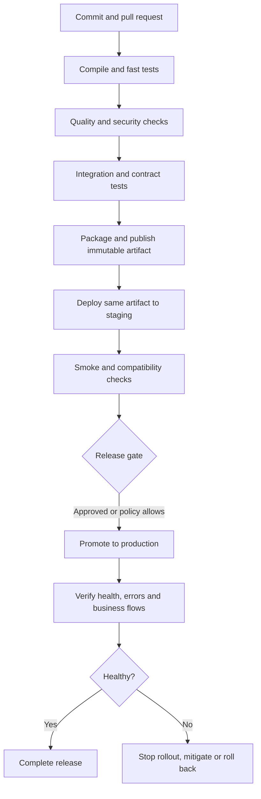

# CI/CD Interview Handbook — Senior Java Backend Developer

**Audience:** Senior Software Engineer / Senior Java Backend Engineer (5–10 years).  
**Perspective:** Developer-owned build, test, quality, packaging, deployment, release, and troubleshooting decisions.  
**Scope:** This is not a Jenkins administration, Kubernetes operations, cloud infrastructure, or SRE handbook. Use the separate Git, Java, Spring, Docker/Kubernetes/Helm, and build-tool handbooks for deeper coverage of those subjects.

## Contents

1. [CI/CD fundamentals](#1-cicd-fundamentals)
2. [Pipeline lifecycle](#2-pipeline-lifecycle)
3. [Java and Spring Boot delivery](#3-java-and-spring-boot-delivery)
4. [Jenkins pipeline-as-code](#4-jenkins-pipeline-as-code)
5. [GitHub Actions](#5-github-actions)
6. [Automated testing](#6-automated-testing)
7. [Quality and security gates](#7-quality-and-security-gates)
8. [Artifacts and promotion](#8-artifacts-and-promotion)
9. [Configuration and secrets](#9-configuration-and-secrets)
10. [Deployment strategies](#10-deployment-strategies)
11. [Release management](#11-release-management)
12. [Troubleshooting](#12-troubleshooting)
13. [Performance and productivity](#13-performance-and-productivity)
14. [Microservices](#14-microservices)
15. [Database migrations](#15-database-migrations)
16. [Senior-level decisions](#16-senior-level-decisions)
17. [Scenarios](#17-scenarios)
18. [Most-asked questions](#18-most-asked-questions)
19. [Mock interviews](#19-mock-interviews)
20. [Revision checklist and references](#20-revision-checklist-and-references)

---

## 1. CI/CD fundamentals

### Q1. What are Continuous Integration, Continuous Delivery, and Continuous Deployment?

**Continuous Integration (CI)** means developers integrate changes frequently and automatically validate them through compilation, tests, and quality checks. It aims to discover integration problems while changes are small. **Continuous Delivery** extends CI so that a validated artifact is kept ready to release, although a person or policy may still approve production deployment. **Continuous Deployment** automatically deploys every change that passes the required controls to production.

These terms are related but not interchangeable. Continuous deployment is not inherently best for every product: a regulated service, a coordinated launch, or a high-risk data migration may require an approval gate. The goal is a repeatable, evidence-based release process, not automation without judgment.

### Q2. Walk through a commit from code change to production.



Stages may run in parallel or appear in a different order. The important invariant is traceability: the artifact deployed should be the artifact that was validated, not a separately rebuilt approximation.

### Q3. Why use CI if developers already test locally?

Local tests provide fast feedback in one environment. CI checks a clean checkout using a known JDK, build wrapper, dependencies, environment, and test command. It also creates a shared merge gate. CI cannot prove the application defect-free: tests may miss cases, production data and traffic differ, and runtime configuration may be wrong. A green pipeline means the configured checks passed under the conditions tested; it is evidence, not a guarantee.

### Q4. What are the developer's responsibilities before and after merge?

Before merge, write testable code, add meaningful tests, review pipeline and configuration changes, understand required checks, and resolve or escalate failures with evidence. After deployment, help verify expected behavior and investigate regressions. Developers should not bypass required checks merely to get a green result. If a check is noisy or incorrect, fix it or use the documented exception process with an owner and rationale.

---

## 2. Pipeline lifecycle

### Q5. What are the typical stages of a Java backend pipeline?

A common flow is source checkout, dependency resolution, compilation, unit tests, static analysis, integration/contract tests, security scans, packaging, artifact publication, optional container-image creation, test/staging deployment, smoke tests, production promotion, and post-deployment verification. Ordering depends on cost, risk, and dependencies. Fast deterministic checks usually run early; all mandatory release checks must finish before release.

| Stage | Developer responsibility | Typical failure clues |
|---|---|---|
| Checkout | Correct branch, commit, generated inputs | Wrong ref, missing file, untracked local file |
| Dependencies | Declare versions and repositories correctly | 401/403, 404, rate limit, TLS error |
| Compile | Pin toolchain and build settings | JDK mismatch, annotation processor, generated code |
| Unit tests | Deterministic assertions and isolated state | Assertion, order dependence, timezone |
| Quality/security | Fix findings and document justified exceptions | Gate threshold, vulnerable dependency, secret leak |
| Integration tests | Validate real boundaries and isolate data | Connection refused, schema mismatch, shared rows |
| Package/publish | Correct artifact identity and permissions | Missing JAR, duplicate version, registry denial |
| Deployment | Runtime config and startup compatibility | Missing property, database connection, probe failure |
| Verification | Validate critical flows and release signals | 5xx increase, downstream contract failure |

### Q6. Which failures should block merge or release?

Compilation, required tests, mandatory quality gates, secret leaks, policy-blocking vulnerabilities, failed migration validation, untraceable artifacts, and missing required approvals should normally block the relevant decision. Teams should document thresholds and exception handling. A warning that does not block a pull request is not equivalent to a security gate; be explicit about what actually ran and what remains outstanding.

### Q7. How do you investigate a failed stage?

Start at the first meaningful error and its exit code, not the final generic “pipeline failed” message. Read the compiler output, test report, scanner finding, or registry response; compare the failing commit with the last green commit. Determine whether the failure is a code defect, an undeclared environment assumption, or a transient external problem. Retry only when there is evidence of a transient failure; repeated retries can hide nondeterminism.

---

## 3. Java and Spring Boot delivery

### Q8. How do you build and test a Spring Boot service in CI?

Use the repository wrapper and committed build configuration. Typical commands are:

```bash
# Maven: run the lifecycle through verification
./mvnw --batch-mode --no-transfer-progress clean verify

# Gradle: run configured verification tasks
./gradlew --no-daemon clean check
```

Exact task behavior depends on plugins and project configuration. Confirm that the intended unit and integration tests are actually bound to these commands. Avoid skipping tests in a required validation pipeline unless equivalent mandatory checks run before the merge/release decision.

### Q9. How should environment-specific configuration be managed?

Build one artifact and inject environment-specific values at runtime. Spring Boot supports externalized configuration through properties/YAML, environment variables, command-line arguments, and other property sources. Profiles can select configuration sets, but should not become separate environment-specific codebases. Use typed configuration and validate required values at startup. Fail clearly when a required endpoint or property is missing; do not silently fall back to a developer's local URL or a permissive security setting.

### Q10. How should secrets be supplied?

Use an approved secret manager or protected CI credential store, granting access only to trusted jobs that need it. Reference a configured secret rather than putting the value in Git, pipeline YAML, Dockerfiles, command output, or container layers. Masking helps but does not make printing secrets safe. If a secret appears in logs, rotate/revoke it, assess its scope, restrict exposed logs where possible, and correct the code path that emitted it.

### Q11. What makes a Java build reproducible?

Control JDK and build-tool versions, use Maven/Gradle wrappers, avoid dynamic dependency versions in releases, declare generated inputs, and use dependency locking or verification features where supported. Record build metadata and the source commit. Byte-for-byte reproducibility is a stronger claim: timestamps, generated metadata, native tools, and platform-specific outputs can change bytes. Do not claim it unless tested.

### Q12. What should be checked before deploying a new Spring Boot version?

Verify Java compatibility, startup behavior, required configuration, health/readiness endpoints, logging, graceful shutdown, API compatibility, and migration order. During rolling deployments, old and new versions may run simultaneously. Avoid relying on in-memory state that disappears when an instance is replaced. A deployable JAR alone does not prove a release is safe.

---

## 4. Jenkins pipeline-as-code

### Q13. What is a Jenkinsfile?

A Jenkinsfile defines delivery steps as version-controlled code. It makes pipeline changes reviewable and ties behavior to a commit. Declarative Pipeline uses a structured form such as `pipeline`, `agent`, `stages`, `steps`, and `post`; Scripted Pipeline offers more direct Groovy control flow but can be harder to maintain. Prefer the simplest form that meets the requirement.

### Q14. Explain stages, steps, agents, environment variables, and post actions.

A **stage** groups a logical activity such as testing or packaging. **Steps** execute commands or Jenkins actions. An **agent** is the execution environment. **Environment variables** provide configuration and references to credentials. **Post actions** run after outcomes such as success, failure, or always, often publishing reports or cleaning up. Developers need to read and maintain these definitions, not administer Jenkins controllers or agents.

### Q15. Show a concise Declarative Jenkins Pipeline for Java.

This example assumes an agent with a compatible JDK and the Maven wrapper. Adapt report patterns to the project.

```groovy
pipeline {
    agent any
    options {
        timestamps()
        timeout(time: 20, unit: 'MINUTES')
    }
    stages {
        stage('Checkout') {
            steps { checkout scm }
        }
        stage('Build and test') {
            steps {
                sh './mvnw --batch-mode --no-transfer-progress clean verify'
            }
        }
        stage('Archive package') {
            steps {
                archiveArtifacts artifacts: 'target/my-service.jar',
                                 fingerprint: true
            }
        }
    }
    post {
        always {
            junit testResults: '**/target/surefire-reports/*.xml',
                  allowEmptyResults: false
        }
    }
}
```

The JAR path is intentionally explicit; replace it with the project's actual artifact name. Failsafe reports may need a separate pattern for integration tests. This example omits deployment credentials and production deployment logic. Use Jenkins credential bindings or approved integrations; never hardcode tokens. A pipeline change should be reviewed and tested on a branch with non-production credentials.

### Q16. How do you diagnose Jenkins failures?

Open the failed stage, locate the first command with a non-zero exit code, and inspect the relevant compiler/test/scanner report. Compare the commit and toolchain with the last successful run. If it is a repository outage or runner issue, record evidence and retry according to policy. If code or pipeline logic caused it, fix the root cause. Do not repeatedly rerun a deterministic failure until it happens to pass.

---

## 5. GitHub Actions

### Q17. Explain workflows, events, jobs, steps, and runners.

A workflow is YAML under `.github/workflows/`. Events such as `pull_request`, `push`, or a release tag trigger it. Jobs run on runners and may run in parallel unless `needs` establishes dependencies. Steps run actions or shell commands. Reusable workflows share standard behavior. Job dependencies should represent real ordering requirements; parallelize independent work only when it is safe.

### Q18. Show a basic GitHub Actions Java workflow.

This assumes Maven and Java 21. Major action tags keep the example readable; security-sensitive production workflows should pin critical actions to reviewed immutable commit SHAs.

```yaml
name: Java CI
on:
  pull_request:
  push:
    branches: [main]
permissions:
  contents: read
jobs:
  verify:
    runs-on: ubuntu-latest
    steps:
      - uses: actions/checkout@v4
      - uses: actions/setup-java@v4
        with:
          distribution: temurin
          java-version: '21'
          cache: maven
      - name: Build and test
        run: ./mvnw --batch-mode --no-transfer-progress clean verify
      - name: Upload test reports
        if: always()
        uses: actions/upload-artifact@v4
        with:
          name: test-reports
          path: |
            **/target/surefire-reports/*.xml
            **/target/failsafe-reports/*.xml
          if-no-files-found: warn
```

The workflow has read-only repository permission. Add permissions only when needed. Do not expose privileged release secrets to untrusted pull-request code, especially forked PRs. Keep validation separate from trusted publishing and deployment jobs.

### Q19. How should caching and artifacts be used?

A dependency cache speeds downloads; it is not the authoritative release artifact. Include wrapper, lockfile/dependency descriptors, and relevant toolchain inputs in cache keys. Cache misses must still produce a correct build. Workflow artifacts transfer outputs and reports between jobs; a package registry stores durable release artifacts. Never deploy a stale cached JAR merely because it is available.

### Q20. Jenkins versus GitHub Actions: what matters to a developer?

Both orchestrate commands, tests, reports, and gates. Jenkins often offers flexible integrations and self-managed execution; GitHub Actions is closely integrated with GitHub events and permissions. Portable skills matter more than syntax: deterministic builds, useful tests, least privilege, secret hygiene, immutable artifacts, and clear failure handling. GitLab CI and Azure Pipelines use different configuration models but similar core concepts.

---

## 6. Automated testing

### Q21. Unit, integration, contract, and end-to-end tests—how do they differ?

A **unit test** isolates a small unit, often using Mockito for collaborators. An **integration test** validates interaction across components, such as Spring wiring, serialization, or database access. A **contract test** verifies agreement between an API provider and consumer. An **end-to-end test** exercises a workflow across deployed components. Mocks are fast but cannot prove SQL, transactions, HTTP serialization, or real configuration work.

### Q22. Where should tests run?

Run fast, deterministic unit tests on every PR. Run relevant integration and contract tests on PRs where feasible; otherwise enforce them at a later stage that still blocks release. Broader end-to-end tests may run in parallel or later depending on cost, but critical tests must finish before the risk decision they protect. Optimize tests before weakening coverage.

### Q23. How should database integration tests work?

Use a representative database engine and schema. Testcontainers can launch disposable database instances and reduce reliance on a developer's local database. Isolate test data and cleanup. An in-memory database may not reproduce production SQL, locking, data types, or migration behavior. Migration tests should start from the supported prior schema, apply changes, and verify critical operations.

### Q24. How do you diagnose flaky tests?

Classify failures: timing, shared state, random input, external services, concurrency, timezone, file ordering, or resource pressure. Reproduce with focused repetition and inspect reports. Replace arbitrary sleeps with condition-based synchronization; isolate rows, ports, and external resources; use fixed clocks and deterministic inputs where useful. A temporary quarantine needs an owner, tracking issue, and review date. Never let “retry until green” become the release policy.

### Q25. Does high code coverage prove test quality?

No. Coverage measures execution, not whether assertions catch defects. Review boundary cases, error paths, business invariants, and whether plausible incorrect behavior would fail a test. Coverage thresholds can prevent regressions, but should not be gamed with meaningless assertions.

### Q26. CI tests pass locally but fail in CI. What do you check?

Confirm the exact commit and run the same wrapper command from a clean checkout. Compare JDK, build tool, locale/timezone, environment variables, dependency versions, test ordering, filesystem case sensitivity, local services, fixed ports, and stale database state. Fix the hidden assumption rather than adding a CI-only bypass.

---

## 7. Quality and security gates

### Q27. What is a quality gate?

A quality gate evaluates measurements such as new-code defects, coverage, duplication, or security findings against policy. SonarQube and similar tools can report issues and block changes according to configured thresholds. When a gate fails, inspect the exact finding and whether it applies to new or existing code. Fix it or use a narrow, documented exception with a reason, owner, and review date.

### Q28. How should a developer respond to a vulnerable dependency?

Confirm the component, resolved version, advisory, severity, reachability, transitive path, and available patched version. Upgrade compatibly, run tests, review release notes, and inspect the resolved dependency tree. If no fix exists, assess mitigations with the security owner and follow formal risk acceptance. A critical reachable issue may block release even if functional tests pass; do not dismiss it based only on perceived likelihood.

### Q29. Explain SCA, secret scanning, image scanning, and SBOM.

Software composition analysis (SCA) inventories dependencies and known risks. Secret scanning detects credentials exposed in source. Image scanning checks packages in container images. A Software Bill of Materials (SBOM) is a machine-readable inventory of included components. These tools improve visibility but findings need triage. Restrict publishing permissions, review third-party actions, pin critical inputs where appropriate, and preserve artifact provenance. A scanner finding that is truly inapplicable should be documented narrowly rather than suppressed globally.

---

## 8. Artifacts and promotion

### Q30. Distinguish build, package, publish, deploy, and release.

**Build** compiles/processes source. **Package** creates a deployable unit such as a JAR or image. **Publish** stores it in a repository/registry. **Deploy** runs that artifact in an environment. **Release** makes functionality available to users, potentially through deployment, routing, or a feature flag. A successful image build does not prove it was published, deployed, or enabled for customers.

### Q31. Why promote the same artifact from staging to production?

Independent rebuilds can differ because dependencies or base-image tags move, generated metadata changes, or build-time configuration differs. Build once, test and scan that artifact, publish it immutably, and promote the same bytes. Inject environment-specific configuration at runtime. For container images, record and deploy by digest where supported; a tag is a useful label but can be mutable.

### Q32. What release metadata is useful?

Record source commit, build run, toolchain/build metadata, artifact version or image digest, test and scan results, release version, environment, and deployment time. Where appropriate include SBOM and provenance. This allows the team to identify exactly what is running and redeploy the same artifact during recovery. Do not overwrite released versions with different bytes.

---

## 9. Configuration and secrets

### Q33. Why keep environment-specific values out of the binary?

One artifact should be promotable through environments without recompilation. Hardcoded URLs, credentials, or environment branches create different binaries and make staging less representative. Use external configuration, validate it, and fail clearly when a required value is missing. Spring profiles can select configuration but are not a secret store and should not enable test integrations or relaxed security in production accidentally.

### Q34. What role do feature flags play?

Flags separate deployment from exposure. A team can deploy code with the feature disabled, enable it for internal users or a small cohort, and expand after validation. Test both states when behavior differs; protect flag changes and use a safe default. Remove temporary flags after rollout to avoid permanent conditional complexity.

---

## 10. Deployment strategies

### Q35. Compare rolling, blue-green, and canary deployment.

A **rolling deployment** replaces instances gradually, so old and new versions coexist. **Blue-green** maintains two environments and switches traffic after validation. A **canary** exposes a limited audience or traffic share to a new version before expanding. The platform implements routing, but developers must design compatible APIs, schemas, startup behavior, and background jobs for mixed versions.

### Q36. What makes rollback safe?

The previous application must remain compatible with the current database schema, configuration, messages, and data. Destructive migrations, irreversible external side effects, or data written in an incompatible format can make rollback unsafe. Define rollback triggers, target immutable artifact, compatibility constraints, and verification steps. Sometimes a feature flag or forward fix is safer than reverting code.

### Q37. What should health checks and smoke tests prove?

Readiness indicates whether an instance should receive traffic; liveness indicates whether the process should be restarted. A smoke test checks critical post-deployment behavior, such as startup, authentication, and a representative API path. Do not make liveness depend on every downstream service unless restarting is the right response; otherwise a dependency outage can cause restart storms. Health endpoints must not leak secrets.

### Q38. How should APIs remain compatible during rolling releases?

Prefer additive changes. Introduce optional fields or endpoints while preserving old behavior, deploy consumers/providers in a compatible sequence, observe adoption, and remove old behavior only in a later release. Contract tests catch incompatible status codes, payloads, authentication, or error formats—not just endpoint names.

---

## 11. Release management

### Q39. What is a release candidate?

A release candidate is a specific immutable artifact tied to a commit and build run. Run required tests and gates, deploy it to pre-production, validate configuration and migrations, and record results. If code changes, build a new candidate and rerun required checks; do not attach an old approval to different bytes.

### Q40. How should an urgent hotfix move through CI/CD?

Use the documented hotfix workflow, keep the patch narrow, and run mandatory safety checks. Prioritize regression tests for the defect and high-risk areas, but do not bypass critical controls without an explicit emergency policy and approval. Build a traceable artifact, deploy through the controlled path, verify the fix, and merge the change back into active development branches as appropriate.

### Q41. How do you handle a partially successful release?

Determine which instances/regions changed, whether traffic shifted, which migrations ran, and whether external side effects occurred. Stop further rollout if the mixed state is unsafe. Continue, roll back, or forward-fix based on compatibility and data safety. Communicate the actual state and verify recovery at application and business level.

---

## 12. Troubleshooting

### Q42. Compilation fails in CI but passes locally. What do you inspect?

Confirm commit SHA and clean checkout. Compare JDK vendor/version, wrapper, compiler options, annotation processors, generated code, dependency versions, environment variables, and case-sensitive paths. Run the exact wrapper command locally in a clean workspace. IDE caches and untracked generated files can hide problems. Fix declared build inputs rather than relying on local state.

### Q43. Dependency resolution fails. How do you diagnose it?

Read artifact coordinates and HTTP/TLS errors. 401/403 often indicate authentication/permission issues; 404 may mean an incorrect coordinate or unpublished artifact; 429/5xx may be rate limiting or repository instability. Confirm the version exists and repository configuration is correct. Retry only transient failures and do not switch to an untrusted repository as a workaround.

### Q44. Integration tests fail but unit tests pass. What does that suggest?

Look at real boundaries: Spring wiring, database schema, serialization, HTTP clients, transactions, and permissions. Inspect service/container startup output, migration logs, connection settings (not credentials), and the first failed assertion. Confirm dependencies are ready before tests run. Do not replace a meaningful integration test with a mock just to get a green pipeline.

### Q45. Artifact publication fails after tests pass. Can you deploy a local JAR?

Not as an informal workaround. Inspect permissions, coordinates, duplicate-version policy, network response, and whether upload completed. Retry transient failures. If the release artifact cannot be retrieved from the approved repository, the traceable release path is incomplete. Publish the exact tested output through the normal process rather than substituting an untracked local file.

### Q46. A container image builds but fails in staging. How do you investigate?

Verify the exact image digest and inspect startup logs. Check entrypoint, Java runtime, JAR path, file permissions, required environment properties, port, memory limits, and database/dependency connectivity. Compare digests, not just tags. Image build success proves packaging completed, not that the application can start under staging configuration.

### Q47. A database migration fails. What is the safe response?

Stop promotion. Inspect the migration tool's error, database logs, current schema, and whether the migration ran fully or partially. Do not blindly rerun or reverse DDL without understanding the engine's transaction behavior. Determine if retry is safe or a reviewed repair/forward migration is needed; validate recovery on a representative database.

### Q48. Deployment succeeds technically, but production errors or latency increase. What next?

Identify the artifact from release metadata and compare error rate, latency percentiles, traffic, database behavior, downstream timings, and business outcomes before and after release. Stop rollout and roll back if impact is material and rollback is safe. If schema/data changes make rollback unsafe, mitigate with a feature flag or narrow forward fix. Preserve evidence and add regression coverage for the root cause.

### Q49. A pipeline is slow. How do you improve it?

Measure time spent in dependency resolution, compilation, tests, scanning, image builds, and environment setup. Cache stable dependencies, parallelize independent jobs, remove duplicate work, and isolate tests before enabling parallel execution. Keep fast feedback early while preserving mandatory release checks. Track duration, time to first failure, failure rate, and flaky-test rate. Never use stale cached binaries as the release artifact.

---

## 13. Performance and productivity

### Q50. What can go wrong with build caching?

A cache key that ignores a lockfile, JDK, plugin, generated input, or build configuration can restore stale outputs. Caches may also be polluted by untrusted jobs or contain sensitive information. Include relevant inputs, scope caches, and ensure a cache miss runs the normal build. If only cache hits produce incorrect output, invalidate the cache and fix the key or undeclared build inputs.

### Q51. When is parallel testing appropriate?

Parallelize tests that do not share mutable databases, ports, files, queues, or rate-limited dependencies. Use isolated schemas/containers or unique data when sharing is unavoidable. Parallelism reduces wall-clock time only until resource contention dominates; measure runtime and flakiness rather than assuming more workers are always faster.

---

## 14. Microservices

### Q52. Why should microservices have independent release pipelines?

A service should build and release from its own source, tests, dependencies, and artifact. A change to Order should not force an unrelated Notification service to rebuild unless a real dependency exists. Shared templates can enforce consistent controls but should remain understandable and configurable. Version shared libraries explicitly and test consumer compatibility.

### Q53. How do you coordinate API changes across services?

Use expand-and-contract: add a compatible provider contract, deploy consumers/providers in a compatible order, observe adoption, then remove old behavior in a later release. Contract tests validate supported versions. If breaking changes are unavoidable, version the contract and coordinate a migration window rather than assuming all services can deploy atomically.

### Q54. Monorepo versus multi-repository: what changes?

A monorepo can support atomic changes but needs dependency-aware change detection and targeted tests. Multi-repository setups provide independent histories but require explicit cross-service contracts and release coordination. Neither model removes the need for immutable artifacts, tests, and backward-compatible APIs.

---

## 15. Database migrations

### Q55. Why are database migrations harder to roll back than application code?

Schema changes may transform or destroy data and can break old instances during a rolling deployment. Treat schema evolution as compatibility across application versions, not merely as a script run before startup.

### Q56. Explain expand-and-contract.

**Expand:** add schema elements without removing the old ones. **Migrate:** deploy code compatible with both forms and backfill data safely. **Switch:** move reads/writes to the new representation and verify it. **Contract:** remove old schema only after old instances and consumers are gone. Backfills should be resumable and safe to rerun; avoid long locks and destructive changes in the same release that first requires the new schema.

### Q57. How should Liquibase fit into release delivery?

Version changesets in source control, review them as code, and test against the supported database engine and a populated prior schema. Define which component applies migrations and understand how applied changesets are tracked. Do not let multiple application instances run conflicting migrations unless the migration process explicitly coordinates that behavior. Test failure and recovery, not only the happy path.

### Q58. The migration succeeded but the new app fails and the old app cannot use the schema. What now?

Stop rollout and inspect the actual schema state. Decide whether a forward fix is possible or a reviewed schema repair is safe; do not blindly reverse DDL or restore data without assessing loss and transaction semantics. This should have been prevented by additive schema expansion and mixed-version compatibility tests. Remove old schema only in a later contract phase.

---

## 16. Senior-level decisions

### Q59. How do you choose which checks block a PR?

Block on checks that protect against high-impact defects: compilation, meaningful tests, required integration/contract coverage, and agreed quality/security policy. Keep feedback fast through parallelism and reliable tests, but make sure mandatory checks finish before merge or release. Document exceptions and ownership. Improve noisy checks rather than casually removing them.

### Q60. A new security stage adds ten minutes to every PR. What would you do?

Measure the stage and the risks it detects. Remove duplicate work, parallelize it, cache safe inputs, and consider whether the same broad scan must run on every commit while preserving a required pre-release gate. Do not remove a critical control solely to improve duration. Compare both feedback time and risk coverage after the change.

### Q61. How should pipeline configuration changes be tested?

Review YAML/Jenkinsfile changes as code, validate syntax, and test in a branch or non-production workflow with non-production credentials. Verify success/failure paths, artifact selection, secret masking, permissions, and missing-report behavior. Ensure untrusted PRs cannot publish or deploy. Release logic should only be triggered by the intended protected branch or tag.

### Q62. When should a release be blocked despite a green build?

Block it if the artifact is untraceable, a required security gate failed, migration compatibility is unproven, production configuration is invalid, approval is missing, the target environment is unhealthy, or risk exceeds policy. A green build does not mean the release is authorized or production-ready.

---

## 17. Scenario-based questions

### Q63. Your Spring Boot service builds locally but CI compilation fails. How do you isolate it?

I would confirm the commit and compare the JDK, wrapper, compiler flags, annotation processors, generated sources, and resolved dependencies. Then I would run the exact wrapper command from a clean checkout, because IDE caches or untracked generated files can mask missing inputs. I would inspect the first compiler error and check case-sensitive paths. I would fix the declared toolchain or source issue and add regression coverage where useful, rather than changing CI to an undocumented local setup.

### Q64. Integration tests fail because they modify the same database state. What do you do?

I would identify shared rows, fixed IDs, order assumptions, and cleanup behavior. Each test should own its data, use unique identifiers or isolated schemas/containers, and clean up even after failure. If tests run in parallel, database state and resource names must be isolated. I would not disable integration tests or replace real database checks with mocks because the issue may expose a genuine state-isolation defect. Re-run repeatedly and in parallel to prove determinism.

### Q65. A pipeline takes 25 minutes due to downloads and serial tests. How do you improve it?

Measure stage duration first. Cache dependencies using keys tied to wrapper and dependency descriptors, parallelize independent test jobs, and profile slow tests. Before parallelizing database tests, isolate data and containers. Keep fast unit tests early and required integration/contract tests as release gates. Compare duration and flaky-test rate after changes; never reuse an old JAR as a shortcut.

### Q66. A dependency vulnerability appears just before release. What is your decision?

Confirm the exact version, advisory, severity, reachability, patched version, and compatibility. Prefer a patch, run tests and scans, and create a new candidate artifact. If no patch exists, assess mitigations with the security owner and use formal risk acceptance. A critical reachable vulnerability or policy-blocking finding should stop release; the deadline does not itself justify acceptance.

### Q67. Staging and production build the image independently. Why is this risky?

The base image, dependencies, generated metadata, or build-time inputs may differ, so production may run bytes staging never tested. I would build once, scan and test the image, publish it, record its digest, and promote that same digest. Runtime configuration and secrets should be injected separately. Trace commit, build run, and digest together.

### Q68. A deployment fails health checks even though CI is green. How do you respond?

Verify the deployed digest and inspect startup logs for the first exception. Check configuration, Java runtime, database connectivity/migration status, port/context path, memory limits, and probe semantics. If the service remains unhealthy or critical behavior is affected, stop rollout and restore the known-good artifact if schema and side effects permit it. Otherwise use the planned forward-recovery path. Add a pre-deployment check for the root cause.

### Q69. A migration succeeded, but the new app fails and old code no longer works. What should have been done?

The schema was not backward-compatible during the rollout. Stop promotion and inspect actual schema state before deciding between a forward fix and reviewed repair; blindly reverting DDL can lose data. The correct design is expand-and-contract: add schema first, deploy compatible code, migrate data, switch behavior, and remove old schema only after all old versions are gone. Test migrations from a production-like prior schema.

### Q70. Deployment reports success but a downstream service errors. What signals matter?

Check downstream error rate, latency, timeouts, contract failures, and critical business outcomes correlated with the release. Compare API payloads, status codes, auth, and timing against the last healthy version. Stop rollout and disable the feature or roll back if safe; otherwise forward-fix compatibly. Add contract or post-deployment tests for the failure.

### Q71. A developer wants to skip tests for an urgent release. What is safer?

Determine whether the failing test signals a real defect or a known infrastructure problem. Run focused regression tests and mandatory safety gates; use the documented emergency exception process only for justified non-critical gaps, recording approver, reason, and follow-up. Skipping tests indiscriminately replaces a visible failure with unmeasured production risk.

### Q72. A secret is printed in CI logs. What actions do you take?

Treat it as compromised: revoke/rotate it, assess permissions and access history, restrict exposed logs according to policy, and notify the appropriate security contact. Find the source—shell tracing, verbose output, exception logging, or echo—then remove it. Use the approved secret store, least privilege, and verify the logs no longer expose it. Masking alone is not sufficient.

### Q73. A feature must be merged before it is ready for users. How do flags help?

Merge behind a flag with a safe default off and test both enabled and disabled behavior. Deploy the artifact, enable it for a limited audience, verify technical and business signals, and expand gradually. Protect flag changes and remove temporary flags after rollout to avoid permanent conditional complexity.

### Q74. Two services need a breaking API change. How do you release safely?

Prefer an additive compatible contract first. Deploy the provider change, migrate consumers while both contracts work, observe adoption, and remove the old contract later. Use contract tests for supported versions. If a breaking change is unavoidable, version the API and coordinate a migration window rather than assuming simultaneous deployment.

### Q75. A cached artifact lacks the latest code. How do you prevent recurrence?

Compare artifact metadata/digest to the expected commit. Inspect cache keys, workspace reuse, artifact naming, job dependencies, and mutable tags. Make artifact identity explicit and require the deploy job to consume the exact output of the current successful build. Cache dependencies and safe intermediates, not an ambiguous authoritative release binary.

### Q76. Staging passes but production latency rises. What do you do?

Compare latency percentiles, traffic, saturation, database queries, downstream timings, and release timing. Look for production-only data volume, N+1 queries, synchronous calls, lock contention, or cache misses. Stop rollout and roll back if impact is material and rollback is safe; otherwise disable the feature or mitigate forward. Add representative performance coverage after identifying the cause.

### Q77. A PR workflow has a publishing secret. What is the risk?

Untrusted pull-request code could exfiltrate the secret or publish a poisoned artifact. Separate PR validation from trusted publishing, apply least-privilege workflow permissions, avoid privileged secrets for forked PRs, and restrict publishing to protected branches or trusted release events. Prefer short-lived identity-based authentication where supported. Test that PR workflows can run tests but cannot publish production packages.

---

## 18. Most-asked questions

### Q78. What is the key difference between continuous delivery and continuous deployment?

Continuous delivery keeps changes ready to release but may require approval; continuous deployment automatically releases changes that pass controls. See [Q1](#q1-what-are-continuous-integration-continuous-delivery-and-continuous-deployment).

### Q79. Why should CI fail fast?

Fast deterministic checks catch obvious issues before expensive stages consume time. Independent checks can run in parallel, but required checks must still complete before the relevant merge/release decision.

### Q80. Why is an immutable artifact important?

It preserves the exact bytes tested and approved, supports audit and redeployment, and avoids different outputs being published under the same release identity. See [Q30](#q30-distinguish-build-package-publish-deploy-and-release).

### Q81. Why is an image digest stronger than a tag?

A tag can be moved to a different image; a digest identifies image content. Use readable tags for discovery and digest-based identity for traceable promotion where supported.

### Q82. Why are deterministic tests important?

They produce repeatable results for controlled inputs. Flakes erode trust and encourage unsafe retries. Control time, random inputs, shared resources, and external dependencies; isolate state.

### Q83. What should a pipeline do with secrets?

Store them outside source control, scope access to trusted jobs, inject at runtime, avoid logging, and rotate exposed credentials. See [Q10](#q10-how-should-secrets-be-supplied).

### Q84. Why can database migrations make rollback unsafe?

They may delete/transform data or break old code. Use backward-compatible expand-and-contract changes and plan forward recovery for irreversible changes. See [Q56](#q56-explain-expand-and-contract).

### Q85. What should happen after deployment?

Verify the expected artifact, readiness, smoke tests, error rate, latency, and critical business flow. Stop rollout or follow the rollback/mitigation plan if release criteria fail.

---

## 19. Mock interviews

### Round 1 — Fundamentals

**Interviewer:** Explain CI, continuous delivery, and continuous deployment.  
**Model answer:** CI validates frequent integrations. Continuous delivery keeps validated changes releasable, potentially with an approval before production. Continuous deployment automatically releases every change that passes defined controls. I would choose based on product risk and validation capability rather than assuming one model is universally superior.

**Interviewer:** Does a green pipeline guarantee production safety?  
**Model answer:** No. It proves only that configured checks passed under tested conditions. Production configuration, data, traffic, permissions, and dependencies can differ. I would combine test evidence with artifact traceability, migration compatibility, staged verification, and post-deployment signals.

### Round 2 — Java pipeline design

**Interviewer:** Design a Spring Boot PR pipeline.  
**Model answer:** Use a clean checkout and wrapper on a controlled JDK; compile, run unit tests, relevant integration/contract tests, quality/security checks, and package. Parallelize independent checks, publish reports on failure, and prevent untrusted PR jobs from publishing releases. A trusted release workflow publishes an immutable artifact with commit metadata, deploys that same artifact to staging, runs smoke tests, then promotes it under the release policy.

**Interviewer:** Would you run every end-to-end test on every PR?  
**Model answer:** I would consider runtime, stability, and risk coverage. Fast tests should run on every PR. Critical integration and contract checks should gate the PR where feasible; broader E2E suites may run in parallel or later but must still gate release if they protect critical flows. Optimize the tests before removing controls.

### Round 3 — Quality and security

**Interviewer:** Coverage gate fails but code looks correct.  
**Model answer:** Inspect uncovered new code and add assertions for meaningful behavior and edge cases. If generated code or a legitimate exclusion is involved, use a narrow approved exclusion. I would not lower a global threshold or add meaningless tests just to get green.

**Interviewer:** A severe dependency vulnerability is found.  
**Model answer:** Confirm the version, advisory, reachability, and patched options. Upgrade and test if possible. If not, assess mitigations with the security owner and follow formal risk acceptance. A critical reachable issue can block release even if functional tests pass.

### Round 4 — Release and rollback

**Interviewer:** Why build once and promote?  
**Model answer:** Independent builds can differ due to mutable dependencies, base images, or generated metadata. Promoting the same immutable artifact ensures staging evidence applies to production. Track commit, build run, version/digest, and inject runtime configuration separately.

**Interviewer:** Can every release be rolled back?  
**Model answer:** No. Old code may not work with a new schema, transformed data, or irreversible side effects. Use additive migrations, mixed-version compatibility, and a forward-recovery plan where rollback is unsafe.

### Round 5 — Troubleshooting and senior judgment

**Interviewer:** CI fails but local tests pass.  
**Model answer:** Confirm the commit, run the wrapper from a clean checkout, compare JDK/build-tool versions, environment, dependencies, timezone, filesystem assumptions, and service dependencies. Inspect the first meaningful error and report. Fix hidden assumptions rather than weakening CI.

**Interviewer:** A security stage adds ten minutes to each PR.  
**Model answer:** Measure its cost and risk value, remove duplicate work, parallelize it, and cache safe inputs. Consider a risk-based cadence only if the required pre-release gate remains. I would measure feedback-time improvement and ensure risk coverage is not weakened.

**Interviewer:** Production latency increases without errors.  
**Model answer:** Compare latency percentiles, traffic, saturation, database and downstream timings, and business outcomes. Stop rollout or roll back if impact is material and rollback is safe. Otherwise mitigate with a feature flag or targeted forward fix. Add representative performance tests for the root cause.

---

## 20. Revision checklist and official references

### Final revision checklist

- [ ] Explain CI versus continuous delivery versus continuous deployment — [Q1](#q1-what-are-continuous-integration-continuous-delivery-and-continuous-deployment).
- [ ] Trace a commit through validation, artifact promotion, and post-deploy checks — [Q2](#q2-walk-through-a-commit-from-code-change-to-production).
- [ ] Explain Java build and test commands — [Q8](#q8-how-do-you-build-and-test-a-spring-boot-service-in-ci).
- [ ] Read Jenkinsfile and GitHub Actions workflows — [Q15](#q15-show-a-concise-declarative-jenkins-pipeline-for-java), [Q18](#q18-show-a-basic-github-actions-java-workflow).
- [ ] Distinguish test levels and diagnose flaky tests — [Q21](#q21-unit-integration-contract-and-end-to-end-tests-how-do-they-differ), [Q24](#q24-how-do-you-diagnose-flaky-tests).
- [ ] Triage a quality gate and dependency vulnerability — [Q27](#q27-what-is-a-quality-gate), [Q28](#q28-how-should-a-developer-respond-to-a-vulnerable-dependency).
- [ ] Explain artifact immutability and promotion — [Q30](#q30-distinguish-build-package-publish-deploy-and-release), [Q31](#q31-why-promote-the-same-artifact-from-staging-to-production).
- [ ] Explain configuration and secret handling — [Q9](#q9-how-should-environment-specific-configuration-be-managed), [Q10](#q10-how-should-secrets-be-supplied).
- [ ] Compare deployment strategies and rollback limits — [Q35](#q35-compare-rolling-blue-green-and-canary-deployment), [Q36](#q36-what-makes-rollback-safe).
- [ ] Explain expand-and-contract migration — [Q56](#q56-explain-expand-and-contract).
- [ ] Diagnose CI failures and production regressions — [Q42](#q42-compilation-fails-in-ci-but-passes-locally-what-do-you-inspect), [Q48](#q48-deployment-succeeds-technically-but-production-errors-or-latency-increase-what-next).
- [ ] Improve pipeline speed without reducing confidence — [Q49](#q49-a-pipeline-is-slow-how-do-you-improve-it).
- [ ] Coordinate microservice contracts — [Q53](#q53-how-do-you-coordinate-api-changes-across-services).

### Official references

- [Jenkins documentation](https://www.jenkins.io/doc/) — Pipeline and Jenkinsfile syntax.
- [GitHub Actions documentation](https://docs.github.com/en/actions) — workflows, events, permissions, secrets, caching, and artifacts.
- [Docker documentation](https://docs.docker.com/) — image builds, registries, and containers.
- [Spring Boot documentation](https://docs.spring.io/spring-boot/) — externalized configuration, testing, packaging, and Actuator.
- [JUnit 5 user guide](https://junit.org/junit5/docs/current/user-guide/) — test lifecycle and execution.
- [Testcontainers for Java](https://java.testcontainers.org/) — disposable dependencies for integration tests.
- [SonarQube documentation](https://docs.sonarsource.com/) — analysis and quality gates.
- [OWASP SAMM](https://owaspsamm.org/) — software assurance practices.
- [OWASP CI/CD Security Cheat Sheet](https://cheatsheetseries.owasp.org/cheatsheets/CI_CD_Security_Cheat_Sheet.html) — pipeline access and supply-chain risks.
- [Liquibase documentation](https://docs.liquibase.com/) — database changesets and migration management.
- [Maven lifecycle guide](https://maven.apache.org/guides/introduction/introduction-to-the-lifecycle.html) — lifecycle phases.
- [Gradle user manual](https://docs.gradle.org/current/userguide/userguide.html) — tasks, dependency management, and caching.

**Interview reminder:** Explain the tool, the risk it controls, the evidence it produces, how you diagnose failure, and how you recover safely. Strong senior answers connect application design—testability, configuration, compatibility, and migrations—to dependable delivery.
