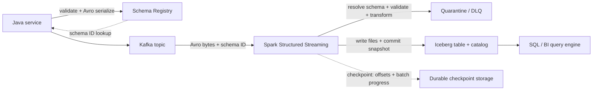

# Apache Iceberg, Avro & Schema Evolution Interview Handbook

**Audience:** Java backend engineers with 5+ years of experience preparing for senior backend and data-platform interviews.  
**Focus:** The high-value concepts behind Iceberg tables, Avro serialization, schema compatibility, and reliable Kafka–Spark pipelines.

Examples target Apache Iceberg with Spark SQL, Apache Avro 1.12 concepts, Kafka, and (where explicitly named) Confluent Schema Registry. Exact SQL procedures, catalog behavior, serializer wire formats, and compatibility defaults depend on deployed versions and configuration. Treat snippets as focused examples; verify them against your runtime versions before production use.

## Contents

- [A. Apache Iceberg](#a-apache-iceberg)
- [B. Apache Avro](#b-apache-avro)
- [C. Schema evolution and integration](#c-schema-evolution-and-integration)
- [D. End-to-end architecture](#d-end-to-end-architecture)
- [Official references](#official-references)

---

## A. Apache Iceberg

### Q1. What is Apache Iceberg, and what problem does it solve?

Apache Iceberg is an open table format for large analytic datasets stored in object storage or distributed filesystems. It adds a reliable table layer over data files—often Parquet—so engines can understand a table's schema, partitions, current files, and historical states.

With a directory of Parquet files alone, readers often need external conventions or a metastore to decide which files belong to a table. Updates, deletes, concurrent writers, and schema changes become difficult to coordinate consistently. Iceberg records table state in metadata and publishes changes through snapshots. A query plans against a particular table state instead of guessing from whatever files happen to be in a directory.

Iceberg is not a query engine and does not itself run Spark jobs. It defines table metadata and operations that compatible engines and catalogs use. It is useful when multiple engines need to read a shared table, when data arrives incrementally, or when time travel, safe schema evolution, and large-scale maintenance matter.

### Q2. Why use Iceberg instead of plain Parquet files or a traditional Hive-style table?

Parquet is a columnar file format: it describes how data is encoded inside each file. Iceberg is a table format: it describes which files make up a table, their schemas and partition information, and the snapshots that represent committed table states. Iceberg tables commonly store Parquet files, so this is not an either/or choice.

Traditional Hive-style layouts often expose partition columns through directory paths such as `event_date=2026-10-27/`. This can make partition layout visible to users and can tie table behavior to path conventions. Iceberg tracks partition metadata separately and supports partition transforms and evolution without requiring query authors to know the physical directory layout.

Choose plain Parquet when the data is a simple immutable export and table-level updates or concurrent commits are unnecessary. Choose Iceberg when you need managed table state, atomic metadata commits, schema/partition evolution, deletes, snapshots, or reliable concurrent access. Iceberg adds catalog and metadata-maintenance complexity; it is not free operationally.

### Q3. How does Iceberg compare with Delta Lake and Apache Hudi?

All three are table formats intended to make data-lake files behave more like managed tables, with metadata, transactional writes, and support for changing datasets. Their transaction protocols, metadata organization, APIs, and ecosystem integrations differ.

Iceberg uses snapshots, manifests, and metadata files and is designed around an open specification with multiple engine integrations. Delta Lake uses a transaction log as its central table-state mechanism. Hudi emphasizes record-level upserts and incremental processing patterns, with its own timeline and indexing options. These are high-level distinctions, not absolute feature boundaries: capabilities overlap and change by release.

In an interview, compare the actual workload and deployed ecosystem: engine compatibility, upsert/delete patterns, streaming latency, catalog and governance integration, operational tooling, and maintenance requirements. Do not claim one format is universally faster or more correct without a workload-specific benchmark.

### Q4. Explain Iceberg's metadata hierarchy: metadata files, snapshots, manifest lists, manifests, and data files.

A table's current metadata file identifies the current schema, partition specifications, table properties, snapshot history, and the current snapshot. A snapshot represents a committed table state. It points to a manifest list, which points to manifests. Manifests list data files (and their partition and column-statistics metadata) or, depending on operation and format version, delete files. Data files contain the actual rows, often in Parquet.

```text
Catalog entry
   |
   v
Current table metadata file
   |-- schema + partition specs + snapshot history
   v
Current snapshot
   |
   v
Manifest list
   |
   +--> Manifest A ----> data-file entries / statistics
   +--> Manifest B ----> data-file entries / statistics
                             |
                             v
                         Parquet files
```

For example, an append creates new data files and metadata describing them, then publishes a new snapshot. Existing snapshots may continue to reference older files. The catalog usually points readers to the current metadata location; the exact catalog commit mechanism varies. Iceberg's metadata graph is why readers do not simply list every object in a data directory to discover table contents.

### Q5. How does Iceberg track table state, and how does a reader find files for a query?

A writer writes data files, creates or updates manifests and metadata, and attempts to commit a new table metadata version. On a successful commit, the catalog/table reference points to the new metadata. A reader resolves the table through its catalog, loads a metadata version and snapshot, and uses manifest summaries, partition values, and file-level column statistics to exclude files that cannot match the query.

Suppose a query filters on `event_day = DATE '2026-10-27'`. If the partition spec and file statistics show that a file cannot contain matching rows, the planner can skip it. This is metadata pruning; the engine still reads selected data files to evaluate remaining predicates.

Readers normally plan against a consistent snapshot, rather than mixing files from a half-published write. Catalog implementations, engine behavior, and isolation mode still matter, so do not assume every read/write combination has identical semantics.

### Q6. What is hidden partitioning, and what do Iceberg partition transforms do?

Iceberg separates the logical table schema from its physical partition layout. A table may partition on a transform of a source column without requiring users to query a generated partition column. The engine can use the source-column predicate to infer which partitions may match; this is often called hidden partitioning.

Common transforms include:

- `identity(col)`: partition by the original value.
- `days(ts)` or `day(ts)` depending on the API: partition by calendar day.
- `months(ts)`: partition by month.
- `bucket(N, col)`: hash values into N buckets; useful for spreading high-cardinality keys, but not range pruning.
- `truncate(W, col)`: group values by a truncated prefix or numeric width, according to the column type.

For example, partitioning by day on a timestamp lets a filter on a timestamp range prune irrelevant days without the application manually constructing partition paths. Exact transform syntax varies between Spark SQL and Iceberg APIs. Partitioning should reflect query filters and file sizes; too many tiny partitions can create small-file and metadata overhead.

### Q7. How can Iceberg evolve schemas and partitions without rewriting every data file immediately?

Iceberg stores schema and partition-spec metadata separately from the physical files. Adding a column can update table metadata without rewriting old Parquet files; old files simply lack that field, and readers resolve the field using Iceberg's schema identity and null/default semantics. Renames and reorders can be metadata operations because Iceberg tracks field IDs rather than relying only on column position or name.

Partition evolution similarly adds a new partition spec for future writes. Old files retain the spec under which they were written, and Iceberg records which spec applies to each file. A query can read files written under multiple specs. Existing files are not automatically repartitioned; rewrite them only if the new layout is expected to improve query performance or maintenance.

This is a key distinction from changing an event schema: Iceberg's field IDs and table metadata govern the table's logical columns, while an Avro event's writer/reader schema resolution governs serialized records.

### Q8. How does Iceberg make table updates atomic, and what does the catalog contribute?

Writers generally create new data and metadata objects first, then attempt to atomically publish a new metadata version through the catalog's commit mechanism. A reader following the old metadata sees the previous valid snapshot; a reader following the new metadata sees the new snapshot. The data files are not exposed as committed table contents merely because they exist in object storage.

The catalog is important because writers need a safe way to compare and replace the current table metadata reference. Implementations may use atomic pointer updates, version checks, locks, or service-specific coordination. Do not assume every catalog uses the same protocol or provides the same guarantees.

Atomicity is at the table commit boundary supported by the implementation. It does not automatically create an arbitrary transaction spanning multiple Iceberg tables, Kafka offsets, and external databases. A failed commit may leave unreferenced files, which are candidates for carefully managed orphan cleanup after a safety interval.

### Q9. What happens when two writers commit to the same Iceberg table concurrently?

Iceberg commonly uses optimistic concurrency: both writers can prepare work against a snapshot, but each must validate and commit against the table's current state. If writer A commits first, writer B may find that the metadata it expected is no longer current. Depending on the operation and conflict, the engine can retry/rebase the commit or return a conflict requiring the application/job to retry.

Not every concurrent operation conflicts. Two appends may be safely combined by retrying against the newer metadata, while overlapping row-level updates or deletes may conflict depending on validation rules, isolation settings, engine, and Iceberg version. A successful commit does not mean all business-level concurrent updates are automatically merged as intended.

Investigate the operation type, base snapshot, commit exception, catalog implementation, retry settings, and whether jobs are modifying overlapping rows. Make jobs retryable and avoid blindly replaying non-idempotent external side effects. For repeated conflicts, stagger jobs, reduce overlapping write scope, or coordinate writers.

### Q10. What are snapshot isolation, time travel, rollback, and corrective commits?

A snapshot is a committed view of table state. Time travel queries an older snapshot or timestamp, allowing investigation or reproducible reads without copying the full dataset. With Spark SQL, syntax and timestamp support depend on the Iceberg Spark integration and version; a common form is:

```sql
SELECT *
FROM prod.analytics.events VERSION AS OF 1234567890123456789;
```

Some configurations use timestamp-based syntax or DataFrame options. Check the deployed Iceberg/Spark documentation.

Rollback changes the table's current reference to a previously committed snapshot, where the catalog and engine support the operation. It does not erase the snapshot history instantly, nor does it undo messages already published to Kafka or results copied to another system. A corrective commit instead writes a new snapshot that repairs the bad data while retaining an auditable history of the mistake and correction.

Snapshot isolation is not a guarantee of serializable business transactions across tables and systems. Time travel also depends on snapshots and files not having been expired or cleaned up.

### Q11. How do snapshot expiration and orphan-file cleanup work, and why are they risky?

Snapshot expiration removes old snapshots outside the retention policy and may make files referenced only by those snapshots eligible for deletion. Orphan-file cleanup removes files in table storage that are not referenced by current table metadata and are older than a configured safety threshold. They solve different problems: one prunes historical table state; the other finds abandoned files left by failed jobs or interrupted operations.

Run maintenance with an understanding of retention needs, legal/audit requirements, long-running readers, streaming jobs, rollback windows, and concurrent writers. If the orphan age threshold is too short, a cleanup process can delete files a writer has created but not yet committed. If snapshots are expired too aggressively, a required time-travel point or recovery option disappears.

Use the supported Iceberg procedures/actions for your engine and version, preview or scope cleanup where possible, and monitor files removed. Retention settings are recovery decisions, not merely storage-cost knobs.

### Q12. How do Iceberg partition pruning and statistics improve query performance?

The planner can use partition transforms, manifest partition summaries, and file-level column statistics such as lower/upper bounds and null counts to skip irrelevant files before scanning rows. This reduces object-store requests, bytes read, and downstream Spark work. It is most effective when filters align with the data layout and the metadata contains useful statistics.

For example, a selective filter on an event timestamp may prune days, and a filter on a well-distributed numeric column may eliminate files whose recorded bounds cannot match. If files have broad overlapping ranges, statistics may be less useful. A query that casts a partition source column or uses a non-sargable expression can also limit pruning depending on engine optimization.

Inspect the physical plan, files scanned versus total files, bytes read, partition distribution, and filter selectivity. Do not assume that creating more partitions always makes queries faster; excessive partition cardinality can make planning and maintenance expensive.

### Q13. What are small files, compaction, and manifest rewriting?

Frequent micro-batches or many parallel tasks can produce thousands of small data files. Each file adds planning, metadata, and object-store request overhead, and tasks may spend more time opening files than processing rows. Data-file compaction rewrites many small files into fewer appropriately sized files while preserving table semantics through a new commit.

Manifest rewriting is different: it reorganizes metadata manifests to improve planning efficiency, without necessarily rewriting the data files. Use data compaction when file sizes or file counts are unhealthy; rewrite manifests when manifest layout and planning overhead are the issue. Neither should be run indiscriminately—rewriting large healthy files wastes compute and may compete with ingestion.

Illustrative Spark SQL for Iceberg integrations that expose the procedure:

```sql
CALL prod.system.rewrite_data_files(
  table => 'analytics.events'
);
```

Procedure names, catalog qualification, and options depend on the configured catalog and Iceberg release. Validate exact syntax in the maintenance documentation for the deployed version.

### Q14. How does Iceberg work with Apache Spark, and what should a backend engineer understand?

Spark supplies distributed execution: reading records, transforming DataFrames, and running write tasks. Iceberg supplies table metadata and commit behavior through Spark's Iceberg integration and a configured catalog. A table is addressed through the catalog, for example `prod.analytics.events`, and Spark SQL or the DataFrame writer can append, overwrite, delete, or evolve it where the configured integration supports the operation.

A typical table creation statement is:

```sql
CREATE TABLE prod.analytics.events (
  event_id STRING,
  event_ts TIMESTAMP,
  customer_id BIGINT,
  event_type STRING
)
USING iceberg
PARTITIONED BY (days(event_ts));
```

This assumes the Spark catalog is configured for Iceberg and supports that SQL syntax. Spark task success and table commit success are separate concerns: a failed job may have produced temporary or unreferenced files, while the table should expose only committed state. Use a compatible Spark/Iceberg runtime pair and validate the exact versions, catalog configuration, and write mode.

### Q15. A large Iceberg table has become slow and its metadata has grown. How would you investigate and fix it? (Scenario)

First determine whether the delay is in planning or scanning. Compare query planning time, number of manifests and files considered, files actually scanned, bytes read, task duration, and skew. Check whether the table has many small files, many snapshots, overly granular partitions, overlapping file statistics, or manifests that no longer match the current workload.

If planning is slow, inspect manifest layout and metadata growth, then consider manifest rewriting and snapshot retention according to recovery requirements. If scanning is slow, inspect partition pruning and file sizes, then compact small files or adjust the partition strategy based on real query filters. If only a few keys or partitions dominate, investigate skew and layout rather than blindly increasing cluster size.

After maintenance, compare the same representative query and monitor ingestion impact. Prevent recurrence by tuning micro-batch sizes and write parallelism, setting safe retention policies, and scheduling maintenance with sufficient age thresholds. Follow-up: explain how you would distinguish snapshot expiration from orphan cleanup, and how you would avoid deleting files used by a concurrent writer.

---

## B. Apache Avro

### Q16. What is Apache Avro, and why is it used?

Avro is a data serialization system with a schema-based data model and compact binary encoding. The schema describes record fields and their types; data is encoded according to that schema. Avro is popular in event-driven systems because it supports explicit writer/reader schema resolution and can evolve records without requiring every consumer to deploy at exactly the same moment.

Unlike plain JSON, a compact Avro binary datum does not normally carry a complete self-describing schema with every record. The consumer needs the writer schema, either supplied out-of-band or resolved through a container-file header or a message convention such as a schema registry. That makes schema governance part of the design.

Avro is a good fit for Kafka events, data exchange, and files where schema control and efficient encoding matter. It does not by itself guarantee that producers and consumers are compatible; schema resolution and any registry policy still need to be understood.

### Q17. How does Avro compare with JSON, Protocol Buffers, and Java serialization?

JSON is human-readable and easy to inspect, but field names and textual values add overhead, and schema enforcement is often external. Avro's binary encoding is compact and its writer/reader schema resolution is built into the format. Protocol Buffers also use a schema and compact binary encoding, with a different schema language and evolution conventions. Ordinary Java native serialization is closely tied to Java object/class details and is generally less suitable as a durable cross-language event contract.

The right choice depends on ecosystem, interoperability, tooling, and compatibility requirements. Avro is especially common in Kafka/data platforms where registry-managed schemas and analytical pipelines are important. Protobuf is common in strongly typed service RPC ecosystems. None of these formats makes an incompatible change safe merely because serialization succeeds.

### Q18. What types does Avro support, and what are unions and logical types?

Avro's primitive types include null, boolean, int, long, float, double, bytes, and string. Complex types include records, enums, arrays, maps, and unions. A union allows a value to use one of several declared schemas, often to represent an optional field such as `["null", "string"]`. A logical type annotates an underlying Avro type with a meaning such as date, timestamp, decimal, or time; support and precision mapping depend on the logical type and implementation.

Example:

```json
{
  "type": "record",
  "name": "OrderCreated",
  "namespace": "com.example.events",
  "fields": [
    {"name": "orderId", "type": "string"},
    {"name": "amount", "type": {"type": "bytes", "logicalType": "decimal", "precision": 12, "scale": 2}},
    {"name": "note", "type": ["null", "string"], "default": null}
  ]
}
```

The union allows `note` to be null or string; the default is null and matches the first branch. A nullable field is not the same as a field that may be absent from the schema. Logical-type annotations do not change the underlying binary representation by themselves; both sides must agree on the logical interpretation.

### Q19. How does Avro encode a record, and why does the schema matter at decode time?

Avro encodes values according to the schema, in field order for records. Binary values generally do not repeat every field name and type, which makes them compact. To decode a raw binary datum correctly, a reader needs the writer schema—the schema that was used to encode it—and may also supply a reader schema describing the structure it wants.

Avro object container files include schema information in their header. A Kafka message usually uses a separate convention or registry integration to identify the writer schema. Without the right schema, a consumer cannot safely infer the meaning of arbitrary bytes.

This is why “the bytes arrived successfully” does not prove the event is readable. Schema identity and schema resolution are part of the message contract.

### Q20. What is the difference between a writer schema and a reader schema?

The writer schema describes the datum as it was encoded by the producer. The reader schema describes what the consumer wants to receive. Avro resolves the two schemas when decoding: fields can be matched by name, missing reader fields can use reader-side defaults, and some type promotions are allowed. Fields written by the producer but not requested by the reader can generally be ignored.

For example, writer schema v1 might contain `orderId` only. Reader schema v2 may add `source` with a default of `"unknown"`; the reader can then read v1 data and supply that default. The reverse direction is not necessarily compatible: an old reader that requires a field absent from new writer data may fail if its reader schema has no applicable default.

Always reason about the actual writer-reader pair and direction. A registry's compatibility mode is a policy applied to schema changes, not the same thing as the mechanics of resolving one particular datum.

### Q21. How do Avro defaults work, especially when a field is absent from the writer schema?

A default is used during schema resolution when a field exists in the reader schema but is absent from the writer schema. It is not a general instruction to silently fill in missing values while writing a record that violates its own schema. The default value must conform to the field's schema; for unions, Avro's default convention requires the default to match the first union branch.

For example:

```json
{"name": "region", "type": ["null", "string"], "default": null}
```

A reader using this schema can read older records whose writer schema had no `region` field and obtain null. A new writer schema adding a field without a usable default may be incompatible with older data/readers under common compatibility policies.

Do not confuse an Avro schema default with a Java field initializer, a database default, or a registry compatibility setting. They operate at different layers.

### Q22. What are the differences between a schema definition, schema ID, and encoded message?

The schema definition is the actual Avro schema document. A schema ID is an identifier used by a registry or message convention to locate a registered schema/version. The encoded message is the serialized datum bytes, sometimes preceded by a format-specific header containing a schema identifier.

A schema ID is not the schema itself and does not prove that the payload is valid. Consumers must use the correct registry, subject/version policy, and wire-format decoder. Do not assume schema IDs are globally meaningful across registries or environments, or that every registry puts them in the same byte layout.

For example, Confluent's serializers use a Confluent-specific wire format that associates a schema ID with the payload. That convention is not part of the Avro binary datum specification itself. Keep registry-specific decoding and generic Avro decoding conceptually separate.

### Q23. How is Avro commonly used with Kafka and a schema registry?

A Java producer builds an Avro record, then an Avro serializer encodes it and—when configured for a registry—registers or looks up its schema and places the registry-specific schema identifier into the message format. Kafka stores the bytes; it does not automatically validate the Avro schema. A consumer's deserializer extracts the identifier, retrieves the writer schema, and resolves the datum into the configured reader type or generic record.

A registry centralizes schema versions and can enforce compatibility policies at registration time. It does not remove the need to roll out consumers safely, validate business semantics, or handle registry outages and unknown schema IDs. The exact subject naming strategy, wire format, authentication, caching, and compatibility policy depend on the selected registry and configuration.

### Q24. What does a Java Kafka producer/consumer using Confluent Schema Registry look like?

At a high level, use Kafka's producer/consumer clients plus Confluent's Avro serializer/deserializer and generated Avro classes or `GenericRecord`. This is illustrative configuration, not a complete runnable application:

```java
// Producer properties
props.put("key.serializer", StringSerializer.class);
props.put("value.serializer",
    io.confluent.kafka.serializers.KafkaAvroSerializer.class);
props.put("schema.registry.url", registryUrl);

// Consumer properties
props.put("key.deserializer", StringDeserializer.class);
props.put("value.deserializer",
    io.confluent.kafka.serializers.KafkaAvroDeserializer.class);
props.put("schema.registry.url", registryUrl);
props.put("specific.avro.reader", true);
```

The producer sends an instance of a generated Avro class to Kafka; the consumer receives the corresponding generated class when the schema and generated code setup support specific records. Without specific-reader mode, the deserializer may return a generic record. Dependency versions must match the Kafka client and registry client in the deployment.

Do not mix a Confluent serializer with a different registry's deserializer or assume generic Avro APIs understand Confluent's message prefix automatically. Add bounded retries, registry connectivity monitoring, and clear handling for serialization/deserialization errors.

### Q25. What happens if a consumer receives a message with an unknown or incompatible schema?

With a registry-based format, an unknown schema ID can prevent the consumer from retrieving the writer schema. A malformed payload or a writer/reader resolution failure can also cause deserialization to fail. These are different from a business validation error after successful decoding, and they should be observable separately.

Do not endlessly retry a permanently malformed record: that can block a partition or repeatedly fail a streaming batch. Depending on the business and platform, route poison messages to a dead-letter topic with the original bytes, topic/partition/offset, schema ID if available, and error details; alert the owning team; and preserve a controlled replay path. Registry outages are different: bounded retry and backoff may be appropriate because the schema could become available again.

Avoid logging sensitive payloads indiscriminately. A DLQ is not a substitute for a compatibility policy; it is a recovery mechanism for failures that still occur.

### Q26. How should schema registration and deployment ordering work in production?

First decide the compatibility policy and validate the proposed schema against the existing versions. For a common backward-compatible additive change, register the new schema, deploy consumers that tolerate both old and new records, and then deploy producers that emit the new field. Monitor decoding and business metrics before removing old behavior.

Exact ordering depends on the compatibility mode and whether consumers use generated classes, generic records, or a registry's latest-reader-schema feature. Never assume registering a schema automatically upgrades consumer code. Also avoid a producer that starts emitting a new required semantic field before every downstream system can handle it.

Use CI compatibility checks, representative old/new payload tests, staged rollout, and a rollback plan. If a change is incompatible, prefer a new event version or topic and a migration window rather than silently breaking live consumers.

### Q27. What are the most important Avro compatibility pitfalls?

The most common mistakes are adding a field without a suitable reader default, changing a field type without checking permitted promotions, changing a union in a way that changes resolution, changing enum symbols while old readers still process data, and assuming that a registry policy proves all deployed consumers are compatible.

A schema can be accepted under one registry policy but still fail in a particular application because the application uses a different reader schema, custom conversion, generated class, or business assumption. Conversely, a particular writer/reader pair may resolve successfully even when a registry policy rejects the change because the policy protects other historical versions.

Test the old writer/new reader and new writer/old reader directions required by your rollout. Include representative payloads, not only schema documents, and verify logical-type handling in Java and Spark.

---

## C. Schema evolution and integration

### Q28. What is schema evolution, and why is it difficult in distributed systems?

Schema evolution is changing a data contract over time while old and new data, producers, consumers, jobs, and deployments may coexist. It is difficult because deployment is not atomic across all participants: a producer can upgrade while a consumer is still running old code, historical messages remain stored, and batch jobs may replay data written months ago.

A safe change must consider both structural compatibility and semantic meaning. Adding a field may be structurally compatible but still break a consumer that assumes the record has only known fields or interprets null incorrectly. A timestamp type change may decode but alter timezone or precision behavior.

Treat schema changes as staged contract migrations: define intended semantics, check compatibility, deploy tolerant readers, then writers, monitor, and only later remove obsolete behavior. Keep rollback and replay in the design.

### Q29. Explain backward, forward, and full compatibility. How is registry policy different from Avro resolution?

In common schema-registry terminology:

- **Backward compatibility:** new consumers/readers can read data written with the previous schema.
- **Forward compatibility:** old consumers/readers can read data written with the new schema.
- **Full compatibility:** both directions are supported.

“Transitive” variants commonly check a proposed schema against more than just the latest prior version; exact behavior and naming depend on the registry. These terms describe a policy applied across schema versions. Avro reader/writer resolution, by contrast, is the actual algorithm used to decode one writer schema with one reader schema.

For example, adding a field with a reader default often supports backward reading of old data. Forward reading by an old reader can also work because the old reader ignores an extra field in new data. But registry acceptance depends on the selected mode, all checked versions, union/default rules, and implementation. Always check the registry's official compatibility matrix rather than relying on a slogan.

### Q30. When is adding a field compatible, and what happens when a field is removed or renamed?

For Avro, adding a field with a suitable default in the new reader schema usually allows the new reader to read older records where that field is absent. Removing a field from the reader schema is often safe for reading newer records because the reader can ignore writer fields it does not request; the reverse direction and registry policy still need checking.

Renaming an Avro field is not automatically the same as preserving its identity. Avro supports field aliases in schemas, which can help resolution when used correctly, but not every registry or code-generation workflow handles the rollout identically. A safer staged migration may temporarily support both names or introduce a new field and migrate consumers.

For Iceberg, renames are safer when performed as table metadata operations that preserve the field ID. Dropping a column and adding another with the same visible name can assign a different identity and risks confusing historical files or readers. Event-schema identity and Iceberg field identity are separate mechanisms.

### Q31. How do nullable fields and union types affect compatibility?

In Avro, nullability is commonly represented as a union such as `["null", "string"]`. The default should match the first union branch under Avro's default rules, so `default: null` pairs naturally with that ordering. Adding null to a union, removing a branch, or changing branch ordering should be checked against the actual reader/writer resolution and registry policy.

Making a field nullable is not equivalent to making it optional in every programming language or business workflow. A consumer may decode null successfully but then throw a null-pointer exception or violate a business invariant. Similarly, a database column may allow SQL NULL while a Java DTO validation rule still requires a value.

Test both serialization and downstream handling. Define what null means—unknown, not provided, not applicable, or cleared—because those meanings are not interchangeable.

### Q32. How is schema evolution different in Iceberg tables and Avro events?

Avro evolves a serialized message contract. Each record is interpreted using its writer schema and the reader schema selected by the consumer; defaults, aliases, unions, and type promotions govern resolution. Registry compatibility policies help prevent unsafe changes before they are published.

Iceberg evolves a table's logical schema through table metadata and stable field IDs. Readers use that metadata to map physical data from files written at different times to the current logical columns. A metadata-only add or rename often avoids immediately rewriting all old data files. Old files do not magically acquire newly populated values, however, and a schema change does not transform existing data semantics.

These are independent boundaries. An Avro event may decode correctly but fail when Spark maps it to an Iceberg table; an Iceberg table may accept a column addition while downstream SQL consumers still break due to assumptions about column order or nullability.

### Q33. How can Spark safely read evolving Avro/Kafka data and write to Iceberg?

Start by defining the event contract and how the Kafka deserializer selects the writer and reader schema. Normalize records into a stable Spark schema, explicitly handle absent/null fields, validate required business fields, and use deliberate casts for timestamps, decimals, and identifiers. Do not rely on inference from a small sample to define a production contract.

Before writing, compare the normalized DataFrame schema with the Iceberg table schema and decide whether the pipeline is allowed to evolve the table or must fail until a reviewed migration is applied. Enable schema-merge options only where supported and intentionally configured; they are not a universal compatibility layer and do not resolve semantic conflicts. Avoid silently converting bad values to null without metrics or quarantine.

Test mixed old/new event samples, checkpoint recovery, and writes to the deployed Iceberg version. Spark's schema inference, streaming source options, and Iceberg write/evolution features vary by release and connector.

### Q34. How should Kafka consumers handle old and new event versions during rolling deployments?

Prefer a consumer that tolerates the versions allowed by the contract, with explicit defaults and validation. Deploy the tolerant reader first, then the producer that emits the new form. Keep the old form supported for at least the maximum relevant retention/replay window, not just until the first deployment finishes.

For an incompatible change, use a versioned event type/topic or an explicit version field and a deliberate migration. A version field can help dispatch logic, but it does not replace a schema registry or compatibility tests. Avoid assuming all consumers upgrade together or that Kafka's partition ordering coordinates deployments across services.

Track schema IDs/versions and decoding failures by consumer group, and keep replay tests using retained historical messages. If old consumers cannot read new data, stop or gate producer rollout until the compatible consumer fleet is ready.

### Q35. How do you evolve an event schema without breaking producers and consumers? (Scenario)

Suppose `OrderCreated` gains a `salesChannel` field. First decide whether it is optional for old orders and choose an Avro representation such as `["null","string"]` with `default: null` if that matches the business meaning. Run registry compatibility checks and test old-writer/new-reader plus new-writer/old-reader behavior.

Deploy consumers that can handle the field being absent or null. Then deploy producers that populate it. Update Spark transformations and Iceberg mapping separately; the table may need a column addition, and historical rows will not acquire meaningful values automatically. Monitor deserialization errors, null rates, and downstream query behavior before retiring legacy code.

If the field is truly required for correctness, a default like an empty string may hide missing data rather than solve it. Enforce the business invariant at the producer or ingestion boundary and consider a new event version if old events cannot be interpreted safely. Follow-up: when would you use an alias, and what tests would you require before enabling the new producer?

### Q36. A producer adds a required field and old consumers start failing. What do you do? (Scenario)

Pause or roll back the producer change if the failure is causing material impact and the producer can safely return to the previous contract. Inspect the failing consumer logs, schema ID, writer and reader schemas, registry compatibility mode, and whether the failure happens during deserialization or later validation. A new writer field is often ignorable by an old Avro reader, so verify whether the field was added incompatibly, the old consumer uses a strict generated model, or the registry/wire format was misconfigured.

If the new field is additive, use a compatible optional/defaulted representation and deploy tolerant readers before writers. If the field is semantically required, do not fake it with a meaningless default; use a coordinated rollout or versioned event contract. Add CI tests for mixed versions and alert on schema IDs and decoding failures.

Prevent recurrence with schema checks in CI/CD, consumer contract tests, staged rollout, and an explicit owner for the event contract. Follow-up: distinguish an Avro resolution error from a business validation error.

### Q37. A Spark streaming job writes tiny Iceberg files every few minutes. How would you address it? (Scenario)

Measure files created per micro-batch, average and percentile file sizes, task count, input rate, batch duration, and downstream query planning time. Small files often result from low-volume batches combined with too many Spark tasks or partitions, not from Iceberg malfunctioning. Tune trigger cadence and write parallelism carefully, but do not reduce parallelism so far that throughput or latency requirements are missed.

Use Iceberg's supported data-file rewrite/compaction procedure to combine existing small files. Schedule it so it does not overload ingestion, and confirm the procedure and options for the actual catalog and Iceberg version. Keep checkpointing stable; compaction is table maintenance and should not be treated as a reason to delete or reset streaming checkpoints.

Prevent recurrence by matching batch size and output partitioning to throughput, monitoring file-size distribution, and setting maintenance thresholds. Follow-up: why is manifest rewriting not a substitute for data-file compaction?

### Q38. Two Spark jobs concurrently modify the same Iceberg table and one fails to commit. What is your response? (Scenario)

Capture the commit exception and identify the table snapshot each job started from, the write operation, catalog implementation, and whether the jobs append or modify overlapping rows. An optimistic concurrency conflict means the table changed since the writer's expected base state; it does not necessarily mean data files themselves are corrupt.

For independent appends, use the engine's supported retry behavior and retry the table commit when safe. For overlapping updates/deletes, re-read the latest snapshot and recompute the affected operation rather than blindly replaying stale results. Ensure retries do not duplicate external side effects. If conflicts recur, serialize overlapping jobs, narrow the write scope, or schedule them separately.

Inspect the final snapshot and row-level results after recovery. A task retry is not identical to a transaction retry. Follow-up: why can a successful Iceberg table commit still fail to provide an exactly-once business operation spanning Kafka and another database?

### Q39. A column is renamed while older readers are still running. How do you reduce risk? (Scenario)

Establish which readers use the Iceberg catalog and table metadata dynamically and which rely on cached schemas, copied schemas, positional projections, or hard-coded SQL names. Perform a supported Iceberg rename operation that preserves the field ID rather than dropping and recreating the column. Then test the old reader against the renamed table using the exact deployed engine and catalog.

A reader resolving the table's current metadata may map the same field identity to the new name, but SQL that explicitly references the old name can still fail. Metadata compatibility does not rewrite application queries or cached schemas automatically. Use a staged migration: update dependent queries and views, roll out readers, apply the rename, monitor failures, and retain a rollback plan.

If the system cannot safely coordinate readers, introduce a compatibility view or a transition period with application-level mapping. Follow-up: explain why stable field IDs matter when older files physically contain values written before the rename.

### Q40. A Kafka-to-Spark pipeline fails halfway through a batch. How can it recover without corrupting results? (Scenario)

Use a durable Structured Streaming checkpoint and a sink/commit pattern supported by the specific Spark and Iceberg versions. Investigate whether the failure occurred before reading, during transformation, during file writing, or after the Iceberg commit but before Spark recorded batch completion. That last window matters: a retry may re-run the batch even though the table commit already succeeded.

Iceberg's atomic table commit prevents readers from seeing a half-published snapshot, but it does not alone guarantee exactly-once business effects across Kafka offsets and Iceberg. Verify the sink's batch commit/idempotency behavior, stable checkpoint location, and how retries identify already-committed work. Do not delete a checkpoint casually; restarting from scratch can replay old events.

For critical pipelines, include a deterministic event ID or deduplication key and define the acceptable duplicate semantics. Test failures at each boundary, compare input offsets and committed snapshots, and keep a replay/reconciliation procedure. Follow-up: what changes if the checkpoint is lost, and how do you avoid double-counting during a backfill?

### Q41. How do you reprocess historical events after a schema or transformation change?

Separate the change into contract, transformation, and storage decisions. If the new reader can resolve old Avro records, replay them through a versioned transformation. If semantics changed, record which transformation version produced each output or write to a new target and compare results before switching consumers. A schema change alone does not imply historical values should be recomputed.

For Iceberg, write a backfill using a controlled append, overwrite, or merge strategy supported by the engine. Define a deterministic key and conflict policy so replayed events do not create duplicates. Use a separate checkpoint or batch job for a bounded backfill; do not reuse a live streaming checkpoint for an unrelated replay.

Validate row counts, key uniqueness, null distributions, and business aggregates before promotion. Preserve source offsets/event IDs and transformation version for auditability. Reprocessing is a data-correctness operation, not just “restart the job.”

### Q42. What is the difference between schema evolution, data migration, transformation changes, and table maintenance?

Schema evolution changes the declared structure or contract—for example, adding an Avro field or an Iceberg column. A data migration changes stored values or their representation, such as populating a new field for historical rows or converting a timestamp convention. A transformation change changes the logic mapping source events to output data, even if the schemas remain identical. Table maintenance changes physical organization or retained metadata, such as compacting files or expiring snapshots.

These operations have different risks and rollback plans. A metadata-only column addition may be fast but leave old rows null. A backfill is compute-intensive and can change analytical results. Compaction should preserve logical rows but rewrites files. Snapshot expiration may remove recovery options without changing current query results.

Name the operation precisely in design reviews and release plans. Tests should cover schema resolution, semantic correctness, row-level effects, and operational impact separately.

### Q43. How do you handle malformed events, incompatible schemas, and failed writes in production?

Separate failures into stages: registry lookup/deserialization, structural schema resolution, business validation, transformation, and table commit. Emit metrics and logs that identify the stage, schema ID/version where available, topic/partition/offset, batch ID, and error category without leaking sensitive payloads.

Transient registry/network failures merit bounded retry with backoff. Permanently malformed or semantically invalid events may go to a dead-letter/quarantine path with enough metadata to replay them after correction. Table commit conflicts may be retried only according to the operation's safe retry semantics. A failed table write must not be treated as proof that no data was committed until the batch/snapshot state is checked.

Set operational policies for alerting, DLQ retention, replay ownership, and reconciliation. Do not silently drop bad records or convert all failures to null; either action can make analytics appear healthy while data is missing.

### Q44. How do you design and roll out a schema change across producers, consumers, Spark, and Iceberg? (Scenario)

Treat it as several related but independent contracts. First define the event change and validate it against the registry's policy. Test old and new Avro writer/reader combinations. Deploy compatible consumers first, then producers. Update Spark normalization and validation, then make an explicit Iceberg table change if required. Run end-to-end tests with retained old events and new events before broad rollout.

Monitor deserialization failures, quarantine rates, Spark batch duration, Iceberg commit failures, null rates, and analytical query results. Keep a rollback option at each boundary; reverting producer code does not undo already-published events, and rolling back table metadata does not reverse downstream exports. If semantics are incompatible, version the event or use a parallel table and controlled cutover rather than pretending a registry approval guarantees end-to-end safety.

Prevent recurrence with contract tests, CI compatibility checks, schema ownership, a deployment runbook, and replay tests. Follow-up: which component owns correctness at each boundary, and what evidence would you require before declaring the rollout complete?

---

## D. End-to-end architecture

### Q45. Design a Java → Avro → Kafka → Spark Structured Streaming → Iceberg → analytics pipeline.

A typical design separates responsibilities: the Java service validates the business command and creates an event; the Avro serializer encodes it using a governed schema; Kafka durably retains the event; Spark consumes and transforms it; Iceberg commits the resulting table state; and a SQL engine queries the table.



Schemas are defined and reviewed with the event contract. The registry stores versions and enforces a configured compatibility policy; the serializer/deserializer implementation defines how schema IDs are represented in Kafka messages. Spark converts decoded events into an explicit stable schema, validates business invariants, and routes bad records to quarantine rather than silently discarding them.

Iceberg stores table state through metadata and snapshots. The catalog coordinates publication of a new metadata version. Spark checkpoints track source progress and streaming query state, while the Iceberg sink's commit protocol determines how a batch's output is made visible. Checkpointing and atomic table commits must be evaluated together: neither alone guarantees exactly-once business outcomes across all external effects.

For duplicates, use deterministic event IDs and an explicit deduplication/upsert policy where supported; also understand the cost of stateful deduplication and retention. For recovery, keep checkpoints durable and versioned, inspect the last completed batch and current table snapshot, and replay with an explicit idempotency strategy. For historical reprocessing, use a separate bounded backfill with a known transformation version and reconcile results before promotion.

**Correctness ownership by boundary:**
- Java service: business validation and event identity.
- Schema Registry: schema versions and configured compatibility enforcement.
- Kafka: durable ordered log per partition, not automatic business deduplication.
- Spark: transformation correctness, validation, checkpointing, and retry behavior.
- Iceberg/catalog: atomic publication of supported table commits and snapshot history.
- Analytics layer: query semantics, freshness expectations, and downstream interpretation.

### Q46. What checks would you add before shipping this pipeline?

Require CI schema compatibility checks and tests using old/new event payloads; serializer/deserializer integration tests; Spark transformation tests for nulls, timestamps, decimals, and malformed records; and an integration test against the actual supported Spark/Iceberg/catalog combination. Exercise restart and failure windows around batch completion and table commit, not only the happy path.

Operationally, alert on consumer lag, registry lookup errors, decode failures, quarantine volume, streaming batch duration, checkpoint errors, commit conflicts, small-file growth, snapshot/manifest growth, and data freshness. Make replay ownership explicit and document what happens when a checkpoint or schema version is unavailable.

Before rollout, define acceptance checks such as input/output counts, unique event IDs, aggregate reconciliation, and expected null rates. “The job is green” is insufficient evidence if the pipeline silently dropped records or duplicated business facts.

---

## Official references

Use documentation matching the deployed versions and selected registry/catalog. These links are starting points, not a claim that every example applies unchanged to every release.

- [Apache Iceberg documentation](https://iceberg.apache.org/docs/latest/)
- [Iceberg Spark writes](https://iceberg.apache.org/docs/latest/spark-writes/)
- [Iceberg maintenance](https://iceberg.apache.org/docs/latest/maintenance/)
- [Apache Avro documentation](https://avro.apache.org/docs/)
- [Avro 1.12 specification](https://avro.apache.org/docs/1.12.0/specification/)
- [Apache Kafka documentation](https://kafka.apache.org/documentation/)
- [Apache Spark documentation](https://spark.apache.org/docs/latest/)
- [Confluent Schema Registry documentation](https://docs.confluent.io/platform/current/schema-registry/index.html)
- [Confluent schema evolution and compatibility](https://docs.confluent.io/platform/current/schema-registry/fundamentals/schema-evolution.html)

**Final reminder:** schema compatibility at one boundary is not end-to-end correctness. Validate the event contract, transformation behavior, table metadata changes, replay semantics, and production failure handling independently.
