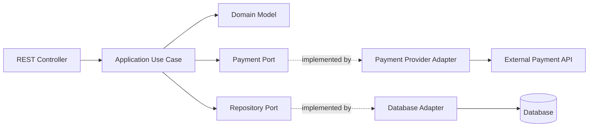
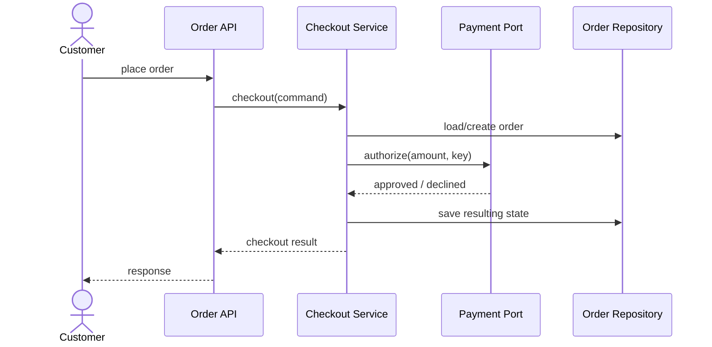
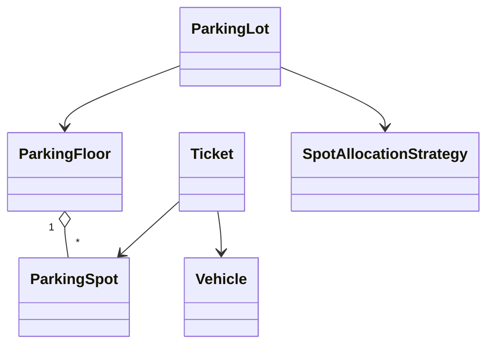
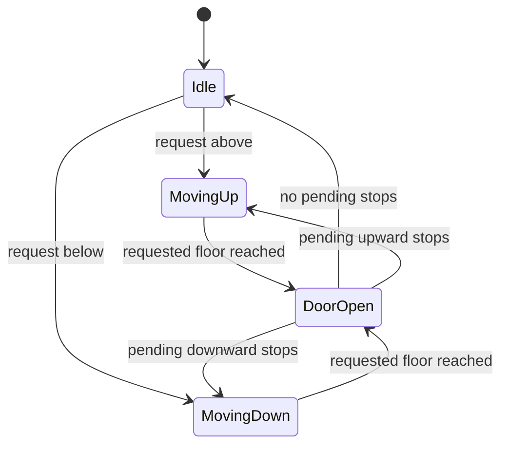
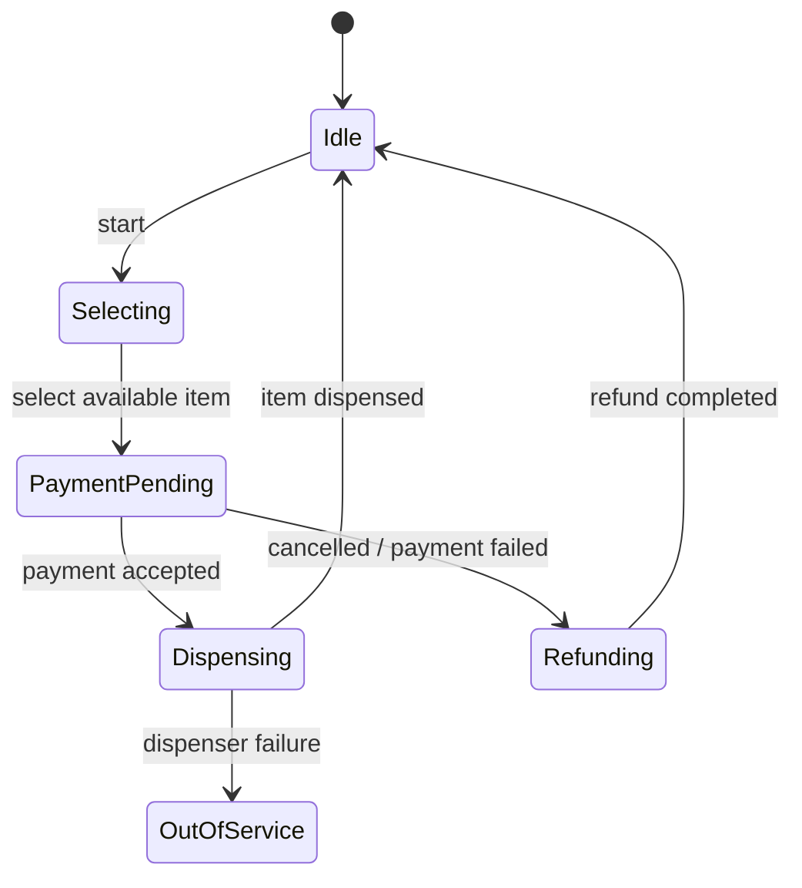
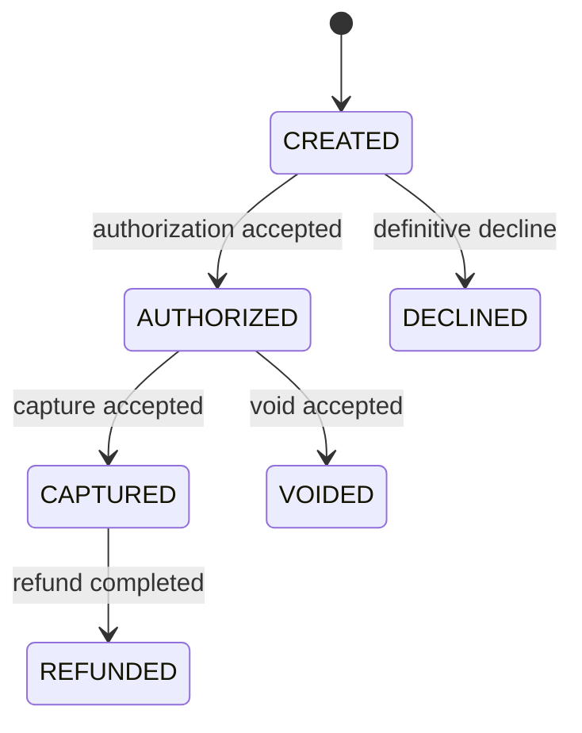

# Design Patterns & Low-Level Design (LLD) Interview Handbook

**Audience:** Java backend engineers with 4–6 years of experience preparing for Senior Software Engineer and Backend Engineer interviews.  
**Purpose:** A practical, interview-first guide to object design, GoF patterns, enterprise application patterns, UML, concurrency-aware design, testing, and realistic LLD exercises.

This is a single-file revision handbook. Examples are intentionally small enough to discuss at a whiteboard. Unless explicitly stated otherwise, code is illustrative core logic—not a complete production service with persistence, security, observability, migrations, deployment, or distributed coordination.

## Table of contents

- [1. How to approach an LLD interview](#1-how-to-approach-an-lld-interview)
- [2. Object-oriented design fundamentals](#2-object-oriented-design-fundamentals)
- [3. SOLID principles](#3-solid-principles)
- [4. Creational patterns](#4-creational-patterns)
- [5. Structural patterns](#5-structural-patterns)
- [6. Behavioral patterns](#6-behavioral-patterns)
- [7. Enterprise and backend application patterns](#7-enterprise-and-backend-application-patterns)
- [8. Design principles, code smells, and refactoring](#8-design-principles-code-smells-and-refactoring)
- [9. UML and communicating a design](#9-uml-and-communicating-a-design)
- [10. Concurrency and thread safety in LLD](#10-concurrency-and-thread-safety-in-lld)
- [11. Testing design and maintainability](#11-testing-design-and-maintainability)
- [12. LLD case studies](#12-lld-case-studies)
  - [12.1 Parking lot](#121-parking-lot)
  - [12.2 Elevator controller](#122-elevator-controller)
  - [12.3 Library management](#123-library-management)
  - [12.4 Vending machine](#124-vending-machine)
  - [12.5 Rate limiter](#125-rate-limiter)
  - [12.6 Notification service](#126-notification-service)
  - [12.7 Payment processing](#127-payment-processing)
  - [12.8 Logging framework](#128-logging-framework)
  - [12.9 In-memory cache](#129-in-memory-cache)
  - [12.10 Splitwise / expense sharing](#1210-splitwise--expense-sharing)
  - [12.11 Food ordering](#1211-food-ordering)
  - [12.12 Hotel booking](#1212-hotel-booking)
  - [12.13 Ride booking](#1213-ride-booking)
  - [12.14 Meeting room scheduler](#1214-meeting-room-scheduler)
  - [12.15 Inventory management](#1215-inventory-management)
  - [12.16 Task scheduler](#1216-task-scheduler)
  - [12.17 File metadata service](#1217-file-metadata-service)
  - [12.18 ATM](#1218-atm)
  - [12.19 Pub/sub event dispatcher](#1219-pubsub-event-dispatcher)
  - [12.20 Pluggable rule engine](#1220-pluggable-rule-engine)
- [13. Pattern selection and comparison](#13-pattern-selection-and-comparison)
- [14. Interview follow-ups and design review checklist](#14-interview-follow-ups-and-design-review-checklist)
- [15. References](#15-references)

---

## 1. How to approach an LLD interview

### 1.1 What is the interviewer evaluating?

An LLD interview is not a contest to draw the largest class diagram or name the most patterns. It evaluates whether you can turn ambiguous requirements into a coherent object model, assign responsibilities, protect invariants, explain trade-offs, and evolve the design without making every class depend on every other class.

A repeatable process is:

1. **Clarify scope.** Ask about actors, main use cases, boundaries, failure cases, and what can be simplified.
2. **Separate requirements.** List functional behavior and the relevant quality attributes: correctness, concurrency, latency, extensibility, testability, and persistence.
3. **Identify domain concepts.** Find entities with identity, value objects defined by values, policies, and external dependencies.
4. **Write invariants.** Examples: a booking cannot overlap another confirmed booking; inventory cannot become negative; a payment request must not charge twice for the same idempotency key.
5. **Assign responsibilities.** Decide which object owns each rule and which object coordinates a use case.
6. **Model collaborations.** Draw the important classes and one or two sequence flows.
7. **Implement the core path.** Write only enough Java to demonstrate the key behavior.
8. **Discuss edge cases.** Include invalid transitions, failures, duplicate requests, concurrency, and recovery.
9. **Review trade-offs.** State what you intentionally did not build and when the design would need to change.

Do not start by forcing a design pattern into the problem. Start with the behavior and invariants; introduce a pattern when it removes a concrete source of coupling or complexity.

### 1.2 How do you handle unclear requirements?

State assumptions explicitly and continue. For a parking lot, for example: “I will model one facility with multiple floors, support cars and motorcycles, allocate compatible spaces, and allow ticket-based exit. I will treat payment processing as an external port and discuss concurrent allocation separately.” This gives the interviewer something concrete to challenge without spending ten minutes guessing.

### 1.3 What should a good LLD answer contain?

A good answer makes clear:
- **What can happen:** use cases and public operations.
- **Who owns what:** class responsibilities and boundaries.
- **What must always be true:** domain invariants.
- **How objects collaborate:** key sequence diagrams or pseudocode.
- **What can vary:** interfaces, policies, strategies, and extension points.
- **What is outside the model:** persistence, distributed coordination, external APIs, and operational concerns.

A class diagram without behavior is incomplete. Code without responsibilities and invariants is also incomplete.

---

## 2. Object-oriented design fundamentals

### 2.1 Explain encapsulation, abstraction, inheritance, and polymorphism.

These concepts solve different problems. **Encapsulation** protects an object's state and rules; **abstraction** exposes a useful contract while hiding implementation details; **inheritance** models a genuine subtype relationship; **polymorphism** lets callers use a common contract while implementations provide different behavior.

```java
interface PaymentMethod {
    PaymentResult charge(Money amount);
}

final class CardPayment implements PaymentMethod {
    @Override
    public PaymentResult charge(Money amount) {
        // Card-provider integration omitted.
        return PaymentResult.approved();
    }
}
```

The caller depends on `PaymentMethod`, not the card provider's implementation. This is abstraction and polymorphism. Encapsulation means the payment object should not expose mutable internal state that callers can corrupt. Inheritance is not required merely to obtain polymorphism; interface implementation is often enough.

### 2.2 Composition vs inheritance: which should you choose?

Prefer composition when behavior can vary independently or be assembled from collaborators. Use inheritance when the subtype truly satisfies the base type's contract and the shared abstraction is stable.

Inheritance can be concise, but it creates a strong coupling to base-class behavior. A subclass may accidentally inherit methods that do not make sense, or break assumptions made by callers. Composition makes dependencies explicit and supports runtime substitution, but can add delegation code and more objects. The right question is not “Is inheritance bad?” but “Is this a stable subtype relationship, or am I using inheritance only to reuse code?”

### 2.3 Interface vs abstract class in Java

An interface defines a capability or contract that unrelated implementations can share. An abstract class is useful when closely related implementations need shared state or protected implementation.

Use an interface for a payment processor, notification sender, or pricing policy. Use an abstract class when subclasses genuinely share lifecycle logic or invariant-preserving state. Java allows a class to implement multiple interfaces but extend only one class. Default interface methods can evolve contracts, but should not turn an interface into a confusing mix of unrelated responsibilities.

### 2.4 What are coupling and cohesion?

**Coupling** describes how strongly one component depends on others; **cohesion** describes how closely the responsibilities within one component belong together. Aim for high cohesion and manageable coupling, not zero coupling. A service must depend on something to do useful work.

For example, an `OrderService` that validates an order, formats email HTML, queries SQL directly, calls three payment vendors, and writes audit files has low cohesion. Split responsibilities when each one has a meaningful reason to change. Avoid splitting every method into a new class merely to reduce line count.

### 2.5 Dependency inversion vs dependency injection

Dependency Inversion is a design principle: high-level policy should not be tightly coupled to low-level implementation details; both should depend on abstractions where that boundary is useful. Dependency Injection is a technique for supplying collaborators from outside an object rather than having it construct them itself.

```java
final class CheckoutService {
    private final PaymentMethod paymentMethod;

    CheckoutService(PaymentMethod paymentMethod) {
        this.paymentMethod = paymentMethod;
    }

    PaymentResult checkout(Money amount) {
        return paymentMethod.charge(amount);
    }
}
```

The constructor makes the dependency visible and easy to replace in a test. A DI framework can automate object creation, but the principle works without Spring. An interface is not automatically valuable: if there is no meaningful boundary or expected variation, direct dependency may be simpler.

### 2.6 What is immutability, and when is it useful?

An immutable object cannot change its observable state after construction. Immutability simplifies reasoning, safe sharing, caching, and use as a map key. Use defensive copies for mutable inputs and outputs; a final reference alone does not make the referenced object immutable.

```java
public record Money(BigDecimal amount, Currency currency) {
    public Money {
        Objects.requireNonNull(amount);
        Objects.requireNonNull(currency);
        if (amount.scale() > currency.getDefaultFractionDigits()) {
            // Real monetary rules should define rounding explicitly.
        }
    }
}
```

Records are shallowly immutable: a record containing a mutable list still exposes that list unless it is copied. For money, define rounding and scale policy explicitly rather than assuming every currency has two decimal places.

### 2.7 Object identity vs equality

Identity asks whether two references point to the same object; equality asks whether two objects represent the same value or domain concept. Use identity for entities whose lifecycle matters and value equality for value objects such as a date range or monetary amount. In Java, implement `equals` and `hashCode` consistently: equal objects must have equal hash codes. Do not base hash codes on mutable fields when objects are used as hash-map keys.

### 2.8 What are entities, value objects, and domain services?

An **entity** has identity across changes, such as an Order identified by order ID. A **value object** is defined by its values and is usually immutable, such as Money or Address. A **domain service** holds domain behavior that does not naturally belong to a single entity or value object, such as a policy that calculates a complex settlement between multiple accounts.

Do not create a domain service for every calculation. Put behavior on an entity when it naturally protects that entity's invariants; use a service when the operation genuinely spans concepts or represents a policy.

### 2.9 Explain Tell, Don't Ask and the Law of Demeter.

Tell, Don't Ask encourages asking an object to perform behavior rather than pulling out its data and making decisions elsewhere. The Law of Demeter advises avoiding long chains through unrelated object internals.

Instead of `if (order.getPayment().getCard().getStatus() == ...)`, prefer a meaningful operation such as `order.canBeCancelled()` or `payment.authorize()` when the rule belongs there. These are guidelines, not prohibitions on getters. Data transfer and read models often need data access; the concern is leaking invariants and coupling callers to internal object graphs.

### 2.10 How do you design clear class responsibilities?

Give a class one coherent reason to change, make invariants explicit, and expose operations that represent valid domain actions. A class name should describe its role rather than its technical size. Keep orchestration in an application service, domain rules near the domain model, and I/O behind adapters. Avoid both extremes: a god object that owns everything and an anemic network of classes where every trivial operation is delegated without improving clarity.

---

## 3. SOLID principles

### 3.1 Single Responsibility Principle (SRP)

SRP says a module should have one coherent reason to change—not literally one method or one line of code. Consider an `InvoiceService` that calculates totals, persists invoices, creates PDFs, and emails customers. Tax rules, storage, document rendering, and notification requirements change for different reasons.

Separate responsibilities around real change boundaries:

```java
final class InvoiceCalculator {
    Money total(Invoice invoice) {
        // Apply pricing and tax rules.
        return invoice.subtotal();
    }
}
interface InvoiceRepository {
    void save(Invoice invoice);
}
interface InvoiceRenderer {
    byte[] render(Invoice invoice);
}
```

This improves focused testing and makes each policy replaceable. The trade-off is more types and coordination. Do not split a tiny stable feature into many classes solely to claim SRP compliance.

### 3.2 Open/Closed Principle (OCP)

OCP means a stable module should accommodate likely extensions without repeatedly editing its core decision logic. It does not mean code must never change. A payment switch that must be modified every time a payment type is added is a candidate for polymorphism.

```java
interface DiscountPolicy {
    Money discountFor(Order order);
}

final class Checkout {
    private final DiscountPolicy discountPolicy;

    Checkout(DiscountPolicy discountPolicy) {
        this.discountPolicy = discountPolicy;
    }

    Money total(Order order) {
        return order.subtotal().minus(discountPolicy.discountFor(order));
    }
}
```

New policies can be introduced independently. But if there are only two stable cases, a simple conditional may be clearer. Extend the axis of change that is actually likely; do not build a plugin framework for imaginary future requirements.

### 3.3 Liskov Substitution Principle (LSP)

A subtype must be usable wherever its base contract is expected without breaking correctness. It must honor the base type's preconditions, postconditions, and invariants. A subtype that throws `UnsupportedOperationException` for a promised operation often signals a bad abstraction.

For example, if every `Bird` is required to `fly()`, a penguin subtype violates the contract. Model capabilities separately:

```java
interface Bird { void eat(); }
interface FlyingBird extends Bird { void fly(); }

final class Penguin implements Bird {
    public void eat() { /* ... */ }
}
```

LSP is about behavioral substitutability, not merely matching method signatures. Tests should verify contracts across implementations.

### 3.4 Interface Segregation Principle (ISP)

Clients should not be forced to depend on methods they do not use. Instead of one broad `Device` interface with print, scan, fax, and staple operations, separate capabilities such as `Printable` and `Scannable`. A printer-only device then implements only the contract it supports.

Small interfaces can improve substitution and testing, but excessive fragmentation creates needless indirection. Segregate around client needs and stable capabilities, not around every individual method by default.

### 3.5 Dependency Inversion Principle (DIP)

High-level business policy should not directly depend on low-level details when those details are volatile. Both can depend on a stable abstraction owned by the policy boundary. A notification use case should depend on `NotificationSender`, not instantiate an SMTP client inside its business logic.

This is not a rule that every class needs an interface. An abstraction earns its cost when it separates a volatile detail, gives a useful seam for testing, or expresses a meaningful contract. Constructor injection is usually the clearest way to make required dependencies explicit.

### 3.6 Common SOLID mistakes

- **SRP as one class per method:** increases indirection without improving cohesion.
- **OCP as never editing existing code:** realistic requirements and bug fixes often require changing code.
- **LSP as compilation only:** a subtype can compile and still violate behavioral expectations.
- **ISP as tiny interfaces everywhere:** consumers can end up navigating dozens of meaningless types.
- **DIP as interface for every concrete class:** adds ceremony when no useful boundary exists.
- **SOLID as a substitute for domain understanding:** the correct responsibilities still come from requirements and invariants.

### 3.7 Applying SOLID to order processing

An application service may coordinate validation, pricing, payment, and persistence, while each policy has its own contract. Keep the order's state transitions inside the Order model; put external payment-provider calls behind an adapter. Do not let a controller calculate totals or let a provider-specific SDK determine domain states. The design should still be proportionate: a small application may not need a rule registry or dynamic plugin discovery.

---

## 4. Creational patterns

### 4.1 Singleton

Singleton ensures one instance is used within a defined scope. The key phrase is **defined scope**: a static singleton is usually one instance per class loader, not one instance across a cluster or every process. It can be appropriate for stateless, process-wide coordination, but global mutable singletons hide dependencies and make tests order-dependent.

For a lazy, thread-safe Java singleton, the initialization-on-demand holder idiom is concise:

```java
public final class ConfigurationRegistry {
    private ConfigurationRegistry() {}

    private static class Holder {
        private static final ConfigurationRegistry INSTANCE =
                new ConfigurationRegistry();
    }

    public static ConfigurationRegistry getInstance() {
        return Holder.INSTANCE;
    }
}
```

Class initialization safely publishes the instance. An enum singleton is also robust against ordinary serialization and reflection pitfalls. In a Spring application, a singleton-scoped bean is normally one bean instance per application context; it is not identical to a globally accessible GoF singleton. Prefer container-managed lifecycle and constructor injection for application services. Singleton scope does not make mutable fields thread-safe.

### 4.2 Factory Method

Factory Method delegates creation to a method or subtype so callers depend on a product contract instead of concrete construction details.

```java
interface NotificationSender {
    void send(String recipient, String message);
}
interface NotificationSenderFactory {
    NotificationSender create();
}
```

A factory is useful when construction involves configuration, selecting an implementation, or hiding vendor-specific setup. A factory method in the GoF sense is a creation method designed for overriding in subclasses; in everyday code, “simple factory” often means a separate object with a conditional. Name the distinction in interviews. If construction is just `new Foo()`, a factory may add no value.

### 4.3 Abstract Factory

Abstract Factory creates a family of related products without exposing their concrete classes. For example, a UI toolkit may create matching buttons and checkboxes for a theme, or a storage abstraction may create compatible reader/writer components for one provider.

The benefit is consistency across the product family. The cost is that adding a new product type can require changing every factory implementation. Use it when products must vary together as a family, not just because several classes share a prefix.

### 4.4 Builder

Builder separates complex object construction from the final representation. It is useful when a type has many optional parameters, validation rules, or construction steps.

```java
public final class ReportRequest {
    private final LocalDate from;
    private final LocalDate to;
    private final boolean includeArchived;

    private ReportRequest(Builder b) {
        if (b.from.isAfter(b.to)) {
            throw new IllegalArgumentException("from must not be after to");
        }
        this.from = b.from;
        this.to = b.to;
        this.includeArchived = b.includeArchived;
    }

    public static class Builder {
        private final LocalDate from;
        private final LocalDate to;
        private boolean includeArchived;

        public Builder(LocalDate from, LocalDate to) {
            this.from = Objects.requireNonNull(from);
            this.to = Objects.requireNonNull(to);
        }
        public Builder includeArchived(boolean value) {
            this.includeArchived = value;
            return this;
        }
        public ReportRequest build() { return new ReportRequest(this); }
    }
}
```

The builder centralizes validation and avoids telescoping constructors. A record or ordinary constructor is simpler for a small value type with few required fields. Be careful with builders that allow invalid intermediate states to escape or that retain mutable collections without copying.

### 4.5 Prototype

Prototype creates a new object by copying an existing configured object. It can be useful when object setup is expensive or there are many similar templates. Java's `Cloneable` and `Object.clone()` have awkward semantics, so an explicit copy constructor or `copy()` method is often easier to reason about.

Decide whether the copy is shallow or deep. Sharing immutable dependencies is usually fine; unintentionally sharing mutable nested state is not. Prototype is less compelling when construction is cheap and object creation is already clear.

### 4.6 How do you choose among the creational patterns?

Use Builder for complex parameterized construction; Factory Method when a subtype or method chooses a product; Abstract Factory for related product families; Prototype for copying configured instances; Singleton only when a true single-instance lifecycle is required. These patterns are not mutually exclusive, but combining them should solve a real construction problem rather than increase pattern count.

---

## 5. Structural patterns

### 5.1 Adapter

Adapter converts one interface into the interface expected by a client. It is especially useful for third-party SDKs, legacy APIs, or incompatible data models.

```java
interface TaxCalculator {
    Money taxFor(Order order);
}
final class LegacyTaxAdapter implements TaxCalculator {
    private final LegacyTaxClient client;
    LegacyTaxAdapter(LegacyTaxClient client) { this.client = client; }

    public Money taxFor(Order order) {
        LegacyTaxResponse response = client.calculate(order.toLegacyRequest());
        return Money.of(response.amount(), order.currency());
    }
}
```

The adapter isolates vendor-specific types and error mapping. It should translate semantics, not just rename methods. If the external API has different retry, timeout, or idempotency behavior, those details belong at the integration boundary too.

### 5.2 Decorator

Decorator adds behavior around an object while preserving its interface. It supports stacking independent behaviors such as metrics, caching, or logging.

```java
interface Catalog {
    Item find(String id);
}
final class CachingCatalog implements Catalog {
    private final Catalog delegate;
    private final Map<String, Item> cache = new ConcurrentHashMap<>();

    CachingCatalog(Catalog delegate) { this.delegate = delegate; }

    public Item find(String id) {
        return cache.computeIfAbsent(id, delegate::find);
    }
}
```

This is illustrative: production cache code must define expiration, invalidation, failure caching, memory bounds, and whether `null` results are legal. A decorator is appropriate when the added behavior preserves the component's contract. It is not automatically appropriate for authorization if the wrapper can be bypassed through another path.

### 5.3 Facade

Facade offers a simpler interface over a complicated subsystem. A checkout facade might coordinate inventory, tax, payment, and receipt services behind one use-case operation. Unlike an adapter, its primary goal is to simplify interaction, not translate an incompatible interface. A facade should not become a god object that absorbs every business rule.

### 5.4 Proxy

Proxy controls access to another object while presenting a compatible interface. Common uses include access checks, lazy loading, remote access, and virtual proxies. A proxy often has a lifecycle or access-control responsibility; a decorator's intent is usually to add behavior.

**Decorator vs Proxy:** their structures can be identical. Distinguish them by intent: decoration adds responsibilities; a proxy controls access, lifecycle, or indirection. In real systems the boundary can overlap. Security must be enforced at a trusted boundary; an in-process proxy alone cannot secure an exposed remote endpoint.

### 5.5 Composite

Composite lets clients treat individual objects and groups uniformly through a shared abstraction. A file tree can represent both files and directories as `FileNode`; a directory contains child nodes and computes aggregate size. Use it when the domain is genuinely hierarchical. Avoid forcing uniform operations where leaves and composites have fundamentally different semantics.

### 5.6 Bridge

Bridge separates an abstraction from an implementation so both can vary independently. For example, a notification type (alert, digest) can be combined with delivery channels (email, SMS) without creating a subclass for every combination. Prefer composition of two dimensions over a combinatorial inheritance tree.

**Bridge vs Adapter:** Bridge is usually designed in advance to separate dimensions that should evolve independently; Adapter reconciles an existing interface with a client that expects another one. They can look structurally similar, but the design intent differs.

### 5.7 Flyweight

Flyweight shares common immutable intrinsic state among many logical objects to reduce memory use. A text renderer might share font metadata while keeping character position and content as extrinsic state. The shared state must not contain per-object mutable data. Flyweight is useful only when profiling or scale justifies the added indirection.

### 5.8 Adapter vs Facade vs Decorator at a glance

| Pattern | Main intent | Typical example |
|---|---|---|
| Adapter | Make incompatible interfaces work together | Wrap a vendor tax API |
| Facade | Simplify a subsystem | One checkout operation coordinates several services |
| Decorator | Add behavior while preserving an interface | Add caching or metrics around a catalog |
| Proxy | Control access or add indirection | Authorization check, lazy object, remote stub |

---

## 6. Behavioral patterns

### 6.1 Strategy

Strategy encapsulates interchangeable algorithms behind a common contract. It is useful for shipping prices, discounts, payment routing, or retry policies when the choice can vary independently of the caller.

```java
interface ShippingStrategy {
    Money costFor(Order order);
}
final class StandardShipping implements ShippingStrategy {
    public Money costFor(Order order) { return Money.of("5.00", order.currency()); }
}
final class CheckoutPricing {
    private final ShippingStrategy shipping;
    CheckoutPricing(ShippingStrategy shipping) { this.shipping = shipping; }
    Money shippingCost(Order order) { return shipping.costFor(order); }
}
```

The client selects or receives a strategy. If the behavior has only one stable implementation, a strategy interface may be unnecessary. A map of named strategies can replace a long conditional when lookup is data-driven, but do not create a registry just to avoid a short readable `if`.

### 6.2 Observer

Observer defines a one-to-many relationship: when a subject changes or emits an event, registered observers are notified. It is useful for in-process listeners, UI events, and domain events. Specify whether delivery is synchronous, ordered, and allowed to fail. One observer throwing an exception should not accidentally prevent all other listeners unless that is the intended contract.

In-process Observer is not equivalent to durable messaging. If events must survive process crashes or cross service boundaries, use a durable broker and address transactional publication separately.

### 6.3 Command

Command represents a request as an object, allowing queuing, logging, retry policies, or undo when meaningful. A command can include a stable identifier, parameters, and an execution handler. For side-effecting commands, retries require idempotency or deduplication; merely wrapping a method call in a class does not make it safe to repeat.

### 6.4 Template Method

Template Method defines an algorithm skeleton in a base class and lets subclasses customize selected steps. It is useful when the overall sequence is stable but a few steps vary. The trade-off is inheritance coupling and less flexible composition. If subclasses need to vary several independent steps, strategies or injected collaborators may be easier to test.

### 6.5 Chain of Responsibility

A chain passes a request through handlers until it is handled or the chain ends. A request validation pipeline might perform authentication, input validation, rate checks, and business validation. Define clearly whether every handler runs, a handler can stop the chain, and how errors are represented. A chain is less suitable when the order is obscure or the flow requires complex branching that is better expressed directly.

### 6.6 State

State represents behavior that changes with an object's state. Instead of scattering state-dependent switches through the code, each state can define permitted transitions and behavior.

For an order, `PENDING`, `PAID`, `SHIPPED`, and `CANCELLED` have different allowed actions. A small enum and guarded transition method may be enough; separate State classes are justified when behavior is substantial or state-specific logic keeps growing. Never assume a state object alone protects a transition against concurrent updates in the database.

### 6.7 Iterator

Iterator exposes sequential traversal without exposing the underlying representation. Java's `Iterator` and enhanced `for` loop are familiar examples. A custom iterator is useful for a specialized traversal or collection abstraction, but usually unnecessary when the standard collection contract suffices. Define behavior when the underlying collection changes during iteration.

### 6.8 Mediator

Mediator centralizes interactions among collaborating objects to reduce direct peer-to-peer dependencies. A workflow coordinator can route events between UI components or domain collaborators. The danger is a mediator that becomes a god object; keep domain invariants in their owners and use the mediator for coordination.

### 6.9 Visitor

Visitor separates operations from a stable object structure, often useful when many operations must be applied to a fixed family of node types, such as evaluating or rendering an AST. The trade-off is that adding a new node type can require updating every visitor. If the type hierarchy changes frequently, ordinary polymorphism or pattern matching may be simpler.

### 6.10 Memento

Memento captures an object's state so it can be restored later without exposing internal representation. Undo features and editor history are common examples. Be deliberate about memory use, sensitive data, version compatibility, and whether external side effects can actually be undone. Restoring an in-memory snapshot does not reverse an email or a completed payment.

### 6.11 Interpreter

Interpreter models a small language as expressions that can evaluate themselves or be evaluated by an interpreter. It can be useful for a limited rule DSL, query expression, or filter language. For complex languages, a parser and dedicated AST are more maintainable than nested string conditionals. Never evaluate arbitrary user-provided Java or script code just to implement a simple rule engine.

### 6.12 Strategy vs State vs Template Method

- **Strategy:** the caller chooses one interchangeable algorithm, such as a pricing policy.
- **State:** the object's current state determines permitted behavior and transitions.
- **Template Method:** a base class fixes the algorithm sequence while subclasses override selected steps.

Use the simplest model that communicates the variation. A conditional is not a design failure when it is short, local, and stable.

### 6.13 Observer vs Pub/Sub

Observer commonly connects an in-process subject directly to listeners. Pub/sub typically introduces a topic or broker that decouples publishers from subscribers, often across processes. Pub/sub raises additional concerns—durability, delivery semantics, ordering, retries, dead letters, and schema evolution—which are covered in the Distributed Systems and Kafka handbooks.

---

## 7. Enterprise and backend application patterns

These are not all GoF patterns. They are architectural or enterprise application patterns that organize application boundaries and business behavior.

### 7.1 Dependency Injection (DI)

DI supplies an object's collaborators from outside rather than letting it construct every dependency. Constructor injection makes required dependencies explicit and supports deterministic tests. Use field injection sparingly because it hides requirements and makes plain unit construction harder. Spring-specific bean lifecycle, scopes, proxies, and transaction integration belong in the Spring handbook.

### 7.2 Repository

A Repository presents a domain-oriented collection-like interface for loading and saving aggregates while hiding persistence details. It should express useful operations such as `findById` or `save`, not expose every database concern to domain objects. In data-heavy CRUD applications, a direct DAO or query service can be simpler; do not create a repository abstraction that only forwards every ORM method unchanged.

### 7.3 Service Layer

A Service Layer defines application operations and coordinates domain objects, repositories, and external ports. It is a natural place for transaction boundaries and use-case orchestration. Keep domain rules in domain objects or policies where that makes them easier to protect and reuse. Avoid a service that becomes a large collection of unrelated business decisions.

### 7.4 Unit of Work

Unit of Work tracks changes made during a business transaction and coordinates persistence so related changes are committed together. ORM persistence contexts often provide this behavior. Conceptually, an order and its line items should not be persisted in contradictory states. A Unit of Work is not a distributed transaction across arbitrary services; cross-service workflows need different consistency strategies.

### 7.5 Specification

Specification encapsulates a business predicate so it can be composed, reused, and tested. For example, `EligibleForDiscount` may express customer status, order value, and date constraints. Simple specifications can compose with `and`, `or`, and `not`. Keep executable predicates and database-translatable query specifications conceptually distinct; not every Java predicate can be translated into SQL.

### 7.6 DTO and Mapper

A DTO carries data across a boundary; a mapper converts between representations such as API requests, domain objects, and persistence models. DTOs prevent external API shape from dictating internal domain structure. Avoid blindly mirroring every field in every layer; mappings should be explicit about defaults, validation, nullability, and fields clients are not allowed to set.

### 7.7 Transaction Script vs Domain Model

A Transaction Script organizes business logic as procedures for use cases and is often effective for straightforward CRUD workflows. A Domain Model represents business rules and state in collaborating objects and is useful when invariants and behavior become complex. Neither is universally superior. A small stable workflow may be clearer as a script; a complex lifecycle with many transitions may benefit from a richer domain model.

### 7.8 Domain service vs application service

A **domain service** expresses a domain rule that does not naturally belong to one entity or value object. An **application service** coordinates a use case: load data, invoke domain behavior, persist results, and return a response. Application services should not become the only place where all business logic lives.

### 7.9 Hexagonal Architecture (Ports and Adapters)

Hexagonal Architecture keeps application/domain policy independent of external systems. A port is an interface the core needs or exposes; an adapter connects that port to a database, HTTP provider, message broker, or UI.



The point is dependency direction, not a required number of folders. An application can use ports and adapters without wrapping every library call in an interface. Keep abstractions at boundaries where change or testing justifies them.

### 7.10 Clean Architecture

Clean Architecture organizes code so source dependencies point inward toward stable business rules. Frameworks, databases, and delivery mechanisms remain outer details. It overlaps with Hexagonal Architecture but emphasizes concentric policy boundaries and dependency direction. It does not require four specific modules or prohibit pragmatic framework use; avoid letting architecture become more complex than the product.

### 7.11 Layered architecture

A common backend uses controller/API, application/service, domain, and persistence/integration layers. Layers clarify responsibilities, but rigid layering can cause excessive pass-through classes. Avoid upward dependencies and do not let controllers or repositories silently own business rules. A modular monolith can preserve clear boundaries without the operational cost of separate services.

### 7.12 Modular monolith

A modular monolith is deployed as one application but divided into modules with explicit APIs and ownership. It can provide strong domain boundaries, simpler transactions, and lower operational overhead than microservices. Modules should avoid reaching into each other's internals or sharing mutable tables without ownership rules. Extract a service only when deployment, scaling, team ownership, or isolation needs justify the cost.

### 7.13 CQRS

Command Query Responsibility Segregation separates operations that change state from models used to read state. It can simplify read models when query and write needs differ substantially, but adds synchronization, projection maintenance, and operational complexity. CQRS does not require event sourcing or separate databases. For ordinary CRUD, one model is often simpler.

### 7.14 Outbox pattern and anti-corruption layer

The **Outbox pattern** stores a business change and an event record in the same local database transaction, then publishes the record asynchronously. It addresses the gap between committing data and sending a message; it does not by itself guarantee exactly-once end-to-end effects. See the Distributed Systems and Kafka handbooks for retries, deduplication, and delivery semantics.

An **anti-corruption layer** translates an external or legacy model into the application's own domain vocabulary. It prevents vendor-specific fields, error codes, and lifecycle assumptions from spreading through the core. An adapter is one implementation technique; the broader layer may include mapping, validation, policy, and error translation.

---

## 8. Design principles, code smells, and refactoring

### 8.1 DRY, KISS, and YAGNI

- **DRY:** avoid duplicating knowledge or rules that must stay consistent. Similar-looking code is not always the same knowledge; premature generic helpers can make unrelated behavior harder to change.
- **KISS:** prefer the simplest design that correctly meets requirements. Simplicity is about cognitive load, not necessarily the fewest classes.
- **YAGNI:** do not build speculative capabilities before a real requirement justifies them. Leave clear extension seams where change is plausible, but do not build a universal plugin engine for one use case.

These principles can conflict. A small amount of duplication may be safer than coupling two policies that will evolve independently.

### 8.2 How do you refactor a large conditional?

First identify what varies and whether the branches represent stable business concepts. Replace the conditional with Strategy when the alternatives are cohesive algorithms with independent lifecycle or testing needs. Use State when transitions and allowed actions depend on lifecycle state. Use a map when selecting a handler by key is the real problem. Keep a conditional when it is the clearest expression of a small fixed rule.

Refactor in small steps: add behavior tests, extract a method, introduce a type only if it clarifies the model, and run tests after each change. Avoid mixing a broad rewrite with a behavior change.

### 8.3 What are common code smells?

- **God object:** too many unrelated responsibilities; split by cohesive behavior and ownership.
- **Long method:** mixed levels of abstraction or too many steps; extract named operations.
- **Primitive obsession:** domain concepts are represented by loosely validated strings/numbers; introduce value objects where they protect meaningful invariants.
- **Feature envy:** a method repeatedly reads another object's data to make its decisions; consider moving the behavior to the data owner.
- **Shotgun surgery:** one policy change requires edits across many unrelated files; find the missing abstraction or boundary.
- **Deep inheritance:** behavior and invariants become hard to trace; prefer composition when behavior varies independently.
- **Anemic domain model:** entities only hold data while all meaningful rules live in services. This can be appropriate for simple CRUD; it is a smell when complex invariants are scattered and easy to bypass.
- **Over-abstraction:** layers and interfaces that add navigation but no meaningful boundary.

### 8.4 How do you avoid primitive obsession?

Create types for concepts with validation or domain meaning: `EmailAddress`, `Money`, `BookingInterval`, `OrderId`, or `Percentage`. This can make invalid states harder to express. Do not wrap every string in a class; introduce a value object when it protects a rule, clarifies an API, or prevents unit mix-ups.

### 8.5 How should an API or interface be designed?

Make valid use explicit, avoid surprising side effects, choose names that describe business intent, and define error behavior. Prefer one method that expresses a complete invariant-preserving operation over a sequence of getters and setters that callers must coordinate correctly. Keep interfaces small enough for consumers to understand, but not so fragmented that simple tasks require navigating many abstractions.

### 8.6 How do you balance clean design with delivery constraints?

Start with a correct, understandable design for current requirements. Add an abstraction when there is real variation, a boundary to isolate, or a testability problem. Keep extension points narrow and observable. A pragmatic implementation with one clear conditional can be better than a pattern-heavy design. The interview answer should explain what you chose, what you deliberately deferred, and what evidence would trigger a refactor.

---

## 9. UML and communicating a design

### 9.1 Class diagram essentials

A class diagram shows static structure: classes, interfaces, attributes, operations, and relationships. Common notations include:
- Inheritance/generalization: solid line with a hollow triangle pointing to the parent.
- Interface realization: dashed line with a hollow triangle pointing to the interface.
- Association: a structural relationship between objects.
- Aggregation: hollow diamond at the whole side; shared-part semantics are often weakly defined in practice.
- Composition: filled diamond at the owning whole; implies strong ownership/lifecycle coupling.
- Multiplicity: `1`, `0..1`, `*`, or `1..*` at association ends.

Do not use composition just because one object has a field referencing another. Ask whether the part's lifecycle is owned by the whole and whether it can meaningfully exist independently.

### 9.2 Sequence diagram essentials

A sequence diagram explains how participants interact over time. Lifelines represent participants; arrows represent calls or messages; return arrows are optional. Use it to show a critical path, not every getter. Mark external boundaries and failure branches when those affect correctness.



This is a conceptual flow. A real design must specify transaction boundaries and how payment-provider side effects are reconciled if saving the result fails.

### 9.3 State and activity diagrams

A state diagram models states and legal transitions of one entity or process. It is useful for orders, bookings, payments, and vending machines. An activity diagram models a workflow with decisions, parallel steps, and alternative paths. Use a state diagram when lifecycle validity is the central concern; use an activity diagram when process flow is the concern.

### 9.4 How do you translate requirements into classes?

Underline nouns as candidate concepts and verbs as candidate operations, but do not mechanically create a class for every noun. Identify ownership, invariants, lifecycle, and likely change points. A noun may be a value object, an enum, an external system, or merely a field. A verb may be a method on an entity, a domain policy, or an application use case.

### 9.5 How should you explain your design aloud?

Begin with assumptions and invariants. Present the main classes and their responsibilities. Walk through one successful use case and one failure or race condition. Explain why a pattern is useful and what would be simpler if the requirements were smaller. End with persistence, concurrency, and extension points. This makes your reasoning auditable and invites useful discussion.

---

## 10. Concurrency and thread safety in LLD

### 10.1 What is shared mutable state, and why is it dangerous?

When multiple threads read and modify the same mutable state without a suitable coordination mechanism, operations can interleave and violate invariants. A thread-safe collection does not automatically make a multi-step business operation atomic.

For example, `if (inventory.available() >= quantity) inventory.decrease(quantity)` is unsafe if another thread can consume stock between the check and update. Put the check-and-reserve operation behind one atomic boundary, such as a synchronized aggregate in a single process or a conditional database update/transaction in a persistent application.

### 10.2 Synchronization, atomics, and concurrent collections

Use synchronization or locks when several fields must change together under one invariant. Atomic classes are useful for individual atomic variables and compare-and-set loops, but they do not automatically make multi-object invariants safe. Concurrent collections protect their documented operations; check whether the full workflow is atomic. Choose the narrowest lock scope that preserves correctness, but avoid complicated nested locks without a clear ordering strategy.

### 10.3 Booking race conditions

Two requests may both observe a room as available and attempt to reserve the same interval. A process-local lock only coordinates threads in that process; it does not protect multiple application instances. A production booking system needs a durable conflict-prevention mechanism: for example, database constraints/locking or a serializable transaction appropriate to the schema. Re-check availability at commit time. A prior availability search is advisory, not a reservation.

### 10.4 Inventory race conditions

A conditional update can protect a single stock row:

```sql
UPDATE inventory
SET available = available - :quantity
WHERE sku = :sku
  AND available >= :quantity;
```

Treat one updated row as a successful reservation and zero rows as insufficient stock or a concurrent conflict. Validate that quantity is positive and decide how reservations expire or are released. Multi-SKU orders need an all-or-nothing policy, usually a transaction or a reservation workflow with explicit compensation.

### 10.5 Thread-safe rate limiters and caches

Rate limiters need atomic accounting for tokens or request timestamps. Caches need explicit choices for concurrent loads, expiration, eviction, failure behavior, and invalidation. A `ConcurrentHashMap` can help with per-key atomic initialization, but a cache with maximum size and time-based expiration still needs a policy and lifecycle management. Discuss whether duplicate computation is acceptable and whether the stored value is immutable.

### 10.6 Deadlocks and lock granularity

Deadlocks can occur when threads acquire the same locks in different orders. Reduce nested locking, keep critical sections short, establish a global lock ordering where multiple locks are unavoidable, and avoid calling unknown external code while holding a lock. Coarse locks simplify correctness but reduce concurrency; fine-grained locks improve parallelism at the cost of more complex reasoning. Measure before optimizing.

### 10.7 Idempotent command handling

An idempotent operation can be retried without producing an additional business effect for the same logical request. For payment or booking commands, associate a client-provided or generated idempotency key with the request and its result. Persist the key and outcome atomically with the business state where possible. Define behavior when the same key is reused with different request parameters. An in-memory set is not sufficient across restarts or multiple instances.

---

## 11. Testing design and maintainability

### 11.1 How do you unit-test object behavior?

Test public behavior and domain invariants rather than private methods. For a booking, test valid creation, overlapping booking rejection, cancellation rules, and transitions after cancellation. Tests should state what the object guarantees, not how many internal helper methods it calls.

### 11.2 Mocks vs stubs vs fakes

- **Stub:** returns controlled answers for a test.
- **Mock:** records or verifies interactions when those interactions are part of the behavior being tested.
- **Fake:** a lightweight working implementation, such as an in-memory repository.

Use a fake repository for domain/service tests when it gives realistic behavior cheaply. Use mocks for external boundaries where a particular call or failure matters. Over-mocking makes tests brittle because harmless refactoring changes interactions without changing behavior.

### 11.3 Dependency injection and testability

Inject required collaborators through constructors so tests can substitute fakes or deterministic implementations. Keep business logic independent of static clocks, random generators, and network clients when deterministic tests matter. A `Clock` abstraction can make time-dependent rules testable without sleeping. Do not create an interface solely to mock a trivial immutable value.

### 11.4 Testing state transitions and invariants

Use table-driven tests for permitted and forbidden transitions. Verify both state and observable effects. For example, a cancelled order should not be shipped; a rejected payment should not mark an order as paid. Property-based testing can be useful for arithmetic, interval overlap, and invariants across many generated inputs.

### 11.5 Testing concurrent behavior

Test the invariant, not a specific thread schedule. Use barriers/latches to arrange simultaneous attempts and verify that only the permitted number succeeds. Avoid arbitrary sleeps, which are flaky. For database concurrency, integration tests against the actual database engine are often needed because an in-memory fake cannot reproduce isolation and locking behavior.

### 11.6 Refactoring safely

Add tests around current behavior, change one responsibility at a time, and keep commits small. When introducing a pattern, verify that the new abstraction reduces coupling or clarifies variation. A pattern that makes tests harder to understand is a signal to reconsider it.

---

## 12. LLD case studies

The following exercises show how to reason from requirements to a core design. Their snippets demonstrate central rules, not complete production implementations. For each problem, start by clarifying scope with the interviewer; assumptions below are a useful default, not universal requirements.

### 12.1 Parking lot

**Requirements and assumptions.** One facility has floors and parking spots of different sizes. Vehicles enter, receive a ticket, and pay before exit. A spot must not be allocated twice. Pricing and payment may vary.

**Core model.** `ParkingLot` coordinates floors and allocation; `ParkingSpot` owns occupancy; `Ticket` records entry and spot; `ParkingStrategy` chooses a compatible spot; `FeePolicy` calculates cost. Vehicle compatibility is a domain rule, not a controller conditional.



```java
enum SpotSize { MOTORCYCLE, COMPACT, LARGE }
record Vehicle(String plate, SpotSize requiredSize) {}

final class ParkingSpot {
    private final String id;
    private final SpotSize size;
    private boolean occupied;

    ParkingSpot(String id, SpotSize size) {
        this.id = id;
        this.size = size;
    }
    boolean fits(Vehicle v) {
        return size.ordinal() >= v.requiredSize().ordinal();
    }
    synchronized boolean tryOccupy(Vehicle v) {
        if (occupied || !fits(v)) return false;
        occupied = true;
        return true;
    }
    synchronized void release() { occupied = false; }
    String id() { return id; }
}
```

This snippet assumes the enum order represents fit hierarchy, which is a simplification; a capability/compatibility table is clearer when vehicle classes have non-linear rules. In-memory synchronization protects only one JVM. A multi-instance deployment needs durable allocation/locking. A real ticket should make release idempotent and record status; payment and exit must not free the spot twice.

**Patterns and trade-offs.** Strategy supports different allocation policies (nearest, EV charging, reserved spots); a Fee Policy can be Strategy as well. Avoid a deep subclass hierarchy for every vehicle/spot combination. Consider lost tickets, full capacity, payment failure, accessibility, EV charging, and spot reservation as follow-ups.

### 12.2 Elevator controller

**Requirements.** Accept hall and cabin requests, choose a car, assign direction, and stop at requested floors. Clarify number of elevators, service floors, emergency behavior, and whether this is a simulation or real safety-critical control.

**Model.** `ElevatorController` assigns requests; each `ElevatorCar` owns current floor, direction, and pending stops; `SchedulingStrategy` chooses a car and stop order. State transitions must prevent impossible movement and conflicting direction assumptions.



A simple strategy can prioritize requests along the current direction before reversing, but fairness and waiting-time optimization may require a more advanced scheduler. Keep physical motor control and safety interlocks outside an interview-level business model. Discuss duplicate requests, overload, emergency mode, maintenance, starvation, and concurrent requests. This design is a software scheduling model, not safety-certified elevator firmware.

### 12.3 Library management

**Requirements.** Search titles, distinguish a book title from individual physical copies, borrow and return copies, and track due dates/fines. Clarify reservations and renewals.

**Model.** `Book` describes bibliographic metadata; `BookCopy` represents a lendable item with a barcode and status; `Member` represents a borrower; `Loan` records checkout/due/return times; `FinePolicy` calculates fees. Availability is about copies, not titles.

```java
enum CopyStatus { AVAILABLE, ON_LOAN, LOST, REPAIR }
final class BookCopy {
    private final String barcode;
    private CopyStatus status = CopyStatus.AVAILABLE;
    BookCopy(String barcode) { this.barcode = barcode; }

    void checkout() {
        if (status != CopyStatus.AVAILABLE)
            throw new IllegalStateException("Copy is not available");
        status = CopyStatus.ON_LOAN;
    }
    void returnCopy() {
        if (status != CopyStatus.ON_LOAN)
            throw new IllegalStateException("Copy is not on loan");
        status = CopyStatus.AVAILABLE;
    }
}
```

In production, a transaction must protect copy status and loan creation together. Consider reservation queues, overdue reminders, lost copies, renewals, and member borrowing limits. Repository and service-layer patterns are natural; a State pattern is optional unless lifecycle behavior becomes substantial.

### 12.4 Vending machine

**Requirements.** Select a product, accept payment, dispense, and return change or refund. Handle empty inventory, insufficient funds, jammed dispenser, and cancellation.

**Model.** `VendingMachine` coordinates the operation; `Inventory` reserves stock; `PaymentAcceptor` handles money; `Dispenser` is a hardware port; machine state restricts valid actions.



Use State when it prevents invalid transitions; for a tiny exercise, an enum and transition method may be enough. The hardest issue is the boundary between payment accepted and physical dispensing: a dispenser failure must trigger a refund or recovery workflow, and repeated commands must not dispense twice. Money should use integer minor units or a well-defined Money type, not floating point.

### 12.5 Rate limiter

**Requirements.** Limit requests per client or key, define the time window and rejection response, and decide whether state is local or shared. Algorithms include fixed window, sliding log, sliding window counter, and token bucket.

**Token bucket intuition.** Tokens refill at a configured rate up to a capacity. A request consumes a token; if none is available, reject or delay it. Capacity allows bursts while the refill rate controls sustained traffic.

```java
final class TokenBucket {
    private final long capacity;
    private final double tokensPerNano;
    private double tokens;
    private long lastRefillNanos;

    TokenBucket(long capacity, double tokensPerSecond, long nowNanos) {
        if (capacity <= 0 || tokensPerSecond <= 0)
            throw new IllegalArgumentException();
        this.capacity = capacity;
        this.tokensPerNano = tokensPerSecond / 1_000_000_000d;
        this.tokens = capacity;
        this.lastRefillNanos = nowNanos;
    }

    synchronized boolean tryAcquire(long nowNanos) {
        long elapsed = Math.max(0, nowNanos - lastRefillNanos);
        tokens = Math.min(capacity, tokens + elapsed * tokensPerNano);
        lastRefillNanos = Math.max(lastRefillNanos, nowNanos);
        if (tokens < 1) return false;
        tokens -= 1;
        return true;
    }
}
```

The synchronized block protects one bucket in one process. Inject a monotonic time source for deterministic tests. Production concerns include per-key bucket eviction, memory bounds, distributed quotas, clock assumptions, fairness, and atomic shared storage. Discuss what happens during a backing-store outage and whether the system fails open or closed.

### 12.6 Notification service

**Requirements.** Send a message over email, SMS, or push; validate recipients; support templates and provider failures; optionally record status. Clarify synchronous vs asynchronous behavior and delivery guarantees.

**Model.** `NotificationService` orchestrates the use case; `NotificationChannel` is a Strategy; channel-specific adapters integrate with providers; `TemplateRenderer` renders content. Retry and delivery status belong at an explicit boundary, not hidden in every channel implementation.

```java
interface NotificationChannel {
    DeliveryResult send(Notification notification);
}
final class NotificationService {
    private final Map<ChannelType, NotificationChannel> channels;
    NotificationService(Map<ChannelType, NotificationChannel> channels) {
        this.channels = Map.copyOf(channels);
    }
    DeliveryResult send(Notification n) {
        NotificationChannel channel = channels.get(n.channel());
        if (channel == null) throw new IllegalArgumentException("Unsupported channel");
        return channel.send(n);
    }
}
```

Production design should handle provider timeouts, rate limits, retries with backoff, deduplication, opt-outs, sensitive data, template versioning, and observability. A successful provider API response often means accepted for delivery, not delivered to the recipient. Use a durable queue/outbox if losing notifications on process failure is unacceptable.

### 12.7 Payment processing system

**Requirements.** Authorize/capture or charge, support multiple providers, track payment lifecycle, handle duplicate client requests and uncertain outcomes, and reconcile provider callbacks. Clarify whether refunds and partial captures are in scope.

**Model.** `PaymentService` coordinates a use case; `PaymentGateway` abstracts providers; `Payment` owns valid state transitions; `PaymentRepository` persists state; `IdempotencyStore` protects repeated requests. Never treat a network timeout as proof that a payment failed—the provider may have completed the charge while the response was lost.



A core interface might be `PaymentResult charge(PaymentRequest request, String idempotencyKey)`. Persist the request key and state, send a provider-supported idempotency key, and reconcile webhooks/polling for uncertain results. Provider adapters map external statuses into internal states. A database transaction cannot atomically commit a remote payment; recovery and reconciliation are part of correctness. Security-sensitive card data handling is intentionally out of scope for the snippet.

### 12.8 Logging framework

**Requirements.** Support levels, named loggers, structured messages, multiple appenders, and configurable filtering. Clarify asynchronous behavior, ordering, and loss tolerance.

**Model.** `Logger` is the API; `LogLevel` filters; `Appender` outputs; `Formatter` structures records. A composite appender can fan out to console and file outputs; a decorator can add buffering or metrics. Avoid a mutable global logger that makes configuration and tests unpredictable.

```java
interface Appender { void append(LogEvent event); }
final class Logger {
    private final String name;
    private final LogLevel threshold;
    private final List<Appender> appenders;

    Logger(String name, LogLevel threshold, List<Appender> appenders) {
        this.name = name;
        this.threshold = threshold;
        this.appenders = List.copyOf(appenders);
    }
    void log(LogLevel level, String message) {
        if (level.ordinal() < threshold.ordinal()) return;
        LogEvent event = new LogEvent(name, level, message, Instant.now());
        appenders.forEach(a -> a.append(event));
    }
}
```

The enum ordering is illustrative and must be defined intentionally; real frameworks often include OFF/ALL and custom level semantics. Production concerns include exception isolation per appender, queue backpressure, structured context, redaction, rollover, shutdown flushing, and asynchronous loss policies.

### 12.9 In-memory cache

**Requirements.** Get/put values, bound memory, define eviction and expiration, and decide behavior during concurrent loads. Common policies include LRU, LFU, and time-to-live. Clarify whether stale values are allowed and how invalidation works.

**Model.** Separate the cache API from eviction and expiration policy. Use immutable values where possible. A `ConcurrentHashMap` alone does not implement capacity or expiration. For an interview, discuss the data structures and invariants before coding a complete LRU list/map combination.

A basic LRU usually combines a hash map for O(1) lookup with a doubly linked list for recency; access moves a node to the front and eviction removes the tail. Synchronize map and list mutations as one invariant, or use a well-tested library in production. Discuss cache stampedes, per-key load coordination, TTL jitter, negative caching, and whether invalidation is local or distributed.

### 12.10 Splitwise / expense sharing

**Requirements.** Create groups, add expenses with equal/exact/percentage splits, calculate balances, and optionally simplify debts. Clarify rounding, currency, edits, and settlement records.

**Model.** `Expense` records payer, amount, and shares; `Money` avoids floating-point errors; `BalanceLedger` computes net positions; `SplitStrategy` handles split modes. Store amounts in minor units or decimal values with explicit currency and rounding policy.

For a 90-unit expense shared equally by three people where A paid, A's net is +60 and each other member's net is -30. The ledger should derive balances from recorded expenses rather than mutate a balance in multiple places without an audit trail. Debt simplification is an optimization problem over net balances and does not change the original expense history. Consider fractional minor-unit allocation and deterministic remainder handling.

### 12.11 Food ordering

**Requirements.** Browse menus, place an order, reserve inventory if required, pay, prepare, and deliver. Clarify restaurant acceptance, cancellation windows, substitutions, and refunds.

**Model.** `Order` owns lifecycle and line items; `PricingPolicy` computes totals; `Restaurant` owns menu availability; `PaymentPort` handles external payment; `OrderRepository` persists. Separate order status from payment status and delivery status when they can evolve independently.

A sequence can be: validate cart and current prices → create pending order → authorize payment → confirm restaurant/inventory → capture or finalize according to business policy → publish notifications. The exact order matters: payment capture before restaurant acceptance may require refunds; inventory reservation may expire. In production, use explicit states, idempotent commands, and a saga/outbox where cross-system coordination is needed. See the distributed systems handbook for saga design.

### 12.12 Hotel booking

**Requirements.** Search rooms for a date range, reserve a room, confirm payment, cancel under policy, and prevent overlapping confirmed reservations. Clarify room types, room inventory, time zones, check-in/out boundaries, and overbooking policy.

**Model.** `Room`, `Booking`, `BookingInterval`, `AvailabilityService`, and `CancellationPolicy`. An interval is typically half-open `[checkIn, checkOut)`, so one guest checking out on a date does not overlap a new guest checking in that date.

Availability search is not a lock. Enforce conflicts in a transaction at reservation time using a database-appropriate strategy, constraint, or lock. Use a reservation hold with expiry if payment takes time, and define how expired holds release inventory. Consider cancellation fees, payment uncertainty, daylight-saving transitions, duplicate booking commands, and concurrent requests.

### 12.13 Ride booking

**Requirements.** Request a ride, find a suitable driver, accept/reject offers, track trip state, calculate fare, and cancel. Clarify dispatch radius, matching criteria, timeout, surge pricing, and driver location freshness.

**Model.** `RideRequest`, `Driver`, `DispatchStrategy`, `FarePolicy`, and a trip lifecycle model. Matching can be a Strategy; ride state should constrain legal transitions such as REQUESTED → MATCHED → DRIVER_ARRIVED → IN_PROGRESS → COMPLETED. Driver assignment must be atomic so two concurrent requests cannot claim the same driver. Location search and large-scale geospatial matching belong to HLD; at LLD level define the boundary and contract.

### 12.14 Meeting room scheduler

**Requirements.** Create, update, and cancel room bookings; list availability; support attendees and recurring meetings if required. Define time zones and whether adjacent intervals overlap.

**Model.** `Room`, `Booking`, `TimeInterval`, `BookingRepository`, and optional `ConflictPolicy`. For half-open intervals, two intervals overlap when `a.start < b.end && b.start < a.end`. Unit-test equal endpoints and invalid intervals. The repository must enforce conflict protection under concurrent requests; checking in application memory alone is insufficient. Follow-ups include recurring meetings, room capacity/equipment, time-zone changes, and distributed calendar synchronization.

### 12.15 Inventory management

**Requirements.** Track stock by SKU and location, reserve for orders, release reservations, and confirm shipment. Clarify whether stock is physical, available-to-promise, or reserved.

**Model.** `InventoryItem`, `StockReservation`, `InventoryRepository`, and `ReservationPolicy`. Distinguish on-hand, reserved, and available quantities. Every reservation should have an identity and lifecycle so repeated release or confirmation cannot corrupt stock. Use conditional database updates or transaction isolation to preserve non-negative inventory. Discuss reservation expiry, partial fulfillment, multi-warehouse allocation, and reconciliation with physical counts.

### 12.16 Task scheduler

**Requirements.** Schedule one-time or recurring tasks, execute due work, retry failures, and avoid duplicate effects. Clarify durability, priority, cancellation, recurrence syntax, and at-least-once behavior.

**Model.** `TaskDefinition`, `ScheduledExecution`, `TaskHandler`, `TriggerPolicy`, and `ExecutionStore`. Strategy can represent scheduling policies; Command can represent executable work. In a single process, a priority queue ordered by next-run time is a reasonable starting point. Production scheduling requires durable claiming/leases, crash recovery, misfire policy, time-zone handling, bounded retries, and idempotent handlers. Multiple workers need atomic claiming or another coordination mechanism.

### 12.17 File metadata service

**Requirements.** Register a file, track owner/name/size/content type/checksum, manage metadata and permissions, and reference content stored elsewhere. Clarify versioning, deletion, retention, and whether bytes are stored by this service.

**Model.** `FileMetadata`, `FileVersion`, `AccessPolicy`, `MetadataRepository`, and a `BlobStoragePort`. Keep file metadata separate from binary storage. An adapter translates a cloud storage API; an anti-corruption layer prevents provider-specific object identifiers and error codes from spreading. Define consistency between metadata and uploaded blobs, malware scanning, authorization, checksum validation, and orphan cleanup. A database row alone does not guarantee that the underlying blob exists.

### 12.18 ATM

**Requirements.** Authenticate a card/PIN, check balance, withdraw or deposit if supported, dispense cash, print a receipt, and handle hardware failure. Clarify whether banking ledger and ATM cash inventory are in scope.

**Model.** `ATM` coordinates a session; `BankingPort` handles account authorization and ledger operations; `CashDispenser` represents hardware; `CashInventory` tracks denominations; `ATMState` restricts operations. Never let the ATM independently decide the authoritative account balance.

The difficult boundary is debit vs cash dispense. A debit can succeed while the dispenser jams; the system needs a documented reversal/adjustment workflow and auditable transaction identifiers. Cash availability is a denomination allocation problem. Treat hardware commands and banking calls as unreliable, and do not retry a withdrawal blindly without idempotency and reconciliation.

### 12.19 Pub/sub event dispatcher

**Requirements.** Publishers emit typed events and subscribers register handlers. Clarify synchronous/asynchronous delivery, ordering, subscriber failure isolation, registration lifecycle, and whether events must be durable.

```java
interface EventHandler<E> {
    void handle(E event);
}
final class EventDispatcher {
    private final Map<Class<?>, List<EventHandler<?>>> handlers =
            new ConcurrentHashMap<>();

    <E> void subscribe(Class<E> type, EventHandler<E> handler) {
        handlers.computeIfAbsent(type, ignored -> new CopyOnWriteArrayList<>())
                .add(handler);
    }

    @SuppressWarnings("unchecked")
    <E> void publish(Class<E> type, E event) {
        for (EventHandler<?> raw : handlers.getOrDefault(type, List.of())) {
            ((EventHandler<E>) raw).handle(event);
        }
    }
}
```

This is a simplified in-process dispatcher. Type erasure means the event type must be supplied explicitly; generic casting should be kept behind a controlled registration API. Decide whether one handler failure prevents later handlers, whether handlers run inline, and how unsubscribe works. For durable cross-process delivery, use a broker and cover persistence, retries, dead-letter handling, schema evolution, and idempotency in the distributed systems guide.

### 12.20 Pluggable rule engine

**Requirements.** Evaluate business rules such as eligibility, pricing, or routing; define priority, short-circuit behavior, conflict resolution, and how rules are authored and versioned.

**Model.** `Rule` has a predicate and an action/result; `RuleEngine` applies an explicit evaluation policy; `RuleContext` contains validated input. Strategy can choose evaluation semantics; Specification can compose predicates; Chain of Responsibility fits ordered short-circuit processing.

```java
interface Rule<C, R> {
    boolean matches(C context);
    R apply(C context);
}
final class RuleEngine<C, R> {
    private final List<Rule<C, R>> rules;
    RuleEngine(List<Rule<C, R>> rules) {
        this.rules = List.copyOf(rules);
    }
    Optional<R> firstMatch(C context) {
        return rules.stream()
                .filter(rule -> rule.matches(context))
                .findFirst()
                .map(rule -> rule.apply(context));
    }
}
```

Define rule ordering explicitly; relying on incidental collection order is dangerous. Production concerns include rule versioning, explainability, audit trails, validation, deterministic evaluation, performance, and safe deployment. Never execute arbitrary user-supplied code in-process. A dedicated DSL may be justified only when business users need controlled authoring and the complexity is real.

---

## 13. Pattern selection and comparison

### 13.1 Quick decision guide

| Problem you observe | Pattern or technique to consider | First question to ask |
|---|---|---|
| Construction has many optional fields and invariants | Builder | Is a constructor or record already clear enough? |
| Caller must choose among implementations | Strategy | Is this behavior genuinely variable? |
| New implementation requires editing a growing switch | Polymorphism / Factory | Is the variation stable and meaningful? |
| Existing vendor interface does not match your contract | Adapter | What semantic translation is required? |
| Many operations share a complex subsystem | Facade | Is the facade becoming a god object? |
| Add caching/metrics without changing callers | Decorator | Does the wrapper preserve the contract? |
| Access or lifecycle must be controlled | Proxy | Is this a trusted enforcement boundary? |
| Object behavior depends on lifecycle state | State | Would an enum and guarded methods be enough? |
| Ordered handlers may stop or pass a request | Chain of Responsibility | Is ordering and stop behavior explicit? |
| Request should be queued, logged, retried, or audited | Command | Are retries idempotent? |
| Hierarchical leaves and groups share operations | Composite | Are operations meaningful for both? |
| Multiple related products must vary as a family | Abstract Factory | Do the products really vary together? |
| Algorithm skeleton is fixed but steps vary | Template Method | Would composition be more flexible? |
| Stable core must be isolated from external systems | Ports and Adapters | Which dependencies are volatile or hard to test? |

### 13.2 Factory Method vs Abstract Factory vs Builder

Factory Method chooses a product through a creation method, often overridden by subclasses. Abstract Factory creates a family of related products. Builder assembles one complex object through explicit construction steps. If an interviewer asks “Which pattern creates objects?”, clarify the construction problem before naming a pattern.

### 13.3 Decorator vs Proxy vs Adapter vs Facade

Decorator keeps the same contract while adding behavior; Proxy keeps a similar contract while controlling access or indirection; Adapter translates an incompatible contract; Facade provides a simpler contract over a subsystem. Their structures can overlap—intent and responsibility distinguish them.

### 13.4 Strategy vs Chain of Responsibility

Strategy chooses an algorithm to perform a task. Chain of Responsibility passes a request through potentially multiple handlers, often with short-circuiting. A list of validators can be a chain when order and stopping matter; a pricing algorithm selected for the whole order is more naturally Strategy.

### 13.5 Inheritance vs composition

Choose inheritance when a stable subtype relationship satisfies the base behavioral contract. Choose composition when capabilities or policies vary independently, can be swapped, or should be tested separately. Composition introduces delegation, so use it where flexibility or ownership clarity repays the cost.

### 13.6 When should you not use a pattern?

Do not use a pattern merely because it is on an interview checklist. A pattern is justified when it makes a recurring design problem easier to understand, change, test, or protect. For a stable two-branch rule, a conditional can be clearer than Strategy. For a simple object, a constructor beats Builder. For a straightforward CRUD application, a rich domain model may be unnecessary. Explain the simplest correct design first, then show how it would evolve.

---

## 14. Interview follow-ups and design review checklist

### 14.1 Questions interviewers commonly ask after your design

- Which invariant does each class protect?
- What changes if a new payment method, channel, rule, or vehicle type is added?
- Why did you choose this pattern instead of a conditional or composition?
- Which parts are domain logic, application orchestration, and infrastructure?
- What happens if the external provider times out after performing the operation?
- Can two concurrent requests violate this invariant?
- Is a local lock enough when the application has multiple instances?
- What happens if the process crashes between two steps?
- How would you make the command idempotent?
- What would you mock, fake, or test with a real database?
- What is the simplest version you could ship today?
- What evidence would justify adding another abstraction?
- Which failure paths are deliberately outside the scope of this implementation?

### 14.2 Final design checklist

Before declaring an LLD answer complete, verify:

- [ ] Requirements and assumptions are explicit.
- [ ] Main use cases and invalid cases are identified.
- [ ] Entities, value objects, policies, and external dependencies are distinguished.
- [ ] Responsibilities are cohesive and invariants have a clear owner.
- [ ] Interfaces represent meaningful boundaries, not ceremony.
- [ ] Patterns solve a stated problem and alternatives are understood.
- [ ] Object lifecycle and state transitions are valid.
- [ ] Failure, retry, duplicate request, and concurrency behavior are addressed where relevant.
- [ ] Persistence and transaction boundaries are explicit when correctness depends on them.
- [ ] Tests can verify behavior without over-mocking implementation details.
- [ ] The code snippet is proportionate and not presented as production-ready when it is not.
- [ ] The design is understandable enough to explain aloud.

---

## 15. References

These references support further study; the explanations in this handbook are original summaries rather than reproduced book or article text.

1. Erich Gamma, Richard Helm, Ralph Johnson, John Vlissides, *Design Patterns: Elements of Reusable Object-Oriented Software* (GoF), Addison-Wesley.
2. Robert C. Martin, *Agile Software Development: Principles, Patterns, and Practices*, Prentice Hall.
3. Martin Fowler, [Refactoring](https://refactoring.com/) and [Catalog of Refactorings](https://refactoring.guru/refactoring).
4. Refactoring.Guru, [Design Patterns](https://refactoring.guru/design-patterns) — pattern intent, structure, and examples.
5. Oracle, [Java Documentation](https://docs.oracle.com/en/java/) — language, concurrency, collections, and platform behavior.
6. Java Language Specification, [Java SE specifications](https://docs.oracle.com/javase/specs/) — normative language semantics.
7. Martin Fowler, [Patterns of Enterprise Application Architecture](https://martinfowler.com/eaaCatalog/) — Repository, Service Layer, Unit of Work, DTO, and related patterns.
8. Alistair Cockburn, [Hexagonal Architecture](https://alistair.cockburn.us/hexagonal-architecture/).
9. Robert C. Martin, [The Clean Architecture](https://blog.cleancoder.com/uncle-bob/2012/08/13/the-clean-architecture.html).
10. Microsoft, [Cloud Design Patterns](https://learn.microsoft.com/en-us/azure/architecture/patterns/) — selected operational and integration patterns.
11. Martin Fowler, [CQRS](https://martinfowler.com/bliki/CQRS.html).
12. Martin Fowler, [Event Sourcing](https://martinfowler.com/eaaDev/EventSourcing.html) — useful adjacent reading; event sourcing is not required for CQRS.

### Related handbooks in this repository

- [Java Interview Handbook](../Java/Java-Interview-QA.md) — language fundamentals, collections, JVM, and detailed concurrency.
- [Spring Framework + Spring Boot Interview Handbook](../Spring/Spring-Interview-QA.md) — dependency injection implementation, transactions, framework behavior, and testing integration.
- [Hibernate + JPA Interview Handbook](../Hibernate-JPA/Hibernate-JPA-Interview-QA.md) — ORM behavior, persistence context, mappings, and query performance.
- [Microservices & REST APIs Interview Handbook](../Microservices-REST-APIs/Microservices-REST-APIs-Interview-QA.md) — API contracts and service boundaries.
- [Distributed Systems & Event-Driven Architecture Interview Handbook](../Distributed-Systems/Distributed-Systems-Interview-QA.md) — cross-service consistency, retries, sagas, and failure handling.
- [Apache Kafka Interview Handbook](../Kafka/KAFKA_INTERVIEW_GUIDE.md) — messaging semantics, producers/consumers, and operational behavior.
