# Design Patterns & Low-Level Design (LLD) Interview Handbook

**Audience:** Java backend engineers with 4–6 years of experience preparing for Senior Software Engineer and Backend Engineer interviews.  
**Purpose:** A practical, interview-first guide to object design, GoF patterns, enterprise application patterns, UML, concurrency-aware design, testing, and realistic LLD exercises.

This is a single-file revision handbook. Examples are intentionally small enough to discuss at a whiteboard. Unless explicitly stated otherwise, code is illustrative core logic—not a complete production service with persistence, security, observability, migrations, deployment, or distributed coordination.

## Table of contents

- [1. How to approach an LLD interview](#1-how-to-approach-an-lld-interview)
- [2. Object-oriented design fundamentals](#2-object-oriented-design-fundamentals)
- [3. SOLID principles](#3-solid-principles)
- [4. Creational patterns](#4-creational-patterns)
- [5. Structural patterns](#5-structural-patterns)
- [6. Behavioral patterns](#6-behavioral-patterns)
- [7. Enterprise and backend application patterns](#7-enterprise-and-backend-application-patterns)
- [8. Design principles, code smells, and refactoring](#8-design-principles-code-smells-and-refactoring)
- [9. UML and communicating a design](#9-uml-and-communicating-a-design)
- [10. Concurrency and thread safety in LLD](#10-concurrency-and-thread-safety-in-lld)
- [11. Testing design and maintainability](#11-testing-design-and-maintainability)
- [12. LLD case studies](#12-lld-case-studies)
- [13. Pattern selection and comparison](#13-pattern-selection-and-comparison)
- [14. Interview follow-ups and design review checklist](#14-interview-follow-ups-and-design-review-checklist)
- [15. References](#15-references)

---

## 1. How to approach an LLD interview

### Q1. What is the interviewer evaluating?

An LLD interview is not a contest to draw the largest class diagram or name the most patterns. It evaluates whether you can turn ambiguous requirements into a coherent object model, assign responsibilities, protect invariants, explain trade-offs, and evolve the design without making every class depend on every other class.

A repeatable process is:

1. **Clarify scope.** Ask about actors, main use cases, boundaries, failure cases, and what can be simplified.
2. **Separate requirements.** List functional behavior and the relevant quality attributes: correctness, concurrency, latency, extensibility, testability, and persistence.
3. **Identify domain concepts.** Find entities with identity, value objects defined by values, policies, and external dependencies.
4. **Write invariants.** Examples: a booking cannot overlap another confirmed booking; inventory cannot become negative; a payment request must not charge twice for the same idempotency key.
5. **Assign responsibilities.** Decide which object owns each rule and which object coordinates a use case.
6. **Model collaborations.** Draw the important classes and one or two sequence flows.
7. **Implement the core path.** Write only enough Java to demonstrate the key behavior.
8. **Discuss edge cases.** Include invalid transitions, failures, duplicate requests, concurrency, and recovery.
9. **Review trade-offs.** State what you intentionally did not build and when the design would need to change.

Do not start by forcing a design pattern into the problem. Start with the behavior and invariants; introduce a pattern when it removes a concrete source of coupling or complexity.

### Q2. How do you handle unclear requirements?

State assumptions explicitly and continue. For a parking lot, for example: “I will model one facility with multiple floors, support cars and motorcycles, allocate compatible spaces, and allow ticket-based exit. I will treat payment processing as an external port and discuss concurrent allocation separately.” This gives the interviewer something concrete to challenge without spending ten minutes guessing.

### Q3. What should a good LLD answer contain?

A good answer makes clear:
- **What can happen:** use cases and public operations.
- **Who owns what:** class responsibilities and boundaries.
- **What must always be true:** domain invariants.
- **How objects collaborate:** key sequence diagrams or pseudocode.
- **What can vary:** interfaces, policies, strategies, and extension points.
- **What is outside the model:** persistence, distributed coordination, external APIs, and operational concerns.

A class diagram without behavior is incomplete. Code without responsibilities and invariants is also incomplete.

---

## 2. Object-oriented design fundamentals

### Q4. Explain encapsulation, abstraction, inheritance, and polymorphism.

These concepts solve different problems. **Encapsulation** protects an object's state and rules; **abstraction** exposes a useful contract while hiding implementation details; **inheritance** models a genuine subtype relationship; **polymorphism** lets callers use a common contract while implementations provide different behavior.

```java
interface PaymentMethod {
    PaymentResult charge(Money amount);
}

final class CardPayment implements PaymentMethod {
    @Override
    public PaymentResult charge(Money amount) {
        // Card-provider integration omitted.
        return PaymentResult.approved();
    }
}
```

The caller depends on `PaymentMethod`, not the card provider's implementation. This is abstraction and polymorphism. Encapsulation means the payment object should not expose mutable internal state that callers can corrupt. Inheritance is not required merely to obtain polymorphism; interface implementation is often enough.

### Q5. Composition vs. inheritance: which should you choose?

Prefer composition when behavior can vary independently or be assembled from collaborators. Use inheritance when the subtype truly satisfies the base type's contract and the shared abstraction is stable.

Inheritance can be concise, but it creates a strong coupling to base-class behavior. A subclass may accidentally inherit methods that do not make sense, or break assumptions made by callers. Composition makes dependencies explicit and supports runtime substitution, but can add delegation code and more objects. The right question is not “Is inheritance bad?” but “Is this a stable subtype relationship, or am I using inheritance only to reuse code?”

### Q6. Interface vs. abstract class in Java: which should you choose?

An interface defines a capability or contract that unrelated implementations can share. An abstract class is useful when closely related implementations need shared state or protected implementation.

Use an interface for a payment processor, notification sender, or pricing policy. Use an abstract class when subclasses genuinely share lifecycle logic or invariant-preserving state. Java allows a class to implement multiple interfaces but extend only one class. Default interface methods can evolve contracts, but should not turn an interface into a confusing mix of unrelated responsibilities.

### Q7. What are coupling and cohesion?

**Coupling** describes how strongly one component depends on others; **cohesion** describes how closely the responsibilities within one component belong together. Aim for high cohesion and manageable coupling, not zero coupling. A service must depend on something to do useful work.

For example, an `OrderService` that validates an order, formats email HTML, queries SQL directly, calls three payment vendors, and writes audit files has low cohesion. Split responsibilities when each one has a meaningful reason to change. Avoid splitting every method into a new class merely to reduce line count.

### Q8. Dependency inversion vs. dependency injection: what is the difference?

Dependency Inversion is a design principle: high-level policy should not be tightly coupled to low-level implementation details; both should depend on abstractions where that boundary is useful. Dependency Injection is a technique for supplying collaborators from outside an object rather than having it construct them itself.

```java
final class CheckoutService {
    private final PaymentMethod paymentMethod;

    CheckoutService(PaymentMethod paymentMethod) {
        this.paymentMethod = paymentMethod;
    }

    PaymentResult checkout(Money amount) {
        return paymentMethod.charge(amount);
    }
}
```

The constructor makes the dependency visible and easy to replace in a test. A DI framework can automate object creation, but the principle works without Spring. An interface is not automatically valuable: if there is no meaningful boundary or expected variation, direct dependency may be simpler.

### Q9. What is immutability, and when is it useful?

An immutable object cannot change its observable state after construction. Immutability simplifies reasoning, safe sharing, caching, and use as a map key. Use defensive copies for mutable inputs and outputs; a final reference alone does not make the referenced object immutable.

```java
public record Money(BigDecimal amount, Currency currency) {
    public Money {
        Objects.requireNonNull(amount);
        Objects.requireNonNull(currency);
        // Scale and rounding policy are domain-specific; define them explicitly.
    }
}
```

Records are shallowly immutable: a record containing a mutable list still exposes that list unless it is copied. For money, define rounding and scale policy explicitly rather than assuming every currency has two decimal places.

### Q10. Object identity vs. equality: what is the difference?

Identity asks whether two references point to the same object; equality asks whether two objects represent the same value or domain concept. Use identity for entities whose lifecycle matters and value equality for value objects such as a date range or monetary amount. In Java, implement `equals` and `hashCode` consistently: equal objects must have equal hash codes. Do not base hash codes on mutable fields when objects are used as hash-map keys.

### Q11. What are entities, value objects, and domain services?

An **entity** has identity across changes, such as an Order identified by order ID. A **value object** is defined by its values and is usually immutable, such as Money or Address. A **domain service** holds domain behavior that does not naturally belong to a single entity or value object, such as a policy that calculates a complex settlement between multiple accounts.

Do not create a domain service for every calculation. Put behavior on an entity when it naturally protects that entity's invariants; use a service when the operation genuinely spans concepts or represents a policy.

### Q12. Explain Tell, Don't Ask and the Law of Demeter.

Tell, Don't Ask encourages asking an object to perform behavior rather than pulling out its data and making decisions elsewhere. The Law of Demeter advises avoiding long chains through unrelated object internals.

Instead of `if (order.getPayment().getCard().getStatus() == ...)`, prefer a meaningful operation such as `order.canBeCancelled()` or `payment.authorize()` when the rule belongs there. These are guidelines, not prohibitions on getters. Data transfer and read models often need data access; the concern is leaking invariants and coupling callers to internal object graphs.

### Q13. How do you design clear class responsibilities?

Give a class one coherent reason to change, make invariants explicit, and expose operations that represent valid domain actions. A class name should describe its role rather than its technical size. Keep orchestration in an application service, domain rules near the domain model, and I/O behind adapters. Avoid both extremes: a god object that owns everything and an anemic network of classes where every trivial operation is delegated without improving clarity.

---

## 3. SOLID principles

### Q14. What is the Single Responsibility Principle (SRP)?

SRP says a module should have one coherent reason to change—not literally one method or one line of code. Consider an `InvoiceService` that calculates totals, persists invoices, creates PDFs, and emails customers. Tax rules, storage, document rendering, and notification requirements change for different reasons.

Separate responsibilities around real change boundaries:

```java
final class InvoiceCalculator {
    Money total(Invoice invoice) {
        // Apply pricing and tax rules.
        return invoice.subtotal();
    }
}
interface InvoiceRepository {
    void save(Invoice invoice);
}
interface InvoiceRenderer {
    byte[] render(Invoice invoice);
}
```

This improves focused testing and makes each policy replaceable. The trade-off is more types and coordination. Do not split a tiny stable feature into many classes solely to claim SRP compliance.

### Q15. What is the Open/Closed Principle (OCP)?

OCP means a stable module should accommodate likely extensions without repeatedly editing its core decision logic. It does not mean code must never change. A payment switch that must be modified every time a payment type is added is a candidate for polymorphism.

```java
interface DiscountPolicy {
    Money discountFor(Order order);
}

final class Checkout {
    private final DiscountPolicy discountPolicy;

    Checkout(DiscountPolicy discountPolicy) {
        this.discountPolicy = discountPolicy;
    }

    Money total(Order order) {
        return order.subtotal().minus(discountPolicy.discountFor(order));
    }
}
```

New policies can be introduced independently. But if there are only two stable cases, a simple conditional may be clearer. Extend the axis of change that is actually likely; do not build a plugin framework for imaginary future requirements.

### Q16. What is the Liskov Substitution Principle (LSP)?

A subtype must be usable wherever its base contract is expected without breaking correctness. It must honor the base type's preconditions, postconditions, and invariants. A subtype that throws `UnsupportedOperationException` for a promised operation often signals a bad abstraction.

For example, if every `Bird` is required to `fly()`, a penguin subtype violates the contract. Model capabilities separately:

```java
interface Bird { void eat(); }
interface FlyingBird extends Bird { void fly(); }

final class Penguin implements Bird {
    public void eat() { /* ... */ }
}
```

LSP is about behavioral substitutability, not merely matching method signatures. Tests should verify contracts across implementations.

### Q17. What is the Interface Segregation Principle (ISP)?

Clients should not be forced to depend on methods they do not use. Instead of one broad `Device` interface with print, scan, fax, and staple operations, separate capabilities such as `Printable` and `Scannable`. A printer-only device then implements only the contract it supports.

Small interfaces can improve substitution and testing, but excessive fragmentation creates needless indirection. Segregate around client needs and stable capabilities, not around every individual method by default.

### Q18. What is the Dependency Inversion Principle (DIP)?

High-level business policy should not directly depend on low-level details when those details are volatile. Both can depend on a stable abstraction owned by the policy boundary. A notification use case should depend on `NotificationSender`, not instantiate an SMTP client inside its business logic.

This is not a rule that every class needs an interface. An abstraction earns its cost when it separates a volatile detail, gives a useful seam for testing, or expresses a meaningful contract. Constructor injection is usually the clearest way to make required dependencies explicit.

### Q19. What are common mistakes when applying SOLID?

- **SRP as one class per method:** increases indirection without improving cohesion.
- **OCP as never editing existing code:** realistic requirements and bug fixes often require changing code.
- **LSP as compilation only:** a subtype can compile and still violate behavioral expectations.
- **ISP as tiny interfaces everywhere:** consumers can end up navigating dozens of meaningless types.
- **DIP as interface for every concrete class:** adds ceremony when no useful boundary exists.
- **SOLID as a substitute for domain understanding:** the correct responsibilities still come from requirements and invariants.

### Q20. How do you apply SOLID to an order-processing system?

An application service may coordinate validation, pricing, payment, and persistence, while each policy has its own contract. Keep the order's state transitions inside the Order model; put external payment-provider calls behind an adapter. Do not let a controller calculate totals or let a provider-specific SDK determine domain states. The design should still be proportionate: a small application may not need a rule registry or dynamic plugin discovery.

---

### Q21. How can SOLID guide a real checkout refactoring?

Imagine an `OrderService` that validates a cart, calculates discounts, charges a card, saves the order, sends an email, and writes an audit record. At first this looks convenient: one method coordinates everything. As requirements grow, however, every change becomes risky. A new discount affects checkout; a new payment provider affects the same class; a new email template requires touching code that also handles money.

A better design does not mean creating a class for every line. It means separating policies and I/O that change for different reasons.

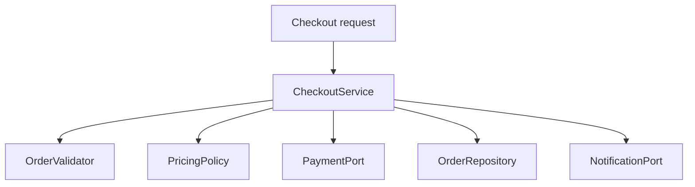

The application service still coordinates the use case. The validator owns validation rules, the pricing policy owns price calculation, and adapters implement payment and notification integrations. This illustrates SRP and DIP; Strategy can represent variable pricing rules. You do not need a design pattern for every dependency.

A practical refactoring sequence is:

1. Add tests around the existing checkout behavior, including invalid input and payment failure.
2. Extract pure calculations first because they are easiest to test.
3. Define interfaces only at meaningful boundaries, such as an external payment provider.
4. Move persistence and notification behind collaborators.
5. Keep the order's legal state transitions inside the domain model.
6. Re-run tests after each change rather than performing one large rewrite.

**Interview point:** SOLID is not a scorecard. Explain which change becomes easier, which dependency is isolated, and what additional complexity the abstraction introduces. If a small, stable feature is clearer as one class, keeping it simple can be the more maintainable choice.

### Q22. How do SOLID principles reinforce one another?

The principles overlap, but they answer different questions:

| Principle | Design question | Typical warning sign |
|---|---|---|
| SRP | Does this module have one coherent reason to change? | One class owns pricing, persistence, and delivery |
| OCP | Can likely variations be added without rewriting stable decision logic? | A growing switch over provider types |
| LSP | Can each implementation honor the contract callers rely on? | A subtype rejects an operation the base type promises |
| ISP | Do clients depend only on capabilities they need? | A client must implement irrelevant methods |
| DIP | Does business policy depend on stable contracts rather than volatile details? | Domain logic constructs vendor SDK clients directly |

Do not try to maximize all five in isolation. A highly fragmented design may technically have small classes and interfaces but still be hard to follow. The goal is a coherent model with explicit boundaries, valid contracts, and a reasonable cost of change.

## 4. Creational patterns

### Q23. What is the Singleton pattern, and when should you use it?

Singleton ensures one instance is used within a defined scope. The key phrase is **defined scope**: a static singleton is usually one instance per class loader, not one instance across a cluster or every process. It can be appropriate for stateless, process-wide coordination, but global mutable singletons hide dependencies and make tests order-dependent.

For a lazy, thread-safe Java singleton, the initialization-on-demand holder idiom is concise:

```java
public final class ConfigurationRegistry {
    private ConfigurationRegistry() {}

    private static class Holder {
        private static final ConfigurationRegistry INSTANCE =
                new ConfigurationRegistry();
    }

    public static ConfigurationRegistry getInstance() {
        return Holder.INSTANCE;
    }
}
```

Class initialization safely publishes the instance. An enum singleton is also robust against ordinary serialization and reflection pitfalls. In a Spring application, a singleton-scoped bean is normally one bean instance per application context; it is not identical to a globally accessible GoF singleton. Prefer container-managed lifecycle and constructor injection for application services. Singleton scope does not make mutable fields thread-safe.

### Q24. What is the Factory Method pattern, and when should you use it?

Factory Method lets a creator decide which concrete product to instantiate while callers work with a product abstraction. In the classic GoF form, subclasses override a creation method; in everyday backend code, a small factory object or method that selects an implementation is also often called a factory. Be precise about which form you mean in an interview.

Consider a notification service that should not contain provider-specific construction logic:

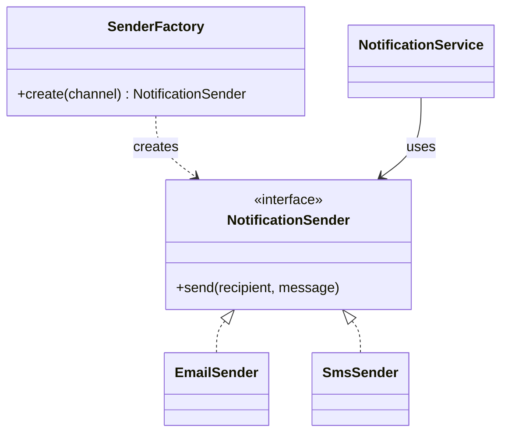

A compact factory implementation could be:

```java
interface NotificationSender {
    void send(String recipient, String message);
}

final class SenderFactory {
    private final NotificationSender email;
    private final NotificationSender sms;

    SenderFactory(NotificationSender email, NotificationSender sms) {
        this.email = email;
        this.sms = sms;
    }

    NotificationSender create(String channel) {
        return switch (channel) {
            case "email" -> email;
            case "sms" -> sms;
            default -> throw new IllegalArgumentException(
                    "Unsupported channel: " + channel);
        };
    }
}
```

This is a simple factory, not the strict subclass-based GoF Factory Method. It centralizes selection, while the caller still invokes the returned `NotificationSender` contract. In a Spring application, dependency injection can supply the implementations.

Use a factory when selection or construction is a meaningful responsibility—for example, configuration, provider setup, or mapping a requested type to an implementation. If the only operation is `new Foo()`, a factory may add unnecessary indirection. For a growing set of channels, a validated map of implementations may be easier to extend than a switch.

### Q25. What is the Abstract Factory pattern, and when should you use it?

Abstract Factory creates a **family of related products** through a common factory contract, so application code can use a compatible set without naming concrete classes. Think of a storage provider that supplies a reader and writer that must work together, or a UI toolkit that creates matching controls for one theme.

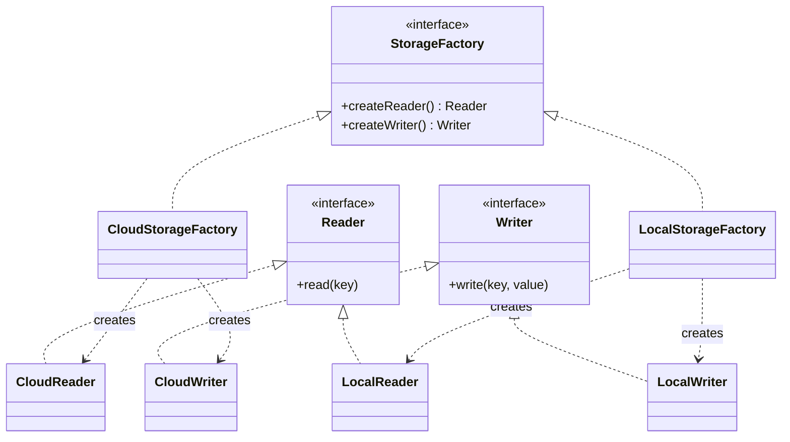

A simplified Java sketch:

```java
interface DocumentReader {
    String read(String key);
}
interface DocumentWriter {
    void write(String key, String content);
}
interface StorageFactory {
    DocumentReader reader();
    DocumentWriter writer();
}

final class LocalStorageFactory implements StorageFactory {
    public DocumentReader reader() { return new LocalReader(); }
    public DocumentWriter writer() { return new LocalWriter(); }
}
```

The concrete reader and writer types are omitted. The client receives one `StorageFactory` and asks it for both products, keeping the product family consistent. The example demonstrates the shape of the pattern; a real implementation would define error handling, resource lifecycle, and transaction semantics explicitly.

**Trade-off:** adding another family (for example, cloud storage) is straightforward once its factory is implemented, but adding a new product kind (such as a lister) requires extending the factory contract and every family. Use Abstract Factory when products truly vary together. If you only need to choose one implementation, a simple factory, dependency injection, or map lookup is usually simpler.

### Q26. What is the Builder pattern, and when should you use it?

Builder separates complex object construction from the final representation. It is useful when a type has many optional parameters, validation rules, or construction steps.

```java
public final class ReportRequest {
    private final LocalDate from;
    private final LocalDate to;
    private final boolean includeArchived;

    private ReportRequest(Builder b) {
        if (b.from.isAfter(b.to)) {
            throw new IllegalArgumentException("from must not be after to");
        }
        this.from = b.from;
        this.to = b.to;
        this.includeArchived = b.includeArchived;
    }

    public static class Builder {
        private final LocalDate from;
        private final LocalDate to;
        private boolean includeArchived;

        public Builder(LocalDate from, LocalDate to) {
            this.from = Objects.requireNonNull(from);
            this.to = Objects.requireNonNull(to);
        }
        public Builder includeArchived(boolean value) {
            this.includeArchived = value;
            return this;
        }
        public ReportRequest build() { return new ReportRequest(this); }
    }
}
```

The builder centralizes validation and avoids telescoping constructors. A record or ordinary constructor is simpler for a small value type with few required fields. Be careful with builders that allow invalid intermediate states to escape or that retain mutable collections without copying.

### Q27. What is the Prototype pattern, and when should you use it?

Prototype creates a new object by copying an existing configured object. It can be useful when object setup is expensive or there are many similar templates. Java's `Cloneable` and `Object.clone()` have awkward semantics, so an explicit copy constructor or `copy()` method is often easier to reason about.

Decide whether the copy is shallow or deep. Sharing immutable dependencies is usually fine; unintentionally sharing mutable nested state is not. Prototype is less compelling when construction is cheap and object creation is already clear.

### Q28. How do you choose among the creational patterns?

Use Builder for complex parameterized construction; Factory Method when a subtype or method chooses a product; Abstract Factory for related product families; Prototype for copying configured instances; Singleton only when a true single-instance lifecycle is required. These patterns are not mutually exclusive, but combining them should solve a real construction problem rather than increase pattern count.

---

### Q29. How do you choose a creational pattern based on the construction problem?

Use the construction problem—not the pattern name—to decide.

| Situation | Likely fit | Example |
|---|---|---|
| A single process-scoped instance is genuinely required | Singleton or container-managed singleton scope | Immutable configuration registry |
| The caller needs one implementation behind a common product contract | Factory Method / simple factory | Select a notification sender |
| Several related products must be compatible as a family | Abstract Factory | Build a UI theme's button, menu, and dialog |
| Construction has many optional steps or invariants | Builder | Create a complex search request |
| A new object is best initialized from an existing configured instance | Prototype | Clone a template with a few changes |

A common mistake is using Abstract Factory when a simple constructor or map lookup is enough. Another is using Singleton to make a dependency globally reachable. That hides coupling and can create shared mutable state. In Spring, a singleton-scoped bean means one bean instance per application context, not one object shared by every process in a distributed deployment.

#### Real-life example: building a notification sender

If an application only needs to choose among email and SMS implementations, a factory can centralize that choice:

```java
interface NotificationSender {
    void send(String recipient, String message);
}

final class NotificationSenderFactory {
    private final Map<String, NotificationSender> senders;

    NotificationSenderFactory(Map<String, NotificationSender> senders) {
        this.senders = Map.copyOf(senders);
    }

    NotificationSender forChannel(String channel) {
        NotificationSender sender = senders.get(channel);
        if (sender == null) {
            throw new IllegalArgumentException("Unsupported channel: " + channel);
        }
        return sender;
    }
}
```

The factory does not send notifications; it resolves the implementation. A service can then use the returned contract. In a dependency-injection framework, the map can be assembled by the container. This keeps object creation/selection separate from business behavior without introducing an elaborate factory hierarchy.

#### Builder: what problem does it solve?

Builder is useful when an object has many optional fields, validation rules, or construction steps. It is not automatically better than a constructor.

```java
SearchRequest request = SearchRequest.builder()
    .query("payments")
    .pageSize(50)
    .includeArchived(false)
    .build();
```

The example is illustrative; the key point is that `build()` should validate invariants and return a valid object. If the object has only two required fields, a constructor or record may be clearer. Avoid builders that permit invalid intermediate state to escape into application code.

## 5. Structural patterns

### Q30. What is the Adapter pattern, and when should you use it?

Adapter converts one interface into the interface expected by a client. It is especially useful for third-party SDKs, legacy APIs, or incompatible data models.

```java
interface TaxCalculator {
    Money taxFor(Order order);
}
final class LegacyTaxAdapter implements TaxCalculator {
    private final LegacyTaxClient client;
    LegacyTaxAdapter(LegacyTaxClient client) { this.client = client; }

    public Money taxFor(Order order) {
        LegacyTaxResponse response = client.calculate(order.toLegacyRequest());
        return Money.of(response.amount(), order.currency());
    }
}
```

The adapter isolates vendor-specific types and error mapping. It should translate semantics, not just rename methods. If the external API has different retry, timeout, or idempotency behavior, those details belong at the integration boundary too.

### Q31. What is the Decorator pattern, and when should you use it?

Decorator adds behavior around an object while preserving its interface. It supports stacking independent behaviors such as metrics, caching, or logging.

```java
interface Catalog {
    Item find(String id);
}
final class CachingCatalog implements Catalog {
    private final Catalog delegate;
    private final Map<String, Item> cache = new ConcurrentHashMap<>();

    CachingCatalog(Catalog delegate) { this.delegate = delegate; }

    public Item find(String id) {
        return cache.computeIfAbsent(id, delegate::find);
    }
}
```

This is illustrative: production cache code must define expiration, invalidation, failure caching, memory bounds, and whether `null` results are legal. A decorator is appropriate when the added behavior preserves the component's contract. It is not automatically appropriate for authorization if the wrapper can be bypassed through another path.

### Q32. What is the Facade pattern, and when should you use it?

Facade gives clients a small, purpose-oriented interface over a subsystem with several collaborators. A backend checkout facade might expose one `checkout()` operation while coordinating inventory, pricing, payment, and order confirmation. It reduces the knowledge a caller needs about the subsystem, but does not automatically make the underlying workflow transactional.

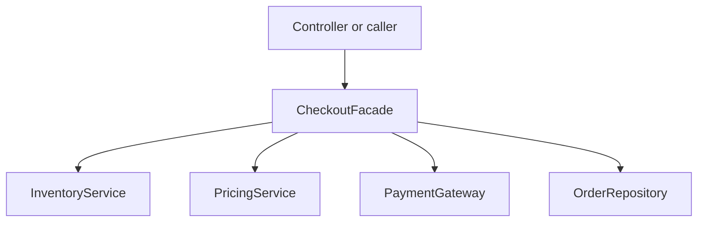

```java
final class CheckoutFacade {
    private final InventoryService inventory;
    private final PricingService pricing;
    private final PaymentGateway payments;
    private final OrderRepository orders;

    CheckoutFacade(InventoryService inventory, PricingService pricing,
                   PaymentGateway payments, OrderRepository orders) {
        this.inventory = inventory;
        this.pricing = pricing;
        this.payments = payments;
        this.orders = orders;
    }

    Order checkout(Cart cart) {
        inventory.reserve(cart);
        Money total = pricing.totalFor(cart);
        PaymentResult payment = payments.charge(cart.customerId(), total);
        if (!payment.approved()) {
            inventory.release(cart);
            throw new PaymentRejectedException();
        }
        return orders.createPaidOrder(cart, total, payment.reference());
    }
}
```

Supporting types are omitted. This is a simplified orchestration example, not production-grade payment handling: failures can occur between steps, and compensation may fail too. Real checkout flows need explicit transaction boundaries, idempotency, and a recovery strategy (often a saga or durable workflow) rather than assuming that a facade makes multiple systems atomic.

**Facade vs. Adapter:** an Adapter translates an incompatible interface; a Facade offers a simpler interface over a subsystem. A facade should coordinate a use case without absorbing every business rule or becoming a god object.

### Q33. What is the Proxy pattern, and when should you use it?

Proxy stands in for another object while exposing a compatible contract. It can control access, defer expensive creation, represent a remote object, or add lifecycle behavior. The client calls the proxy as if it were using the subject, while the proxy decides how and when to delegate.

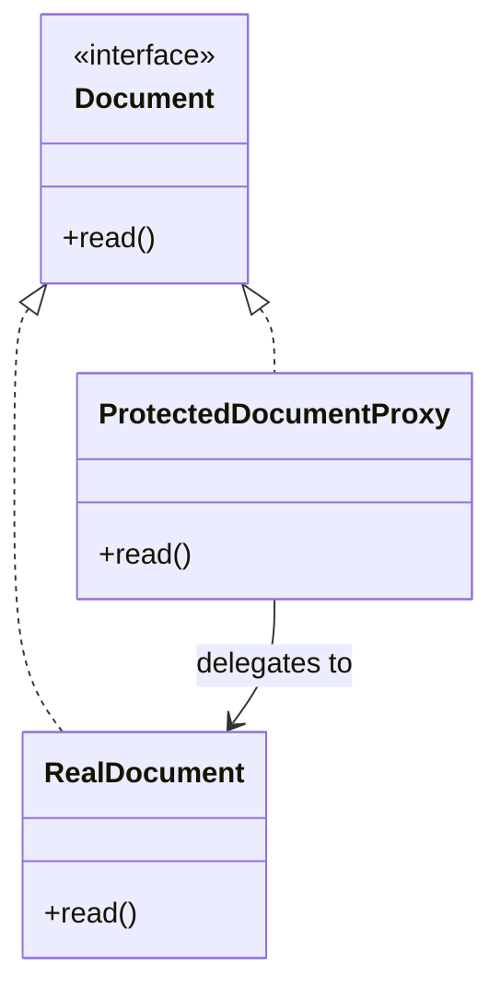

```java
interface Document {
    String read();
}

final class ProtectedDocumentProxy implements Document {
    private final Document target;
    private final AccessPolicy access;
    private final User user;

    ProtectedDocumentProxy(Document target, AccessPolicy access, User user) {
        this.target = target;
        this.access = access;
        this.user = user;
    }

    @Override
    public String read() {
        access.requireCanRead(user);
        return target.read();
    }
}
```

The access policy, user and real document are illustrative collaborators. The proxy is useful only if callers cannot bypass it through an unprotected path. For remote APIs, authorization must also be enforced at the server boundary; an in-process proxy is not a security boundary by itself.

**Proxy vs. Decorator:** their class structures may be identical. A Proxy controls access, creation, or indirection; a Decorator adds a responsibility while preserving the contract. Some real wrappers can serve both purposes, so explain intent rather than relying on the class shape alone.

### Q34. What is the Composite pattern, and when should you use it?

Composite represents individual objects and groups through a shared interface, so clients can apply the same operation to a leaf or a hierarchy. Common examples include file systems, organization trees, and nested UI components. Use it when the hierarchy is part of the domain; do not force every operation to make sense for every node if their semantics differ.

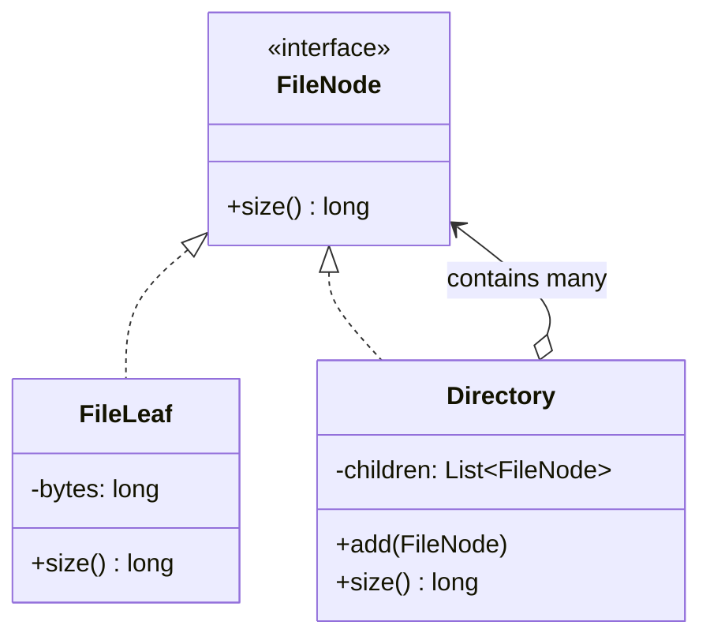

```java
interface FileNode {
    long size();
}

final class FileLeaf implements FileNode {
    private final long bytes;

    FileLeaf(long bytes) {
        if (bytes < 0) throw new IllegalArgumentException("bytes must be non-negative");
        this.bytes = bytes;
    }

    public long size() { return bytes; }
}

final class Directory implements FileNode {
    private final List<FileNode> children = new ArrayList<>();

    void add(FileNode child) { children.add(Objects.requireNonNull(child)); }

    public long size() {
        return children.stream().mapToLong(FileNode::size).sum();
    }
}
```

This demonstrates recursive aggregation. A production file system would also need rules for cycles, duplicate children, concurrent mutation, access control, and I/O errors. The shared interface makes aggregate operations convenient, but can be awkward if leaf and composite operations cannot honestly share a contract.

### Q35. What is the Bridge pattern, and when should you use it?

Bridge separates an abstraction from an implementation so both can vary independently. For example, a notification type (alert, digest) can be combined with delivery channels (email, SMS) without creating a subclass for every combination. Prefer composition of two dimensions over a combinatorial inheritance tree.

**Bridge vs Adapter:** Bridge is usually designed in advance to separate dimensions that should evolve independently; Adapter reconciles an existing interface with a client that expects another one. They can look structurally similar, but the design intent differs.

### Q36. What is the Flyweight pattern, and when should you use it?

Flyweight shares common immutable intrinsic state among many logical objects to reduce memory use. A text renderer might share font metadata while keeping character position and content as extrinsic state. The shared state must not contain per-object mutable data. Flyweight is useful only when profiling or scale justifies the added indirection.

### Q37. How do Adapter, Facade, and Decorator differ?

| Pattern | Main intent | Typical example |
|---|---|---|
| Adapter | Make incompatible interfaces work together | Wrap a vendor tax API |
| Facade | Simplify a subsystem | One checkout operation coordinates several services |
| Decorator | Add behavior while preserving an interface | Add caching or metrics around a catalog |
| Proxy | Control access or add indirection | Authorization check, lazy object, remote stub |

---

### Q38. How are structural patterns used in a backend service?

Structural patterns help assemble objects without making callers understand every implementation detail. Consider an order service that calls a third-party shipping API, needs metrics around calls, and uses a vendor SDK with a different interface.

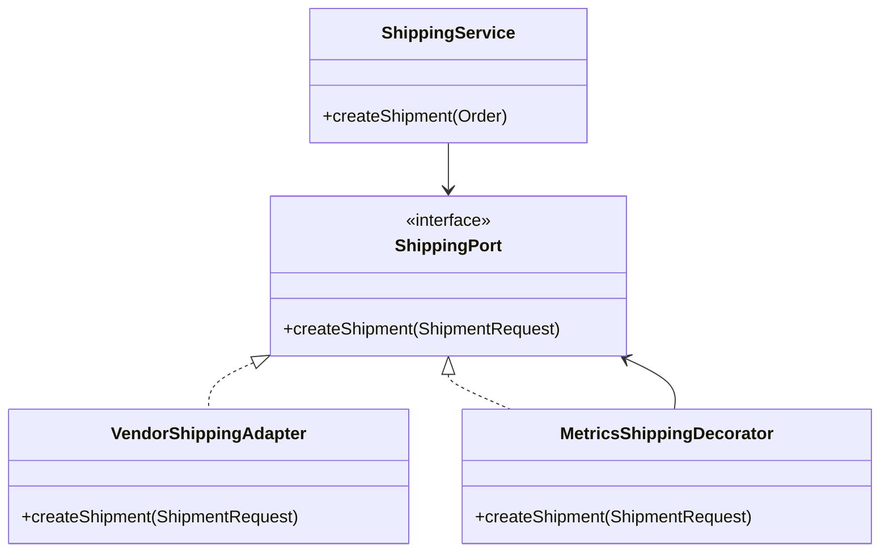

- **Adapter** translates the application's shipping contract into the vendor SDK's contract and maps the vendor response back.
- **Decorator** wraps the same contract to add metrics, tracing, caching, or retry behavior without changing the caller.
- **Proxy** controls access to an object, for example by enforcing authorization or lazy remote access. A proxy is not automatically a security boundary; enforcement must be complete and hard to bypass.
- **Facade** provides a simpler operation over several subsystem calls, such as `checkout()` coordinating inventory, payment, and order confirmation.
- **Bridge** separates two independent dimensions of variation, such as a notification abstraction from its delivery mechanism.
- **Composite** lets callers treat a group and an individual uniformly, as with nested folders and files.
- **Flyweight** shares immutable intrinsic state among many logical objects, as a text renderer might share glyph definitions.

The same wrapper structure can sometimes serve more than one purpose. Distinguish patterns by intent. If the wrapper translates an incompatible contract, call it an Adapter; if it preserves the contract while adding behavior, it is a Decorator.

#### Example: adding metrics with a decorator

```java
interface PaymentGateway {
    PaymentResult charge(PaymentRequest request);
}

final class MetricsPaymentGateway implements PaymentGateway {
    private final PaymentGateway delegate;
    private final PaymentMetrics metrics;

    MetricsPaymentGateway(PaymentGateway delegate, PaymentMetrics metrics) {
        this.delegate = Objects.requireNonNull(delegate);
        this.metrics = Objects.requireNonNull(metrics);
    }

    @Override
    public PaymentResult charge(PaymentRequest request) {
        long started = System.nanoTime();
        try {
            PaymentResult result = delegate.charge(request);
            metrics.recordSuccess(System.nanoTime() - started);
            return result;
        } catch (RuntimeException ex) {
            metrics.recordFailure(System.nanoTime() - started);
            throw ex;
        }
    }
}
```

Supporting types are intentionally omitted. The decorator preserves the `PaymentGateway` contract while adding instrumentation. In production, define whether checked exceptions, timeouts, cancellations, and failures returned as result values are counted as failures. Do not accidentally log card data or other sensitive request fields.

## 6. Behavioral patterns

### Q39. What is the Strategy pattern, and when should you use it?

Strategy encapsulates interchangeable algorithms behind one contract, allowing a caller to select or receive the policy without embedding every variant in a large conditional. Backend examples include shipping-price calculation, discount rules, payment routing, retry policies, and authorization policies.

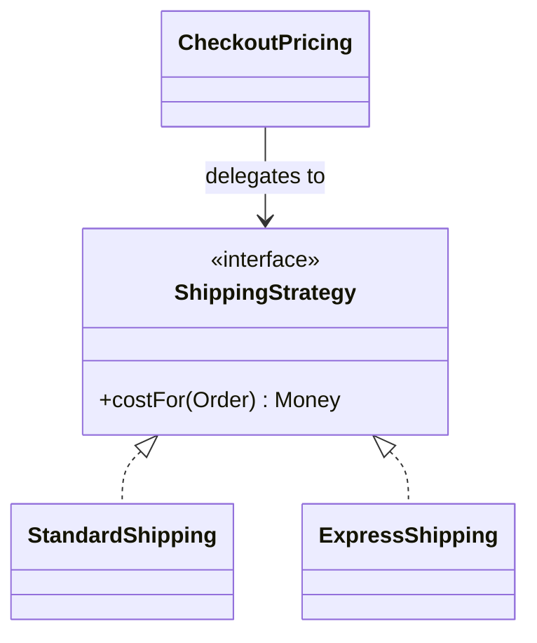

```java
interface ShippingStrategy {
    Money costFor(Order order);
}

final class StandardShipping implements ShippingStrategy {
    public Money costFor(Order order) {
        return Money.of("5.00", order.currency());
    }
}

final class ExpressShipping implements ShippingStrategy {
    public Money costFor(Order order) {
        return Money.of("15.00", order.currency());
    }
}

final class CheckoutPricing {
    private final ShippingStrategy shipping;

    CheckoutPricing(ShippingStrategy shipping) {
        this.shipping = Objects.requireNonNull(shipping);
    }

    Money shippingCost(Order order) {
        return shipping.costFor(order);
    }
}
```

The amounts are illustrative; real pricing must define currency, taxes, thresholds and rounding. The key is that `CheckoutPricing` delegates the variable algorithm through a contract, and tests can inject a deterministic strategy.

**When not to use it:** if behavior has one stable implementation or a short conditional is clearer, an interface may be unnecessary. Strategy is especially valuable when alternatives evolve independently or must be tested and selected separately.

### Q40. What is the Observer pattern, and when should you use it?

Observer defines a one-to-many relationship: a subject publishes a notification to registered observers when an event occurs. It is useful for in-process listeners, UI events, and domain events where publishers should not know the concrete listener types.

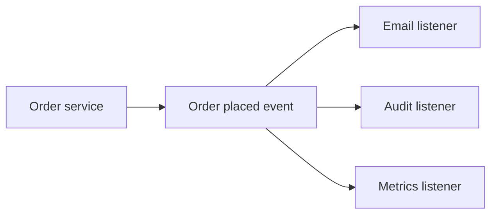

A small in-process version might look like this:

```java
interface OrderPlacedListener {
    void onOrderPlaced(OrderPlaced event);
}

final class OrderEvents {
    private final List<OrderPlacedListener> listeners = new CopyOnWriteArrayList<>();

    void subscribe(OrderPlacedListener listener) {
        listeners.add(Objects.requireNonNull(listener));
    }

    void publish(OrderPlaced event) {
        for (OrderPlacedListener listener : listeners) {
            listener.onOrderPlaced(event);
        }
    }
}
```

The event and listener implementations are omitted for focus. This example is synchronous: a slow listener delays the publisher, and an exception can interrupt later listeners unless failures are isolated deliberately. Decide whether listener order matters, whether one failure should block others, and how subscription lifecycle is managed.

Do not confuse in-process Observer with durable pub/sub. If an event must survive a process crash or reach another service, use durable messaging and handle publication consistency, retries, duplicate delivery, and schema evolution. A common backend approach is to persist the business change and an outbox record in one transaction, then publish the event asynchronously.

### Q41. What is the Command pattern, and when should you use it?

Command represents a request as an object. That makes it possible to queue, log, audit, retry, schedule, or route work without hard-coding the operation directly into the caller. It is particularly useful when requests need a lifecycle beyond an immediate method call.

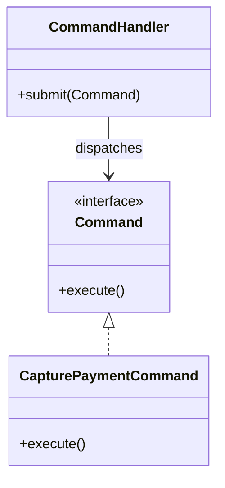

For example:

```java
interface Command {
    void execute();
}

final class CapturePaymentCommand implements Command {
    private final PaymentService payments;
    private final String paymentId;

    CapturePaymentCommand(PaymentService payments, String paymentId) {
        this.payments = payments;
        this.paymentId = paymentId;
    }

    @Override
    public void execute() {
        payments.capture(paymentId);
    }
}
```

This shows the shape of a command, not a complete payment implementation. The command handler or queue is responsible for dispatching it; the payment service still owns payment rules. For side-effecting commands, retries must be safe: use a durable command identifier or idempotency key and persist the outcome appropriately. Wrapping a call in a class does not itself provide retries, durability, or exactly-once execution.

### Q42. What is the Template Method pattern, and when should you use it?

Template Method defines the fixed outline of an algorithm in a base class and lets subclasses customize selected steps. It fits workflows whose order must remain stable but whose details vary—for example, a report-generation pipeline that always loads data, transforms it, and writes output, with a different transformation per report type.

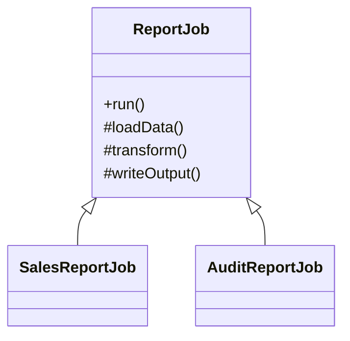

```java
abstract class ReportJob {
    public final void run() {
        var data = loadData();
        var result = transform(data);
        writeOutput(result);
    }

    protected abstract List<String> loadData();
    protected abstract List<String> transform(List<String> data);
    protected abstract void writeOutput(List<String> result);
}
```

The data type is deliberately simplified. Marking `run()` final protects the sequence from being reordered by subclasses. A real workflow must still handle errors, resource cleanup, retries and partial output.

**Trade-off:** Template Method uses inheritance, so subclasses are coupled to the base class's lifecycle and hooks. If several steps vary independently or need runtime replacement, injected strategies/composition are usually more flexible. Do not choose Template Method just to avoid writing a small helper method.

### Q43. What is the Chain of Responsibility pattern, and when should you use it?

Chain of Responsibility sends a request through an ordered sequence of handlers. Each handler may process it, reject it, or pass it to the next handler. It is useful when the order of checks is meaningful and handlers can be composed—for example, a request pipeline that checks authentication, input validity, rate limits, and business constraints.

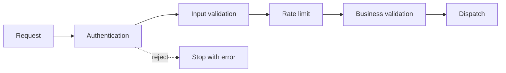

A minimal chain can use one common contract:

```java
interface RequestHandler {
    void handle(Request request);
}

final class ValidationChain {
    private final List<RequestHandler> handlers;

    ValidationChain(List<RequestHandler> handlers) {
        this.handlers = List.copyOf(handlers);
    }

    void handle(Request request) {
        for (RequestHandler handler : handlers) {
            handler.handle(request); // A rejection can throw or return a result.
        }
    }
}
```

The example uses exceptions to stop the loop; a result-based design can make rejection explicit. Define the ordering, stop behavior, error aggregation and whether handlers are pure or side-effecting. In a web framework, middleware/interceptor pipelines are related applications of this idea, though their exact lifecycle differs.

**Chain vs. Strategy:** Strategy chooses one algorithm for a task; a chain usually applies multiple handlers in sequence and may stop early. If all checks must always run and errors should be collected, a validation aggregator may be more accurate than a short-circuit chain.

### Q44. What is the State pattern, and when should you use it?

State models behavior that depends on an object's current lifecycle state. It can replace a growing collection of state-dependent conditionals when each state has meaningful behavior and transition rules. For a small lifecycle, an enum and a single guarded transition method are often simpler than a class per state.

For example, an order may allow payment only while pending and shipment only after payment:

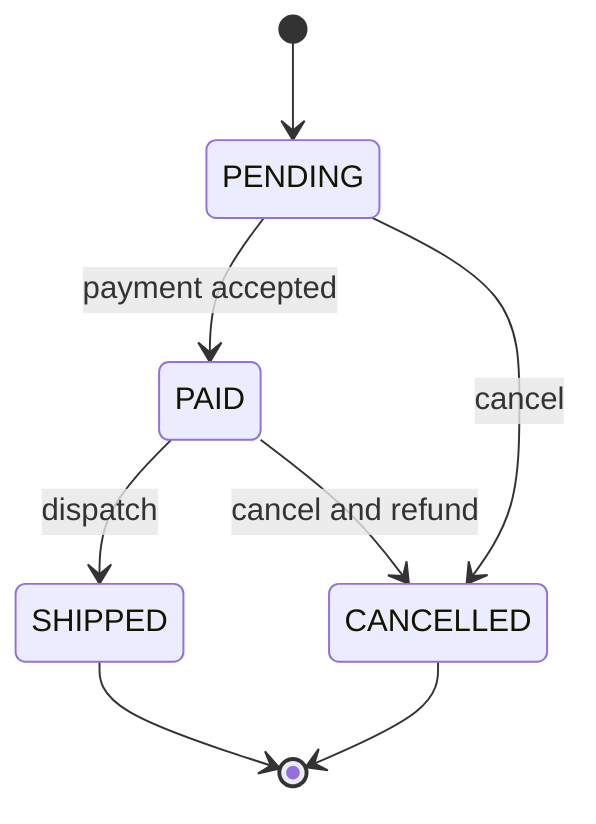

A minimal enum-based approach keeps transitions explicit:

```java
enum OrderStatus { PENDING, PAID, SHIPPED, CANCELLED }

final class Order {
    private OrderStatus status = OrderStatus.PENDING;

    void markPaid() {
        requireStatus(OrderStatus.PENDING);
        status = OrderStatus.PAID;
    }

    void ship() {
        requireStatus(OrderStatus.PAID);
        status = OrderStatus.SHIPPED;
    }

    private void requireStatus(OrderStatus expected) {
        if (status != expected) {
            throw new IllegalStateException(
                    "Expected " + expected + " but was " + status);
        }
    }
}
```

This is a guarded state transition, not a full GoF State implementation. Separate state classes become useful when each state has substantial, distinct behavior or the number of transitions makes the enum approach difficult to maintain. In a concurrent or persisted system, an in-memory check is not enough to prevent races: enforce the transition atomically with a database version, conditional update, lock, or other suitable coordination mechanism.

### Q45. What is the Iterator pattern, and when should you use it?

Iterator exposes sequential traversal without exposing the underlying representation. Java's `Iterator` and enhanced `for` loop are familiar examples. A custom iterator is useful for a specialized traversal or collection abstraction, but usually unnecessary when the standard collection contract suffices. Define behavior when the underlying collection changes during iteration.

### Q46. What is the Mediator pattern, and when should you use it?

Mediator centralizes interactions among collaborating objects to reduce direct peer-to-peer dependencies. A workflow coordinator can route events between UI components or domain collaborators. The danger is a mediator that becomes a god object; keep domain invariants in their owners and use the mediator for coordination.

### Q47. What is the Visitor pattern, and when should you use it?

Visitor separates operations from a stable object structure, often useful when many operations must be applied to a fixed family of node types, such as evaluating or rendering an AST. The trade-off is that adding a new node type can require updating every visitor. If the type hierarchy changes frequently, ordinary polymorphism or pattern matching may be simpler.

### Q48. What is the Memento pattern, and when should you use it?

Memento captures an object's state so it can be restored later without exposing internal representation. Undo features and editor history are common examples. Be deliberate about memory use, sensitive data, version compatibility, and whether external side effects can actually be undone. Restoring an in-memory snapshot does not reverse an email or a completed payment.

### Q49. What is the Interpreter pattern, and when should you use it?

Interpreter models a small language as expressions that can evaluate themselves or be evaluated by an interpreter. It can be useful for a limited rule DSL, query expression, or filter language. For complex languages, a parser and dedicated AST are more maintainable than nested string conditionals. Never evaluate arbitrary user-provided Java or script code just to implement a simple rule engine.

### Q50. How do Strategy, State, and Template Method differ?

- **Strategy:** the caller chooses one interchangeable algorithm, such as a pricing policy.
- **State:** the object's current state determines permitted behavior and transitions.
- **Template Method:** a base class fixes the algorithm sequence while subclasses override selected steps.

Use the simplest model that communicates the variation. A conditional is not a design failure when it is short, local, and stable.

### Q51. How do Observer and Pub/Sub differ?

Observer commonly connects an in-process subject directly to listeners. Pub/sub typically introduces a topic or broker that decouples publishers from subscribers, often across processes. Pub/sub raises additional concerns—durability, delivery semantics, ordering, retries, dead letters, and schema evolution—which are covered in the Distributed Systems and Kafka handbooks.

---

### Q52. How do behavioral patterns work together in a real workflow?

Behavioral patterns organize communication and the choice of behavior. The easiest way to understand them is to ask what is varying or communicating.

#### Strategy: choose one algorithm

A checkout can choose among pricing policies, routing policies, or payment selection rules. The caller uses a common interface and the chosen implementation performs the algorithm.

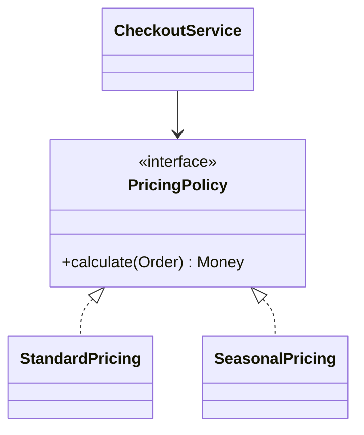

Use Strategy when alternatives represent interchangeable ways to perform the same job. It is usually better than a long conditional when the alternatives are expected to grow or change independently. A two-branch, stable rule may remain a conditional for clarity.

#### State: behavior depends on lifecycle

A payment behaves differently when it is created, authorized, captured, refunded, or declined. State design is about valid transitions, not merely storing a status string.

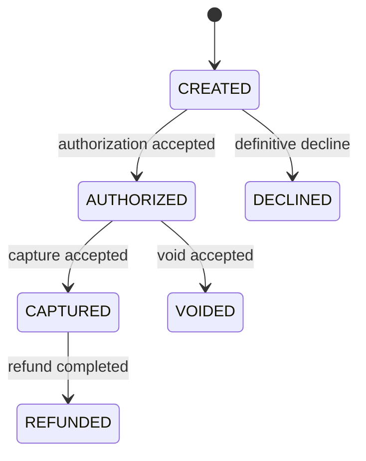

Reject illegal transitions explicitly. Do not allow arbitrary setters to change `CAPTURED` back to `CREATED`. A state enum plus guarded methods is often enough; State objects become useful when each state has substantially different behavior.

#### Command: represent a request as an object

A command packages an action and its parameters, such as `CancelOrder(orderId)` or `CapturePayment(paymentId)`. This makes it possible to queue, audit, retry, or authorize an operation consistently. But retries are safe only if the command's effects are idempotent or the system has a reliable deduplication mechanism.

#### Observer: notify registered listeners

Observer is useful when one in-process object needs to notify listeners that something changed. For example, a local order model may notify a UI view. For reliable communication between independent backend services, a durable message broker and explicit delivery semantics are usually more appropriate than an in-memory observer list.

#### Chain of Responsibility: try ordered handlers

A request may pass through authentication, validation, risk checks, and routing. Each handler either rejects, handles, or passes the request along. Make order and stop behavior explicit; otherwise an innocent reordering can change business semantics.

#### Template Method: keep a stable skeleton

A base workflow defines the order of steps while subclasses supply selected steps. This can work for stable algorithms with controlled variation, but it couples subclasses to the base-class lifecycle. Prefer Strategy/composition when the steps need to vary independently at runtime.

#### Pattern comparison

| Need | Better starting point | Why |
|---|---|---|
| Pick one interchangeable algorithm | Strategy | One policy is selected for the operation |
| Enforce legal lifecycle transitions | State or guarded enum transitions | Behavior depends on current state |
| Package an operation for queueing/audit | Command | The action becomes a value |
| Notify in-process listeners | Observer | One subject informs multiple dependents |
| Pass work through ordered handlers | Chain of Responsibility | A handler can handle or pass onward |
| Reuse a fixed algorithm skeleton | Template Method | The sequence is stable, selected steps vary |

## 7. Enterprise and backend application patterns

These are not all GoF patterns. They are architectural or enterprise application patterns that organize application boundaries and business behavior.

### Q53. What is Dependency Injection (DI), and how does it help?

DI supplies an object's collaborators from outside rather than letting it construct every dependency. Constructor injection makes required dependencies explicit and supports deterministic tests. Use field injection sparingly because it hides requirements and makes plain unit construction harder. Spring-specific bean lifecycle, scopes, proxies, and transaction integration belong in the Spring handbook.

### Q54. What is the Repository pattern, and what problem does it solve?

A Repository provides a domain-oriented interface for loading and saving aggregates while hiding persistence details. It should express operations the use case needs rather than exposing SQL, ORM sessions, or every low-level database operation to the domain.

```java
interface OrderRepository {
    Optional<Order> findById(OrderId id);
    void save(Order order);
}

final class PayOrder {
    private final OrderRepository orders;
    private final PaymentGateway payments;

    PayOrder(OrderRepository orders, PaymentGateway payments) {
        this.orders = orders;
        this.payments = payments;
    }

    void execute(OrderId id) {
        Order order = orders.findById(id)
                .orElseThrow(() -> new OrderNotFoundException(id));
        order.markPaid(payments.authorize(order.total()));
        orders.save(order);
    }
}
```

The domain types and provider behavior are illustrative. The example shows that the use case depends on an abstraction, not a concrete database implementation. In production, the transaction boundary and payment failure/uncertain-outcome behavior must be designed explicitly; a database transaction cannot roll back a remote payment.

A Repository is particularly useful when it protects aggregate boundaries or separates business logic from persistence technology. In straightforward CRUD code, a DAO or framework repository may be enough. Avoid creating an interface that only forwards every ORM method unchanged if it adds no meaningful boundary.

### Q55. What is the Service Layer pattern, and when is it useful?

A Service Layer defines application operations and coordinates domain objects, repositories, and external ports. It is a natural place for transaction boundaries and use-case orchestration. Keep domain rules in domain objects or policies where that makes them easier to protect and reuse. Avoid a service that becomes a large collection of unrelated business decisions.

### Q56. What is the Unit of Work pattern?

Unit of Work tracks changes made during a business transaction and coordinates persistence so related changes are committed together. ORM persistence contexts often provide this behavior. Conceptually, an order and its line items should not be persisted in contradictory states. A Unit of Work is not a distributed transaction across arbitrary services; cross-service workflows need different consistency strategies.

### Q57. What is the Specification pattern?

Specification encapsulates a business predicate so it can be named, tested, reused, and sometimes combined. For example, a discount may apply only to active customers whose order total crosses a threshold.

```java
@FunctionalInterface
interface Specification<T> {
    boolean isSatisfiedBy(T candidate);

    default Specification<T> and(Specification<T> other) {
        return candidate -> isSatisfiedBy(candidate)
                && other.isSatisfiedBy(candidate);
    }
}
```

A concrete specification can then express a meaningful business rule, such as `ActiveCustomer` or `MinimumOrderValue`, and callers can compose them. For small one-off conditions, a plain conditional is clearer; Specification is valuable when the rule has a domain name or is reused across use cases.

Keep in-memory predicates distinct from database-translatable specifications. An arbitrary Java lambda generally cannot be converted to SQL by a persistence provider. If the predicate must run in the database, define an explicit query representation or criteria-building mechanism and test that it matches the business semantics.

### Q58. What are DTOs and mappers, and why separate them from domain objects?

A DTO carries data across a boundary; a mapper converts between representations such as API requests, domain objects, and persistence models. DTOs prevent external API shape from dictating internal domain structure. Avoid blindly mirroring every field in every layer; mappings should be explicit about defaults, validation, nullability, and fields clients are not allowed to set.

### Q59. Transaction Script vs. Domain Model: how do they differ?

A Transaction Script organizes business logic as procedures for use cases and is often effective for straightforward CRUD workflows. A Domain Model represents business rules and state in collaborating objects and is useful when invariants and behavior become complex. Neither is universally superior. A small stable workflow may be clearer as a script; a complex lifecycle with many transitions may benefit from a richer domain model.

### Q60. Domain service vs. application service: how do they differ?

A **domain service** expresses a domain rule that does not naturally belong to one entity or value object. An **application service** coordinates a use case: load data, invoke domain behavior, persist results, and return a response. Application services should not become the only place where all business logic lives.

### Q61. What is Hexagonal Architecture (Ports and Adapters)?

Hexagonal Architecture keeps application/domain policy independent of external systems. A port is an interface the core needs or exposes; an adapter connects that port to a database, HTTP provider, message broker, or UI.

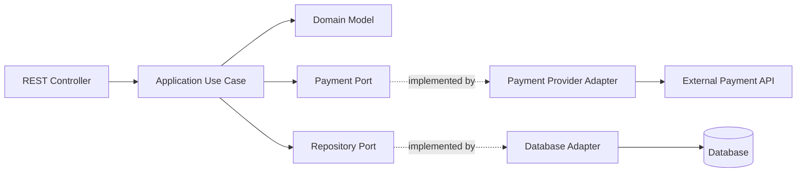

The point is dependency direction, not a required number of folders. An application can use ports and adapters without wrapping every library call in an interface. Keep abstractions at boundaries where change or testing justifies them.

### Q62. What is Clean Architecture?

Clean Architecture organizes code so source dependencies point inward toward stable business rules. Frameworks, databases, and delivery mechanisms remain outer details. It overlaps with Hexagonal Architecture but emphasizes concentric policy boundaries and dependency direction. It does not require four specific modules or prohibit pragmatic framework use; avoid letting architecture become more complex than the product.

### Q63. What is layered architecture, and what are its trade-offs?

A common backend uses controller/API, application/service, domain, and persistence/integration layers. Layers clarify responsibilities, but rigid layering can cause excessive pass-through classes. Avoid upward dependencies and do not let controllers or repositories silently own business rules. A modular monolith can preserve clear boundaries without the operational cost of separate services.

### Q64. What is a modular monolith, and when is it a good choice?

A modular monolith is deployed as one application but divided into modules with explicit APIs and ownership. It can provide strong domain boundaries, simpler transactions, and lower operational overhead than microservices. Modules should avoid reaching into each other's internals or sharing mutable tables without ownership rules. Extract a service only when deployment, scaling, team ownership, or isolation needs justify the cost.

### Q65. What is CQRS, and when should you consider it?

Command Query Responsibility Segregation separates operations that change state from models used to read state. It can simplify read models when query and write needs differ substantially, but adds synchronization, projection maintenance, and operational complexity. CQRS does not require event sourcing or separate databases. For ordinary CRUD, one model is often simpler.

### Q66. What are the Outbox pattern and anti-corruption layer?

The **Transactional Outbox** solves a common dual-write problem: a service must commit a database change and publish an event, but those operations cannot normally be made atomic together without stronger coordination. Store the business change and an outgoing-event record in the **same local database transaction**, then let a publisher deliver pending records.

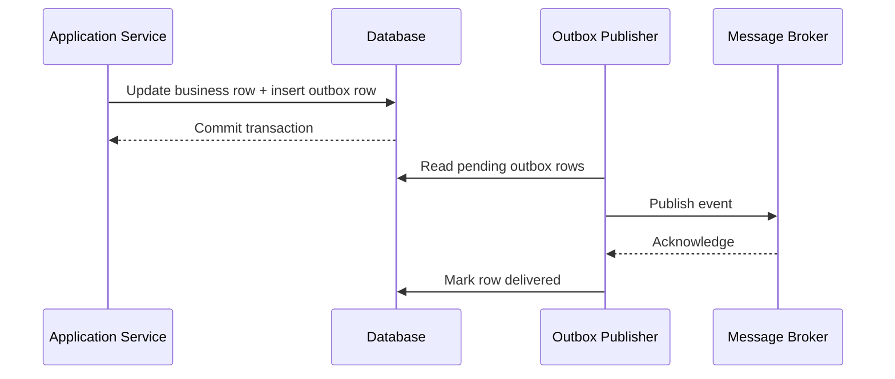

The atomic part is the database update plus outbox insert—not the later broker publication. A crash after publishing but before marking the row delivered can cause a duplicate publication, so consumers should be idempotent and the publisher should support retries and observability. Outbox does not provide exactly-once business effects end to end.

An **anti-corruption layer** protects the domain model from an external or legacy system's vocabulary and assumptions. It can translate DTOs, identifiers, statuses, errors, and lifecycle semantics into the application's own model. An Adapter may implement part of this layer, but the layer can include richer mapping and validation logic. Keep the translation at the boundary rather than spreading vendor-specific concepts throughout the domain.

See the Distributed Systems and Kafka handbooks for deeper treatment of retries, deduplication, delivery guarantees, and consumer behavior.

### Q67. How do backend architecture patterns fit together in a Java service?

These patterns are complementary rather than competing. A common Java backend request path may look like this:

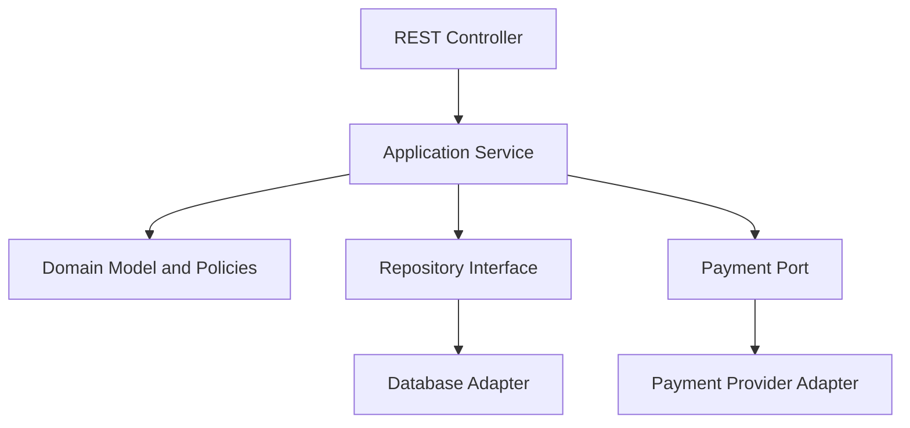

- The **controller** translates transport-level input into an application request and maps the result to HTTP.
- The **application service** coordinates the use case and transaction boundary.
- The **domain model** protects business invariants and state transitions.
- The **repository** provides collection-like persistence operations for domain objects without exposing SQL details to business policy.
- The **adapter** translates an external technology's API into the application's port.
- The **DTO and mapper** keep the public API representation separate from internal domain state.

For example, a controller should not calculate discounts, directly update payment state, and publish messages in one method. Nor should every single-line operation be split into a separate service. Put each rule where it is easiest to reason about and test.

#### Repository vs DAO

A DAO often emphasizes persistence operations and database mapping. A Repository presents a domain-oriented collection abstraction. In real code, the names overlap, and a Spring Data repository may perform both roles. The important question is whether business rules are leaking into SQL access code or persistence details are leaking into the domain model.

#### Application service vs domain service

An application service coordinates a use case: load an order, invoke domain behavior, persist changes, and return a result. A domain service represents a domain rule that does not naturally belong to one entity or value object. An application service should not become the home for all business calculations merely because it is already called by the controller.

#### CQRS: use it only when the read/write needs differ

CQRS separates the model used to change state from the model used to query it. It can help when reads need different projections, query volume is high, or read and write concerns evolve differently. It also introduces synchronization, duplicate models, and more operational complexity. CQRS does not automatically require separate databases, event sourcing, or microservices.

#### Outbox: commit state and publication intent together

If a service updates a database and publishes an event, a crash between those operations can leave the database updated but the event missing—or the event published even though the transaction rolls back. The outbox pattern writes the business change and an outgoing-event record in one local database transaction; a separate publisher delivers the event later. Consumers still need idempotency because delivery may be repeated.

## 8. Design principles, code smells, and refactoring

### Q68. What are DRY, KISS, and YAGNI?

- **DRY:** avoid duplicating knowledge or rules that must stay consistent. Similar-looking code is not always the same knowledge; premature generic helpers can make unrelated behavior harder to change.
- **KISS:** prefer the simplest design that correctly meets requirements. Simplicity is about cognitive load, not necessarily the fewest classes.
- **YAGNI:** do not build speculative capabilities before a real requirement justifies them. Leave clear extension seams where change is plausible, but do not build a universal plugin engine for one use case.

These principles can conflict. A small amount of duplication may be safer than coupling two policies that will evolve independently.

### Q69. How do you refactor a large conditional?

First identify what varies and whether the branches represent stable business concepts. Replace the conditional with Strategy when the alternatives are cohesive algorithms with independent lifecycle or testing needs. Use State when transitions and allowed actions depend on lifecycle state. Use a map when selecting a handler by key is the real problem. Keep a conditional when it is the clearest expression of a small fixed rule.

Refactor in small steps: add behavior tests, extract a method, introduce a type only if it clarifies the model, and run tests after each change. Avoid mixing a broad rewrite with a behavior change.

### Q70. What are common code smells?

- **God object:** too many unrelated responsibilities; split by cohesive behavior and ownership.
- **Long method:** mixed levels of abstraction or too many steps; extract named operations.
- **Primitive obsession:** domain concepts are represented by loosely validated strings/numbers; introduce value objects where they protect meaningful invariants.
- **Feature envy:** a method repeatedly reads another object's data to make its decisions; consider moving the behavior to the data owner.
- **Shotgun surgery:** one policy change requires edits across many unrelated files; find the missing abstraction or boundary.
- **Deep inheritance:** behavior and invariants become hard to trace; prefer composition when behavior varies independently.
- **Anemic domain model:** entities only hold data while all meaningful rules live in services. This can be appropriate for simple CRUD; it is a smell when complex invariants are scattered and easy to bypass.
- **Over-abstraction:** layers and interfaces that add navigation but no meaningful boundary.

### Q71. How do you avoid primitive obsession?

Create types for concepts with validation or domain meaning: `EmailAddress`, `Money`, `BookingInterval`, `OrderId`, or `Percentage`. This can make invalid states harder to express. Do not wrap every string in a class; introduce a value object when it protects a rule, clarifies an API, or prevents unit mix-ups.

### Q72. How should an API or interface be designed?

Make valid use explicit, avoid surprising side effects, choose names that describe business intent, and define error behavior. Prefer one method that expresses a complete invariant-preserving operation over a sequence of getters and setters that callers must coordinate correctly. Keep interfaces small enough for consumers to understand, but not so fragmented that simple tasks require navigating many abstractions.

### Q73. How do you balance clean design with delivery constraints?

Start with a correct, understandable design for current requirements. Add an abstraction when there is real variation, a boundary to isolate, or a testability problem. Keep extension points narrow and observable. A pragmatic implementation with one clear conditional can be better than a pattern-heavy design. The interview answer should explain what you chose, what you deliberately deferred, and what evidence would trigger a refactor.

---

### Q74. How do you refactor toward a better design?

When code becomes hard to change, do not immediately introduce patterns. Identify the source of the pain first.

1. **Duplicated rule:** extract a shared function or policy only if the behavior really has the same meaning.
2. **Growing type switch:** consider polymorphism or Strategy if each branch is a stable, meaningful variation.
3. **Long parameter list:** introduce a parameter object or value object when the fields form one concept.
4. **Primitive obsession:** replace raw strings, numbers, or booleans with domain types when validation or meaning matters.
5. **Feature envy:** move behavior closer to the data and invariants it uses, unless the logic belongs to a coordinating service.
6. **God class:** split by cohesive responsibilities and reasons to change, not by arbitrary line counts.
7. **Shotgun surgery:** group behavior that changes together behind a clear module boundary.
8. **Premature abstraction:** remove abstractions that add indirection without protecting a real boundary or variation.

#### Example: replace primitive values with a value object

A method accepting `String currency` and `BigDecimal amount` can be called with inconsistent combinations and repeated validation. A `Money` value object can define currency consistency and arithmetic rules in one place.

```java
record Money(BigDecimal amount, Currency currency) {
    Money {
        Objects.requireNonNull(amount);
        Objects.requireNonNull(currency);
        if (amount.signum() < 0) {
            throw new IllegalArgumentException("Amount cannot be negative");
        }
    }
}
```

This particular type is suitable only for non-negative amounts; a general accounting domain may need signed values for balances and adjustments. That is the lesson: domain types should encode the actual business rules, not assumptions borrowed from one use case.

Refactor in small steps with tests. A clean design is not the design with the most abstractions; it is the design where important rules are visible and changes have a predictable blast radius.

## 9. UML and communicating a design

### Q75. What are the essentials of a UML class diagram?

A class diagram shows static structure: classes, interfaces, attributes, operations, and relationships. Common notations include:
- Inheritance/generalization: solid line with a hollow triangle pointing to the parent.
- Interface realization: dashed line with a hollow triangle pointing to the interface.
- Association: a structural relationship between objects.
- Aggregation: hollow diamond at the whole side; shared-part semantics are often weakly defined in practice.
- Composition: filled diamond at the owning whole; implies strong ownership/lifecycle coupling.
- Multiplicity: `1`, `0..1`, `*`, or `1..*` at association ends.

Do not use composition just because one object has a field referencing another. Ask whether the part's lifecycle is owned by the whole and whether it can meaningfully exist independently.

### Q76. What are the essentials of a UML sequence diagram?

A sequence diagram explains how participants interact over time. Lifelines represent participants; arrows represent calls or messages; return arrows are optional. Use it to show a critical path, not every getter. Mark external boundaries and failure branches when those affect correctness.

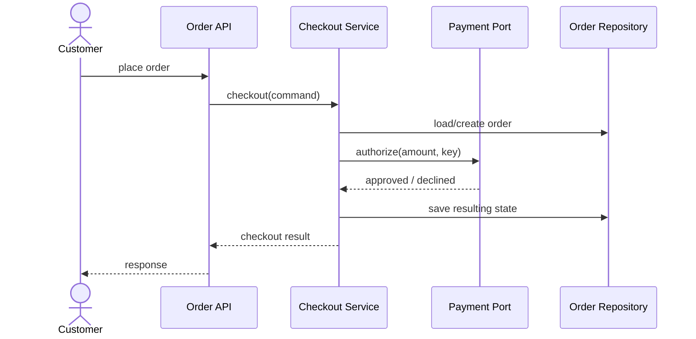

This is a conceptual flow. A real design must specify transaction boundaries and how payment-provider side effects are reconciled if saving the result fails.

### Q77. What are state diagrams and activity diagrams used for?

A state diagram models states and legal transitions of one entity or process. It is useful for orders, bookings, payments, and vending machines. An activity diagram models a workflow with decisions, parallel steps, and alternative paths. Use a state diagram when lifecycle validity is the central concern; use an activity diagram when process flow is the concern.

### Q78. How do you translate requirements into classes?

Underline nouns as candidate concepts and verbs as candidate operations, but do not mechanically create a class for every noun. Identify ownership, invariants, lifecycle, and likely change points. A noun may be a value object, an enum, an external system, or merely a field. A verb may be a method on an entity, a domain policy, or an application use case.

### Q79. How should you explain your design aloud?

Begin with assumptions and invariants. Present the main classes and their responsibilities. Walk through one successful use case and one failure or race condition. Explain why a pattern is useful and what would be simpler if the requirements were smaller. End with persistence, concurrency, and extension points. This makes your reasoning auditable and invites useful discussion.

---

### Q80. How do you represent relationships correctly in UML?

Class diagrams are useful only when the relationships communicate real design intent.

| Relationship | Meaning | Example |
|---|---|---|
| Association | One object knows or collaborates with another | `OrderService` calls `PaymentGateway` |
| Dependency | A temporary use, often as a parameter or local variable | A mapper uses a date formatter |
| Aggregation | A whole refers to parts that can exist independently; semantics are often domain-specific | A team refers to employees |
| Composition | Strong ownership/lifecycle relationship; the part is owned by the whole | An order owns its line items in a simple order model |
| Generalization | Inheritance or subtype relationship | `CardPayment` implements `PaymentMethod` |
| Realization | A class implements an interface | `StripeAdapter` implements `PaymentGateway` |

Do not use composition diamonds simply because one class has a field of another type. Ask whether the part's lifecycle is owned by the whole and whether it can meaningfully exist independently. UML is a communication tool, not a replacement for domain reasoning.

### Q81. How do you model a checkout workflow with a sequence diagram?

A sequence diagram explains the order of calls and the boundary where failures can happen.

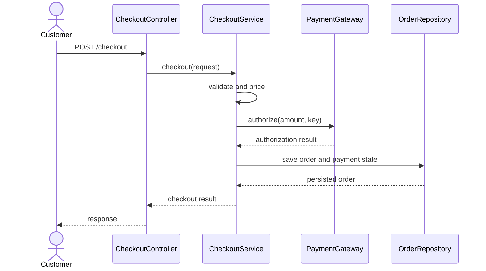

This is one possible flow, not a universal implementation. A real system must decide what happens if the payment provider succeeds but the database write fails, or if the provider times out after processing the request. The diagram helps expose these questions; it does not solve them by itself. Payment authorization/capture policy and transaction boundaries must be made explicit.

### Q82. When should you use class, sequence, state, and activity diagrams?

- Use a **class diagram** to communicate static structure: types, responsibilities, and relationships.
- Use a **sequence diagram** to show which participant calls which collaborator and in what order.
- Use a **state diagram** to show valid states and transitions for one lifecycle-bearing object.
- Use an **activity diagram** to show workflow branching, decisions, and parallel paths.

A common interview mistake is drawing only a class diagram. The interviewer may understand which classes exist but still not know how a use case succeeds or what happens on failure. For a typical LLD question, a small class diagram plus one sequence or state diagram is often enough. Add more only when they clarify a difficult part.

### Q83. What workflow should you follow in an LLD interview?

For a 35–45 minute interview, a reasonable approach is:

1. **Clarify the scope** and list the actors and primary use cases.
2. **State assumptions** instead of silently guessing.
3. **Write the core entities and value objects**, then identify the rules that must always hold.
4. **Assign responsibilities** and draw only the relationships needed for the main flow.
5. **Walk through one successful scenario** with a sequence diagram or numbered steps.
6. **Walk through one failure or race condition**, such as duplicate payment or simultaneous booking.
7. **Show extension points** only where variation is realistic.
8. **Discuss tests and trade-offs**, including what is intentionally out of scope.

For example, in a meeting-room scheduler, the key invariant is not simply “there is a Booking class.” It is “two confirmed bookings for the same room cannot overlap.” That invariant affects the repository operation, transaction/locking strategy, and concurrency tests. A strong design ties requirements to the classes and operations that enforce them.

## 10. Concurrency and thread safety in LLD

### Q84. What is shared mutable state, and why is it dangerous?

When multiple threads read and modify the same mutable state without a suitable coordination mechanism, operations can interleave and violate invariants. A thread-safe collection does not automatically make a multi-step business operation atomic.

For example, `if (inventory.available() >= quantity) inventory.decrease(quantity)` is unsafe if another thread can consume stock between the check and update. Put the check-and-reserve operation behind one atomic boundary, such as a synchronized aggregate in a single process or a conditional database update/transaction in a persistent application.

### Q85. How do synchronization, atomic variables, and concurrent collections differ?

Use synchronization or locks when several fields must change together under one invariant. Atomic classes are useful for individual atomic variables and compare-and-set loops, but they do not automatically make multi-object invariants safe. Concurrent collections protect their documented operations; check whether the full workflow is atomic. Choose the narrowest lock scope that preserves correctness, but avoid complicated nested locks without a clear ordering strategy.

### Q86. How do you handle booking race conditions?

Two requests may both observe a room as available and attempt to reserve the same interval. A process-local lock only coordinates threads in that process; it does not protect multiple application instances. A production booking system needs a durable conflict-prevention mechanism: for example, database constraints/locking or a serializable transaction appropriate to the schema. Re-check availability at commit time. A prior availability search is advisory, not a reservation.

### Q87. How do you handle inventory race conditions?

A conditional update can protect a single stock row:

```sql
UPDATE inventory
SET available = available - :quantity
WHERE sku = :sku
  AND available >= :quantity;
```

Treat one updated row as a successful reservation and zero rows as insufficient stock or a concurrent conflict. Validate that quantity is positive and decide how reservations expire or are released. Multi-SKU orders need an all-or-nothing policy, usually a transaction or a reservation workflow with explicit compensation.

### Q88. How do you design thread-safe rate limiters and caches?

Rate limiters need atomic accounting for tokens or request timestamps. Caches need explicit choices for concurrent loads, expiration, eviction, failure behavior, and invalidation. A `ConcurrentHashMap` can help with per-key atomic initialization, but a cache with maximum size and time-based expiration still needs a policy and lifecycle management. Discuss whether duplicate computation is acceptable and whether the stored value is immutable.

### Q89. What causes deadlocks, and how does lock granularity matter?

Deadlocks can occur when threads acquire the same locks in different orders. Reduce nested locking, keep critical sections short, establish a global lock ordering where multiple locks are unavoidable, and avoid calling unknown external code while holding a lock. Coarse locks simplify correctness but reduce concurrency; fine-grained locks improve parallelism at the cost of more complex reasoning. Measure before optimizing.

### Q90. How do you implement idempotent command handling?

An idempotent operation can be retried without producing an additional business effect for the same logical request. For payment or booking commands, associate a client-provided or generated idempotency key with the request and its result. Persist the key and outcome atomically with the business state where possible. Define behavior when the same key is reused with different request parameters. An in-memory set is not sufficient across restarts or multiple instances.

---

## 11. Testing design and maintainability

### Q91. How do you unit-test object behavior?

Test public behavior and domain invariants rather than private methods. For a booking, test valid creation, overlapping booking rejection, cancellation rules, and transitions after cancellation. Tests should state what the object guarantees, not how many internal helper methods it calls.

### Q92. Mocks vs. stubs vs. fakes: how do they differ?

- **Stub:** returns controlled answers for a test.
- **Mock:** records or verifies interactions when those interactions are part of the behavior being tested.
- **Fake:** a lightweight working implementation, such as an in-memory repository.

Use a fake repository for domain/service tests when it gives realistic behavior cheaply. Use mocks for external boundaries where a particular call or failure matters. Over-mocking makes tests brittle because harmless refactoring changes interactions without changing behavior.

### Q93. What is dependency injection and testability?

Inject required collaborators through constructors so tests can substitute fakes or deterministic implementations. Keep business logic independent of static clocks, random generators, and network clients when deterministic tests matter. A `Clock` abstraction can make time-dependent rules testable without sleeping. Do not create an interface solely to mock a trivial immutable value.

### Q94. What is testing state transitions and invariants?

Use table-driven tests for permitted and forbidden transitions. Verify both state and observable effects. For example, a cancelled order should not be shipped; a rejected payment should not mark an order as paid. Property-based testing can be useful for arithmetic, interval overlap, and invariants across many generated inputs.

### Q95. What is testing concurrent behavior?

Test the invariant, not a specific thread schedule. Use barriers/latches to arrange simultaneous attempts and verify that only the permitted number succeeds. Avoid arbitrary sleeps, which are flaky. For database concurrency, integration tests against the actual database engine are often needed because an in-memory fake cannot reproduce isolation and locking behavior.

### Q96. What is refactoring safely?

Add tests around current behavior, change one responsibility at a time, and keep commits small. When introducing a pattern, verify that the new abstraction reduces coupling or clarifies variation. A pattern that makes tests harder to understand is a signal to reconsider it.

---

## 12. LLD case studies

Use these as LLD interview practice prompts. This section intentionally contains only the question and problem statement; solutions and coding implementations will be maintained separately in a different repository.

### Q97. Design a Parking Lot

Design a parking-lot system for a facility with multiple floors and different types of parking spots. Vehicles receive a ticket on entry and complete payment before exiting. Account for spot allocation, parking fees, a full facility, lost tickets, and payment failures.

### Q98. Design an Elevator Controller

Design a controller for a building with multiple elevator cars and floors. Support hall calls, in-car destination requests, elevator assignment, stop scheduling, and cars becoming unavailable.

### Q99. Design a Library Management System

Design a library system that supports catalogue search, physical book copies, checkout, return, renewal, reservations, borrowing limits, due dates, and overdue fees.

### Q100. Design a Vending Machine

Design a vending machine that supports product selection, stock checks, cash or electronic payment, dispensing, change return, cancellation, and failures such as sold-out products or a jammed dispenser.

### Q101. Design a Rate Limiter

Design a rate limiter that controls how frequently a client can call an API. Consider configurable limits, limiting algorithms, concurrent requests, and whether limits are local or shared across application instances.

### Q102. Design a Notification Service

Design a notification service that sends messages through channels such as email, SMS, and push notifications. Consider templates, recipient preferences, provider failures, retries, delivery status, and adding new channels.

### Q103. Design a Payment Processing System

Design a payment component that supports multiple payment providers and payment lifecycle operations such as authorization, capture, and refunds. Consider idempotency, duplicate requests, provider callbacks, timeouts, and uncertain payment outcomes.

### Q104. Design a Logging Framework

Design a reusable logging framework with named loggers, severity levels, structured events, configurable filtering, and multiple outputs such as console and file appenders. Consider asynchronous logging and failures in output handlers.

### Q105. Design an In-Memory Cache

Design a thread-safe in-memory cache with get, put, update, and remove operations. Support a capacity limit, an eviction policy such as LRU or LFU, and optional expiration.

### Q106. Design Splitwise and Expense Sharing

Design an expense-sharing application that supports groups, members, shared expenses, equal/exact/percentage splits, balance calculation, and settlements. Consider currency and rounding rules, expense edits, and optional debt simplification.

### Q107. Design a Food-Ordering System

Design a food-ordering system that lets customers browse menus, place orders, pay, and track restaurant preparation and delivery. Consider item availability, restaurant acceptance or rejection, cancellation, refunds, and duplicate order requests.

### Q108. Design a Hotel Booking System

Design a hotel booking system that supports searching for available rooms, reserving rooms for date ranges, confirming bookings, and cancelling reservations. Prevent conflicting bookings and consider payment, temporary holds, and concurrent attempts to reserve the last available room.

### Q109. Design a Ride-Booking System

Design a ride-booking system that matches riders with drivers and tracks a trip from request to completion. Support driver acceptance or rejection, trip status, fare calculation, cancellation, timeouts, and driver unavailability.

### Q110. Design a Meeting Room Scheduler

Design a meeting-room scheduler that supports availability search, booking creation and cancellation, room capacity and equipment requirements, and optional recurring meetings. Prevent overlapping bookings, including concurrent booking requests.

### Q111. Design an Inventory Management System

Design an inventory system that tracks stock by product and location. Support stock reservations, releases, fulfilment, adjustments, and reconciliation while preventing invalid quantities and duplicate inventory operations.

### Q112. Design a Task Scheduler

Design a task scheduler that supports one-time and recurring tasks, execution dispatch, cancellation, retries, and execution status. Consider process restarts, missed schedules, duplicate execution, time zones, and multiple workers.

### Q113. Design a File Storage and Metadata Management System

Design a file storage service that supports upload, metadata lookup, authorized download, deletion, and optional versioning. Consider large or multipart uploads, file validation, access control, interrupted uploads, and failures between file storage and metadata persistence.

### Q114. Design an ATM

Design an ATM that supports card/PIN authentication, balance inquiry, cash withdrawal, cash inventory, and receipts. Consider insufficient funds, unavailable denominations, hardware failure, and the case where an account is debited but cash is not dispensed.

### Q115. Design a Pub/Sub Event Dispatcher

Design an event dispatcher that allows publishers to publish typed events and subscribers to register handlers. Consider registration and unregistration, synchronous or asynchronous delivery, ordering, handler failures, and duplicate events.

### Q116. Design a Pluggable Rule Engine

Design a rule engine for evaluating business rules such as eligibility, pricing, or routing. Support rule registration, evaluation order, short-circuiting, conflicting matches, rule updates, and explaining why a result was produced.


---

## 13. Pattern selection and comparison

### Q117. How do you choose a design pattern quickly?

| Problem you observe | Pattern or technique to consider | First question to ask |
|---|---|---|
| Construction has many optional fields and invariants | Builder | Is a constructor or record already clear enough? |
| Caller must choose among implementations | Strategy | Is this behavior genuinely variable? |
| New implementation requires editing a growing switch | Polymorphism / Factory | Is the variation stable and meaningful? |
| Existing vendor interface does not match your contract | Adapter | What semantic translation is required? |
| Many operations share a complex subsystem | Facade | Is the facade becoming a god object? |
| Add caching/metrics without changing callers | Decorator | Does the wrapper preserve the contract? |
| Access or lifecycle must be controlled | Proxy | Is this a trusted enforcement boundary? |
| Object behavior depends on lifecycle state | State | Would an enum and guarded methods be enough? |
| Ordered handlers may stop or pass a request | Chain of Responsibility | Is ordering and stop behavior explicit? |
| Request should be queued, logged, retried, or audited | Command | Are retries idempotent? |
| Hierarchical leaves and groups share operations | Composite | Are operations meaningful for both? |
| Multiple related products must vary as a family | Abstract Factory | Do the products really vary together? |
| Algorithm skeleton is fixed but steps vary | Template Method | Would composition be more flexible? |
| Stable core must be isolated from external systems | Ports and Adapters | Which dependencies are volatile or hard to test? |

### Q118. Factory Method vs. Abstract Factory vs. Builder: how do they differ?

Factory Method chooses a product through a creation method, often overridden by subclasses. Abstract Factory creates a family of related products. Builder assembles one complex object through explicit construction steps. If an interviewer asks “Which pattern creates objects?”, clarify the construction problem before naming a pattern.

### Q119. Decorator vs. Proxy vs. Adapter vs. Facade: how do they differ?

Decorator keeps the same contract while adding behavior; Proxy keeps a similar contract while controlling access or indirection; Adapter translates an incompatible contract; Facade provides a simpler contract over a subsystem. Their structures can overlap—intent and responsibility distinguish them.

### Q120. Strategy vs. Chain of Responsibility: how do they differ?

Strategy chooses an algorithm to perform a task. Chain of Responsibility passes a request through potentially multiple handlers, often with short-circuiting. A list of validators can be a chain when order and stopping matter; a pricing algorithm selected for the whole order is more naturally Strategy.

### Q121. Inheritance vs. composition: how do they differ?

Choose inheritance when a stable subtype relationship satisfies the base behavioral contract. Choose composition when capabilities or policies vary independently, can be swapped, or should be tested separately. Composition introduces delegation, so use it where flexibility or ownership clarity repays the cost.

### Q122. When should you not use a pattern?

Do not use a pattern merely because it is on an interview checklist. A pattern is justified when it makes a recurring design problem easier to understand, change, test, or protect. For a stable two-branch rule, a conditional can be clearer than Strategy. For a simple object, a constructor beats Builder. For a straightforward CRUD application, a rich domain model may be unnecessary. Explain the simplest correct design first, then show how it would evolve.

---

## 14. Interview follow-ups and design review checklist

### Q123. What questions do interviewers commonly ask after your design?

- Which invariant does each class protect?
- What changes if a new payment method, channel, rule, or vehicle type is added?
- Why did you choose this pattern instead of a conditional or composition?
- Which parts are domain logic, application orchestration, and infrastructure?
- What happens if the external provider times out after performing the operation?
- Can two concurrent requests violate this invariant?
- Is a local lock enough when the application has multiple instances?
- What happens if the process crashes between two steps?
- How would you make the command idempotent?
- What would you mock, fake, or test with a real database?
- What is the simplest version you could ship today?
- What evidence would justify adding another abstraction?
- Which failure paths are deliberately outside the scope of this implementation?

### Q124. What is the final design checklist?

Before declaring an LLD answer complete, verify:

- [ ] Requirements and assumptions are explicit.
- [ ] Main use cases and invalid cases are identified.
- [ ] Entities, value objects, policies, and external dependencies are distinguished.
- [ ] Responsibilities are cohesive and invariants have a clear owner.
- [ ] Interfaces represent meaningful boundaries, not ceremony.
- [ ] Patterns solve a stated problem and alternatives are understood.
- [ ] Object lifecycle and state transitions are valid.
- [ ] Failure, retry, duplicate request, and concurrency behavior are addressed where relevant.
- [ ] Persistence and transaction boundaries are explicit when correctness depends on them.
- [ ] Tests can verify behavior without over-mocking implementation details.
- [ ] The code snippet is proportionate and not presented as production-ready when it is not.
- [ ] The design is understandable enough to explain aloud.

---

## 15. References

These references support further study; the explanations in this handbook are original summaries rather than reproduced book or article text.

1. Erich Gamma, Richard Helm, Ralph Johnson, John Vlissides, *Design Patterns: Elements of Reusable Object-Oriented Software* (GoF), Addison-Wesley.
2. Robert C. Martin, *Agile Software Development: Principles, Patterns, and Practices*, Prentice Hall.
3. Martin Fowler, [Refactoring](https://refactoring.com/) and [Catalog of Refactorings](https://refactoring.guru/refactoring).
4. Refactoring.Guru, [Design Patterns](https://refactoring.guru/design-patterns) — pattern intent, structure, and examples.
5. Oracle, [Java Documentation](https://docs.oracle.com/en/java/) — language, concurrency, collections, and platform behavior.
6. Java Language Specification, [Java SE specifications](https://docs.oracle.com/javase/specs/) — normative language semantics.
7. Martin Fowler, [Patterns of Enterprise Application Architecture](https://martinfowler.com/eaaCatalog/) — Repository, Service Layer, Unit of Work, DTO, and related patterns.
8. Alistair Cockburn, [Hexagonal Architecture](https://alistair.cockburn.us/hexagonal-architecture/).
9. Robert C. Martin, [The Clean Architecture](https://blog.cleancoder.com/uncle-bob/2012/08/13/the-clean-architecture.html).
10. Microsoft, [Cloud Design Patterns](https://learn.microsoft.com/en-us/azure/architecture/patterns/) — selected operational and integration patterns.
11. Martin Fowler, [CQRS](https://martinfowler.com/bliki/CQRS.html).
12. Martin Fowler, [Event Sourcing](https://martinfowler.com/eaaDev/EventSourcing.html) — useful adjacent reading; event sourcing is not required for CQRS.

### Related handbooks in this repository

- [Java Interview Handbook](../Java/Java-Interview-QA.md) — language fundamentals, collections, JVM, and detailed concurrency.
- [Spring Framework + Spring Boot Interview Handbook](../Spring/Spring-Interview-QA.md) — dependency injection implementation, transactions, framework behavior, and testing integration.
- [Hibernate + JPA Interview Handbook](../Hibernate-JPA/Hibernate-JPA-Interview-QA.md) — ORM behavior, persistence context, mappings, and query performance.
- [Microservices & REST APIs Interview Handbook](../Microservices-REST-APIs/Microservices-REST-APIs-Interview-QA.md) — API contracts and service boundaries.
- [Distributed Systems & Event-Driven Architecture Interview Handbook](../Distributed-Systems/Distributed-Systems-Interview-QA.md) — cross-service consistency, retries, sagas, and failure handling.
- [Apache Kafka Interview Handbook](../Kafka/KAFKA_INTERVIEW_GUIDE.md) — messaging semantics, producers/consumers, and operational behavior.
