# Microservices & REST APIs Interview Q&A Handbook

**Audience:** Java backend engineers with 4–6 years of experience preparing for senior software engineer and backend engineer roles.  
**Purpose:** A practical, interview-first reference covering service boundaries, HTTP semantics, API contracts, resilience, security, distributed consistency, delivery, and production troubleshooting.

This guide emphasizes the reasoning an experienced engineer should communicate: what a design does, why it fits, which assumptions it relies on, and how it fails. Examples are illustrative, not a claim that a complete application was executed. Check framework-specific APIs and configuration against the versions in your project.

## Contents

1. [Microservices fundamentals](#1-microservices-fundamentals)
2. [Communication and architecture](#2-communication-and-architecture)
3. [REST and HTTP semantics](#3-rest-and-http-semantics)
4. [REST API design and contracts](#4-rest-api-design-and-contracts)
5. [Reliability and resilience](#5-reliability-and-resilience)
6. [Security](#6-security)
7. [Distributed data and consistency](#7-distributed-data-and-consistency)
8. [Testing, deployment, and evolution](#8-testing-deployment-and-evolution)
9. [Observability and production troubleshooting](#9-observability-and-production-troubleshooting)
10. [Real-world interview scenarios](#10-real-world-interview-scenarios)
11. [References](#11-references)

## 1. Microservices fundamentals

### Q1. What are microservices, and what problems do they solve?

Microservices is an architectural style in which an application is split into independently deployable services organized around business capabilities. Each service owns a focused responsibility, exposes a contract, and can evolve without requiring every other service to be released at the same time.

The main benefit is not simply having smaller codebases. Teams can deploy, scale, and choose implementation details for a service independently when boundaries and operational practices support that independence. For example, an order service may manage order lifecycle while a payment service owns payment authorization and a notification service owns delivery of emails or SMS.

The trade-off is that in-process calls become network calls. The system now has partial failures, latency, distributed data, contract compatibility, service discovery, observability, and deployment coordination to manage. Microservices work best when the organization can operate them reliably and the domain genuinely benefits from independent ownership.


**Architecture sketch**

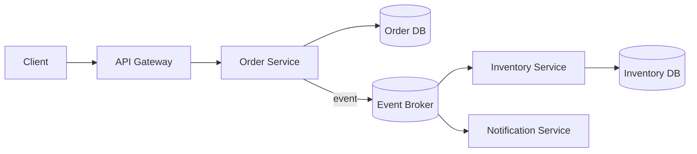

Each service owns its data; other services interact through contracts rather than writing its tables.
### Q2. Compare a monolith, a modular monolith, and microservices.

A monolith deploys the application as one unit. A modular monolith still deploys as one unit but enforces internal boundaries through modules, explicit interfaces, and controlled dependency direction. Microservices split those modules into independently deployed processes, typically with separate data ownership.

A monolith is often easier to debug and transact across because calls are local and one database transaction may cover a workflow. A modular monolith preserves much of that simplicity while improving code ownership and preventing a codebase from becoming an unstructured ball of dependencies. Microservices add deployment and scaling independence but also introduce network failure and distributed consistency costs.

A useful evolution path is often to modularize first, measure where independent scaling or release cadence is blocked, then extract a service when there is a clear business and operational reason. Splitting a poorly modularized monolith can simply distribute its coupling across the network.

### Q3. What are the main advantages and costs of microservices?

Advantages include independent deployments, scaling specific hot paths, clearer team ownership, fault isolation when designed correctly, and the ability to evolve a service's implementation independently. Teams may also choose different technologies where there is a genuine need, rather than by default.

Costs include network latency, partial failure, eventual consistency, duplicate delivery and retry handling, more complicated local development and testing, service discovery, secrets and certificate management, observability, infrastructure spend, and a larger operational burden. Data reporting can become harder when information is distributed across service-owned stores.

A senior answer should tie benefits to measurable needs: release frequency, scaling profile, team autonomy, or regulatory isolation. “Microservices are more scalable” is incomplete; a well-designed monolith can scale horizontally too. Microservices make selective scaling possible, but only when the architecture and workload justify the additional complexity.

### Q4. How do you decide service boundaries?

Start with business capabilities and domain language, not technical layers such as “controller service,” “database service,” or “common utilities service.” A service should have high cohesion—its behavior and data belong together—and low coupling to other services. Identify which business rules change together, which team owns the capability, and which invariants must be enforced atomically.

Domain-driven design (DDD) offers useful tools. A *bounded context* is a boundary within which a domain model and its terms have a consistent meaning. The word “Customer,” for example, may mean a billing account in one context and a delivery recipient in another. Sharing one universal model across contexts can create accidental coupling.

Validate boundaries against real workflows. If every change requires coordinated edits across five services, or every request synchronously calls many services, the decomposition may be wrong. Avoid both extremes: one giant service and a service per entity or database table.

### Q5. What are cohesion, coupling, and bounded contexts in practice?

Cohesion describes how strongly a module's responsibilities belong together. Coupling describes how much one module depends on another's internal behavior or release schedule. A bounded context establishes where a domain model and its language apply consistently.

Suppose an Order service owns order status and line items, while Inventory owns available stock. Order should not directly update Inventory's tables. It should use an explicit API or event contract. That boundary lets Inventory change its schema without silently breaking Order, provided the public contract remains compatible.

Low coupling does not mean no dependencies. It means dependencies are explicit, narrow, and stable. An API that leaks internal database tables or requires consumers to understand another service's persistence model is a weak boundary even if the services run in separate containers.

### Q6. What does “database per service” mean, and why is it recommended?

It means each service owns its data model and controls writes to its data store. The physical deployment may share a database server or cluster for operational reasons, but other services should not bypass the owner and write directly to its tables. Ownership is the important boundary; separate hardware is not the definition.

This prevents schema changes in one service from silently breaking another and lets each service enforce its own invariants. Other services obtain data through APIs or published events, sometimes maintaining a local read model.

The trade-off is that joins and transactions across service boundaries are no longer ordinary SQL operations. Cross-service reporting may need data pipelines or projections; workflows may become eventually consistent. If many services need frequent synchronous access to the same mutable data, reconsider whether the domain boundary is correct.

### Q7. What are common microservices anti-patterns?

Common anti-patterns include a distributed monolith where services must be deployed together; shared databases with cross-service writes; chatty request chains; one service per table; duplicated business rules that drift; synchronous calls for every step of long workflows; a “common” library that forces lockstep upgrades; and adopting many technologies without a team capable of operating them.

Another failure is treating a gateway or service mesh as a substitute for good service boundaries. Infrastructure can route, secure, and observe traffic, but it cannot decide which service owns a business invariant.

Look for symptoms rather than labels: coordinated releases, cascading outages, repeated data inconsistency, long lead times, or teams unable to test a service independently. Fixing the boundary or interaction pattern is usually more durable than adding another infrastructure layer.

### Q8. When should you not use microservices?

Avoid them when the product is small, the domain is not understood, one team owns the whole application, independent deployment is not valuable, or the organization lacks deployment automation and production observability. A modular monolith can provide clear boundaries without distributing every failure mode.

Microservices are not automatically faster, cheaper, safer, or easier to scale. They exchange local complexity for operational and distributed-systems complexity. Start with the simplest architecture that meets current requirements and preserve the option to extract a service when evidence supports it.

## 2. Communication and architecture

### Q9. When should services communicate synchronously versus asynchronously?

Synchronous communication, commonly HTTP request/response, is appropriate when a caller needs an immediate answer to continue: for example, checking whether a user is authorized before returning protected data. It is easy to understand, but the caller inherits the dependency's latency and availability.

Asynchronous communication, commonly messaging or events, is useful when work can finish later, multiple consumers need the same fact, or the producer should not wait for each consumer. It improves temporal decoupling but introduces eventual consistency, message replay, duplicate handling, schema evolution, and more complex debugging.

Choose based on business semantics, not fashion. A checkout might synchronously validate the request and create an order, then publish an event to trigger fulfillment. Do not make a user wait for an email service to send a confirmation if the business operation can be accepted independently.


**Choose the interaction style**

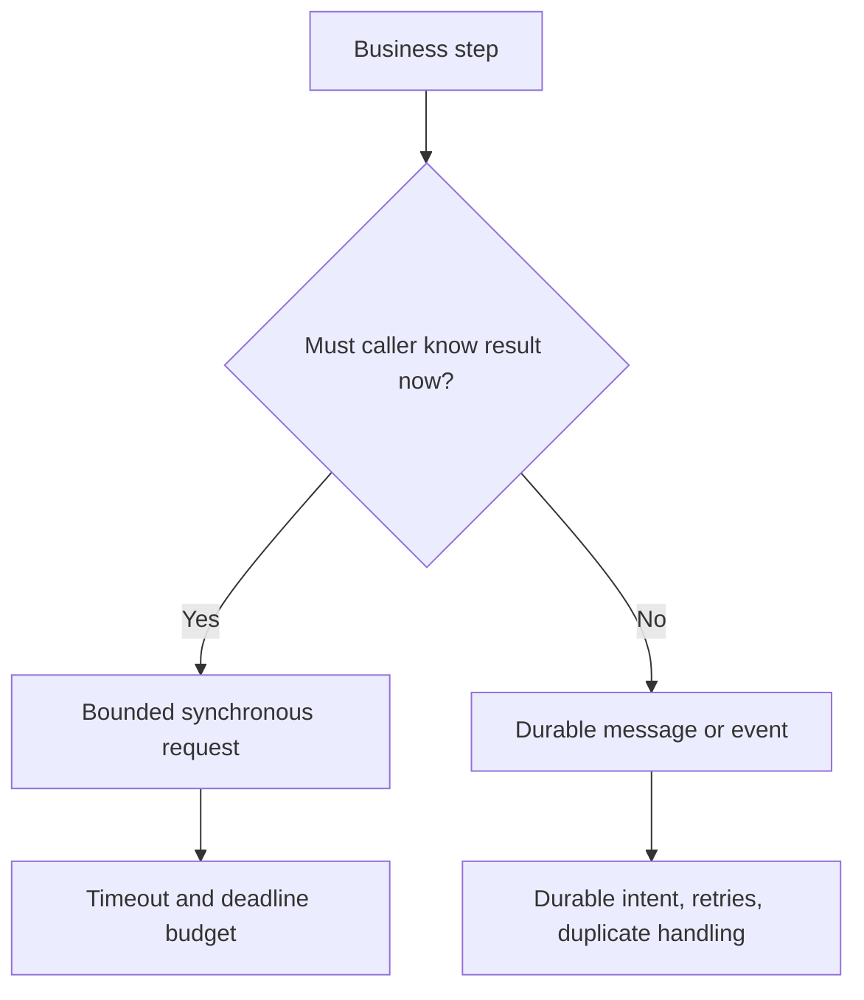
### Q10. Compare REST, RPC, and messaging.

REST uses resource-oriented HTTP semantics and standard methods/status codes; it is broadly interoperable and works well for public and internal APIs. RPC models calls as invoking operations on a remote service and may use HTTP/2 and a schema-driven protocol such as gRPC. Messaging sends records or commands through a broker so producers and consumers need not be online at the same time.

REST is often a natural choice for externally consumed CRUD-like APIs. RPC can be useful for strongly typed, low-latency service-to-service calls with generated clients. Messaging fits asynchronous workflows, fan-out, buffering, and event-driven integration.

None removes distributed failure. RPC still times out, REST is not automatically resource-oriented just because it uses HTTP, and messaging does not guarantee exactly-once business effects. Consider client diversity, latency, schema evolution, ordering, observability, and operational expertise.

### Q11. What is service discovery, and how does load balancing fit in?

Service discovery lets a caller find healthy instances of a logical service without hardcoding individual addresses. Depending on the platform, this may be provided by DNS, a service registry, a container orchestrator, or a service mesh. Load balancing chooses an instance among available candidates.

Client-side load balancing selects an instance in the caller; server-side load balancing sends traffic through a proxy or load balancer that selects the destination. Health checks and endpoint propagation matter: a stale registry can route traffic to an instance that has already disappeared.

Discovery is not resilience by itself. Callers still need timeouts, bounded retries, connection-pool limits, and sensible behavior when no healthy instance exists. Avoid assuming a discovered instance is guaranteed to remain healthy throughout a request.

### Q12. What should an API gateway do, and what should it not do?

An API gateway is an entry point that can route requests, terminate TLS, authenticate or enforce coarse-grained access policy, apply rate limits, normalize headers, and expose a stable external API. It can also support API analytics and request-size limits.

It should not become the home for core business logic or turn every request into a long chain of synchronous calls. Excessive orchestration at the gateway creates a central bottleneck and makes business behavior hard to test and reuse. Authorization decisions that depend on business ownership still need enforcement by the service that owns the resource.

A gateway is also not the same as a load balancer, though products may provide both functions. Use it when external API management or cross-cutting policy is needed, not merely because the system has more than one service.

### Q13. What is Backend-for-Frontend (BFF), and when is it useful?

A BFF is a backend layer tailored to a particular client experience, such as a mobile app and a web application. It composes data, adapts representations, and reduces the number of calls each client must make. It can help when client needs, release cadence, or network constraints differ significantly.

The danger is duplicating business logic or creating a separate BFF for every screen. Business invariants should remain in domain services; a BFF should mostly coordinate and shape data for its client. It also needs normal security, timeout, observability, and capacity controls.

Use a BFF when it measurably simplifies clients or avoids expensive round trips. For a single client with simple needs, a separate layer may add more deployment and maintenance cost than value.

### Q14. Why are chatty calls and fan-out risky?

A chatty design requires many small network calls to complete one user request. Fan-out sends a request to multiple dependencies, often in parallel. Both increase overhead and make latency depend on the slowest necessary dependency.

If a request needs all five downstream calls and each independently completes within a deadline only 99% of the time, the chance that all five meet that deadline is approximately \(0.99^5 \approx 95.1\%\), assuming independence. Real failures may be correlated, making the result worse. Parallel fan-out can reduce summed latency, but it does not eliminate tail-latency or availability risk.

Reduce unnecessary round trips, aggregate at an appropriate boundary, cache safe read data, or use asynchronous projections. Do not blindly parallelize every call: fan-out can overload downstreams and complicate cancellation and partial-result semantics.


**Fan-out and tail latency**

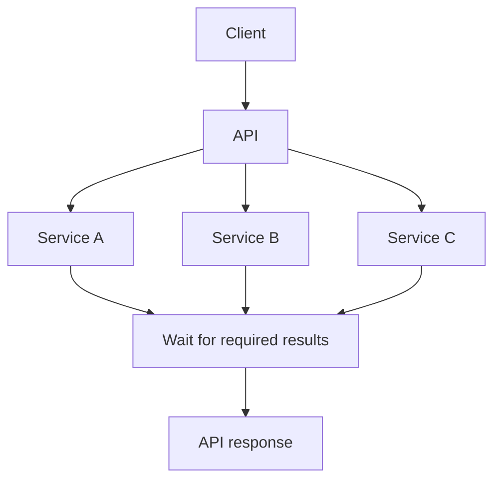

If every branch is required, the slowest branch gates the response. Parallel calls reduce summed latency but do not eliminate tail-latency or downstream-capacity risk.
### Q15. How should configuration and secrets be managed?

Separate deploy-time configuration from code: endpoints, feature switches, timeouts, and capacity settings should be environment-specific and changeable without rebuilding the application where practical. Secrets such as passwords, signing keys, and client credentials belong in a secrets manager or platform secret facility with access controls, rotation, and auditability—not in source control or container images.

Use least privilege and keep secret access scoped to the service that needs it. Plan rotation so old and new credentials can overlap briefly where supported. Avoid logging secret values, authorization headers, or full sensitive payloads.

Configuration changes also need validation and safe rollout. A syntactically valid but incorrect timeout or connection-pool value can cause a production incident. Expose non-sensitive effective configuration for diagnostics, while masking secret values.

## 3. REST and HTTP semantics

### Q16. What is REST, and is every JSON-over-HTTP API RESTful?

REST (Representational State Transfer) is an architectural style defined through constraints including client-server separation, stateless interactions, cacheability, a uniform interface, layered systems, and optionally code-on-demand. In practice, many APIs described as “REST APIs” use HTTP and resource-oriented URIs but implement only part of the full REST constraints.

A good practical HTTP API still benefits from using standard method semantics, status codes, representations, caching rules, and clear resource identifiers. JSON is a representation format, not what makes an API RESTful. An endpoint such as POST /doEverything can be a useful RPC-style HTTP API, but it is not strongly resource-oriented simply because the payload is JSON.

In an interview, describe the degree of RESTfulness honestly and focus on predictable contracts and correct HTTP behavior.

### Q17. Explain resources, URIs, and representations.

A resource is a conceptual target, such as an order or customer. A URI identifies that resource; a representation is a transfer format describing its current state or a result related to it. One resource may have multiple representations, such as JSON or XML, selected through content negotiation.

For example, GET /orders/123 identifies an order resource and might return a JSON representation containing its status and total. The representation need not mirror the database row. Exposing internal table structures couples the API to persistence and can leak fields consumers should not see.

Model URIs around stable nouns and use HTTP methods for standard operations. Use query parameters for filtering and pagination, and make relationship paths meaningful without creating excessively deep nested paths.

### Q18. Explain GET, POST, PUT, PATCH, and DELETE.

- **GET** retrieves a representation and is safe and idempotent by HTTP semantics.
- **POST** asks the target resource to process the enclosed representation according to its semantics; it is commonly used to create a subordinate resource or initiate an operation and is not inherently idempotent.
- **PUT** creates or replaces the state of the target resource with the supplied representation according to the API contract. It is idempotent in intended effect.
- **PATCH** applies partial modifications. Its idempotency depends on the patch operation and design.
- **DELETE** requests removal of the target resource association/state. It is idempotent in intended effect, even if repeated responses differ.

Do not use GET to trigger business mutations; crawlers, prefetchers, and caches may issue it unexpectedly. PUT and DELETE can still produce audit records on every attempt; idempotency refers to the intended effect, not identical response bytes or absence of all side effects. These semantics are defined by HTTP, while the exact application representation remains part of the API contract.


| Method | Typical intent | Safe? | Idempotent by HTTP semantics? |
|---|---|---:|---:|
| GET | Read representation | Yes | Yes |
| POST | Target-specific processing or create subordinate resource | No | Not generally |
| PUT | Create/replace target resource state | No | Yes |
| PATCH | Apply partial modification | No | Depends on operation |
| DELETE | Remove target resource state/association | No | Yes, in intended effect |
### Q19. What is the difference between safe and idempotent HTTP methods?

A safe method is intended to be read-only from the client's perspective. Idempotency means multiple identical requests have the same intended server effect as one request. GET is both safe and idempotent; PUT and DELETE are idempotent but not safe. POST is generally neither, although an application can design a particular POST operation to be safely retryable.

Idempotency matters because the client may lose the response after the server has committed the operation. The client cannot infer from a timeout that the server did nothing. A retry of an idempotent operation can converge on the same intended state; retrying a non-idempotent payment creation can charge twice unless the API provides deduplication.

HTTP method semantics are specified in [RFC 9110](https://www.rfc-editor.org/rfc/rfc9110.html). Application-level idempotency keys are a common convention for safely retrying operations that use POST.

### Q20. How do you choose HTTP status codes?

Use status codes to communicate the result class and next action, not as arbitrary labels.

- **200 OK:** request succeeded and a representation is returned.
- **201 Created:** a resource was created; a Location header is useful for identifying it.
- **202 Accepted:** processing was accepted but is not complete; explain how to check status if appropriate.
- **204 No Content:** success with no response body.
- **400 Bad Request:** the server cannot or will not process the request because of a client-side problem such as malformed syntax or invalid request data, according to the API contract.
- **401 Unauthorized:** valid authentication credentials are absent or unacceptable; despite the name, it means authentication is required or failed. A server generating 401 must send an applicable `WWW-Authenticate` challenge.
- **403 Forbidden:** the server understood the request but refuses it; re-authenticating as the same identity usually does not solve the authorization problem.
- **405 Method Not Allowed:** the method is known but not supported for this resource; the response must include an `Allow` header listing supported methods.
- **406 Not Acceptable:** the server cannot provide a representation matching the request's proactive content-negotiation preferences, when it chooses to honor them strictly.
- **415 Unsupported Media Type:** the request content format is unsupported, for example an unsupported `Content-Type`.
- **404 Not Found:** no current representation is found, or the server is unwilling to disclose that it exists.
- **409 Conflict:** the request conflicts with current resource state.
- **412 Precondition Failed:** a conditional request precondition failed.
- **422 Unprocessable Content:** content type and syntax are understood, but the instructions cannot be processed semantically.
- **408 Request Timeout:** the server did not receive a complete request within the time it was prepared to wait.
- **429 Too Many Requests:** rate limit exceeded; `Retry-After` may help, but clients should still use bounded backoff and honor the overall deadline.
- **500 Internal Server Error:** unexpected server failure.
- **502 Bad Gateway / 503 Service Unavailable / 504 Gateway Timeout:** commonly used to describe gateway upstream failure, temporary unavailability, and upstream timeout respectively.

Choose codes consistently and document them. Do not return 200 with an error object for every outcome; clients, monitoring, and intermediaries rely on HTTP semantics.


**Status-code decision sketch**

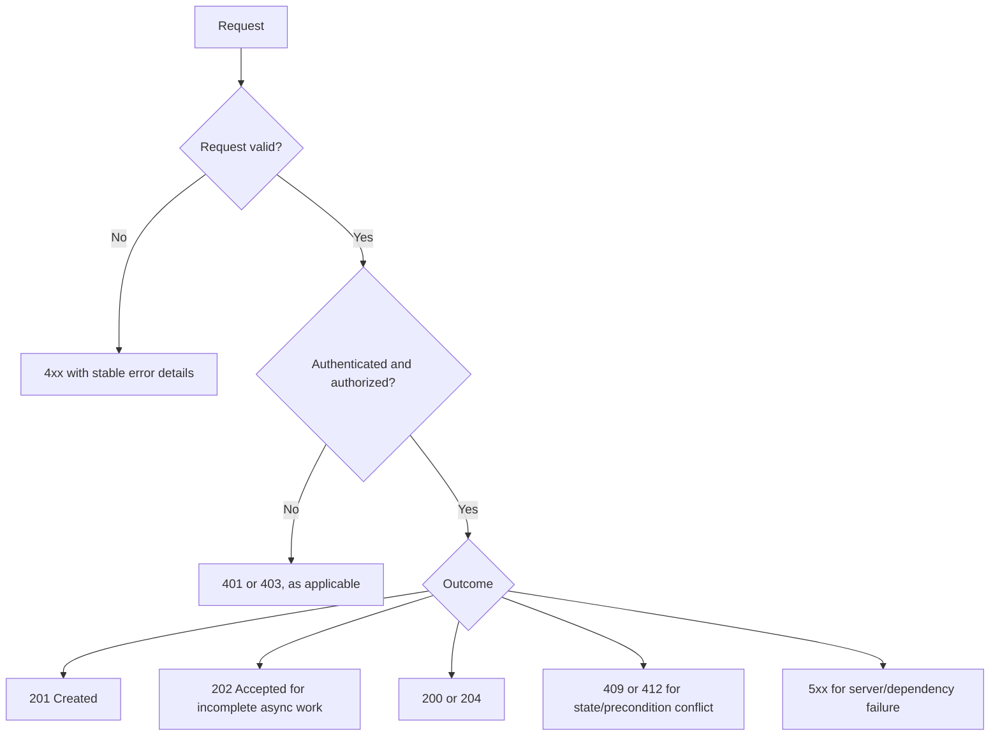

Use endpoint-specific semantics; this is a decision aid, not a universal mapping.
### Q21. What is the difference between PUT and PATCH?

PUT is generally used to replace the state of a target resource with the representation supplied by the client; omitted fields may therefore be treated as absent or reset according to the contract. PATCH describes a partial modification and can use formats such as JSON Merge Patch or JSON Patch.

For example, PUT /users/42 might require a complete editable user representation, while PATCH /users/42 could update only a display name. The API must define how omitted fields, explicit nulls, arrays, and validation behave. A patch that increments a counter is not idempotent unless designed with additional safeguards.

Partial updates also create concurrency concerns. Use ETags with If-Match or another optimistic concurrency mechanism when silently overwriting a newer version would be harmful.

### Q22. What are content negotiation and media types?

Content negotiation lets a client express acceptable response representations, commonly through Accept. Content-Type describes the media type of the request or response body. For JSON, a typical media type is application/json; a server may return 406 Not Acceptable if it cannot produce an acceptable representation or 415 Unsupported Media Type when it does not support the submitted content type.

Do not assume that every JSON-looking body is valid for every endpoint. Validate content type, schema, field constraints, and payload size. If an API supports vendor-specific media types or versioned representations, document the rules and test clients against them.

### Q23. How do ETags and conditional requests help?

An ETag is a validator associated with a representation. A client can send If-None-Match on a GET to ask whether its cached representation is still current; if unchanged, the server can return 304 Not Modified without sending the full body. A client can send If-Match on a write to require that the current representation matches a known validator, preventing a lost update.

For example, a client reads an order with ETag "v7", then attempts an update using If-Match: "v7". If another update has already changed the resource, the server rejects the stale write, commonly with 412 Precondition Failed. The client can reload and reconcile rather than overwriting newer state.

ETags can be strong or weak validators and must be generated according to the representation semantics. They are not automatically database version numbers, although a version field can be used to construct one if the mapping is sound.


**Optimistic concurrency example**

```http
GET /orders/123
ETag: "v7"

PATCH /orders/123
If-Match: "v7"
Content-Type: application/merge-patch+json

{"shippingAddress":"New address"}
```

If the representation changed after version `v7`, reject the stale write with `412 Precondition Failed`. The patch media type and ETag semantics belong in the contract.
### Q24. Explain HTTP caching and Cache-Control.

Caching reduces latency and load by reusing a stored response when its freshness and validation rules allow it. Cache-Control directives govern behavior: max-age defines freshness lifetime; no-cache allows storage but requires validation before reuse; no-store tells caches not to store the response. These directives are not interchangeable.

Publicly cacheable data can be served by shared caches, while private user-specific responses need careful controls. Incorrect cache keys or missing variation rules can leak one user's response to another. Use Vary when representation selection depends on request headers, and avoid caching sensitive data in shared caches without a deliberate security design.

Caching is not just a performance switch. It changes freshness guarantees and invalidation complexity. For rapidly changing data, conditional requests or a short freshness lifetime may be safer than attempting global cache invalidation.

## 4. REST API design and contracts

### Q25. What makes a good resource URI design?

Prefer stable plural nouns for collections and identifiers for individual resources, such as GET /orders and GET /orders/{orderId}. Use query parameters for filtering and pagination, for example /orders?status=OPEN&limit=50. Keep naming consistent and avoid exposing database-specific identifiers or table names when they are not part of the domain contract.

Nested resources can express containment, such as /orders/{orderId}/items, but deeply nested paths can be brittle. If an item has an independent identity and lifecycle, /order-items/{itemId} may be more appropriate. Model business actions explicitly when they are not naturally CRUD operations, rather than forcing every operation into an awkward resource shape.

### Q26. How should an API validate requests and return errors?

Validate at the boundary for syntax, required fields, type, length, range, allowed values, and cross-field constraints. Then enforce domain invariants inside the owning service. Boundary validation improves feedback, but it is not a replacement for authorization or business-rule enforcement.

Return a stable error schema with a machine-readable code, a human-readable detail, and field-level violations when helpful. Do not expose stack traces, SQL messages, internal hostnames, tokens, or sensitive input. Clients should branch on stable codes and status codes, not parse prose that may change.

RFC 9457 defines Problem Details for HTTP APIs. A response may use application/problem+json and include fields such as type, title, status, detail, and instance, plus documented extension fields. Keep the shape consistent across endpoints.


**Example error representation (illustrative)**

```json
{
  "type": "https://api.example.com/problems/validation-error",
  "title": "Request validation failed",
  "status": 422,
  "detail": "One or more fields are invalid",
  "errors": [{ "field": "quantity", "code": "must_be_positive" }]
}
```

Use `application/problem+json` where appropriate. Extension fields are API-defined; do not expose stack traces or internal exception details.
### Q27. How should pagination be designed? Offset versus cursor?

Offset pagination is simple: limit and offset (or page and size) make it easy to jump to a page, but large offsets can be expensive and concurrent inserts/deletes can shift results between pages. Always define a deterministic sort, ideally including a unique tie-breaker.

Cursor/keyset pagination encodes a position based on ordered values, such as createdAt plus id. It can be more efficient and stable for large, changing datasets, but jumping directly to an arbitrary page is harder and cursor tokens need validation and sometimes signing. The cursor should be opaque to clients and bound to relevant filters and sort order.

Choose based on access patterns. Admin screens may benefit from offset pagination; feeds and high-volume APIs often benefit from cursors. Set a maximum page size and define whether total counts are exact, approximate, or omitted.


**Pagination examples**

```http
GET /orders?limit=50&offset=100
GET /orders?limit=50&cursor=opaque-token
```

A keyset query may use a stable compound order, for example `WHERE (created_at, id) < (:lastCreatedAt, :lastId) ORDER BY created_at DESC, id DESC LIMIT :limit`, assuming the database supports tuple comparison. Match comparison direction to sort order and index; validate cursor state.
### Q28. How should filtering, sorting, searching, and field selection work?

Use documented query parameters such as status=PAID, sort=-createdAt, and q=term, with a defined grammar and allowed fields. Never concatenate raw user input into SQL or a query expression. Map external field names to an allowlist of known properties, validate sort direction, and impose limits on expensive search patterns.

Field selection can reduce payload size, but it increases representation variants and complicates caching and client compatibility. Search semantics should distinguish exact filters from full-text search and define case sensitivity, tokenization, and consistency expectations when relevant.

Set sensible limits, timeouts, and rate controls. A query endpoint is an API surface for resource consumption, not just a convenient database wrapper.

### Q29. What is API versioning, and which strategy would you choose?

Common approaches include URI versioning (/v1/orders), a custom or vendor media type, and a version header. URI versioning is explicit and easy to route, document, and debug. Header or media-type versioning can keep resource URIs stable but is less visible in logs and browser tools. There is no universally correct strategy; consistency and client tooling matter.

Prefer additive, backward-compatible evolution when possible: adding an optional response field is usually safer than renaming a field or changing its type. However, even additive changes can break clients with strict deserializers or exhaustive enum handling. Removing fields, changing meaning, tightening validation, or changing ordering can be breaking changes.

Version only when compatibility cannot be preserved economically. Multiple major versions create maintenance cost, so define support windows, usage metrics, migration guidance, and a deprecation process.

### Q30. How do you deprecate an API safely?

First identify consumers using access logs, client identifiers, telemetry, and direct communication. Publish the replacement contract and migration examples; provide a clear timeline; and, where applicable, use deprecation and sunset metadata. Measure actual usage rather than assuming all clients upgraded.

Run old and new versions in parallel long enough for consumers to migrate, and use contract tests or staged traffic to find differences. Avoid changing the old contract in place while clients still depend on it. Security vulnerabilities or legal constraints may require faster retirement, but communicate the impact and provide a mitigation path.

Deprecation is a product and coordination process, not merely deleting a controller method. Keep ownership clear so consumers know whom to contact.

### Q31. How do idempotency keys make POST operations retryable?

A client sends a unique key for one logical operation, often in an Idempotency-Key header. The server stores the key with the operation outcome under a scope such as authenticated customer plus endpoint. A repeated request with the same key and equivalent payload returns the original outcome rather than applying the operation again.

The implementation must be atomic enough to prevent concurrent duplicates from both executing. Store a payload hash or equivalent request identity, define behavior when a key is reused with a different payload, and retain records for a documented period. A database uniqueness constraint is often part of the protection.

Do not merely cache the HTTP response after performing the side effect: two concurrent requests could both charge before either response is stored. The idempotency record, business operation, and state transition must be coordinated carefully. For external payment providers, propagate their idempotency mechanism when available.


**Idempotency record schema sketch**

```sql
CREATE TABLE idempotency_record (
  principal_id VARCHAR(100) NOT NULL,
  idempotency_key VARCHAR(200) NOT NULL,
  request_hash VARCHAR(128) NOT NULL,
  operation_id VARCHAR(100) NOT NULL,
  status VARCHAR(30) NOT NULL,
  response_json CLOB,
  PRIMARY KEY (principal_id, idempotency_key)
);
```

Illustrative, not portable SQL: adapt types to your database. Reserve the key atomically and define what concurrent duplicates receive while the first request is in progress. Coordinate operation state with the business mutation so crashes do not create unrepeatable half-results.
### Q32. How should bulk APIs handle partial failures?

Define whether the batch is atomic or each item succeeds independently. An endpoint that processes 100 records may return an overall success with per-item outcomes, or reject the entire batch before applying anything. Neither behavior should be surprising or undocumented.

For partial success, include a stable item identifier, status, and structured error for each failed item. Consider limits on batch size, per-item validation, retryability, ordering, and whether one invalid item blocks others. For atomic batches, explain transaction-size limits and what happens when a remote side effect cannot roll back.

Bulk APIs can improve throughput by reducing round trips, but they amplify payload size, memory use, and failure complexity. Make retries safe at the item or batch level.

### Q33. What are correlation IDs and trace IDs? Are they the same?

A correlation ID is an identifier used to connect related log entries or business operations. A distributed trace ID identifies a trace made of spans across instrumented services. They may be linked, but they are not interchangeable: a single business operation may create multiple traces, and trace context also includes span and sampling information.

Accept or generate request identifiers at trusted boundaries, propagate context through supported HTTP and messaging instrumentation, and include it in structured logs. Do not blindly trust arbitrary client-provided IDs for security decisions; validate format and avoid letting clients forge misleading operational context.

Use W3C Trace Context where appropriate instead of inventing incompatible propagation headers. IDs make investigation easier, but they do not replace useful span attributes, metrics, or error details.

### Q34. What role do OpenAPI and Swagger play?

OpenAPI is a language-agnostic specification for describing HTTP APIs: paths, operations, parameters, request and response schemas, authentication schemes, and error responses. Tools often use OpenAPI documents to generate interactive documentation, clients, server stubs, and contract checks. Swagger is commonly used to refer to tooling around the OpenAPI specification.

Treat the API description as a contract that changes with the implementation. Review generated diffs, validate schemas in CI, and test examples against actual behavior. Generated clients can save time but may not handle custom errors, retries, pagination, or authentication exactly as the application needs.

Do not expose internal endpoints or sensitive schemas simply because documentation generation is enabled. Publish the intended public contract and secure internal documentation appropriately.

### Q35. How should an API handle long-running operations?

If work cannot reasonably complete within a synchronous request budget, accept the request and return 202 Accepted with a stable operation/status resource, or another clearly documented asynchronous contract. The client can poll the status endpoint, subscribe to a notification, or receive a callback where appropriate.

The operation resource should describe states such as PENDING, RUNNING, SUCCEEDED, and FAILED, including a safe result reference or failure code. Define retention, cancellation, retry behavior, and what happens if the client submits the same request again.

A 202 response does not mean the work succeeded; it means it was accepted for processing. The system must durably record the accepted operation before claiming acceptance, or it risks returning success while losing the work.

## 5. Reliability and resilience


**Asynchronous operation lifecycle**

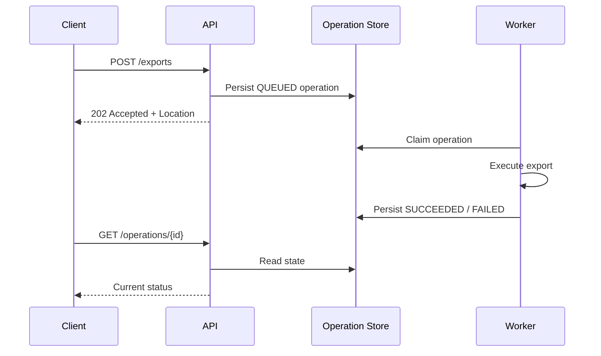

Persist the operation before acknowledging acceptance; retries and duplicate scheduling must also be safe.
### Q36. Why are timeouts essential in microservices?

A timeout bounds how long a caller waits for a dependency. Without one, a stuck network call can hold threads, connections, memory, and request context indefinitely, eventually exhausting resources and spreading failure. Configure connection establishment, response/read, and overall request deadlines deliberately; their exact names vary by client.

A timeout is not proof that the remote operation failed. The remote service may have committed a write and lost or delayed the response. For writes, pair timeouts with idempotency or a status/reconciliation mechanism.

Set budgets from the user-facing deadline and the call graph. If the overall request has 800 ms left, a downstream call should not be allowed to consume several seconds. Include queueing, connection acquisition, retries, and serialization in the end-to-end budget.

### Q37. How should retries use exponential backoff and jitter?

Retry only failures that are plausibly transient, and only when the operation is safe to repeat or protected by idempotency. Exponential backoff increases the delay after each failure; jitter randomizes that delay so many clients do not retry simultaneously. Honor server guidance such as Retry-After where appropriate.

For example, delays might grow from 100 ms to 200 ms to 400 ms, with a random component and a small attempt limit. This is illustrative, not a universal configuration. The total retry time must fit within the caller's deadline. Retry classification should be explicit: connection failures, selected 5xx responses, and 429/408 may be retryable depending on the operation and contract; most other 4xx responses indicate a request or authorization problem and should not be retried unchanged.

Retries at multiple layers multiply. If a gateway, client library, and service each make three attempts, one user request can produce many downstream attempts. Pick a clear retry owner, cap attempts and concurrency, and observe retry rates separately from original traffic.


**Retry budget pseudocode**

```text
for attempt in 1..maxAttempts:
    remaining = deadline - monotonicNow()
    if remaining <= 0: stop
    result = callWithTimeout(min(perAttemptTimeout, remaining))
    if result succeeded: return result
    if failure is not retryable or operation is unsafe to repeat: fail
    sleep(randomizedExponentialBackoff(attempt), capped by remaining)
fail clearly
```

This is pseudocode, not a drop-in implementation. The sleep and every attempt must fit inside the same end-to-end deadline.
### Q38. What is a circuit breaker, and what are its states?

A circuit breaker stops calls to a dependency that appears unhealthy so the caller can fail quickly instead of repeatedly consuming scarce resources. In the **closed** state calls flow and failures are measured. In **open**, calls are rejected immediately. In **half-open**, a limited number of probes test whether the dependency recovered; success can close the breaker and failure reopens it.

A breaker needs a meaningful failure predicate and thresholds. Counting every 4xx response as a dependency failure may open it during ordinary client validation errors; counting only connection errors may miss a dependency returning repeated 500s. Slow-call thresholds can also matter.

A breaker does not fix the dependency or guarantee graceful behavior. Define what the caller returns when calls are rejected, and combine the breaker with timeouts, bounded retries, and resource isolation.


**Circuit-breaker states**

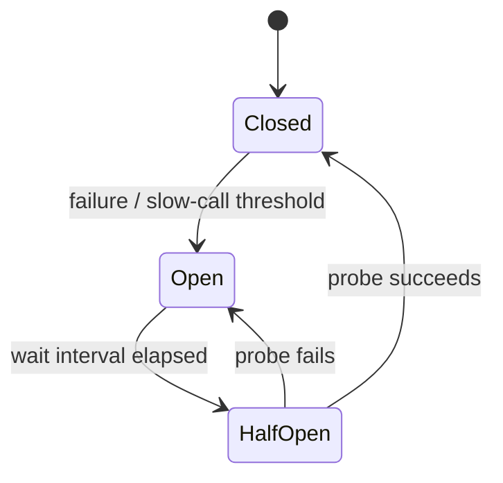

Half-open should allow only limited probes so recovery does not trigger a sudden traffic surge.
### Q39. What are bulkheads, rate limiting, throttling, and load shedding?

Bulkheads isolate resources so one failing dependency or workload cannot consume everything. Separate connection pools, bounded thread pools, semaphores, or concurrency limits can prevent slow reporting calls from starving checkout requests.

Rate limiting constrains request frequency, often per identity or client. Throttling deliberately slows or rejects traffic when a limit is reached. Load shedding rejects lower-priority or excess work before the system becomes unstable. Backpressure communicates or propagates capacity constraints so producers do not overwhelm consumers.

Choose limits based on measured capacity and business priority. A global limit may unfairly let one tenant consume the quota; per-instance limits can also multiply unexpectedly across replicas. Return clear retry guidance where appropriate and ensure rejected work is not silently lost.

### Q40. What is graceful degradation, and when are fallbacks dangerous?

Graceful degradation preserves the most important user capability when a dependency fails. A product page might show cached recommendations when the recommendation service is down, while still serving core product data. The fallback should be explicit about staleness and should not fabricate critical facts.

A fallback is dangerous when it hides a correctness or security failure. Never authorize a transaction merely because the authorization service is unavailable, or report a payment as successful because a downstream status check timed out. Returning stale data may be fine for a catalog but not for account balance or inventory reservation without clear rules.

Define fallback behavior per dependency and business invariant. Monitor fallback usage and duration; a fallback that becomes the normal path can conceal a long-running outage.

### Q41. What is backpressure, and how does it differ from rate limiting?

Backpressure is a way for a slower consumer or component to signal that upstream production must slow down, pause, or buffer within a bounded limit. Rate limiting is a policy that caps how much traffic a client or workload may send over a period. They can complement each other but solve different problems.

Without backpressure or bounded queues, a traffic spike can turn into growing latency and memory use even before CPU reaches 100%. A queue only delays overload if incoming work persistently exceeds processing capacity. Use bounded buffers, concurrency limits, admission control, and explicit rejection or deferral policies.

In an HTTP API, a service may return 429 for a client-specific quota or 503 when temporarily unable to accept more work. The exact status and retry guidance should match the contract and failure mode.

### Q42. How should health checks and readiness work?

A liveness check asks whether the process is functioning enough that restarting it may help. A readiness check asks whether the instance should receive traffic now. A process can be live but not ready while warming caches, applying startup initialization, or waiting for required local resources.

Do not make liveness depend on every remote service: a brief database outage could cause all application instances to restart repeatedly, making recovery harder. Readiness may include critical dependencies, but avoid aggressive flapping and consider whether a dependency outage should remove every instance from service.

Health endpoints should be cheap, bounded, and not leak infrastructure secrets. Use platform probes together with meaningful service-level monitoring; a green health endpoint does not prove business requests are healthy.


| Probe | Question answered | Typical failure action |
|---|---|---|
| Liveness | Is the process stuck or irrecoverably unhealthy? | Restart may help |
| Readiness | Should this instance receive new traffic? | Temporarily remove from service |
| Startup | Has initialization completed? | Delay liveness/readiness evaluation |

Avoid making liveness depend on every remote service; a shared outage could otherwise restart all application instances.
### Q43. How do you propagate deadlines across a call chain?

A deadline is the latest time by which the overall operation should finish. Each downstream call should use the remaining budget, not start a fresh full timeout. If the caller has 500 ms left, a downstream operation with a 2-second timeout violates the caller's deadline and wastes resources after the result is no longer useful.

Propagate deadline metadata where the protocol and client stack support it, subtract time already spent, and reserve some budget for response processing. Cancel work when possible after the caller abandons the request, while recognizing that cancellation may not undo a remote side effect.

Retries must fit inside the same deadline. Otherwise, an attempt may consume the full budget and subsequent retries guarantee a late response.

### Q44. How do you choose resilience policies without making failure worse?

Start with the failure mode and user-facing deadline. Add a timeout first, then decide whether retries are safe, whether a circuit breaker can prevent repeated waste, and whether bulkheads are needed to isolate resource consumption. Define a fallback only if the business can tolerate its semantics.

Avoid layering every pattern by default. A retry inside a retry inside a gateway can multiply load; a circuit breaker with an overly sensitive threshold can reject healthy traffic; a bulkhead that is too small can cause avoidable queueing. Test failure conditions, not just happy paths.

Instrument original calls, retries, timeouts, rejected calls, queue depth, and fallback usage. Resilience settings should be tuned from production evidence and tested under realistic load.

## 6. Security

### Q45. What is the difference between authentication and authorization?

Authentication establishes who or what is making a request. Authorization determines whether that identity may perform a particular action on a particular resource. A valid access token authenticates a caller's claims; it does not automatically authorize access to every order or customer.

For example, an authenticated user may read their own order but not another user's order. The service that owns the order should enforce that resource-level policy, not rely only on a gateway checking that a token exists. This helps prevent broken object-level authorization.

Apply least privilege, deny by default, and test both allowed and forbidden paths. Avoid treating user-supplied IDs as proof of ownership.

### Q46. Explain OAuth 2.0 and OpenID Connect.

OAuth 2.0 is an authorization framework that allows a client to obtain limited access to a resource server. An access token represents authorization to access specified resources or scopes. OAuth alone is not a login protocol and does not define a standard identity assertion for the client.

OpenID Connect (OIDC) adds an identity layer on top of OAuth 2.0, including an ID token and standardized user identity claims. A browser or mobile application commonly uses Authorization Code flow with PKCE; a service acting on its own behalf commonly uses Client Credentials where appropriate. Choose flows based on client type and trust model.

Follow current OAuth security guidance, including RFC 9700. Do not use the Resource Owner Password Credentials grant or the implicit grant for new designs; use Authorization Code with PKCE for interactive clients where applicable. Do not treat an access token as proof of a user's identity unless the protocol and token type explicitly support that use.


**Authorization Code with PKCE — simplified flow**

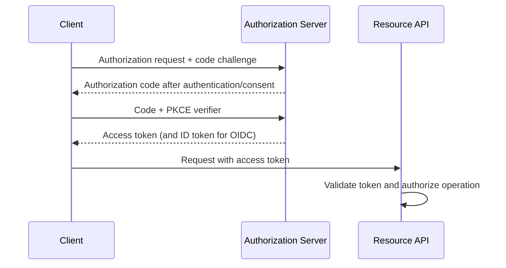

The ID token is intended for the OIDC client; the access token is presented to the resource server. Exact flow details depend on client type and provider configuration.
### Q47. What is a JWT, and how should a resource server validate it?

A JSON Web Token is a compact claims format that may be signed or otherwise protected. A common signed JWT has three Base64URL-encoded parts: header, payload, and signature. Encoding is not encryption; claims may be readable by anyone who obtains the token.

Validation includes verifying the signature with a trusted key, allow-listing acceptable algorithms, checking issuer and audience, validating expiration and not-before claims, and enforcing required scopes or claims. Reject unexpected algorithm/key combinations and never accept an unsigned token where a signed access token is required. The service must not trust a token merely because it can decode it. Key discovery and rotation should use trusted issuer metadata or configured keys, with safe caching and refresh behavior. Follow JWT Best Current Practices in RFC 8725.

Keep access tokens short-lived enough to limit exposure, avoid sensitive claims, and plan revocation or session invalidation requirements. A signed token can remain valid until expiry unless the architecture adds revocation checks or other controls.


**JWT validation checklist**

```text
1. Parse with a trusted library; decoded claims are not yet trusted.
2. Enforce expected token type and allowed algorithms.
3. Verify signature with a trusted issuer key.
4. Validate issuer, audience, expiry and not-before claims.
5. Enforce scopes/claims and resource-level authorization.
6. Reject invalid tokens and never log the raw token.
```
### Q48. What are the trade-offs of stateless JWT authentication?

With stateless validation, a service can verify a signed token locally without querying a session store on every request, reducing a network dependency and improving horizontal scalability. However, revoking a token immediately is harder, token claims can become stale, and every resource server must validate issuer, audience, expiry, signature, and authorization correctly.

A centralized opaque-token introspection model makes revocation and policy changes easier to enforce but adds a dependency and latency unless carefully cached. Some systems use short-lived JWT access tokens with refresh-token controls at the authorization server.

“Stateless” does not mean there is no state anywhere, and it does not remove the need to protect signing keys or refresh tokens. Choose based on revocation needs, risk, scale, and operational capability.

### Q49. How should service-to-service authentication work?

Services should authenticate each other with short-lived workload credentials, OAuth client credentials, mutual TLS, or a platform identity mechanism appropriate to the environment. Each service should receive only the scopes or permissions required for its role. Do not distribute one long-lived shared secret to every service.

Transport encryption protects credentials in transit; authentication identifies the peer; authorization restricts what the peer can do. These are separate controls. Rotate credentials, audit usage, and avoid placing secrets in source code, logs, images, or plain environment files with broad access.

Do not automatically forward an end-user access token to every downstream service. Decide whether the downstream call acts on behalf of the user or as the calling workload, and use token exchange or delegated scopes where needed.

### Q50. Explain TLS, CORS, and CSRF. Are they interchangeable?

TLS protects data in transit and authenticates the server when correctly configured; mutual TLS can also authenticate the client. CORS is a browser-enforced policy that controls whether scripts from one origin may read responses from another origin. CSRF is an attack that tricks a browser into sending an authenticated action, often because cookies are automatically attached.

CORS is not API authentication and does not stop non-browser clients. CSRF protections are especially important for cookie-based sessions; approaches include anti-CSRF tokens, SameSite cookie settings, and origin checks appropriate to the application. Bearer tokens explicitly attached by scripts have a different CSRF profile, but introduce token-storage and XSS concerns.

Use HTTPS everywhere, configure allowed origins narrowly, and avoid wildcard CORS with credentials. Do not confuse CORS errors in a browser with proof that the server rejected all cross-origin traffic.

### Q51. How do you prevent injection and sensitive-data exposure?

Validate types, lengths, ranges, and allowed values at the boundary, and use parameterized queries or safe APIs rather than concatenating untrusted input into SQL, shell commands, templates, or query languages. Validation alone is not sufficient if the input is later interpreted in a different context; output encoding and safe query construction still matter.

Prevent **mass assignment and broken object-property authorization** by mapping request DTOs to explicitly writable fields rather than binding arbitrary JSON directly to persistence entities. A caller allowed to update a display name must not be able to set fields such as tenantId, ownerId, role, accountBalance, or approvalStatus unless the business policy explicitly permits it. Apply authorization to individual properties and operations, not just to the object as a whole.

Treat user-supplied URLs as untrusted when a service fetches remote content, validates webhook destinations, or imports files. This can create **server-side request forgery (SSRF)**: an attacker may target loopback, private-network, link-local, or cloud metadata endpoints. Prefer destination allowlists where feasible; validate resolved IP addresses, block prohibited address ranges, re-check after DNS resolution and redirects, restrict outbound network access, and defend against DNS rebinding. URL parsing alone is not a sufficient control.

Return generic client errors with stable error codes and keep detailed diagnostics in access-controlled logs. Redact passwords, access tokens, session cookies, payment details, and sensitive personal data. Log enough context to investigate without recording full request bodies by default.

Use rate limits, abuse detection, payload-size limits, authorization checks, dependency updates, and security testing as layers. Do not rely on a gateway alone; each service must protect its own resources.

## 7. Distributed data and consistency

### Q52. Why doesn't a local database transaction cover a remote service call?

A local database transaction controls operations managed by one transaction manager and database connection. An HTTP request to another service is a separate operation with its own transaction and failure boundary. If the local transaction rolls back after the remote service commits, the remote effect is not automatically undone.

For example, an order service might reserve inventory remotely and then fail to save the order. A database rollback cannot reverse the inventory service's committed reservation unless the workflow has an explicit compensating operation or a distributed transaction protocol spanning both resources.

Avoid holding local database locks open while waiting on slow remote calls. Prefer workflow designs that persist state transitions and handle failure explicitly. The correct solution depends on whether the business requires strict atomicity or can tolerate temporary inconsistency.

### Q53. What is eventual consistency, and when is it acceptable?

Eventual consistency means replicas or projections may temporarily disagree but converge if updates stop and propagation succeeds. In microservices, a service may publish an OrderCreated event and a reporting service updates its read model shortly afterward. During the gap, a query to the reporting service may not show the new order.

This is acceptable for analytics, search indexes, recommendation feeds, and many read models. It may not be acceptable for enforcing a payment limit or preventing overselling unless the authoritative owner maintains the required invariant.

Make consistency expectations explicit. If a user needs read-your-writes behavior, return the authoritative result from the write service, provide a version or operation status, or let the read model wait until it has applied the relevant event. Do not promise immediate global consistency without a design that provides it.

### Q54. What is a saga? Compare choreography and orchestration.

A saga coordinates a business workflow across local transactions, with each step committing independently. If a later step fails, the workflow may execute compensating actions to counteract earlier effects. Compensation is a new business operation, not a database rollback; it may be imperfect or require manual resolution.

In choreography, services react to events and emit subsequent events. This reduces a central coordinator but can make the workflow hard to understand as the number of participants and branches grows. In orchestration, a workflow coordinator tells each participant what step to execute and records progress. The flow is explicit, but the orchestrator becomes a component that must be made reliable.

Choose based on workflow complexity, visibility, and team ownership. Both require idempotent steps, timeouts, durable state, retry policies, and a plan for stuck or ambiguous outcomes.


**Saga patterns — conceptual comparison**

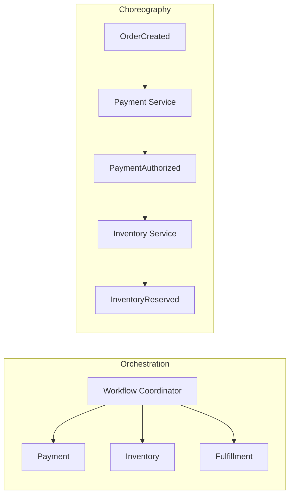

Choreography still needs explicit failure/compensation events; an orchestrator needs durable workflow state and recovery logic.
### Q55. What is the transactional outbox pattern?

The outbox pattern addresses the dual-write problem: a service must update its database and publish an event, but committing the database and sending to a broker are two independent operations. If the database commit succeeds and publishing fails, consumers never hear about the change; if publishing succeeds first and the database rolls back, consumers see an event for state that does not exist.

With an outbox, the service writes its business change and an outbox record in the same local database transaction. A separate publisher or change-data-capture process later sends the outbox event. Publication may be repeated, so consumers must be idempotent; the publisher also needs monitoring, retry, ordering, and cleanup policies.

The outbox makes the state change and intent to publish atomic within the local database. It does not magically make the broker and database one transaction or guarantee exactly-once downstream business effects.


**Transactional outbox flow**

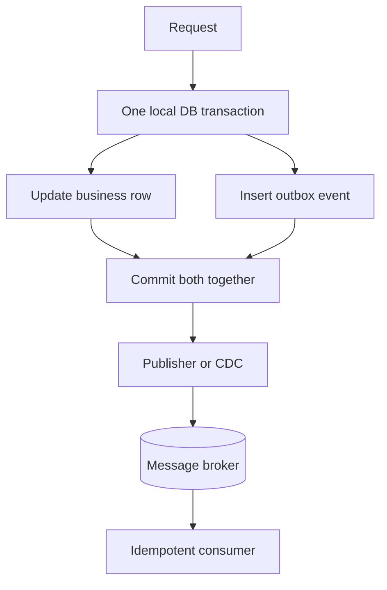

Only the business update and outbox row are atomic together. Publish/consume may repeat, so stable event identity and idempotent consumers are still required.
### Q56. What are the inbox pattern and idempotent consumers?

An inbox records message identifiers that have already been processed. A consumer can transactionally check or insert the message ID and apply its local business change, so redelivery does not repeat the effect. A uniqueness constraint on the message ID is often important for handling concurrent deliveries.

For example, a payment event consumer can store the event ID and update a local projection in one transaction. If the same event is delivered again, the unique constraint detects it and the consumer acknowledges or safely skips it according to the contract.

Deduplication scope and retention matter. A deduplication record deleted too early can permit an old replay to repeat an effect. Idempotency should also be enforced by business keys where possible; a transport-level message ID alone may not catch two different messages representing the same logical operation.


**Inbox transaction pseudocode**

```text
BEGIN
  insert message_id into processed_messages (unique key)
  if duplicate: COMMIT and acknowledge safely
  apply local business update
COMMIT
acknowledge message
```

The inbox record and local update must commit atomically. If the update fails, roll back the inbox insert too, or a retry could be discarded incorrectly.
### Q57. What does “exactly once” mean in distributed systems?

Be precise about the boundary. A broker or stream processor may provide exactly-once processing guarantees for specific operations within its supported transactional model, but that does not automatically mean a payment, email, database update, and external API call happen exactly once end to end.

A client may retry after a timeout even though the remote operation succeeded. A message may be delivered more than once. The practical design is usually at-least-once delivery plus idempotent processing, durable operation identity, deduplication, and reconciliation.

For an external side effect, use the provider's idempotency feature where available and persist a state machine that can recover from ambiguous outcomes. Explain which boundary is guaranteed, what state is transactional, and which failures still require compensation or manual repair.

### Q58. How do you prevent lost updates when multiple services change business data?

First, define a single authoritative owner for each invariant. If two services can independently overwrite the same logical state, conflicting writes are likely. Route commands to the owner rather than allowing shared-database writes.

Within one service, optimistic concurrency can use a version field or conditional update; a stale update fails and the caller reloads and reconciles. Pessimistic locking may be appropriate for short, high-contention critical sections, but holding locks across network calls is dangerous. For cross-service workflows, use commands, reservations, sagas, or explicit conflict resolution rather than pretending independent local transactions are atomic.

The solution depends on the invariant. Inventory may need atomic reservation at its owner; profile preferences may permit last-write-wins. Do not choose a consistency model without stating the business rule it must preserve.

## 8. Testing, deployment, and evolution

### Q59. What testing layers are useful for microservices?

Unit tests verify local logic quickly. Integration tests verify interactions with real infrastructure or framework components. Component tests exercise one service through its public boundary while replacing or controlling external dependencies. Consumer-driven contract tests verify that a provider's API remains compatible with consumer expectations. End-to-end tests validate critical workflows across deployed components.

No single layer replaces the others. A large end-to-end suite is slow and often difficult to diagnose; mocks can be too permissive and miss real serialization, transaction, or network behavior. Use realistic integration tests for database mappings and wire formats, and a small set of end-to-end tests for the most important user journeys.

Keep tests deterministic and assert behavior rather than internal implementation details. Include failure cases such as timeouts, malformed responses, retries, and duplicate events.


**Testing layers (illustrative prioritization)**

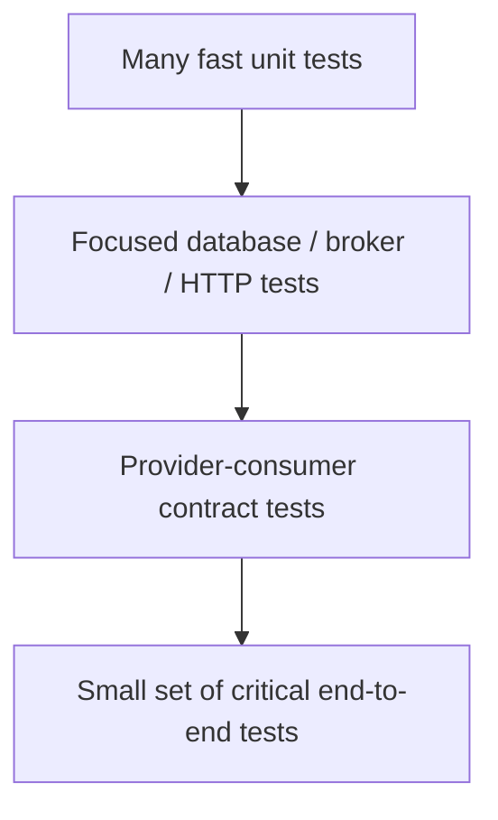

This is not a rigid hierarchy: contract and integration tests can run alongside each other; choose the mix based on risk and architecture.
### Q60. What is consumer-driven contract testing?

A consumer-driven contract captures the interactions a consumer relies on: requests it sends and responses or errors it expects. The provider verifies those expectations so incompatible changes are detected before deployment. It is especially useful when services deploy independently and the full integration environment is expensive.

Contracts should test the fields and semantics the consumer actually uses, not freeze every incidental field. A contract suite does not prove the provider is correct for all possible inputs, nor does it replace authorization, load, or end-to-end testing.

Use it with explicit compatibility rules, provider verification in CI, and a process for updating contracts when requirements intentionally change. Versioning alone is not a substitute for compatibility tests.

### Q61. How do rolling, blue-green, and canary deployments differ?

A rolling deployment gradually replaces instances with a new version. It uses resources efficiently but requires old and new versions to coexist safely during rollout. Blue-green maintains two environments and switches traffic after validation; rollback can be quick, but duplicated capacity and state compatibility need planning. Canary sends a small portion of traffic to the new version and expands it based on health and business metrics.

All strategies need backward-compatible API and database changes. A rollback is not safe if the new version has irreversibly changed stored data or emitted incompatible events. Define abort thresholds, monitor errors and latency, and verify behavior under realistic traffic.

Choose based on risk, platform support, cost, and rollback requirements—not because one strategy is universally superior.


| Strategy | Traffic shift | Strength | Risk to plan for |
|---|---|---|---|
| Rolling | Replace instances gradually | Resource-efficient | Old and new versions coexist |
| Blue-green | Switch between two environments | Fast traffic rollback | Data or external effects may not roll back |
| Canary | Increase a small traffic share gradually | Limits initial exposure | Requires representative traffic and guardrails |
### Q62. How do you change a database schema without downtime?

Use an expand-and-contract sequence. First add the new schema in a way compatible with the current application. Deploy code that can read or write both old and new forms as needed. Backfill data safely, validate the result, switch reads to the new representation, and only later remove old columns or behavior after all old application versions and consumers are gone.

Avoid deploying a code version that requires a column before the migration has run, or dropping a column while an old instance still reads it. Large backfills should be batched, observable, resumable, and mindful of locks and replication lag.

Database compatibility is part of deployment design. Test the migration against realistic data volume and have a recovery plan; “the migration ran in staging” does not prove it will be safe on production-sized data.

### Q63. How should feature flags be used safely?

Feature flags separate deployment from activation. They can enable a feature for internal users, a small percentage of traffic, or a selected tenant before broad release. This reduces rollout risk and supports quick disablement when behavior is wrong.

Flags create complexity if they are permanent or have unclear ownership. Define who can change each flag, whether it is safe to change at runtime, what telemetry validates success, and when it will be removed. Test important flag combinations without attempting every possible combination of a large flag set.

A feature flag is not a substitute for authorization. Hiding a UI element or disabling a client path does not prevent a caller from invoking an unprotected endpoint directly.

### Q64. How should mocking remote services be used?

Mocks are useful for deterministic unit tests and for simulating rare failures such as a timeout or malformed response. They let a test focus on the caller's behavior without requiring every dependency to run.

However, a mock may reproduce the test author's assumptions rather than the real service. It can miss HTTP serialization differences, authentication configuration, status-code behavior, TLS, connection-pool constraints, and provider contract changes. Keep mocks aligned with explicit contracts and supplement them with integration and contract tests.

For high-risk integrations, use a controlled test environment or a stub server that exercises the actual HTTP client and wire format. Test both successful and failure responses.

## 9. Observability and production troubleshooting

### Q65. Explain logs, metrics, and distributed traces.

Logs capture discrete events with contextual details; metrics aggregate numeric measurements over time; traces show the path and timing of one request across services. They complement each other. Metrics can reveal that p99 latency rose, traces can identify which downstream span consumed the time, and logs can explain the corresponding error.

Use structured logs with stable fields such as service, environment, request/trace ID, operation, and outcome. Avoid high-cardinality metric labels such as raw user IDs or arbitrary URLs; they can overwhelm the metrics system. Sample traces carefully under high traffic while preserving error and slow-request visibility.

Observability should answer operational questions: what is broken, how many users are affected, where the time is spent, and whether a change improved the situation. Merely collecting telemetry does not guarantee useful diagnosis.


**Follow one request across services**

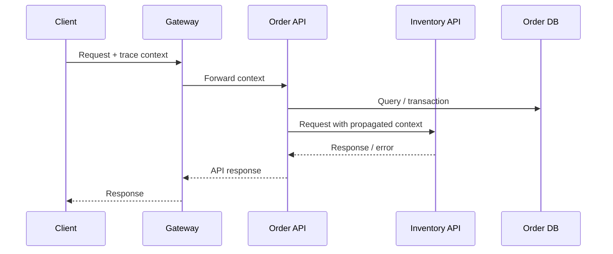

Traces locate time spent; logs explain individual failures, while metrics reveal volume and saturation.
### Q66. What are RED and USE metrics?

RED focuses on request-driven services: **Rate** (requests per second), **Errors** (failed requests), and **Duration** (latency distribution). USE focuses on resources: **Utilization**, **Saturation**, and **Errors**. For a service, RED describes user-visible behavior; USE helps reveal whether CPU, memory, pools, disks, or other resources are approaching capacity.

Track latency histograms and percentiles, not just averages. An average can look healthy while a small but meaningful group of requests experiences severe delays. Break metrics down by operation and dependency without creating uncontrolled cardinality.

These are diagnostic frameworks, not rigid laws. Use the measurements that correspond to the architecture and SLOs, and pair them with traces and logs for causal investigation.

### Q67. What are SLIs and SLOs, and how do they influence design?

A service-level indicator (SLI) is a measured aspect of service behavior, such as the proportion of valid requests completed successfully within a latency threshold. A service-level objective (SLO) is the target for that indicator over a defined window. An SLA is a broader commitment, often contractual, with consequences if it is missed.

A useful SLO reflects the user experience and has a clear measurement boundary. For example, “99.9% of eligible read requests complete successfully within 300 ms over 30 days” is more actionable than “the service should be fast.” Define exclusions carefully so errors are not hidden by measurement choices.

SLOs guide timeout budgets, capacity, alerting, and release decisions. Alert on user-impacting symptoms and error-budget burn rather than paging on every isolated infrastructure metric.

### Q68. How do you investigate high p99 latency when average latency is fine?

First determine whether the increase affects all endpoints, one operation, one region, or a specific dependency. Compare latency distributions, request volume, errors, saturation, deployment changes, and traffic mix. Inspect traces for slow requests and examine time spent waiting for a connection, thread, lock, queue, database, or downstream response.

Tail latency can be caused by a small number of slow dependencies, overloaded connection pools, garbage collection pauses, uneven load balancing, cache misses, retries, or synchronized background work. An average hides these outliers. Parallel fan-out can make overall latency track the slowest dependency.

Do not immediately increase timeouts; that can retain resources longer and worsen overload. Reproduce under realistic concurrency, fix the bottleneck, and verify p95/p99 as well as throughput and error rate after the change.

### Q69. A service is slow. How do you distinguish CPU, thread-pool, connection-pool, and downstream bottlenecks?

Correlate request latency with CPU, garbage collection, thread states, executor queue depth, active and pending database connections, HTTP connection acquisition time, and downstream span duration. High CPU with runnable threads may indicate computation or inefficient serialization. Low CPU with many blocked threads often points to waiting, locks, I/O, or undersized pools.

A saturated pool can create queueing before the actual database or remote call begins. Increasing pool size without understanding downstream capacity may simply move the queue to the database and worsen contention. Compare configured limits with observed concurrency and dependency capacity.

Use thread dumps, runtime metrics, traces, and database diagnostics together. Change one constraint at a time and load-test the result rather than guessing from a single dashboard.

### Q70. What is a cascading failure, and how do you prevent it?

A cascading failure occurs when one component's slowdown or outage causes callers to accumulate work, exhaust resources, and fail too, spreading the incident. For example, a slow inventory service keeps order-service threads and connections occupied; incoming requests queue, the order service becomes unhealthy, and retries add more load to inventory.

Prevention includes bounded timeouts, retry budgets with jitter, circuit breakers, bulkheads, load shedding, backpressure, capacity limits, and fallbacks that preserve correctness. Monitor saturation and queue depth before hard failure, and ensure one dependency cannot consume every shared resource.

During an incident, reduce load and stop retry amplification before making broad scaling changes. After recovery, review the dependency graph, failure thresholds, and load tests to determine why isolation failed.

### Q71. How should you investigate a production incident across services?

Establish user impact, start time, affected operations, regions, and recent deployments or configuration changes. Check SLO/error-budget dashboards and request/latency/error metrics first. Use traces to locate the failing or slow boundary, then inspect correlated structured logs and dependency metrics. Confirm the hypothesis with evidence before changing production behavior.

Mitigate safely: roll back a suspect release, reduce optional traffic, disable a problematic feature, or fail over if the recovery path is tested. Preserve logs and traces, communicate status, and avoid risky changes that make evidence disappear.

After recovery, document the timeline, contributing factors, detection gaps, and concrete prevention work. A blameless review should improve the system and process, not simply attribute the incident to an individual.

## 10. Real-world interview scenarios


**Incident-response sequence**

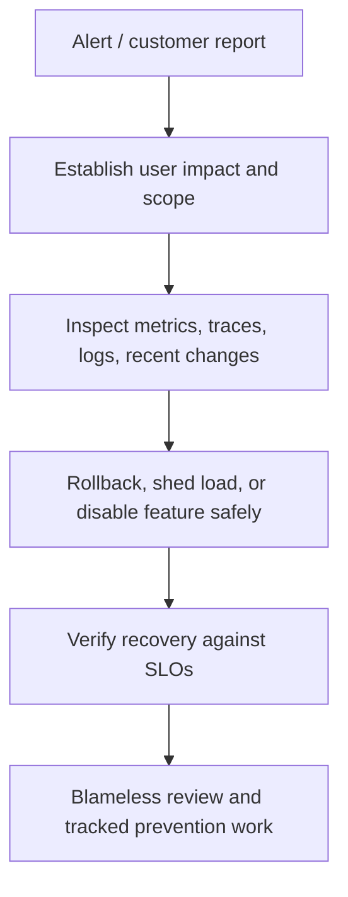
### Q72. A downstream service becomes slow or unavailable. What do you do?

**Investigate:** Check the downstream's latency and error rate, caller traces, connection-acquisition time, thread-pool saturation, and whether the issue started after a deployment or traffic spike. Determine whether the failure is isolated or shared.

**Mitigate:** Enforce bounded timeouts and stop unbounded retries. Use a circuit breaker and bulkhead where they protect resources. Return a documented degraded response only if the business can tolerate it; otherwise fail clearly and quickly. Shed optional work if necessary.

**Prevent:** Set dependency-specific budgets, test latency and outage scenarios, alert on saturation and SLO burn, and clarify ownership and recovery expectations. Scaling the caller alone may not help if the downstream is the bottleneck.


**Dependency failure decision path**

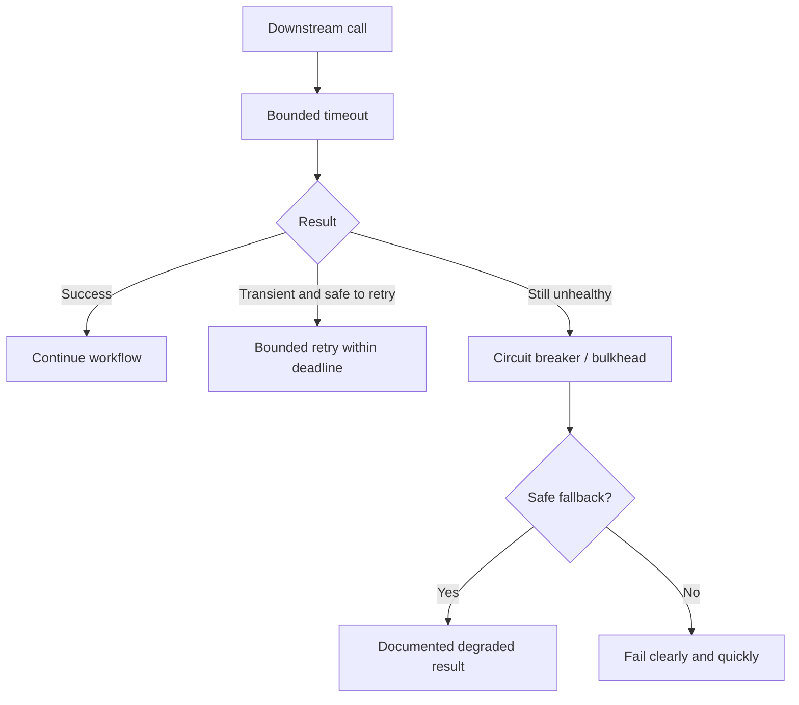
### Q73. An API request times out, but the operation may have succeeded. How should the client recover?

Treat the outcome as unknown rather than assuming failure. The client should retry with the same idempotency key if the endpoint supports it, or query an operation/resource status endpoint using a stable operation identifier. The server should persist operation identity and outcome so repeated requests converge on one business effect.

For payments or orders, reconcile with the authoritative system before creating a new operation. Return clear statuses such as pending, succeeded, failed, or unknown where the business workflow supports them. Log the request and operation IDs, but do not log sensitive payment data.

Prevent recurrence by designing idempotent writes, using bounded client timeouts, documenting retry semantics, and testing the “commit succeeded, response lost” failure case.

### Q74. A client retries a payment or order request. How do you avoid duplicates?

Require a client-generated idempotency key scoped to the authenticated principal and operation. Atomically reserve that key with a unique constraint, associate it with the request identity, and persist the operation result. Concurrent duplicate requests must not both execute the side effect. A reused key with a different payload should produce a documented conflict rather than silently applying new input.

Propagate the key to a payment provider if its API supports idempotency. For asynchronous processing, use durable operation state and idempotent consumers. Reconcile ambiguous provider outcomes instead of blindly creating a second charge.

Test concurrent submissions, client retries after timeout, process crashes between steps, and key expiration. Exactly-once business effects are an end-to-end design property, not something an HTTP client automatically provides.


**Idempotent payment flow**

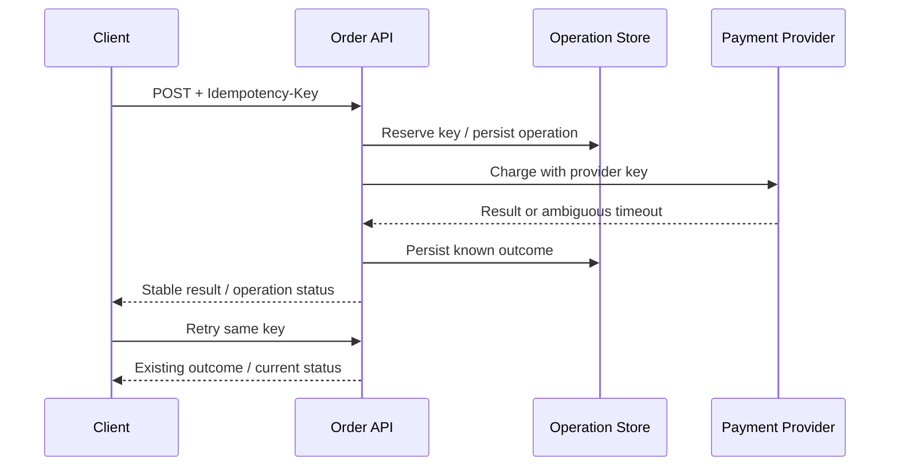

If the provider outcome is ambiguous, reconcile using its operation reference or idempotency API; do not create a fresh charge with a new key simply because the response timed out.
### Q75. A deployment breaks older clients. What is your response?

Identify the breaking change from API logs, client versions, and contract tests. Roll back or restore the compatible contract if user impact is ongoing. Avoid assuming that adding a field is always harmless: strict clients can reject unknown fields or enum values, and a changed field meaning is breaking even if its type remains the same.

Adopt additive evolution, tolerant-but-safe parsing, explicit deprecation windows, consumer-driven contract tests, and staged rollout. If a new major version is unavoidable, run versions in parallel and measure migration progress before removing the old one.

Prevent recurrence by treating the API specification as a reviewed contract and running compatibility checks in CI against known consumers.

### Q76. Several services need data to answer one API request. What architecture would you choose?

First ask whether all data must be fresh and authoritative at request time. If so, a bounded aggregator or BFF can call a small number of services in parallel with per-call deadlines and an overall deadline, returning partial data only when the contract explicitly allows it. Avoid an uncontrolled fan-out tree.

If the use case is read-heavy and can tolerate staleness, build a query-side projection that combines events from the owning services. This reduces request-time dependencies but introduces propagation lag, schema ownership, and repair/rebuild concerns.

Choose based on freshness, latency SLO, failure behavior, and data volume. Do not create a shared database that bypasses service ownership merely to make joins convenient.

### Q77. The database transaction succeeds, but event publication fails. How do you fix it?

This is a dual-write problem. The immediate mitigation is to identify affected records and reconcile or republish safely, using stable event IDs and idempotent consumers to avoid duplicate effects. The durable design is to write the business update and an outbox record in the same database transaction, then publish the outbox asynchronously with retries and monitoring.

Track outbox age, publish failures, and backlog. Ensure poison records do not block all progress and define cleanup and replay policies. Consumers must tolerate duplicates because the publisher can crash after sending but before recording completion.

Do not publish first and assume a later database rollback will undo the event; the broker is outside the local transaction.


**Spring/JPA-style outbox write sketch**

```java
@Transactional
public Order createOrder(CreateOrderRequest request) {
    Order order = orderRepository.save(Order.from(request));
    outboxRepository.save(OutboxEvent.orderCreated(order.getId()));
    return order;
}
```

Both writes must use the same local database transaction. A separate publisher or CDC process sends the outbox record; this method does not make a broker send atomic with the database.
### Q78. Traffic suddenly spikes. How do you keep the system stable?

Determine whether the traffic is legitimate, a client retry storm, a bot/abuse pattern, or a downstream recovery loop. Check rate, concurrency, queue depth, CPU, memory, connection pools, and dependency saturation. Apply per-client rate limits, admission control, bounded queues, and load shedding based on business priority.

Scale horizontally if the workload is stateless and the true bottleneck can scale, but do not blindly add replicas when the database or another shared dependency is saturated. Cache safe reads and defer noncritical work asynchronously where appropriate. Protect recovery by avoiding synchronized retries.

After mitigation, establish capacity thresholds, load-test realistic traffic patterns, and alert on saturation before the service starts returning widespread errors.

### Q79. An API works locally but fails under production load. What do you inspect?

Compare runtime configuration, traffic concurrency, payload sizes, dependency latency, resource limits, TLS/DNS/network behavior, and data volume. Inspect p95/p99 latency, error rates, thread and connection pools, queue depth, garbage collection, database locks, query plans, and downstream timeouts. Local testing often has one user, warm caches, small data, and no realistic network failures.

Reproduce with production-like load and representative data, preferably in a controlled environment. Check whether retries multiply traffic or whether pools are sized beyond downstream capacity. Do not solve every symptom by increasing thread counts or timeouts.

Use staged load tests, canaries, resource dashboards, and configuration parity to detect the issue before full rollout.

### Q80. Requests fail during a rolling deployment because instances are terminated while still serving traffic. How do you design graceful shutdown?

Treat shutdown as a traffic-draining protocol, not just a process signal. When an instance receives a termination signal, it should stop accepting new work, become unready so routing can remove it, and allow in-flight requests to finish within a bounded grace period. The orchestrator's endpoint propagation and load-balancer drain time must be coordinated with the application's shutdown behavior; readiness changes are not always instantaneous.

For an HTTP service, configure the server and framework to stop accepting new connections or requests while completing active requests. Close message consumers carefully: stop fetching new messages, finish or safely release in-flight work, and acknowledge only after the durable business effect has committed. If a worker cannot finish before the deadline, rely on redelivery plus idempotent processing rather than acknowledging work that was lost.

Set the termination grace period longer than the expected drain window but still bounded. Test termination during slow requests, database transactions, message processing, and deployments under load. Also account for forced termination, which may bypass graceful hooks; shutdown logic is a best-effort recovery mechanism, not a substitute for durable state and retry safety.

### Q81. Two services require conflicting updates to shared business data. How do you redesign it?

Identify the invariant and designate one service as the authoritative owner of the data. Other services send commands to that owner or consume events and maintain read-only projections. Do not let both services write the same tables independently.

If the workflow spans multiple owners, model it as a saga with explicit states and compensations, or use a stronger coordination mechanism only when strict atomicity is genuinely required and operationally supportable. Use optimistic concurrency to detect conflicting updates within an owner and define whether the business should reject, merge, or serialize them.

The key is to resolve ownership and consistency requirements, not simply add locks around remote calls.

### Q82. How would you migrate a service without downtime?

Introduce the new contract and infrastructure in backward-compatible steps. For a database or API migration, expand first, deploy code that can coexist with the old version, backfill or dual-read/write only with explicit consistency safeguards, compare results, then switch traffic and contract away old behavior after all consumers have migrated.

Use canary or blue-green rollout, monitor error rates and latency, and define rollback triggers. A rollback plan must account for data already written in the new format and events already emitted; switching binaries back is not always enough.

Test the sequence with realistic traffic and failure injection. “No downtime” is a property of the complete migration procedure, not merely the load balancer.

### Q83. Average latency is fine, but p99 is unacceptable. What would you do?

Break latency down by endpoint, region, tenant, payload, and dependency. Inspect trace spans from slow requests and correlate them with connection-pool waits, queueing, GC pauses, lock contention, cache misses, and downstream tail latency. Determine whether the tail is caused by one slow dependency or by fan-out where the slowest branch dominates.

Set an end-to-end deadline and give each dependency a budget. Reduce unnecessary fan-out, isolate slow work, bound queues, and avoid retries that extend the tail. If partial results are allowed, document which components can be omitted; never silently degrade correctness-sensitive data.

Validate the fix with a load test and percentile histograms. An improved average alone is not acceptance evidence.


### Q84. Your API starts returning HTTP 429 responses after a client integration goes live. How do you investigate and fix it?

First establish whether the rate limit is expected policy or an accidental limit caused by incorrect identity, routing, or configuration. Compare request rates by client, tenant, credential, endpoint, and gateway instance. Check whether retries are multiplying traffic and whether limits are applied consistently across replicas.

Define limits around the resource being protected: per API key or tenant for fairness, and sometimes a global concurrency or capacity limit for a fragile dependency. Return `429 Too Many Requests` with a useful error body and, when appropriate, `Retry-After`. Clients should use bounded exponential backoff with jitter and respect the server's guidance; immediate retries make overload worse.

Do not simply raise the limit until the database or downstream is saturated. Load-test the proposed policy, document quotas, and make rate-limit metrics distinguish legitimate demand from retry storms.

### Q85. A cache makes the API fast, but users sometimes see stale data. How would you diagnose and correct it?

Identify the freshness requirement first: a product description may tolerate a short delay, while account balance or authorization state may not. Trace the read path and determine whether staleness comes from TTL, failed invalidation, asynchronous event lag, replica lag, or a cache key that omits a tenant or version dimension.

Choose a strategy that matches the requirement: short TTL for bounded staleness, explicit invalidation after successful writes, versioned keys, or read-through refresh. For critical read-after-write behavior, bypass or update the cache for the writer's next read rather than assuming invalidation is instantaneous across every node.

Test invalidation failure and concurrent updates, monitor cache age and hit rate, and provide a repair path. A cache is a performance layer, not the source of truth; never let a cache-only value silently become authoritative business data.

### Q86. A paginated REST endpoint skips or repeats records while data changes. What would you change?

Offset pagination is easy to understand, but inserts and deletes before the current offset can shift rows between requests. Ensure ordering is deterministic, including a unique tie-breaker; ordering only by a non-unique timestamp is not enough.

For large or frequently changing datasets, prefer keyset (cursor) pagination using the last seen ordered values, such as `created_at` plus a unique ID. The cursor should be opaque, validated, and bound to the relevant filter and sort criteria so clients cannot accidentally reuse it for a different query. If the product requires a stable snapshot across pages, explain the snapshot or versioning mechanism because cursor pagination alone does not freeze the dataset.

Set maximum page sizes, validate filters, index the sort path, and test concurrent inserts/deletes. The right answer depends on whether the requirement is simple browsing, deep traversal, or a consistent export.


**Cursor response example**

```json
{
  "items": [
    { "id": "o-104", "createdAt": "2026-10-25T10:15:00Z" },
    { "id": "o-103", "createdAt": "2026-10-25T10:10:00Z" }
  ],
  "nextCursor": "opaque-token"
}
```

The cursor should represent the last item's complete sort position, including a unique tie-breaker, and be validated against the query/filter context.
### Q87. A request triggers work that takes several minutes and exceeds gateway timeouts. How should the API be designed?

Do not keep an HTTP request open indefinitely. Accept the request, validate it, create a durable job or operation record, and return `202 Accepted` with a stable operation URL and an appropriate `Location` header. The client can poll that resource or receive a callback/event if the product supports it. The status resource should represent states such as queued, running, succeeded, failed, and cancelled, with safe error details.

Persist the job before acknowledging acceptance; otherwise a process restart can lose work that the client believes was accepted. Workers need bounded retries, idempotent processing, concurrency limits, and a dead-letter or operator-recovery path for poison jobs.

Document retention, cancellation semantics, progress reporting, and how clients resume after losing the response. A queue alone is not a complete job API: the operation's lifecycle and failure contract must also be designed.


**Long-running API example**

```http
POST /exports
Content-Type: application/json

{"from":"2026-01-01","to":"2026-10-01"}

HTTP/1.1 202 Accepted
Location: /operations/op-123
Retry-After: 3
```

The polling hint is illustrative; document its meaning and define cache behavior for the operation-status resource.
### Q88. Your service sends webhooks, but customers report missed or duplicate notifications. What is the design?

Treat webhook delivery as an at-least-once asynchronous workflow. Persist an event or delivery task durably, send it with a stable event ID, and record each attempt and its outcome. Retry transient failures with exponential backoff and jitter, but cap attempts or age and expose failed deliveries for inspection and replay.

The receiver may process the webhook and then lose its response, so the sender cannot know whether the side effect occurred. Duplicate delivery is therefore expected: consumers should deduplicate by event ID and make processing idempotent. Sign payloads or requests using a documented signature scheme, include timestamps to reduce replay risk, and provide secret rotation.

Offer delivery history, replay controls, endpoint-disable safeguards, and clear timeout/response requirements. Never claim exactly-once delivery across two independently operated systems; define delivery guarantees and make duplicates safe.


**Webhook delivery flow**

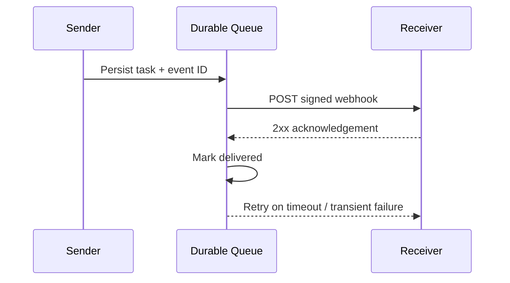

Simplified picture: a delivery worker performs retries. The receiver may have processed the event before its acknowledgement is lost, so duplicate event IDs must be safe.
### Q89. Authentication succeeds at the API gateway, but a downstream service rejects the request—or accepts too much. How do you troubleshoot it?

Map the identity and authorization flow end to end. Check token issuer, audience, expiry, signing-key rotation, scopes/roles, and whether the downstream is receiving the intended user or service identity. A token valid for the gateway is not automatically valid for every backend. Inspect clock skew and key-cache refresh behavior without logging raw tokens.

Choose an explicit trust model: each service validates a suitable access token, or the gateway authenticates the external caller and forwards a narrowly scoped, cryptographically trustworthy identity assertion over authenticated internal channels. Do not trust arbitrary identity headers supplied by clients; strip and overwrite them at the boundary.

Separate authentication (who is calling) from authorization (what this caller may do). Add negative tests for wrong audiences, missing scopes, expired tokens, and cross-tenant access, and ensure gateway bypass paths cannot expose unprotected services.

### Q90. One tenant's workload degrades the API for everyone else. How would you enforce tenant fairness?

Measure traffic, concurrency, queue depth, latency, and resource consumption by tenant, then identify whether the shared bottleneck is CPU, database connections, storage, or a downstream quota. Apply tenant-aware rate limits and concurrency budgets, and use bounded queues so one tenant cannot occupy all workers. Priority classes can protect critical operations, but their policy must be explicit and observable.

Isolation may also require per-tenant database quotas, partitioning, or separate infrastructure for high-value or regulated tenants. Avoid placing tenant IDs only in logs: tenant identity must be enforced in authorization checks, cache keys, queries, and asynchronous messages.

Test a noisy-neighbor workload alongside normal tenants and verify that throttling one tenant does not starve others. Fairness should be demonstrated with per-tenant SLOs, not assumed because the service has multiple replicas.

### Q91. A bulk REST endpoint processes 500 items, but 7 items fail. What should its contract look like?

Decide whether the operation is atomic or allows partial success. If all-or-nothing semantics are required, validate before committing where possible and use a transaction only if the data and side effects fit within its boundary. If partial success is allowed, return a result for each item with a stable item identifier, outcome, and machine-readable error; do not return only a generic success status that hides failures.

Document whether the endpoint is synchronous or creates an asynchronous job, how clients retry failed items, and whether repeating the entire batch is safe. Use per-item idempotency or stable business keys to prevent duplicate effects when a client retries after a connection failure.

Bound batch size and processing time, validate all input, and avoid one malformed item silently aborting unrelated items unless that is the promised contract. Test mixed outcomes, duplicate items, and failure after some items have committed.

### Q92. A database column or event field must change while old and new service versions run together. How do you roll it out safely?

Use an expand-and-contract migration. First add the compatible schema or field without removing the old one. Deploy readers that can handle both forms, then update writers in a controlled sequence. Backfill existing data, compare old and new representations, and switch reads only after validation. Remove the old field in a later release after all application instances, consumers, and replay paths no longer depend on it.

For event contracts, prefer additive optional fields with defined defaults and tolerant handling of unknown fields where the format and business semantics permit it. A field whose meaning changes is not compatible merely because its name and type stay the same.

Automate compatibility checks and test mixed-version deployments and event replay. Dual writes introduce their own consistency problem, so define a source of truth and a reconciliation plan rather than leaving two fields to drift indefinitely.

### Q93. Clients need to upload multi-gigabyte files through your REST service. What architecture would you propose?

Avoid proxying every byte through a general-purpose application service if it creates unnecessary memory, bandwidth, or timeout pressure. A common design is for the API to authenticate and authorize the upload, create an upload session, and issue a short-lived, narrowly scoped signed URL to object storage. The client uploads directly, then calls a completion endpoint or triggers a verified storage event.

Validate file size, type, checksum, ownership, and upload state; do not trust a client-supplied filename or content type as proof of safety. Use multipart/resumable uploads where supported, and scan or quarantine content before making it available to downstream consumers.

Make completion idempotent, expire abandoned sessions, and prevent public exposure before validation. Consider malware scanning, retention, encryption, auditability, and cleanup as part of the API contract—not merely storage configuration.


**Direct-to-object-storage upload flow**

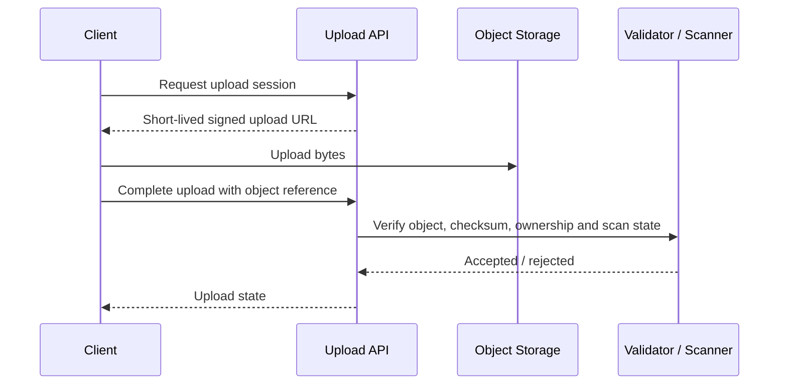

Never trust client-reported completion alone; verify the stored object and quarantine it until required checks pass.
### Q94. A region becomes unavailable and the business asks for automatic failover. What questions must be answered before enabling it?

Determine which operations must remain available, the acceptable recovery time objective (RTO) and recovery point objective (RPO), and whether writes can be safely accepted in another region. Active-active deployments require explicit conflict handling and a data model that tolerates concurrent updates; active-passive deployments need a tested promotion and traffic-switch procedure.

Check dependencies beyond compute: identity, secrets, DNS, queues, object storage, databases, rate limits, and third-party services. A healthy application in a second region is not useful if its data is stale or it cannot authenticate. Avoid automatic failover that creates split-brain writers or silently loses acknowledged writes.

Run failover and failback exercises, verify replication lag and data integrity, and define who decides to promote a region. Recovery objectives are operational commitments that must be tested against real failure modes.


**Regional failover checklist**

```text
1. Declare failure using agreed criteria.
2. Confirm target-region data freshness against RPO.
3. Fence the old writer to avoid split brain.
4. Promote target data services and switch traffic.
5. Verify identity, queues, dependencies and business transactions.
6. Reconcile data and plan controlled failback.
```
### Q95. A cache miss causes hundreds of concurrent requests to recompute the same expensive value. How do you prevent this cache stampede?

Recognize the pattern by correlating a cache expiry or eviction with a sudden increase in backend calls and latency. Use request coalescing or single-flight behavior so concurrent callers share one refresh. For suitable data, refresh before expiry, add jitter to TTLs to avoid synchronized expiration, or serve a bounded-stale value while one refresh runs.

A distributed lock can coordinate refreshes across instances, but it adds lease, expiry, and failure concerns; do not introduce one without a clear need. Bound refresh concurrency and ensure failed refreshes do not trigger an unbounded retry loop.

Measure backend load during expiry events and test cold-cache behavior, not only warm-cache throughput. Stale-while-revalidate is appropriate only when the business accepts the defined staleness window.

### Q96. Distributed traces stop at one service boundary. What would you check?

Verify that the incoming trace context is extracted and the outgoing context is injected using the agreed propagation standard, such as W3C Trace Context. Check HTTP clients, message producers/consumers, asynchronous executors, and framework instrumentation; custom thread pools or manually constructed requests can break propagation. Confirm that services do not accidentally start a new root trace for every hop.

Use trace IDs and span IDs for correlation, but do not treat them as business identifiers or put sensitive data in baggage. Sampling may explain why only some spans are visible, so inspect sampling configuration and exporter failures before assuming instrumentation is broken.

Validate with a known request that crosses synchronous and asynchronous boundaries. Combine traces with structured logs and metrics; tracing is diagnostic evidence, not a substitute for service-level error and saturation monitoring.

### Q97. A user can access another customer's order by changing the ID in the URL. What is the root issue and how do you fix it?

This is a broken object-level authorization issue. Authentication proves who the caller is; it does not prove that the caller owns or may access a particular order. Enforce authorization on every operation that reads or mutates an object, using the authenticated principal and the object's tenant/owner/relationship. Prefer queries scoped to the authorized tenant or owner when practical, rather than fetching an unrestricted record and relying on every caller to remember a later check.

Do not rely on unpredictable IDs as the security control. Apply the same checks to nested resources, bulk endpoints, exports, background jobs, and cached responses. Avoid leaking whether another tenant's object exists if that information is sensitive.

Add integration tests that use two principals and attempt cross-tenant reads, updates, deletes, and indirect references. Audit access failures without recording secrets or unnecessary personal data.


**Authorization test matrix**

| Principal | Resource owner | Expected result |
|---|---|---|
| Alice | Alice | Allow if action policy permits |
| Alice | Bob | Deny or intentionally conceal existence |
| Service account | Tenant-scoped resource | Allow only within granted scope |

Repeat tests for reads, updates, deletes, bulk operations, exports, caches and asynchronous jobs—not just the primary GET endpoint.
### Q98. An API's response time regresses after adding a new field to the response. How do you prove whether the field is responsible?

Compare before-and-after traces, response sizes, serialization time, database query plans, downstream calls, and p95/p99 latency by endpoint and payload size. The field might add an expensive join, trigger lazy-loading N+1 queries, increase JSON serialization and network transfer, or cause clients to perform additional work. Correlation alone is not proof, so reproduce the change with representative data and controlled load.

Use query-count assertions or profiling to catch N+1 behavior, and avoid fetching large nested object graphs when the contract needs only a summary. If the data is expensive or optional, consider a separate expansion parameter or dedicated endpoint, but keep the contract predictable and protect against unbounded expansions.

Roll back or gate the expensive behavior if user impact is severe. Add performance tests and budgets for response size and query count, not just functional tests.

### Q99. Two services show different values for what should be the same business fact. How do you restore consistency?

First identify the authoritative owner and whether the difference is expected propagation lag or a real correctness defect. Compare event IDs, entity versions, timestamps, consumer offsets or checkpoints, failed-message queues, and the time since the last successful update. Do not “fix” the discrepancy by letting both services overwrite each other's data.

Provide a reconciliation process that compares authoritative state with projections, detects missing or duplicate events, and repairs derived data idempotently. If events can arrive out of order, use entity versions or sequence numbers to reject stale updates; if a consumer is stuck, fix the cause before replaying a large backlog.

Track projection lag, reconciliation discrepancies, and repair outcomes. Define which reads may be stale and how long, and make rebuilds/replays safe. Reconciliation is a normal control for distributed systems, not an exceptional manual database-editing procedure.

### Q100. A client disconnects or cancels a request, but expensive downstream work continues. How should cancellation and deadlines propagate?

Distinguish client cancellation from a server-side timeout and from an operation that has already committed. Propagate a deadline budget to downstream calls rather than giving every hop a fresh full timeout; otherwise a request can outlive the caller's useful time window. Cancel work that is safe to stop, release resources, and ensure queued tasks can be removed or marked cancelled.

Cancellation is not rollback. If a payment or order has crossed its commit point, the service must report or expose the operation's actual state rather than imply that disconnecting undid it. Long-running jobs should use an explicit cancellation API with documented state transitions and cooperative worker checks.

Test disconnects, timeouts at different hops, cancellation races, and cleanup of database connections and executor tasks. Monitor abandoned work so client impatience does not silently consume production capacity.


**Deadline budget example**

```text
Incoming request deadline: 800 ms
  gateway / authentication:  80 ms
  service processing:       120 ms
  downstream call budget:   450 ms
  response / safety margin: 150 ms
Total:                      800 ms
```

Numbers are illustrative. Allocate budgets from measured latency and preserve one end-to-end deadline; do not give each hop a fresh 800 ms timeout.
## 11. References

These sources support protocol semantics and implementation practices. Interview emphasis and examples in this handbook are synthesized rather than copied verbatim.

- [RFC 9110 — HTTP Semantics](https://www.rfc-editor.org/rfc/rfc9110.html): methods, safe/idempotent semantics, status codes, conditional requests.
- [RFC 9111 — HTTP Caching](https://www.rfc-editor.org/rfc/rfc9111.html): cache behavior and directives.
- [RFC 9457 — Problem Details for HTTP APIs](https://www.rfc-editor.org/rfc/rfc9457.html): standard error representation.
- [RFC 9700 — OAuth 2.0 Security Best Current Practice](https://www.rfc-editor.org/rfc/rfc9700.html): current OAuth security recommendations.
- [OpenID Connect Core](https://openid.net/specs/openid-connect-core-1_0.html): identity layer on OAuth 2.0.
- [RFC 7519 — JSON Web Token](https://www.rfc-editor.org/rfc/rfc7519.html): JWT claims format.
- [RFC 8725 — JSON Web Token Best Current Practices](https://www.rfc-editor.org/rfc/rfc8725.html): secure JWT implementation and validation guidance.
- [OpenAPI Specification](https://spec.openapis.org/oas/v3.2.1.html): API description format (version 3.2.1, published September 2026).
- [Spring Cloud CircuitBreaker reference](https://docs.spring.io/spring-cloud-circuitbreaker/reference/): Spring integration options for circuit breakers.
- [Spring Boot Actuator reference](https://docs.spring.io/spring-boot/reference/actuator/index.html): application health and observability endpoints.
- [Testcontainers documentation](https://testcontainers.com/): disposable dependencies for integration testing.
- [OWASP API Security Top 10 (2023)](https://owasp.org/API-Security/editions/2023/en/0x00-header/): broken object/property-level authorization, unrestricted resource consumption, SSRF, and other API-specific risks.
- [W3C Trace Context](https://www.w3.org/TR/trace-context/): interoperable trace-context propagation.
- [Google SRE Book — Monitoring Distributed Systems](https://sre.google/sre-book/monitoring-distributed-systems/): monitoring, alerting, and production operations.
- [Microsoft Azure Architecture Center — Microservices](https://learn.microsoft.com/en-us/azure/architecture/guide/architecture-styles/microservices): decomposition and trade-offs.

---
