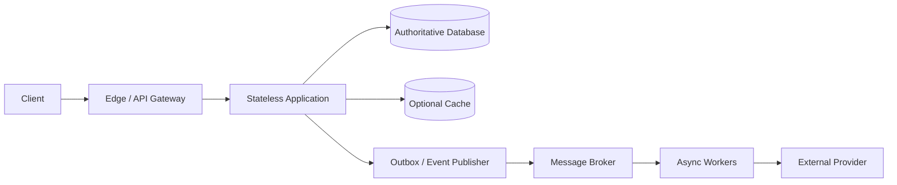
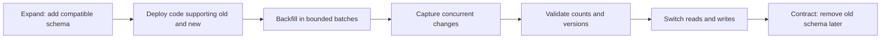
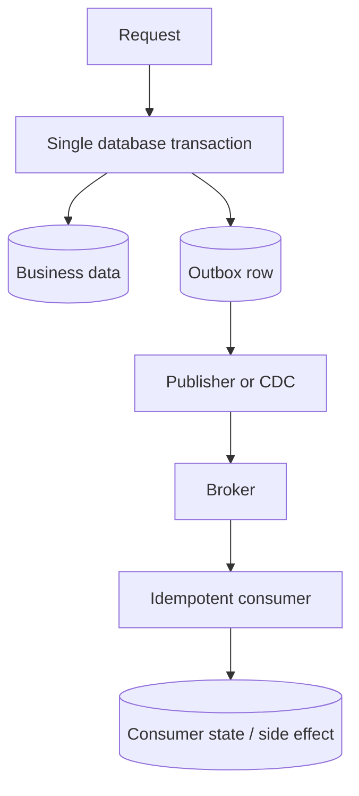
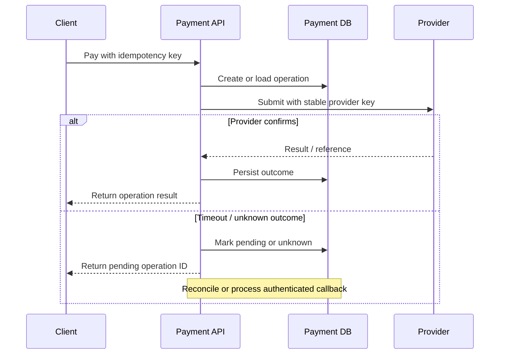
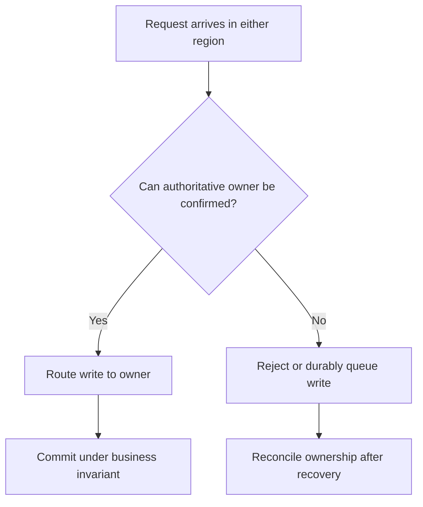
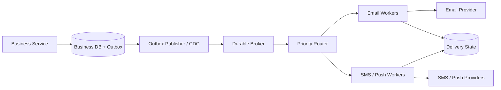

# System Design HLD Interview Handbook

**Audience:** Java backend engineers with 5+ years of experience preparing for senior backend and product-company interviews.  
**Purpose:** A progressive guide to architecture reasoning, capacity estimation, data ownership, consistency, failure handling, operations, and cost.  
**Status:** Targeted technical and scenario-depth review completed for key failure modes; the systematic accuracy, depth, and readability audit is in progress. Structural checks pass; full line-by-line verification and rendered diagram validation remain.

> **How to use this guide:** Learn fundamentals in order, then practise scenarios aloud. State assumptions, identify the critical business invariant, estimate scale, draw the simplest viable architecture, and deepen the part the interviewer challenges. Naming technologies is not the goal; explaining why the design satisfies requirements is.

## Table of contents

1. [HLD interview method](#1-hld-interview-method)
2. [Requirements and quality attributes](#2-requirements-and-quality-attributes)
3. [Capacity estimation](#3-capacity-estimation)
4. [Networking and request delivery](#4-networking-and-request-delivery)
5. [APIs and service boundaries](#5-apis-and-service-boundaries)
6. [Scaling and traffic management](#6-scaling-and-traffic-management)
7. [Databases and data modelling](#7-databases-and-data-modelling)
8. [Caching and content delivery](#8-caching-and-content-delivery)
9. [Distributed systems and consistency](#9-distributed-systems-and-consistency)
10. [Messaging and event-driven architecture](#10-messaging-and-event-driven-architecture)
11. [Transactions and business correctness](#11-transactions-and-business-correctness)
12. [Resilience and failure handling](#12-resilience-and-failure-handling)
13. [Security and abuse prevention](#13-security-and-abuse-prevention)
14. [Observability and operations](#14-observability-and-operations)
15. [Multi-region and disaster recovery](#15-multi-region-and-disaster-recovery)
16. [Cost and architectural evolution](#16-cost-and-architectural-evolution)
17. [Advanced HLD deep-dive Q&A](#17-advanced-hld-deep-dive-qa)
18. [Senior-level scenario bank](#18-senior-level-scenario-bank)
19. [End-to-end case-study index](#19-end-to-end-case-study-index)
20. [Cross-references and authoritative reading](#20-cross-references-and-authoritative-reading)

---

## 1. HLD interview method

### Q1. What does a High-Level Design interview evaluate?

It evaluates whether you can turn an ambiguous product goal into a coherent architecture and defend its important decisions. Interviewers look for requirement discovery, assumptions, capacity reasoning, data modelling, component boundaries, consistency guarantees, failure handling, and communication. They do not expect a perfect production architecture in 45 minutes; they expect you to expose important decisions and reason about consequences.

Start with user journeys and business invariants, not a list of fashionable technologies. In a ticket-booking system, preventing two users from buying the same seat is more fundamental than choosing an API framework.

### Q2. How is HLD different from LLD?

HLD explains major components, responsibilities, communication paths, data ownership, scaling, and reliability. LLD explains classes, interfaces, methods, object collaboration, and implementation-level patterns. The boundary is not absolute: an HLD discussion may need a concrete schema, API contract, partition key, or transaction boundary when it determines correctness.

### Q3. How should you structure a 45–60-minute design interview?

A reasonable default is 0–5 minutes for requirements; 5–10 for quality targets and estimates; 10–20 for architecture and main flows; 20–35 for data, consistency, and bottlenecks; 35–50 for failure handling, security, and trade-offs; then summarize. Adapt when the interviewer redirects you. Do not rigidly follow a schedule at the expense of the discussion.

### Q4. What should you clarify before drawing the architecture?

Start with the users and their most important journeys: what must they be able to do, and what must never go wrong? Then ask about scale (average and peak traffic, bursts, data growth), read/write patterns, latency and availability targets, retention, geography, privacy, and cost. For workflows such as payments or booking, explicitly ask which outcomes must be atomic and which can complete asynchronously.

Prioritize questions that could change the design. For example, a notification system with a two-second delivery target needs a different queueing and provider strategy from a bulk email system that can take an hour. If the interviewer cannot provide a number, state a reasonable assumption and continue rather than getting stuck.

### Q5. How do functional and non-functional requirements differ?

Functional requirements describe what the system does, such as create an order or send a notification. Non-functional requirements describe how well it must work, such as latency, availability, durability, privacy, throughput, recovery time, and cost. Functional requirements define the features; non-functional requirements often determine the architecture.

### Q6. How do you handle an ambiguous prompt such as “design a notification system”?

Turn the broad phrase into a few concrete journeys. Ask which channels are needed (email, SMS, push), expected volume and burst size, delivery deadlines, user preferences, provider quotas, and whether notifications may expire. Clarify what “delivered” means: accepted by your API, durably queued, accepted by the provider, or confirmed on the recipient's device. Those are different guarantees.

Then identify which work must be synchronous. A request can return an operation ID after the notification request is durably recorded, while provider delivery happens asynchronously. Design for retries, duplicate events, provider outages, and per-channel priorities; otherwise, “send a notification” hides the main architectural decisions.

### Q7. How do you avoid overengineering?

Start with the simplest architecture that satisfies requirements and leaves credible growth paths. A modular monolith and relational database may be ideal at modest scale. Add a broker, cache, search index, or service boundary only when a requirement or measured bottleneck justifies its operational cost.

### Q8. What makes an architecture diagram useful?

Show major components, ownership boundaries, synchronous calls, asynchronous events, persistent stores, and trust boundaries. Label critical flows and identify the authoritative owner of each data item. A clear six-component diagram with explained trade-offs is better than twenty unexplained boxes.

A generic backend flow might look like this; a real interview diagram should be tailored to the requirements.

The synchronous path should own the user-visible acceptance guarantee. The asynchronous path is useful for work that can complete later, but it needs durable events, idempotent consumers, and observable backlog.

### Q9. How should you respond when the interviewer changes a requirement?

Restate the new constraint, identify assumptions it invalidates, and update only affected parts. If notifications now have a two-second deadline, priority queues and reserved capacity may be needed; the entire system does not automatically require a rewrite.

### Q10. Why do candidates underperform in HLD interviews?

Common problems include designing before clarifying requirements, skipping estimates, confusing average and peak load, choosing databases by popularity, ignoring correctness, assuming retries are harmless, drawing components without data flows, and omitting operations and cost. Treating every problem as a microservices problem is another frequent mistake.

### Q11. How do you know the design is complete enough?

You can explain the main user flow, data ownership, critical invariant, expected load, likely bottleneck, dependency-failure behavior, security boundary, and recovery strategy. State what remains out of scope. Complete enough means adequate for the requirements and time, not every implementation detail.

### Q12. How should you communicate a trade-off?

Make the reasoning conditional on the requirement: “Because this workflow must prevent duplicate seat reservations, I would enforce uniqueness in the authoritative database. That gives us a clear correctness boundary, but contention can limit throughput for a very hot event. If the business accepts overselling or uses temporary inventory allocation, I would revisit the design.”

A good trade-off answer names the benefit, the cost, the failure mode, and the condition that would change your decision. Avoid saying that a technology is “best” without explaining the workload and guarantees that make it suitable.

## 2. Requirements and quality attributes

### Q13. Explain scalability, availability, reliability, durability, and fault tolerance.

These terms describe different properties, so avoid using them as synonyms:

- **Scalability** is the ability to handle more work by adding resources or changing the design without unacceptable degradation. Adding application instances helps only if the database or another shared dependency is not already the bottleneck.
- **Availability** is the likelihood that a request receives a usable response within the promised conditions and time. A process returning HTTP 200 is not enough if the response violates the business contract.
- **Reliability** is the broader ability to keep performing the intended function correctly over time. It includes more than whether an endpoint is reachable.
- **Durability** means acknowledged data survives the failures the design claims to tolerate. The guarantee depends on the database's commit and replication settings, not merely on having multiple copies.
- **Fault tolerance** is the ability to continue providing an acceptable level of service despite specified failures, often through redundancy, isolation, or graceful degradation.

For example, a catalogue can remain available while showing a slightly stale product description. A payment service should not preserve availability by returning an unverified balance or accepting conflicting debits. A durable database may still be temporarily unavailable during failover.

### Q14. Latency versus throughput: what is the difference?

Latency is how long one operation takes from the relevant start point to completion. Throughput is how many operations complete per unit of time. They are related but not interchangeable: batching can increase throughput while making each request wait longer, and a service can look fast at low load but become slow when queues form near saturation.

For example, a worker may process 10,000 events per second overall while an individual event waits 30 seconds in the queue. Track latency percentiles and successful throughput together, and include queueing time in end-to-end latency. Higher request rate is not useful if it mainly produces timeouts or work that completes after its deadline.

### Q15. Why do P95 and P99 latency matter?

P95 is the value at or below which 95% of measured requests complete; P99 is the equivalent threshold for 99% of requests. If average latency is 80 ms but p99 is 2.5 seconds, the average hides a painful experience for a meaningful subset of users. Tail latency often reveals queueing, lock contention, garbage-collection pauses, hot keys, or slow downstream dependencies.

Fan-out makes this especially important. If an endpoint waits for several required services, the whole response may be delayed by the slowest call. Measure percentiles by endpoint and request class, and always state the measurement window and population; percentile values from different windows or samples are not directly comparable.

### Q16. What are SLI, SLO, and SLA?

An **SLI** (service-level indicator) is the measurement, such as the percentage of eligible requests that succeed or the p99 latency of successful requests. An **SLO** (service-level objective) is the target for that measurement over a stated window—for example, 99.9% of eligible requests succeed over 30 days. An **SLA** (service-level agreement) is an external commitment to customers and may define service credits or other consequences if the commitment is missed.

Be precise about the measurement. “99.9% availability” could mean the fraction of time the service is usable or the fraction of eligible requests that succeed; those are not interchangeable. Define which requests count, what counts as success, the observation window, and how planned maintenance or client errors are treated. Otherwise, a team can report a healthy SLI while users experience a broken critical journey.

### Q17. What is an error budget?

For a time-based 99.9% availability target over a 30-day month, the nominal unavailability budget is about 43 minutes. A request-based SLO instead allows a fraction of eligible requests to fail. Error budgets help balance release velocity and reliability work; they are not permission to ignore incidents.

### Q18. How do you estimate end-to-end availability across dependencies?

If a request succeeds only when every required dependency succeeds, and their failures are independent, multiply their availability estimates. For example, three serial dependencies each available 99.9% of the time give approximately \(0.999^3 = 99.70\%\) end-to-end availability. The request path is less available than any one dependency because any required component can make it fail.

Treat this as a first-order model, not a production forecast. Failures are often correlated: several services may share a database, network, identity provider, or deployment. Conversely, caching, retries within a deadline, and valid fallback behavior can improve user-visible success. Model only dependencies that are truly required for the response, and explain what the system does when each one is unavailable.

### Q19. What is graceful degradation?

Graceful degradation means preserving the most valuable, correct parts of a service when some capabilities are unavailable or overloaded. A shopping page might continue to show product details while hiding recommendations; a video service might lower resolution instead of failing playback. The degraded behavior should be deliberate, documented, and measurable—not a collection of accidental fallbacks.

First classify dependencies as critical or optional for each user journey. If recommendations fail, omitting them may be safe. If the inventory check fails, accepting a reservation based on stale data may violate the core business invariant. Define what can be omitted, what can be stale, and what must fail closed; then test those behaviors under dependency failure.

### Q20. How do you prioritize conflicting quality attributes?

Identify the business invariant and rank requirements by impact and risk. For a financial ledger, correctness and durability usually outrank accepting every write during a partition. For a public catalogue, availability and low latency may justify slightly stale data. State the boundary explicitly.

### Q21. What is blast radius?

Blast radius is the scope of impact when something fails: how many users, tenants, regions, or business functions are affected. A bad release that breaks one optional feature has a smaller blast radius than a shared authentication failure that prevents every service from accepting requests.

Reduce blast radius through bulkheads, bounded queues, tenant quotas, separate capacity for critical workloads, staged rollouts, and genuinely independent failure domains. Redundancy alone is not enough if every replica shares the same overloaded database, credentials, or control plane. In an interview, identify the common dependency that could turn a local problem into a platform-wide incident.

## 3. Capacity estimation

### Q22. Estimate requests per second from daily active users.

Assume 2 million daily active users each make 40 requests per day: 80 million requests/day. Divide by 86,400 seconds to get about 926 requests/second on average. If peak traffic is four times average, plan for roughly 3,700 requests/second before retries, background jobs, and internal fan-out.

These are illustrative assumptions, not measured production facts. The estimate helps determine whether a simple deployment is plausible and which components deserve further investigation.

### Q23. Why is average traffic insufficient?

Traffic is uneven: campaigns, commute times, and viral events create peaks. A system sized exactly to average load queues work during peaks, increasing latency and triggering retries. Estimate peak-to-average ratio, burst duration, and whether excess work can be queued or must be rejected.

### Q24. How do you estimate storage?

Assume 10 million records/day averaging 1.5 KB including metadata. Raw growth is about 15 GB/day, or 5.5 TB/year before indexes, replicas, logs, compaction, and backups. If effective overhead is 2.5×, an initial estimate is about 13.7 TB/year. Validate with actual measurements and distinguish decimal GB/TB from binary GiB/TiB.

### Q25. How do you estimate bandwidth?

Multiply request rate by average payload size and estimate responses separately. At 4,000 requests/second and a 20 KB response, response egress is about 80 MB/s, or 640 Mbps, before protocol overhead and headroom. Large media often belongs in object storage behind a CDN rather than flowing through application servers.

### Q26. How do you estimate queue processing capacity?

If 8,000 events/second arrive and each worker instance reliably processes 500 events/second, at least 16 instances are needed just to match arrivals. Running at 100% leaves no burst or failure headroom. If arrivals exceed processing for a sustained period, the backlog grows regardless of queue size.

### Q27. How do retries affect capacity?

Capacity must be sized for **attempts**, not only original logical requests. If 1,000 requests per second each trigger two retries, the dependency can receive up to 3,000 attempts per second for that traffic, before considering retries at other layers. During an outage, this amplification can push a partially unhealthy service into a cascading failure.

Use bounded retries with exponential backoff and jitter, stop when the end-to-end deadline expires, and retry only operations that are safe to repeat. Choose a clear retry owner where possible; client, gateway, service, and broker retries can multiply. Monitor attempts per logical operation as well as raw request rate.

### Q28. How do you estimate cache memory?

Estimate active keys multiplied by average serialized value size, then add key/object overhead, metadata, fragmentation, and replication. Five million values averaging 2 KB need 10 GB for values alone; actual allocation may be much higher. Validate using representative data and memory metrics.

### Q29. What changes when traffic grows 10×?

Find the limiting resource rather than multiplying every server count by ten. Stateless compute may scale horizontally, but a single database writer, hot partition, provider quota, or global lock may not. Recalculate network, storage, connection pools, queue drain time, and cost; the bottleneck often moves after the first fix.

### Q30. What is capacity headroom?

Headroom is spare capacity beyond expected demand. It absorbs bursts, node failures, deployments, and estimation error. The right amount depends on burst duration, scaling delay, failure tolerance, and cost. Autoscaling is not instantaneous, so sudden spikes may require warm capacity or admission control.

## 4. Networking and request delivery

### Q31. What happens when a client makes an HTTPS request?

At a high level, the client resolves the hostname through DNS, opens or reuses a transport connection, negotiates TLS when needed, sends the HTTP request, and receives a response from the server. In a typical web architecture, the request may pass through a CDN, WAF, load balancer, or API gateway before reaching the application and its dependencies.

Each step has costs and failure modes. DNS can return a stale endpoint; connection establishment and TLS add latency; a proxy can queue requests; the application can wait for a database connection; and the response can be delayed by downstream work. Persistent connections and TLS session resumption can reduce setup overhead, but they do not fix application bottlenecks. When diagnosing latency, break down the end-to-end timeline rather than assuming the application code is responsible for all of it.

### Q32. Layer 4 versus Layer 7 load balancing?

A Layer 4 load balancer routes using transport-level information such as IP addresses, ports, and connection state. It does not need to understand the HTTP path or application payload, so it can be a good fit for efficient connection distribution. A Layer 7 load balancer understands the application protocol and can route based on hostnames, paths, headers, cookies, or other request properties.

Layer 7 is useful for API routing, authentication integration, and request-aware policies, but it adds processing and configuration complexity. Neither layer automatically makes a backend highly available: health checks, capacity, connection draining, and shared dependencies still matter.

### Q33. Which load-balancing algorithms are common?

Round robin distributes requests cyclically; least-connections prefers backends with fewer active connections; weighted methods account for unequal capacity; consistent hashing can preserve affinity for a key. No algorithm fixes an overloaded shared database. Choose based on request duration, backend heterogeneity, and locality.

### Q34. Are health checks enough for safe failover?

No. A health check is a signal, not a complete failover protocol. **Liveness** asks whether a process should be restarted; **readiness** asks whether it should receive new traffic. A process can be alive but not ready, and a shared database outage can make every instance fail a dependency check even though restarting those instances will not fix the database.

Use thresholds and time windows that avoid reacting to brief noise, and distinguish process health from dependency health. During planned removal, mark the instance unready and drain existing requests before shutdown. For stateful systems, a health check alone must never decide write ownership or prove that the old leader has stopped accepting writes.

### Q35. What are the limitations of sticky sessions?

Sticky sessions route a client repeatedly to one server. They can improve locality but create uneven load and complicate failover. If session state exists only in process memory, restart loses it. Prefer stateless services unless affinity is a measured requirement.

### Q36. How should timeout budgets be designed?

Start with the time the user journey can tolerate, then set an end-to-end deadline and allocate part of that budget to each required step. If the API has a one-second deadline, a downstream call must not independently wait two seconds. Leave time for the application to validate the result, commit its own state, and return a response.

Check what each client library's timeout actually covers: connection-pool acquisition, DNS, TLS, network transfer, server processing, or only some of these. Propagate the remaining deadline to downstream calls where possible. Retries consume the same budget, so a retry is useful only if enough time remains for a successful attempt. Too-short timeouts create unnecessary retries; too-long timeouts tie up threads and connections while users wait.

### Q37. When use WebSockets, Server-Sent Events, or long polling?

WebSockets support bidirectional long-lived communication, useful for chat and collaboration. Server-Sent Events provide a server-to-client stream over HTTP. Long polling holds a request until data is available and can be simpler but adds repeated request overhead. Choose based on directionality, scale, reconnect behavior, and delivery needs.

### Q38. What does a CDN solve and not solve?

A CDN caches eligible content near users, reducing origin load and geographic latency. It works well for static assets and carefully cacheable responses, but not automatically for personalized data, authorization, or writes. Cache keys must include every request dimension that changes the representation.

## 5. APIs and service boundaries

### Q39. REST versus RPC/gRPC: how do you choose?

REST over HTTP is often a good fit for public, resource-oriented APIs because it is broadly supported by browsers, gateways, debugging tools, and client libraries. gRPC provides generated typed contracts, compact Protocol Buffers messages, and first-class streaming, which can be useful for internal service calls or high-volume communication.

Do not choose based only on claims that one protocol is faster. Network topology, payload size, connection reuse, serialization cost, proxy support, observability, and team tooling all affect end-to-end performance. Choose the contract and operational model that fit the clients and workload, and benchmark realistic traffic if performance is the deciding factor.

### Q40. How do you change an API without breaking clients?

Prefer additive changes that preserve existing field meanings and behavior—for example, adding an optional response field that old clients can ignore. Treat a semantic change as potentially breaking even if the JSON shape remains the same; changing `amount` from gross to net is a contract break without a schema change. Avoid reusing a removed field name for a different meaning.

When an incompatible change is unavoidable, use a versioning or migration plan, publish a deprecation window, measure which clients still use the old contract, and remove it only when the agreed policy allows. Test old and new clients against mixed-version deployments and ensure rollback does not leave incompatible data behind.

### Q41. Offset versus cursor pagination?

**Offset pagination** asks for a page after skipping a number of rows, such as `LIMIT 50 OFFSET 50000`. It is simple for clients and supports jumping to a page number, but the database may need to scan or discard many rows at large offsets. If rows are inserted or deleted between requests, later pages can contain duplicates or miss records.

**Cursor pagination** carries a position from the previous page, often based on a stable sort key plus a unique tie-breaker such as `(created_at, id)`. The next query can seek from that position instead of skipping thousands of rows, which is often more efficient for large datasets. The API must define how sorting and filtering work and how cursors are validated. A cursor alone does not create a consistent snapshot; for exports or audits that need a fixed view, use an explicit snapshot boundary or asynchronous export workflow.

### Q42. What is an idempotency key?

It identifies a logical operation so repeated submissions resolve to the same operation rather than creating duplicate effects. Persist the key with operation state and a request fingerprint; reject reuse with a different payload. Enforce uniqueness atomically so concurrent first attempts cannot both execute. Define key scope and retention, and return either the stored result or a documented in-progress response while the original attempt is running.

### Q43. API gateway versus service mesh?

An API gateway commonly handles north-south traffic: external authentication, quotas, routing, and API policies. A service mesh focuses on service-to-service traffic, often providing workload identity, transport security, telemetry, and traffic policies. Neither replaces sound service contracts or application authorization.

### Q44. When should a monolith be split into microservices?

Split when independent ownership, deployment, scaling, security, or fault isolation has meaningful value and the team can operate the complexity. Identify cohesive domain boundaries and data ownership first. Poorly split services create chatty calls and distributed transactions—a distributed monolith. A modular monolith may be the better choice.

### Q45. Why is database-per-service not an automatic win?

Independent data ownership reduces coupling, but cross-service queries and transactions become harder. Duplicated read models may be needed and are often eventually consistent. Start from domain ownership and access patterns, not a slogan.

## 6. Scaling and traffic management

### Q46. Vertical versus horizontal scaling?

Vertical scaling increases resources on one machine and is operationally simple until hardware limits or single-node risks dominate. Horizontal scaling adds instances but requires distributing traffic and state. Stateful systems often need sharding, replication, or coordination before they scale horizontally.

### Q47. Why might adding application instances not improve throughput?

The bottleneck may be the database, a global lock, a connection pool, downstream quota, network, or serialized critical section. More instances can increase contention and connection pressure. Use latency breakdowns, saturation metrics, traces, and load tests before scaling.

### Q48. What is backpressure?

Backpressure prevents producers from overwhelming slower consumers through bounded queues, demand signals, concurrency limits, or rejection. Without bounds, a queue converts overload into memory growth and long latency. Decide whether to slow producers, reject work, or defer it based on business priority.

### Q49. What is load shedding?

Load shedding intentionally rejects lower-priority work when capacity is exhausted so critical work remains healthy. A fast overload response can be better than allowing every request to time out. Align the policy with product priorities and monitor rejected work.

### Q50. Why can autoscaling make an incident worse?

If CPU is not the bottleneck, adding instances may increase database connections, cache misses, or downstream traffic. Aggressive thresholds can cause oscillation, and cold starts may worsen latency. Scale on the resource limiting useful throughput, cap concurrency, and reserve capacity for sudden bursts.

### Q51. How do you isolate a noisy tenant?

Use per-tenant quotas, concurrency budgets, fair scheduling, workload pools, and tenant-aware metrics. Strong isolation may require dedicated partitions or infrastructure. A global limit protects the platform but does not ensure fairness.

### Q52. How do you estimate queue drain time?

With 3.6 million messages, 12,000 processed/second, and 4,000 new arrivals/second, net drain rate is 8,000/second, so drain time is about 450 seconds or 7.5 minutes. This assumes stable rates and no retries or variable processing costs. If arrivals match or exceed processing, the backlog will not drain.

## 7. Databases and data modelling

### Q53. How do you choose SQL versus NoSQL?

Start with relationships, invariants, access patterns, transaction requirements, query flexibility, and operational expertise. Relational databases are strong defaults for structured data and multi-row transactions. Key-value or wide-column stores suit predictable high-volume patterns; document databases suit aggregate-oriented records; graph databases help relationship traversal. NoSQL does not automatically mean faster or more scalable.

### Q54. OLTP versus OLAP?

OLTP handles operational reads and writes, usually with short transactions and correctness needs. OLAP supports large scans and aggregations. Heavy analytics on the transactional primary can damage user-facing latency; replicate or stream data to analytical storage when workload isolation justifies it.

### Q55. What makes a good shard key?

It distributes load and storage while supporting common queries without excessive scatter-gather. A user ID localizes user data but can become hot for a popular user. Time-based keys can create write hotspots. Evaluate cardinality, skew, queries, growth, and migration difficulty.

### Q56. What is a hot partition?

A partition is hot when it receives disproportionate traffic or data. Causes include skewed keys, celebrity accounts, sequential keys, or uneven tenant load. Mitigations include key salting, sub-partitioning, caching, isolating hot tenants, or redesigning access patterns. Each can make reads or aggregation more complex.

### Q57. What is consistent hashing?

Consistent hashing maps keys and nodes onto a logical ring so adding or removing a node typically remaps only a portion of keys. Virtual nodes can improve balance. It reduces movement but does not guarantee perfect distribution, eliminate hot keys, or solve replication correctness.

### Q58. What are read replicas good for, and what can go wrong?

Replicas can scale reads and provide recovery options. Asynchronous replication introduces lag: a user may write a value and immediately read an older one. Route read-after-write traffic to the primary or use a supported consistency token. Replicas also consume resources and have failover implications.

### Q59. Why is read/write splitting not simply “send reads to replicas”?

Some reads require fresh data or influence a subsequent write. A lagging replica can violate business expectations. Classify reads by consistency needs, define routing rules, and test failover behavior. Monitor lag and avoid overwhelming replicas with expensive queries.

### Q60. How do you perform a zero-downtime schema migration?

Use expand–migrate–contract. Add a backward-compatible schema element, deploy code that handles old and new representations, backfill in bounded batches, verify, switch reads/writes, and remove the old schema only after clients migrate. Plan for locks, index creation, rollback, and mixed-version behavior.

The migration is complete only after the backfill and concurrent-write stream agree, the new path has been observed in production, and rollback no longer depends on the old representation.

### Q61. Normalization versus denormalization?

Normalization reduces duplicated facts and update anomalies. Denormalization duplicates or derives data to improve read locality. It creates a synchronization obligation: define the authoritative copy, propagation method, freshness contract, and reconciliation process.

### Q62. How do you recover from database failure?

Distinguish node loss, corruption, accidental deletion, regional loss, and logical errors. Replication helps availability but may replicate corruption. Backups and point-in-time recovery protect against some logical failures. Define RPO/RTO, test restores, verify integrity, and document promotion and client reconnection.

## 8. Caching and content delivery

### Q63. When does caching help?

Caching helps when values are reused, expensive to fetch, and tolerate the freshness model. It may hurt when data is rarely reused, invalidation is expensive, values are large, or a remote lookup adds more latency than it saves. Measure hit ratio alongside end-to-end latency, backend load, memory, and stale-read incidents.

### Q64. Explain cache-aside.

The application checks the cache, loads from the source on a miss, and populates the cache. On writes, it commonly updates the database and invalidates the key. Concurrent readers can repopulate stale data, so use suitable TTLs and versioning or invalidation coordination where needed. Never treat a cache as the authoritative financial record.

### Q65. What is a cache stampede?

Many requests miss the same expired key and simultaneously query the backend. Mitigations include single-flight request coalescing, jittered TTLs, refresh-ahead, stale-while-revalidate, and carefully bounded per-key locks. A lock itself can become a bottleneck.

### Q66. Cache penetration, hot keys, and stampedes—what differs?

Penetration is repeated access to nonexistent keys, potentially addressed by negative caching or a Bloom filter. A hot key is one existing key receiving disproportionate traffic, addressed through replication, local caching, or coalescing. A stampede is concurrent regeneration of a key, often after expiry. Diagnose before choosing a mitigation.

### Q67. How should TTLs be chosen?

Choose TTL based on staleness cost, update frequency, and backend capacity. Randomize TTLs to avoid synchronized expiration. TTL bounds retention, not freshness across in-flight requests or a guarantee that every client sees the same value.

### Q68. What if Redis becomes unavailable?

Determine whether it is optional acceleration or correctness-critical coordination. Cache-aside fallback may overload the database, so use concurrency limits, circuit breaking, load shedding, and carefully permitted stale responses. If Redis stores lock or workflow state, preserve the invariant rather than blindly bypassing it.

### Q69. How do you keep cache and database consistent?

There is no universal atomic operation spanning an ordinary database and an independent cache. Commit then invalidate is common but still has races. TTL bounds stale duration but does not eliminate it. Stricter needs may require versioned values, transactional change capture, or bypassing the cache for critical reads.

## 9. Distributed systems and consistency

### Q70. What is a partial failure?

One component or network path fails while the rest of the system continues. A caller may time out even though the callee completed the operation. A timeout is not proof that an operation did not happen.

### Q71. Explain strong and eventual consistency.

Strong consistency is an umbrella term; system-design discussions often mean linearizability, where operations behave as if they occurred in a single agreed order. Eventual consistency means replicas may temporarily disagree but converge if updates stop and repair succeeds. It does not define a maximum staleness bound or guarantee business correctness by itself.

### Q72. What is read-your-writes consistency?

After a client successfully writes a value, its subsequent reads observe that write or a newer one. Implementations may route to the primary, pin a session to a caught-up replica, or pass a version token. It is weaker than global linearizability and can be sufficient for user settings.

### Q73. Explain CAP carefully.

When a network partition prevents nodes from communicating, a distributed data system cannot guarantee both linearizable consistency and a successful response from every non-failing node. Partition tolerance is not a practical optional feature in a networked system; the meaningful choice during a partition is often whether to reject or delay some operations or serve potentially stale data. CAP does not mean any two properties are freely chosen under all conditions.

### Q74. What does PACELC add?

PACELC says that during a partition a system trades off availability and consistency; otherwise, during normal operation, it still trades off latency and consistency. It is a reasoning aid, not a substitute for understanding a database's actual guarantees.

### Q75. What are quorum reads and writes?

Replicated systems may require acknowledgements from a configured number of replicas. In a simple N-replica model, read quorum R and write quorum W with R + W > N create an intersection between the read and write sets. That intersection helps a read encounter a recent write only if the system's protocol, versions, membership, and conflict resolution preserve the relevant guarantee. Sloppy quorums, concurrent writes, and product-specific semantics can change the result; the arithmetic alone is not a universal consistency guarantee.

### Q76. Why are distributed locks difficult?

A lock holder can pause or lose connectivity beyond its lease while still believing it owns the lock. Another client may acquire the expired lock, so both can work. Fencing tokens—monotonically increasing ownership numbers enforced by the protected resource—can reject stale writes. Prefer database constraints or conditional writes when they express the invariant more simply.

### Q77. Does exactly-once delivery exist?

The phrase is incomplete without a system boundary. A broker may offer exactly-once processing within specific transactional boundaries, but that does not automatically make an external payment, email, or database side effect exactly once. Business workflows commonly combine at-least-once delivery, durable operation records, idempotent consumers, unique constraints, and reconciliation.

### Q78. How do you handle out-of-order events?

Decide whether order is needed and at what scope. If per-account order matters, partition by account and process sequentially within that partition. Include versions or sequence numbers so consumers can detect stale or missing updates. Global ordering is expensive and usually unnecessary.

### Q79. What is reconciliation?

Reconciliation compares independent records or states to discover missed, duplicated, or inconsistent work. For example, compare internal payment operations with provider settlement records. It complements transactional design by recovering from uncertain outcomes and failures that cannot be prevented completely.

## 10. Messaging and event-driven architecture

### Q80. Queue versus event stream?

A task queue commonly distributes work among workers, with each task intended for one worker in a consumer group. An event stream retains an ordered log that multiple independent consumers can read and replay within retention. Products may support both patterns, but retention, replay, ordering, and acknowledgement semantics differ.

### Q81. What is a Kafka partition key?

The key determines which partition receives a record under the producer's partitioning strategy. Same-key records are typically routed to the same partition, enabling per-key ordering there. A bad key can create a hot partition; changing partition counts or strategy can change key placement.

### Q82. What is consumer lag?

Consumer lag measures how far a group trails the available log. Lag alone does not reveal catch-up time; record size, processing cost, partitions, and incoming rate matter. Monitor lag trend, age of oldest event, processing latency, errors, and throughput.

### Q83. How should retries and dead-letter queues work?

Retry transient failures with bounded attempts and backoff. Do not retry permanent validation errors forever. A dead-letter queue stores messages that exceed policy for investigation and safe replay. Preserve payload, error context, attempt count, and correlation IDs; assign ownership so the DLQ is not a silent graveyard.

### Q84. What is the transactional outbox pattern?

Write the business change and an outbox record in the same database transaction. A publisher or CDC pipeline then publishes the record. This avoids the dual-write gap where the database commits but the event is lost—or the event publishes while the database rolls back. Publication may repeat, so consumers should be idempotent.

The important property is that the business change and outbox row commit together. Publishing is a separate, retryable step; it can publish the same event more than once, so downstream processing still needs deduplication.

### Q85. Saga choreography versus orchestration?

In choreography, services react to events and each knows how to continue or compensate. It avoids a central coordinator but complex workflows become hard to understand. In orchestration, a coordinator tracks state and commands participants, improving visibility while adding a component whose availability and state matter. Both need idempotency, timeouts, durable state, and compensation.

### Q86. How do you handle poison messages?

A poison message repeatedly fails due to malformed data, schema incompatibility, or deterministic bugs. Classify errors, cap attempts, route irrecoverable messages for investigation, and preserve ordering requirements. Skipping a failed event may be unsafe if later events depend on it.

## 11. Transactions and business correctness

### Q87. How do you prevent duplicate payment charges?

Create a durable payment-operation record with a unique business/idempotency key before calling the provider. Repeated submissions resolve to the same operation. Pass a stable idempotency key to the provider if supported and persist provider references. Understand the provider's key scope and retention window: a retry after that window may not be deduplicated, so query status or reconcile before resubmitting. Treat timeouts as unknown outcomes and do not blindly initiate a new charge.

The operation record is created before the external side effect. A timeout moves the workflow into an uncertain state; it must not trigger a new logical payment with a new key.

### Q88. How do you prevent double booking a seat?

The invariant is that at most one active reservation owns a seat for a show. Enforce it in the authoritative datastore with a unique constraint, conditional update, or transactionally guarded state transition. A cache or distributed lock alone is insufficient. Holds need expiry and an atomic transition to confirmed.

### Q89. Optimistic versus pessimistic concurrency control?

Optimistic control allows concurrent work and checks for conflict at commit, often using a version. It works when conflicts are uncommon. Pessimistic control locks data during the transaction and may suit high contention, but can reduce throughput and introduce deadlocks. Choose based on conflict frequency, transaction duration, and invariant.

### Q90. What happens when a request times out after a successful write?

The client sees an uncertain outcome. It should retry with the same idempotency key or query operation status, not create a new logical operation. The server must persist enough state to return the original result. Distinguish accepted, in progress, succeeded, failed, and unknown where relevant.

### Q91. Why is a saga not a distributed ACID transaction?

A saga coordinates local transactions and compensating actions; the whole workflow is not atomic at every instant. Intermediate states are visible, compensation can fail, and some effects cannot truly be undone. Model the workflow explicitly and provide retry and manual-recovery paths.

### Q92. How should webhook consumers handle duplicate callbacks?

Verify authenticity, persist the provider event ID under a uniqueness constraint, and make state transitions idempotent. Acknowledge after durable acceptance according to the provider contract. Callbacks may be duplicated or out of order; validate legal state transitions and reconcile when necessary.

## 12. Resilience and failure handling

### Q93. How should retries be designed?

Retry only likely transient failures, only when the operation is safe to repeat, and only within a bounded deadline. Use exponential backoff with jitter. Coordinate retries across clients, gateways, services, and brokers; independent retry policies can multiply attempts. Respect provider retry guidance where available.

### Q94. What does a circuit breaker do?

It stops calls to a dependency that appears unhealthy, allowing recovery and preventing callers from accumulating slow requests. Typical states are closed, open, and half-open. Thresholds must match the workload. It complements timeouts; it does not replace them.

### Q95. What is a bulkhead?

A bulkhead isolates resources so one failing workload cannot consume all capacity. Separate thread pools, concurrency limits, queues, or connection pools can help. Separate application pools do not help if all of them wait on the same exhausted database.

### Q96. Why can retries cause cascading failures?

A slow dependency causes timeouts; callers retry, increasing load; the dependency slows further; queues and connection pools fill; unrelated requests fail. Break the loop with deadlines, retry budgets, jitter, circuit breakers, bounded concurrency, load shedding, and reduced optional work.

### Q97. Liveness versus readiness?

Liveness asks whether a process should continue or be restarted. Readiness asks whether it should receive traffic. Restarting every instance because a shared database is temporarily down can worsen an outage. Probes should not turn dependency failure into a restart storm.

### Q98. How should a service recover after a long downstream outage?

Protect the recovering dependency from a sudden flood. Limit concurrency, drain queues at a controlled rate, prioritize time-sensitive work, and preserve idempotency. Monitor queue age and net drain rate. Expire work only according to explicit business policy.

## 13. Security and abuse prevention

### Q99. Authentication versus authorization?

Authentication establishes who or what is making a request; authorization decides whether that identity may perform an action on a resource. A valid token does not imply access to every tenant's data. Enforce resource ownership on every relevant path.

### Q100. How do you secure service-to-service communication?

Use workload identities or short-lived credentials, authenticated transport such as TLS/mTLS where appropriate, least-privilege authorization, secret rotation, and audit trails. Avoid long-lived shared secrets in source code or images. Network location alone is not identity.

### Q101. How do you prevent API abuse?

Apply identity-aware rate limits, quotas, payload-size limits, concurrency caps, validation, anomaly detection, and threat-specific controls. Use multiple dimensions such as IP, account, API key, tenant, and endpoint. Distributed rate limiting adds coordination cost; choose accuracy based on risk.

### Q102. What security issues arise in multi-tenant systems?

Enforce tenant identity in database queries, cache keys, background jobs, object-storage paths, logs, and exports. A cache key that omits tenant identity can leak data even when database queries are secure. Add isolation tests and audit privileged cross-tenant access.

## 14. Observability and operations

### Q103. What should you monitor?

Track request rate, error rate, latency percentiles, and saturation. Add domain signals such as payment outcomes, inventory conflicts, queue age, consumer lag, cache hit ratio, replication lag, and reconciliation discrepancies. Infrastructure metrics alone cannot prove business correctness.

### Q104. Logs, metrics, and traces: what is each for?

Logs record discrete events and context; metrics aggregate numeric behavior for alerting; traces show a request's path across components and where time was spent. Connect them with trace/correlation IDs. Avoid high-cardinality metric labels such as raw user IDs and never log secrets.

### Q105. How do you investigate high p99 latency when CPU is low?

Break latency into queue wait, connection acquisition, network, downstream service, database, and serialization. Inspect traces, pool saturation, thread states, locks, garbage collection pauses, DNS/TLS, and retries. Low CPU may mean threads are blocked, not that the system has spare useful capacity.

### Q106. Canary versus blue-green deployment?

A canary sends a small share of traffic to a new version and expands based on health signals. Blue-green runs two environments and switches traffic, often enabling quick rollback at extra resource cost. Both require backward-compatible data changes; rollback may not undo irreversible writes.

### Q107. Why do schema compatibility and feature flags matter during deployments?

Application versions coexist during rolling deployments. A new producer may emit a field an old consumer cannot parse. Use expand–migrate–contract, compatible event schemas, staged rollout, and explicit rollback plans. Feature flags do not replace schema compatibility.

### Q108. What belongs in an incident runbook?

Symptoms and impact, dashboards and queries, likely failure domains, safe mitigation, escalation ownership, rollback/failover procedures, and verification steps. Include the risks of each mitigation so responders do not worsen the incident.

## 15. Multi-region and disaster recovery

### Q109. Active-passive versus active-active regions?

Active-passive serves normal traffic from one region and keeps another ready for failover. It is easier to reason about writes but needs tested promotion and acceptable recovery time. Active-active serves traffic in multiple regions and may reduce latency, but conflicts, replication lag, routing, and operations become harder. Active-active compute does not require active-active writes to the same entity.

### Q110. Define RTO and RPO.

Recovery Time Objective is the target maximum time to restore service after disruption. Recovery Point Objective is the maximum tolerable data-loss window measured in time. Backups, replication, failover automation, and restore testing influence them. A replica is not a backup against logical corruption.

### Q111. How do you handle a regional outage without conflicting financial writes?

Define a single authoritative write owner per financial entity or use a datastore with the required global consistency. If regions cannot coordinate and correctness is mandatory, reject writes whose ownership cannot be established. Queue a write only when the queue itself durably records the request, preserves its idempotency identity, and does not falsely promise that the financial operation has committed; otherwise return a retryable response. Fence the old leader and reconcile before restoring normal writes. Double-charging customers is not an acceptable availability trade-off.

Serving reads from both regions can remain possible, but accepting conflicting writes is a separate decision. Routing a request to a healthy region is not proof that the region owns the right to commit it.

### Q112. What is split brain?

Split brain occurs when two nodes or regions both believe they are authoritative, producing conflicting writes. Prevent it with quorum/consensus or explicit ownership, and use fencing epochs enforced by storage. DNS failover does not prove the old region stopped accepting writes.

### Q113. Why are backups and replication different?

Replication maintains another current copy and can reduce recovery time, but may copy accidental deletion or corruption. Backups provide historical recovery points when retained independently. Test restores, not just backup-job success.

## 16. Cost and architectural evolution

### Q114. How do you reduce cost without violating latency or reliability?

Measure cost by workload and tenant. Look for idle capacity, oversized instances, inefficient queries, excessive retention, unnecessary cross-region transfer, poor cache effectiveness, and retry amplification. Change one major factor at a time and compare latency, errors, saturation, and recovery objectives.

### Q115. When is a modular monolith preferable?

When a small team needs cohesive deployment, transactions across related modules, and low operational overhead. Keep modules separated by domain APIs and ownership so future extraction remains possible. Avoid shared mutable internals and cross-module table access that make separation difficult.

### Q116. Explain the Strangler pattern.

Incrementally move capabilities from a legacy system to a new implementation. Route selected flows to the new path while the old system serves the rest. Use clear data ownership, compatibility adapters, observability, and rollback. Avoid independent writes from both systems without reconciliation.

### Q117. How do you evolve from thousands to millions of users?

Do not build hypothetical scale at the expense of delivery. Establish SLOs and load-test baselines, identify likely constraints, and evolve when evidence appears. Stable IDs, tenant isolation, data ownership, and idempotency are often cheaper to design early than retrofit later.

### Q118. How do you reason about cost per request?

Include compute, storage operations, database capacity, egress, broker throughput, cache memory, observability, and idle headroom. Divide by successful business operations rather than raw HTTP attempts so retries and failures remain visible.

## 17. Advanced HLD deep-dive Q&A

This section adds cross-cutting architecture questions that interviewers use to test whether a candidate can connect requirements, component behavior, and operational consequences. It complements—not replaces—the dedicated Distributed Systems, Kafka, Redis, SQL, and Microservices guides.

### Q119. How do you turn requirements into an architecture instead of jumping directly to components?

Start by writing down user-visible operations and the invariant each operation must preserve. For each journey, identify its authoritative data, latency target, failure behavior, and dependencies. Estimate the load, then draw the smallest architecture that satisfies those constraints. For example, “place an order” might require a synchronous durable order record but allow email and analytics to happen asynchronously. The requirement—not a preference for Kafka or microservices—determines the boundary.

### Q120. How do you distinguish a system boundary from a deployment boundary?

A system boundary describes ownership, trust, data, and responsibility; a deployment boundary describes what is released and scaled together. They can align, but they do not have to. A modular monolith can enforce clear domain boundaries in one deployment. Splitting every module into a separate service adds network failures, versioning, observability, and operational burden. Extract a service when independent ownership, scaling, deployment, or isolation has measurable value.

### Q121. How do you decide which work belongs on the synchronous request path?

Keep synchronous work limited to what is necessary to produce a truthful response and preserve immediate business invariants. Move slow, retryable, or nonessential side effects—such as analytics, noncritical notifications, or media processing—to durable asynchronous workflows. However, asynchronous acceptance must be durable: if the API promises “accepted,” persist the job or outbox record before returning. Do not acknowledge work that exists only in process memory.

### Q122. How do you identify the authoritative source of truth in a system with several databases?

For each business fact, name one authoritative owner and distinguish it from caches, search indexes, analytics stores, and replicated read models. A product search index can be stale, but checkout should validate price and availability against their authoritative owners. If two services can independently overwrite the same fact, define conflict resolution or redesign ownership. “Both databases are the source of truth” is usually a warning that consistency responsibilities are unclear.

### Q123. What is a materialized view, and when is it useful?

A materialized view stores a precomputed representation of data for a read pattern. A social feed or customer dashboard may combine facts from several owners, making on-demand fan-out expensive. Build the view from reliable change events or periodic refreshes, track its freshness, and make updates idempotent. The trade-off is write amplification, extra storage, and eventual consistency. Rebuild and reconciliation procedures are part of the design.

### Q124. How do you choose between request-time fan-out and precomputation?

Request-time fan-out keeps data fresh and avoids storing every combination, but latency and availability depend on several services. Precomputation moves work to the write/update path and makes reads predictable, but introduces staleness and update complexity. Use request-time composition for low-volume or highly personalized data when latency permits; precompute hot, repeatable views when read volume is high and freshness can be bounded. A hybrid often works best.

### Q125. What is the difference between a control plane and a data plane?

The control plane configures and coordinates behavior—such as routes, policies, cluster membership, or tenant quotas. The data plane handles the actual requests or records. Separating them can protect request processing from slow administrative operations, but stale configuration and control-plane outages still need explicit behavior. Cache validated configuration, define safe defaults, and decide which policy changes must take effect immediately.

### Q126. How do you choose between pushing and pulling work?

With push, producers send work immediately to consumers; it can reduce latency but may overload consumers unless admission control and backpressure exist. With pull, consumers control their own pace, making load regulation simpler but potentially adding polling delay. Brokers often combine durable push-to-storage with consumer-controlled fetching. Choose based on latency, burstiness, consumer capacity, and how much control consumers need over throughput.

### Q127. Why are bounded queues important?

A queue absorbs short bursts; it cannot fix a permanent throughput deficit. If arrival rate stays above completion rate, backlog grows until retention, memory, disk, or latency limits are reached. Bound in-memory queues and define rejection, persistence, expiry, and priority policies. Monitor queue age and estimated drain time, not only depth. A million old low-priority jobs can be more damaging than a small queue of deadline-sensitive work.

### Q128. How do you estimate whether a queue can recover from a burst?

Calculate net drain rate as processing rate minus ongoing arrival rate. If 9,000 tasks/s can be processed while 6,000/s continue to arrive, a backlog of 1.8 million tasks takes roughly 600 seconds to drain. This assumes stable rates and homogeneous task cost. Include retries, poison messages, provider quotas, and worker failures. If net drain rate is zero or negative, adding retention only postpones the problem.

### Q129. How do you select a partition key when both ordering and throughput matter?

First define the ordering scope. If all events for an account must be ordered, account ID is a natural key, but a very active account may become a hot partition. Splitting one account across partitions improves throughput only by weakening ordering or requiring a later merge/coordination step. Measure skew and decide whether the business truly requires per-entity order, or only version checks and eventual convergence.

### Q130. When is a global lock a design smell?

A global lock serializes otherwise independent operations and can become a throughput ceiling and availability dependency. Ask whether the invariant can instead be enforced with a unique constraint, conditional write, version check, partition ownership, or per-entity lock. Global coordination may be justified for rare administrative operations, but it should not sit on every request without a clear correctness reason.

### Q131. What is the difference between deduplication and idempotency?

Deduplication recognizes that the same event or operation ID has been seen before. Idempotency means repeating an operation has the same intended effect as performing it once. Deduplication storage can expire or be unavailable, and two different event IDs can represent the same business action. Use stable business keys, idempotent state transitions, and database constraints where the invariant demands it.

### Q132. How should you handle a request that depends on several downstream services?

Draw the dependency graph and classify calls as required, optional, or conditionally required. Give each call a deadline within the overall request budget; parallelize independent calls where it helps. Bound concurrency and retries, and degrade only optional data. Fan-out increases the chance that at least one dependency is slow or failing, so precompute or consolidate calls when the user experience cannot tolerate the combined tail latency.

### Q133. How do you reason about availability for a fan-out endpoint?

If all N independent dependencies must succeed and each has availability A, a simplified estimate is A^N. For example, ten required dependencies each at 99.9% yield about 99.0% combined availability. This model assumes independence and ignores retries, caching, and fallback paths; real failures are often correlated. The architectural lesson is to reduce mandatory dependencies and define graceful behavior, not to treat the calculation as a production forecast.

### Q134. How do you choose a cache consistency model?

Start from the consequence of stale data. Stale recommendations may be harmless; stale authorization, inventory, or balances may not be. For tolerant reads, define maximum acceptable staleness, TTL, invalidation, and repair. For critical decisions, read from the authority or use a datastore guarantee that supports the invariant. A short TTL is a bound on cache residence, not proof of instantaneous consistency.

### Q135. What should a cache key include?

Every input that can change the response representation: entity ID, tenant, locale, currency, permission scope, relevant query parameters, and sometimes schema/version. Omitting tenant or authorization context can leak data across users. Including too many dimensions fragments the cache and reduces hit ratio. Document the cache-key contract and test isolation explicitly.

### Q136. How should a design respond to a cold cache after deployment or failover?

Assume a cold cache may expose the full source workload. Estimate miss traffic, use bounded concurrency and request coalescing, and warm only high-value keys when safe. Stagger expirations and rollouts. Avoid eagerly loading the entire dataset if it competes with production traffic. If the source cannot handle cold-cache load, keep spare capacity or temporarily shed optional traffic.

### Q137. What is the difference between a replica, a backup, and a read model?

A replica maintains another copy for availability or read scaling, often with limited lag. A backup is a retained recovery point for restoring earlier state after corruption or deletion. A read model is a representation optimized for particular queries and may be derived from events. These serve different purposes; none automatically substitutes for the others.

### Q138. How do you choose a consistency boundary for a business workflow?

Identify the smallest set of facts that must change atomically to preserve an invariant. Keep those changes in one transaction when possible. Coordinate later cross-service steps through a saga or durable events, making intermediate states explicit. For example, order creation and its outbox event can commit together, while notification delivery occurs later. Do not expand a transaction across every service just to make the diagram look atomic.

### Q139. What is the dual-write problem?

A service updates a database and separately publishes an event. If the database commit succeeds but publishing fails, downstream systems never learn about the change; if publishing succeeds but the transaction rolls back, consumers see a phantom event. The transactional outbox or a supported CDC approach closes this gap between the authoritative commit and publication. Consumers still need idempotency because publication and delivery can repeat.

### Q140. When is event sourcing justified?

Event sourcing stores state-changing events as the primary record and derives current state by replaying them. It can provide audit history and temporal reconstruction, but introduces event-schema evolution, replay cost, projection lag, correction strategies, and operational complexity. It is not synonymous with using Kafka or publishing domain events. Choose it when the event history itself is a core domain requirement, not merely because an event-driven architecture is desired.

### Q141. How should API rate limits be distributed across multiple application instances?

A local limiter is fast and resilient but allows aggregate traffic to multiply with instance count and can be uneven across instances. A shared limiter enforces a more global view but adds network latency and a new dependency. Hierarchical budgets can allocate a global quota to local instances and periodically reconcile it, trading exactness for speed. Choose based on abuse risk, quota semantics, traffic volume, and behavior during limiter failure.

### Q142. How do token bucket and leaky bucket differ conceptually?

A token bucket accumulates tokens up to a capacity; requests consume tokens, allowing controlled bursts while bounding long-term average rate. A leaky-bucket-style shaper releases work at a controlled rate, smoothing bursts; variants may instead reject excess work. Pick a model based on whether bursts should be permitted, whether requests can wait, and how strict the quota must be. State the exact algorithm rather than relying on the name alone.

### Q143. What is admission control, and how does it differ from rate limiting?

Rate limiting constrains traffic over a defined interval or budget. Admission control decides whether the system has enough current capacity to accept additional work, often using concurrency, queue length, deadlines, or resource saturation. A request may be within its rate quota but still be rejected because all workers are busy. Both can protect latency and prevent overload.

### Q144. How should you design for a downstream provider's quota?

Centralize or coordinate quota accounting at the scope the provider enforces. Queue requests, use priority classes, coalesce duplicate work, and schedule calls under the allowed rate. A per-instance limiter is insufficient if the provider applies one account-wide limit. Respect retry hints and expose pending state rather than silently dropping work. Ensure recovery does not create a quota-breaking replay storm.

### Q145. What makes a multi-tenant architecture fair?

Fairness requires explicit budgets for request rate, concurrent work, storage, queue use, and expensive operations. A single global limit protects total capacity but can let one tenant starve everyone else. Weighted fair scheduling, per-tenant queues, and dedicated pools can isolate workloads. Measure per-tenant latency and rejection rates, and account for contractual priority tiers.

### Q146. How should service-to-service authentication influence the architecture?

Use workload identity and least-privilege authorization instead of assuming that internal network access implies trust. Decide how identity is issued, rotated, propagated, and audited. Ensure gateways and service meshes do not become the only place where resource-level authorization is enforced. Background workers, replay tools, and administrative paths need the same data-isolation controls as public APIs.

### Q147. How do you design observability for asynchronous workflows?

Propagate correlation and causation identifiers across API requests, outbox rows, messages, retries, and callbacks. Record durable workflow state and attempt metadata. Measure queue age, processing duration, retry counts, dead-letter volume, and business completion rate. A single distributed trace may not remain open for a workflow lasting hours, so persist identifiers and link separate trace segments.

### Q148. Why can infrastructure health checks miss business failures?

A process can return HTTP 200 while a workflow is stuck, a provider callback is never reconciled, or a read model is stale. Monitor business outcomes and state transitions in addition to CPU, memory, and endpoint health. Define freshness and completion SLOs for asynchronous work. Alerts should identify actionable symptoms and include links to diagnostic context.

### Q149. How do you set an RTO and RPO from business requirements?

Ask how long the business can tolerate service interruption and how much committed data it can afford to lose. RTO is a recovery-time target; RPO is a data-loss-window target. Translate them into architecture and operating procedures: backup frequency, replication mode, failover readiness, restore time, and reconciliation. Validate with exercises; a documented target without measured recovery evidence is only an aspiration.

### Q150. Why can active-active compute still use a single write leader?

Requests can be served near users while each entity's writes route to one authoritative region or partition. This avoids conflicting concurrent updates while keeping read latency low. The trade-off is cross-region write latency and reduced write availability when the owner is unreachable. Active-active deployment and active-active writes are separate decisions.

### Q151. What is a safe failover sequence for a stateful service?

Detect and assess the failure, fence the old writer, verify the candidate's data and replication position, promote one authority, update routing, and ensure clients reconnect safely. Afterward, validate invariants and monitor replication and error rates. Failover must prevent both old and new leaders from accepting writes. DNS or health-check changes alone do not establish exclusive ownership.

### Q152. How do you prevent a failover loop?

Separate health detection from promotion policy. A region may fail a health check because a shared dependency is unavailable; promoting another region with the same dependency may not help and can cause repeated flips. Use hysteresis, explicit state transitions, minimum stable periods, and clear failback criteria. Test partial dependency failures and ensure the recovery region has enough capacity.

### Q153. What is the role of a canary in reducing release risk?

A canary exposes a small, controlled share of traffic to a new version, then expands only if preselected signals remain healthy. Choose both technical and business indicators: latency, errors, saturation, payment outcomes, and workflow completion. Account for traffic representativeness and delayed effects. A canary cannot protect against a schema change that irreversibly corrupts shared data; use compatible migrations and rollback planning too.

### Q154. How should a system support backward-compatible event evolution?

Assume old and new producers/consumers may run simultaneously during rollout and rollback. Prefer additive optional fields, stable meanings, tolerant readers, and explicit schema compatibility checks. Deploy consumers that can handle the new representation before producers emit it. Treat semantic changes and field reuse as breaking even if the schema registry accepts them.

### Q155. How do you reduce cloud cost without creating reliability debt?

Attribute cost to workloads and successful business outcomes, then inspect idle headroom, query inefficiency, egress, retention, over-replication, unnecessary logs, and retry amplification. Do not remove redundancy or lower capacity targets without quantifying the effect on SLOs, RTO/RPO, and failure tolerance. Run controlled changes and compare cost with p95/p99 latency, errors, and recovery behavior.

### Q156. How do you evaluate a proposed new technology?

State the unmet requirement first. Compare the candidate with the simplest existing option across performance under representative load, consistency guarantees, operational expertise, migration, observability, security, cost, and exit strategy. Prototype the riskiest assumption and test failure behavior. A benchmark that ignores realistic data skew, tail latency, or recovery is weak evidence.

### Q157. What belongs in an architecture decision record?

Record the context and constraints, decision, alternatives considered, consequences, assumptions, and signals that would trigger reconsideration. Include rejected alternatives and why they were rejected. This prevents a temporary choice from becoming an unquestioned rule and helps future engineers understand whether changed requirements justify a different design.

### Q158. How do you explain the limits of your own design in an interview?

Name the guarantees you provide, the failure modes you handle, and the ones you do not. For example: “The order write is durable before acceptance; notification delivery is asynchronous and at-least-once, with deduplication. A provider outage can delay delivery, and the queue-age SLO will alert us.” This is more credible than claiming “exactly once,” “zero downtime,” or “infinite scalability” without defining scope and assumptions.

### Q159. How do you decide whether an index belongs in the database or a search engine?

Use database indexes for queries that are part of transactional access patterns and can be served efficiently by the primary datastore. A search engine is useful for full-text relevance, faceting, typo tolerance, and search-specific ranking at scale. It adds another derived data store, indexing lag, schema management, and operational cost. The search engine should not silently become the authority for transaction-critical facts unless the architecture explicitly supports that role.

### Q160. What is CQRS, and when is it worth the complexity?

Command Query Responsibility Segregation separates the model used to change state from the model used to read it. It can help when read and write workloads have very different shapes, or when complex read views need independent scaling. It does not require separate microservices or databases. The cost is duplicated models, propagation delay, replay/rebuild logic, and more difficult debugging. Use it to solve a concrete workload or domain problem, not as a default architecture.

### Q161. What is change data capture (CDC), and how is it different from application events?

CDC captures committed changes from a database's log or change mechanism and publishes them downstream. It is useful when existing applications cannot reliably publish events themselves or when downstream systems need a faithful data-change feed. Application domain events express business meaning—such as “OrderConfirmed”—while row-level CDC may expose implementation details like a column update. CDC pipelines need schema evolution, delete handling, offsets, retention, replay, and monitoring.

### Q162. How do you handle deletes in a replicated read model?

A delete must propagate as a durable tombstone or explicit deletion event; simply removing a row from the source does not automatically remove copies elsewhere. Include entity identity and version so delayed older updates cannot resurrect deleted records. Define retention for tombstones, rebuild behavior, and deletion propagation to caches, search indexes, analytics, and legally relevant stores. Verify deletion with reconciliation rather than assuming a successful source delete completes the entire workflow.

### Q163. How do you choose between soft deletes and hard deletes?

Soft deletes retain a marker and can support recovery, audit, or business workflows, but queries must consistently exclude deleted rows and uniqueness rules may need adjustment. Hard deletes reduce retained data but complicate recovery and downstream propagation. Privacy or regulatory deletion requirements may require removal from active stores and a defined policy for backups and logs. Choose based on domain lifecycle, legal requirements, and recovery needs; soft delete is not a universal compliance solution.

### Q164. What is a data retention policy, and how does it affect architecture?

Retention defines how long each class of data is stored, where it resides, and when it is deleted or archived. It affects primary storage, indexes, replicas, caches, logs, backups, analytics, and replay capability. Retention must account for legal holds, deletion obligations, restore procedures, and the ability to rebuild derived views. “Keep it forever” creates cost and risk; “delete after 30 days” is incomplete unless all copies and downstream systems are addressed.

### Q165. How do you handle online backfills without overwriting newer data?

Use idempotent batches and compare entity versions or timestamps under a well-defined ordering rule. A backfill snapshot may be older than live updates, so an unconditional upsert can revert current state. Use a high-water mark plus change capture, version-aware writes, or a dual-read validation phase. Checkpoint progress, rate-limit work, and reconcile mismatches before switching reads.

### Q166. How do you estimate shard count?

Start with independent constraints: data size per shard, sustained read/write throughput per shard under representative load, connection/query overhead, and desired failure headroom. Calculate candidate shard counts from each constraint and use the largest credible requirement, then add migration and growth margin. Avoid false precision: real shard capacity depends on query mix, key skew, index size, and operational limits. Load testing is required to validate the estimate.

### Q167. What makes re-sharding difficult?

The difficulty is not just creating more partitions; clients and services must agree on routing while data moves and writes continue. Common strategies include dual routing with versioned ownership, copying a bounded snapshot, capturing concurrent changes, validating, switching reads/writes, and retiring the old placement. Every stage needs retry-safe migration logic and rollback criteria. Monitor hot shards, copy lag, mismatch counts, and the duration of mixed routing.

### Q168. How do you generate unique IDs across regions?

Options include database sequences, centrally allocated ranges, random identifiers, and time/worker-based schemes. A central sequence is simple but adds coordination and availability constraints. Random IDs reduce coordination but need a sufficiently large space and collision handling. Time/worker schemes require worker-ID allocation, clock assumptions, and handling clock rollback. Choose based on uniqueness, sortability, index locality, ID leakage, coordination cost, and whether IDs must be allocated while disconnected.

### Q169. Why can time-based IDs cause problems?

Clock skew or clock rollback can produce ordering anomalies or collisions if the scheme assumes time always moves forward. Sequential IDs may expose approximate creation volume and create write hotspots in some indexes. Mitigations depend on the algorithm: worker allocation, sequence bits, logical time, or waiting for clock recovery. Do not assume a timestamp is globally unique or a perfect ordering of distributed events.

### Q170. How should timestamps and event ordering be represented?

Use a clear timestamp standard, normally UTC for persisted instants, and distinguish event time from processing time. Wall clocks can skew, so timestamps alone are not a reliable total order across machines. For critical ordering, use entity versions, sequence numbers, database commit order, or a defined coordination mechanism. Preserve timezone and locale as presentation concerns rather than encoding ambiguous local times into stored instants.

### Q171. How do you prevent stale updates from overwriting newer state?

Use optimistic concurrency with a version or compare-and-set condition. The update succeeds only if the stored version matches the caller's expected version; otherwise, reload and resolve the conflict. For event consumers, reject versions older than the last applied version. Last-write-wins timestamps can be unsafe when clocks skew or when business precedence differs from wall-clock order.

### Q172. What is a reconciliation loop, and why is it useful?

A reconciliation loop repeatedly compares observed state with desired or authoritative state and applies safe corrections. It is common in infrastructure controllers and can also repair stale projections, incomplete workflows, and missing external confirmations. Reconciliation must be idempotent, bounded, observable, and careful not to undo legitimate newer work. It is a recovery mechanism, not a substitute for preventing avoidable inconsistency.

### Q173. How do you decide between synchronous replication and asynchronous replication?

Synchronous replication waits for acknowledgements according to a configured durability/consistency policy, potentially increasing write latency and making writes unavailable when required replicas cannot respond. Asynchronous replication lowers write latency and can improve availability, but recent acknowledged writes may be missing from a replica promoted after failure. Understand the exact commit and failover semantics of the selected datastore; “synchronous” alone does not specify every guarantee.

### Q174. How do you reason about database connection-pool size?

The pool should provide enough concurrency to use the database effectively without creating excessive contention. If each application instance opens a large pool, horizontal scaling can multiply total connections beyond database capacity. Consider query duration, transaction duration, database limits, number of instances, and workload mix. Monitor acquisition wait and connection hold time; increasing the pool may only move queueing from the application to the database.

### Q175. What is the difference between a database lock wait and connection-pool wait?

A pool wait means a request cannot obtain a connection; a lock wait means a transaction has a connection but is blocked by conflicting database work. The remedies differ: pool sizing and connection leaks may affect pool waits, while transaction duration, lock order, query plans, and contention affect lock waits. Instrument both separately so a pool saturation symptom is not mistaken for the root cause.

### Q176. How do you choose a storage model for time-series data?

Consider write rate, timestamp ordering, retention, aggregation windows, cardinality, late-arriving data, and query patterns. Time partitioning and compression can improve retention and scans, but a timestamp-only partition key may create write hotspots. Downsampling or rollups reduce cost but lose detail. Separate raw retention from aggregate retention, and define how corrections and late events update aggregates.

### Q177. How do you design a search index rebuild?

Build a new index generation alongside the current one, backfill from a consistent snapshot or replayable change stream, and continue applying concurrent changes. Validate document counts and representative query results, then switch an alias or routing pointer atomically where supported. Retain the old index for rollback until the new generation is healthy. Rebuild capacity must not starve production queries or ingestion.

### Q178. How do you make pagination stable while records are changing?

Use a deterministic ordering with a unique tie-breaker and cursor based on the last seen values. Offset pagination can shift as records are inserted or deleted. Cursor pagination reduces this drift but does not automatically provide a consistent snapshot across pages. If snapshot semantics matter, use a supported snapshot/version boundary or explain that pages reflect a changing dataset.

### Q179. How do you design a webhook delivery system?

Persist the event and delivery attempt state, sign requests, use bounded retries with backoff and jitter, and expose delivery status. The receiver may time out after processing, so delivery is generally at-least-once and the receiver should deduplicate. Isolate endpoints so one slow receiver cannot block others; enforce quotas and per-endpoint concurrency limits. Provide safe replay and protect against SSRF and secret leakage when users configure destinations.

### Q180. How should a system handle poison records without violating ordering?

First determine whether later records depend on the failed record. If strict per-key order is required, pausing that key/partition may be necessary while other partitions continue. If records are independent, quarantine the failed item and continue under an explicit policy. Preserve the original payload and error details, alert owners, and make replay controlled and idempotent. Automatically skipping a record can silently corrupt state.

### Q181. What is the difference between a queue's depth and age?

Depth counts pending items; age measures how long the oldest or representative item has waited. A large backlog of low-priority work may be tolerable if deadlines are distant, while a small queue of time-critical events may already violate an SLO. Track both, plus arrival rate, completion rate, retries, and estimated drain time. Queue depth alone does not describe user impact.

### Q182. How do you prevent one slow consumer from affecting others?

Use independent consumer groups or subscriptions when consumers need separate progress, bounded per-consumer concurrency, and workload isolation. In a shared queue where each task is assigned to one worker, one slow worker can still hold a task or partition. Use visibility timeouts/leases carefully, poison-message policy, and separate queues for different service-level objectives. Isolation increases storage and operational cost but limits blast radius.

### Q183. How do you choose a message retention period?

Estimate the longest realistic consumer outage, recovery and replay duration, event rate, record size, replication overhead, and safety margin. Include legal retention constraints and the cost of keeping records. If events are needed to rebuild a projection, retention must cover rebuild time or an archive/source-of-truth must exist. Retention is a recovery design choice, not just a broker setting.

### Q184. How do you avoid retrying permanent failures forever?

Classify errors by semantics: validation or unsupported schema errors are usually permanent until data/code changes; throttling, transient network errors, and temporary unavailability may be retryable. Use bounded retries, backoff, a dead-letter or quarantine path, and clear ownership for remediation. Error classification must be based on actual provider contracts rather than assuming all 4xx or 5xx responses have universal meaning.

### Q185. What should happen when a circuit breaker opens?

Stop sending calls that are unlikely to succeed, fail fast or use an allowed fallback, and probe recovery in a controlled half-open state. Ensure callers do not all resume at once. Keep timeout and concurrency limits because breaker thresholds can lag behind sudden failures. Monitor open duration, rejected calls, probe success, and whether fallback is serving valid data.

### Q186. How do you choose between fail-open and fail-closed behavior?

Fail-open prioritizes continued operation when a control or dependency is unavailable; fail-closed prioritizes safety or enforcement. A recommendation service may fail open by omitting recommendations. Authorization, fraud controls, or a strict quota may need to fail closed. Make the choice per operation and risk, document the user-visible behavior, and test the failure path instead of letting it emerge accidentally.

### Q187. How should a feature degrade during overload?

Rank features by business value and correctness. Preserve core operations, reject or defer optional work, reduce expensive personalization, and apply explicit deadlines. Degradation should be deterministic and visible in metrics; silent partial correctness is dangerous. Use separate capacity budgets where possible so optional traffic cannot consume resources required for critical work.

### Q188. How do you design an operational kill switch?

Define the exact behavior to disable, the identity authorized to activate it, propagation target, audit trail, and rollback. Cache configuration locally for availability but specify how quickly emergency changes must propagate and what happens if the control plane is down. A kill switch should disable a risky path without accidentally disabling unrelated safety checks or making data inconsistent.

### Q189. How do you measure the quality of an asynchronous workflow?

Measure acceptance success, completion success, end-to-end duration, age of pending work, retries, terminal failures, and reconciliation discrepancies. Segment by event type, tenant, and provider without creating unbounded metric cardinality. A broker's healthy status and low consumer lag do not prove the business workflow completed correctly.

### Q190. How do you test a system's capacity before launch?

Define representative workload distributions, data volume, key skew, payload size, concurrency, and dependency behavior. Test normal, peak, burst, cold-cache, node-loss, and degraded-dependency conditions. Increase load until throughput stops scaling or latency/error objectives fail; inspect the bottleneck before adding capacity. Repeat after material architecture changes and preserve the test assumptions with results.

### Q191. What is the difference between load, stress, spike, and soak testing?

Load testing checks expected traffic; stress testing pushes beyond normal capacity to find failure behavior; spike testing checks sudden traffic changes; soak testing checks long-duration issues such as leaks, compaction pressure, or gradual queue growth. All are useful for HLD validation because average throughput alone does not expose burst recovery or resource exhaustion.

### Q192. How do you design chaos experiments safely?

Start with a specific hypothesis, limited blast radius, measurable steady-state indicators, and a rollback/stop condition. Inject one class of failure at a time—such as dependency latency or a worker crash—then verify both user-visible behavior and recovery. Run in representative environments and communicate with responders. Chaos testing is not random disruption without a learning objective.

### Q193. How do you define useful alerts from SLOs?

Alert on symptoms that represent user impact or a rapidly burning error budget, not every infrastructure fluctuation. Use windows appropriate to the objective, include actionable context, and distinguish urgent pages from tickets. Avoid alerting on a metric simply because it is easy to collect. A low-traffic service may need different alert logic than a high-volume API.

### Q194. How do you reason about a dependency's error budget?

A dependency's failures consume the caller's reliability budget according to how often and how critically the caller depends on it. Optional calls with safe fallbacks have a different impact from a dependency required for every transaction. Establish dependency SLOs, timeouts, fallback semantics, and ownership escalation. Do not assume the dependency's published availability equals your end-to-end availability.

### Q195. What is a failure domain, and how do you reduce correlated failures?

A failure domain is a set of resources likely to fail together, such as a host, rack, availability zone, region, shared credential, or common database. Place replicas across genuinely independent domains, remove shared bottlenecks, and avoid synchronized deployments or retry schedules. Geographic separation does not help if every region depends on the same control plane or credential provider.

### Q196. How do you evaluate a fallback's correctness?

Define what data the fallback uses, how stale it may be, and which invariants still hold. A stale product description may be acceptable; stale available inventory can create overselling. Test fallback activation, recovery, and transitions back to the primary path. Track fallback rate and age, and ensure fallback behavior does not hide a persistent primary failure.

### Q197. How should a design account for data privacy in observability?

Avoid putting secrets, payment credentials, tokens, or unnecessary personal data in logs and traces. Use redaction, access controls, retention limits, and audited access to sensitive diagnostics. Correlation IDs should support troubleshooting without encoding sensitive data. Ensure exports and third-party telemetry follow the same residency and deletion requirements as primary systems.

### Q198. What is the difference between technical success and business success?

An HTTP request can succeed while an order remains unfulfilled, a payment is unresolved, or a notification never reaches its intended terminal state. Define business outcomes and valid state transitions, then instrument them alongside transport and infrastructure metrics. Design reconciliation and operator tooling for incomplete workflows. Senior-level architecture must explain how the system detects and repairs silent business failures.

### Q199. How do you estimate cache hit ratio before implementation?

Use workload shape rather than a universal rule. Identify the key popularity distribution, working-set size, value update rate, and cache capacity. If a small set of hot keys accounts for most reads, a modest cache may have a high hit ratio; uniformly random access over a dataset much larger than memory may not. Load-test with realistic key skew and measure hit ratio, origin load, stale responses, and p99 latency together.

### Q200. How do you calculate storage for a replicated database?

Estimate logical data first, then add indexes, metadata, write-ahead logs, temporary migration space, and retention overhead. If logical data is 8 TB and three full replicas are maintained, raw replica storage alone is roughly 24 TB before indexes, backups, and operational headroom. Confirm whether the vendor's reported storage already includes replicas to avoid double counting. Backups and snapshots may have different incremental-storage behavior.

### Q201. How do you estimate connection demand across a microservice fleet?

Multiply instances by per-instance pool size to estimate the maximum potential connections to each dependency, then include background workers, migrations, monitoring, and failover behavior. Forty instances with a pool of 30 can create up to 1,200 connections to the same database. This is a ceiling, not a throughput estimate. Bound pools and concurrency, and consider how a rolling deployment temporarily increases instance count.

### Q202. How do you estimate the impact of a downstream fan-out ratio?

If 5,000 incoming requests per second each cause four downstream calls, the downstream service may receive 20,000 calls/second before retries. Some branches may be conditional or cached, so estimate actual fan-out per request class. Fan-out affects both capacity and tail latency; reducing unnecessary calls can outperform adding downstream instances.

### Q203. How do you calculate a service's error budget from a request-based SLO?

For 50 million eligible requests and a 99.9% success target, the error budget is 0.1% of 50 million, or 50,000 unsuccessful eligible requests during the measurement window. Define whether timeouts, client errors, health checks, and rejected overload requests count. The metric must match the user-visible contract; otherwise teams can appear compliant while customers experience failures.

### Q204. How do you estimate object-storage cost at a high level?

Estimate new bytes per day, retention duration, storage tier, replication or versioning, request counts, retrieval volume, and egress. If 2 TB/day is retained for 90 days, the steady-state raw footprint approaches 180 TB before versions and copies. Lifecycle policies can move cold data to cheaper tiers, but retrieval latency, minimum storage duration, and retrieval fees may matter. Treat estimates as a model to validate against current provider pricing.

### Q205. How do you estimate how much capacity a cache outage removes?

Estimate normal origin reads as total reads multiplied by cache miss ratio. If a service handles 40,000 reads/s at a 90% cache hit ratio, the origin sees roughly 4,000 reads/s. If the cache fails and every read falls through, origin load can approach 40,000 reads/s—ten times the previous rate. Plan for bounded fallback, stale serving where safe, and load shedding rather than assuming the database can absorb all misses.

### Q206. How do you estimate the bandwidth needed for replication?

Multiply change rate by average serialized change size, then account for protocol overhead, batching, compression, and bursts. At 15,000 changes/s averaging 1.2 KB, raw payload flow is about 18 MB/s, or 144 Mbps, before overhead. Cross-region replication adds cost and can compete with application traffic. Measure real change records because large updates and tombstones may make averages misleading.

### Q207. How do you estimate partition count for an event stream?

Estimate the required consumer parallelism and throughput per partition under realistic processing cost, then account for key skew and future growth. If a workload needs 30 parallel consumers, more than 30 partitions may be useful for headroom, but extra partitions have metadata and operational costs. Partition count alone does not guarantee throughput: broker disk/network, producer batching, consumer work, and hot keys can be the limiting factors.

### Q208. How do you estimate whether a rate limiter can sustain traffic?

Estimate operations per incoming request, atomicity requirements, key cardinality, state size, and expected contention on hot keys. A limiter that performs two remote round trips for every API call may become a latency bottleneck. Use server-side atomic operations, local token budgets, or hierarchical quotas where the precision trade-off is acceptable. Benchmark the limiter under the same key skew and burst pattern expected in production.

### Q209. When should large files bypass application servers?

For uploads/downloads of large objects, application servers can authenticate and issue scoped upload/download URLs while the client transfers bytes directly to object storage. This reduces application bandwidth and connection occupancy. The design still needs size/type limits, authorization, checksum validation, malware scanning where appropriate, lifecycle policies, and safe handling of partially uploaded objects. Direct transfer is not appropriate if the application must inspect or transform every byte synchronously.

### Q210. How do you design resumable uploads?

Create a durable upload session with owner, expiry, expected size, checksum policy, and part metadata. Upload chunks independently, allow retry of individual parts, and finalize only after verifying all required parts and the final checksum. Make finalization idempotent and clean up abandoned sessions. Consider abuse controls because incomplete multipart uploads consume storage and metadata.

### Q211. How do you choose between polling and push notifications for status updates?

Polling is simple and works when update frequency is low, but repeated requests waste capacity and can create synchronized spikes. Push mechanisms such as WebSockets or Server-Sent Events reduce repeated polling but need connection management, reconnect handling, and fan-out infrastructure. A hybrid approach often uses polling for low-value status and push for time-sensitive changes, with the server retaining durable state so clients can recover after disconnects.

### Q212. How do you design a long-running operation API?

Return a durable operation ID and an explicit accepted/pending state after the operation is durably recorded. Provide a status endpoint or notification mechanism, define terminal states and expiry, and make client retries idempotent. Do not keep an HTTP request open for hours. Document whether cancellation is supported and whether it means “stop future work” or “compensate effects already performed.”

### Q213. How should cancellation work in a distributed workflow?

Cancellation is a command, not proof that all work stopped instantly. Persist cancellation intent, propagate it to queued and active steps, and make workers check it at safe boundaries. If prior steps created external effects, define compensation or a “too late to cancel” result. Race cancellation against completion explicitly, and ensure the workflow reaches one durable terminal state.

### Q214. What is the difference between a timeout, a deadline, and a lease?

A timeout limits how long a particular wait or operation may continue. A deadline is an absolute end time for the whole request/workflow budget and can be propagated downstream. A lease grants temporary ownership that expires unless renewed. Expired leases do not forcibly stop a paused worker, so the protected resource may need fencing tokens or conditional writes.

### Q215. How should timeouts be chosen for downstream calls?

Use observed downstream latency percentiles, acceptable false-timeout rate, network characteristics, and the caller's end-to-end deadline. Include connection acquisition and other phases if the client library's timeout does not cover them. Too-short timeouts create unnecessary retries and load; too-long timeouts hold threads and connections. Revisit values when latency distributions or topology change. See [AWS guidance on timeouts, retries, and jitter](https://aws.amazon.com/builders-library/timeouts-retries-and-backoff-with-jitter/).

### Q216. How do you decide whether a fallback is safe?

List the exact user-visible result produced by the fallback and the invariant it must preserve. A cached product description may be safe; cached authorization or inventory may not be. Define maximum staleness, fallback activation, and recovery behavior, then test it under dependency failure. A fallback that returns plausible but incorrect data can be worse than an explicit error.

### Q217. How do you avoid cascading failure across a dependency graph?

Bound concurrency and queue depth at each layer, propagate deadlines, avoid unbounded retries, and isolate optional work. Model the dependency graph to find shared databases, identity services, and control planes that create common failure paths. Add load shedding before resources are exhausted. Recovery should be gradual, because restoring all retries and queued work simultaneously can recreate the overload.

### Q218. What is a retry budget?

A retry budget limits the amount of additional traffic generated by retries over a period or relative to successful/original requests. It prevents retries from consuming unlimited capacity during an incident. A token bucket is one implementation: retries consume tokens that replenish under a defined rule. The budget complements per-request attempt limits and deadlines; it does not make an unsafe operation idempotent.

### Q219. How do you choose the right level of redundancy?

Redundancy should match the failure model and recovery target. Multiple application instances protect against process/host failure, multiple availability zones protect against some zone failures, and cross-region copies address larger outages. Every extra copy adds cost and may create consistency or operational complexity. Verify independence: replicas sharing the same credentials, network, or database are not fully independent.

### Q220. How do you design graceful shutdown for a worker or service?

Stop accepting new work, mark the instance unready, drain in-flight requests within a deadline, and safely release or extend leases. For message consumers, stop fetching new records and commit progress only after processing is durable. If shutdown is forced, assume work may be retried and ensure idempotency. Test deployment termination and node loss, not only clean local shutdown.

### Q221. How should a system handle duplicate job scheduling?

Give each logical scheduled occurrence a deterministic identity, such as job ID plus scheduled instant, and enforce uniqueness durably. Workers should claim work with leases or conditional state transitions and make side effects idempotent. A scheduler can crash between triggering and recording a run, so duplicates must be expected. Define misfire policy for missed intervals and prevent accidental unbounded catch-up.

### Q222. How do you prevent stale leaders from committing writes?

Assign a monotonically increasing epoch or fencing token whenever ownership changes. The storage resource must reject operations carrying an older epoch. A lease service by itself cannot stop an old process from resuming after a pause. Also define leader promotion, membership changes, and how the old owner is prevented from being treated as authoritative.

### Q223. How do you choose a data consistency guarantee for each API?

For every endpoint, state whether it needs linearizable reads/writes, read-your-writes, monotonic reads, bounded staleness, or eventual convergence. Tie the guarantee to a user journey and business risk. For example, account settings may tolerate a brief stale read while a payment authorization may not. Explicit guarantees guide routing, caching, replica selection, and client retry behavior.

### Q224. What does bounded staleness mean?

Bounded staleness promises that a read is no more than a defined amount behind the authoritative state, or behind a defined number of versions, under the system's documented assumptions. Eventual consistency alone provides no such time bound. A TTL on a cache does not necessarily provide a global staleness bound if invalidation, refill, or replication can lag longer.

### Q225. How do you prevent lost updates in a read-modify-write flow?

Two clients can read the same value and overwrite each other's change. Use a transaction, atomic update, compare-and-set with a version, or an operation that expresses the increment directly. A distributed lock may be unnecessary if the database can enforce the condition. Test concurrent interleavings and decide whether conflicts should be retried, merged, or returned to the client.

### Q226. How do you design inventory for oversell-sensitive products?

Keep the authoritative available quantity in a datastore that can atomically reserve or decrement stock only when sufficient inventory remains. Represent reservations with expiry and idempotent state transitions; release expired holds safely. Cache stock for display if useful, but validate during reservation. If overselling is an accepted business policy, state the limit and customer-remediation path explicitly.

### Q227. How do you model temporary holds and expiry safely?

Persist hold ID, resource, owner, expiry instant, and status. Confirm only if the hold remains valid under an atomic condition, and make release idempotent. A cleanup job can be delayed, so correctness must not depend solely on a timer deleting expired rows. Use the datastore's current-time semantics or an explicit version/state transition to prevent confirming an expired hold.

### Q228. How do you keep a payment ledger correct across retries and reconciliation?

Represent each business operation with stable IDs and immutable or auditable entries, enforce uniqueness where required, and model reversals as explicit compensating entries rather than silently rewriting history. Provider callbacks and settlement files may be delayed or duplicated, so reconciliation should compare amounts, currencies, references, and terminal states. A successful HTTP response is not a substitute for settlement correctness.

### Q229. How do you decide whether to use a saga or a single database transaction?

If all state changes belong to one transactional datastore and the transaction can be short, a local ACID transaction is usually simpler. A saga is useful when a workflow spans independently owned services and cannot share one atomic transaction. It exposes intermediate states and compensation failure, so use durable orchestration/choreography state, idempotency, timeouts, and reconciliation. Do not introduce a saga merely because a flow has multiple classes.

### Q230. What is a transactional inbox pattern?

A consumer stores a received event ID and applies its database effect in the same transaction. A uniqueness constraint prevents the same event from applying twice after a retry. This is useful when the broker provides at-least-once delivery. It does not automatically deduplicate two distinct event IDs representing the same business action, and it cannot atomically cover an unrelated external side effect without additional protocol support.

### Q231. How do you handle schema changes when old and new application versions run simultaneously?

Use additive changes first, keep both representations readable during migration, and avoid changing field meaning in place. Deploy compatible readers before new writers, backfill gradually, and remove the old schema only after all callers and rollback paths no longer need it. Test rolling deployment and rollback with mixed versions. Database compatibility and event compatibility should be reviewed separately.

### Q232. How do you prevent cache poisoning or cache-key confusion?

Validate inputs before caching, normalize keys consistently, include all representation-changing dimensions, and ensure untrusted headers cannot alter a shared cache entry unexpectedly. Keep authorization-aware responses private unless shared caching is explicitly safe. Test tenant boundaries and variants such as locale, encoding, and query parameters. Cache invalidation must also be authenticated and scoped.

### Q233. How do you decide between local cache and distributed cache?

A local cache has very low access latency and avoids a network dependency, but each instance has its own copy and invalidation can be difficult. A distributed cache shares entries across instances but adds network latency, capacity limits, and an outage mode. Frequently reused immutable or versioned data may suit local caching; large shared working sets may suit a distributed cache. Layered caching can work if consistency semantics are explicit.

### Q234. How do you plan a CDN cache invalidation strategy?

Prefer versioned or content-addressed URLs for immutable assets so updates create new keys rather than requiring global purge. For mutable content, define TTL, purge scope, propagation expectations, and behavior when purge fails. Purges can be expensive and may create origin traffic spikes. Monitor cache hit ratio and origin load during release and invalidation events.

### Q235. How do you prevent an origin stampede when a CDN key expires?

Use origin request coalescing where supported, staggered TTLs, stale-while-revalidate for safe content, and rate limits at the origin. Prewarm only the highest-value keys when it is cost-effective. Ensure stale serving is not used for authorization or other correctness-critical responses. A CDN does not automatically prevent all concurrent misses, especially across regions or cache nodes.

### Q236. How do you design tenant-aware data partitioning?

Compare tenant size distribution, query patterns, residency constraints, and isolation requirements. Shared tables with tenant IDs are operationally efficient but require strict query isolation and may create noisy-neighbor issues. Dedicated databases or shards improve isolation for large tenants but increase cost and management overhead. Plan for tenant migration between placements and measure per-tenant storage and latency.

### Q237. How do you handle a tenant that outgrows its original shard?

Use a controlled migration to a dedicated shard or new placement: establish routing ownership, copy a snapshot, capture concurrent writes, validate, and switch routing. Keep tenant-aware metrics and ensure cache keys and background jobs follow the new placement. Avoid moving a tenant by simply changing a routing table while writes are in flight; stale routing can split ownership.

### Q238. How do you know when a system needs sharding rather than a larger database?

Look for measured limits in storage, write throughput, index size, connection capacity, or maintenance windows that cannot be solved adequately with vertical scaling, indexing, query improvements, or replicas. Sharding adds routing, cross-shard query, rebalancing, and transaction complexity. Establish the bottleneck and estimate the cost of simpler alternatives before adopting it. Shard only when the expected benefit exceeds that complexity.

### Q239. How do DNS-based global routing and application-level routing differ?

DNS-based routing influences which endpoint a client resolves, often using geography, health, or policy. It is not an immediate per-request switch because resolvers and clients cache answers, and existing connections remain open. Application-level routing can make decisions per request but adds a routing hop and requires visibility into request identity and health. Neither mechanism alone guarantees data consistency or prevents an old region from continuing to accept writes.

### Q240. What does connection draining accomplish during deployment?

Connection draining stops assigning new work to an instance while allowing existing requests or streams to finish within a deadline. It reduces interrupted requests during rolling updates. Long-lived WebSockets and slow requests may not drain quickly, so define maximum drain time, reconnect behavior, and safe termination. Draining is most effective when readiness changes before the process exits and clients retry only operations that are safe to repeat.

### Q241. What is the architectural role of TLS termination?

TLS termination decrypts client traffic at a gateway, load balancer, or proxy. It can centralize certificate management and policy, but the path from that point to backend services may need TLS or mutual TLS depending on trust boundaries. Decide where identity is authenticated, how original client context is propagated safely, and how certificates rotate. Encrypting only the external hop does not automatically secure east-west traffic.

### Q242. When does HTTP/2 help, and what are its limits?

HTTP/2 multiplexes multiple streams over one connection and compresses headers, reducing connection overhead for many request patterns. It does not remove server queueing, dependency latency, or application bottlenecks. Because streams share a TCP connection, packet loss can affect progress across streams at the transport layer. Measure real workloads; protocol choice is less important than eliminating unnecessary round trips and managing concurrency.

### Q243. What problem does HTTP/3 attempt to address?

HTTP/3 uses QUIC over UDP and can reduce some connection-establishment and transport head-of-line blocking costs compared with HTTP/2 over TCP. It can improve behavior on changing or lossy networks, but adoption depends on clients, intermediaries, observability, and operational support. It does not guarantee faster application execution or fix slow databases. Evaluate end-to-end measurements rather than assuming a protocol upgrade solves latency.

### Q244. How should an API gateway avoid becoming a single point of failure?

Run redundant gateway instances across failure domains, keep routing/configuration changes safe, and ensure health checks reflect the ability to serve traffic. Avoid putting expensive business logic or a global synchronous dependency into every gateway request. Capacity-plan TLS handshakes, authentication, logging, and rate-limit operations. Gateway redundancy is not enough if all instances share one exhausted quota store or configuration control plane.

### Q245. What is service discovery, and what failure modes matter?

Service discovery maps a logical service name to healthy instances or endpoints. It may be DNS-based, registry-based, or provided by a platform. Stale records, slow health detection, registry outages, and uneven endpoint selection can cause failures. Cache discovery data with a deliberate freshness policy, use connection and request timeouts, and ensure clients can recover when endpoints change.

### Q246. When should sticky sessions be used for WebSockets?

A WebSocket connection is inherently attached to a server for the life of that connection, but new connections do not necessarily need sticky routing if session state is externalized. Sticky routing may help with connection ownership or locality, but it can create uneven load and complicate reconnects. Design reconnect tokens, presence state, and message delivery so a client can reconnect to another instance after failure.

### Q247. How do you scale presence tracking in a chat system?

Treat presence as ephemeral state with a lease or heartbeat rather than a permanent record. Clients can disconnect without a clean logout, so expiry and last-seen semantics matter. Partition presence by user or region, coalesce rapid changes, and avoid broadcasting every heartbeat to all contacts. Distinguish “online” as a best-effort indicator from durable message delivery guarantees.

### Q248. How should a real-time system handle reconnects and missed events?

Persist durable events or provide a cursor/sequence number that lets the client resume from its last acknowledged position. On reconnect, validate the cursor, replay retained events, and fall back to a state snapshot if history has expired. A live socket alone is not durable delivery. Deduplicate replayed events and document how clients detect a gap.

### Q249. What is the difference between a CDN cache and an application cache?

A CDN cache sits near clients and can reduce origin traffic and geographic latency for cacheable HTTP responses or assets. An application cache sits closer to service logic and can store domain objects or computed results. Their keys, invalidation, access control, and freshness rules differ. A response may pass through both, so define which layer owns cache policy and prevent one layer from accidentally preserving data after another has invalidated it.

### Q250. How should you cache personalized responses safely?

First decide whether shared caching is appropriate at all. If the response depends on identity, tenant, role, locale, or entitlement, those dimensions must be represented in the cache policy and key—or the response should be private/non-cacheable. Authorization must not be skipped merely because an entry exists. Test cross-user and cross-tenant requests, and consider revocation delay when cached permissions influence the response.

### Q251. How do you prevent cache invalidation from racing with a refill?

A reader may miss the cache, load old database data, then repopulate the cache after a writer has committed and invalidated the key. Possible mitigations include versioned values, write-through coordination, delayed refill, or invalidation protocols tied to source versions. The right choice depends on staleness tolerance. A simple delete-after-write pattern is common but is not an atomic transaction across database and cache.

### Q252. How do you choose between time-based and event-based cache invalidation?

TTL is simple and bounds cache residence under ordinary operation, but it may serve stale values until expiry. Event-driven invalidation can reduce staleness but depends on reliable event delivery and correct ordering. A hybrid uses events for prompt updates and TTL as a safety net. For critical invariants, neither should replace an authoritative read or a datastore consistency guarantee.

### Q253. What does a Bloom filter help with in a high-volume lookup service?

A Bloom filter can quickly indicate that a key is definitely absent or might be present, reducing expensive lookups for nonexistent keys. It has false positives but, under its standard design, no false negatives for inserted items. It does not return the value or guarantee freshness after updates/deletes without maintenance. Use it when negative lookups are common and filter memory/refresh costs are justified.

### Q254. How should you choose between normalized data and a denormalized read model in an interview?

Explain the write invariant first. Normalize authoritative transactional data to avoid conflicting copies, then denormalize for high-value read paths if measured query cost justifies it. Define how derived copies are updated, what staleness is allowed, and how to rebuild them. Avoid denormalizing the same fact into multiple independently writable authoritative stores.

### Q255. How do database isolation levels influence HLD?

Isolation determines which concurrent transaction effects can be observed and which anomalies may occur. A system must choose isolation and constraints based on business invariants, not merely accept defaults. Stronger isolation may increase contention or retries; weaker isolation can be safe when updates are independent or guarded by constraints. Verify the chosen database's actual semantics because isolation names and implementation details vary.

### Q256. When is a unique constraint better than application-level validation?

A prior “does this row exist?” query races with another request performing the same check. A unique constraint enforces the invariant at the authoritative storage boundary even under concurrency. The application should translate the conflict into a meaningful response and handle retries safely. Application validation remains useful for user experience but cannot replace a database-enforced uniqueness rule when duplicates are forbidden.

### Q257. How should an API handle idempotency-key expiration?

The key's retention must exceed the realistic client retry window and the time required to resolve uncertain outcomes. Expiring it too early can allow a late retry to create a duplicate operation. Retaining keys forever can grow storage, so use durable operation history or a documented retention policy and reject ambiguous replays when safe. The TTL must match the business operation's lifecycle, not just a convenient cache setting.

### Q258. How do you design API pagination when the underlying data changes frequently?

Use stable sort fields and a unique tie-breaker, and make the cursor opaque or integrity-protected so clients cannot alter internal query state. Decide whether pages represent a live view or a snapshot. A cursor avoids expensive large offsets but does not itself guarantee snapshot consistency or freeze the result set. For audit or export workflows, a snapshot boundary or asynchronous export job may be more appropriate.

### Q259. What is an API compatibility contract?

It specifies which request/response shapes and semantics clients can rely on, including field meaning, error codes, ordering, pagination, and idempotency. A change can be breaking even if the JSON schema remains valid—for example, changing a field from gross to net amount. Use contract tests, deprecation telemetry, and mixed-version deployment tests. Document behavioral guarantees as carefully as field names.

### Q260. How should a system manage external API quotas across retries and failover?

Count attempts at the same scope the provider counts them, including retries and requests from multiple regions. A failover must not reset a local quota budget if the provider's quota is account-wide. Central coordination, preallocated budgets, or a durable scheduler may be appropriate. Respect retry-after instructions and avoid immediate catch-up traffic after an outage.

### Q261. How should a service mesh affect application design?

A mesh can standardize transport security, routing, retries, and telemetry, but it does not remove the need for application deadlines, idempotency, business authorization, and correct error handling. Mesh-level retries can interact with client-library retries and multiply attempts. Make retry ownership explicit and inspect effective policies across the whole call path. Operational complexity and sidecar/resource overhead also belong in the trade-off.

### Q262. What should happen if service discovery returns stale endpoints?

Clients should use connection/request timeouts, detect failed endpoints, refresh discovery data, and avoid synchronized retry storms. The platform's readiness and endpoint-removal semantics matter, especially during rolling deployments. A stale endpoint should fail within a bounded budget, not hold threads indefinitely. Observe discovery freshness and connection errors to distinguish routing problems from application failures.

### Q263. How do you design a health endpoint that does not amplify outages?

Separate liveness, readiness, and deeper diagnostic checks. A readiness check may include critical dependencies, but if every instance becomes unready due to a shared dependency failure, traffic may have nowhere to go and restart loops may follow. Keep probes cheap, use appropriate thresholds, and avoid making every probe trigger an expensive query. Business-path synthetic checks should complement—not replace—process health checks.

### Q264. How should graceful degradation be represented in an API contract?

Specify which fields or capabilities may be omitted, whether partial responses are marked, and which failures remain hard errors. Clients should not have to infer that missing data means a valid empty result. Use explicit status or metadata when partial results are supported. Never degrade a response in a way that silently violates authorization, financial correctness, or a user's understanding of completion.

### Q265. How do you choose between blue-green and canary deployment?

Canary is useful when gradual exposure and measurable comparison are possible; blue-green simplifies switching traffic between two complete environments but costs more temporary capacity. Both require compatible schemas, session behavior, and rollback planning. A rollback cannot undo external side effects or irreversible data transformations. Choose based on release risk, traffic controls, infrastructure cost, and how quickly health signals become meaningful.

### Q266. What is a safe rollback strategy for a database migration?

Design rollback before deployment. During the expand phase, old and new code should coexist; after new writes use an incompatible representation, rollback may require reverse transformation or forward-fix instead of simply reverting the application. Keep migration checkpoints and validated backups, and define the point beyond which rollback is unsafe. Prefer additive, reversible changes and delay destructive contract steps.

### Q267. How do feature flags interact with data migrations?

A feature flag can control which code path is active, but it does not make the database schema compatible by itself. Deploy compatible schema first, backfill and validate, then enable the new path gradually. Keep both code paths safe during rollout and define how to handle records written by the new path if the flag is turned off. Test the rollback path, not only flag activation.

### Q268. How do you plan a canary for a low-volume service?

Small percentages may produce too few requests to detect regressions quickly. Use representative synthetic transactions, longer observation windows, targeted tests, and business invariants in addition to aggregate latency/error metrics. Do not interpret a lack of observed errors as proof of safety when the sample is tiny. Choose rollout pace based on risk and statistical confidence.

### Q269. What is the difference between horizontal scaling and workload isolation?

Horizontal scaling adds capacity to handle more work. Workload isolation prevents one class of work from consuming capacity needed by another. Scaling all workloads together may not protect a critical payment path from a bulk export job. Separate queues, concurrency pools, database resources, or priority classes can improve isolation, though they add utilization and management trade-offs.

### Q270. How should a design handle bursty batch workloads alongside interactive traffic?

Schedule or throttle batch work according to spare capacity, use separate worker pools or resource quotas, and prioritize interactive requests. Batch jobs should checkpoint and resume safely. Observe database and network saturation, not just worker CPU. A batch job that is fast in isolation may violate interactive p99 latency when run concurrently.

### Q271. How do you estimate whether a cache saves money?

Compare cache infrastructure and operational costs with the source reads, database capacity, egress, and latency-related costs it avoids. Include cache misses, invalidation traffic, replica overhead, and engineering/operational complexity. A high hit ratio does not automatically mean lower total cost if values are huge or the database query is already cheap. Evaluate cost per successful business operation under representative load.

### Q272. How do you choose a retention policy for logs and traces?

Base retention on incident investigation needs, compliance, privacy, and storage cost. High-volume traces may need sampling, while error traces or security audit events may require stronger retention and access controls. Sampling policies must preserve enough information to debug rare tail-latency and distributed failures. Do not apply one retention rule to all telemetry without considering its purpose.

### Q273. How should an architecture handle sensitive data in backups?

Encrypt backups, restrict access, rotate and protect keys, audit restores, and define retention/deletion rules. Ensure restore tooling can access keys during disaster recovery without making keys broadly available. If a deletion request conflicts with immutable backup retention, define the policy for expiry and prevent restored data from silently reintroducing deleted records. Backup security is part of the system's trust boundary.

### Q274. What is a data residency boundary in a multi-region system?

It specifies which data classes may be stored, processed, or accessed in each jurisdiction. Map primary data, replicas, backups, logs, traces, search indexes, support exports, and analytics. A global control plane may hold limited metadata, but that exception must be explicit and approved. Automated placement policies and audits are more reliable than relying on teams to remember regional rules.

### Q275. How do you design a safe administrative or repair tool?

Require strong authentication, least privilege, scoped operations, audit logs, dry-run support, rate limits, and idempotency. Repair jobs should have checkpoints and preview affected records before destructive changes. Separate routine service credentials from elevated operator credentials. A one-off script can bypass all normal invariants, so production repair paths deserve the same review as application code.

### Q276. How do you protect a system from a retry storm caused by clients outside your control?

Apply edge admission control, quotas, request deadlines, and overload responses with clear retry guidance where appropriate. Use jittered server-directed delays if the protocol supports them, and protect expensive endpoints with concurrency limits. Do not assume clients obey retry policies. During an incident, preserve capacity for high-value operations and monitor incoming attempts versus unique logical requests.

### Q277. How should a system handle overload when requests have different business priorities?

Assign explicit classes such as critical transactions, user-facing reads, background exports, and low-priority analytics. Reserve or cap capacity per class, use fair scheduling, and shed lower-priority work first. Avoid relying solely on HTTP endpoint names; one endpoint may contain different workloads. Ensure priority cannot be abused by arbitrary clients and measure starvation across classes.

### Q278. How do you model a workflow that can remain pending for hours?

Persist workflow state, next-action time, retry count, deadline, and correlation IDs instead of holding threads or HTTP connections. Use durable timers or scheduled work and idempotent transitions. Define expiry and manual intervention paths. Long-running workflows need auditability and reconciliation because process memory and a single distributed trace are not sufficient records of progress.

### Q279. How do you avoid duplicate side effects when replaying historical events?

Replay should use a distinct mode or idempotent consumer contract that understands whether the target is being rebuilt or live business effects are being invoked. Use stable event IDs and versions, separate projection rebuilds from irreversible side effects, and gate external calls during replay unless explicitly intended. Document offset boundaries and verify counts before switching the rebuilt projection into service.

### Q280. How do you design a poison-message remediation workflow?

Store the original event, failure category, attempt history, and relevant code/schema version. Provide an owner, alert, safe inspection path, and controlled replay mechanism. Correct the underlying cause before replaying at scale. If ordering matters, define whether the partition remains blocked or later records can continue. Dead-letter storage without ownership and replay tooling merely hides the failure.

### Q281. How do you select a partitioning strategy for multi-tenant data?

Evaluate tenant skew, cross-tenant queries, regional placement, growth, and the need to isolate large tenants. Hashing tenant IDs distributes tenants but does not split one huge tenant; range partitioning may support locality but create hotspots. A hybrid can keep small tenants shared and move large tenants to dedicated shards. Routing changes need versioning and a migration plan.

### Q282. How do you prevent a global counter from limiting write throughput?

A single atomic counter serializes updates and can become a hotspot. Ask whether the exact global sequence is truly required. Alternatives include per-partition counters, preallocated ranges, approximate counts, or generated IDs with different ordering guarantees. If a strict global monotonic sequence is a business invariant, acknowledge the coordination cost and design for its availability requirements.

### Q283. How do you handle clock skew in expiration and lease logic?

Use a trusted datastore's time or a carefully defined clock source where possible, and avoid assuming clocks on different hosts are identical. A lease owner may pause past expiry while still working, so fencing is needed for protected writes. Expiry jobs should perform conditional state transitions rather than deleting records solely because one worker's clock says they are old. Define tolerated skew and test boundary conditions.

### Q284. What is the difference between a lease and a lock with an explicit release?

A lease expires automatically after a bounded period, which helps recover from crashed owners but risks overlap when an owner pauses beyond expiry. A lock with explicit release can remain stuck if the owner crashes unless there is recovery logic. Both need clear ownership identity; leases protecting writes often need fencing tokens. Neither mechanism makes external side effects safe without checking ownership at the resource.

### Q285. How should a design handle a cache or broker that is itself replicated?

Understand its own consistency, failover, durability, and data-loss guarantees. A replicated cache may still lose recent writes or serve stale data during promotion; a replicated broker may acknowledge records according to configured durability settings. Do not treat the word “cluster” as a guarantee. Verify acknowledgement, replication, persistence, and recovery behavior against the actual product and configuration.

### Q286. How do you choose between synchronous and asynchronous audit logging?

If an audit record is required to authorize or complete a regulated operation, it may need to be durably committed with the business change or through a reliable outbox. If it is operational telemetry, asynchronous buffering may be acceptable. Dropping audit records silently is different from sampling traces. Define required durability, tamper protection, retention, and behavior when the audit sink is unavailable.

### Q287. How do you make an API safe for clients that retry after losing the response?

Define idempotency for the logical operation, persist the result or operation state, and let clients query by stable request/operation ID. A timeout leaves the outcome uncertain; the client must not generate a new logical key for the same action. Document key scope, payload mismatch behavior, retention, and concurrent duplicate handling. This is especially important for payments, orders, and resource creation.

### Q288. How should a service expose partial completion?

Return a clear operation state or per-item result when the contract permits partial success. Avoid a generic success response that hides failed sub-operations. For bulk operations, persist item-level progress and allow safe retry of failed items. Define whether the operation is atomic, best-effort, or eventually completed, and make that semantic visible to clients.

### Q289. How do you decide between one large service and several smaller services?

Compare domain cohesion, team ownership, independent scaling, deployment cadence, fault isolation, and data transaction boundaries. Smaller services can isolate changes but increase network hops, contract management, and on-call complexity. A single service can be modular internally and scale adequately for many workloads. Use evidence from bottlenecks and team constraints rather than a preferred service count.

### Q290. What is the role of a backend-for-frontend (BFF) in HLD?

A BFF tailors an API to a specific client experience, reducing client fan-out and allowing aggregation. It can also duplicate business logic if responsibilities are unclear. Keep domain invariants in authoritative services and use the BFF for presentation-oriented composition and client-specific contracts. Consider whether one shared API is sufficient before introducing a separate BFF for every client.

### Q291. How do you design a system for graceful regional failback?

Failback is not simply reversing DNS. Verify the recovered region's data freshness, fence old ownership, synchronize missing changes, and decide which region becomes authoritative. Gradually shift traffic, monitor error and latency signals, and retain a rollback path. Avoid oscillating between regions due to transient health checks. Define how in-flight workflows and clients reconnect.

### Q292. How do you decide whether to queue a write during a regional outage?

Queue only if the operation can be durably accepted, its ordering and expiry semantics are clear, and delayed execution remains valid. A queued “reserve this seat” may be invalid after the event sells out; a queued analytics event may be harmless. Do not claim success for an in-memory queued write. Expose pending status and reconcile conflicts when the authoritative system returns.

### Q293. How should a system respond when a replica is too far behind?

Route freshness-sensitive reads elsewhere, reduce replica load, or temporarily stop sending those read classes to the lagging replica. Identify whether lag comes from write volume, long transactions, network limits, or replica saturation. Do not wait a fixed arbitrary duration and assume it caught up. Define freshness thresholds and monitor replication position/lag.

### Q294. How do you design an API gateway's rate limiting for authenticated and anonymous traffic?

Anonymous traffic may need IP/network and abuse signals, while authenticated traffic can be limited by account, API key, tenant, and endpoint cost. Shared NAT makes IP-only limits unfair, and distributed attackers make them insufficient. Apply inexpensive edge limits before expensive work and keep privileged operations under stronger controls. Define behavior when identity or limiter infrastructure is unavailable.

### Q295. How do you evaluate a fallback provider for critical traffic?

Verify semantic compatibility, regional availability, rate limits, data handling, latency, cost, idempotency, and whether failover can duplicate effects. Provider switching may require different credentials, request formats, or reconciliation. Test health-based switching and failback. Having a second provider on a diagram does not establish that it can safely take over.

### Q296. How do you prevent queue starvation across priorities?

Use separate queues or weighted fair scheduling rather than a strict high-priority queue that can starve lower classes indefinitely. Set reserved capacity or aging rules and measure wait time per class. Critical work should remain responsive without making normal work permanently unserviceable. The policy should be explicit and tested under sustained overload.

### Q297. How do you distinguish a capacity problem from a correctness problem during an incident?

Capacity problems typically show saturation, queue growth, timeouts, or rising latency; correctness problems show invariant violations, mismatched state, duplicate effects, or impossible transitions. They can co-occur: overload can trigger retries and duplicate work. Use traces and resource metrics alongside business-level reconciliation and state-transition logs. Mitigation must not improve availability by weakening critical correctness guarantees.

### Q298. How do you decide what should be included in a design diagram?

Include components that own data, enforce a critical invariant, create a network boundary, process asynchronous work, or define a failure domain. Show the main request and event flows, data stores, and trust boundaries. Omit implementation details that do not change the architecture discussion. Add deeper diagrams only when a critical path, transaction boundary, or failure sequence needs explanation.

### Q299. How should a senior candidate respond when an interviewer challenges a technology choice?

Return to the requirement and compare alternatives against measurable constraints. Acknowledge the cost and failure modes of your chosen option, explain what evidence would change the decision, and simplify if the added component is not justified. Do not defend a technology by popularity or claim universal superiority. The interviewer is evaluating your reasoning and adaptability, not loyalty to a stack.

### Q300. What is the final checklist for defending an HLD design?

Be ready to state the requirements and assumptions; core business invariant; rough traffic/storage/throughput estimates; authoritative data owner; request and event flows; consistency and idempotency guarantees; scaling bottleneck; timeout/retry/overload behavior; failure-domain and recovery plan; security and tenant boundaries; operational signals; cost drivers; and the simplest viable alternative. Clearly state which guarantees are provided, which are best-effort, and what remains out of scope.

## 18. Senior-level scenario bank

For every scenario, state assumptions, identify the invariant, analyse evidence, recommend a design, explain alternatives, describe failure behavior, and name operational signals. These are connected design discussions, not technology flashcards.

### Scenario 1 — 100,000 requests/second, one hot database shard

**Problem:** Overall traffic is high, but one shard is saturated while others are underused.

**Clarify:** Is the hotspot a popular key, poor shard key, expensive query, write hotspot, or skewed tenant? What is the read/write mix and is the hot key correctness-critical?

**Analysis and design:** Inspect per-shard QPS, CPU, queueing, lock waits, query latency, and key distribution. For hot reads, use request coalescing and cache replicas/local caches if freshness allows. For hot writes, split the logical key into buckets only if business invariants permit it. If the shard key is poor, plan versioned repartitioning. More application instances do not fix one saturated partition.

**Trade-offs and signals:** Key salting complicates reads and aggregation; caching reduces reads, not writes; resharding requires migration correctness. Track per-shard p99, hot-key frequency, cache hit ratio, lock waits, and rebalance duration.

**Follow-ups**
- **Why not add shards?** A single hot key may still map to one shard.
- **How migrate safely?** Version routing, backfill, capture concurrent changes, validate counts/checksums, switch reads, then retire the old layout.

### Scenario 2 — Adding a cache increases latency

**Problem:** Redis reduces database CPU, but p99 rises.

**Clarify:** Does the path add a network hop? What are hit ratio, payload size, serialization cost, pool wait, Redis latency, and miss-path behavior?

**Answer:** Compare traces before and after. A remote cache can be slower than a small indexed database or local read. Large values, connection saturation, and stampedes can outweigh saved database work. Measure per endpoint, remove caching where it does not help, and test cold-cache behavior. If Redis fails, bounded fallback is required because unrestricted database fallback may overload the source.

**Follow-up:** A high hit ratio is not proof of benefit; compare end-to-end latency and backend work saved.

### Scenario 3 — Read replicas return stale order status

**Problem:** An order write succeeds, but the next GET returns “not found” because it is served by a lagging replica.

**Diagnose:** Confirm the primary committed the order and inspect replica replay/replication position. Check whether routing is random, whether the API promises read-your-writes, and whether a failover has changed the authoritative node.

**Options:** Route the immediate follow-up read to the primary, carry a consistency token/commit position if the datastore supports it, or wait until the replica has applied the relevant position. Keep unrelated catalogue or recommendation reads on replicas when their freshness contract permits it. Do not insert an arbitrary sleep and call it a guarantee.

**Trade-off:** Sending every read to the primary is simple but can reduce read scaling. Monitor replica lag and stale-read rate, and test behavior during replica failover as well as normal operation.

### Scenario 4 — Payment provider times out after charging

**Problem:** The payment provider may have charged the customer, but your API timed out before receiving the result.

**Reason through the uncertainty:** A timeout tells you that your service did not receive a response within its deadline; it does not prove the provider failed to execute the charge. Treat the operation as `PENDING` or `UNKNOWN`, not as a definitive failure.

**Design:** Create a durable payment operation and stable idempotency key before calling the provider. Reuse the same provider key for retries, query provider status when supported, process authenticated callbacks idempotently, and reconcile unresolved operations against provider or settlement records. Never create a new logical payment just because the first request timed out.

**Signals:** Track unknown outcomes, provider timeouts, callback delay, retry count, duplicate-charge indicators, and reconciliation mismatches. Explain to the interviewer which states the client can observe and how the system eventually resolves an uncertain result.

### Scenario 5 — Kafka consumers fall behind

**Problem:** Input rate exceeds successful processing rate and consumer lag keeps growing.

**Diagnose:** Compare arrival rate with completion rate, oldest-record age, partition skew, per-record processing time, retry/DLQ rate, rebalance frequency, and downstream latency. Distinguish a temporary burst from a sustained throughput deficit. A hot key can remain serial even when more consumers are added, and consumer count cannot usefully exceed available partitions for one consumer group.

**Design:** Fix the slowest stage first, batch only where semantics permit, increase partitions/consumers only after checking ordering and downstream capacity, and isolate slow event types. Apply bounded retries and poison-message policy. Ramp backlog replay gradually so a recovering dependency is not overwhelmed.

**Estimate:** A backlog of 1.8 million records at a net drain rate of 5,000 records/s takes about 360 seconds to drain, assuming rates remain stable. Net drain rate means completion rate minus ongoing arrivals; if it is zero or negative, the backlog will not shrink.

**Signals:** Track lag and oldest-event age, arrival/completion rates, rebalance count, processing latency, error rate, and projected drain time.

### Scenario 6 — Autoscaling overloads the database

**Problem:** CPU-driven autoscaling adds application instances, but database CPU, connection count, and query latency spike until the database becomes the bottleneck.

**Diagnose:** Compare request rate, successful throughput, per-instance pool size, total open connections, pool-acquisition wait, database CPU, lock waits, and query latency. Check whether each new instance adds more concurrent queries than the database can serve. CPU on the application tier is not enough to decide when to scale.

**Design:** Set a database connection budget across the whole fleet, including rolling-deployment surge and background workers. Bound in-flight requests and queue depth, optimize slow queries, and scale application instances only while the database has headroom. If the database is saturated, shed or defer noncritical work instead of adding more concurrent load.

**Trade-off and signals:** Smaller pools can increase application-side waiting but protect the database; larger pools can simply move the queue downstream. Validate capacity with load tests and a node-loss scenario. Monitor successful throughput, pool wait, database saturation, rejected work, and p99 latency.

### Scenario 7 — Notification provider unavailable for 45 minutes

**Problem:** A provider is unavailable for 45 minutes while new notification requests continue to arrive.

**Clarify the business contract:** Which notifications are urgent, which may expire, and what does the API promise when it accepts a request? A security alert and a promotional message should not necessarily share the same queue or retry policy.

**Design:** Durably record accepted work, separate queues by channel and priority, and use provider-specific circuit breakers with bounded exponential backoff and jitter. Apply tenant quotas and cap concurrency so retries do not overwhelm the provider when it recovers. Expire obsolete work according to an explicit policy; do not deliver time-sensitive marketing messages hours late simply because they were queued.

**Recovery:** Ramp traffic gradually after the provider returns, monitor its quota and error rate, and preserve idempotency during replay. Track oldest-message age, queue growth, attempts per notification, delivery latency, and cost per successful delivery.

### Scenario 8 — Redis outage overloads the database

**Problem:** Redis becomes unavailable and a read-heavy service sends the full request load to the database, which cannot sustain the cache-miss rate.

**Diagnose:** Estimate the uncached request rate and compare it with tested database capacity. Check whether Redis failure is total or partial, whether connection timeouts are delaying requests, and whether repeated retries are amplifying traffic.

**Design:** Treat cache failure as a separate capacity scenario. Bound Redis timeouts and fallback concurrency, open a circuit when appropriate, shed low-priority reads, and serve stale data only for endpoints whose freshness and security requirements permit it. Use request coalescing to avoid many simultaneous misses for the same key. After recovery, warm high-value keys gradually rather than stampeding Redis and the database.

**Trade-off and signals:** Fail-open to the database is safe only if the database has headroom. Monitor cache error rate, miss rate, database QPS, pool wait, rejected requests, and recovery ramp. Test the complete cache-outage path in advance.

### Scenario 9 — One tenant dominates the platform

**Problem:** One customer sends a traffic burst or expensive queries that increase latency for every tenant in a shared SaaS platform.

**Diagnose:** Attribute request rate, concurrency, CPU/query cost, storage growth, queue depth, and error rate by tenant. Determine whether the problem is a burst, a hot key, an inefficient query, or a genuinely large tenant whose normal load exceeds the shared design.

**Design:** Apply tenant-aware rate and concurrency limits, fair scheduling, bounded per-tenant queues, and workload isolation. Consider a dedicated shard or pool for persistently large tenants, with an explicit routing and migration plan. Enforce tenant scope in authorization and cache keys, not merely in client-supplied filters.

**Trade-off and signals:** Strict quotas protect neighbors but must honor contractual burst allowances and critical recovery operations. Track noisy-neighbor incidents, per-tenant p99, throttling, queue age, and resource consumption. Test that one tenant cannot read or overwrite another tenant's data.

### Scenario 10 — Zero-downtime migration of a heavily written table

**Problem:** A heavily written table must change shape without stopping writes or losing updates.

**Approach:** Use an expand–migrate–contract sequence. Add the new schema compatibly, deploy code that can read and write the representations needed during transition, and backfill in small idempotent batches. Capture concurrent changes through a carefully designed dual-write mechanism or CDC stream, then compare versions and counts before switching reads. Avoid letting a stale backfill overwrite a newer live update; use version-aware conditional writes or a high-water mark.

**Operational safety:** Rate-limit the backfill so it does not starve production queries, monitor lock duration and replication lag, checkpoint progress, and define pause/rollback criteria. Keep the old representation until the new path has been validated in production and rollback no longer depends on it. “Zero downtime” still requires a tested plan for mixed application versions and partial migration failure.

### Scenario 11 — Distributed lock expires while work continues

**Problem:** Worker A obtains a lease and pauses during a long GC pause or network partition. The lease expires, worker B acquires ownership, and then A resumes and attempts to commit stale work.

**Invariant:** At most one current owner may successfully mutate the protected resource. A lock service cannot enforce this invariant by itself if the resource accepts writes from stale owners.

**Design:** Issue a monotonically increasing fencing token or epoch when ownership changes, and require the protected database or service to reject writes with an older token. Prefer a conditional update or unique constraint when it directly expresses the invariant. Make long-running work resumable and idempotent; do not rely only on a worker checking its local lease before writing.

**Follow-up:** Explain what happens if A calls an external provider that cannot validate fencing tokens. Use provider idempotency, a durable operation state machine, and reconciliation to manage the remaining uncertainty.

### Scenario 12 — p99 latency is poor but averages look healthy

**Problem:** Average latency is 80 ms, but p99 is 2.5 seconds and users report intermittent stalls.

**Diagnose:** Confirm that the percentile uses the correct request population and time window. Break traces down by endpoint, tenant, payload size, region, and dependency. Inspect queue wait, connection-pool acquisition, lock contention, slow queries, garbage collection, retries, and fan-out. Compare latency during peak load with the same path at low load.

**Design:** Fix the dominant source of tail latency rather than optimizing the average. Propagate an end-to-end deadline, bound concurrency and queueing, isolate expensive tenants or optional dependencies, and parallelize only independent calls. If one optional field dominates the tail, allow a partial response only when the API contract explicitly permits it.

**Signals and validation:** Track p50/p95/p99 alongside throughput, errors, and queue/pool wait. Reproduce the workload under load and dependency degradation; a low average does not prove that the SLO is met.

### Scenario 13 — Multi-region partition during financial writes

**Problem:** Regions A and B lose connectivity, but both continue receiving requests to debit, refund, or update the same financial entity.

**Clarify:** Which system is authoritative, what does an accepted response promise, and can the datastore establish one write owner during the partition?

**Design:** Use a single authoritative writer per entity or a datastore with the required globally consistent transaction semantics. Fence the old owner so it cannot commit after promotion. If ownership cannot be proven, reject the write with a retryable response or durably record a pending command without claiming that the financial mutation has committed. Preserve the same idempotency identity across retries and reconcile provider records before resuming normal processing.

**Trade-off and signals:** Strong coordination can reduce write availability during a partition; allowing conflicting writes risks irreversible double effects. Monitor owner changes, rejected/queued writes, unknown payment outcomes, and ledger discrepancies. Active-active application servers do not imply safe active-active writes.

### Scenario 14 — New microservice makes requests slower

**Problem:** A feature that previously made one in-process call now calls three services, increasing p99 latency and creating new failure paths.

**Diagnose:** Compare traces before and after extraction. Include network and serialization cost, connection-pool waits, retries, sequential versus parallel calls, duplicated database queries, and the availability of each required dependency. Check whether the new service owns its data or merely adds a network hop to a shared database.

**Options:** Coarsen the API to avoid chatty calls, reuse connections, parallelize independent requests under a concurrency limit, or build a read model for a high-volume composite query. Keep authorization and consistency-critical checks at the appropriate authoritative owner. If the service boundary adds no independent ownership, scaling, deployment, or isolation benefit, a well-defined module in the same deployment may be better.

**Decision:** Compare end-to-end latency, operational cost, and failure behavior—not just per-service CPU. A microservice is an organizational and operational boundary, not an automatic performance optimization.

### Scenario 15 — Retry policy creates an outage

**Problem:** The client, gateway, and worker each retry a slow dependency three times, turning one logical request into a burst of downstream attempts.

**Analysis:** Retries at multiple layers can multiply attempts rather than simply add a few extra calls. Timeouts can also leave the caller uncertain whether a write committed, so a retry may duplicate a side effect.

**Design:** Choose a clear retry owner where possible, propagate an end-to-end deadline, cap attempts, and use exponential backoff with jitter. Retry only failures likely to be transient and only when the operation is safe to repeat through idempotency or deduplication. Apply concurrency limits, retry budgets, circuit breaking, and load shedding; restore traffic gradually after recovery.

**Signals and validation:** Monitor attempts per logical request, timeout rate, retry traffic, dependency saturation, and recovery time. Test an outage and recovery, not just a single injected failure. See [Google SRE guidance on cascading failures](https://sre.google/sre-book/addressing-cascading-failures/).

### Scenario 16 — API returns success before work is durable

**Problem:** The API responds `201 Created` or `202 Accepted` before the database transaction commits or the broker durably acknowledges the queued job. A process crash can then lose work that the client believes was accepted.

**Clarify the contract:** `201 Created` normally indicates that a resource was created; `202 Accepted` indicates that processing was accepted but may not be complete. Neither status code itself guarantees durability—the implementation and documented contract must provide it.

**Design:** For synchronous creation, commit the durable record before returning success. For asynchronous processing, persist a job or operation record (often with an outbox in the same transaction as business state) before acknowledging acceptance. Return an operation ID and expose pending, succeeded, failed, and retryable states. In-memory task submission alone is not durable acceptance.

**Failure handling:** Test crashes between persistence, broker publication, and response transmission. A client timeout after commit can cause a retry, so use an idempotency key and return the existing operation rather than creating a duplicate.

### Scenario 17 — Strongly consistent payments and eventually consistent analytics

**Problem:** Finance requires an accurate payment state, while dashboards and reports can tolerate delayed updates.

**Design:** Keep the ledger and payment state in an authoritative transactional store. Commit the business change and an outbox record atomically, then publish through an outbox publisher or CDC pipeline to analytical storage. Make projection updates idempotent and version-aware, and provide a rebuild/reconciliation path.

**Trade-off:** Synchronous writes to analytics would couple payment latency and availability to reporting infrastructure. Eventual analytics introduces a freshness delay, so show an “as of” timestamp or freshness SLO and never use a lagging analytical model to authorize financial decisions.

**Signals and follow-up:** Monitor outbox age, consumer lag, projection freshness, reconciliation mismatches, and ledger-to-report totals. If a report is wrong, trace the operation through the ledger, outbox, event, and projection before rebuilding.

### Scenario 18 — Incompatible event schema deployment

**Problem:** A new producer emits an event shape that an older consumer cannot parse, causing retries or a consumer outage.

**Diagnose:** Determine whether the change is syntactically incompatible (for example, a required field is missing) or semantically incompatible (a field kept the same name but changed meaning). Schema validation catches only the rules configured in the registry; it cannot prove business meaning is preserved.

**Rollout plan:** Prefer additive fields with safe defaults. Deploy consumers that tolerate the new representation before producers start emitting it, then roll out producers gradually. Keep compatibility through the rollback window and test old/new producer-consumer combinations. For incompatible changes, introduce a new version or event type and migrate consumers explicitly.

**Recovery:** Quarantine malformed records rather than retrying them forever, preserve the original payload and schema version, and replay only after the consumer can process them safely. Monitor consumer errors, DLQ growth, and event-processing lag.

### Scenario 19 — Rate limiter becomes the bottleneck

**Problem:** A remote rate limiter becomes a bottleneck because every incoming request performs a shared counter operation.

**Diagnose:** Measure limiter latency, contention on hot keys, network round trips, and how much of the API's p99 is spent waiting for quota decisions. Confirm whether the quota truly needs exact global enforcement or only bounded overshoot.

**Options:** A shared atomic limiter gives a more accurate global view but adds a dependency and latency. Local token buckets are fast and resilient but can multiply the allowance across instances. A hierarchical design can allocate bounded token budgets to instances from a global quota, reducing per-request coordination while controlling overshoot.

**Decision:** Pick the simplest algorithm that satisfies the abuse and billing risk. Define fail-open versus fail-closed behavior, account for scale-out and restarts, and monitor limiter errors, quota consumption, rejection rate, and latency added by enforcement.

### Scenario 20 — 10× spike with a limited budget

**Problem:** A campaign may create ten times normal traffic, but the budget does not allow every tier to be provisioned for the peak continuously.

**Clarify:** How quickly does the spike arrive, how long does it last, which user journeys are revenue- or safety-critical, and what latency or rejection rate is acceptable for optional work?

**Design:** Separate baseline from burst capacity. Cache immutable or safely stale reads, precompute expensive results, queue deferrable work with bounded retention, reserve capacity for critical operations, and use admission control or rate limits. Pre-warm capacity and test autoscaling lag; autoscaling cannot instantly create capacity for a sudden spike. Avoid letting a cold cache or dependency failure multiply the load.

**Trade-off and validation:** Overprovisioning improves burst response but costs more; shedding load protects critical paths but rejects some work. Run a representative load test, including cold-cache and degraded-dependency cases, and monitor queue age, rejected traffic, p99, and cost per successful operation.

### Scenario 21 — Millions of queued events after an outage

**Problem:** A downstream service recovers after several hours, leaving millions of retryable events. Replaying everything immediately risks causing a second outage.

**Clarify:** What is the incoming rate now, what is the safe processing rate, which events have deadlines, and which are obsolete or non-retryable?

**Approach:** Calculate net drain rate as completion rate minus ongoing arrivals. Ramp replay gradually, cap concurrency against the downstream service's capacity, prioritize deadline-sensitive work, and separate poison messages. Preserve idempotency because replay can repeat side effects; expire or coalesce work only when business policy permits it.

**Signals and follow-up:** Track oldest-event age, arrival and completion rates, retry rate, failure rate, and estimated drain time. If processing capacity is no greater than ongoing arrivals, the backlog will not drain; add safe capacity, reduce incoming work, or change admission policy rather than merely increasing retention.

### Scenario 22 — Duplicate notifications after consumer rebalance

**Problem:** A Kafka consumer group rebalances during a deployment and users receive the same notification twice.

**Trace:** Follow a stable notification ID through the source transaction, outbox, broker record, consumer attempt, provider request, and delivery callback. Determine whether the duplicate came from republishing, reprocessing after offset reset, concurrent ownership during a rebalance, or provider retry after an uncertain timeout.

**Design:** Use durable deduplication keyed by logical notification ID and an idempotent state transition. Commit local notification state before acknowledging the record; if the consumer crashes in between, the repeated record can be recognized. Pass a stable provider idempotency key if supported, and persist provider references and outcomes.

**Limit:** If the provider does not support idempotency and a request times out after it may have sent the message, a duplicate cannot always be ruled out. Document that residual window and use delivery callbacks/reconciliation where possible. Monitor duplicate rate, rebalance frequency, provider timeouts, and retry attempts.

### Scenario 23 — Search shows stale price after product update

**Problem:** A product price changes, but search results still show the old price while a customer attempts checkout.

**Design:** Treat search as a derived read model with an explicit freshness SLO. Publish changes reliably through an outbox/CDC path, make index updates idempotent and version-aware, and monitor indexing lag and failed updates. The checkout/order path must revalidate price and availability against the authoritative source before committing the transaction; do not use stale search data to determine the amount charged.

**User experience:** If the price changed between search and checkout, return a clear price-change result and ask for confirmation where required. Avoid silently charging a different amount.

**Recovery:** Rebuild or replay the index from authoritative data when corruption or missed events occur. Verify counts and representative queries before switching index generations.

### Scenario 24 — Regional failover creates a routing loop

**Problem:** Region A forwards traffic to B after a health check fails, while B's routing policy sends the same request back to A.

**Clarify:** Which layer owns global routing, how is a region marked draining or failed, and can a region's local dependencies serve the request without cross-region forwarding?

**Approach:** Define explicit regional states and a one-way failover decision for each request. Keep global routing policy separate from service-level routing, attach a hop/region context where useful, and prevent forwarding back to a region already visited. Distinguish ingress health from end-to-end dependency health, and ensure failback is a controlled state transition rather than automatic oscillation.

**Signals and follow-up:** Monitor cross-region hop counts, redirect/forwarding rate, routing decisions, dependency health, and failover state changes. Test partial failures and failback, not only a complete region shutdown.

### Scenario 25 — Retention doubles storage requirements

**Problem:** A compliance change doubles retention from 90 to 180 days, and the original storage budget no longer holds.

**Approach:** Recalculate steady-state growth for each data class, including indexes, replicas, snapshots, logs, derived read models, and temporary migration space. Separate data that must remain low-latency and queryable from data that can be archived. Model retrieval, minimum-duration, and egress costs as well as raw storage.

**Correctness and compliance:** Confirm retention and deletion obligations for primary data, downstream copies, caches, logs, and backups; legal holds may override normal deletion timing. Do not shorten retention or delete audit records merely to fit the budget without approval.

**Follow-up:** Measure actual bytes per record and compression rather than extrapolating from logical payload size alone. Track storage growth, archive retrievals, and policy exceptions.

### Scenario 26 — Global service needs low latency on multiple continents

**Problem:** Users are distributed globally, and round trips to a single-region database dominate latency.

**Clarify:** Which data is public and cacheable, which reads need freshness, which entities are written globally, and what regional outage behavior is required?

**Design:** Use CDN/edge caching for eligible content, deploy stateless compute near users, and maintain regional read models when their staleness is acceptable. Assign authoritative ownership for writes or use a datastore with explicit global consistency semantics. Avoid synchronous cross-region calls on every request unless the invariant requires them; they add latency and couple availability to inter-region connectivity.

**Trade-off:** Regional copies reduce read latency but introduce replication lag, data-residency concerns, and failover complexity. Multi-region compute alone does not make data local. Measure user-perceived latency by region, replication lag, cross-region traffic, and failover correctness.

### Scenario 27 — External provider imposes a strict quota

**Problem:** The provider permits 500 calls per second per account, but the application scales across many instances and can collectively exceed the limit.

**Clarify:** Is the quota shared across endpoints or credentials? Are bursts allowed? Does the provider return `Retry-After`, and which operations are deadline-sensitive?

**Approach:** Enforce an account-wide budget using a shared limiter or centrally allocated local token budgets. Queue deferrable calls with bounded depth, prioritize critical work, coalesce duplicate requests, and cache only when the provider contract permits it. Honor retry guidance and expose a pending state rather than retrying every throttled request immediately.

**Trade-off and signals:** A shared limiter adds a dependency; allocated local budgets reduce coordination but can briefly overshoot. Monitor provider 429s, quota consumption, queue age, retries, and per-operation latency. A per-instance limiter alone multiplies the aggregate allowance as instances scale.

### Scenario 28 — Infrastructure is healthy but data is inconsistent

**Problem:** CPU, memory, and availability dashboards are green, but users report missing or contradictory records.

**Approach:** Start with a concrete entity and expected invariant. Trace its version and operation ID through the authoritative database, outbox, broker, consumer, and read model. Check replication lag, consumer offsets, duplicate handling, schema changes, tombstones, and any backfill that may have overwritten newer data. Compare allowed staleness with the API's actual consistency contract.

**Signals:** Add write-to-read freshness, oldest event age, projection lag, duplicate/conflict counts, and reconciliation outcomes. Infrastructure health proves components are responding; it does not prove business state is correct.

**Follow-up:** If the issue affects a financial or authorization invariant, stop unsafe downstream decisions first, then repair from the authoritative source and verify the correction.

### Scenario 29 — Team wants a new database because it is popular

**Problem:** A team proposes a new database based on industry popularity, without showing that the current store is the bottleneck.

**Approach:** State the workload and requirement first: query patterns, transaction invariants, throughput, p99 latency, data size, growth, and recovery targets. Use query plans and production measurements to establish the gap, then benchmark representative data and skew—not only a synthetic happy path. Compare consistency behavior, migration complexity, backup/restore, security, observability, operational skills, and total cost.

**Decision rule:** Adopt the new store only if the measured benefit is material enough to justify migration and ongoing operational risk. If the real issue is a missing index, poor query, hot key, or oversized connection pool, fix that first.

**Follow-up:** Define success and rollback criteria before a proof of concept; a faster benchmark is not enough if restore or failover behavior is unproven.

### Scenario 30 — Interviewer asks “What breaks first?”

**Answer structure:** Start with the rough workload estimate and the capacity limit of each major tier: requests per instance, database throughput/connections, cache capacity, broker partitions, consumer throughput, and third-party quotas. Identify the most likely bottleneck and state the assumptions behind that prediction.

Then consider a failure: if one availability zone or a fraction of instances disappears, can the remaining capacity handle peak traffic? Explain the protective response—queue bounded work, shed optional traffic, throttle tenants, or reject requests before the system enters an uncontrolled failure spiral. Include recovery behavior and the risk of replaying a backlog too quickly.

**Validate:** Name the load test and metrics that would prove or disprove the hypothesis: successful throughput, p99, pool wait, hot-partition skew, queue age/drain time, dependency saturation, and error rate. A strong answer distinguishes a calculated estimate from a measured limit and says what would change the design.

### Scenario 31 — Requirement changes from eventual to strong consistency

**Problem:** A feature that previously tolerated eventual consistency must now guarantee that reads reflect completed writes immediately.

**Clarify:** Ask what “strong consistency” means for the user journey. Does the requirement mean read-your-writes, linearizable reads across all clients, or merely a bounded freshness delay? These guarantees have different cost and architecture implications.

**Design:** Identify the authoritative datastore and determine whether it provides the required guarantee for the operations in question. Route freshness-critical reads to the authority or use a supported consistency token/transaction boundary. Do not use a lagging cache or search index to make correctness-critical decisions. If the requirement spans regions, quantify the added coordination latency and behavior during partitions.

**Trade-off:** Stronger consistency can reduce availability or increase latency when replicas cannot coordinate. Explain which operations must block or fail and which read models can remain eventually consistent. Update tests and API contracts so callers know what guarantee is actually provided.

### Scenario 32 — Global username uniqueness during a regional partition

**Problem:** Two regions must create globally unique usernames while they cannot communicate.

**Invariant:** No two committed accounts may own the same normalized username. A local check followed by an insert is insufficient because both regions can observe the name as available and race to claim it.

**Design choices:** Use a single authoritative uniqueness owner, a globally consistent datastore/coordination protocol, or partition the namespace so each region owns a disjoint subset. If none can establish exclusive ownership during the partition, reject or defer conflicting creations rather than promise uniqueness that cannot be enforced. Normalization rules—case folding, Unicode handling, and reserved names—must be identical in every region.

**Trade-off and recovery:** A single owner adds cross-region latency and can reduce write availability during a partition. After recovery, reconcile pending requests and ensure no split-brain owner accepted conflicting writes. Monitor uniqueness conflicts, ownership changes, and deferred registration attempts.

### Scenario 33 — Connection pool saturated while database CPU is low

**Problem:** Requests wait for a database connection even though database CPU is low.

**Diagnose:** Separate connection-pool acquisition time from query execution and lock-wait time. Inspect active versus idle connections, connection leaks, long transactions, blocked threads, database connection limits, and whether rolling deployments temporarily multiply pools. Low CPU may mean requests are waiting, not that the database can use more connections.

**Design:** Calculate the fleet-wide maximum connection budget, including application instances, workers, migrations, and deployment surge. Find why connections are held—slow queries, transactions that remain open during remote calls, or missing cleanup—before increasing pool size. Bound request concurrency and optimize transaction duration. A larger pool can move the queue into the database and increase contention.

**Validation:** Load-test with realistic concurrency and a deployment/failover event. Monitor pool wait, connection hold time, active transactions, lock waits, total connections, and p99 latency.

### Scenario 34 — Search indexing falls behind during a campaign

**Problem:** Search indexing falls behind during a campaign, so customers see stale products or prices.

**Diagnose:** Compare update arrival rate with indexing throughput, oldest-event age, per-partition skew, bulk indexing latency, retries, and search-cluster saturation. More consumers will not help if the search cluster is already saturated or one hot key serializes processing.

**Design:** Protect the authoritative write path from indexing load using a durable outbox/CDC feed. Scale indexing only within search-cluster capacity, batch writes where semantics permit, and isolate high-priority changes such as price or availability from lower-priority content updates. Use version-aware updates so a delayed older event cannot overwrite a newer document. Checkout must still revalidate price and inventory against the authoritative source.

**Recovery:** Increase capacity or reduce optional indexing work, then drain the backlog gradually. Monitor projection freshness, event age, indexing errors, and mismatch counts; rebuild from the source if missed updates cannot be safely replayed.

### Scenario 35 — A scheduled job runs twice after failover

**Problem:** A scheduled job is triggered twice after a scheduler or region fails over.

**Invariant:** Each logical scheduled occurrence should produce at most one business effect, even if the scheduler or worker executes it more than once.

**Design:** Give each occurrence a deterministic identity, such as `jobId + scheduledInstant`, and enforce uniqueness in durable storage. A worker should claim the run through an atomic state transition or lease, but the side effect must also be idempotent because a worker can pause past lease expiry or crash after the side effect but before recording completion. Use a fencing token when the protected resource can enforce ownership.

**Recovery:** Record started, completed, failed, and skipped runs, define a misfire policy, and reconcile ambiguous outcomes before replay. Monitor duplicate claims, overdue runs, lease expirations, and retries. A scheduler lock alone cannot guarantee exactly-once external effects.

### Scenario 36 — Queue retention expires before consumers recover

**Problem:** A consumer outage lasts longer than the broker's retention period, so some required events expire before processing resumes.

**Clarify:** Are expired events still needed to reconstruct the current state, satisfy audit requirements, or execute business actions? The answer determines whether the system can tolerate loss from the stream.

**Design:** Set retention using realistic outage duration, recovery time, event rate and size, replication overhead, and the time needed to rebuild a projection. If events are the only durable record, retention must cover recovery or the system needs an independent archive/source of truth. Monitor the age of the oldest unprocessed event and alert before it approaches the retention boundary.

**Recovery:** If events have already expired, do not silently continue as if no data were lost. Rebuild from the authoritative database or archive, compare versions and totals, and document any unrecoverable gap. Retention is part of the recovery design, not merely a broker configuration value.

### Scenario 37 — Cached authorization remains valid after revocation

**Problem:** A user's permission is revoked, but a cached authorization result still allows access.

**Invariant:** Revocation must take effect within the security guarantee the product promises. A cache entry that remains valid longer than that window can turn a performance optimization into an authorization bypass.

**Design:** Define the acceptable revocation delay and choose a policy accordingly: short TTLs, event-driven invalidation, versioned permissions, or an authoritative check for sensitive operations. Cache keys must include the relevant identity, tenant, resource, and permission context. Event-based invalidation needs a recovery path because events can be delayed or lost; TTL can serve as a safety net but does not guarantee immediate revocation.

**Response:** For high-risk actions, fail closed when authorization freshness cannot be established. Monitor invalidation lag and cache age, and test cross-tenant access plus revocation during cache or messaging outages.

### Scenario 38 — Rolling deployment duplicates scheduled work

**Problem:** Old and new application versions overlap during deployment, and both run the same periodic billing or cleanup task.

**Design:** Treat each logical scheduled occurrence as a durable job with a deterministic identity, such as `(job_name, scheduled_instant, tenant_or_partition)`. Enforce uniqueness in persistent storage, and let workers claim jobs through conditional state transitions or leases. Use fencing if stale owners could still commit, and make job effects idempotent because crashes can occur after an effect but before completion is recorded.

**Failure cases:** Define misfire behavior after downtime, whether missed runs are skipped or caught up, and how catch-up is rate-limited. A process-local timer or leader election alone does not prevent duplicate external side effects.

**Signals:** Track duplicate run attempts, scheduler lag, missed intervals, lease expirations, job duration, and terminal-state failures. Test rolling deploys, worker pauses, and scheduler failover.

### Scenario 39 — Writes slow after adding indexes

**Problem:** Write latency rises after adding database indexes.

**Diagnose:** Indexes speed up qualifying reads but every relevant insert, update, or delete must maintain them. Check write amplification, index size, page splits, lock contention, disk I/O, query-plan changes, and whether the new index is actually used. A redundant or poorly selective index may add cost without helping important queries.

**Approach:** Compare query plans and read/write metrics before and after the change. Retain indexes that materially improve critical access patterns; remove redundant ones only after checking production queries and constraints. Consider online index creation and migration impact for large tables, and account for extra storage and backup time.

**Validation:** Test a representative write-heavy workload and monitor p95/p99 write latency, rows affected, I/O, index size, and lock waits. Do not assume that more indexes always improve database performance.

### Scenario 40 — Fan-out request calls 20 downstream services

**Problem:** One API request calls 20 downstream services, making p99 latency and availability poor.

**Diagnose:** Draw the dependency graph and distinguish required calls from optional enrichment. Determine which calls are sequential, which can run in parallel, and which share a database or other failure domain. If all 20 independent services are mandatory, even individually reliable dependencies can produce lower combined availability; tail latency is often dominated by the slowest required branch.

**Options:** Remove unnecessary fan-out, create a coarse-grained API, or maintain a materialized read model for frequently requested composite data. Parallelize only independent calls, with concurrency limits and a shared end-to-end deadline. Use fallbacks only when the API contract allows partial results without violating correctness or authorization.

**Trade-off:** A read model reduces request-time coupling but introduces freshness delay and rebuild complexity. Measure downstream call count, p99 per dependency, timeout rate, and projection freshness.

### Scenario 41 — HTTP 200 responses hide business failures

**Problem:** Dashboards report a high HTTP success rate, but customers report orders stuck in `PENDING` and downstream work is not completing.

**Approach:** Separate transport success from business completion. A `2xx` response may mean the request was accepted, not that the workflow finished. Define valid state transitions and terminal outcomes, then instrument acceptance-to-completion latency, state age, rejected transitions, and per-stage success rates. Correlate an operation ID across synchronous requests, outbox records, broker events, and consumers.

**Recovery:** Alert on old nonterminal states and reconcile work that was accepted but never advanced. Do not blindly mark stuck operations complete; repair from authoritative evidence and make replay idempotent.

**Interview point:** State exactly what the API promises and which metric measures that promise. A green infrastructure dashboard cannot prove the business process is healthy.

### Scenario 42 — Consumer offset commits before database transaction

**Problem:** A consumer commits its broker offset before the database transaction commits. If the database write then fails, the broker considers the message processed and may not redeliver it.

**Correctness issue:** The event has been acknowledged without its business effect being durable, creating a lost-update window. Reversing the order—commit the database first, then acknowledge—can produce duplicates if the consumer crashes between those steps, so at-least-once systems must be designed for duplicate processing.

**Design:** Apply the event and record its stable event ID in an inbox/deduplication table within the same database transaction. Acknowledge the broker record only after that transaction commits. On redelivery, the uniqueness constraint identifies the duplicate and prevents the business effect from applying twice. If the effect is an external provider call rather than a local database update, use an operation state machine and provider idempotency/reconciliation because the inbox transaction cannot atomically cover that external side effect.

**Signals:** Monitor redelivery count, transaction failures, duplicate detections, and consumer lag.

### Scenario 43 — Consumer crashes after processing but before acknowledgement

**Problem:** A consumer updates its database successfully, then crashes before acknowledging the broker record. After restart, the same event is delivered again.

**Design:** Assume at-least-once delivery. If the business update and inbox/deduplication record share a database, write both in one transaction and enforce uniqueness on the event ID. A repeated delivery can then detect prior completion and acknowledge safely. Also enforce business-level uniqueness where two distinct event IDs could represent the same action.

**External side effects:** A local transaction cannot atomically include an unrelated email, payment provider, or third-party API. Use the provider's idempotency mechanism when available, durable operation state, and reconciliation for uncertain outcomes.

**Trade-off:** Acknowledging before durable processing risks loss; acknowledging after processing permits duplicates. The usual design chooses the duplicate window and makes effects idempotent rather than claiming universal exactly-once execution.

### Scenario 44 — Cache invalidation events arrive out of order

**Problem:** Version 12 of a product is cached, then a delayed version 10 event arrives and overwrites it with stale data.

**Design:** Prefer version-aware cache writes that reject an update older than the stored version. If the cache cannot enforce that safely, use events to invalidate and refill from the authoritative source, while guarding against an old refill racing with a newer update. Define how cache misses, source reads, and invalidation events interleave.

**Ordering caveat:** Broker ordering is generally scoped to a partition, and only helps if related events use a consistent key and producer configuration. It does not solve out-of-order delivery across independent pipelines or stale backfills.

**Signals:** Track event age, entity-version regressions, invalidation lag, and cache/source mismatches. Test delayed, duplicated, and reordered events explicitly.

### Scenario 45 — A distributed botnet bypasses IP rate limits

**Problem:** Attack traffic comes from many IP addresses, so a per-IP limit is bypassed, while aggressive blocking risks harming legitimate users behind shared NATs.

**Approach:** Apply layered controls using authenticated account or API-key identity, tenant quotas, endpoint-specific cost, concurrency, and behavior signals. Reject obviously abusive traffic at the edge before expensive database or provider calls. Use adaptive challenges or progressive throttling only where appropriate, and protect high-cost operations more tightly than cheap reads.

**Trade-offs:** Identity-based limits can be evaded by account farms; IP limits can penalize shared networks; behavioral detection can create false positives and privacy risks. Combine signals and provide a safe appeal or recovery path for legitimate users.

**Signals:** Monitor abuse indicators, throttled requests by identity and endpoint, challenge success, false-positive reports, and downstream cost. Keep emergency limits configurable and auditable.

### Scenario 46 — Backups exist but restore is untested

**Problem:** The team has backup-success dashboards but has never restored a production-sized dataset or verified that the service can run from it.

**Plan:** Restore into an isolated environment on a recurring schedule. Validate backup integrity, schema compatibility, encryption keys, secrets, access policies, application configuration, and business invariants—not only that the database process starts. Measure the full recovery path, including DNS/routing changes, dependent services, replay, and validation.

**RTO/RPO:** Compare the measured recovery time and restored data point with the documented Recovery Time Objective and Recovery Point Objective. A backup can satisfy RPO but miss RTO if restore or replay is too slow.

**Safety:** Document who can authorize restoration, how to prevent recovered data from overwriting healthy production, and how to handle corrupted data replicated into backups. Replication helps availability but is not a substitute for independent recovery points.

### Scenario 47 — Multiple layers retry the same request

**Problem:** An SDK, gateway, application service, and background worker each retry a failing dependency, multiplying the number of attempts for one logical operation.

**Analysis:** Draw the complete call/attempt tree and calculate the worst-case amplification from each layer's retry count. Include queue redelivery and client retries after timeouts. Confirm whether the original operation may have committed before deciding to retry.

**Design:** Assign retry responsibility to a clear layer where practical, propagate deadlines, cap attempts, use exponential backoff with jitter, and enforce a retry budget or concurrency limit. Retry only transient errors and use stable idempotency keys for operations that can create side effects. Drop or expire work that is no longer useful rather than replaying it forever.

**Validation:** Track attempts per logical request, retry reason, queue redelivery, downstream saturation, and successful throughput. Test recovery as well as outage onset; retry traffic must not prevent the dependency from recovering.

### Scenario 48 — New service must extract data from a monolith safely

**Problem:** A team wants to extract a domain from a monolith, but the old and new paths currently read and update the same tables.

**Plan:** Select a cohesive domain and name the authoritative owner for each business fact. Establish a compatibility API or reliable change feed, backfill the new store in bounded batches, capture concurrent changes, and compare counts, versions, and business outcomes. Avoid two independent writers claiming authority over the same data.

**Migration:** Route a small, measurable slice of traffic to the new path, compare behavior, then increase gradually. Define rollback criteria and how writes made by the new service remain consistent if traffic returns to the old path. Retire old code and permissions only after consumers have migrated.

**Signals:** Track migration lag, mismatch rate, error rate, p99, duplicate effects, and rollback readiness. The extraction is not complete just because the new service deploys successfully.

### Scenario 49 — Tenant requires data residency

**Problem:** An enterprise tenant requires its regulated data to remain in a specified jurisdiction, including during backups and disaster recovery.

**Clarify:** Which data classes and derived data are in scope? Are support access, telemetry, encryption keys, control-plane metadata, and disaster-recovery copies covered by the contract or law?

**Design:** Map data flows and enforce region placement through tenant-aware routing, storage policies, deployment controls, and automated compliance checks. Include primary records, replicas, backups, logs, traces, search indexes, caches, analytics, exports, and support tooling. Document any permitted global metadata and restrict cross-region access.

**Trade-off and operations:** Residency can constrain failover choices, analytics, and support response. Test that a regional outage does not silently copy protected data to an unauthorized region. Audit placement decisions and access logs continuously; storing only the primary database locally is insufficient.

### Scenario 50 — Availability conflicts with correctness during a partition

**Problem:** A network partition prevents one region from confirming the latest inventory or financial state, but users continue submitting writes.

**Reason from the invariant:** Ask what damage a conflicting write would cause and whether the business explicitly tolerates it. For a payment ledger or exclusive seat reservation, accepting writes in both partitions can create irreversible double effects. For some counters or low-risk catalogue metadata, a bounded inconsistency may be acceptable.

**Design:** Keep a single authoritative write owner or use a datastore whose documented consistency guarantees preserve the invariant. If ownership or current state cannot be established, reject the unsafe write or durably queue a command with a clear pending contract; do not claim the business mutation succeeded. Continue serving safe reads and unrelated operations where possible.

**Trade-off:** Strong coordination can reduce write availability during partitions. State the chosen policy, recovery procedure, and reconciliation requirements explicitly instead of saying only “choose consistency over availability.”

### Scenario 51 — A dashboard endpoint fans out to many services

**Problem:** The endpoint calls account, billing, usage, permissions, and recommendations services. Its p99 latency is poor even though most dependencies look healthy.

**Clarify:** Which fields are required to render the page? Which data has a freshness requirement? What is the end-to-end latency objective, and do all calls execute serially?

**Analysis and recommendation:** Draw the dependency graph and use traces to measure each span, including queue and connection wait. Parallelize independent calls under a bounded concurrency limit, but do not assume parallelism removes the slowest dependency's tail. Return a partial response only if the API contract explicitly permits it. For expensive, frequently requested combinations, consider a materialized read model with a freshness SLO. Keep authorization and other correctness-critical checks authoritative.

**Trade-offs and signals:** A read model improves predictable latency but adds projection lag and operational work. Monitor per-dependency p95/p99, fan-out count, timeout rate, queue wait, and read-model age.

**Follow-up:** If one field is optional, isolate its timeout and render the rest rather than allowing it to consume the entire request deadline.

### Scenario 52 — A tenant exceeds its contracted API quota

**Problem:** One tenant sends a burst that overwhelms shared application and database capacity.

**Clarify:** Is the quota a hard contract or a soft target? Does it apply per second, minute, or concurrent request? Are certain endpoints much more expensive? Is burst allowance required?

**Recommendation:** Enforce limits at the correct identity and scope, combine request-rate limits with concurrency and cost-aware admission control, and reserve capacity for critical operations. Use per-tenant metrics and fair scheduling; a global limiter alone can allow noisy-neighbor behavior. If a shared limiter is used, decide whether temporary limiter unavailability fails open or closed according to abuse and correctness risk.

**Follow-up:** If each of 20 instances allows 100 requests/s locally, the aggregate can reach 2,000 requests/s. Local limits must be budgeted or coordinated if the provider contract is global.

### Scenario 53 — An outbox publisher is stuck but API requests succeed

**Problem:** Business records commit, but downstream consumers stop receiving new events.

**Analysis:** The transactional outbox protects against losing the event at commit time, but it does not guarantee that the publisher continues making progress. Inspect oldest unpublished row, publish failures, database load, CDC connector health, broker availability, and schema errors.

**Recommendation:** Alert on outbox age and publish throughput, retry transient errors with bounded backoff, isolate poison records, and make publication idempotent. Ensure outbox retention and cleanup do not delete unpublished rows. Define replay procedures and monitor end-to-end event freshness, not just API success.

**Follow-up:** The outbox table can itself become a write/storage bottleneck; batch publishing, partition/retention strategy, and careful indexing may be needed at scale.

### Scenario 54 — A provider callback arrives before the synchronous response

**Problem:** A payment provider processes a request quickly and sends a webhook before the application has persisted its local provider response.

**Recommendation:** Create the durable payment operation before making the provider call, using a stable operation ID. The callback handler should resolve the operation by provider reference or idempotency key, tolerate valid state transitions arriving in either order, and persist the callback for retry if correlation is not yet possible. Avoid assuming that network arrival order matches business processing order.

**Failure handling:** Deduplicate provider event IDs, authenticate callbacks, validate transition legality, and reconcile unmatched events. Do not discard a valid callback simply because a local state has not caught up yet.

### Scenario 55 — A database failover causes a burst of connection errors

**Problem:** After database failover, many application requests fail because clients continue using old connections or reconnect simultaneously.

**Diagnose:** Confirm whether the new primary is writable and whether the old primary is fenced. Inspect connection errors by type, pool acquisition wait, DNS/service-discovery freshness, and how many clients reconnect at once. A successful promotion does not automatically reset every application's pooled connection.

**Design:** Use bounded connection and request timeouts, invalidate broken connections, and reconnect with jitter rather than an immediate fleet-wide retry. Ensure the application can discover the current authority and does not write to a stale endpoint. Keep pool sizes within the database's total connection budget, including rollout surge and background workers.

**Recovery:** Ramp traffic back carefully and protect the database from a reconnect storm. Monitor connection churn, pool wait, write errors, replication state, and successful transaction rate.

### Scenario 56 — A data backfill competes with live production traffic

**Problem:** A large data backfill competes with live production queries and causes latency to rise.

**Diagnose:** Measure database CPU and I/O, lock waits, replication lag, query latency, batch size, and the backfill's write amplification. Confirm whether the backfill holds long transactions or overwrites newer live updates.

**Design:** Run bounded, checkpointed, idempotent batches with throttling and pause/resume controls. Use version-aware writes or a captured change stream so stale snapshot data cannot replace newer values. Schedule lower-priority work when capacity is available, but do not rely only on a quiet time window if traffic can spike unexpectedly. Keep a reconciliation query to compare the new representation with the authoritative source.

**Trade-off and signals:** Slower migration takes longer but protects user-facing SLOs. Monitor backfill throughput, mismatch counts, lock duration, production p99, and replication lag. Define an automatic pause threshold before running the migration.

### Scenario 57 — A retry storm begins after a brief dependency outage

**Problem:** The dependency has recovered, but request volume remains elevated and latency does not normalize.

**Recommendation:** Inspect attempts per logical request, retry layers, synchronized schedules, queue age, and current dependency saturation. Apply retry budgets, capped exponential backoff with jitter, and concurrency limits. Stop retrying permanent failures and let noncritical work expire according to policy. Recover gradually to avoid immediately replaying all deferred work.

**Follow-up:** Timeouts, retries, backoff, and jitter are complementary—not interchangeable—controls. Timeouts bound resource holding; retries may mask transient failures; backoff and jitter spread attempts over time. Cite the [AWS Builders' Library guidance](https://aws.amazon.com/builders-library/timeouts-retries-and-backoff-with-jitter/) when explaining this trade-off.

### Scenario 58 — A feature flag service becomes unavailable

**Problem:** A feature-flag service becomes unavailable during a rollout, leaving applications unable to fetch the latest configuration.

**Clarify:** Which flags control cosmetic behavior, which enable risky business logic, and which enforce security or emergency shutdown? The correct fallback depends on the consequence of using stale configuration.

**Design:** Avoid a remote flag lookup on every request. Cache validated configuration locally with version and freshness metadata, and define a per-flag fallback: last known value, conservative default, or fail-closed behavior. Include an expiry/freshness policy so an old flag value cannot remain active indefinitely without detection. Emergency kill switches need a tested propagation path and a safe behavior when the control plane is unavailable.

**Validation:** Test both service outage and stale configuration. Track configuration age, propagation delay, evaluation errors, and flag changes by version. A generic “default to false” policy is not safe for every flag.

### Scenario 59 — A CDN serves private content to the wrong user

**Problem:** A CDN returns one user's private response to a different user because the cached representation did not vary by tenant or authorization context.

**Immediate response:** Disable shared caching for the affected response class or purge the vulnerable cache entries while investigating exposure. Do not assume the origin's authorization check prevented the leak; a cache hit may bypass the origin entirely.

**Corrective design:** Treat cache key and cache-control policy as security controls. Sensitive personalized responses should generally be private/non-cacheable unless the caching layer is explicitly designed for the authorization model. For safe shared caching, include every representation-changing dimension, and prevent untrusted headers from influencing shared keys or responses unexpectedly.

**Validation:** Add automated cross-user and cross-tenant tests at the CDN and application layers. Review logs without copying sensitive response bodies into incident notes, assess the exposure scope, and follow the security incident process.

### Scenario 60 — A design review challenges a new microservice

**Problem:** A team proposes extracting a service mainly to “make it scalable,” but the new service adds multiple network calls and shared database access.

**Analysis:** Ask which bottleneck or ownership issue the extraction solves, whether the component needs independent deployment/scaling, and how data ownership changes. Estimate added network latency, retries, on-call burden, and cross-service transaction complexity.

**Recommendation:** If the boundary is not cohesive or independently valuable, retain a module inside the monolith and improve internal interfaces. If extraction is justified, establish data ownership, contract compatibility, observability, deployment strategy, and rollback before migration.

**Follow-up:** “Microservices are more scalable” is not a sufficient rationale. A poorly bounded service can make both scalability and reliability worse.

### Scenario 61 — A search-index rebuild must not lose live updates

**Problem:** A new search index is being rebuilt while live product updates continue. If the rebuild switches to the new index without capturing concurrent changes, some updates may disappear.

**Approach:** Build a separate index generation from a consistent source snapshot and capture the change-stream position associated with that snapshot. Replay all later changes into the new index, using entity versions so older updates cannot overwrite newer documents. Compare counts, versions, important queries, and domain-level aggregates before switching traffic.

**Cutover:** Pause or coordinate writes only if the system cannot safely capture concurrent changes. Otherwise, track replay lag and switch when the new index has caught up to a defined position. Keep the old index for rollback until the new generation is verified.

**Signals:** Monitor snapshot progress, change-stream lag, indexing errors, mismatch counts, freshness, and query latency.

### Scenario 62 — A deleted account reappears in a downstream system

**Problem:** A deleted account reappears in a downstream read model because a delayed create/update event was applied after the deletion.

**Root cause:** Deleting a row from the source does not automatically erase derived copies, and a late older event can resurrect an entity if the consumer treats every message as an unconditional upsert.

**Design:** Publish a durable tombstone or deletion event with the entity identity and a version/lifecycle epoch. Consumers should apply updates only when their version is newer than the last applied version, and retain deletion metadata long enough to reject delayed events and replayed history. Ensure rebuild pipelines, caches, search indexes, and analytics respect deletion semantics.

**Recovery:** Reconcile derived stores against the authoritative source and verify the account is absent from all required locations. Track deletion propagation lag, resurrection attempts, and failed downstream deletes.

### Scenario 63 — Global ID generation fails during a network partition

**Problem:** A central ID allocator becomes unreachable during a network partition, and services in two regions need to continue creating records.

**Clarify:** Does the system require only uniqueness, or also monotonic ordering, approximate time ordering, and compact IDs? Those requirements change the design.

**Options:** Preallocated disjoint ranges or region/worker bits can allow local generation without contacting a central allocator for every ID. These approaches require durable exclusive allocation, safe worker identity, and restart/failover rules. A random identifier avoids coordination but needs a sufficiently large space and collision handling. A central sequence is simple but makes allocation availability depend on the allocator.

**Correctness:** Never let two regions reuse the same range or worker identity. If the scheme relies on time, specify clock rollback and skew behavior. Test allocator failover and process restart, not only normal generation.

### Scenario 64 — A data backfill silently overwrites current values

**Problem:** A backfill reads an older snapshot and writes it after a newer live update, silently reverting current state.

**Design:** Make each backfilled record carry a source version or timestamp governed by a clear ordering rule, and apply it with a conditional write that rejects older versions. For large migrations, combine a consistent snapshot with a captured change stream or high-water mark so writes that occur during the copy are replayed before cutover. Batches should be idempotent and checkpointed.

**Validation:** Compare versions and domain-level values between source and target, not just row counts. Set thresholds for mismatches and replication lag that pause the migration automatically. Keep a rollback path and do not switch reads until the concurrent-update window has been accounted for. A backfill is a concurrent production writer and should be rate-limited accordingly.

### Scenario 65 — A provider returns throttling errors after scaling workers

**Problem:** Increasing worker instances reduces throughput because a third-party provider enforces a fixed account-wide rate limit.

**Diagnose:** Compare the provider's quota scope with the limiter scope. If each instance independently permits the full account limit, aggregate traffic rises with instance count and triggers throttling. Retries can consume the same quota and make the effective throughput worse.

**Design:** Coordinate a shared account-level budget or allocate bounded local token budgets from a global allowance. Queue deferrable work, use priority classes, coalesce duplicate requests, and honor provider retry hints such as Retry-After. Scale workers only until they can sustain the provider's permitted rate; additional instances may help local preparation but cannot raise the external quota.

**Signals:** Track provider 429s, attempts per logical operation, quota consumption, queue age, and successful completion rate.

### Scenario 66 — An emergency kill switch is needed during a rollout

**Problem:** A new feature creates incorrect results, but the configuration service is partially unavailable.

**Approach:** Define a locally cached, versioned flag with a safe default and a clear propagation objective. Determine whether stale configuration is acceptable; for a high-risk feature, conservative behavior may be required. Record flag changes and actors, and verify that disabling the feature does not leave half-completed workflows or inconsistent data. Test the switch during control-plane failure before launch.

### Scenario 67 — A backup restore meets RPO but misses RTO

**Problem:** Data can be restored with acceptable loss, but the restore takes much longer than the business can tolerate.

**Approach:** Measure restore throughput and identify bottlenecks: snapshot size, indexes, network, key retrieval, schema migrations, and validation. Consider incremental backups, parallel restore, warm standby, or replicated infrastructure depending on the required RTO and cost. Rehearse end-to-end restoration, including routing and application readiness, not only database startup.

### Scenario 68 — A fallback returns stale inventory during an outage

**Problem:** The primary inventory service is unavailable, and the application continues selling from cached stock counts.

**Approach:** Decide whether overselling is allowed. If not, stale inventory cannot authorize a reservation; reject or queue the critical operation while allowing safe catalogue reads. If bounded overselling is a deliberate business policy, define limits, reconciliation, and customer remediation. A fallback must preserve the invariant or explicitly change the business contract.

### Scenario 69 — A low-volume service violates its SLO but dashboards show no obvious issue

**Problem:** A service with few requests experiences sporadic failures, making aggregate metrics noisy.

**Approach:** Use request-level SLI definitions, minimum sample awareness, synthetic checks for critical journeys, and structured event logging. Alert on user-impacting failures and meaningful error-budget burn rather than raw percentages alone. Inspect individual traces and dependency errors, and ensure low traffic does not hide a complete outage.

### Scenario 70 — A team proposes active-active writes to reduce latency

**Problem:** Two regions will accept concurrent updates to the same account and asynchronously replicate them.

**Approach:** Ask what happens when the same balance, inventory item, or profile field is updated concurrently during a partition. If the invariant requires one serial order, use a single writer per entity or a datastore/coordination protocol that enforces the needed consistency. Active-active reads and compute can coexist with owner-routed writes. Conflict resolution is acceptable only when the domain defines how conflicts are resolved without violating business correctness.

### Scenario 71 — Object uploads overload application servers

**Problem:** Customers upload large files through application instances, consuming connections and bandwidth needed for normal API traffic.

**Clarify:** Must the application inspect or transform the file inline? What are size, type, checksum, access-control, and malware-scanning requirements?

**Recommendation:** Authenticate the request and issue a short-lived, scoped object-storage upload URL or multipart upload session. Finalize only after validating metadata, size, and checksum; trigger asynchronous scanning/transformation and make the file visible only after policy checks succeed. Clean up abandoned uploads.

**Trade-offs and signals:** Direct upload reduces application bandwidth but moves security controls to storage policies and completion workflows. Monitor incomplete multipart uploads, finalization failures, scan backlog, egress, and storage growth.

### Scenario 72 — A long-running operation is cancelled after external work starts

**Problem:** A client cancels a data export, but workers and a downstream provider continue processing.

**Recommendation:** Persist cancellation intent in workflow state, propagate it to active steps, and have workers check at safe boundaries. Define whether cancellation prevents future steps, attempts compensation, or can be refused after an irreversible action. Use idempotent state transitions so completion racing with cancellation reaches one documented terminal outcome.

**Follow-up:** Cancelling the HTTP request does not cancel a durable background job unless the operation API explicitly implements that contract.

### Scenario 73 — A database pool becomes exhausted during graceful deployment

**Problem:** New instances start before old ones drain, temporarily multiplying connections and exhausting the database.

**Analysis and recommendation:** Calculate peak connection count during rolling replacement, including workers and maintenance tasks. Set pool limits against database capacity, coordinate rollout surge, mark old instances unready before draining, and use connection lifetime settings that handle failover. Do not solve this by increasing pools without considering total fleet size.

**Metrics:** Total connections, pool wait, instance count during rollout, connection churn, transaction duration, and database saturation.

### Scenario 74 — A cache key omission leaks tenant data

**Problem:** Two tenants request the same resource ID, and the cache returns one tenant's representation to the other.

**Recommendation:** Treat tenant and authorization context as part of the response identity. Fix the key contract, invalidate exposed entries, review other cache layers and CDN behavior, and add automated cross-tenant tests. Assess whether sensitive data was exposed and follow incident response procedures. The origin database can be perfectly isolated while a shared cache still leaks data.

### Scenario 75 — A distributed ID generator returns duplicates after failover

**Problem:** Two generator nodes start with overlapping worker IDs or both allocate the same sequence range.

**Recommendation:** Make worker/range ownership durable and exclusive, fence stale owners, and design restart behavior to avoid reusing IDs. If the algorithm relies on time, define clock rollback behavior. Validate uniqueness with property tests and failure injection. A standby generator must not simply inherit state without proving that its range cannot overlap the former owner.

### Scenario 76 — A read model rebuild disagrees with production results

**Problem:** A new projection is rebuilt from retained events but produces different totals from the current projection.

**Approach:** Compare event offsets, schema versions, tombstones, ordering, deduplication, and business logic versions. Replay from a consistent point and capture concurrent updates. Use checksums and domain-level aggregates, not only row counts. Do not switch traffic until discrepancies are explained and an explicit acceptance threshold is met.

### Scenario 77 — A rate limiter allows bursts after instance scaling

**Problem:** The global allowed rate increases whenever autoscaling adds application instances.

**Approach:** The quota was implemented as independent local buckets without a shared budget. Allocate bounded local token budgets from a global allowance or use a shared atomic limiter. Decide whether limited overshoot is acceptable during budget refresh and limiter failure. Test scale-out, scale-in, and instance restart behavior.

### Scenario 78 — A scheduled workflow misses several intervals

**Problem:** A scheduler was unavailable for two hours and must decide whether to run every missed job.

**Clarify:** Are runs independent snapshots, periodic billing, cleanup, or time-sensitive notifications? Should missed intervals be skipped, coalesced into one run, or replayed individually?

**Recommendation:** Define a misfire policy per job class. Coalesce only when intermediate intervals do not matter; replay idempotently when every interval has business significance. Bound catch-up concurrency so recovery does not overload dependencies. Record skipped or coalesced runs for audit.

### Scenario 79 — A region is healthy but cannot reach the identity provider

**Problem:** Compute and database health checks pass, but users cannot authenticate in one region.

**Recommendation:** Treat dependency health and user-journey health separately. Determine whether tokens can be validated locally using cached signing keys, whether key freshness is acceptable, and which operations must fail closed. Do not route all traffic to a second region without understanding its capacity and data locality. Monitor authentication success and key-refresh age as business-path signals.

### Scenario 80 — A new storage engine benchmarks faster but raises operational risk

**Problem:** A prototype shows higher throughput, but the team lacks operational experience and restore tooling.

**Recommendation:** Compare representative workload performance, tail latency, failover, backup/restore, data migration, observability, security, and on-call skill requirements. Run failure and recovery tests, not only happy-path benchmarks. Keep the existing store if the performance gain does not justify migration and operational risk; if adopting the new engine, plan a reversible migration and explicit exit criteria.

### Multi-stage mock interview: Design a notification platform

Use this as one evolving discussion rather than separate trivia questions.

**Stage 1 — Clarify the contract.** Ask which channels are required, whether delivery is best-effort or deadline-bound, how user preferences and consent work, what “delivered” means, and how many notifications arrive at peak. Distinguish accepted, queued, provider-accepted, delivered, and read states.

**Stage 2 — Establish the baseline architecture.** Persist the business event and outbox record together, publish to a durable broker, route by channel and priority, and let workers call providers. Store attempt state and stable notification IDs. Keep provider calls off the user request path unless the product explicitly requires synchronous delivery.

**Stage 3 — Traffic grows 10×.** Recalculate event rate and provider quotas. Scale consumers only within broker partition and downstream capacity, coalesce redundant updates where semantics allow, reserve capacity for urgent alerts, and shed or defer low-priority work according to policy. Add bounded queues and queue-age alerts.

**Stage 4 — One provider fails for 45 minutes.** Open a provider-specific circuit, retain retryable work durably, use capped backoff with jitter, and route to an alternate provider only if the channel, consent, cost, and delivery contract permit it. Expire time-sensitive marketing notifications rather than delivering them hours late; security alerts may need a different policy.

**Stage 5 — Users report duplicate notifications.** Trace notification IDs through outbox, broker, consumer attempts, provider request IDs, and callbacks. A crash after provider acceptance but before local acknowledgement can cause a duplicate. Use durable deduplication and provider idempotency where available; if the provider offers no idempotency, document the remaining duplicate window and reconcile.

**Stage 6 — Senior trade-off.** Explain that broker durability does not guarantee end-user delivery. The system can guarantee durable acceptance and controlled retry attempts, but provider outages, invalid destinations, and downstream behavior still affect final delivery. Track queue age, attempt rate, provider success, delivery latency percentiles, duplicate reports, and cost per successful delivery.

### Multi-stage mock interview: Ticket booking under contention

**Stage 1 — Define the invariant.** Clarify whether seats are exclusive, whether temporary holds exist, how long a hold lasts, and when payment is captured. The core invariant is that at most one active reservation owns a seat for a given event.

**Stage 2 — Design the critical path.** Use an authoritative database operation with a unique constraint or conditional state transition to reserve a seat. Store hold expiry and reservation state durably. A cache can display approximate availability but must not authorize the reservation.

**Stage 3 — Traffic spikes at onsale.** Use a waiting room or admission control, per-event concurrency budgets, and queue-based load leveling. Prioritize fairness and protect the database. Autoscaling application instances alone may amplify database contention.

**Stage 4 — Payment times out after the seat is held.** Keep the reservation pending while the payment outcome is unknown. Query the provider or reconcile using the stable payment operation ID. Release or confirm the hold according to explicit deadlines and state transitions; do not create a second payment on a blind retry.

**Stage 5 — Hold expiry races with confirmation.** Make confirmation conditional on the hold still being valid and in the expected state. The expiry worker must also perform an atomic transition. Only one transition should win; delayed cleanup must not allow an expired hold to be confirmed.

**Stage 6 — Region failure.** If the system cannot establish the authoritative owner for a seat, reject or queue new reservations rather than accept conflicting ownership. Recover the authority, reconcile payment and reservation state, then reopen writes.

### Multi-stage mock interview: Payment processing with uncertain outcomes

**Stage 1 — Define business guarantees.** Clarify whether the system authorizes or captures funds, whether partial refunds exist, what status the client receives, and what provider idempotency features are available. Distinguish request acceptance from a confirmed financial outcome.

**Stage 2 — Durable operation model.** Persist an operation ID, idempotency key, request fingerprint, amount/currency, and state before calling the provider. Enforce uniqueness for the logical operation and return the same operation for retries using the same key. Reject a key reused with a different payload.

**Stage 3 — Provider times out.** Mark the result unknown or pending. Query provider status or wait for a verified webhook; do not assume timeout means failure. If the provider cannot reliably answer, reconcile against settlement data and keep the operation unresolved until evidence is available.

**Stage 4 — Duplicate or out-of-order webhooks.** Authenticate signatures, persist event IDs, deduplicate, and apply only legal state transitions. Use provider references and stable operation IDs to correlate callbacks. Do not allow an old “pending” event to overwrite a confirmed terminal state.

**Stage 5 — Regional failover.** Preserve one write authority per operation or use a store that guarantees the required consistency. Fence old writers, maintain a durable audit trail, and reconcile before resuming ambiguous operations. Avoid accepting independent financial writes in two partitioned regions.

**Stage 6 — Senior trade-off.** Explain that exactly-once network delivery is not the same as exactly-once business effect. The design combines durable state, idempotency, constraints, authenticated callbacks, and reconciliation to make repeated attempts safe and resolve uncertain outcomes. Measure unknown-outcome age, duplicate-key conflicts, provider latency, callback lag, and settlement mismatches.

## 19. End-to-end case-study index

This section is an **index only**. Practise full designs separately; the Q&A above explains reusable principles.

### Core systems

| System | Level / concepts | References |
|---|---|---|
| URL shortener | Intermediate: IDs, redirects, cache, hot keys | [URL shortener design walkthrough](https://systemdesign.cloud/part3-design-problems/url-shortener) |
| Pastebin | Intermediate: expiry, storage, read-heavy traffic | [System Design Primer — Pastebin / Bitly](https://github.com/donnemartin/system-design-primer#design-pastebincom-or-bitly) |
| Distributed unique ID generator | Advanced: uniqueness, time, coordination | [System Design Primer](https://github.com/donnemartin/system-design-primer) |
| Distributed rate limiter | Advanced: token bucket, atomicity, quotas | [System Design Primer](https://github.com/donnemartin/system-design-primer) |
| Notification service | Advanced: queues, priorities, retries | [AWS Builders’ Library](https://aws.amazon.com/builders-library/) |
| Distributed job scheduler | Advanced: durable scheduling, leases | [Google SRE Books](https://sre.google/books/) |

### Social and communication systems

| System | Level / concepts | References |
|---|---|---|
| Chat/messaging platform | Advanced: WebSockets, ordering, delivery | [System Design Primer](https://github.com/donnemartin/system-design-primer) |
| News feed | Advanced: fan-out, ranking, caching | [System Design Primer — Twitter timeline / Facebook feed](https://github.com/donnemartin/system-design-primer#design-the-twitter-timeline-and-search-or-facebook-feed-and-search) |
| Photo-sharing platform | Advanced: object storage, metadata, CDN | [System Design Primer](https://github.com/donnemartin/system-design-primer) |
| Email service | Advanced: queues, abuse controls, delivery status | [Google SRE Books](https://sre.google/books/) |
| Real-time collaboration | Advanced: concurrent edits, conflicts | [Designing Data-Intensive Applications](https://dataintensive.net/) |

### Commerce and transactions

| System | Level / concepts | References |
|---|---|---|
| E-commerce platform | Advanced: catalogue, cart, orders, inventory | [System Design Primer](https://github.com/donnemartin/system-design-primer) |
| Shopping cart and checkout | Advanced: idempotency, workflow | [AWS Builders’ Library](https://aws.amazon.com/builders-library/) |
| Payment processing | Senior: unknown outcomes, ledger, reconciliation | [Stripe Engineering](https://stripe.com/blog/engineering) |
| Ticket booking | Senior: seat holds, contention, expiry | [System Design Primer](https://github.com/donnemartin/system-design-primer) |
| Hotel booking | Senior: date ranges, inventory, overbooking | [System Design Primer](https://github.com/donnemartin/system-design-primer) |
| Inventory reservation | Senior: atomic updates, holds, compensation | [AWS Builders’ Library](https://aws.amazon.com/builders-library/) |
| Food delivery | Senior: geospatial matching, workflows | [Uber Engineering](https://www.uber.com/blog/engineering/) |

### Media and storage

| System | Level / concepts | References |
|---|---|---|
| File storage and synchronization | Advanced: object storage, metadata, versions | [System Design Primer](https://github.com/donnemartin/system-design-primer) |
| Video streaming | Senior: transcoding, CDN, adaptive bitrate | [Netflix TechBlog](https://netflixtechblog.com/) |
| Image-processing pipeline | Intermediate/Advanced: async jobs, retries | [AWS Builders’ Library](https://aws.amazon.com/builders-library/) |
| Search and autocomplete | Advanced: indexes, prefixes, freshness | [Elastic Blog](https://www.elastic.co/blog) |
| Content delivery platform | Advanced: edge caching, origin protection | [Cloudflare Blog](https://blog.cloudflare.com/) |

### Infrastructure and data platforms

| System | Level / concepts | References |
|---|---|---|
| Distributed cache | Senior: sharding, eviction, consistency | [System Design Primer](https://github.com/donnemartin/system-design-primer) |
| Key-value store | Senior: replication, partitioning, quorum | [System Design Primer — key-value store](https://github.com/donnemartin/system-design-primer#design-a-key-value-store-for-a-search-engine) · [Designing Data-Intensive Applications](https://dataintensive.net/) |
| Metrics and logging platform | Senior: ingestion, cardinality, retention | [Google SRE Books](https://sre.google/books/) |
| Event ingestion and analytics | Senior: partitioning, backpressure | [Confluent Developer](https://developer.confluent.io/) |
| Distributed task execution | Senior: scheduling, leases, retries | [Temporal documentation](https://docs.temporal.io/) |
| Feature-flag platform | Advanced: evaluation, rollout, consistency | [LaunchDarkly Blog](https://launchdarkly.com/blog/) |
| API gateway/load balancer | Senior: routing, quotas, resilience | [Envoy documentation](https://www.envoyproxy.io/docs) |

### Location and real-time systems

| System | Level / concepts | References |
|---|---|---|
| Ride-booking platform | Senior: matching, geospatial indexes, surge | [Uber Engineering](https://www.uber.com/blog/engineering/) |
| Location tracking | Advanced: high-write streams, privacy | [Uber Engineering](https://www.uber.com/blog/engineering/) |
| Geospatial search | Advanced: spatial indexes, radius queries | [PostGIS documentation](https://postgis.net/documentation/) |
| Live leaderboard | Advanced: ranking, hot keys, approximate counts | [Redis documentation](https://redis.io/docs/latest/) |

Additional problems worth practising: distributed lock service; webhook delivery platform; configuration service; multi-tenant SaaS control plane; fraud detection pipeline; CDC platform; workflow engine; backup and restore platform.

Reference links are starting points, not claims that every linked page contains a complete solution for the exact prompt. Prefer a specific article when available and verify access before relying on it.

## 20. Cross-references and authoritative reading

The repository's focused guides provide implementation depth; this handbook retains the architectural reasoning.

- [Java Interview Handbook](../Java/Java-Interview-QA.md) — concurrency, JVM, collections, runtime behavior.
- [Design Patterns & LLD](../Design-Patterns-LLD/Design-Patterns-LLD-Interview-QA.md) — object collaboration and component design.
- [Spring Framework + Spring Boot](../Spring/Spring-Interview-QA.md) — application framework and transaction implementation.
- [Microservices & REST APIs](../Microservices-REST-APIs/Microservices-REST-APIs-Interview-QA.md) — service boundaries and API contracts.
- [Distributed Systems](../Distributed-Systems/Distributed-Systems-Interview-QA.md) — consistency, coordination, distributed failure.
- [Hibernate + JPA](../Hibernate-JPA/Hibernate-JPA-Interview-QA.md) — ORM and transaction behavior.
- [SQL & Database Engineering](../SQL-Database/SQL-Database-Interview-QA.md) — query plans, indexes, transaction isolation.
- [Redis & Caching](../Redis-Caching/Redis-Caching-Interview-QA.md) — cache behavior and Redis/database consistency.
- [Apache Kafka](../Kafka/KAFKA_INTERVIEW_GUIDE.md) — broker mechanics, partitioning, delivery semantics.

### Authoritative and practical references

- [System Design Primer](https://github.com/donnemartin/system-design-primer) — concepts and practice problems; its [interview approach](https://github.com/donnemartin/system-design-primer#how-to-approach-a-system-design-interview-question) is a useful companion to this handbook.
- [Google SRE Books](https://sre.google/books/) — reliability, monitoring, incident response.
- [AWS Builders’ Library](https://aws.amazon.com/builders-library/) — operational lessons and distributed design; see also [timeouts, retries, and backoff with jitter](https://aws.amazon.com/builders-library/timeouts-retries-and-backoff-with-jitter/).
- [Google Cloud Architecture Framework](https://cloud.google.com/architecture/framework) — reliability, security, cost.
- [Microsoft Azure Architecture Center](https://learn.microsoft.com/en-us/azure/architecture/) — architecture patterns and reference designs.
- [Apache Kafka documentation](https://kafka.apache.org/documentation/) — broker/client guarantees.
- [PostgreSQL documentation](https://www.postgresql.org/docs/) — transaction, isolation, replication behavior.
- [Redis documentation](https://redis.io/docs/latest/) — data structures, persistence, replication.
- [Envoy documentation](https://www.envoyproxy.io/docs) — proxy and traffic management.
- [Designing Data-Intensive Applications](https://dataintensive.net/) — foundational data-system architecture.

## Revision checklist

Before finishing a practice design, ask:
- What are the key functional requirements and business invariant?
- Which quality attributes are targets, and how are they measured?
- What are average/peak rates, data growth, and payload sizes?
- Which component owns each authoritative data item?
- What happens when a request times out after success?
- Which reads may be stale, and which need read-your-writes?
- What happens when cache, database, broker, or provider fails?
- How are retries bounded and duplicate effects prevented?
- What breaks first at 10× traffic?
- What are the RTO/RPO and data-loss assumptions?
- How are tenant isolation, abuse prevention, and sensitive data handled?
- What are the main operating costs and simplest viable alternative?
- Which metrics and traces prove the design is working?

---

*This is a living study resource. Technical guarantees vary by database, broker, service, configuration, and failure mode. Verify product-specific claims against official documentation and test behavior that matters to the design.*
