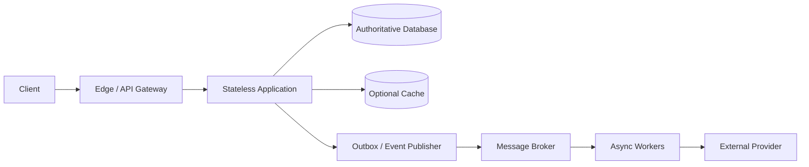
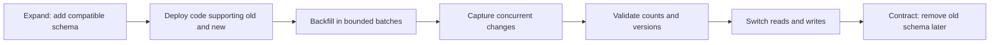
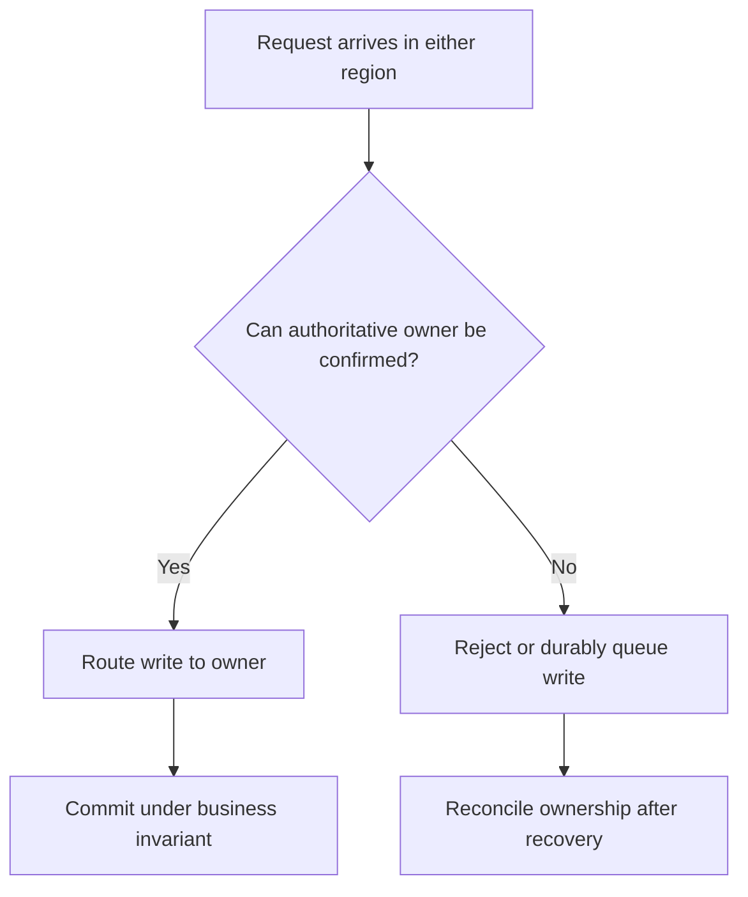
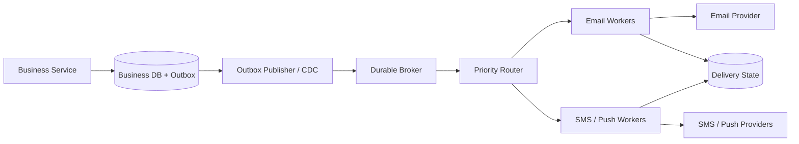

# System Design HLD Interview Handbook

**Audience:** Java backend engineers with 5–10 years of experience preparing for senior and staff-leaning backend/product-company interviews.  
**Purpose:** A progressive guide to architecture reasoning, capacity estimation, data ownership, consistency, failure handling, operations, and cost.  
**Status:** Rebuilding for the 5–10 year experience band. Recent rewrites deepen failback, regional writes, provider fallback, priority fairness, incident diagnosis, diagramming, and interview decision defense, alongside tenant partitioning, leases/fencing, audit, API boundaries, cache and transaction guarantees. Coverage, technical accuracy, readability, and rendered diagrams remain under review; not final sign-off.

> **How to use this guide:** Learn fundamentals in order, then practise scenarios aloud. State assumptions, identify the critical business invariant, estimate scale, draw the simplest viable architecture, and deepen the part the interviewer challenges. Naming technologies is not the goal; explaining why the design satisfies requirements is.

### What interviewers expect from a 5–10 year candidate

At this level, an answer should normally go beyond naming a component. Be ready to explain the workload and invariant that justify it, the request/data flow, the guarantee the component provides, its bottleneck and failure modes, and why you chose it over the main alternatives. The interviewer may ask you to estimate capacity, trace a timeout across three services, explain what happens during a partition, or describe a zero-downtime migration.

Use this answer pattern when useful:

1. **State the requirement and invariant.** What must be fast, available, fresh, unique, ordered, or durable? Which errors are unacceptable?
2. **Explain the mechanism.** Show how requests are routed, data is partitioned, transactions are protected, or work is retried—not just which technology is chosen.
3. **Quantify the design.** Estimate peak throughput, storage, fan-out, connection demand, queue drain, or replication cost with assumptions.
4. **Describe failure and recovery.** Include partial success, timeouts with uncertain outcomes, overload, stale data, leader failover, replay, and restore—not just a process crash.
5. **Compare alternatives and operational cost.** Explain what you give up, how you observe it, how you roll it out, and what evidence would make you change the design.

A strong answer is not necessarily longer in every interview. It is deep enough to answer “why?”, “what if it fails?”, and “how do you know it works?” without hand-waving.

## Table of contents

1. [HLD interview method](#1-hld-interview-method)
2. [Requirements and quality attributes](#2-requirements-and-quality-attributes)
3. [Capacity estimation](#3-capacity-estimation)
4. [Networking and request delivery](#4-networking-and-request-delivery)
5. [APIs and service boundaries](#5-apis-and-service-boundaries)
6. [Scaling and traffic management](#6-scaling-and-traffic-management)
7. [Databases and data modelling](#7-databases-and-data-modelling)
8. [Caching and content delivery](#8-caching-and-content-delivery)
9. [Distributed systems and consistency](#9-distributed-systems-and-consistency)
10. [Messaging and event-driven architecture](#10-messaging-and-event-driven-architecture)
11. [Transactions and business correctness](#11-transactions-and-business-correctness)
12. [Resilience and failure handling](#12-resilience-and-failure-handling)
13. [Security and abuse prevention](#13-security-and-abuse-prevention)
14. [Observability and operations](#14-observability-and-operations)
15. [Multi-region and disaster recovery](#15-multi-region-and-disaster-recovery)
16. [Cost and architectural evolution](#16-cost-and-architectural-evolution)
16a. [Core concept deep dives: databases, distributed coordination, and traffic infrastructure](#core-concept-deep-dives-partitioning-sharding-and-traffic-infrastructure)
17. [Advanced HLD deep-dive Q&A](#17-advanced-hld-deep-dive-qa)
18. [Senior-level scenario bank](#18-senior-level-scenario-bank)
19. [End-to-end case-study index](#19-end-to-end-case-study-index)
20. [Cross-references and authoritative reading](#20-cross-references-and-authoritative-reading)

---

## 1. HLD interview method

### Q1. What does a High-Level Design interview evaluate?

It evaluates whether you can turn an ambiguous product goal into a coherent architecture and defend its important decisions. Interviewers look for requirement discovery, assumptions, capacity reasoning, data modelling, component boundaries, consistency guarantees, failure handling, and communication. They do not expect a perfect production architecture in 45 minutes; they expect you to expose important decisions and reason about consequences.

Start with user journeys and business invariants, not a list of fashionable technologies. In a ticket-booking system, preventing two users from buying the same seat is more fundamental than choosing an API framework.

### Q2. How is HLD different from LLD?

High-Level Design (HLD) explains the system's major building blocks: what each component owns, how requests and events move between components, where data lives, and how the design scales and recovers from failure. Low-Level Design (LLD) zooms into implementation: classes, interfaces, method contracts, object collaboration, and design patterns.

The boundary is not absolute. If a database constraint determines whether two users can book the same seat, it matters in HLD even though it is a low-level detail. A useful rule is to discuss any detail that can change correctness, capacity, reliability, or the choice of architecture; leave details that do not affect those decisions for LLD.

### Q3. How should you structure a 45–60-minute design interview?

A reasonable default is 0–5 minutes for requirements; 5–10 for quality targets and estimates; 10–20 for architecture and main flows; 20–35 for data, consistency, and bottlenecks; 35–50 for failure handling, security, and trade-offs; then summarize. Adapt when the interviewer redirects you. Do not rigidly follow a schedule at the expense of the discussion.

### Q4. What should you clarify before drawing the architecture?

Start with the users and their most important journeys: what must they be able to do, and what must never go wrong? Then ask about scale (average and peak traffic, bursts, data growth), read/write patterns, latency and availability targets, retention, geography, privacy, and cost. For workflows such as payments or booking, explicitly ask which outcomes must be atomic and which can complete asynchronously.

Prioritize questions that could change the design. For example, a notification system with a two-second delivery target needs a different queueing and provider strategy from a bulk email system that can take an hour. If the interviewer cannot provide a number, state a reasonable assumption and continue rather than getting stuck.

### Q5. How do functional and non-functional requirements differ?

Functional requirements describe **what the system does**: create an order, reserve a seat, publish a message, or let a user search products. Non-functional requirements describe the constraints and quality of that behavior: how fast it responds, how much traffic it handles, how reliably it operates, how long it retains data, and what it costs.

The distinction matters because the same feature can lead to different architectures under different quality targets. A report generated once per day can run as a batch job; a dashboard that must update within a second may need streaming updates and a materialized read model. Capture measurable targets wherever possible instead of writing vague requirements such as “fast” or “highly available.”

### Q6. How do you handle an ambiguous prompt such as “design a notification system”?

Turn the broad phrase into a few concrete journeys. Ask which channels are needed (email, SMS, push), expected volume and burst size, delivery deadlines, user preferences, provider quotas, and whether notifications may expire. Clarify what “delivered” means: accepted by your API, durably queued, accepted by the provider, or confirmed on the recipient's device. Those are different guarantees.

Then identify which work must be synchronous. A request can return an operation ID after the notification request is durably recorded, while provider delivery happens asynchronously. Design for retries, duplicate events, provider outages, and per-channel priorities; otherwise, “send a notification” hides the main architectural decisions.

### Q7. How do you avoid overengineering?

Begin with the simplest design that meets the stated requirements, then identify which limits are likely to appear first. A modular monolith with a relational database may be the right answer for a small team and moderate traffic. A broker is useful when work must be durably deferred or independently retried; a cache helps when repeated reads are expensive; a search engine helps when the query needs exceed the database's practical strengths.

Every component adds failure modes, deployment work, monitoring, and operational ownership. Explain what requirement justifies each component and what evidence would trigger the next step. A credible evolution path is usually stronger than starting with a large architecture “just in case.”

### Q8. What makes an architecture diagram useful?

Show major components, ownership boundaries, synchronous calls, asynchronous events, persistent stores, and trust boundaries. Label critical flows and identify the authoritative owner of each data item. A clear six-component diagram with explained trade-offs is better than twenty unexplained boxes.

A generic backend flow might look like this; a real interview diagram should be tailored to the requirements.



The synchronous path should own the user-visible acceptance guarantee. The asynchronous path is useful for work that can complete later, but it needs durable events, idempotent consumers, and observable backlog.

### Q9. How should you respond when the interviewer changes a requirement?

Restate the new requirement and explain which existing assumption it changes. Then trace the impact through the architecture: data model, request path, consistency, capacity, failure behavior, and cost. Update only the components affected instead of starting the whole design again.

For example, if notifications that previously could take several minutes must now arrive within two seconds, you may need priority queues, reserved provider capacity, stricter deadlines, and a different retry policy. You should also explain what happens when the provider is unavailable, because a tighter latency target does not make external dependencies more reliable.

### Q10. Why do candidates underperform in HLD interviews?

Common problems include designing before clarifying requirements, skipping estimates, confusing average and peak load, choosing databases by popularity, ignoring correctness, assuming retries are harmless, drawing components without data flows, and omitting operations and cost. Treating every problem as a microservices problem is another frequent mistake.

### Q11. How do you know the design is complete enough?

You should be able to walk through the main user journey from request to response, identify the authoritative owner of each important fact, and state the invariant the design protects. You should also have a plausible capacity estimate, a likely bottleneck, a plan for dependency failure, a security boundary, and a recovery approach.

You do not need to specify every class or configuration value. Instead, name the important unresolved questions and explain how you would validate them—for example, with a load test, a failover exercise, or a database-specific consistency review. A design is complete enough when its major decisions and limitations are explicit.

### Q12. How should you communicate a trade-off?

Make the reasoning conditional on the requirement: “Because this workflow must prevent duplicate seat reservations, I would enforce uniqueness in the authoritative database. That gives us a clear correctness boundary, but contention can limit throughput for a very hot event. If the business accepts overselling or uses temporary inventory allocation, I would revisit the design.”

A good trade-off answer names the benefit, the cost, the failure mode, and the condition that would change your decision. Avoid saying that a technology is “best” without explaining the workload and guarantees that make it suitable.

## 2. Requirements and quality attributes

### Q13. Explain scalability, availability, reliability, durability, and fault tolerance.

These terms describe different properties, so avoid using them as synonyms:

- **Scalability** is the ability to handle more work by adding resources or changing the design without unacceptable degradation. Adding application instances helps only if the database or another shared dependency is not already the bottleneck.
- **Availability** is the likelihood that a request receives a usable response within the promised conditions and time. A process returning HTTP 200 is not enough if the response violates the business contract.
- **Reliability** is the broader ability to keep performing the intended function correctly over time. It includes more than whether an endpoint is reachable.
- **Durability** means acknowledged data survives the failures the design claims to tolerate. The guarantee depends on the database's commit and replication settings, not merely on having multiple copies.
- **Fault tolerance** is the ability to continue providing an acceptable level of service despite specified failures, often through redundancy, isolation, or graceful degradation.

For example, a catalogue can remain available while showing a slightly stale product description. A payment service should not preserve availability by returning an unverified balance or accepting conflicting debits. A durable database may still be temporarily unavailable during failover.

### Q14. Latency versus throughput: what is the difference?

Latency is how long one operation takes from the relevant start point to completion. Throughput is how many operations complete per unit of time. They are related but not interchangeable: batching can increase throughput while making each request wait longer, and a service can look fast at low load but become slow when queues form near saturation.

For example, a worker may process 10,000 events per second overall while an individual event waits 30 seconds in the queue. Track latency percentiles and successful throughput together, and include queueing time in end-to-end latency. Higher request rate is not useful if it mainly produces timeouts or work that completes after its deadline.

### Q15. Why do P95 and P99 latency matter?

P95 is the value at or below which 95% of measured requests complete; P99 is the equivalent threshold for 99% of requests. If average latency is 80 ms but p99 is 2.5 seconds, the average hides a painful experience for a meaningful subset of users. Tail latency often reveals queueing, lock contention, garbage-collection pauses, hot keys, or slow downstream dependencies.

Fan-out makes this especially important. If an endpoint waits for several required services, the whole response may be delayed by the slowest call. Measure percentiles by endpoint and request class, and always state the measurement window and population; percentile values from different windows or samples are not directly comparable.

### Q16. What are SLI, SLO, and SLA?

An **SLI** (service-level indicator) is the measurement, such as the percentage of eligible requests that succeed or the p99 latency of successful requests. An **SLO** (service-level objective) is the target for that measurement over a stated window—for example, 99.9% of eligible requests succeed over 30 days. An **SLA** (service-level agreement) is an external commitment to customers and may define service credits or other consequences if the commitment is missed.

Be precise about the measurement. “99.9% availability” could mean the fraction of time the service is usable or the fraction of eligible requests that succeed; those are not interchangeable. Define which requests count, what counts as success, the observation window, and how planned maintenance or client errors are treated. Otherwise, a team can report a healthy SLI while users experience a broken critical journey.

### Q17. What is an error budget, and how should teams use it?

An error budget is the amount of unreliability permitted by an SLO during its measurement window. If the SLO is 99.9% successful requests over 30 days, the allowed failure fraction is 0.1% of eligible requests. For a time-based objective that treats the whole 30-day period uniformly, 0.1% of 30 days is about 43.2 minutes of unavailability. A request-based SLO and a time-based SLO measure different things, so do not convert one to the other without stating assumptions.

The budget is useful because it makes the reliability-versus-change trade-off explicit. When error-budget consumption is healthy, teams can continue shipping within the agreed risk policy. If the budget burns too quickly, a team may pause risky releases and prioritize reliability work, capacity fixes, or dependency remediation. This should be a pre-agreed operating policy rather than an improvised punishment after an incident.

Track burn rate as well as remaining budget. A service can consume a month's budget in a short window even when its 30-day availability chart still looks acceptable. Use alerts that identify fast burn and connect it to user impact. Define eligible traffic, what constitutes success, exclusions, and the measurement window; otherwise the SLO can be gamed unintentionally.

The error budget is not a target to spend and not permission to neglect low-volume but high-severity correctness failures. A payment system may meet its availability SLO while still incorrectly charging customers. Pair service-level indicators with business invariants, incident review, and controlled release practices.

### Q18. How do you estimate end-to-end availability across dependencies?

If a request succeeds only when every required dependency succeeds, and their failures are independent, multiply their availability estimates. For example, three serial dependencies each available 99.9% of the time give approximately \(0.999^3 = 99.70\%\) end-to-end availability. The request path is less available than any one dependency because any required component can make it fail.

Treat this as a first-order model, not a production forecast. Failures are often correlated: several services may share a database, network, identity provider, or deployment. Conversely, caching, retries within a deadline, and valid fallback behavior can improve user-visible success. Model only dependencies that are truly required for the response, and explain what the system does when each one is unavailable.

### Q19. What is graceful degradation?

Graceful degradation means preserving the most valuable, correct parts of a service when some capabilities are unavailable or overloaded. A shopping page might continue to show product details while hiding recommendations; a video service might lower resolution instead of failing playback. The degraded behavior should be deliberate, documented, and measurable—not a collection of accidental fallbacks.

First classify dependencies as critical or optional for each user journey. If recommendations fail, omitting them may be safe. If the inventory check fails, accepting a reservation based on stale data may violate the core business invariant. Define what can be omitted, what can be stale, and what must fail closed; then test those behaviors under dependency failure.

### Q20. How do you prioritize conflicting quality attributes?

Start with business impact rather than trying to maximize every attribute at once. Identify which errors are reversible, which are costly, and which would violate a contractual, safety, or financial invariant. Then make the trade-off explicit and apply it to the specific operation—not necessarily to the entire system.

For example, a product catalogue may serve slightly stale descriptions during a regional outage, while checkout must revalidate price and inventory. A payment service may reject a write when it cannot establish the authoritative owner instead of risking a duplicate debit. State the degraded behavior users will see and the recovery path.

### Q21. What is blast radius?

Blast radius is the scope of impact when something fails: how many users, tenants, regions, or business functions are affected. A bad release that breaks one optional feature has a smaller blast radius than a shared authentication failure that prevents every service from accepting requests.

Reduce blast radius through bulkheads, bounded queues, tenant quotas, separate capacity for critical workloads, staged rollouts, and genuinely independent failure domains. Redundancy alone is not enough if every replica shares the same overloaded database, credentials, or control plane. In an interview, identify the common dependency that could turn a local problem into a platform-wide incident.

## 3. Capacity estimation

### Q22. Estimate requests per second from daily active users.

Start with user behavior and convert it to traffic; do not jump straight from user count to server count. Suppose 2 million daily active users each make 40 API requests per day. That is 80 million requests/day, or about 926 requests/second on average because (80{,}000{,}000 / 86{,}400 approx 926). If peak traffic is four times the average, the initial peak estimate is roughly 3,700 requests/second.

Then refine the model. Not every user is active at the same time; requests are not evenly distributed across the day; and a single user action may fan out into multiple backend calls. If 30% of API requests trigger three downstream calls, the average internal-call multiplier is higher than one. Also account for retries, polling, scheduled jobs, mobile reconnects, bulk operations, and separate read/write mixes. Do not multiply every request by every downstream service unless the request path actually calls all of them.

Estimate each major resource separately: edge requests, application CPU, database reads and writes, cache lookups, broker events, external provider calls, and network bytes. The bottleneck may be database writes or a third-party quota rather than API QPS. Use measured request distributions and load testing to validate the assumptions. In an interview, label every number as an assumption, show the arithmetic, and identify which assumption has the greatest impact on capacity.

### Q23. Why is average traffic insufficient?

Average traffic hides how demand is distributed over time. A service averaging 1,000 requests per second may receive 5,000 requests per second during a campaign or flash sale. If it is provisioned only for the average, requests queue, latency rises, clients time out, and retries can create even more load.

Estimate peak-to-average ratio and burst duration, then decide whether the excess work can wait. A report export may be queued; an interactive seat reservation may need a quick rejection rather than a long wait that ends in failure. Load tests should include realistic bursts and dependency degradation, not just a steady average rate.

### Q24. How do you estimate storage?

Estimate logical data first, then account for physical overhead and lifecycle. A basic model is:

```text
logical data = new records per day × average stored bytes per record × retention days
```

Suppose a system stores 5 million events/day at an average 1.5 KB each and keeps 180 days online. Raw payload is roughly (5M × 1.5	ext{ KB} × 180), or about 1.35 TB in decimal units. This is not the required provisioned disk. Add indexes, row/page overhead, metadata, write-ahead logs, temporary space, compaction or vacuum headroom, and safety margin. A relational table with multiple indexes can take substantially more physical space than the application payload alone.

Next distinguish logical from physical copies. Three replicas do not mean the logical dataset tripled in business meaning, but the storage fleet must hold multiple physical copies. Backups and point-in-time recovery logs may require additional storage and retention; snapshots may be incremental or full depending on the product. Search indexes, caches, and materialized read models can create additional derived copies.

Estimate growth, not just launch-day size. Include update churn, deletion/retention requirements, peak ingestion, compaction, and restoration bandwidth. If data is time-partitioned, old partitions may be detached or archived more efficiently than row-by-row deletion, depending on the database's capabilities. Finally, distinguish hot storage from archive/object storage and explain retrieval time, cost, legal retention, encryption, and deletion requirements. Validate the estimate against real serialized records and observed index/storage ratios.

### Q25. How do you estimate bandwidth?

Estimate ingress and egress separately using traffic rate and bytes per operation. If the service receives 4,000 requests/second with an average request size of 2 KB, ingress payload is about 8 MB/s before protocol overhead. If responses average 12 KB, egress is about 48 MB/s. These are decimal payload estimates; TLS records, TCP/IP headers, retransmissions, connection setup, compression, and uneven peaks increase or change actual wire traffic.

For internal traffic, follow the request path rather than counting only client bytes. An API request can trigger several downstream RPCs, copy data into a broker, replicate writes to multiple nodes, and update a search index. Cross-zone and cross-region transfers may have both latency and monetary costs. Replication traffic is related to write volume and payload/index/log behavior, not simply the number of API requests.

Use peak rates and bursts for network interface sizing, and measure both throughput and packet/connection behavior. A workload with small messages can be limited by packets per second or connection churn even when its Mbps looks modest; a bulk export may saturate bandwidth while using little CPU. Compression helps only if CPU cost and content characteristics make it worthwhile. Identify where CDN caching, direct object-storage uploads, batching, streaming, or data locality reduce expensive transfers. Treat estimates as a starting point and validate with load tests, packet/bytes metrics, and the actual cloud billing dimensions.

### Q26. How do you estimate queue processing capacity?

Compare the arrival rate with the sustainable completion rate under realistic processing cost. Let (lambda) be arrivals per second and (mu) be completed messages per second. If (lambda > mu) for a sustained period, the backlog grows at approximately (lambda-mu). Adding a queue absorbs a temporary mismatch; it does not solve a permanent throughput deficit.

For a burst, estimate backlog and drain time. If 1.2 million events arrive during an incident, workers can complete 8,000/s, and new arrivals continue at 3,000/s, the net drain is 5,000/s. Ideal drain time is (1{,}200{,}000/5{,}000=240) seconds, or four minutes, if both rates stay constant. If arrival rate is at or above service rate, the backlog will not shrink.

Measure throughput at the full processing boundary, including database calls, provider quotas, retries, and per-key ordering constraints. A worker that dequeues 10,000 messages/s but commits only 2,000/s is not a 10,000/s worker. Estimate concurrency from operation duration, but avoid increasing concurrency beyond downstream connection or rate limits. Consider partition count, consumer-group parallelism, batch size, lock contention, message size, and failure/replay costs.

Track queue age as well as depth: ten million old events and ten million newly arrived events have different user impact. Set capacity and recovery targets explicitly, bound admission, define expiry/dead-letter rules, and load-test what happens when a dependency slows down rather than assuming the happy-path processing rate will remain constant.

### Q27. How do retries affect capacity?

Capacity must be sized for **attempts**, not only original logical requests. If 1,000 requests per second each trigger two retries, the dependency can receive up to 3,000 attempts per second for that traffic, before considering retries at other layers. During an outage, this amplification can push a partially unhealthy service into a cascading failure.

Use bounded retries with exponential backoff and jitter, stop when the end-to-end deadline expires, and retry only operations that are safe to repeat. Choose a clear retry owner where possible; client, gateway, service, and broker retries can multiply. Monitor attempts per logical operation as well as raw request rate.

### Q28. How do you estimate cache memory?

Start with the number of simultaneously resident keys and the average serialized value size. Five million values averaging 2 KB require about 10 GB for payloads alone, using decimal units. Actual memory use can be substantially higher because Redis and similar systems also store keys, object metadata, allocator overhead, fragmentation, and internal data structures; replicas add further infrastructure memory.

Do not size a cache using an average payload alone. Sample real key and value distributions, include peak key count and eviction policy, and load-test the expected access pattern. Monitor memory fragmentation, eviction rate, hit ratio, and latency. If the cache evicts hot keys continuously, adding memory may help—but a poor key design or low-reuse workload may mean the cache is not providing enough value.

### Q29. What changes when traffic grows 10×?

Do not simply multiply the server count by ten. A 10× increase can change bottleneck location, key popularity, cache behavior, query plans, contention, network fan-out, provider quota usage, and failure probability. Some costs scale linearly; others grow non-linearly near saturation or due to coordination.

Trace a representative user operation and apply the multiplier through its dependency graph. If 10,000 requests/s each cause two database reads and 0.2 writes on average, the database sees about 20,000 reads/s and 2,000 writes/s before retries, background work, and other callers. A cache may protect reads when hit ratio is high, but a cold-cache rollout could suddenly expose the database to the full read volume. A fixed external provider quota does not grow just because the application autoscaled.

Then ask which resource saturates first: CPU, memory/GC, connection pool, database locks, storage IOPS, broker partitions, cache bandwidth, load-balancer connections, or an external quota. Check whether the next tier has enough headroom during one zone/node loss; if capacity only works with every instance healthy, the system has no failure margin.

The correct response may involve query optimization, batching, admission control, per-tenant quotas, cache protection, asynchronous work, more partitions, or sharding—but only the observed bottleneck justifies the mechanism. Plan migration and operational complexity too. A senior answer describes how to scale in stages, what metrics trigger each stage, how the design behaves while scaling, and which failure tests prove it can sustain the new load.

### Q30. What is capacity headroom?

Headroom is the unused capacity available above expected demand. It gives the system room to absorb traffic bursts, a node or availability-zone failure, rolling deployments, and uncertainty in capacity estimates. The right amount depends on how quickly demand can spike, how fast new capacity becomes ready, and whether the system must continue serving peak load after a failure.

Do not treat autoscaling as instant capacity: provisioning, startup, cache warming, and connection establishment all take time. A service with sudden traffic spikes may need warm instances, reserved critical-path capacity, admission control, or load shedding in addition to autoscaling. Validate the chosen headroom with load and failure tests.

## 4. Networking and request delivery

### Q31. What happens when a client makes an HTTPS request?

At a high level, the client resolves the hostname through DNS, opens or reuses a transport connection, negotiates TLS when needed, sends the HTTP request, and receives a response from the server. In a typical web architecture, the request may pass through a CDN, WAF, load balancer, or API gateway before reaching the application and its dependencies.

Each step has costs and failure modes. DNS can return a stale endpoint; connection establishment and TLS add latency; a proxy can queue requests; the application can wait for a database connection; and the response can be delayed by downstream work. Persistent connections and TLS session resumption can reduce setup overhead, but they do not fix application bottlenecks. When diagnosing latency, break down the end-to-end timeline rather than assuming the application code is responsible for all of it.

### Q32. Layer 4 versus Layer 7 load balancing?

A **load balancer** distributes incoming connections or requests across a pool of backends. Its job is not simply to “spread traffic evenly”: it must choose eligible destinations, avoid unhealthy instances, respect connection and timeout behavior, and keep the system within capacity. Load balancing may happen at several layers of one request path—for example, DNS or a global traffic manager chooses a region, a Layer 4 balancer chooses a node, and a Layer 7 proxy chooses an application service.

A **Layer 4 (L4) balancer** makes decisions using transport-level information such as source/destination IP addresses, ports, and TCP/UDP connection state. It usually does not need to parse HTTP paths or headers. This can make it efficient and useful for generic TCP services, database proxies, or high-throughput connection distribution. The trade-off is that it cannot make rich request-level decisions such as routing `/payments` differently from `/catalogue` based on HTTP semantics.

A **Layer 7 (L7) balancer** understands an application protocol such as HTTP. It can route by hostname, path, headers, cookies, method, or other request attributes; terminate TLS; enforce request limits; and support canary routing. That flexibility costs processing, configuration complexity, and a larger security-sensitive surface. TLS termination also changes the trust boundary: the proxy-to-backend hop must be protected where the network is not inherently trusted.

**Example:** `api.example.com/orders` may reach an L7 ingress or gateway, which routes to the order service. That service may itself be reached through an internal L4 or L7 balancer. The L7 gateway should not be assumed to replace internal discovery, database connection management, or application-level authorization.

Both layers need readiness-aware health checks, bounded connection/request queues, sensible timeouts, connection draining during deployment, and observable per-backend traffic. A health check can tell the balancer that a target should receive no new requests; it cannot prove that a database write is safe or that an old leader has lost write authority. Nor does a load balancer remove a bottleneck in a shared database or external provider.

### Q33. Which load-balancing algorithms are common, and when would you use each?

The algorithm is only one part of the decision. First determine what is being balanced—TCP connections, HTTP requests, long-lived streams, or work units—and whether backend capacities and request costs are similar.

- **Round robin** rotates through eligible backends. It is simple and works reasonably well when instances have similar capacity and requests have similar cost. It can be unfair when one request runs for milliseconds and another for minutes.
- **Weighted round robin** assigns a larger share to stronger or intentionally preferred instances. Weights need to reflect real capacity and be adjusted carefully during partial degradation.
- **Least connections** prefers the backend with fewer active connections. It can help when connection duration correlates with work, but it is a poor proxy for load if a few connections can trigger expensive work or if HTTP/2 multiplexes many requests over one connection.
- **Least outstanding requests / least request** can be more meaningful for request-oriented traffic, but it still needs accurate in-flight accounting and does not know the full cost of each request.
- **Random choice (often power of two choices)** samples a small number of backends and chooses the less loaded one. It can avoid centralized load-measurement overhead while achieving good distribution in large pools.
- **Consistent hashing** maps a key (such as tenant ID) to a stable backend or cache shard. It helps with locality and reduces remapping during topology changes, but hot keys can overload one target and membership changes require a well-defined ring or routing map.
- **Source-IP or cookie affinity** keeps a client on the same backend. This can help legacy stateful applications, but it reduces flexibility and can create imbalance; it should not be a substitute for shared session storage in a horizontally scaled design.

In an interview, state the assumption behind the choice. For ordinary stateless HTTP APIs, round robin or a request-aware policy plus health checks may be sufficient. For long-lived connections, account for connection duration and draining. For tenant affinity, use hashing only if locality is worth the skew risk. Always measure successful throughput, tail latency, queue depth, and backend imbalance rather than judging the policy by even request counts alone.

### Q34. Are health checks enough for safe failover?

No. A health check is a signal, not a complete failover protocol. **Liveness** asks whether a process should be restarted; **readiness** asks whether it should receive new traffic. A process can be alive but not ready, and a shared database outage can make every instance fail a dependency check even though restarting those instances will not fix the database.

Use thresholds and time windows that avoid reacting to brief noise, and distinguish process health from dependency health. During planned removal, mark the instance unready and drain existing requests before shutdown. For stateful systems, a health check alone must never decide write ownership or prove that the old leader has stopped accepting writes.

### Q35. What are the limitations of sticky sessions?

Sticky sessions use a cookie or another affinity key to route a client repeatedly to the same backend. This can improve locality for stateful legacy applications, but it creates uneven load when some sessions are much busier than others and makes failover harder when the selected instance disappears.

Affinity is not a substitute for durable session storage. If session state exists only in process memory, a restart or reschedule can lose it; a failover may also send the client to an instance that lacks that state. Prefer stateless application instances with shared or client-held session state when practical. Use sticky routing only when its benefit is measurable, and ensure session state and security do not depend on a particular instance surviving.

### Q36. How should timeout budgets be designed?

Start with the time the user journey can tolerate, then set an end-to-end deadline and allocate part of that budget to each required step. If the API has a one-second deadline, a downstream call must not independently wait two seconds. Leave time for the application to validate the result, commit its own state, and return a response.

Check what each client library's timeout actually covers: connection-pool acquisition, DNS, TLS, network transfer, server processing, or only some of these. Propagate the remaining deadline to downstream calls where possible. Retries consume the same budget, so a retry is useful only if enough time remains for a successful attempt. Too-short timeouts create unnecessary retries; too-long timeouts tie up threads and connections while users wait.

### Q37. When use WebSockets, Server-Sent Events, or long polling?

**WebSockets** provide a long-lived, bidirectional connection, useful for chat, collaboration, and interactive updates. They require connection lifecycle management, heartbeat/reconnect behavior, and capacity planning for many concurrent connections. **Server-Sent Events (SSE)** provide a server-to-client event stream over HTTP and are often simpler when clients only need updates from the server. **Long polling** holds an HTTP request until data is available or a timeout occurs, then the client opens another request; it is easier to support in some environments but adds request overhead.

Choose based on directionality, client support, connection count, proxy behavior, and delivery semantics. None of these transports alone guarantees durable delivery: define event IDs, replay/reconnect behavior, authorization, and what happens when a client is offline.

### Q38. What does a CDN solve and not solve?

A CDN caches eligible content at edge locations closer to users, reducing origin traffic and often improving latency for geographically distributed clients. It is especially effective for versioned static assets and public responses whose cache policy is well defined. Cache invalidation and TTLs determine how quickly changes become visible.

A CDN does not automatically make personalized or authorized responses safe to share. The cache key and cache-control headers must reflect every dimension that changes the response, and sensitive user-specific data often should be private or non-cacheable. CDN caching also does not solve write consistency or an overloaded origin on cache misses. Monitor hit ratio, origin offload, stale-content incidents, and cache-miss latency.

## 5. APIs and service boundaries

### Q39. REST versus RPC/gRPC: how do you choose?

REST over HTTP is often a good fit for public, resource-oriented APIs because it is broadly supported by browsers, gateways, debugging tools, and client libraries. gRPC provides generated typed contracts, compact Protocol Buffers messages, and first-class streaming, which can be useful for internal service calls or high-volume communication.

Do not choose based only on claims that one protocol is faster. Network topology, payload size, connection reuse, serialization cost, proxy support, observability, and team tooling all affect end-to-end performance. Choose the contract and operational model that fit the clients and workload, and benchmark realistic traffic if performance is the deciding factor.

### Q40. How do you change an API without breaking clients?

Prefer additive changes that preserve existing field meanings and behavior—for example, adding an optional response field that old clients can ignore. Treat a semantic change as potentially breaking even if the JSON shape remains the same; changing `amount` from gross to net is a contract break without a schema change. Avoid reusing a removed field name for a different meaning.

When an incompatible change is unavoidable, use a versioning or migration plan, publish a deprecation window, measure which clients still use the old contract, and remove it only when the agreed policy allows. Test old and new clients against mixed-version deployments and ensure rollback does not leave incompatible data behind.

### Q41. Offset versus cursor pagination?

**Offset pagination** asks for a page after skipping a number of rows, such as `LIMIT 50 OFFSET 50000`. It is simple for clients and supports jumping to a page number, but the database may need to scan or discard many rows at large offsets. If rows are inserted or deleted between requests, later pages can contain duplicates or miss records.

**Cursor pagination** carries a position from the previous page, often based on a stable sort key plus a unique tie-breaker such as `(created_at, id)`. The next query can seek from that position instead of skipping thousands of rows, which is often more efficient for large datasets. The API must define how sorting and filtering work and how cursors are validated. A cursor alone does not create a consistent snapshot; for exports or audits that need a fixed view, use an explicit snapshot boundary or asynchronous export workflow.

### Q42. What is an idempotency key?

An idempotency key is a client-supplied operation identity that lets a server recognize repeated attempts at the same logical operation. It is especially important when a caller times out or loses a response after the server may already have committed a side effect. The key does not magically make an operation idempotent; the server must persist and enforce the relationship between the key and the operation.

For example, a payment client sends `POST /payments` with key `K`. The service should atomically claim `K` within a defined scope, such as tenant + endpoint + key, and record the request fingerprint. Concurrent requests using the same key must not both begin independent charges. A repeated key with the same logical payload should return the existing operation/result or its current status; reusing the key with a different payload should be rejected rather than silently returning a result for another request.

The idempotency record and business transition must be coordinated. If the service writes the key record, crashes before creating the payment, and later replays a “completed” response, the contract is broken. Use a database transaction or durable state machine that records the key, request identity, and operation status consistently. For external providers, pass an idempotency identity downstream where supported and reconcile uncertain provider outcomes; your database cannot atomically commit with an unrelated provider.

Define retention explicitly. The key must live long enough to cover legitimate client retries and downstream uncertainty. After expiry, the same key might be treated as new, so document that boundary and consider durable business-level uniqueness for high-impact operations. Idempotency prevents duplicate execution within the designed scope and retention model; it is not the same as deduplication and does not make all distributed side effects exactly-once.

### Q43. What are a reverse proxy, forward proxy, load balancer, API gateway, and service mesh? How do they differ?

These terms overlap because they describe different responsibilities, not always mutually exclusive products.

- A **forward proxy** represents clients when they access external destinations. It can enforce outbound access policy, hide client network details, cache selected responses, or inspect traffic where legally and operationally appropriate. Corporate egress proxies are a common example.
- A **reverse proxy** sits in front of servers and receives requests on their behalf. It can terminate TLS, route traffic, compress responses, enforce request limits, and hide backend topology. NGINX, Envoy, and many ingress products can act as reverse proxies.
- A **load balancer** selects a healthy backend among several candidates. It may operate at L4 or L7 and is often implemented as part of a reverse proxy, cloud network service, or both.
- An **API gateway** is an edge-facing policy and API-management layer. In addition to routing, it commonly applies authentication integration, quotas, request/response transformations, API version routing, and external-client policies. It should not become the only place where business authorization lives; services must still enforce access to their own resources.
- A **service mesh** manages service-to-service communication within a distributed application. Depending on the product and deployment model, it can provide workload identity, mutual TLS, retries/timeouts, traffic shifting, and telemetry through sidecar or node-level proxies and a control plane. It does not automatically solve business-level idempotency, data consistency, or authorization decisions.

A typical request path may be:

```text
Client
  -> DNS / global traffic manager (select region)
  -> CDN or edge protection (optional)
  -> L4/L7 load balancer or ingress
  -> API gateway / reverse proxy (external API policies)
  -> application service
  -> internal service proxy / mesh (optional)
  -> downstream service
```

Not every deployment needs every box. A gateway may also be the L7 load balancer; an ingress controller may combine reverse-proxy and gateway functions; a service mesh may be unnecessary for a small system. Multiple layers can accidentally multiply retries, timeouts, TLS hops, and operational complexity. Define the owner of each policy, the timeout budget across the full path, and which component is authoritative for identity and authorization.

### Q44. When should a monolith be split into microservices?

Split when there is a clear boundary that benefits from independent deployment, scaling, ownership, security, or fault isolation—not simply because the codebase is large or the team uses microservices elsewhere. A modular monolith can keep modules independently structured while retaining in-process calls and simpler transactional behavior. If module boundaries and ownership are unclear, moving the same tangled dependencies over HTTP usually creates a distributed monolith.

Look for evidence: one capability has a substantially different scaling profile; teams regularly block one another's releases; a domain needs a different security or reliability boundary; or a stable business capability can own its data and contract. Verify that the proposed service has cohesive responsibility, an explicit API/event contract, and few reasons to change in lockstep with its neighbors.

Extraction introduces real costs: network failure, timeouts, retries, version compatibility, distributed tracing, deployment pipelines, secrets, service discovery, data duplication, and cross-service workflows. A database transaction that once covered several tables may become a saga or a sequence of eventual updates. Before extracting, define data ownership and decide how to move traffic and data safely.

A Strangler-style migration can route one capability at a time to the new service, use compatibility adapters, replicate or migrate data with validation, and compare outputs before cutover. Preserve a rollback path where feasible and monitor both business correctness and latency. Explain why the service boundary is stable, what coupling it removes, and which new distributed-systems problem it introduces. “More scalable” is not sufficient without identifying what scales independently.

### Q45. Why is database-per-service not an automatic win?

Data ownership is a useful service boundary: the owning service controls its schema, validates invariants, and exposes supported ways to read or change the data. This reduces the risk that unrelated teams couple their releases to another service's tables. But **database-per-service does not necessarily mean one database server or cluster per service**; smaller services can share managed infrastructure while keeping schema and access ownership separate.

The cost appears when a workflow needs data owned by several services. A SQL join across shared tables becomes API calls, events, or a denormalized read model. Those calls can fail independently, increase latency, and return data from different points in time. A local transaction that once updated two tables may become a saga with partial progress and compensation. Analytics and reporting also need a deliberate way to combine data.

Choose the boundary around a cohesive business capability and its invariants, not around every entity or table. Keep a service's data private by convention and access controls; don't let another service make direct writes just because the database is reachable. Where cross-module transactions are frequent and the domain is still tightly coupled, a modular monolith with a shared relational database may be safer and simpler.

If the data is split, define the authoritative owner for each fact, APIs/events for access, consistency lag, deletion propagation, and reconciliation. Plan schema evolution and data migration with backward compatibility. The success measure is independent evolution with manageable operational cost—not the number of database instances.

## 6. Scaling and traffic management

### Q46. Vertical versus horizontal scaling?

Vertical scaling adds CPU, memory, or I/O capacity to one machine. It is often simpler because the application may not need to distribute state, but it has hardware limits and may leave a larger single-node failure domain. Horizontal scaling adds more instances and can improve capacity and fault isolation, but requires traffic distribution and careful handling of state, coordination, and shared dependencies.

Stateless application servers are usually straightforward to scale horizontally. Databases and other stateful components need additional design—replication, partitioning, consensus, or ownership boundaries—before extra nodes translate into useful capacity. Choose based on measured bottlenecks and failure objectives, not on a blanket rule that one scaling method is always better.

### Q47. Why might adding application instances not improve throughput?

Horizontal scaling helps only when the added instances contribute capacity to the limiting part of the system. If the database is saturated, a global lock serializes work, or a third-party provider enforces a fixed quota, adding application instances can simply send more concurrent work into the bottleneck. It may make the incident worse by multiplying database connections or retries.

Use traces and saturation metrics to locate the queue: application CPU, thread pools, connection acquisition, database locks, network, and downstream latency. Then fix or isolate the actual limit. Compare successful throughput and tail latency before and after a scaling change; instance count alone is not a measure of capacity.

### Q48. What is backpressure?

Backpressure is a mechanism for preventing producers from overwhelming slower consumers. It may use bounded queues, demand signals, concurrency limits, rate limits, or explicit rejection. Without a bound, a queue can turn a short overload into growing memory use and very long waiting times.

A queue absorbs bursts only when the arrival rate eventually falls below the processing rate. If incoming work remains faster than completed work, backlog keeps growing. Decide whether each operation should be slowed, durably deferred, or rejected quickly, and make the decision visible to callers. Monitor queue age and drain rate as well as queue depth; a large but rapidly shrinking queue is different from a smaller queue that is getting older.

### Q49. What is load shedding?

Load shedding deliberately rejects or drops lower-priority work when demand exceeds safe capacity, preserving resources for critical operations. For example, a platform may defer recommendation refreshes and bulk exports before allowing checkout requests to wait until they time out. Rejection should be fast and explicit, with a response that tells clients whether retrying later is appropriate.

Define priority classes and admission limits before an incident. Ensure clients do not immediately retry rejected work in a synchronized loop, and avoid starving one tenant indefinitely. Monitor shed traffic by operation, priority, and tenant, alongside successful throughput and latency for the work the system is trying to protect.

### Q50. Why can autoscaling make an incident worse?

Autoscaling can worsen an incident when the scaling signal does not represent the actual bottleneck. Adding application instances may multiply database connections, cache misses, queue consumers, or calls to a rate-limited provider. Aggressive thresholds can also cause oscillation as instances repeatedly start and stop; new instances may initially be cold and add little useful capacity.

Scale on metrics that correlate with sustainable throughput—such as queue age, request concurrency, or a verified CPU bottleneck—and cap downstream concurrency. Account for provisioning and warm-up delay, use minimum warm capacity when spikes are sudden, and load-test scale-out and scale-in behavior. The goal is more successful work within the SLO, not simply more running instances.

### Q51. How do you isolate a noisy tenant?

A noisy tenant consumes a disproportionate share of shared resources and degrades other tenants' latency or availability. Limiting requests per second alone is not enough: one request may be a cheap cache hit while another scans millions of rows, sends a large export, or fans out to many downstream calls. Define budgets for the resources that matter—concurrency, CPU, query cost, queue occupancy, storage, egress, and expensive operations.

Start with per-tenant attribution in metrics and traces. Then apply layered isolation: per-tenant rate/concurrency limits at admission, bounded queues, weighted fair scheduling, query timeouts, separate worker pools for bulk jobs, and per-tenant storage limits. If workloads are very different, put bulk or premium tenants on dedicated pools or shards. Shared infrastructure is cost-efficient, but the resource scheduler must prevent one tenant from monopolizing it.

The isolation boundary must match the bottleneck. A tenant-specific rate limiter will not fix one query holding a global database lock; a separate application pool will not protect a shared primary from expensive SQL. For hot tenants, dedicated shards may help but complicate cross-tenant operations and placement. For bursty work, queue it with an explicit service objective and apply backpressure.

Decide what happens when a tenant reaches its budget: reject, defer, shed optional work, or offer a higher-capacity tier. Return a clear error and retry guidance rather than allowing unbounded queueing. Test fairness during spikes and tenant migrations, and watch for cardinality costs when creating metric labels for every tenant; high-cardinality telemetry may need aggregation or top-N views.

### Q52. How do you estimate queue drain time?

If there are 3.6 million queued messages, workers complete 12,000 messages per second, and new messages arrive at 4,000 per second, the net drain rate is 8,000 messages per second. Estimated drain time is (3{,}600{,}000 / 8{,}000 = 450) seconds, or 7.5 minutes.

This is an approximation: it assumes stable arrival and completion rates, similar message costs, and no extra retry traffic. Use the successful completion rate rather than raw attempts, and include partition skew and downstream rate limits. If the arrival rate equals or exceeds successful completion, the backlog cannot shrink; adding consumers helps only if downstream dependencies can handle the additional concurrency.

## 7. Databases and data modelling

### Q53. How do you choose SQL versus NoSQL?

Choose based on data relationships, business invariants, access patterns, transaction boundaries, query flexibility, scale, and the team's ability to operate the technology. Relational databases are a strong default when entities are related and operations need transactions or constraints. Key-value and wide-column stores can suit predictable high-volume access patterns; document stores can suit aggregate-oriented records; graph stores can help when relationship traversal is central.

These categories overlap, and no database type is automatically faster or more scalable. Ask how the system will query and update the data, what consistency it requires, how it will partition and recover, and how data will be migrated. A familiar relational database with a well-designed schema may outperform a poorly matched distributed store while being much easier to operate.

### Q54. OLTP versus OLAP?

**OLTP (online transaction processing)** handles operational reads and writes that support user-facing workflows: creating orders, updating account settings, reserving inventory, or recording a payment. It tends to require low-latency point/range queries, concurrent transactions, constraints, and predictable write behavior. **OLAP (online analytical processing)** supports aggregations and exploration over large datasets, often scanning and joining much more data to answer business or product questions.

Running heavy analytical queries on the transactional primary can harm OLTP latency by consuming CPU, memory, I/O, buffer cache, and connection slots. A common architecture sends committed changes through CDC or an event pipeline into a warehouse, lakehouse, or analytical store optimized for scans and aggregates. This isolates resource profiles, but introduces replication delay, transformations, data-quality controls, and reconciliation requirements.

Choose the data path based on freshness and query needs. A dashboard that tolerates five-minute delay may use scheduled micro-batches; near-real-time metrics may need streaming ingestion. Do not replicate sensitive operational data to analytics without considering access control, masking, retention, deletion, and residency. Nor should a derived analytical table be treated as authoritative for a payment or inventory decision simply because its query is fast.

In an interview, name the transaction latency and correctness requirements, analytical scan patterns, freshness target, and expected data volume. Explain how data gets from source to analytical store, how schema changes and deletes propagate, and how you detect lag or inconsistent aggregates.

### Q55. What makes a good partition or shard key, and how do you choose one?

A partition key determines how records are divided among storage or compute partitions. In a sharded database, it also helps determine which shard owns a record. A good key balances **distribution**, **query locality**, **write throughput**, **growth**, and **operational manageability**. There is rarely a key that optimizes every query.

Evaluate these dimensions explicitly:

1. **Cardinality and skew:** There should be enough distinct key values to spread the workload. High cardinality alone is not sufficient: a few tenants may generate most traffic, so a nominally high-cardinality key can still be skewed.
2. **Access patterns:** If most queries fetch a user's orders, partitioning by user ID can localize those reads. If common queries need a global time range, user-based partitioning may require scatter-gather across many partitions.
3. **Write distribution:** A monotonically increasing timestamp or ID can send new writes to one range partition. Hashing or bucketing can spread writes, but may make ordered range scans more expensive.
4. **Data locality and invariants:** If a transaction must atomically update several records, colocating them on one shard can simplify correctness. Cross-shard transactions may require coordination or a redesigned workflow.
5. **Growth and movement:** Consider how to add capacity, split a large tenant, rebalance data, and migrate the key scheme. A key that works at today's scale can become expensive to change later.

**Example:** For a multi-tenant SaaS product, `tenant_id` may be a natural routing key because most reads are tenant-scoped. But a very large tenant can become a hot shard. A practical design might route ordinary tenants by tenant ID and split selected large tenants into buckets, while preserving a mapping service that tells the application where each tenant's data lives. That increases routing and migration complexity, so it should be justified by observed skew.

Before choosing a key, list the top queries and write paths, estimate per-key traffic, identify operations that must be atomic, and test both average and worst-case tenants. A key should be selected from the workload and invariants—not because a database product recommends a fashionable strategy.

### Q56. What is a hot partition?

A hot partition receives a disproportionate share of requests or data, so one partition becomes the bottleneck while others remain underused. Common causes include a popular account or tenant, a sequential key that directs writes to the newest range, or a partition key that does not match the actual workload.

Mitigations depend on the access pattern. Key salting or sub-partitioning can spread writes but makes reads and aggregation more complex; caching can reduce repeated reads for hot keys; a large tenant may need dedicated capacity. Before changing the key, measure skew and identify which operations must remain ordered or colocated. A more even distribution is not an improvement if it breaks the queries or invariants the design depends on.

### Q57. What is consistent hashing?

Consistent hashing maps keys and nodes onto a logical ring so that adding or removing a node typically remaps only a portion of keys, rather than reshuffling nearly everything. Virtual nodes can improve distribution when physical nodes have different capacities or the key space is uneven.

It is a placement technique, not a complete storage architecture. It does not guarantee perfectly balanced load, prevent a hot key, or define replication and consistency by itself. Real systems still need to specify replicas, membership changes, failure handling, and how clients discover the current ring. Use it when reducing remapping during topology changes is valuable, and verify distribution under realistic key skew.

### Q58. What are read replicas good for, and what can go wrong?

A read replica maintains a copy of data from a primary or leader so read traffic can be distributed and recovery options improved. With **asynchronous replication**, the primary can acknowledge a commit before every replica has applied it. This means a replica may return an older value, omit a recently inserted row, or temporarily disagree with another replica. Replication is not the same as a consistent snapshot across all nodes.

The routing policy must reflect the read's correctness requirement:

- A catalogue description may tolerate bounded staleness and can be served from a replica or cache.
- A user's immediate read after changing a setting may require **read-your-writes**. The application can route that user's next read to the primary, wait until a replica reaches a known log position if the database supports it, or use a consistency token.
- A balance, reservation, or authorization decision may need an authoritative read and a transactional constraint; simply choosing the replica with the lowest observed lag is not enough to guarantee correctness.

Replicas also have costs: network and storage, replication apply CPU, operational complexity, and potential query contention. Long-running analytical reads can slow replication or consume resources needed for transactional queries. Monitor lag in time and in log/offset position where available, query latency, replica saturation, and failover readiness.

During failover, establish which node is authoritative before allowing writes. Promoting a lagging replica can lose acknowledged data unless the system's replication and commit guarantees rule that out. Prevent the old primary from continuing to accept writes—often called **split brain**—and understand how clients refresh connections and retry in-flight operations. A replica is useful only when its consistency and failover guarantees match the business contract.

### Q59. Why is read/write splitting not simply “send reads to replicas”?

Read/write splitting is a correctness policy as much as a capacity technique. The naive rule “all SELECT statements go to replicas” fails because a read can be part of a write workflow or be expected to observe a previous write. For example, an order service may insert an order and then immediately query it to build a response; a lagging replica can incorrectly make the order appear missing.

Classify operations by their consistency needs rather than SQL syntax alone. Strongly consistent reads, read-after-write flows, authorization checks, inventory checks, and decisions that guard a subsequent mutation may need the primary or a database-supported consistency mechanism. Low-risk browse and reporting reads may use replicas. Some systems use **sticky primary reads** for a short period after a write; others use log-position or session consistency tokens if the database supports them.

Failover complicates routing: the old primary may be unavailable, the new primary may have lagged, and connection pools may still hold stale endpoints. Routing logic needs topology discovery, bounded retry behavior, and clear handling of uncertain write outcomes. Monitor replica lag and reject or reroute reads when the freshness contract cannot be met.

Do not assume splitting will improve throughput automatically. Replicas can become overloaded, expensive queries can interfere with replication, and the primary still handles writes and may also receive critical reads. Measure the actual bottleneck and define the consistency promise for each important user journey before adding replicas.

### Q60. How do you perform a zero-downtime schema migration?

Use expand–migrate–contract. Add a backward-compatible schema element, deploy code that handles old and new representations, backfill in bounded batches, verify, switch reads/writes, and remove the old schema only after clients migrate. Plan for locks, index creation, rollback, and mixed-version behavior.



The migration is complete only after the backfill and concurrent-write stream agree, the new path has been observed in production, and rollback no longer depends on the old representation.

### Q61. Normalization versus denormalization?

Normalization stores each fact in a well-defined place and relates entities through keys. It reduces duplicated data and avoids update anomalies—for example, changing a customer's address should not require finding and updating copies in many order rows. Denormalization duplicates or precomputes information to make common reads faster, such as storing a product summary in a search index.

Denormalization is often valuable for read-heavy systems, but it creates a consistency problem: which copy is authoritative, how are changes propagated, and how stale may a copy become? Keep the transactional source of truth clear and add derived copies only when the read benefit justifies the write and repair complexity.

### Q62. How do you recover from database failure?

First classify the failure because “database down” covers very different situations: one node or availability zone failed; the primary is healthy but overloaded; replication lag is growing; storage is corrupt; an operator deleted data; credentials expired; or an entire region is unavailable. Failover, restore, and capacity remediation are not interchangeable responses.

For node failure, a managed or self-operated cluster may promote a replica, but the promotion protocol must establish a single write authority and account for the replica's replication position. Clients must refresh connections and handle in-flight writes whose outcomes are uncertain. For overload, adding replicas or promoting another node without reducing load may reproduce the failure. Apply admission control, shed optional work, reduce expensive queries, and protect the recovery path.

For corruption, accidental deletion, or malicious modification, replication can reproduce the bad state. You need backups, point-in-time recovery where supported, retention of logs/WAL/binlogs, and a tested restore process. Define **RPO** (maximum tolerable data loss) and **RTO** (maximum tolerable recovery time) with the business. A backup is not proven until you restore it into an isolated environment, validate consistency and application behavior, and measure the elapsed time.

During recovery, protect against a thundering herd of reconnects and retries. Restore service gradually, validate critical invariants, compare source and derived stores, and keep the system in read-only or degraded mode when correctness cannot yet be guaranteed. Record a runbook for promotion, fencing, connection refresh, validation, and rollback. A dashboard that says a replica is healthy is not equivalent to a proven recoverable system.

## 8. Caching and content delivery

### Q63. When does caching help, and when can it make a system worse?

Caching helps when data is read repeatedly, expensive to compute or fetch, and has a freshness tolerance that the cache design can honor. Typical wins include public content, product metadata, expensive configuration reads, authorization metadata with an appropriate revocation model, and derived views. The benefit depends on reuse and locality—not simply on having a lot of requests.

The primary performance question is whether the cache reduces end-to-end work. A remote cache adds a network hop, serialization, key lookup, and its own failure modes. If values are rarely reused or are tiny and cheap to retrieve from a local database buffer, the cache may increase latency. Caching can also shift a bottleneck rather than remove it: high hit ratios may conceal an overloaded origin until a cache outage or cold deployment suddenly sends most traffic to the database.

Define the cache contract per data class: what is authoritative, how stale may a value be, how is it invalidated, and what happens on a miss or cache outage? A product description may tolerate minutes of staleness; inventory at checkout may require an authoritative conditional write. Never let an eventually consistent cache silently decide a correctness-critical financial or inventory transition.

Measure hit ratio together with origin load, p95/p99 latency, memory utilization, evictions, stale-read incidents, and the effect of cache failure. Estimate memory using actual serialized key/value sizes plus metadata and allocator overhead. Add protection against stampedes, hot keys, cache penetration, and mass expiry. The best cache is not the one with the highest hit ratio; it is the one whose total cost and freshness behavior improve the user journey.

### Q64. Explain cache-aside, including its race conditions.

In cache-aside, the application checks the cache first. On a hit, it returns the cached value. On a miss, it loads the authoritative store, populates the cache, and returns the value. For writes, a common sequence is to commit the database change and then invalidate the corresponding cache key. This keeps the database as source of truth and makes the cache an optional acceleration layer.

The simple pattern has races. Suppose reader A misses the cache and reads old value (v1) from the database. Writer B commits (v2) and deletes the cache key. If reader A then writes (v1) into the now-empty cache, stale data is restored after invalidation. TTL limits how long the stale value may live but does not prevent the race. Concurrent misses can also cause a stampede.

Possible mitigations depend on how strict freshness must be: version each value and reject older fills; use compare-and-set or conditional population; serialize refill for hot keys; publish invalidations through reliable change capture; or bypass the cache for correctness-critical reads. An outbox/CDC event can improve the reliability of invalidation delivery, but asynchronous propagation still creates a staleness window. Do not claim that “update DB, then delete cache” provides a globally atomic transaction across both systems.

Design for failure too. If the database commit succeeds and cache invalidation fails, return behavior must reflect the committed mutation while a retry/reconciliation path clears stale cache state. If the cache fails completely, limit origin concurrency and shed optional traffic rather than allowing all misses to overload the database. Cache entries should include appropriate tenant/auth dimensions so a cache-key omission cannot leak one user's data to another.

### Q65. What is a cache stampede, and how do you mitigate it?

A cache stampede occurs when many requests simultaneously miss or refresh the same expensive key and all hit the origin. It can happen after a popular key expires, after a cache restart, or when many keys share similar TTLs. The origin experiences a sudden surge exactly when the cache stops protecting it.

Use the mitigation that matches the key's access pattern. **Single-flight/request coalescing** makes concurrent requests for the same key share one in-flight refill. **TTL jitter** spreads expirations across time. **Refresh-ahead** refreshes hot entries before expiry. **Stale-while-revalidate** serves an explicitly permitted stale value while one worker refreshes it. **Per-key concurrency limits** cap refill work. A distributed lock can help across application instances, but introduces lock expiry, owner failure, and latency; fencing/versioning may be needed if stale refill is correctness-sensitive.

Protect the source even if the cache layer fails: cap concurrent origin requests, keep database pools bounded, and shed low-priority workloads under overload. Avoid a design where every application instance retries an expired key at once. Measure origin QPS during expiry, refresh duration, coalescing effectiveness, stale age, and cache warm-up after deployment. Stale-while-revalidate is suitable for noncritical content, not automatically for balances or stock quantities. For correctness-sensitive state, use an authoritative transactional operation rather than trying to make the cache behave like a lock or database.

### Q66. Cache penetration, hot keys, and stampedes—what differs, and how do you diagnose them?

These symptoms can all increase origin traffic but have different causes:

- **Cache penetration:** requests repeatedly ask for keys that do not exist, so every request misses. Validate inputs, use short-lived negative caching where safe, or use a Bloom filter to avoid many definitely absent lookups. Bloom filters may have false positives, so the database must still decide whether a record exists.
- **Hot key:** one valid key receives disproportionate traffic. Coalesce concurrent reads, replicate or locally cache the value, and use request shaping. If updates are frequent, fan-out invalidation and freshness requirements become central.
- **Stampede:** many requests attempt to regenerate the same key at once, commonly after expiry. Use single-flight, TTL jitter, refresh-ahead, or stale-while-revalidate when the data contract permits it.

Analyze cache miss reason, key distribution, origin QPS, refill concurrency, TTL-expiry patterns, and request source. Negative caching can be unsafe when a record may be created immediately after a miss; use a short TTL or versioned invalidation. Local caches can reduce network traffic but replicate stale copies across application instances. A hot-key mitigation can also move load to a different bottleneck, such as a single lock or a fan-out invalidation service. Choose based on the data's freshness contract and confirm through metrics and load tests, not by applying every cache pattern at once.

### Q67. How should TTLs be chosen?

Choose a TTL by balancing how costly stale data is, how often the source changes, and how much load the backend can handle. A product description may tolerate a longer TTL than an inventory value shown immediately before checkout. Randomize TTLs for large sets of keys so they do not all expire together and create a synchronized burst.

A TTL is not a full consistency guarantee. It does not prevent a request that started before an update from repopulating stale data afterward, nor does it ensure every replica or client sees the same value. Combine TTL with invalidation or versioning when needed, and bypass the cache for decisions that require authoritative current state.

### Q68. What if Redis becomes unavailable?

First establish what Redis is being used for. If it is a disposable cache, the application may fall back to the database—but an immediate fallback from every instance can create a cache-collapse event and take down the origin. If it stores sessions, rate-limit state, ephemeral coordination, or workflow state, bypassing it may create security or correctness failures. The same technology can therefore need different outage behavior for different data sets.

For a cache-aside use case, use bounded database concurrency, request coalescing, load shedding, and possibly carefully permitted stale/local-cache responses. Avoid unlimited retries or creating a new Redis connection per request. For sessions, decide whether requests should fail, reauthenticate, or use an alternative secure session store. For rate limiting, define whether a bounded local limiter is acceptable or whether failure must be closed. For locks, do not blindly proceed as if ownership were acquired.

A Redis cluster/failover setup still needs a clear persistence and acknowledgement model. Depending on configuration and failover timing, recently acknowledged writes may be lost or some operations may observe stale/changed ownership. Do not treat replication as a guarantee of zero data loss. If Redis is part of a correctness-critical workflow, persist the business state in an authoritative datastore and define how to recover or reconcile Redis state.

Test full cache failure and partial failures: connection timeouts, elevated latency, failover, connection pool exhaustion, and hot-key concentration. Monitor errors, command latency, evictions, replica lag, connection counts, and the load shifted to the database. A fallback is safe only when it preserves the business invariant and keeps the remaining dependencies within their own capacity limits.

### Q69. How do you keep cache and database consistent?

An ordinary database transaction and an independent cache do not share one atomic commit. This means a cache update can fail after a database commit, or concurrent readers can refill a stale value. The first design decision is not “which invalidation technique?” but “what consistency does this particular read require?”

For many read-heavy domains, the authoritative database plus cache-aside invalidation and a bounded TTL is adequate. The cache is allowed to be stale for a known window, and correctness-sensitive operations go to the authoritative store. For stricter requirements, version cache entries and compare versions during refill, use a reliable change stream/outbox to deliver invalidations, or use a datastore with a consistency model that directly supports the required reads. Each method still has its own failure and recovery semantics; an asynchronous invalidation event cannot eliminate its propagation window.

A classic race is: reader reads old value, writer commits new value and deletes cache, reader then repopulates the old value. A version check, conditional fill, or coordination mechanism can prevent some variants. A transactional outbox can ensure the invalidation intent is durably recorded with the database mutation, but the consumer may be delayed or redeliver the event, so invalidation processing must be idempotent and lag observable.

For payments, balances, inventory allocation, or permissions that require immediate revocation, do not rely on cache TTL as the only correctness mechanism. Use the source of truth for the decision, or define a token/version/lease contract that bounds stale authorization explicitly. Document stale-read tolerance, cache outage behavior, invalidation latency objective, and reconciliation plan.

## 9. Distributed systems and consistency

### Q70. What is a partial failure, and why is it more dangerous than a simple error?

A partial failure occurs when some components or communication paths work while others are failed, slow, unreachable, or uncertain. A remote call may time out even though the server completed the operation; a broker may accept a message while its acknowledgement is lost; one replica may lag while another is current. The caller does not automatically know whether the side effect occurred.

This uncertainty is different from a definitive rejection. If an inventory reservation times out, sending a new reservation with a new identity can reserve twice. If a payment provider charges a card but the response is lost, recording “failed” and initiating a new charge can duplicate the debit. Preserve an operation ID, make the mutation idempotent at a defined boundary, and query status or reconcile when the outcome is unknown.

Use deadlines and bounded retries to control resources, but do not interpret timeout as rollback. Design the request state machine to distinguish accepted, pending, succeeded, failed, and needs-reconciliation states where appropriate. For async workflows, acknowledge only after the work is durably accepted; for database-plus-event flows, use a transactional outbox and idempotent consumers.

Partial failure must also appear in observability: trace the request across services, record durable state transitions, and alert on operations that remain unknown too long. In an interview, walk through the failure between each pair of steps—before the remote effect, after the effect but before response, and after response but before local commit—and explain what the retry does in each case.

### Q71. Explain strong and eventual consistency with an example.

**Strong consistency** is an umbrella term; be precise about the actual guarantee. In many interviews, “strongly consistent read” means the read reflects writes completed before that read began, often described using linearizability. A linearizable operation appears to take effect atomically at a point between invocation and response and respects real-time ordering. The precise guarantee depends on the system's protocol and API.

**Eventual consistency** means that if updates stop and the system continues making progress, replicas will eventually converge. It does not promise that a read immediately after a write returns the latest value, nor does “eventual” specify a maximum staleness time. Concurrent writes may need conflict resolution or a deterministic merge rule. Some systems offer intermediate guarantees such as read-your-writes, monotonic reads, or bounded staleness.

Example: updating a user's profile display name can often tolerate a short propagation delay to caches and search indexes. Deducting money from an account or allocating the final seat needs an authoritative concurrency-control boundary; showing a stale “available” value can be acceptable for browsing but not for completing the reservation.

Choose consistency per operation based on the invariant, not per technology label. A single application may use a strong transactional write for the order, eventual propagation to search and analytics, and session consistency for a user's immediate status page. Explain the user's observable behavior, the latency/availability trade-off, and how the system repairs derived views when events are delayed or lost.

### Q72. What is read-your-writes consistency, and how can you provide it?

Read-your-writes is a session consistency guarantee: after a client successfully writes a value, its subsequent reads in that session should observe that write or a later one. It is weaker than full global linearizability because unrelated clients may still see older data, and it does not imply that every replica has converged.

A common failure occurs when a write goes to a primary and the next read is sent to an asynchronous replica. The replica has not yet applied the write, so the user's update appears to disappear. The write succeeded; the routing policy violated the session expectation.

Approaches include routing the session's reads to the primary for a period, using a database-supported session/consistency token, or waiting until the replica has applied a known log position before serving the read. A sticky-primary policy is simple but can reduce read scalability. A token-based approach can preserve replica reads if the datastore exposes the necessary replication position and the application correctly enforces it. A fixed sleep is not a correctness guarantee because lag varies.

Define behavior during failover. The write may be acknowledged on the old primary but absent from a promoted replica, depending on replication guarantees. Read-your-writes cannot restore data that has been lost by the chosen durability policy. Critical mutations therefore need a commit guarantee and idempotent retry/status behavior, not just a clever read router. Test with real replica lag and failover rather than only unit-testing the routing code.

### Q73. Explain CAP carefully, without reducing it to “pick any two.”

CAP describes a trade-off that becomes unavoidable when a distributed data system experiences a network partition. **Consistency** in the CAP formulation means a single-copy/linearizable view of the data. **Availability** means every request sent to a non-failed node eventually receives a response, though that response may not reflect the latest write. **Partition tolerance** means the system continues operating despite communication failures between parts of the system.

When the network is healthy, CAP does not say that a system must choose only two properties. During a partition, a system that preserves linearizable consistency may have to reject or block some operations because it cannot safely determine the latest value or current write authority. A system that keeps accepting conflicting operations on both sides may remain responsive but must reconcile divergent state later, so it is not providing linearizable consistency for those operations.

This is not the same as saying “SQL is CP and NoSQL is AP.” Product behavior depends on replication protocol, operation, consistency level, and configuration. Even one database can offer stronger guarantees for some operations and weaker ones for others. CAP also does not mean that latency is irrelevant or that a partition is the only failure mode that matters.

Example: during a regional partition, a catalogue may accept independent view counts or queue noncritical analytics events. A payment ledger or seat inventory may reject writes in the region that cannot prove ownership, because accepting both sides could create conflicting debits or duplicate reservations. Explain which operations remain available, which are rejected, and what recovery/reconciliation is required. PACELC adds that even without a partition, systems trade off latency and consistency, which helps reason about normal operation as well as failure.

### Q74. What does PACELC add?

PACELC extends the CAP discussion by making the normal-operation trade-off explicit. During a **Partition** (P), a system may need to trade **Availability** (A) against **Consistency** (C); **Else** (E), when there is no partition, it may still trade **Latency** (L) against **Consistency** (C). A globally coordinated read may be more current but require a slower cross-region round trip, while a local replica can respond faster with a staleness risk.

Use PACELC as a way to frame questions, not as a complete classification of a database. Read the product's actual guarantees for transactions, replication, failover, and consistency levels before making a design claim.

### Q75. What are quorum reads and writes, and what does the quorum formula not guarantee?

A replicated datastore may require a write to be acknowledged by at least (W) replicas and a read to consult at least (R) replicas out of (N). In a simple model, (R + W > N) ensures that every read set and write set overlap in at least one replica. For example, with (N=3), a write quorum (W=2) and read quorum (R=2) intersect. That intersection is useful only if the protocol knows how to identify and return the newest valid version.

The arithmetic by itself does **not** universally guarantee linearizability, read-your-writes, or conflict-free values. Concurrent writes may be accepted, replicas can have different versions, and a product may use sloppy quorums, hinted handoff, or other policies under failure. Leader-based databases may provide their guarantees through a different replication/consensus protocol, even if the documentation uses the word “quorum.”

Understand the concrete system's semantics: what counts as an acknowledgement (memory, durable log, or applied state), whether a read performs version comparison or repair, what happens when membership changes, and how failover treats acknowledged writes. A write that reaches two replicas but is later overwritten by a conflicting concurrent update is not the same as a linearizable commit.

Quorum size trades latency and availability against consistency and durability, but the exact trade-off depends on topology and protocol. In an interview, define the required guarantee first, then explain how the chosen datastore's read/write policy achieves it and what happens during partition, concurrent writes, or replica recovery.

### Q76. Why are distributed locks difficult?

A distributed lock tries to ensure that only one worker owns a resource at a time, but distributed processes can pause, lose connectivity, or resume after the lock's lease has expired. The lock service may believe ownership transferred while the old worker still runs. An explicit release does not fix process pauses, and a lease expiry does not forcibly stop the old process from issuing writes.

Consider worker A obtains a 30-second lease and begins generating a report. A pauses for 40 seconds due to a long runtime pause or network isolation. Worker B acquires the expired lease and starts a new report. If A resumes and writes its result, both workers may perform the side effect even though the lock service only recognizes B. A lock alone therefore does not protect the target resource from stale owners.

For mutable shared state, use a monotonically increasing fencing token or epoch assigned on ownership change, and make the resource reject writes with older tokens. If the resource cannot validate fencing, rely on an idempotent/conditional operation or redesign ownership around a database transaction or unique constraint. A lock should also have clear acquisition timeout, lease renewal, crash recovery, monitoring, and semantics for owner loss.

Do not use a distributed lock to compensate for missing database invariants when a unique constraint or conditional update can solve the problem more directly. If a scheduled job may run twice, make its state transition idempotent and record durable job identity. The interview answer should specify what exact resource is protected, who validates ownership, and what happens if two workers overlap after a pause.

### Q77. Does exactly-once delivery exist?

Avoid using “exactly once” without naming the boundary. Networks can lose acknowledgements, consumers can crash after performing a side effect but before acknowledging a message, and publishers can retry when they do not know whether a write was committed. At the transport level, most systems expose some combination of at-most-once and at-least-once behavior; duplicates and uncertain outcomes must be considered.

Some brokers and stream processors provide exactly-once processing semantics within a defined transactional boundary—for example, coordinating consumed offsets and produced records. That guarantee does not automatically cover an external payment provider, email service, or arbitrary database unless that external side effect participates in the same protocol or the application adds deduplication/idempotency.

A robust business pattern is to assume redelivery, give each logical operation a stable identity, and make state changes idempotent. A consumer can record the message ID and perform its database mutation in one local transaction, then acknowledge/commit the offset. If the crash occurs before the transaction, the message is retried; if it occurs after commit but before acknowledgement, the deduplication record prevents repeating the effect. This only works if the effect and dedupe record share an atomic boundary. For external calls, use provider idempotency keys when available and reconciliation for uncertain results.

State which layer provides which guarantee: broker delivery, stream-processing transaction, database mutation, or end-user-visible business outcome. An interview-quality answer explains the crash windows and the exact mechanism that closes each one instead of claiming the entire distributed system is exactly once.

### Q78. How do you handle out-of-order events?

Start by defining the actual ordering requirement. Many business workflows require order only per entity, such as per account, order, or inventory item; globally ordering every event creates a coordination bottleneck and is rarely necessary. If order matters per key, route that key consistently to one ordered partition and process its events sequentially, while remembering that producer retries and application concurrency can still introduce semantic reordering.

Include a monotonic entity version or sequence number where possible. A consumer can reject a stale update when its version is less than or equal to the version already applied. If it receives version 12 while the current state is version 10 and version 11 is required, it must decide whether to buffer, retry, query authoritative state, or mark the entity for reconciliation. The right choice depends on whether every intermediate event matters or whether the event describes the latest state.

Timestamps alone are often unsafe ordering signals because clocks can skew and events may be emitted long after the underlying action. Use aggregate versions, log offsets, or domain sequence numbers with explicit scope. For events that can arrive after deletion, retain a tombstone/version long enough to prevent an older update from recreating the entity.

Observe duplicate/out-of-order counts, sequence gaps, and oldest buffered events. Ensure replays and DLQ recovery preserve the required ordering. In an interview, explain what order is guaranteed by the broker, what order is guaranteed by the consumer, and how the system recovers from a missing or permanently invalid event.

### Q79. What is reconciliation, and why do distributed systems need it?

Reconciliation detects and repairs discrepancies between the state a system expects and the state actually observed. It is important because retries, timeouts, delayed events, manual intervention, consumer bugs, partial failures, and external systems can leave two components temporarily or permanently inconsistent. A robust architecture should not assume every event will arrive exactly once and in order forever.

A reconciler compares authoritative state with derived or external state using stable business identifiers and well-defined rules. For example, a payment workflow can periodically compare internal payment attempts with the provider's transaction status and settlement reports. If the provider charged a payment but the callback was lost, the reconciler can advance the internal state; if the internal service believes a payment succeeded but the provider reports failure, it should move to investigation or compensating action rather than blindly overwrite the record.

Reconciliation needs idempotent repair operations, bounded batch sizes, rate controls, auditability, and observability. It should distinguish safe automatic repairs from conflicts requiring human review. Avoid “last write wins” when the discrepancy is about a financial or inventory invariant. Use source versions, event IDs, timestamps with explicit semantics, and status-transition rules to prevent a stale repair from overwriting newer state.

Measure mismatch count, oldest unresolved discrepancy, repair success, and repeated oscillation. Reconciliation does not excuse poor transactional design; it is the safety net for failures that cannot be prevented atomically across boundaries. Design it alongside the initial workflow, including access controls for repair tools and a way to explain every automated state change.

## 10. Messaging and event-driven architecture

### Q80. Queue versus event stream?

A **queue** usually models work to be performed. A consumer receives a task, processes it, and acknowledges completion; the broker's delivery semantics determine when work can be redelivered. A **retained event stream** models a sequence of facts that happened. Consumers can often read independently from their own offsets and replay retained history to rebuild a projection or recover after a bug. Broker products can support both patterns, so the distinction is about semantics and operational contract rather than product branding.

For a task queue, the main questions are visibility/lease timeout, acknowledgement, retries, dead-letter handling, fairness, and whether one task should be processed by only one worker at a time. For an event stream, key questions include partition ordering, retention, consumer offsets, replay, schema evolution, and how multiple consumer groups read the same events independently. Some queue systems also support competing consumers and delayed retries; some log systems can implement work distribution with consumer groups.

Example: “send this email” is a work item; “order 123 was confirmed” is a business fact that can feed email, analytics, search, and customer history independently. Do not use a queue acknowledgement as evidence that an external side effect definitely completed if the worker can crash between the side effect and ack. The consumer still needs idempotency or deduplication.

Choose the abstraction based on whether a message represents an instruction or an immutable fact, whether history must be replayable, and who owns retry and retention policy. In either model, define delivery guarantees, ordering scope, poison-message behavior, idempotency, capacity, and what happens when the backlog exceeds its business deadline.

### Q81. What is a Kafka partition key, and how does it affect ordering and throughput?

A producer's partitioner uses the key to select a partition. With a stable key-to-partition mapping, records sharing a key normally go to the same partition, and Kafka preserves their log order within that partition. This is why an order-processing topic often uses `orderId` when all events for a single order must be processed in sequence.

The key determines both **where the data lands** and **which work can run in parallel**. A good key has enough distinct values to distribute load and aligns with the entity whose ordering matters. A key such as `country` may create a few hot partitions, while a random key spreads traffic but destroys per-order ordering. One extremely popular account can dominate a partition regardless of how many other keys exist.

Partition count and key mapping changes also matter. Increasing the number of partitions may remap keys for common partitioner implementations; messages for one key written before and after the change can land in different partitions, weakening assumptions about total order across the transition. If ordering is a correctness requirement, plan topology changes explicitly or use a stable routing/bucketing strategy.

Check key skew, per-partition throughput and lag, record size, and consumer processing time. More partitions increase parallelism but also broker metadata, replication, and rebalance cost; more consumers in one group cannot make a single partition concurrently processed in-order by several consumers. Choose the key from business invariants and access patterns—not just a desire for a uniform distribution.

### Q82. What is consumer lag, and how should you respond to it?

Consumer lag measures how far a consumer group is behind the latest records available in a stream, commonly expressed as offset difference. It is a symptom, not a full diagnosis. Lag may rise because arrival rate increased, processing slowed, one partition is hot, the consumer is retrying poison messages, database writes are blocked, or a downstream provider is throttling.

Measure more than the aggregate offset count: **oldest unprocessed event age**, arrival and successful completion rates, per-partition lag, processing duration, retries, rebalance frequency, downstream latency, and the business deadline for the event. A backlog of 10 million low-cost events can recover faster than 100,000 events requiring slow external API calls.

Estimate net drain as successful completion rate minus new arrival rate. If workers complete 15,000/s while new records arrive at 9,000/s, net drain is 6,000/s; a 1.2-million backlog takes about 200 seconds under stable conditions. If net drain is zero or negative, adding consumers will help only if consumer parallelism is the bottleneck and the downstream can accept more work.

Mitigate based on cause: add consumers/partitions if safe parallelism is available, increase batch efficiency, optimize downstream writes, isolate slow keys, fix retry loops, or enforce provider quotas. Scale-out can overload a database or create more throttling, so cap concurrency and preserve per-key ordering. Define when events expire, are dead-lettered, or become business-invalid, and verify the end-to-end completion SLO after the backlog drains.

### Q83. How should retries and dead-letter queues work?

Retries are useful for transient faults, but every retry consumes capacity and may repeat a side effect. Classify failures first. A timeout, connection reset, or throttling response may be transient; schema validation errors, authorization failures, and business-rule rejections are usually permanent. Respect provider retry hints where supported, and do not retry every failure indiscriminately.

Use bounded attempts, exponential backoff, and jitter so many clients do not retry at the same moment. Apply an overall deadline or retry budget in addition to a per-attempt timeout. The retry policy should have one clear owner where possible; retries in the client, gateway, service, SDK, and broker can multiply. Most importantly, retry only when the operation is safe to repeat or uses a stable idempotency identity. A timeout means the result may be unknown, not that the operation definitely failed.

A dead-letter queue (DLQ) isolates messages that have exhausted the normal policy or are known to be unprocessable. It is not a substitute for error classification or a place to discard important work silently. Store the original payload or a safe reference, failure reason, attempt history, schema/version metadata, and correlation IDs. Alert on oldest age and count, define ownership and retention, and provide controlled replay after the cause is fixed.

Replay is another production workload: rate-limit it, preserve ordering where the domain requires it, and make consumers idempotent. A poison message may repeatedly break a partition or block later events; moving it aside changes processing semantics and must be an explicit business decision.

### Q84. What is the transactional outbox pattern?

The transactional outbox addresses the **dual-write problem**: an application changes its database and publishes an event to a broker, but the database commit and broker publish are two separate operations. If the database commits and publishing fails, downstream consumers never hear about the change. If the event publishes but the database rolls back, consumers observe a fact that did not commit.

With an outbox, the application writes both the business change and an outbox row in the same local database transaction. A separate publisher reads committed outbox rows and sends them to the broker. The publisher then marks the row as sent or stores publication progress. Because the business mutation and event intent share one ACID transaction, the system does not lose the intent merely because the broker is temporarily unavailable.

The publisher can crash after publishing but before marking the row sent, so duplicate publication is expected. Consumers must therefore be idempotent, usually using a stable event ID and an inbox/processed-event record coordinated with the consumer's local state change. The outbox provides reliable eventual publication, not end-to-end exactly-once side effects.

Operational design matters: poll with bounded batches or use CDC on the outbox; preserve the required per-aggregate ordering; avoid one locked publisher query becoming a bottleneck; monitor oldest unpublished event, backlog size, publisher errors, and duplicate rates; and define retention/cleanup. If an event contains sensitive data, minimize the payload and control access. The interview-quality explanation should show the failure window it closes, the duplicate window it still has, and how consumers recover safely.

### Q85. Saga choreography versus orchestration?

A saga coordinates a long-running business workflow whose steps commit in separate local transactions. Since there is no single ACID transaction spanning all services, the design records progress and defines what happens when a step fails or the workflow times out. A saga is not a database rollback: a compensation is a new business action that attempts to counteract an earlier action and may itself fail or be impossible.

In **choreography**, each service reacts to events and publishes the next event. It avoids a central coordinator and can keep services loosely coupled at runtime, but the end-to-end flow is distributed across handlers. It becomes hard to understand which step comes next, detect a stuck workflow, or change event contracts when there are many branches.

In **orchestration**, a workflow coordinator issues commands to participants, records state, applies deadlines, and decides which step or compensation follows. The control flow is easier to inspect and operate, but the orchestrator becomes a critical component and needs durable state, high availability, versioned workflow definitions, and idempotent command handling.

Example: an order saga may reserve inventory, authorize payment, and arrange shipment. If payment authorization fails, inventory reservation may be released. If shipment was already dispatched, compensation may require a return or refund rather than reversing the external action. Each step needs a stable operation ID, explicit success/failure/unknown states, timeout policy, and reconciliation. Choose choreography for simple event reactions; prefer orchestration when the workflow has branching, long waits, human intervention, compensation, or strict operational visibility.

### Q86. How do you handle poison messages?

A poison message repeatedly fails because of malformed data, an incompatible schema, a deterministic application bug, or another condition that retries will not fix. Classify the failure, cap automatic attempts, and move the record to a dead-letter or quarantine path with its payload, error context, attempt history, and correlation ID preserved.

Do not assume it is always safe to skip the message. If later events depend on it, skipping can corrupt the entity's state; the partition may need to pause until the issue is repaired. Provide an owner and a controlled replay process, and alert on DLQ growth so the queue does not become a silent graveyard.

## 11. Transactions and business correctness

### Q87. How do you prevent duplicate payment charges?

Treat payment processing as a durable state machine, not a single request that either succeeds or fails. The critical case is a timeout after the provider may have charged the customer but before your service receives the response. Retrying a new charge with a new identity can create a second debit.

Create a stable payment/attempt ID before calling the provider and enforce uniqueness for the logical business operation (for example, one payment attempt per order and payment revision). Accept a client idempotency key and atomically bind it to the request fingerprint and payment record. Concurrent requests using the same key must resolve to the same operation. Pass a stable provider idempotency key if the provider supports it, but verify that provider's key scope and retention period rather than assuming it is permanent or globally unique.

Use explicit states such as CREATED, SUBMITTING, AUTHORIZED, CAPTURED, FAILED, and UNKNOWN/RECONCILIATION_REQUIRED, with legal transitions. Do not mark a payment failed merely because the HTTP call timed out. Query provider status, consume signed callbacks/webhooks idempotently, and reconcile internal records against provider transaction reports. Keep an auditable ledger of financial state transitions; avoid mutating a single status field in ways that erase evidence of prior actions.

The database transaction and external provider operation are not one atomic transaction. The design must account for crashes before the call, after provider success, after response receipt, and before the local status commit. If a duplicate side effect is discovered, define safe compensation and customer communication. Explain which invariants are enforced locally, which guarantees depend on the provider, and how an unknown outcome eventually becomes resolved.

### Q88. How do you prevent double booking a seat?

The invariant is that at most one active booking may own a seat for a given event. An application-side check such as “query whether the seat is available, then insert a booking” is not sufficient: two concurrent requests can both read “available” before either writes. The invariant must be enforced atomically by the authoritative store.

One approach is a unique constraint on `(event_id, seat_id)` for active reservations, possibly using a supported partial/filtered index where the database allows it. Another is a conditional update such as changing a seat from AVAILABLE to HELD only if its current state is still AVAILABLE and checking that exactly one row was updated. The transaction then records the hold/booking and its expiry. The loser sees a conflict and must return a clear sold-out/already-held result.

For high-demand events, design the hold lifecycle carefully: a hold has an owner, expiry, and state transition; expiry is not simply a background delete based on an arbitrary worker clock. Use conditional transitions and a durable scheduler/reconciliation process. Payment can complete after the hold has expired, so the workflow must define whether it revalidates inventory, compensates/refunds, or uses a stronger reservation protocol.

A cache can show an approximate availability view, but it should not authorize the final booking. Add request idempotency so client retries do not create duplicate booking attempts. Load-test contention on the same hot seat/event, inspect lock waits, and define how the system behaves if the database response times out after the commit.

### Q89. Optimistic versus pessimistic concurrency control?

**Optimistic concurrency control** assumes conflicting updates are relatively uncommon. A read includes a version or expected value, and the write succeeds only if that version is unchanged. For example, `UPDATE inventory SET quantity = quantity - 1, version = version + 1 WHERE sku = ? AND version = ? AND quantity > 0`; if zero rows are updated, the caller must reread and decide whether to retry or report a conflict. This avoids holding a lock throughout application thinking time but can cause repeated conflicts under heavy contention.

**Pessimistic concurrency control** acquires a lock before modifying a contested record, so conflicting transactions wait or fail. It can be appropriate for very hot resources or short critical sections, but long transactions, inconsistent lock ordering, and remote calls while holding locks can create blocking and deadlocks.

Do not choose based only on a slogan such as “optimistic is faster.” Estimate conflict rate, transaction duration, number of hot keys, and the cost of failed attempts. Use atomic conditional updates or constraints when they naturally express the invariant. If stronger isolation is required to protect a multi-row rule, a single row version may not be sufficient.

Both strategies need explicit retry limits and error handling. A serialization failure or deadlock should usually be retried only after rolling back the full transaction and only if repeating the transaction is safe. External side effects should not occur inside a retryable database transaction unless they are separately idempotent. Explain how the database enforces the invariant, what the loser observes, and how retries affect tail latency under contention.

### Q90. What happens when a request times out after a successful write?

A timeout after a mutation creates an **uncertain outcome**. The server or database may have committed the operation, but the response may have been lost on the network. The client cannot infer “failed” solely from not receiving a response. Retrying with a new identity can duplicate the side effect.

For mutation APIs, create a stable operation identity (often an idempotency key or resource ID) and persist the status through a defined state machine. The retry should return the same logical operation or its current state, not start a second operation. For long-running actions, return an operation ID and expose a status endpoint or callback. Distinguish ACCEPTED/PENDING, SUCCEEDED, FAILED, and UNKNOWN/RECONCILIATION_REQUIRED when those states are meaningful to the contract.

The server must coordinate the operation record with the durable business mutation. A separate idempotency table updated independently can still leave a crash window; place both changes in one transaction or design a recoverable workflow that reconciles them. If the write called an external provider, query provider status or reconcile by a stable merchant/reference ID before deciding whether to retry.

Clients should use bounded retries with backoff, but the API contract must be safe even when retries are delayed or repeated by intermediaries. Include correlation IDs and audit records so support can determine what happened. In interviews, draw the crash points before and after commit and explain the client-visible response at each point.

### Q91. Why is a saga not a distributed ACID transaction?

A local ACID transaction gives atomicity at its transaction boundary: either its changes commit or they do not. A saga is a sequence of separate local transactions across services. Intermediate results can be visible while the workflow is still running, and compensation does not erase history or guarantee that the original effect can be perfectly undone.

For example, an order service may create an order, inventory may reserve a unit, and a payment provider may authorize a card. If shipment later fails, the system may release inventory and void or refund the payment. A refund is a new financial event, not a time machine that makes the authorization never have happened. If the external action is irreversible, the business may need manual resolution or a different workflow.

A saga therefore needs a durable state machine: unique workflow/step IDs, explicit transitions, idempotent participants, timeouts, retry policy, compensation rules, and a reconciliation path. It must handle a crash after a participant commits but before the coordinator records the response; the participant's command should be safe to repeat or queryable by operation ID. Compensation itself can fail and may need retry or escalation.

Use a single database transaction when the invariant can be protected within one database and the transaction can remain short. Use a saga when the business process spans independently owned systems or long-running work. Do not choose a saga simply to avoid transaction design; it deliberately trades atomic visibility for independent progress and operational complexity.

### Q92. How should webhook consumers handle duplicate callbacks?

Assume webhooks can be delivered more than once, delayed, retried out of order, or sent again after the sender fails to observe the acknowledgement. The receiver should return a prompt acknowledgement only after it has durably accepted responsibility for the event. Performing a long business workflow synchronously in the callback handler increases timeout and redelivery risk.

Use the provider's event ID as a deduplication identity where its uniqueness scope is documented. In one local transaction, record that event ID in an inbox/processed-event table and apply the corresponding state transition. If the same event arrives again, recognize it and return success without repeating the side effect. If the event ID may only be unique per account or event type, include that scope in the key. Validate the request signature, timestamp/replay protections, and relevant account/resource identity before trusting the payload.

Deduplication alone does not solve out-of-order events. An old “payment pending” event might arrive after “payment succeeded.” Prefer querying the provider's current status or using monotonic state-transition/version rules rather than applying callbacks blindly. If the event is accepted to a queue, make the enqueue durable before acknowledging; otherwise the provider may stop retrying after the application loses the event.

Provide retry-safe downstream actions, dead-letter handling for invalid payloads, observability by event ID, and a reconciliation job for missing callbacks. Never assume that receiving a success webhook is the only proof of business completion or that HTTP delivery exactly once is guaranteed.

## 12. Resilience and failure handling

### Q93. How should retries be designed?

A retry policy must specify **which failures**, **how many attempts**, **how long to wait**, **the overall deadline**, and **what makes repeating the operation safe**. Retrying every error is dangerous: validation and authorization errors are usually permanent, while timeouts, connection resets, and throttling may be transient. The exact decision depends on the dependency contract.

Use exponential backoff with jitter to spread retries over time. Bound per-request attempts and total retry time, and use a retry budget so retry traffic cannot grow without limit during an incident. Respect provider retry-after headers when applicable. A retry must fit inside the caller's overall deadline; a downstream call should not continue for longer than the request that depends on it. For asynchronous work, use durable delayed retries rather than holding a request thread for minutes.

The important ambiguity is whether the first attempt took effect. A timeout from a GET and a timeout from a payment mutation have different consequences. Use idempotency keys or operation IDs for mutations, and reconcile external outcomes before issuing a new logical operation. Assign one clear layer to own retries where possible: client, SDK, gateway, service, mesh, and broker retries can otherwise multiply.

During overload, retries may need to be suppressed or shed before new requests are rejected. Monitor attempts per logical request, retry success rate, retry-generated QPS, timeout rate, and downstream saturation. A policy that eventually succeeds after many attempts can still be harmful if it destroys p99 latency and recovery capacity. State the failure model and the side-effect guarantee when explaining a retry strategy.

### Q94. What does a circuit breaker do, and when can it make things worse?

A circuit breaker stops or limits calls to a dependency when observations indicate that continuing to call it is unlikely to succeed or may worsen overload. In a common state machine, **closed** allows calls while tracking outcomes; **open** rejects/fails fast for a cooling period; **half-open** permits a limited number of probes to test recovery. The exact thresholds, rolling window, and treatment of slow calls depend on the implementation.

It protects resources by preventing every caller from waiting on a dependency that is already failing. But a breaker is not a queue, a timeout, or a bulkhead. A timeout bounds waiting, a bulkhead caps concurrent resource usage, and a breaker suppresses calls based on failure observations. They often complement one another.

Bad configuration can create problems. A shared breaker that is too sensitive may open during a brief noisy period and cut off healthy traffic; one breaker per process may open at different times and create a synchronized flood of half-open probes. Treating business 4xx responses as dependency failures can open the breaker incorrectly. Falling back to a cache or alternate provider can also be unsafe if the fallback violates data freshness or correctness.

Define which outcomes count as failures, minimum sample volume, open duration, probe limits, and the behavior when open. Monitor open/half-open transitions, rejected calls, slow-call rates, and recovery. Use jitter or controlled probes at scale, and do not let each layer independently retry through the breaker. In an interview, explain what protects the caller from waiting, what protects the dependency from concurrency, and how the system recovers after the dependency is healthy again.

### Q95. What is a bulkhead, and how is it different from a circuit breaker?

A bulkhead isolates resource consumption so a failing or slow workload cannot consume the capacity needed by unrelated work. It can mean separate thread/connection pools, per-dependency concurrency limits, separate queues, independent worker pools, or dedicated capacity for critical tenants. The analogy is a ship's compartments: flooding one compartment should not sink the whole vessel.

For example, if a service uses one shared pool for recommendations and checkout, slow recommendation calls may occupy every worker and prevent checkout from completing. A dedicated pool or concurrency limit for recommendations caps the damage. However, bulkheads consume resources and can leave capacity idle in one pool while another is saturated; sizing and prioritization must reflect the workload.

A **circuit breaker** observes failures or slow calls and temporarily stops sending calls to an unhealthy dependency, typically moving through closed, open, and half-open states. A bulkhead limits how much resource is exposed; a circuit breaker limits calls while failure is observed. They are complementary, not substitutes. A breaker alone may still allow too many concurrent calls before it opens, and a bulkhead alone may keep issuing calls that will all fail.

Use bulkheads where dependency latency, tenant load, or task class can vary independently. Set queue and pool bounds, define rejection/fallback behavior, and measure wait time, concurrency, and rejected work. Avoid proliferating tiny pools without evidence, since they add tuning complexity and can reduce aggregate utilization.

### Q96. Why can retries cause cascading failures?

Retries turn one logical request into multiple physical attempts. When a dependency becomes slow, callers may time out and retry while the original work is still running. The dependency now has more concurrent requests, becomes slower, triggers more retries, and may fail completely. This positive feedback loop is a common route from a small incident to a system-wide outage.

For example, 1,000 requests/s with an average of two extra attempts can create up to 3,000 attempts/s at the dependency while the original request rate is unchanged. If each attempt fans out to more services, the multiplication can be larger. Multiple retrying layers multiply policies: three client attempts combined with three gateway attempts and three service attempts can theoretically produce up to 27 downstream attempts for one original request, depending on the exact path and early failures.

Mitigate this with bounded attempts, exponential backoff with jitter, an end-to-end deadline, retry budgets, concurrency limits, circuit breakers, bulkheads, and load shedding. Retry only transient failures and only when repeated execution is safe. Prefer a single well-defined retry owner for a given operation. During overload, drop or reject retries as well as new requests; otherwise retries can consume the capacity needed for fresh work and recovery.

Instrument original request rate separately from attempt rate, plus retry count, timeout rate, queue age, active concurrency, and successful throughput. A lower error rate after the system is saturated may require reducing traffic sharply before capacity returns, because only a fraction of instances may remain healthy. Validate the policy under dependency latency and partial-failure tests.

### Q97. Liveness versus readiness?

A **liveness** check answers whether a process is functioning well enough that restarting it may help. A **readiness** check answers whether the instance should receive new traffic right now. They are not synonyms and should not be tied blindly to the same dependencies.

If liveness depends on a remote database, one database outage can cause every application instance to restart at once. The restart storm does not repair the database and may increase connection churn. Readiness can reasonably consider whether the instance can serve critical work, but if every instance becomes unready because of one shared dependency, the load balancer may remove all capacity. Separate optional capabilities from those required for each route.

Keep probes cheap, bounded, and stable. Use thresholds/hysteresis to avoid flapping, ensure readiness is updated before shutdown, and drain ongoing requests. A process-level probe can be healthy while a business journey is broken because of a bad dependency response or incorrect data; synthetic checks and service-level indicators complement health endpoints.

For stateful writers, neither liveness nor readiness proves exclusive write ownership. Promotion needs an explicit protocol, epoch, or fencing rule. In an interview, describe the consequence of each probe failure: restart, stop new traffic, alert only, or mark a dependency degraded. The action should fit the failure, not create a synchronized system-wide reaction to a shared outage.

### Q98. How should a service recover after a long downstream outage?

Recovery is often more dangerous than the initial outage because a backlog, retry queue, and many waiting clients can all resume at once. Simply marking the dependency healthy and releasing all traffic may recreate the overload. The service needs a controlled recovery plan, not just automatic retries.

Before resuming, determine whether queued work is still valid, whether ordering matters, whether any items have expired, and whether the downstream quota or capacity has changed. Use a bounded replay rate, concurrency limits, exponential backoff with jitter, and priority classes that reserve capacity for live critical traffic. Drain oldest or most urgent work according to the business objective, not necessarily FIFO for every queue.

Make consumers idempotent and reconcile uncertain operations before replaying them. A message may have succeeded downstream before the response was lost; replaying with a new operation identity can duplicate the side effect. For external providers, check retry-after signals and account-level quotas. If the backlog cannot drain before its business deadline, expire or reject stale work with a visible reason rather than spending capacity on useless attempts.

Track queue depth and age, successful drain rate, provider throttling, duplicate/conflict count, and live-traffic latency. Estimate time-to-drain using net throughput (mu-lambda), and communicate the estimate as conditional on stable rates. Increase capacity gradually and monitor the impact; a dependency returning to health does not mean it is ready for peak traffic immediately.

## 13. Security and abuse prevention

### Q99. Authentication versus authorization?

**Authentication** establishes who or what is making a request. **Authorization** decides whether that authenticated identity may perform a specific action on a particular resource under the current policy. Authentication might validate a user session, signed token, client certificate, or workload identity; authorization evaluates permissions, ownership, tenant boundaries, resource state, and requested action.

A valid token is not proof that every operation is allowed. A user may be authenticated but lack permission to refund an order, read another tenant's records, or access an administrative endpoint. Conversely, authorization based only on a user ID supplied in a request is unsafe because the caller may change it. The service owning the resource must enforce the relevant policy, even when a gateway performs authentication.

Design tokens and identity claims carefully. Validate signature, issuer, audience, expiry, key rotation, and permitted algorithms; avoid trusting arbitrary headers that a caller could spoof. Keep access tokens short-lived where appropriate, and define how revocation and permission changes propagate. Caching authorization decisions can improve latency but creates a stale-permission window that must be explicit—especially for account disablement and high-impact administrative actions.

In a multi-tenant system, tenant context must be derived from trusted identity or a validated membership relation and propagated through every data access path. A service should not rely on the UI or gateway alone to filter rows by tenant. In an interview, trace identity from entry to the resource-owning service and state which component makes the final authorization decision.

### Q100. How do you secure service-to-service communication?

Use workload identity, authenticated transport, least-privilege authorization, and safe secret/key lifecycle management. Private network placement is useful defense in depth but should not be treated as proof of identity: internal networks can be misconfigured or compromised, and requests may traverse shared infrastructure.

Common mechanisms include mutual TLS between workloads, short-lived workload credentials, signed tokens with narrowly scoped audience/claims, or platform identity systems. The receiving service should validate the caller's identity and authorize the specific operation. A service mesh can automate certificate issuance, rotation, and mTLS, but it does not determine whether a caller may cancel a particular order or read a tenant's records.

Separate user identity from workload identity. A service receiving a user request may need both: its own workload credential to call another service and the user's delegated identity or explicit authorization context. Avoid forwarding a broad bearer token to every downstream service or trusting caller-supplied identity headers. Define how delegation, audience restriction, and service-to-service permissions work.

Operationally, rotate credentials without simultaneous outage, monitor certificate expiry and authentication failures, protect secrets in logs and dumps, and design behavior when the identity control plane is temporarily unavailable. Local verification of short-lived signed credentials can reduce request-path dependence on an identity provider, but it has a revocation/freshness trade-off. Threat-model lateral movement, replay, confused-deputy behavior, and compromised service accounts. In a senior interview, explain identity issuance, verification, authorization, rotation, and incident revocation—not just “use HTTPS.”

### Q101. How do you prevent API abuse?

Treat abuse prevention as layered admission control rather than one global rate limit. Apply inexpensive controls early—request size limits, connection limits, malformed-input rejection, IP/network heuristics, and coarse edge throttling—before requests consume database or provider capacity. Then apply authenticated limits by user, API key, tenant, endpoint, and operation cost. An upload, search query, or bulk export may be much more expensive than a simple read.

IP-only limiting is insufficient: many legitimate users can share a NAT address, while distributed attackers can rotate IPs. Identity-aware controls improve fairness but can be bypassed when authentication is free or easy to automate. Combine limits with quotas, concurrency caps, behavioral detection, bot signals, proof-of-work or challenge mechanisms where appropriate, and explicit protection for expensive endpoints. Do not put sensitive security decisions solely in a client-controlled header.

Bound resource use at every stage: request body size, decompression ratio, query complexity, page size, execution time, concurrent jobs, and output bytes. For long-running work, queue it under an authenticated quota and return an operation ID instead of holding a request thread. Respect provider quotas across all service instances; per-instance limits can multiply with autoscaling.

Define failure behavior. If a rate-limit store fails, a strict paid quota may need fail-closed behavior, while a coarse protective limit may allow a bounded local fallback. Return clear 429/4xx responses and retry guidance, but avoid revealing sensitive detection rules. Monitor rejection rate, costly endpoint usage, tenant fairness, false positives, and attack-driven traffic. Load-test controls so the limiter itself does not become the bottleneck.

### Q102. What security issues arise in multi-tenant systems?

The core risk is **cross-tenant access**: a caller authenticated for tenant A can read, change, export, or infer tenant B's data. This can happen through a missing tenant filter, a cache key that omits tenant identity, an object-storage path derived from user input, a search query that forgets its tenant constraint, a background job running with excessive permissions, or an authorization bug in an internal service.

Model tenant identity as a trusted part of the request context, not an arbitrary parameter. Resolve membership and permissions from trusted claims or a validated relationship; then enforce isolation at the resource-owning service and, where supported, at the datastore layer with row-level security, separate schemas/databases, or separate accounts for stronger isolation. Every layer must agree: database queries, caches, search indexes, object storage, event payloads, logs, exports, and administrative tools.

Test isolation with adversarial cases, not only happy paths. Try changing object IDs, tenant headers, cursor tokens, cache keys, event routing keys, and background-job parameters. For async processing, persist the tenant identity with the job and revalidate authorization when appropriate. Ensure global administrators and support tooling have audited, time-bounded access.

Tenant isolation also includes resource fairness and operational blast radius. Per-tenant quotas prevent one tenant from starving others, but quota controls are not a substitute for data access controls. A shared table may be cost-efficient; dedicated database or encryption-key boundaries may be required for particularly sensitive workloads or contractual requirements. Document what isolation level is promised and verify it in tests, logs, backup/restore, and incident response.

## 14. Observability and operations

### Q103. What should you monitor in a distributed service?

Monitor whether users can complete important journeys, not just whether machines are running. Start with service-level indicators such as successful request ratio, latency percentiles, freshness, and completion time for asynchronous operations. Break them down by endpoint, tenant tier, region, and request class where that helps explain impact without creating unmanageable metric cardinality.

For each critical dependency, monitor the four basic resource/behavior dimensions: **latency, traffic, errors, and saturation**. Saturation means a resource is approaching its useful limit—CPU, memory/GC, thread pools, database connections, lock waits, queue depth/age, broker lag, cache memory, provider quotas, or network bandwidth. A service can have low CPU and still fail because requests are waiting for a connection or a lock.

For asynchronous systems, include oldest message age, arrival/completion rates, retry attempts, dead-letter count, workflow age, and end-to-end completion success. For databases, track query latency and plan changes, replication lag, lock waits, storage/IOPS, pool acquisition wait, and restore/failover status. For caches, track hit ratio alongside origin load, stale-data incidents, evictions, and refill concurrency.

Build alerts around user impact and fast error-budget consumption, not every noisy metric crossing a threshold. Dashboards help diagnose; alerts should trigger an action. Add release markers, dependency maps, and trace correlation. Monitor the monitoring system's own failure modes and protect sensitive data. A useful senior answer explains what signal detects the incident, which hypothesis that signal tests, and what response it should trigger.

### Q104. Logs, metrics, and traces: what is each for?

**Metrics** are numeric time-series aggregates such as request rate, error ratio, queue age, or p99 latency. They are efficient for dashboards, alerting, and spotting patterns over time. **Logs** are timestamped records of discrete events, useful for explaining what a specific process or operation did. **Traces** connect spans across service boundaries to show the path and latency of one distributed request or workflow.

They solve different questions. Metrics can tell you that p99 doubled after a release; a trace can show that 90% of the time is spent waiting on the inventory service; logs can reveal the exact timeout or error category for one correlated operation. Structured logs should include stable correlation identifiers and useful fields, not just unsearchable free text. Trace context should propagate through HTTP/RPC and messaging boundaries, including async correlation where a workflow crosses time.

Sampling is necessary at high volume, but tail-based sampling or error/latency-aware retention can help preserve diagnostically valuable traces. Never assume every request has a trace. Cardinality and cost matter: raw user IDs as metric labels can explode the time-series count, while high-volume debug logs can become a security and cost problem.

Avoid logging secrets, access tokens, payment credentials, or unnecessary personal data. Keep event IDs for investigations without exposing sensitive payloads. In a senior interview, describe how you correlate one user-visible failure across the entry point, asynchronous event, database transaction, and external provider, and how alerts remain useful when telemetry itself is delayed or unavailable.

### Q105. How do you investigate high p99 latency when CPU is low?

Low CPU does not imply unused end-to-end capacity. Requests may be waiting for database connections, row locks, a remote service, network buffers, a rate limiter, a thread/worker slot, or a queue. A small fraction of slow operations can dominate p99 while averages and aggregate CPU look healthy.

Start by confirming the measurement: endpoint, region, time window, traffic mix, and whether the percentile includes client/network time. Compare successful throughput, error rate, timeout rate, and percentiles before/after the change. Break latency into queueing, application processing, connection acquisition, database execution, downstream calls, and serialization using tracing or targeted instrumentation.

Check saturation at the correct layer: thread-pool active/queued tasks; connection-pool wait and hold time; database lock waits, slow plans, and replication lag; downstream tail latency; open connections; GC pauses; network retransmissions; and per-tenant or per-key skew. An overloaded shared dependency can cause lots of application threads to sleep, resulting in low application CPU and high latency.

Do not respond by immediately adding application instances or increasing pool sizes. That may send more concurrent work into the saturated database or provider. Test a hypothesis with a controlled change: reduce concurrency, shed optional fan-out, roll back a release, isolate slow queries, or route traffic differently. Then verify that p99 and successful throughput improve, not just that one metric moves. State how you would distinguish queueing delay from service time and locate the first growing queue in the request path.

### Q106. Canary versus blue-green deployment?

A **canary** gradually sends a small fraction of traffic or a limited cohort to the new version, then expands if health and business indicators remain within agreed thresholds. It reduces the blast radius and allows observation under real traffic, but the old and new versions run concurrently, so APIs, events, and database schemas must be compatible. A low-volume service may not produce enough signal quickly, and tenant or request skew can make a small percentage unrepresentative.

A **blue-green deployment** runs two complete environments: blue (current) and green (candidate). After validation, traffic is switched to green. This can make cutover and application rollback simpler, but duplicates capacity and does not automatically make database changes reversible. Long-lived connections, queued jobs, external side effects, and state written by the new version can complicate a traffic switch.

Choose based on rollback needs, environment cost, traffic volume, statefulness, and how safely versions can coexist. Define automated gates using error rate, latency, saturation, and business correctness (for example, order conversion or payment discrepancies). Use staged traffic and a bake time; instant rollback after one noisy sample can also cause oscillation.

The hardest part is often the data migration, not the binary deployment. Use expand–migrate–contract: add compatible fields, deploy readers/writers that support both forms, backfill, validate, then remove old fields only after no supported version uses them. A rollback plan must state whether the previous app can still read data written by the new version. Test this explicitly before relying on the deployment strategy.

### Q107. Why do schema compatibility and feature flags matter during deployments?

In a rolling deployment, old and new application versions may run simultaneously while sharing the same database and message topics. If the new version immediately renames a column, changes an event field's meaning, or assumes every consumer understands a new enum value, requests and messages crossing version boundaries can fail.

Use backward- and forward-compatible changes where feasible. A common database pattern is **expand–migrate–contract**: add a compatible field/table, deploy code that can handle old and new representations, backfill in bounded batches, verify, switch reads/writes, then remove the old representation after the compatibility window. For events, prefer additive optional fields, explicit schema versions, stable meanings, and consumer tolerance for unknown fields where the format allows it. Removing or reinterpreting fields is a breaking change even if the serialization still parses.

Feature flags can decouple deployment from activation, letting teams deploy code dark, enable it for a cohort, and disable the behavior if metrics deteriorate. But flags create multiple code paths and require ownership, expiry, access control, and testing. A flag cannot make an incompatible database write safe if the new schema is already being used by other services.

Rollback is safe only if the previous application can operate on the data and events already produced. Plan for mixed versions, background jobs, cached schemas, and consumers that lag. For each migration, state the compatibility window, validation method, cutover gate, and rollback point. Track flag usage and remove obsolete flags rather than letting temporary controls become permanent hidden architecture.

### Q108. What belongs in an incident runbook?

A runbook should help an on-call engineer restore a safe service under pressure without relying on tribal knowledge. Include the symptom and user impact, severity/escalation criteria, dashboards and logs, common hypotheses, safe diagnostic commands, and step-by-step mitigations with expected outcomes. Separate read-only diagnostics from operations that change state or risk data loss.

For example, a database saturation runbook might guide the engineer to inspect connection-pool wait, active sessions, lock waits, slow queries, and replica lag; then apply approved load shedding or pause a backfill before any risky failover. It should warn against common harmful reactions such as increasing connection pools without checking database limits, restarting every application instance, or replaying a queue at full speed after a recovery.

Document ownership and access paths, dependencies on external providers, emergency credentials with audited use, communication channels, and rollback steps. Include conditions under which the engineer must stop and escalate rather than continue—for example, uncertain payment outcomes or possible split-brain write ownership. State how to validate recovery through user-level SLOs and business invariants, not just a green health endpoint.

Runbooks should be tested in game days and updated after incidents. Record the last validation date and the telemetry needed to make the procedure work. Avoid hard-coded assumptions that become stale; commands and thresholds should be verified against current operational tooling. A senior candidate should explain how the runbook limits secondary damage while the team diagnoses the root cause.

## 15. Multi-region and disaster recovery

### Q109. Active-passive versus active-active regions?

In **active-passive**, one region serves the primary workload while another is warm or ready to take over. This simplifies write ownership and can reduce conflict handling, but failover takes time and the standby may have capacity, configuration, or data lag that is not visible during normal operation. The failover plan needs a known promotion procedure, routing change, and validation.

In **active-active**, multiple regions serve live traffic concurrently. This can reduce geographic latency and improve use of capacity, but “active-active” must be qualified: compute may be active in every region while writes for a given entity still route to one authoritative region. Truly concurrent multi-region writes require conflict prevention or resolution, including uniqueness, ordering, deletes, and business invariants. Conflict-free merge is not possible for every domain—two regions cannot independently guarantee a globally unique username during a partition without coordination or reduced write availability.

Compare data replication mode, regional failure behavior, latency targets, residency rules, recovery time, cost, and operational maturity. If writes are synchronously replicated across regions, commit latency depends on network distance and writes may be unavailable when the required quorum cannot be reached. Asynchronous replication lowers latency but can lose recent acknowledged data on failover depending on the commit/promotion policy.

For most designs, start from the business invariant and consider active-passive or per-entity single-writer before proposing global multi-writer. Test a real region loss, including routing, old-writer fencing, in-flight operations, identity/control-plane dependencies, queue ownership, and failback. DNS changes alone do not provide data correctness.

### Q110. Define RTO and RPO, and how do they affect architecture?

**Recovery Time Objective (RTO)** is the target maximum time to restore an acceptable service after a disruption. **Recovery Point Objective (RPO)** is the target maximum amount of data loss measured in time. They express different business tolerances: a service might need to return in 15 minutes but tolerate five minutes of lost updates, or tolerate no acknowledged-write loss while taking longer to restore read-only access.

RPO influences durability and replication choices. Asynchronous replication can have nonzero data loss if a primary fails before changes reach the promoted replica; synchronous or quorum-based commit policies can reduce that risk but may increase write latency and reduce availability under partition. Backups and point-in-time recovery address corruption or accidental deletion, not just node failure. The details depend on the selected database's commit and replication semantics.

RTO includes more than restarting a process. It may include detection, decision-making, leader fencing/promotion, DNS or routing convergence, client reconnection, data verification, cache/search rebuild, and workload ramp-up. A backup restore may meet RPO but miss RTO if restoring several terabytes takes hours.

Derive objectives from business impact and test them end to end. Run restore and failover exercises with measured volumes, verify application invariants, and account for dependencies such as KMS, identity systems, container images, DNS, and operator access. State whether the target is per component or for the complete user journey; a database RTO is not automatically the product's RTO.

### Q111. How do you handle a regional outage without conflicting financial writes?

Define a single authoritative write owner per financial entity or use a datastore with the required global consistency. If regions cannot coordinate and correctness is mandatory, reject writes whose ownership cannot be established. Queue a write only when the queue itself durably records the request, preserves its idempotency identity, and does not falsely promise that the financial operation has committed; otherwise return a retryable response. Fence the old leader and reconcile before restoring normal writes. Double-charging customers is not an acceptable availability trade-off.



Serving reads from both regions can remain possible, but accepting conflicting writes is a separate decision. Routing a request to a healthy region is not proof that the region owns the right to commit it.

### Q112. What is split brain, and how do you prevent it?

Split brain occurs when two nodes or regions both believe they are the authoritative writer for the same logical data. It can happen after a network partition, failed leadership transition, stale routing, or an unsafe failover procedure. Both sides may accept conflicting writes, and reconciliation can be impossible if the business operations cannot be merged.

A health check only reports a signal; it does not establish exclusive ownership. Prevent split brain with a protocol that defines who can promote, how quorum or a trusted coordination service selects authority, and how the previous owner is fenced. A monotonically increasing epoch/fencing token should be checked by the protected write resource so a paused old leader cannot resume and commit with stale authority. The storage layer must enforce the rule; simply writing the token in application logs is not sufficient.

During regional failover, isolate or fence the old writer before enabling the new one, verify the candidate's data position and promotion eligibility, then update routing. If the old region is unreachable and cannot be proven fenced, the system may need to reject writes until ownership is safe. This reduces availability but protects correctness.

Test the partition scenario where both regions can serve clients but cannot communicate with each other. Define which operations, if any, remain safe on each side. Global unique identifiers do not solve conflicting updates to the same business entity. Explain the recovery plan for divergent data and how the system detects stale leaders, not only the ideal leader-election path.

### Q113. Why are backups and replication different?

Replication maintains one or more current copies to improve availability, read capacity, or durability under certain failures. Backups preserve recoverable historical states so data can be restored after logical corruption, accidental deletion, a faulty migration, or malicious modification. They solve overlapping but different problems.

If an application issues a destructive update or an attacker deletes records, synchronous or asynchronous replicas may faithfully reproduce the damage. A backup or point-in-time recovery log may let the operator return to a state before the mistake. Conversely, restoring an old backup to recover one failed node may take far longer than promoting a healthy replica and can lose changes made after the backup point.

Define backup frequency, retention, encryption, immutability/access separation, point-in-time recovery coverage, and the target restore granularity. Consider whether backups include schema/configuration and how to rebuild derived data such as search indexes. Legal deletion and data residency requirements must also account for backup retention and restore procedures.

A backup is only useful if it can be restored. Regularly restore into an isolated environment, validate record counts and business invariants, measure restore time, and rehearse how to prevent restored data from overwriting newer valid data. Record RPO/RTO from the measured exercise. In an interview, say what failures replication handles, what failures backups handle, and how you would prove recovery works.

## 16. Cost and architectural evolution

### Q114. How do you reduce cost without violating latency or reliability?

Optimize cost per useful business outcome, not the cloud bill in isolation. Start by measuring the major cost drivers: compute utilization, idle capacity, database instance/storage, requests and egress, cross-region replication, cache memory, observability retention, managed-service premiums, and third-party API charges. Tie them to workload and service objectives so cheaper infrastructure does not create slower or less reliable user journeys.

Low-risk improvements often include rightsizing, autoscaling with conservative minimum capacity, scheduling nonproduction environments, compressing or batching transfers, reducing unnecessary log volume, moving cold data to cheaper storage, and eliminating repeated work with caching or precomputation. But each has trade-offs: scale-to-zero can worsen cold starts; compression consumes CPU; shorter log retention can impair investigations; aggressive autoscaling may overload a shared database.

Do not remove redundancy without understanding its impact on failure headroom and RTO/RPO. A service provisioned only for average traffic may be cheap until a spike or zone loss creates a severe outage. Use load tests and capacity forecasting to find safe efficiency, and model cost at peak as well as average. For caches and replicas, include their operational cost and the origin work they save; they may increase the bill but reduce incidents or improve latency.

Treat savings as an experiment: define the metric, the acceptable guardrails, rollback trigger, and measurement period. A senior answer describes both the financial benefit and the reliability debt being accepted—or avoided.

### Q115. When is a modular monolith preferable?

A modular monolith deploys as one application but enforces clear internal module boundaries, ownership, and interfaces. It is often preferable when a product is evolving quickly, the team is small or medium-sized, domain boundaries are still changing, and most operations benefit from simple local transactions and low-latency in-process calls.

The key word is **modular**. Modules should have explicit APIs, own their data structures, and avoid reaching into each other's internal tables or classes arbitrarily. If every feature can directly change every other module's internals, the architecture is a monolith without meaningful boundaries. Enforcing those boundaries makes later extraction more deliberate.

Compared with microservices, a modular monolith has fewer network failure modes, simpler local debugging and deployment, less duplicated infrastructure, and easier cross-module transactions. Its costs include coupled release cadence, a shared process/resource failure domain, and less independent scaling. Strong module separation and runtime metrics can reveal which capability would benefit most from extraction later.

Split a module when the benefit is concrete: independent scaling, a different security/reliability boundary, independent ownership/release needs, or a stable domain contract. Before extracting, define data ownership, API/event semantics, failure behavior, and migration strategy. In an interview, proposing a modular monolith can be the more senior answer when it satisfies requirements; the sophistication is in explaining the boundary and evolutionary path, not in maximizing service count.

### Q116. Explain the Strangler pattern.

The Strangler pattern replaces parts of a legacy system incrementally rather than rewriting everything in one release. A routing layer or façade directs selected capabilities to a new implementation while remaining functionality stays in the old system. Over time, more responsibilities move behind the new boundary until the legacy path can be retired.

A safe migration begins by choosing a narrow business capability with measurable behavior and a clear owner. Define the contract, identify the authoritative data store, and map hidden dependencies such as batch jobs, reports, integrations, and administrative tools. Build compatibility adapters when clients cannot migrate at once. Route a small cohort or operation type to the new implementation, compare results, and expand only after correctness and latency are validated.

Data is usually the hardest part. Avoid uncontrolled dual writes to old and new stores. Use a defined source of truth, CDC/event propagation or controlled migration, stable IDs, versioned routing, and reconciliation. Shadow reads can compare outputs without exposing the new result; shadow writes require much more caution because they may create real side effects. Ensure the new version can handle in-flight workflows and old event schemas.

Rollback has a boundary: once the new system has accepted writes that the old one cannot understand, routing back may lose or corrupt state. Plan reverse replication or forward repair, define the point of no return, and retain audit data. Monitor traffic split, mismatch counts, migration lag, business outcomes, and remaining legacy dependencies. Strangling is an operational program with phases and exit criteria, not just a proxy in front of two applications.

### Q117. How do you evolve from thousands to millions of users?

Do not tie architecture to a user-count milestone alone. A million mostly inactive users can be easier than ten thousand users generating expensive, highly concurrent writes. Evolve based on measured workload: peak QPS, read/write mix, payload size, storage growth, key skew, latency objective, and dependency quotas.

A sensible evolution path is to begin with a well-instrumented, modular application and an appropriate primary database. First improve correctness and query plans, add indexes deliberately, bound connection pools and queues, and load-test. Add caching for repeated reads, replicas for read workloads that tolerate their consistency, and asynchronous workers for durable work that need not block the user response. Apply admission control and per-tenant fairness before overload.

When the bottleneck persists, scale the constrained component: more application instances for stateless CPU-bound work; database tuning or vertical scale for database limits; partitions for retention/query pruning; sharding for independently distributed data; additional broker partitions when parallelism and ordering allow it. Every step changes operational failure modes, so add observability, runbooks, rollback, and capacity headroom as the architecture grows.

Avoid “scale out everything” as a default. Stateless app nodes may be cheap to add, but each may create more database connections and downstream concurrency. A cache can lower normal load but worsen a cold-start incident. More services may allow independent scaling but add network and consistency cost. Explain what is limiting the system today, what evidence supports the next step, and how you would safely migrate rather than drawing a future-state diagram disconnected from current constraints.

### Q118. How do you reason about cost per request?

Include compute, storage operations, database capacity, egress, broker throughput, cache memory, observability, and idle headroom. Divide by successful business operations rather than raw HTTP attempts so retries and failures remain visible.

## Core concept deep dives: partitioning, sharding, and traffic infrastructure

The numbered Q&A above is the quick-revision bank. Use these deeper modules to build the explanations expected in a senior-level interview. They deliberately focus on concepts that are easy to name but difficult to explain precisely.

### Deep dive A. What is the difference between partitioning, sharding, replication, and clustering?

These terms are related but solve different problems:

- **Partitioning** divides one logical dataset into smaller pieces according to a rule. Depending on the database, partitions may be managed inside one database instance or distributed across nodes. Range partitioning groups values such as dates into ranges; hash partitioning applies a hash function; list partitioning assigns explicit value groups.
- **Sharding** distributes parts of a logical dataset across multiple independent database nodes or shards. Each shard owns a subset of the records and may itself have replicas. Application routing or a database proxy must know where a key belongs.
- **Replication** stores copies of the same logical data on multiple nodes. It can improve read capacity and availability, but asynchronous copies may lag. Replication does not by itself increase the write capacity of a single leader for the same data.
- **Clustering** is a broad term for coordinating multiple nodes as a system. A cluster may provide replication, partitioning, failover, or some combination; the word alone does not specify the consistency or durability guarantee.

**Example:** An orders table may be range-partitioned by order date within a database so old partitions can be archived efficiently. If the database becomes too large for one node, the logical orders dataset may then be sharded by tenant ID across several database nodes. Each shard can have a primary and replicas. The design now has three distinct concerns: partition pruning within a shard, routing an order to the right shard, and keeping replica copies sufficiently current.

Partitioning can improve maintenance and query pruning without solving a single-node CPU or write limit. Sharding can add capacity but makes cross-shard queries, unique constraints, transactions, rebalancing, and operations harder. Choose the least complex mechanism that addresses the measured bottleneck.

### Deep dive B. How does range partitioning differ from hash partitioning?

**Range partitioning** places records into ordered ranges—for example, orders with `created_at` in January, February, and March. It is attractive for range scans, time-based retention, and dropping old data by partition. A query constrained to one date range may scan only relevant partitions (**partition pruning**). The main risk is skew: if all new writes go to the newest time range, that partition can become hot. On a distributed database, range boundaries and splits must be managed as data grows.

**Hash partitioning** applies a stable hash to a key and maps the result to a partition. It often spreads keys more evenly and avoids a single “latest timestamp” range receiving all new writes. However, it weakens natural ordering: a query for a time range or a set of unrelated keys may need to contact many partitions. If the number of partitions or hash mapping changes, moving data can be expensive unless the database provides a routing abstraction.

A **composite strategy** is common: partition by time for lifecycle and retention, then distribute each time partition by a hash key for parallelism. The extra complexity is justified only if the workload needs both. In an interview, describe which queries benefit, which become scatter-gather, and how skew and partition growth will be handled.

### Deep dive C. How does database sharding work end to end?

A sharded database splits rows by a routing key. For example, `hash(tenant_id) -> shard_id` maps a tenant to a shard. The application, a database proxy, or a routing layer uses this mapping before executing a query. Each shard stores and indexes its own subset of records, and may have a primary plus replicas.

A normal request should ideally include the shard key, allowing **single-shard routing**. A query that omits it may require scatter-gather: send the query to multiple shards, merge the results, and apply global ordering or pagination. Scatter-gather increases fan-out, tail latency, resource use, and failure exposure. If a request fans out to 20 shards and requires every response, its success depends on all 20 responding within the deadline; partial-result behavior must be explicit.

Sharding changes familiar database assumptions:

- **Uniqueness:** a local unique index may only enforce uniqueness within one shard. Global uniqueness may need a globally allocated ID, a dedicated uniqueness service, or a routing scheme that guarantees all conflicting values reach the same shard.
- **Joins and transactions:** joins and atomic updates across shards can be expensive or unsupported. Colocate related records when the access pattern and business invariants justify it; otherwise use explicit workflow coordination or derived read models.
- **Rebalancing:** adding a shard does not magically move existing records. You need a migration plan, routing-map updates, dual-read/write or change capture where appropriate, validation, and a rollback strategy.
- **Hot tenants and keys:** average shard balance can hide a single tenant that dominates traffic. Dedicated placement or sub-sharding may be needed.
- **Operations:** backups, schema changes, failover, observability, and capacity planning become per-shard problems as well as system-wide problems.

Do not shard merely because a table is large. First measure whether indexes, query plans, vertical scaling, read replicas, partition pruning, caching, or archival can solve the problem. Sharding is a major architectural commitment and is most defensible when a known capacity or isolation requirement cannot be met more simply.

### Deep dive D. What is the difference between a shard key and a partition key?

The terms are sometimes used interchangeably by products, so define what you mean. In this handbook, a **partition key** is the key used to divide data into partitions; a **shard key** is the key or routing value used to decide which independently managed shard owns a record. A shard may contain multiple local partitions. A database may also hide sharding behind a distributed SQL layer, making the routing key less visible to the application.

A good key minimizes scatter-gather for common queries while distributing storage and work. Those goals conflict. A key such as `tenant_id` localizes tenant-scoped queries, but one very large tenant can create a hot shard. A key such as `order_id` can spread orders well but makes “all orders for this tenant” expensive unless a suitable index or secondary access path exists.

Document the expected query patterns before finalizing the key: point reads, tenant-level listing, global time-range queries, aggregations, and transactional writes. Estimate both key cardinality and traffic skew. A key that distributes row counts evenly may still distribute CPU unevenly if some records are much more frequently accessed or some queries are much more expensive.

### Deep dive E. How do you detect and mitigate hot shards or hot partitions?

A hot shard receives much more work than peers. Look beyond storage size: compare requests per second, write rate, CPU, lock waits, queue depth, p95/p99 latency, cache hit rate, and tenant-level contribution. A shard holding 10% of rows may receive 70% of requests. A global average can conceal this completely.

Choose mitigation based on the cause:

- For a **hot read key**, use caching, request coalescing, or replicated read paths if freshness permits.
- For a **hot tenant**, allocate a dedicated shard or split that tenant across buckets. This requires routing logic and may complicate tenant-wide queries and transactions.
- For a **monotonic range hotspot**, use hash/bucket distribution or redesign the key. This can make ordered scans and global pagination harder.
- For **uneven record sizes or query costs**, rebalance by actual resource consumption rather than row count alone.
- For a **hot counter or coordination record**, consider sharded counters, batching, or an append-and-aggregate model if the business semantics permit it.

Do not blindly add partitions: more partitions do not solve a single serialized key or lock. Validate the change against both the hotspot and the queries that depend on locality. Every mitigation should include a plan for migration, observability, and rollback.

### Deep dive F. How do forward proxies, reverse proxies, load balancers, gateways, and service meshes fit together?

Think in terms of **who the proxy represents** and **which policy it owns**. A forward proxy represents a client accessing another network; a reverse proxy represents servers to incoming clients. A load balancer selects a backend. An API gateway applies external API policies. A service mesh manages internal service-to-service communication. These roles can be combined in one product or split across layers.

For example:

```text
Browser/mobile client
  -> DNS / global traffic manager
  -> CDN / DDoS protection (where appropriate)
  -> public L4/L7 load balancer
  -> ingress or API gateway
  -> application service
  -> internal service proxy / mesh (optional)
  -> downstream service
```

At each hop, ask: Does it terminate TLS? Does it authenticate a caller or merely forward identity? Can it retry? Which timeout does it enforce? Does it buffer request bodies? How does it discover healthy destinations? What information appears in logs? Which team owns its configuration? These questions reveal hidden latency and failure modes.

The most dangerous design is one where every layer independently retries and uses a long timeout. A single client call can multiply into many downstream attempts, and each layer may believe it is behaving reasonably. Establish an end-to-end deadline, assign retry ownership to one layer where possible, propagate trace context, and ensure authorization is enforced at the resource-owning service. Avoid adding a gateway or mesh just because the architecture diagram looks more “enterprise”; each layer must earn its operational cost.

### Deep dive G. How do DNS, a global traffic manager, a load balancer, and service discovery differ?

**DNS** maps names to records and is often part of reaching a service, but cached DNS responses and resolver behavior mean it is not an instantaneous, per-request failover mechanism. **Global traffic management** chooses a region or endpoint based on policy such as health, geography, latency, or failover priority. **Regional load balancing** distributes traffic among eligible targets in a region or network. **Service discovery** helps a client or proxy find current instances of an internal service.

These layers have different scopes and health signals. A region can answer TCP connections while its application cannot complete writes. A global manager may steer new connections away from a region but cannot necessarily move established WebSocket connections or reverse a write already accepted there. DNS TTLs do not guarantee that every client switches immediately.

Design failover around the user-visible operation: what qualifies a region as healthy, how write ownership changes, whether data is sufficiently replicated, and how in-flight or uncertain operations are reconciled. Test both the control plane and data plane. A traffic-routing change without a safe data-ownership plan can turn an availability incident into split-brain writes or lost acknowledged data.

### Deep dive H. What does “health check” mean at each layer?

A **liveness check** asks whether a process should be restarted. A **readiness check** asks whether it should receive new traffic. A **dependency check** reports the state of a database, broker, identity provider, or another required dependency. A **synthetic check** exercises a user journey from outside the service. These signals answer different questions and should not be collapsed into one Boolean.

If readiness requires every optional dependency to be healthy, a temporary recommendation-service outage can remove every application instance from the pool. If liveness restarts every process when the database is unavailable, the system may create a restart storm without repairing the database. Conversely, a process-level readiness endpoint can return healthy while every business request fails due to an exhausted connection pool.

Define checks based on the traffic the instance can safely serve, use thresholds and hysteresis to avoid flapping, and distinguish shared-dependency alerts from instance-local failure. During deployment, stop new traffic and drain in-flight requests. For leaders and stateful writers, use an explicit lease, epoch, or fencing mechanism; a health check alone cannot safely transfer write ownership.

### Deep dive I. What is the difference between queueing, backpressure, and load shedding?

**Queueing** absorbs a temporary mismatch between arrival and service rates, but it does not create capacity. If arrivals remain faster than processing, the backlog grows until a queue, disk, memory limit, or deadline is reached. **Backpressure** signals upstream components to slow down or stop producing work when downstream capacity is limited. **Load shedding** deliberately rejects or drops lower-priority work to preserve the most important work and keep the system stable.

For a queue, let arrival rate be λ and service rate be μ. If λ is persistently greater than μ, backlog grows at roughly λ-μ items per second. If the backlog is 3.6 million messages, arrivals are 4,000/s, and workers complete 12,000/s, net drain is 8,000/s and ideal drain time is 450 seconds (7.5 minutes), assuming those rates stay stable and no new bottleneck appears. If arrivals equal or exceed service rate, the backlog never drains.

Use bounded queues, queue age and depth alerts, producer throttling, concurrency limits, deadlines, and priority separation. Rejecting a request quickly may be safer than accepting work that cannot complete before its deadline. Do not shed a financial write after it may already have committed without returning an operation identity or defining how the caller discovers the outcome.

### Deep dive K. How do database indexes work, and why can adding an index make a system slower?

An index is an auxiliary data structure that helps the database find rows without scanning the entire table. Many relational databases use B-tree or B+ tree structures for general-purpose indexes because they support equality lookups and ordered/range scans. Other index types—such as hash, bitmap, inverted, spatial, or specialized engine-specific indexes—fit different query patterns. The exact options and guarantees depend on the database engine.

An index is useful only when the query planner can use it and the index is selective enough to reduce work. For example, an index on `orders(customer_id, created_at)` may help retrieve one customer's recent orders. Column order matters: a composite index commonly supports predicates beginning with its leading columns, but may not efficiently serve a query filtering only on `created_at`. Expressions, type conversions, collation, null behavior, and query shape can also prevent use of an expected index.

Indexes are not free. Every insert, update, and delete may need to update one or more indexes; indexes consume memory and disk, increase backup and replication volume, and can cause write amplification. A very wide index may displace useful pages from cache. Too many overlapping indexes can slow writes without meaningfully improving reads.

In an interview, explain the evidence you would collect: the actual query plan, rows estimated versus rows actually examined, selectivity, index size, lock and I/O behavior, and p95/p99 latency under representative load. Do not say “add an index” as a universal fix. An index may not help a query that returns a large fraction of the table, and it will not fix an inefficient join, an N+1 query pattern, an overloaded connection pool, or a hot row lock.

### Deep dive L. How do B-tree indexes differ from LSM-tree storage, and when does the distinction matter?

A B-tree-based storage engine keeps data organized in pages that can be searched and updated in place, with a tree structure helping locate keys. This is a common fit for transactional databases that need efficient point lookups, range scans, and mixed read/write workloads. Actual engines add mechanisms such as write-ahead logs, buffer pools, and page management, so “in place” does not mean a write is always a single disk operation.

An LSM-tree (Log-Structured Merge Tree) typically buffers writes in memory, writes immutable sorted files, and merges those files through compaction. This can make sustained write ingestion efficient, especially for workloads with many writes. The trade-offs can include read amplification (checking multiple structures), write amplification during compaction, temporary disk-space needs, and latency or resource spikes when compaction competes with foreground traffic.

Neither structure is universally faster. B-tree systems can have substantial write costs when many pages and indexes must be updated; LSM systems can provide strong write throughput but require careful compaction and read-path management. Compare the actual engine and workload: read/write ratio, point versus range reads, update frequency, latency tails, data size, compaction behavior, durability settings, and operational constraints. Do not choose a database from the data-structure name alone.

### Deep dive M. What should you understand about transaction isolation and concurrency control in HLD?

Isolation describes what concurrent transactions are allowed to observe. The exact behavior depends on the database and isolation level; the SQL label alone does not always guarantee identical behavior across engines. Common anomalies include dirty reads, non-repeatable reads, phantom rows, and lost updates. Snapshot-based isolation can prevent some anomalies while still allowing write skew in certain cases.

Choose the guarantee from the business invariant. If two users attempt to reserve the same seat, a unique constraint or conditional update in the authoritative database is often a clearer correctness boundary than “check availability, then insert” in application code. If a balance is updated by reading and writing a value, use an atomic update, a version check, an appropriate lock, or a ledger model rather than assuming concurrent requests cannot overlap.

Stronger isolation may increase contention, lock waits, aborts, and retries. Weaker isolation can improve concurrency but requires the application to handle anomalies explicitly. Keep transactions short, avoid remote network calls while holding database locks, define lock ordering where practical, and treat serialization failures or deadlocks as expected outcomes that may need bounded retries.

A senior-level answer should identify the invariant, show which database mechanism enforces it, explain what concurrent requests observe, and describe how failures and retries behave. “We use transactions” is not enough unless you can say what the transaction actually guarantees.

### Deep dive N. What are consensus, leader election, quorum, and fencing—and why are they not interchangeable?

**Leader election** is the process of choosing which node is currently allowed to coordinate some work. **Consensus** is a stronger distributed agreement problem: nodes agree on a value or sequence of decisions despite specified failures and communication delays. Protocols such as Raft use terms, logs, elections, and quorum rules to maintain a consistent replicated state under their assumptions. A service that merely chooses the node with the lowest ID has not implemented safe consensus.

A **quorum** is a required subset of participants whose responses satisfy a protocol's rule. The simple formula (R+W>N) can ensure read and write sets intersect in some replicated-store designs, but it does not by itself guarantee linearizability, freshness, or conflict resolution. Those depend on the replication protocol, versioning, read repair, leader behavior, and what acknowledgements mean.

**Fencing** prevents an old or paused owner from continuing to perform writes after its lease or leadership has expired. A lease timeout alone is not enough: a process may pause, lose connectivity, and later resume. A monotonically increasing fencing token or epoch must be checked by the protected resource so stale owners are rejected.

These concepts solve different layers of the problem. Consensus may support a leader decision; a lease may limit its expected duration; fencing protects the resource against stale owners; and a quorum defines which replicas must participate in a particular operation. In an interview, explain the failure model and who validates write authority. Never assume a health check or distributed lock automatically prevents split brain.

### Deep dive O. How do you choose between a relational database, key-value store, document store, wide-column store, search engine, and object storage?

Start with the access patterns and correctness requirements rather than the product category. A relational database is a strong default for structured records, constraints, joins, and transactions. A key-value store fits direct key-based access with predictable operations. A document store can be useful when aggregates have flexible or evolving structures. Wide-column systems target distributed workloads with carefully designed partition keys and query patterns. Search engines provide text analysis and relevance ranking, but their indexes are often derived data rather than the authoritative transactional source. Object storage is suited to durable blobs and large files, not arbitrary low-latency row updates or relational joins.

The choice also depends on scale and operational capability: data volume, write rate, read/write mix, latency target, consistency, query flexibility, retention, backup/restore, cost, team expertise, and the consequences of a vendor or engine failure. A “NoSQL” label does not automatically mean more scalable, and a relational database is not automatically limited to small systems.

A common architecture deliberately uses more than one storage system: a relational database owns orders, an event or CDC pipeline updates a search index, and object storage holds uploaded documents. This creates data propagation and reconciliation work. State which system is authoritative, how derived stores are rebuilt, how quickly they may lag, and what the user sees if one is unavailable. Avoid distributed data duplication unless the read or operational benefit justifies the consistency and maintenance cost.

### Deep dive J. How should a senior engineer explain a design decision?

A strong answer follows a repeatable chain: **requirement → invariant → workload → design choice → alternatives → failure behavior → operational proof**.

For example: “Most reads are tenant-scoped, and the current primary is approaching its write and storage limits. I would first measure whether indexing, query tuning, partition pruning, and read replicas address the bottleneck. If write capacity still requires distribution, I would consider sharding by tenant because it localizes the common access pattern. I would measure tenant skew, define how a large tenant is split, and explain the impact on global search, uniqueness, migrations, backups, and cross-tenant reporting. I would not claim sharding is free or that it guarantees balanced load.”

This structure demonstrates judgement rather than memorized vocabulary. It also gives the interviewer useful places to probe: key choice, consistency, failover, capacity, and migration. State assumptions, identify the weakest part of the design, and say what measurement or failure test would validate it.

## 17. Advanced HLD deep-dive Q&A

This section adds cross-cutting architecture questions that interviewers use to test whether a candidate can connect requirements, component behavior, and operational consequences. It complements—not replaces—the dedicated Distributed Systems, Kafka, Redis, SQL, and Microservices guides.

### Q119. How do you turn requirements into an architecture instead of jumping directly to components?

Translate the product request into **user journeys, business invariants, measurable quality targets, and workload assumptions** before selecting components. For a ticketing system, journeys include search events, view availability, hold a seat, pay, and receive confirmation. The invariant might be “one seat cannot be sold to two orders”; latency targets differ between search and checkout.

Next quantify the expected traffic and data: peak requests, reads/writes per journey, event rates, record growth, retention, fan-out, and external quotas. Draw the simplest architecture that meets these constraints, showing trust boundaries, synchronous calls, asynchronous events, persistent stores, and the owner of each fact. Do not add Kafka, Redis, a service mesh, or a search engine until a requirement justifies the capability.

Then walk through the main flow and its failure windows: what if a dependency times out, a write commits but the response is lost, an event is duplicated, or a region fails? Choose consistency and recovery behavior per operation. Identify bottlenecks and describe how the design evolves if the workload changes.

Finally, state trade-offs and operational proof: what you would load-test, which SLOs you would measure, how you would roll out schema changes, and which unresolved assumptions could change the architecture. This flow is reusable across interview prompts. It produces a design that is tied to requirements and gives the interviewer clear places to probe, rather than a catalogue of technologies.

### Q120. How do you distinguish a system boundary from a deployment boundary?

A system boundary describes ownership, trust, data, and responsibility; a deployment boundary describes what is released and scaled together. They can align, but they do not have to. A modular monolith can enforce clear domain boundaries in one deployment. Splitting every module into a separate service adds network failures, versioning, observability, and operational burden. Extract a service when independent ownership, scaling, deployment, or isolation has measurable value.

### Q121. How do you decide which work belongs on the synchronous request path?

The synchronous path should contain the work needed to return a truthful and useful answer to the caller. Include the minimum validation, authorization, and authoritative state transition needed to uphold the business invariant. Move work that can safely happen later—emails, analytics, search indexing, bulk reports, noncritical enrichment—to a durable asynchronous path when it would otherwise increase latency or couple availability to optional dependencies.

The choice is not “synchronous is bad, asynchronous is good.” If the user asks to reserve inventory, the system may need to commit a hold before claiming it is reserved. If the user requests an export, the service can durably record the job and return an operation ID rather than keep an HTTP request open for 20 minutes. If a payment is merely accepted for processing, the API must communicate PENDING/ACCEPTED instead of promising that payment is completed.

Async introduces its own contract: durable acceptance, queue retention, idempotent consumers, status visibility, retries, ordering, expiry, and dead-letter remediation. An in-memory fire-and-forget task is not durable acceptance. Decide what the system returns if the broker is down, whether the operation can expire before execution, and how clients discover final success or failure.

Estimate the latency and failure contribution of each synchronous dependency. Every required fan-out call adds latency and can reduce availability. Keep optional features off the critical path when the business allows degradation, but do not move a correctness-critical check behind eventual processing. In an interview, explain both why work is asynchronous and what guarantee is established before returning the HTTP response.

### Q122. How do you identify the authoritative source of truth in a system with several databases?

For each important business fact, name the system that owns the right to accept and validate changes. An order database may own order status, a payment ledger may own financial movements, and a search index may be a derived projection of catalogue data. There can be many copies, but the architecture needs an explicit rule for which one is authoritative when they disagree.

Ownership is about more than where data physically lives. It includes which service may mutate the fact, which invariants are enforced transactionally, how changes are published, and how a derived copy is rebuilt. If every service can update the same shared rows, service boundaries are weak even if the system has many databases.

For example, a search index may show “available” based on a recent event, but checkout should ask the inventory owner to perform an authoritative conditional reservation. Search is optimized for discovery and may lag. Likewise, an analytics warehouse can report a payment count but should not authorize a refund based on a possibly delayed aggregate.

Use contracts and identifiers to coordinate across owners: domain events/outbox, APIs for commands, CDC for data-change propagation where appropriate, and reconciliation for missed or conflicting updates. Document propagation lag and deletion behavior. Avoid treating a read replica, cache, materialized view, and transactional source as interchangeable. In an interview, describe what happens when two stores disagree, which store wins, and how the other copies converge without silently overwriting newer data.

### Q123. What is a materialized view, and when is it useful?

A materialized view stores the result of a query or transformation so that readers do not have to recompute it every time. It may live inside a database, a search engine, a key-value store, or another analytical/read-optimized system. Examples include a user's order summary, a product-search document, a news-feed candidate list, or daily revenue aggregates.

Materializing a view trades cheaper reads for extra write and operational work. The system must decide how the view is updated: synchronously in the source transaction, asynchronously from an outbox/event stream, through CDC, or through periodic batch recomputation. Synchronous maintenance can add latency and couple the write to the projection; asynchronous maintenance creates a freshness window and requires retry, deduplication, ordering, deletion handling, and reconciliation.

The view should have an explicit source of truth and a rebuild plan. If a projection is corrupted, can it be regenerated from authoritative data or retained events? If the pipeline has lag, what does the UI show? If two updates arrive out of order, can a stale event overwrite a newer view? Version numbers, idempotent upserts, tombstones for deletes, and replay checkpoints are common parts of a robust design.

Use a materialized view when many reads reuse an expensive computation, read latency matters, or the query shape differs substantially from the write model. Avoid it when data changes constantly, the view is rarely reused, or the cost of maintaining freshness outweighs the read benefit. In an interview, explain refresh semantics, staleness, rebuild, and reconciliation—not merely that a view makes reads faster.

### Q124. How do you choose between request-time fan-out and precomputation?

Request-time fan-out composes data by calling several services when the client asks. It keeps results relatively fresh and avoids storing every combination in advance, but latency is affected by downstream calls, and the endpoint inherits their failure modes. If all ten parallel dependencies must succeed, the endpoint's availability is lower than any one dependency under an independence assumption, and the tail is often dominated by the slowest required call.

Precomputation builds a materialized view, feed, search result, or aggregate ahead of the request. Reads become faster and can be served from a purpose-built store, but writes/events must update the projection, propagation lag becomes visible, and rebuild/reconciliation is required. A hybrid often works best: precompute stable or expensive parts, then fetch a small amount of critical/fresh data at request time.

Example: a news feed can precompute candidate post IDs, then fetch current privacy/deletion state before returning the response. A dashboard can serve recent aggregates from a materialized view but label its freshness. A checkout flow should not rely on a delayed precomputed inventory view to finalize a reservation.

Estimate read rate, update rate, fan-out depth, data freshness requirement, and cost of recomputation. Precomputation becomes attractive when many reads reuse the same expensive result, but high write churn and personalized combinations can make it wasteful. Define how events are deduplicated and ordered, how deletes propagate, and how the view is rebuilt from a known source of truth. Decide what happens when the projection is stale or unavailable rather than silently serving old data.

### Q125. What is the difference between a control plane and a data plane?

The **control plane** decides or distributes how a system should behave: routes, service membership, configuration, deployment state, policies, quotas, or ownership metadata. The **data plane** handles the actual user or workload traffic using that configuration. Keeping them distinct helps prevent routine administrative operations from becoming a synchronous dependency of every request, but the boundary is logical rather than necessarily a separate product or cluster.

For example, a control plane may publish a new set of healthy service endpoints and route rules. Proxies and applications cache validated configuration and use it to route millions of requests through the data plane. If the control plane is temporarily unavailable, the data plane may continue using its last known-good configuration—but only if that configuration is safe to retain. Expired credentials, revoked permissions, or a compromised route may require stricter behavior than an ordinary routing update.

The design needs an explicit policy for stale configuration: what can continue, for how long, and what must fail closed? Avoid blocking each request on a central configuration lookup, since this can turn a control-plane incident into a global data-plane outage. Conversely, indefinite stale configuration can prevent security revocations or ownership changes from taking effect. Use versioned/validated updates, staged rollout, last-known-good behavior where appropriate, observable configuration age, and a rollback mechanism.

A useful interview distinction is that **data-plane redundancy does not automatically imply control-plane resilience**. Replicated gateways may still all be affected by a failed global rate-limit store, identity provider, certificate-rotation system, or configuration service. Identify which services are required in the hot path, and which can be cached or handled asynchronously.

### Q126. How do you choose between pushing and pulling work?

With **push**, a producer actively sends work to consumers or invokes them. Push can reduce latency and work well when consumers are ready and capacity is known, but a fast producer can overwhelm a slow consumer unless the receiving system has flow control or bounded admission. With **pull**, consumers request work when they have capacity. Pull naturally limits intake and lets workers regulate concurrency, but may add polling latency and must handle fairness and empty polls efficiently.

The best choice depends on workload shape, consumer heterogeneity, latency objectives, and broker capabilities. A queue with a visibility timeout or consumer credit can combine durable buffering with pull-based capacity control. A streaming system often has consumers fetch batches by offset, which gives the client control over processing rate and progress. A push-based HTTP callback system needs delivery retries, endpoint health handling, backoff, and a durable queue to absorb recipient downtime.

Do not confuse push delivery with real-time completion. A producer can publish an event quickly, while the consumer processes it later; acknowledgements and end-to-end status need clear semantics. For high-volume systems, batch pulls can reduce per-message overhead but increase per-message latency and complicate failure/replay. For interactive control events, push may be preferable if the consumer is capable of handling bursts.

Explain how the design behaves when consumers are slow or unavailable: producer blocking, queue growth, rejection, delayed delivery, or message expiry. Whichever pattern is selected, define who controls concurrency, how backlog is bounded, and how producers learn that the system cannot accept more work safely.

### Q127. Why are bounded queues important?

A queue absorbs a temporary difference between incoming and outgoing work; it does not create processing capacity. An unbounded in-memory queue can consume all memory, while an unbounded durable queue can create enormous storage bills and hold work past its useful deadline. As queues grow, wait time rises and requests can expire before they are processed.

Bound queues by the resource they protect: item count, bytes, per-tenant capacity, age, or a combination. A queue of 10,000 tiny events is different from 10,000 payloads of several megabytes. Choose the response when a limit is reached: block producers (backpressure), reject quickly, shed low-priority work, spill to durable storage, or expire stale items. Each choice has a user-visible contract.

A bounded queue should be paired with admission control and monitoring. Track depth, bytes, oldest age, arrival rate, successful completion rate, retry rate, and time-to-drain. If the queue fills, inspect whether the root cause is insufficient workers or a downstream dependency limit; adding consumers can worsen database saturation or provider throttling.

For a request queue, estimate the maximum acceptable wait from the end-to-end deadline and service rate, not just available memory. For a durable job queue, define retention, cancellation, replay, and dead-letter handling. In an interview, explain why the bound exists, what happens when it is reached, and how the system preserves critical work without pretending every request can be accepted during overload.

### Q128. How do you estimate whether a queue can recover from a burst?

Estimate how much backlog a burst creates, then calculate how quickly the system can drain it while new work continues. If arrivals are (lambda) events/second and successful processing capacity is (mu), net drain is (mu-lambda) only when (mu>lambda). For backlog (B), a first approximation is (B/(mu-lambda)). If processing capacity is no greater than arrivals, the queue cannot recover without reducing input or adding sustainable capacity.

For example, a 900,000-message backlog with 7,000 completions/s and 2,500 new arrivals/s drains at 4,500/s, so ideal drain time is 200 seconds. This assumes similar event cost, stable provider quotas, no partition skew, and no additional failures. If retries or poison messages consume worker capacity, use successful completion rate rather than attempted throughput.

Then validate the operational constraints. Can the database tolerate the replay write rate? Do external providers impose account-wide quotas? Does consumer parallelism depend on partition count or per-key ordering? Will catch-up traffic starve live interactive requests? A design may reserve a portion of capacity for real-time work, replay backlog at a safe rate, or expire events whose business deadline passed.

Monitor backlog age and drain rate as well as depth; a queue that is shrinking too slowly can still violate the product's completion SLO. The recovery plan should include ramp-up, retry jitter, idempotency, and reconciliation for ambiguous prior attempts. In an interview, show the arithmetic, state assumptions, and explain what you would change if the expected drain time exceeds the business deadline.

### Q129. How do you select a partition key when both ordering and throughput matter?

The partition key is not merely a distribution choice; it defines the unit for which the system can preserve locality or ordering cheaply. If all events for an order must be applied in sequence, use an order-level key so those events are routed together. If the key is too broad—such as one global key—the workload can collapse onto a single partition. If it is too narrow or random, related events may be scattered and the desired ordering lost.

Estimate both **key cardinality** and **traffic skew**. A million distinct keys does not help if one tenant or account emits most events. Use per-key and per-partition throughput measurements, not only total throughput. Also ask whether the business needs total order or just monotonic state updates; version checks can sometimes tolerate reordering without serializing every event.

If a single key is inherently hot, mitigations include caching hot reads, batching updates, aggregating partial counters, or splitting the key into buckets. Bucketing spreads load but breaks straightforward per-key ordering and may require a merge/coordination stage. A large tenant can sometimes be sub-sharded while ordinary tenants remain colocated.

Finally, plan for topology changes. Increasing partition count or changing a hash function may remap keys; older and newer events for the same entity can then be processed on different partitions during migration. Define a transition protocol or versioned routing strategy when ordering is critical. Explain which invariant forces the key choice, which queries benefit, how skew is detected, and how a hot key will be handled.

### Q130. When is a global lock a design smell?

A global lock serializes otherwise independent work, so throughput is bounded by the critical section and every participant becomes dependent on the lock's availability. It can be correct for a genuinely global invariant, but it is a warning sign when the lock exists only because the data model or workflow does not express ownership clearly.

Ask what invariant the lock protects. If two requests only conflict when they update the same account, use per-account concurrency control instead of one system-wide lock. If the database can enforce the rule through a unique constraint, conditional update, optimistic version, or a short transaction, that is often easier to reason about than a distributed lock. If the work is an aggregate, partitioning by aggregate key may preserve local ordering without global coordination.

Global coordination has a throughput and reliability cost: one slow owner can block all callers, lock-service failure can stop writes, and lease expiry can permit overlap with a stale worker unless fencing is enforced. Long-running work should not hold a lock across network calls if the invariant can be split into durable state transitions.

Do not remove a lock without proving the invariant still holds. Sometimes a single sequencer or leader is required for unique global ordering, and the cost should be explicit. In an interview, describe the critical section, expected conflict rate, the smallest ownership boundary that can protect it, and how you prevent stale owners or stuck locks.

### Q131. What is the difference between deduplication and idempotency?

**Deduplication** attempts to recognize that a message or request has already been observed, usually by storing a stable identifier and rejecting or skipping repeats. **Idempotency** is a behavioral property: repeating the same logical operation produces the same intended state as executing it once. They are related but not the same.

For example, if a consumer sees event ID 123 twice, an inbox table can deduplicate delivery. But if processing event 123 sends an email through an external provider and the consumer crashes before recording completion, replay may send the email again unless the provider supports idempotency or the application can query/reconcile the send. Likewise, a “set status to PAID” operation may be state-idempotent while a “increment balance by 100” operation is not unless guarded by operation identity.

A robust consumer records the event ID and applies its local database change in one transaction. If the external side effect cannot join that transaction, use a stable downstream operation ID and reconciliation. Define the uniqueness scope of IDs and retention period; deleting dedupe records too early can allow old events to repeat side effects.

Deduplication state can grow large, so use retention aligned with broker replay windows, business retry windows, and regulatory needs. If events can be replayed from months-old history, a 24-hour dedupe table may not protect a high-impact operation. In interviews, identify the side effect, its atomic boundary, its stable identity, and the duplicate path after every crash point.

### Q132. How should you handle a request that depends on several downstream services?

Start by separating **required dependencies** from optional enrichment. A page may require product and pricing data but tolerate missing recommendations. If every dependency is treated as mandatory, one low-value service can break the whole user journey. Define fallback semantics before designing fan-out.

For required calls, propagate an end-to-end deadline and allocate a budget to each dependency. Run independent calls concurrently when that reduces latency, but control concurrency so one incoming request does not trigger unlimited fan-out. Use bounded connection pools, request limits, and bulkheads. Retries must fit inside the remaining deadline and should not multiply at several layers. For writes, preserve a stable operation identity and treat timeout outcomes as uncertain.

Each downstream has its own latency and error distribution. The response time of parallel fan-out is approximately the slowest required call plus orchestration overhead; serial calls accumulate latency. If the endpoint requires all (n) dependencies and their failures were independent, end-to-end availability would be the product of their availabilities. Real failures are correlated, so this is an initial model, not an exact forecast.

For expensive or frequently requested combinations, consider precomputed read models instead of request-time fan-out. That reduces latency and coupling but introduces staleness and projection repair. Instrument each dependency's contribution to end-to-end latency, show which fallback was used, and test partial failures. A senior answer explains how the endpoint remains useful without hiding incorrect results.

### Q133. How do you reason about availability for a fan-out endpoint?

Identify which downstream results are required for the response. If all (n) independent dependencies must succeed, a first-order estimate is the product of their availabilities. If five required services are each 99.9% available, then (0.999^5 approx 99.50%). Real failures are correlated—shared networks, databases, credentials, or deployments can affect several services together—so the multiplication is only an initial model.

Now decide whether every dependency truly must be on the critical path. An optional recommendation service can degrade to an empty list, but a payment authorization failure must not be replaced with a fabricated success. A cached response or precomputed projection can remove a dependency from the synchronous path, but only if its freshness and correctness contract is acceptable.

Latency also composes: serial calls add their latency, while parallel calls are bounded by the slowest required call. Parallelism reduces latency but increases instantaneous concurrency and may amplify load during bursts. Set per-call timeouts from an end-to-end deadline, cap fan-out, and avoid retries that continue after the client has already given up.

Measure the end-to-end journey, per-dependency success and p99 latency, fallback frequency, and business outcome. In an interview, show the dependency graph, mark required versus optional edges, estimate the availability/latency impact, and explain graceful degradation without weakening the core invariant.

### Q134. How do you choose a cache consistency model?

Choose consistency from the business operation, not from the cache product. Ask how stale the value may be, whether a read after a write must see the new value, whether revocation must be immediate, and whether incorrect decisions are reversible. “TTL of 30 seconds” is a staleness budget only under assumptions about invalidation, refill races, and cache availability; it is not a full consistency guarantee.

For public content, eventual consistency with TTL and asynchronous invalidation may be sufficient. For session settings, read-your-writes may be needed so the user's own update appears immediately. For permissions, a stale authorization cache can allow access after revocation, so use a clear revocation strategy, short-lived credentials, version checks, or an authoritative policy check for high-risk operations. For inventory or balances, a cached value can support display but should not authorize the final mutation.

Define the source of truth, invalidation/refresh mechanism, maximum tolerated stale age, and outage behavior. Versioned cache entries can prevent an older refill from overwriting a newer value; outbox/CDC invalidations can make change notification durable; single-flight can limit duplicate refills. These techniques reduce specific failure modes but introduce their own complexity.

If the consistency requirement cannot be guaranteed with the cache, bypass it for that decision. Measure stale-read incidents and invalidation lag as product correctness signals, not only hit ratio. In an interview, give a concrete example and explain what the user observes during a write, concurrent read, delayed invalidation, and cache failure.

### Q135. What should a cache key include?

A cache key must include every input dimension that can change the cached result, and exclude dimensions that do not. For a public product detail page, the key may be product ID plus locale and representation version. For a personalized response, it might also need tenant, user/permission scope, currency, feature-flag cohort, or query filters. Omitting one of these can cause incorrect responses or a cross-tenant data leak.

Treat key design as part of correctness and security. Do not trust arbitrary client-supplied strings as a complete identity; derive canonical values from validated input and trusted authentication context. Normalize case, encoding, default parameters, and query ordering where semantic equivalence requires it. Hash long or sensitive key material when appropriate, while keeping debugging and collision behavior understood.

Include versioning where schema or serialization changes can make old cached values incompatible. When invalidating a resource, know which key variants are affected; broad prefix invalidation may be expensive or risky. Tenant- or user-specific keys can also create high cardinality and memory pressure, so account for eviction and TTL policy.

A safe response cache must honor HTTP cache-control semantics, vary dimensions, authorization, cookies, and private/public boundaries. Never let a shared CDN or distributed cache store a personalized payload under a key that all users share. Test by changing one dimension at a time—tenant, user, locale, permission, feature flag, or filter—and verifying that data does not cross boundaries.

### Q136. How should a design respond to a cold cache after deployment or failover?

A cold cache removes the origin offload that normal traffic may rely on. If a cache restart or rollout causes millions of misses at once, the origin database can saturate even though request volume has not changed. Capacity planning should include this cold-cache condition, not just steady-state hit ratio.

Use controlled warm-up for predictable hot keys, staggered deployment, jittered TTLs, request coalescing, and origin-side concurrency limits. Prewarming the entire keyspace may be wasteful or impossible; prioritize keys by recent traffic and business value. Consider a local cache layer only if its invalidation and memory behavior are understood. Serve stale data while refreshing only for data whose contract permits staleness.

Keep application scaling from amplifying the miss storm: every new instance should not independently preload the same large dataset. Bound database connection pools and queries per key. If the cache is unavailable, explicitly degrade, throttle, or reject low-priority requests rather than opening the origin to unlimited concurrency.

Watch cache hit ratio, origin QPS, database saturation, fill concurrency, eviction rate, and p99 during the ramp. Recovery should be gradual, with stop/rollback thresholds if the origin approaches its safe operating limit. In an interview, explain what changes under a cache outage and why the origin remains protected until the cache is warm again.

### Q137. What is the difference between a replica, a backup, and a read model?

A **replica** is a live copy of a datastore maintained for availability, read scaling, or recovery. Depending on replication mode, it may lag behind the primary and may or may not contain every acknowledged write when promoted. A **backup** is a retained recovery point intended to restore data after loss, corruption, accidental deletion, or malicious change. A **read model** is a projection optimized for specific query patterns, often derived from events or CDC and potentially delayed.

These are not interchangeable. A replica may reproduce a bad delete or corruption quickly, so it is not an independent backup. A backup is usually not suitable for serving current reads because it is older and restoring it may take time. A read model may omit details or denormalize state by design, so it should not be treated as the source of truth for operations it does not own.

Each has a separate recovery contract. Replicas need lag, failover, and split-brain management. Backups need retention, access separation, immutability where appropriate, and restore testing against RPO/RTO. Read models need versioned schemas, replay/rebuild procedures, delete/tombstone handling, and monitoring for projection lag and mismatches.

For example, an order database can be the authority, its replica can serve eligible reads, a backup can recover from accidental data corruption, and a search index can support text queries. If the search index is lost, rebuild it from the authority or retained events. In an interview, state what each copy is for and which guarantee it does—and does not—provide.

### Q138. How do you choose a consistency boundary for a business workflow?

A consistency boundary is the set of state changes that must agree atomically to preserve a business invariant. Start by writing that invariant in business language. “An order cannot be confirmed unless inventory is reserved” may require order and inventory state to coordinate, while “the analytics dashboard reflects the order within one minute” can tolerate asynchronous propagation.

If the invariant fits within one database, a local transaction, constraint, or conditional update is usually the simplest and strongest boundary. Splitting that transaction across services makes partial progress visible and requires explicit coordination. A saga can manage the lifecycle, but it does not provide atomic visibility: one service may have reserved inventory while payment is still pending.

Some operations naturally have two outcomes: a durable command is accepted now, while completion occurs later. Expose a pending state and operation ID instead of pretending that asynchronous completion is synchronous. Define timeout and cancellation behavior, including whether external effects can still complete after the caller cancels.

Put authority where the invariant can be enforced. A cache or search index may present approximate availability, but the inventory owner must atomically reserve the unit. For financial workflows, use ledger/state transitions, idempotency, reconciliation, and explicit unknown states. In an interview, identify the invariant, the smallest transaction boundary that protects it, and the cross-boundary protocol for progress, failure, compensation, and repair.

### Q139. What is the dual-write problem, and what patterns solve it?

The dual-write problem occurs when one logical business operation must update two systems independently—for example, commit an order in a database and publish an event to a broker. The writes can diverge because there is no shared atomic commit. Database-first can lose the event; broker-first can publish an event for a transaction that rolls back.

The most common solution for a database plus broker is the transactional outbox: persist the business change and an outbox record in one database transaction, then publish the outbox asynchronously. Change-data-capture can stream committed changes from the database log or the outbox, depending on the design. Consumers must be idempotent because publication may repeat after a crash.

For two independent databases or an external provider, an outbox alone does not make the entire operation atomic. You may need a saga with explicit state transitions and compensations, an inbox at the consumer, an idempotency key accepted by the provider, or reconciliation of uncertain outcomes. The right pattern depends on which system is authoritative, whether the side effect is reversible, and what consistency the product promises.

Avoid naive application-level “write A, then write B” with a catch block: a process can crash between the writes, and a retry can repeat one side. Also avoid pretending that a distributed transaction is available unless every participant and operational constraint truly supports it. Describe the exact failure window the pattern closes, what duplicates remain possible, and how the system detects and repairs inconsistent state.

### Q140. When is event sourcing justified?

Event sourcing stores the sequence of domain events that represent state changes, then derives current state by replaying or projecting those events. It can provide a detailed audit history, support temporal questions, and allow new read projections to be built from past events. It is not simply publishing events after writing current state; the event log is the authoritative record of changes.

The approach is valuable when the domain genuinely needs immutable history—such as financial ledgers or complex state transitions—and the team can define stable event semantics, versioning, replay, and projection operations. It has significant costs: event schemas become long-lived contracts, replay can be slow, projections can lag, historical bugs may reproduce during replay, and changing the meaning of an event is much harder than changing a table column.

Snapshots can reduce replay time but must be consistent with the event position. Projections should be rebuildable and idempotent. Corrections are usually new compensating events rather than destructive edits to history, but sensitive-data deletion and retention requirements need deliberate design; immutable history does not override privacy or legal obligations. Protect event logs and backups as carefully as source-of-truth data.

Do not adopt event sourcing merely because the system uses Kafka. Many applications work better with a conventional transactional database plus outbox/domain events for downstream integration. Choose it when immutable business history and replay materially justify the complexity, and explain how the system handles schema evolution, duplicate delivery, failed projection rebuilds, and reconciliation.

### Q141. How should API rate limits be distributed across multiple application instances?

First define the scope of the limit. A quota might apply per IP address, user, API key, tenant, endpoint, provider account, or the whole platform. If the limit is 1,000 requests per minute per tenant, a local counter on each of ten application instances can unintentionally allow about 10,000 requests per minute when traffic is spread across all ten. The same limit must be enforced at the scope promised by the contract.

There are three common designs:

- **Local per-instance limiter:** low latency and works even when a shared store is unavailable, but the aggregate limit is approximate and depends on routing. It is suitable for a coarse safety guard or when small quota overshoot is acceptable.
- **Shared/distributed limiter:** instances coordinate through a shared store or dedicated rate-limit service. It can enforce a more consistent global budget but adds a network hop, contention, and a dependency that can itself become saturated. Atomicity, clock behavior, failover, and key cardinality matter.
- **Hierarchical token allocation:** a global controller allocates bounded token budgets or leases to local instances. Requests are decided locally until the allocation is exhausted, reducing hot-path coordination. The trade-off is temporary unused capacity and possible bounded overshoot or uneven fairness while budgets are redistributed.

Choose the semantics before choosing the algorithm: strict contractual quota, abuse protection, and load shedding are different use cases. A fixed window is simple but can permit a burst at the boundary; a sliding window smooths the accounting but costs more state; a token bucket explicitly permits a configured burst while bounding the long-term rate. Also distinguish rate from concurrency: 100 requests per second can be harmless for 5 ms calls but dangerous if each call occupies a worker for 30 seconds.

Define fail-open versus fail-closed behavior. If a billing quota must not be exceeded, failing open may violate a contract; if the limiter is an approximate abuse guard and rejecting every legitimate request would cause a major outage, a bounded local fallback may be better. Monitor allowed/rejected counts, latency, store errors, key cardinality, and quota overshoot, and test behavior as the instance count changes.

### Q142. How do token bucket and leaky bucket differ conceptually?

A token bucket accumulates tokens up to a capacity; requests consume tokens, allowing controlled bursts while bounding long-term average rate. A leaky-bucket-style shaper releases work at a controlled rate, smoothing bursts; variants may instead reject excess work. Pick a model based on whether bursts should be permitted, whether requests can wait, and how strict the quota must be. State the exact algorithm rather than relying on the name alone.

### Q143. What is admission control, and how does it differ from rate limiting?

Rate limiting constrains traffic over a defined interval or budget. Admission control decides whether the system has enough current capacity to accept additional work, often using concurrency, queue length, deadlines, or resource saturation. A request may be within its rate quota but still be rejected because all workers are busy. Both can protect latency and prevent overload.

### Q144. How should you design for a downstream provider's quota?

Centralize or coordinate quota accounting at the scope the provider enforces. Queue requests, use priority classes, coalesce duplicate work, and schedule calls under the allowed rate. A per-instance limiter is insufficient if the provider applies one account-wide limit. Respect retry hints and expose pending state rather than silently dropping work. Ensure recovery does not create a quota-breaking replay storm.

### Q145. What makes a multi-tenant architecture fair?

Fairness requires explicit budgets for request rate, concurrent work, storage, queue use, and expensive operations. A single global limit protects total capacity but can let one tenant starve everyone else. Weighted fair scheduling, per-tenant queues, and dedicated pools can isolate workloads. Measure per-tenant latency and rejection rates, and account for contractual priority tiers.

### Q146. How should service-to-service authentication influence the architecture?

Service-to-service authentication determines how one workload proves its identity to another; it should be part of the system's trust boundaries, not an assumption that private network traffic is safe. Common approaches include mutual TLS with workload certificates, short-lived signed credentials, or platform-issued workload identity. The receiving service should authenticate the calling workload and then authorize the requested operation.

Keep workload identity separate from end-user identity. An order service calling a payment service may present its own workload credential and also carry a narrowly scoped user or order authorization context. Blindly forwarding a broad user token or trusting a caller-supplied identity header can create a confused-deputy problem. Downstream services must validate token issuer, audience, expiry, signature/key rotation, and relevant claims.

The architecture must define identity issuance, rotation, revocation, and what happens when the identity control plane is unavailable. Local validation of a short-lived signed token can keep the hot path independent of a remote identity check, but revocation is less immediate; introspection can provide fresher policy but adds latency and a dependency. mTLS encrypts and authenticates the channel, but does not itself grant access to every resource.

Use least privilege for service accounts, limit credentials to an audience/purpose, audit privileged calls, and avoid logging secrets. In an interview, trace how a caller's identity is established, propagated, and checked at the resource-owning service, including what happens after a credential leak or during key rotation.

### Q147. How do you design observability for asynchronous workflows?

An asynchronous request may return before the business operation completes, so HTTP latency and status code are not enough to measure success. Assign a stable operation/workflow ID at acceptance, propagate it through outbox records, messages, retries, consumer logs, and external calls, and record durable state transitions with timestamps. Trace context can cross messaging boundaries, but tracing alone is not a substitute for a durable business history.

Measure acceptance rate, end-to-end completion rate, completion-time percentiles, oldest pending age, queue depth, arrival/completion rate, retry count, dead-letter count, and the number of workflows stuck in each state. Break down by tenant, priority, provider, and workflow version where safe. A queue can have low depth but contain one very old critical operation; age and business deadline are often more informative than depth alone.

Separate technical delivery from business completion. “Broker acknowledged message” means the broker accepted it; “consumer acknowledged” means the consumer declared the delivery handled under its protocol; neither necessarily means an email arrived or a payment settled. Use domain states and provider receipts/reconciliation to measure the actual outcome. Alert on stalled state transitions and SLO burn, not just broker health.

Telemetry itself can be duplicated or delayed. Keep correlation identifiers stable through retries, avoid high-cardinality metrics for every workflow ID, and protect sensitive payloads. In an interview, explain how on-call staff locate one operation across queue wait, consumer processing, database commit, and external provider, and how dashboards reveal silent loss or stuck workflows.

### Q148. Why can infrastructure health checks miss business failures?

A process can return HTTP 200 while a workflow is stuck, a provider callback is never reconciled, or a read model is stale. Monitor business outcomes and state transitions in addition to CPU, memory, and endpoint health. Define freshness and completion SLOs for asynchronous work. Alerts should identify actionable symptoms and include links to diagnostic context.

### Q149. How do you set an RTO and RPO from business requirements?

Derive recovery objectives from the business impact of an outage and data loss, rather than choosing numbers because a platform supports them. **RTO** asks how long a critical user journey can remain unavailable before the harm becomes unacceptable. **RPO** asks how much recently accepted data the business can afford to lose, expressed as a time window. Different workflows may need different targets: catalogue browsing may tolerate more interruption than payment authorization or inventory allocation.

Work with the product/business owner to quantify impact over time, regulatory obligations, customer commitments, and dependencies. Then build a recovery timeline that includes detection, decision/escalation, fencing the old writer, promotion/restore, routing convergence, cache and read-model rebuilding, client reconnection, and validation. The database's RTO is only one piece of end-to-end recovery.

RPO drives replication and durability choices. If zero acknowledged-write loss is required, asynchronous replication alone may not meet the requirement under primary loss; the actual synchronous/quorum commit guarantee and failure model must be verified. Backups and point-in-time recovery protect against corruption but have their own restore time. RTO drives automation, standby capacity, recovery procedures, and how often the team tests them.

Write the target in business terms and measure it in exercises. Restores should verify data integrity and application behavior, not just that database startup succeeded. Include dependencies such as DNS, identity/KMS, deployment artifacts, network access, and operator credentials. If the measured restore takes six hours but the stated RTO is one hour, the architecture does not meet its requirement regardless of dashboard status.

### Q150. Why can active-active compute still use a single write leader?

Compute can be active in several regions while writes for a given entity are routed to one authoritative region, shard, or leader. This keeps application instances close to users for reads and stateless processing while retaining a single serialization point for updates that must not conflict. “Active-active deployment” therefore does not necessarily mean “both regions can independently commit every write.”

For example, users in Europe and Asia may read a replicated catalogue locally, but a payment account or inventory item has a home region that owns its writes. If another region receives a write, it forwards the command to the owner or rejects it during loss of ownership. This can add cross-region latency and make writes unavailable during a partition, but avoids concurrent conflicting debits or overselling.

The design needs a routing/ownership map, safe leader transfer, fencing tokens or an equivalent protocol, replication monitoring, and behavior during region loss. If the owner is unreachable, the system must decide whether the invariant permits queuing the command, redirecting it after safe promotion, or rejecting it. DNS or nearest-region routing cannot make that correctness decision.

True multi-writer operation is possible for some data models, especially when independent updates can merge, but conflict resolution is not universally safe. A globally unique name, final inventory unit, or bank balance requires coordination or a deliberate availability trade-off. In an interview, distinguish stateless compute redundancy, replicated reads, single-writer per entity, and true active-active writes.

### Q151. What is a safe failover sequence for a stateful service?

A safe failover must restore service without allowing two writers or silently losing data that the system promised to preserve. The sequence depends on the database/consensus protocol, but the decision points should be explicit:

1. **Detect and validate the failure.** Distinguish an instance-local failure from a regional partition or shared-dependency outage. Avoid promoting because one probe failed.
2. **Establish exclusive ownership.** Fence the old leader or obtain proof from the system's election/quorum protocol that it can no longer commit. An unreachable old process may resume later, so timeout alone is not proof.
3. **Choose a promotable candidate.** Check the candidate's log/replication position and the configured durability guarantee. A lagging replica may violate the RPO if promoted.
4. **Promote once and update routing.** Use an epoch/term/lease that stale clients and writers cannot reuse. Refresh connection pools and discovery data without creating a thundering herd.
5. **Validate the system, then restore traffic gradually.** Check data invariants, error rate, latency, replication, queue ownership, and dependent workflows. Keep a rollback/failback plan that does not re-enable the old writer unsafely.

An acknowledged write may be absent on the candidate if the original commit policy permitted asynchronous loss. The application needs idempotency/status handling for in-flight requests whose response was lost. After the failover, compare affected operations and reconcile derived stores. In an interview, describe the exact point at which the old leader loses authority, what evidence justifies promotion, and how the data-loss risk matches the RPO.

### Q152. How do you prevent a failover loop?

A failover loop occurs when the system repeatedly switches between regions or leaders because health signals flap, dependencies are shared, or the new target is not truly capable of serving traffic. Each switch can interrupt connections, invalidate caches, amplify retries, and create additional data or ownership risks.

Use layered health signals with different scopes: process readiness, application success, dependency health, and synthetic user-journey checks. Require sustained failure or a threshold across a window before triggering automatic failover, and add hysteresis/cooldown so transient recovery does not immediately trigger failback. Avoid treating every downstream error as proof a region is unhealthy; an identity provider or database shared by both regions may be the common root cause.

Separate failover from failback. Failover selects a safe new authority; failback should happen only after the original region's data is current, write ownership is transferred safely, and the team has validated that the underlying problem is fixed. Gradually shift traffic and keep a rollback path. For stateful systems, health checks alone cannot fence a leader.

Record why the controller made each decision, including signal values, thresholds, current leader epoch, and action. Test flapping networks, partial regional connectivity, and a region that can serve reads but not writes. In an interview, explain which signals trigger the transition, what state prevents repeated oscillation, and how you ensure that routing changes do not create split brain.

### Q153. What is the role of a canary in reducing release risk?

A canary exposes a small, controlled share of traffic to a new version, then expands only if preselected signals remain healthy. Choose both technical and business indicators: latency, errors, saturation, payment outcomes, and workflow completion. Account for traffic representativeness and delayed effects. A canary cannot protect against a schema change that irreversibly corrupts shared data; use compatible migrations and rollback planning too.

### Q154. How should a system support backward-compatible event evolution?

Events are contracts between producers and consumers that may be deployed at different times and may process retained messages long after they were published. A schema change is therefore not just a code change: old consumers may receive new events, and new consumers may replay old event versions.

Prefer additive changes with clear semantics. Adding an optional field with a safe default is often compatible, while removing a field, changing its type, renaming it, or reusing it with a different meaning can break consumers even if a serializer still accepts the payload. Consumers should define how they handle unknown fields and enum values based on the format and business requirements. A schema registry and compatibility checks can catch structural incompatibilities, but cannot prove that the new field's meaning is correct.

Use explicit event versions only when needed and define the conversion/compatibility strategy. During rollout, deploy consumers that can handle both old and new forms before producers emit the new form. Keep historical replay and DLQ payloads in mind; a consumer may encounter events from months ago. Avoid embedding transient internal database models directly into public domain events.

Test compatibility with representative old/new producer and consumer versions, including replay. Monitor deserialization errors, unknown values, and version distribution. If a breaking change is unavoidable, publish a migration and retirement plan with a clear support window. In an interview, explain mixed-version operation and rollback, not just “add a version field.”

### Q155. How do you reduce cloud cost without creating reliability debt?

Attribute cost to workloads and successful business outcomes, then inspect idle headroom, query inefficiency, egress, retention, over-replication, unnecessary logs, and retry amplification. Do not remove redundancy or lower capacity targets without quantifying the effect on SLOs, RTO/RPO, and failure tolerance. Run controlled changes and compare cost with p95/p99 latency, errors, and recovery behavior.

### Q156. How do you evaluate a proposed new technology?

Start with the problem statement and measurable acceptance criteria. A technology should solve a named limitation—such as a demonstrated query pattern, throughput ceiling, latency requirement, durability guarantee, or operational bottleneck. “It is popular,” “it is modern,” or “it scales” is not evidence that it fits this system.

Compare alternatives against the workload: data model, consistency, latency percentiles, sustained throughput, failure behavior, retention, security, portability, and cost. Include operational maturity: on-call skills, dashboards, backup/restore, upgrades, incident behavior, capacity testing, vendor support, and migration/exit costs. A faster benchmark is relevant only if the benchmark matches the real payload, concurrency, key distribution, failure mode, and durability settings.

Prototype the riskiest assumption rather than building a full proof of concept for everything. For example, benchmark a hot-key access pattern, test restore from a realistic data volume, or verify how the product behaves when a replica is promoted. Include failure injection and operational tasks, not only happy-path performance.

Record the decision, constraints, rejected alternatives, known risks, and evidence that would trigger revisiting it. Design for reversibility where possible: adapters, portable data formats, gradual traffic rollout, and an export plan. In an interview, show that you can choose a reasonable technology and also explain when you would *not* choose it.

### Q157. What belongs in an architecture decision record?

Record the context and constraints, decision, alternatives considered, consequences, assumptions, and signals that would trigger reconsideration. Include rejected alternatives and why they were rejected. This prevents a temporary choice from becoming an unquestioned rule and helps future engineers understand whether changed requirements justify a different design.

### Q158. How do you explain the limits of your own design in an interview?

Name the guarantees you provide, the failure modes you handle, and the ones you do not. For example: “The order write is durable before acceptance; notification delivery is asynchronous and at-least-once, with deduplication. A provider outage can delay delivery, and the queue-age SLO will alert us.” This is more credible than claiming “exactly once,” “zero downtime,” or “infinite scalability” without defining scope and assumptions.


### Q159. How do you decide whether an index belongs in the database or a search engine?

Use the primary database's indexes for transactional access patterns such as equality/range filters, joins, uniqueness, and ordered retrieval that fit its query engine. A database index participates in the database's transaction and constraint model, but every index adds storage and write-maintenance cost. Inspect query plans, selectivity, rows scanned, sort cost, and read/write ratio before adding one.

A search engine is useful when the workload requires full-text analysis, relevance ranking, faceting, typo tolerance, autocomplete, or specialized document retrieval at scale. It is usually a derived read model fed from events or CDC, so changes may lag and updates/deletes need robust propagation. A search result can help users discover an item but should not automatically authorize a transaction-critical decision such as final inventory reservation or payment.

The architecture must define which system owns the canonical data, how changes reach the search index, how schema/analyzer changes are deployed, and how the index can be rebuilt. A rebuild should not lose live updates: take a consistent source boundary, bulk-load, capture concurrent changes, catch up, validate, and switch aliases/routing safely. Deletion tombstones may be needed so old replayed updates do not resurrect removed documents.

Choose based on query semantics and operational cost, not raw benchmark speed. If a relational index meets the latency and throughput target, a separate search cluster adds failure modes and eventual consistency without enough benefit. If relevance search is core to the product, forcing it into SQL can create slow or brittle queries. State the freshness contract users will observe.

### Q160. What is CQRS, and when is it worth the complexity?

Command Query Responsibility Segregation (CQRS) separates the model used to change state from the model used to answer reads. A command expresses an intent such as “reserve this seat” and is validated against authoritative invariants; a query reads a model optimized for a particular view. CQRS does not inherently require separate services, databases, or event sourcing, though those patterns are sometimes combined with it.

It is valuable when reads and writes have materially different needs: for example, an order write model needs transactional state transitions, while a customer-facing order history needs denormalized status, product names, and shipment information. A dedicated read model can reduce joins and allow independent scaling. It also creates asynchronous propagation, stale reads, projection rebuilds, delete handling, schema evolution, and more complex debugging.

Define the consistency contract for the read model. If a user confirms an order and immediately opens its status, read-your-writes may be required; route to the authoritative source or carry a version/consistency token if the storage system supports it. Do not allow a stale read model to make a correctness-critical mutation.

Use CQRS only when a clear workload/domain problem justifies the extra model and synchronization. For simple CRUD with similar read/write shapes, one well-designed relational model is often better. In an interview, describe the command transaction, event/projection path, freshness target, rebuild procedure, and fallback when the projection is behind or unavailable.

### Q161. What is change data capture (CDC), and how is it different from application events?

Change data capture (CDC) observes committed changes from a database's transaction log or change mechanism and makes them available to downstream systems. It is useful for synchronizing a search index or analytical store, migrating data, and integrating a legacy application that cannot reliably publish business events itself. CDC can capture inserts, updates, and deletes with source ordering/positions depending on the connector and database.

Application domain events communicate business meaning, such as `OrderConfirmed` or `PaymentCaptured`. CDC may instead report a row changed from status A to status B, including storage-oriented fields that are not a stable business contract. A row update is not automatically a meaningful domain event, and downstream consumers should not infer business intent from arbitrary schema mutations unless that contract is explicit.

CDC pipelines need checkpoint/offset management, replication-log retention, schema evolution, delete/tombstone behavior, idempotent consumers, backpressure, and monitoring. If the connector falls behind longer than the source retains its log, it may need a snapshot/rebootstrap. A CDC stream also does not magically solve the dual-write problem if the application wrote the wrong state or if an external side effect was not committed in the source database.

Choose CDC for faithful data movement and change propagation; choose application events when consumers need a domain-level statement of what happened. Some designs use both: a transactional outbox emits domain events, while CDC mirrors operational tables to analytics. Document event semantics, ordering scope, recovery and replay, privacy filtering, and how derived systems are reconciled.

### Q162. How do you handle deletes in a replicated read model?

Deletes are tricky because removing a record from a source can erase the information a downstream consumer needs to know that the record once existed. If an older update event is replayed after the delete, it can recreate the record unless the consumer has a tombstone or version that proves the delete is newer.

Use an explicit deletion event or tombstone with a stable entity ID and version/sequence. The projection should apply the delete only if it is not older than the current record, and should reject older updates after the tombstone. If the source uses CDC, understand how deletes and tombstones are represented and how long the connector/broker retains them. A soft-delete flag may simplify propagation, but it does not automatically meet privacy or physical-erasure requirements.

Design retention deliberately. If tombstones are removed before any delayed consumer or replay window has passed, an old event can resurrect the record. If legal deletion requires removing personal information, use an architecture that can erase or cryptographically render inaccessible the required data while preserving permissible audit records; “event sourcing” or “keep tombstones forever” is not a universal solution.

Test out-of-order update/delete events, full index rebuild, consumer reset, backup restore, and tenant migration. Track delete lag and resurrection incidents. In an interview, identify which system owns deletion, how it propagates to caches/search/analytics, what prevents stale resurrection, and how the design satisfies retention and privacy rules.

### Q163. How do you choose between soft deletes and hard deletes?

Soft deletes retain a marker and can support recovery, audit, or business workflows, but queries must consistently exclude deleted rows and uniqueness rules may need adjustment. Hard deletes reduce retained data but complicate recovery and downstream propagation. Privacy or regulatory deletion requirements may require removal from active stores and a defined policy for backups and logs. Choose based on domain lifecycle, legal requirements, and recovery needs; soft delete is not a universal compliance solution.

### Q164. What is a data retention policy, and how does it affect architecture?

Retention defines how long each class of data is stored, where it resides, and when it is deleted or archived. It affects primary storage, indexes, replicas, caches, logs, backups, analytics, and replay capability. Retention must account for legal holds, deletion obligations, restore procedures, and the ability to rebuild derived views. “Keep it forever” creates cost and risk; “delete after 30 days” is incomplete unless all copies and downstream systems are addressed.

### Q165. How do you handle online backfills without overwriting newer data?

An online backfill transforms existing records while production writes continue. The main race is that the backfill reads an old value, a live request writes a newer value, and the backfill later overwrites that new value with its stale result. The migration can finish with no errors and still corrupt data.

Define a source snapshot or consistent boundary and use version-aware writes. For each record, retain a version/update timestamp/sequence and update the destination only if the backfill's version is newer than the destination version—or ensure the backfill cannot overwrite a row changed since it was read. Timestamps require care because clocks can skew; database-generated versions or log positions are safer when available. Another pattern is to copy a snapshot, then replay CDC changes after the snapshot's log position before cutover.

Run bounded batches with throttling so the migration does not overload the primary or increase production p99 latency. Make the worker restartable and idempotent; record checkpoints and per-partition progress. Validate counts, sampled checksums, constraints, null/missing values, and business invariants. Capture deletes as well as inserts/updates.

A safe cutover includes a lag threshold, reconciliation of mismatches, read shadowing where feasible, and a rollback/forward-repair plan. Do not treat “backfill job completed” as proof of consistency. Explain how concurrent writes are captured, how stale work is rejected, and how you will stop or resume the migration during an incident.

### Q166. How do you estimate shard count without pretending the estimate is exact?

Estimate shard count from several independent limits, then use the most restrictive credible one. First measure or load-test **per-shard safe capacity** using the expected query mix, index size, writes, transactions, and latency objective. A shard's marketing maximum or peak benchmark is not a safe production target; include headroom for skew, failover, maintenance, and bursts.

A starting model is:

- **Storage constraint:** required logical data divided by usable logical capacity per shard.
- **Throughput constraint:** expected peak reads/writes divided by the safe per-shard throughput for that same workload.
- **Hot-key/tenant constraint:** the largest tenant or key must fit within one shard's limit—or the data model must explicitly allow that tenant/key to be split.
- **Operational constraint:** query fan-out, connection budgets, rebalance duration, backup windows, replica placement, and the number of nodes the team can safely operate.

Take the maximum of the constraints, then add an explicit growth and failure margin. These calculations are a first sizing pass, not proof: sharding changes query plans, network traffic, lock contention, and cache behavior, so benchmark with realistic skew and failure conditions.

**Illustrative storage example:** assume 12 TB of logical live data and a target of no more than 1 TB of usable logical data per shard. The storage constraint alone suggests at least 12 shards. If each logical shard has one primary and two replicas, there are 36 stored copies across the fleet before counting indexes, logs, temporary migration copies, and backups. That replication factor does not mean there are 36 independent logical shards. If write throughput or the largest tenant requires 18 shards, throughput/skew—not storage—becomes the governing constraint.

Do not start by selecting an arbitrary number such as 16 or 32 because it is a power of two. Explain the measurements that would validate your estimate and keep enough flexibility to move or split data later.

### Q167. What makes re-sharding difficult, and how would you do it safely?

Re-sharding is a live data migration plus a routing migration. The hard part is not copying existing rows; it is keeping the old and new placements consistent while writes continue, clients run different software versions, and retries or failures occur at every stage. A partial cutover can cause missing reads, duplicated writes, conflicting owners, or data that is difficult to roll back.

A disciplined migration usually has these phases:

1. **Define a stable routing abstraction.** Use a versioned mapping from logical key or virtual partition to physical shard, so adding nodes does not require embedding a fixed modulo calculation in every client. Confirm that all readers, writers, background jobs, and repair tools use the routing layer.
2. **Prepare the destination.** Create schemas and indexes, apply compatible migrations, and verify capacity, access controls, backup and replication settings.
3. **Copy a consistent baseline.** Snapshot or copy the source data in bounded chunks. Track progress by partition and use retry-safe writes. A snapshot timestamp or log position defines the boundary between copied data and later changes.
4. **Capture ongoing writes.** Replay the source change log/CDC stream after the baseline position, preserving the required ordering per key. Uncoordinated dual writes to old and new shards are dangerous: one side can succeed while the other fails. If dual writes are used, the repair protocol and authority model must be explicit.
5. **Validate and shadow-read.** Compare counts, checksums, sampled records, deletes, and key invariants. Send shadow reads to the destination and compare results without changing user-visible responses.
6. **Cut over using an ownership epoch or version.** Prevent stale application instances from continuing to write to the old location. Switch a small cohort first, monitor errors and mismatch rates, then expand. Retain the old copy until the rollback window and reconciliation checks are satisfied.
7. **Retire deliberately.** Stop old writes, prove no supported client still depends on the old mapping, and only then delete old data.

Rollback is not automatically safe after new writes have been accepted by the destination. You need a defined reverse-replication or reconciliation path, or a clear point after which rollback means forward repair rather than switching back. Track copy lag, CDC lag, per-shard load, conflicts, mismatch counts, and cutover progress. In a senior interview, include how you handle deletes, stale route caches, a migration worker crash, and a rollback after writes reach the new shard.

### Q168. How do you generate unique IDs across regions?

Choose an ID strategy from the requirements: uniqueness scope, global ordering, approximate time ordering, generation latency, sortability, index behavior, privacy, and whether IDs must be generated during a network partition. Different schemes solve different needs; no strategy gives all properties for free.

A central database sequence is simple and can provide a monotonic sequence, but it introduces coordination and can become a bottleneck or single-region dependency. Range allocation lets a coordinator lease blocks of IDs to nodes, reducing per-ID coordination but requiring safe range ownership and handling unused IDs. Random UUID-style identifiers allow decentralized generation with a very low collision probability when the space and randomness are adequate, but they are not naturally time-ordered and may affect index locality. Time/worker/sequence schemes (such as Snowflake-like designs) can be compact and roughly time-sortable, but require worker identity allocation, bit-layout capacity planning, and clock rollback handling.

Uniqueness does not imply ordering. Two regions may generate IDs whose lexical order does not match real-time event order. A timestamp component is not a perfect clock or a global ordering service. If the business requires strictly monotonic order, a coordination point may be necessary.

Describe how worker IDs are assigned uniquely across deployments and failover; how clock skew or rollback is handled; what happens when sequence bits are exhausted; and whether IDs reveal information. The ID generator should be tested during region loss and split brain, not only under normal startup. If the database can enforce a uniqueness constraint at the true invariant boundary, keep that as a final safety check where feasible.

### Q169. Why can time-based IDs cause problems?

Clock skew or clock rollback can produce ordering anomalies or collisions if the scheme assumes time always moves forward. Sequential IDs may expose approximate creation volume and create write hotspots in some indexes. Mitigations depend on the algorithm: worker allocation, sequence bits, logical time, or waiting for clock recovery. Do not assume a timestamp is globally unique or a perfect ordering of distributed events.

### Q170. How should timestamps and event ordering be represented?

A timestamp records a clock reading; it does not by itself establish a strict order across distributed writers. Machines can have clock skew, time synchronization can step or drift, and an event may be created at one time but published or observed much later. Two events with identical timestamps or timestamps that appear reversed may still have a clear causal order.

Use the field that matches the question: event occurrence time, database commit time, publication time, ingestion time, or processing time are different values. Use UTC and an explicit machine-readable format for wall-clock timestamps, and add a stable sequence/version when per-entity order matters. Database log positions, Kafka offsets within a partition, and aggregate versions can provide order within their defined scope, but none is automatically a global order across partitions or regions.

For state updates, use conditional version checks or compare-and-set rather than “latest timestamp wins” if clock skew could overwrite the newer business state. For event-time analytics, late arrivals require a watermark/lateness policy; processing-time ordering may give a different result. For lease and expiry decisions, define which clock is authoritative and use fencing or conditional transitions as needed.

In an interview, label the timestamp semantics and ordering scope explicitly. If the question is “which event happened first?”, clarify whether the business means real-world occurrence, causal order, commit order, or ingestion order. A single timestamp field cannot answer all four reliably.

### Q171. How do you prevent stale updates from overwriting newer state?

Use optimistic concurrency with a version or compare-and-set condition. The update succeeds only if the stored version matches the caller's expected version; otherwise, reload and resolve the conflict. For event consumers, reject versions older than the last applied version. Last-write-wins timestamps can be unsafe when clocks skew or when business precedence differs from wall-clock order.

### Q172. What is a reconciliation loop, and why is it useful?

A reconciliation loop repeatedly compares observed state with desired or authoritative state and applies safe corrections. It is common in infrastructure controllers and can also repair stale projections, incomplete workflows, and missing external confirmations. Reconciliation must be idempotent, bounded, observable, and careful not to undo legitimate newer work. It is a recovery mechanism, not a substitute for preventing avoidable inconsistency.

### Q173. How do you decide between synchronous replication and asynchronous replication?

With asynchronous replication, the primary can acknowledge a write before all replicas have applied it. This reduces latency and permits writes to continue when replicas are slow or disconnected, but a primary failure can expose a gap between acknowledged state and the replica promoted for recovery. The actual loss risk depends on the database's commit/flush/replication configuration and failover policy.

Synchronous replication waits for one or more replicas according to a configured acknowledgement rule before the write is considered committed. This can reduce the risk of losing acknowledged writes, but increases write latency and may reject/block writes when the required replicas cannot respond. “Synchronous” must be qualified: acknowledgement may mean received in memory, flushed to durable storage, or applied; a quorum protocol may have other semantics. Read the product's guarantee precisely.

Choose from the business RPO, geographic distance, latency budget, and partition behavior. A cross-region synchronous commit may add a network round trip to every write and reduce write availability during a link failure. A system can instead keep a single write leader in a region, replicate asynchronously, and accept that a regional failover may require an explicit data-loss decision—or use stronger commit semantics for the critical dataset.

Test promotion after a node/zone/region failure and verify which writes are present. Monitor replication lag/position, not just a green “replica connected” status. In an interview, state the failure case you promise to tolerate, whether acknowledged writes can be lost, and how the chosen topology meets latency and RPO requirements.

### Q174. How do you reason about database connection-pool size?

A connection pool caps how many concurrent database sessions an application can hold and avoids paying connection setup cost for every request. It is also a queueing boundary: when all connections are checked out, new requests wait in the application. Increasing the pool only helps if the database can use the extra concurrency; otherwise it shifts contention into the database.

Calculate the fleet-wide connection budget, not just one service instance. If 20 application instances each configure a maximum pool size of 50, they can potentially open 1,000 connections, before batch workers, migrations, monitoring, and administrative sessions. Reserve capacity for operations and failover, and consider connection limits per database cluster, shard, and tenant. Autoscaling can multiply connections suddenly.

Size from measured query/transaction duration, needed concurrency, and the database's safe throughput under the real workload. Long queries hold connections longer; short queries may need fewer. Use connection acquisition wait, pool utilization, hold duration, database active sessions, lock waits, and query latency to diagnose. If the pool is saturated because transactions wait on locks, making it larger may increase the number of blocked sessions and worsen tail latency.

Bound acquisition time and fail quickly when the request deadline cannot be met. Avoid holding a connection while doing remote HTTP calls or expensive CPU work. For large fleets, use a proxy/pooler where appropriate, but understand transaction/session semantics and limits. In an interview, explain how you prevent connection storms during rollout/failover and how you distinguish a small pool from a saturated database.

### Q175. What is the difference between a database lock wait and connection-pool wait?

A **connection-pool wait** happens before a request obtains a database connection. It can be caused by a pool that is too small for the workload, connections held too long, a leak, slow acquisition, or a surge in request concurrency. The query may not have reached the database yet. Increasing pool size can help only if the database has remaining capacity.

A **lock wait** occurs after a transaction has a connection and tries to access data that another transaction holds or conflicts with. Causes include long transactions, hot rows, lock ordering, a missing/poor index that expands the locked work, or a transaction that waits on a remote call while holding locks. The remedy is usually to reduce contention or transaction duration, not to create more connections.

Instrument pool acquisition time, connection hold time, active/idle/waiting pool counts, database sessions, lock wait graphs, deadlocks, slow queries, and transaction age. Traces should distinguish waiting for a connection from executing SQL. A service can show low CPU while all request threads wait for a pool slot or database lock.

Use the symptom to test the hypothesis. If acquisition wait rises while the database has few active queries, inspect leaks, connection holds, and pool limits. If connections are busy with blocked transactions, inspect blocking sessions and transaction paths. In an interview, clearly explain where the request is waiting and how the proposed fix reduces the queue without pushing overload to another layer.

### Q176. How do you choose a storage model for time-series data?

Start with the query and retention shape: append rate, points per second, number of distinct series, time-range queries, downsampling, late arrivals, and how often old data is updated or deleted. Time-series data often benefits from partitioning by time so queries can prune irrelevant ranges and retention can remove old data efficiently. If all writes target the newest range on one node, combine time partitioning with a distribution strategy that avoids a hot write target.

Choose the storage engine based on ingestion rate, compression, cardinality, aggregation/query patterns, and operational needs. A relational database can be sufficient at moderate scale, particularly with appropriate indexes and time partitions. A specialized time-series database or columnar store may be better for high-ingest metrics and range aggregations; object storage can retain raw historical data cheaply but generally has different query latency and access patterns.

Series cardinality can dominate storage and index cost. Labels such as unique user IDs or request IDs may create millions of distinct series, overwhelming a metrics-oriented store. Define allowed dimensions, aggregation/downsampling, and separate detailed event logs from high-cardinality metrics. For late or corrected samples, decide whether to update historical buckets, write correction records, or accept a watermark/lateness window.

Retention is part of the design: raw data may stay for days, downsampled aggregates for months, and long-term archives for years. Include compression, replication, indexes, ingestion buffers, backups, and query concurrency in estimates. In an interview, map the access pattern to storage layout and explain how partitions, cardinality, late events, and retention affect cost and performance.

### Q177. How do you design a search index rebuild without losing live updates?

A search index is usually a derived projection, so rebuilding it must account for writes and deletes that happen while the bulk load is running. Deleting the old index and loading a new one directly can expose an empty or partially populated search experience and can miss concurrent updates.

A safer pattern is to build a **new versioned index** beside the live one. Establish a consistent source boundary, such as a snapshot tied to a database log position or CDC offset. Bulk-load the snapshot in bounded batches, then replay changes after that boundary in the correct per-entity order. Track consumer lag and retain enough source-log history to finish the rebuild. If the log expires before catch-up completes, the process needs a new snapshot or a defined restart.

Validate record counts, sampled documents, key fields, analyzer behavior, versions, and deletes/tombstones. Shadow queries can compare the new index against the old index without changing user-visible responses. During catch-up, use version-aware writes so an older bulk-load record cannot overwrite a newer event. Then switch an alias or routing pointer atomically where supported, monitor search latency and result quality, and retain the old index for a bounded rollback window.

Do not confuse infrastructure success (index exists and responds) with search correctness. A rebuild can silently omit documents or resurrect deleted records. Plan for schema/analyzer version changes, rollback after new updates, capacity for two indexes during migration, and privacy/deletion requirements. In an interview, identify the source of truth, snapshot boundary, live-change capture, validation gates, and cutover mechanism.

### Q178. How do you make pagination stable while records are changing?

Offset pagination can skip or repeat records when rows are inserted or deleted before the offset between page requests. Keyset/cursor pagination avoids the growing cost of large offsets by continuing from the last sort key, but it is only stable if the ordering is deterministic and the cursor includes enough information to resume correctly.

Use a stable order with a unique tie-breaker, for example `(created_at, id)`, and encode the last observed key in an opaque cursor. Protect or sign the cursor if clients must not alter filters, tenant context, or page position; validate it against the request's sort/filter schema. The query should use a matching index so it can seek from the cursor rather than scan from the beginning.

Cursor pagination does not automatically provide a snapshot. If rows change their sort key, records can move across page boundaries. For a live feed, that may be acceptable; for an audit export or billing report, use a snapshot/version boundary, a database snapshot transaction where operationally practical, or an asynchronous export built from a fixed dataset. Avoid long-running database snapshots that retain old versions or lock resources for too long.

Define deletion behavior, filtering changes, maximum page size, cursor expiry, and what happens when the underlying resource is deleted. A cursor is a continuation token, not an authorization grant. Revalidate authorization on each page. In an interview, explain the ordering/index choice and whether the API promises a stable snapshot or simply efficient continuation over a changing dataset.

### Q179. How do you design a webhook delivery system?

Treat each webhook as durable outbound work. When a business event occurs, record the delivery intent transactionally with the source change—often through an outbox—then enqueue or publish the delivery. The delivery worker signs the payload, sends it with a bounded timeout, records the response and attempt, and retries eligible failures with exponential backoff and jitter. A slow customer endpoint must not block the business transaction.

Use a stable event/delivery ID so receivers can deduplicate repeats. At-least-once delivery is common because the sender can time out after the receiver processes the event but before it receives the acknowledgement. Sign payloads with a timestamp and a secret or asymmetric key, use TLS, support secret rotation, and document replay protection. The receiver should verify the signature and use the event ID to make its handler idempotent.

Classify responses: success codes acknowledge delivery; timeouts, connection failures, and some 5xx/429 responses may be retryable; permanent 4xx failures often require pausing, alerting, or endpoint correction. Respect retry-after where appropriate, but keep a bounded retry horizon. Make delivery order explicit: per-destination order may be needed for state changes, but global order across all customers is usually expensive.

Protect the platform with per-customer concurrency and rate limits, bounded queues, dead-letter/failed-delivery views, manual redrive, and endpoint disablement after sustained failure. Monitor success ratio, oldest undelivered event, attempts, latency, and customer-specific failures. Provide a delivery log and event replay interface with audit controls. Never assume a webhook is delivered exactly once or that HTTP 2xx proves the customer completed its downstream business workflow.

### Q180. How should a system handle poison records without violating ordering?

A poison record cannot be processed successfully under the current consumer code or data contract. Moving it to a dead-letter queue lets the partition progress, but may violate the business requirement if later records depend on the missing state transition. The design must choose between blocking that key/partition, quarantining the record and accepting a gap, or applying a domain-specific skip/repair.

For per-entity ordering, isolate by key where possible. Pause or defer only the affected key/partition rather than every unrelated workload if the broker and consumer architecture allows it. Preserve the original record, offset/sequence, schema version, failure reason, and trace context. Fix the cause, then replay the record before later dependent events. If skipping is permitted, record an explicit gap/compensation decision and reconcile the resulting state.

Automatic retries should be bounded for deterministic failures; repeated deserialization or validation failure will not improve with faster retry. Use delayed retries for transient dependencies and a quarantine/DLQ for poison payloads, while protecting the retry topic from the same failure. Manual replay must be rate-limited and idempotent, and it should not change event identity unless the business action is genuinely new.

Measure blocked partition time, oldest poison record, DLQ age, and entities affected. In an interview, identify whether ordering is global, per partition, or per entity; then explain why your chosen remediation preserves or deliberately relaxes that guarantee.

### Q181. What is the difference between a queue's depth and age, and which is more useful?

**Depth** tells how many items are waiting (sometimes also measured in bytes). **Age** tells how long the oldest or typical waiting item has been pending. Both matter, but they answer different questions. A large queue may be draining quickly with enough capacity; a small queue can still violate an SLA if one critical item is stuck behind a poison message or blocked partition.

For example, a queue contains 500,000 events and workers complete 40,000/s while arrivals are 20,000/s. It has high depth but strong net drain. Another queue contains only 2,000 jobs, but the oldest job is 45 minutes old and the completion target is five minutes; the service objective is already violated. Track both with successful completion rate, arrival rate, retry count, and per-partition skew.

For deadlines, record enqueue time and, where relevant, the business expiry time. Avoid relying solely on consumer clocks for ordering or lease decisions; define timestamp semantics and use monotonic/versioned identifiers when needed. If old work is no longer useful, expire it deliberately and report the reason rather than processing it indefinitely.

Use depth to plan capacity and storage, age to detect customer impact and stuck work. Alert on time-to-drain versus the business deadline, not just one absolute item count. In an interview, explain what each metric tells you and how it changes the response—scale, throttle, repair a blocked consumer, or expire stale work.

### Q182. How do you prevent one slow consumer from affecting others?

Isolation starts with understanding what the consumers share: a process/thread pool, broker partition, queue, database connection pool, provider quota, or a shared lock. A single slow consumer can block others if work is serialized behind one partition, if all messages use one ordered key, or if one destination monopolizes shared concurrency. Adding more workers may not help if the ordering or external dependency is the actual limit.

Use separate consumer groups for independent subscribers, bounded concurrency and queues, per-tenant or per-destination quotas, and dedicated pools for high-cost work where justified. For a shared queue, weighted fair scheduling can prevent one tenant from consuming all available workers. For Kafka-style partitioning, parallelism is bounded by partitions in a group and ordering is per partition; a hot key cannot simply be spread across consumers without changing semantics.

Use deadlines and circuit breakers around slow external calls, and avoid holding broker partitions or database transactions unnecessarily while waiting on network operations. Some brokers use visibility timeouts or per-message leases; make lease duration and redelivery semantics safe for long jobs. Consumers should commit/ack only according to the durability boundary promised by the workflow.

Observe per-consumer throughput, per-partition lag, queue age, active concurrency, throttling, and error rates. In an interview, name the shared resource and explain which isolation boundary prevents one slow consumer from delaying critical unrelated work without breaking ordering or fairness.

### Q183. How do you choose a message retention period?

Retention is determined by recovery, replay, audit, and business-expiry requirements—not by picking an arbitrary number of days. Ask how long consumers may be unavailable, how long a schema bug might go unnoticed, whether new consumers need historical events to build projections, what audit/regulatory obligations apply, and how much storage the retained volume requires.

For an event stream, retention must be long enough for the worst credible consumer outage plus detection, repair, and catch-up time, with margin. If a consumer can be offline for seven days but the broker retains only three, it may need a full snapshot/rebuild from another source. For a work queue, retention also interacts with expiry: processing a notification two weeks after its deadline may be worse than dropping it with an explicit outcome.

Estimate storage from incoming bytes per second, retention duration, replication factor, compression, segment/index overhead, and peak bursts. Longer retention increases disk and recovery/replay volume. Backups, object-storage archives, and compacted topics may offer different trade-offs but have distinct guarantees. Tombstones and compaction rules must be understood if deletes or latest-state reconstruction matter.

Document what happens on expiry, who owns replay, how schemas stay compatible over the retention window, and whether payloads contain data subject to deletion or residency requirements. Monitor retention headroom and consumer lag so the system does not silently delete the history a slow consumer still needs. In an interview, connect retention directly to the recovery plan and the system's rebuild capability.

### Q184. How do you avoid retrying permanent failures forever?

Classify failure categories and give each a policy. Network timeouts, temporary service unavailability, and throttling may be retryable; malformed payloads, schema incompatibility, invalid credentials, and business-rule violations generally need correction rather than repeated attempts. Some responses—such as 429 or 5xx—require reading the specific provider contract rather than applying one universal rule.

Bound attempts and total retry age, use exponential backoff and jitter, honor retry-after signals, and stop retrying when the operation's business deadline expires. Send exhausted or deterministic failures to a DLQ/quarantine with enough context to investigate and safely replay. Alert on increasing DLQ age/count and repeated failure reasons; a DLQ that no one owns is silent data loss from the business's perspective.

Do not discard events without understanding ordering and state impact. A poison event may block dependent events for the same entity. A human or automated remediation path should repair the schema/data or mark an explicit compensation, then replay with the original event identity so deduplication still works.

External calls require idempotency because a timeout can hide a successful side effect. Before retrying a payment or webhook delivery, use a stable downstream operation ID or query/reconcile the provider state. In an interview, define transient versus permanent failure, the retry budget, escalation path, and what evidence proves a failed operation was safely resolved.

### Q185. What should happen when a circuit breaker opens?

When a breaker opens, new calls to the dependency should fail fast or use a documented fallback instead of waiting on a dependency that is currently failing or too slow. The desired behavior is route-specific: an optional recommendation call may return an empty result, while a payment authorization cannot safely claim success without confirmation.

A breaker needs defined failure categories, a measurement window/minimum sample count, thresholds, open duration, and a half-open probe policy. Network/timeouts and selected 5xx/slow calls may count; client validation errors should not normally be treated as dependency unavailability. Thresholds that are too sensitive can turn transient noise into avoidable outage, while thresholds that are too lax let requests pile up.

Opening the breaker is only one protection. Bound concurrent calls with a bulkhead, use deadlines, and cap retries so callers do not continue consuming resources while the breaker evaluates failures. At scale, synchronize-free or per-instance breakers may transition at different times; half-open probes should not overwhelm a recovering dependency. Do not add a fallback that returns semantically incorrect or stale data without defining the tolerance.

Monitor breaker state transitions, rejected calls, fallback frequency, dependency latency/error rate, and the time to recovery. Test open, half-open, and recovery states. In an interview, explain what users receive while the breaker is open and how the system determines that the dependency is safe to receive traffic again.

### Q186. How do you choose between fail-open and fail-closed behavior?

**Fail-open** means continuing the operation when a control or dependency is unavailable; **fail-closed** means rejecting or pausing the operation because the required decision cannot be made. The correct choice depends on what an incorrect allow or incorrect deny costs. Neither is universally safer.

For a payment or sensitive authorization check, allowing access because the policy service is unavailable can violate security or financial invariants, so fail-closed may be appropriate. For noncritical analytics or a recommendation service, failing open by omitting the optional capability may preserve the main user journey. A rate limiter can have mixed requirements: coarse abuse protection may use a bounded local fallback, while a hard account-wide billing quota may require strict enforcement.

Specify the failure mode and scope. “Fail-open” should not mean unbounded work; local concurrency caps or conservative cached policy can provide a controlled degraded mode. “Fail-closed” should not unintentionally take down all routes when only one optional feature needs the dependency. Use cached decisions only with explicit freshness and revocation rules.

For every dependency, define the safe default, maximum time allowed in degraded mode, monitoring, and recovery behavior. In an interview, map the choice to the business invariant, explain abuse/correctness risks, and state how clients observe rejection or degraded responses. The policy should be tested during dependency outages, not decided during an incident.

### Q187. How should a feature degrade during overload?

Start by separating the system's core promise from optional work. Under overload, it may be acceptable to remove recommendations, delay analytics, reduce image resolution, or reject bulk exports so that checkout, authentication, or other critical journeys remain usable. It is not acceptable to return a fabricated success for a payment or reserve inventory based on stale data simply to preserve the HTTP success rate.

Define the degraded mode in advance. Set workload priorities, per-route concurrency budgets, queue bounds, feature flags/kill switches, and explicit fallback semantics. A request should fail quickly with a meaningful retry policy when it cannot finish within its deadline, rather than sitting in a queue until it times out. Use load shedding and admission control before the system exhausts thread pools or database connections.

Fallbacks can create a second incident: serving stale data can violate permissions or inventory rules, and redirecting all traffic to an alternate provider can exceed its quota. Define which dependencies are required, how stale the data may be, and when a fallback is disabled. For asynchronous work, durably accept only what can be stored and processed before its business deadline.

Measure successful critical operations, p99 latency, rejected work, queue age, and business correctness during overload. Test degradation at planned load and beyond capacity. A senior answer states what is preserved, what is sacrificed, and why the degraded behavior remains correct and understandable to users.

### Q188. How do you design an operational kill switch?

A kill switch disables a specific risky behavior quickly without requiring a full deployment—for example, stop a new recommendation path, pause a replay job, disable an external integration, or prevent a new type of write while preserving safe reads. It is an emergency control, not a substitute for rollback, admission control, or data repair.

Design its scope narrowly and define the safe state. A switch that disables a feature should not accidentally bypass authentication, skip a required inventory check, or leave a workflow permanently half-complete. For a partially completed business operation, the kill switch must determine whether to reject new operations, finish existing ones, compensate, or let a durable state machine resume later.

The switch should have authenticated, audited changes; explicit owner and reason; observable current state; and a tested propagation path to all instances. If configuration is distributed asynchronously, measure how long it takes to become effective and what happens when the control plane is unreachable. For high-risk actions, use a fail-safe default and avoid letting arbitrary application users change the control.

Test activation and recovery, including stale caches and in-flight requests. A switch that is not exercised can fail precisely when needed. Monitor effects after activation and define clear criteria for re-enabling the feature. In an interview, identify what gets stopped, what remains safe, how existing work is handled, who can act, and how the team verifies that the switch took effect.

### Q189. How do you measure the quality of an asynchronous workflow?

Measure from the caller's durable acceptance to the final business outcome. HTTP response time often reports only how quickly the job was queued, not whether it was completed correctly. Track acceptance success, end-to-end completion success, time-to-complete percentiles, timeout/expiry rate, oldest pending age, retries, dead-lettered items, and operations stuck in intermediate states.

Define the terminal states and completion semantics. A webhook being accepted by a broker is not the same as the receiver processing it; a payment command being accepted is not the same as settlement. State transitions should be durable and correlated by a stable operation ID. For external systems, use receipts, status queries, or reconciliation to identify outcomes that remain unknown after a timeout.

Measure both system throughput and business validity. A worker can process 100,000 records/s yet fail to apply them correctly, or complete events after their useful deadline. Track duplicates, ordering gaps, version conflicts, compensation outcomes, and manual intervention. Segment metrics by workflow type, priority, tenant tier, and provider without using every workflow ID as a metric label.

Choose alerts from user-facing objectives: for example, “99% of accepted exports complete within 10 minutes” or “no payment remains unknown for more than 5 minutes without investigation.” Combine metrics with traces/logs for diagnosis and a durable state history for audit. In an interview, explain how you detect silent loss, stuck workflows, and incorrect completion—not just worker crashes.

### Q190. How do you test a system's capacity before launch?

Translate requirements into a realistic workload model: request mix, read/write ratio, payload sizes, key/tenant skew, burst patterns, cache hit rate, downstream latency, and arrival rates. A constant stream of identical tiny requests is rarely representative. Include background work, event consumers, retries, and administrative operations that compete for resources in production.

Increase offered load in stages while measuring successful throughput, p50/p95/p99 latency, errors, saturation, queue age, and database behavior. The goal is not merely to find a request rate that returns responses; it is to identify the maximum sustainable load within the SLO and understand what breaks next. Test with production-like data volume and indexes, since query plans and cache behavior can change with data size.

Test failure conditions as well: loss of an instance or zone, cache cold start, increased database latency, provider throttling, broker lag, connection churn, and recovery after the burst. Verify scale-out time and headroom after a failure, not only the all-instances-healthy path. Protect downstream systems and third-party environments from load tests through explicit limits and coordination.

Use a controlled baseline, compare one change at a time, and keep the test repeatable. Validate that the system's business invariants still hold under load—for example, no duplicate booking or lost event. A senior answer should explain the target SLO, the workload assumptions, the bottleneck found, the capacity margin, and the corrective action taken before launch.

### Q191. What is the difference between load, stress, spike, and soak testing?

**Load testing** checks performance under the expected workload and planned peak, including latency, throughput, errors, and resource use. **Stress testing** pushes beyond the expected operating range to find limits and observe failure behavior: does the system reject safely, collapse unpredictably, or recover? **Spike testing** introduces a rapid demand increase to test cold-start, autoscaling, connection, cache, and admission-control behavior. **Soak testing** sustains a representative load over a longer period to uncover leaks, gradual queue growth, compaction problems, resource drift, and periodic-task interference.

A meaningful test needs a workload model and an explicit pass/fail criterion. The target may be “p99 below 300 ms and fewer than 0.1% errors at 4,000 requests/s,” not just “the test completed.” Also track successful business operations, database contention, external quotas, and the time required to drain a backlog after a spike.

Use production-like data volumes and dependency behavior, while protecting real users and providers. Test result interpretation should separate offered load from successful completions: high attempts with rising errors do not demonstrate capacity. Repeat tests after meaningful schema, query, library, instance, or configuration changes.

Each test answers a different question, so passing a steady-state load test does not prove spike recovery or long-duration stability. In an interview, choose a test that targets the suspected failure mode and explain what evidence would change the architecture or capacity plan.

### Q192. How do you design chaos experiments safely?

A chaos experiment deliberately introduces a controlled failure to test a resilience hypothesis—for example, “the service remains within its SLO when one application instance disappears” or “the consumer recovers after broker connectivity is interrupted.” It should test a specific property, not randomly break production systems without a way to judge the result.

Begin with a baseline, a written hypothesis, measurable steady-state indicators, a bounded blast radius, and a stop condition. Start in a test environment or small canary cohort; inject one failure at a time before testing correlated failures. Use realistic failure modes such as latency, packet loss, process termination, dependency errors, leader loss, or zone isolation. Ensure the team can stop the experiment and restore the environment quickly.

Protect data integrity first. Experiments involving payment ledgers, destructive writes, failover ownership, or production customer data require additional safeguards and carefully scoped test entities. Avoid experiments that cause uncontrolled third-party calls, exceed provider quotas, expose secrets, or create non-reversible side effects. Have a responder and rollback/cleanup plan, and coordinate with incident/on-call teams.

A successful experiment is not merely that the service stayed up; it confirms expected behavior and surfaces limitations. Record what happened, whether alerts fired, whether operators followed the runbook, and how long recovery took. If the experiment violates the hypothesis, fix the design or update the SLO/runbook before increasing blast radius. In an interview, distinguish a disciplined fault-injection test from uncontrolled production disruption.

### Q193. How do you define useful alerts from SLOs?

Start from a user-facing SLI and SLO, then alert when the system is consuming its error budget fast enough that action is needed. A service can violate a 30-day SLO only gradually, or burn most of its monthly budget in minutes; these situations need different alert urgency. Burn-rate alerts help detect fast deterioration without waiting for the full window to close.

An alert should be actionable. It should identify the affected journey/region, the symptom, the likely diagnostic links, and the runbook or owner. CPU at 80% may be a useful dashboard signal but not necessarily a page unless it predicts user impact or imminent failure. Conversely, a low-volume critical workflow can violate a business invariant while aggregate availability and CPU look healthy.

Use multiple windows or thresholds to balance fast detection against noise. Alert on end-to-end successful completion, p99 latency, queue age, provider failure, replication lag relative to RPO, and error-budget burn where they correspond to a clear response. Avoid high-cardinality labels and duplicate alerts that all fire for the same root cause.

Review alerts after incidents: did the alert fire early enough, was it noisy, and did the action restore service? A senior answer should connect alert design to the SLO, an operator decision, and a tested runbook—not merely list every metric that can be monitored.

### Q194. How do you reason about a dependency's error budget?

A service's SLO may depend on another service, but the dependency's published availability does not automatically equal its contribution to your user-visible success. The impact depends on whether the dependency is required for a specific operation, how its failure modes correlate with yours, and whether there is a safe fallback or cache.

If an endpoint requires a payment authorization dependency, its unavailability directly limits successful payment requests. If an endpoint can omit recommendations when the recommender fails, the recommender may affect feature completeness but not the core page-availability SLI. Track dependency success and latency by route, and distinguish failures the caller can safely handle from failures that break the business invariant.

Set an internal reliability target for dependencies based on the user journey. A downstream SLO can be stricter or looser than the upstream service's need, but the upstream team must not assume the dependency team will always meet an idealized target. Include timeout, retry, quota, maintenance, and correlated failure behavior in the integration contract.

When the dependency's error budget burns quickly, reduce optional traffic or use an approved degraded mode; do not blindly retry and increase pressure. Coordinate ownership, escalation, capacity plans, and incident reviews across teams. In an interview, draw the dependency graph, identify critical edges, and explain how the upstream system protects its own SLO when the downstream is degraded.

### Q195. What is a failure domain, and how do you reduce correlated failures?

A failure domain is a set of components likely to fail together: one process, host, rack, availability zone, region, shared network, common database, credential provider, deployment, or control plane. Placing two replicas on different hosts helps against host failure; it does not protect against a zone outage if both hosts share that zone, or a bad release if both run the same artifact and configuration.

Map the dependencies and failure causes, not just the deployment topology. Place replicas across independent domains where the recovery objective warrants it; avoid shared credentials, storage, network paths, and quotas that erase the benefit of geographic redundancy. Stagger deployments and retry schedules, reserve capacity for failover, and ensure control-plane outages do not immediately stop all data-plane traffic.

Redundancy can create correlated overload. If one zone fails and all traffic moves to the survivors, the survivors must have sufficient headroom or shed lower-priority work. Health-based routing that removes every slightly slow node can also reduce capacity and trigger a cascading failure. Model capacity after a failure, not only under normal balancing.

Test representative failures and inspect what was actually independent. A “multi-region” architecture can still share a single global database, identity provider, KMS, DNS control plane, or external provider account. In an interview, name the failure being tolerated, the isolation boundary that helps, the shared dependencies that remain, and the observed evidence that failover works.

### Q196. How do you evaluate a fallback's correctness?

A fallback is correct only if the behavior remains within the business contract when the preferred path fails. A response can be technically available but incorrect—for example, returning stale inventory that leads to an oversell, treating a failed authorization check as allowed, or claiming a payment succeeded without provider confirmation.

Classify the dependency's role. If it provides optional enrichment, omission may be safe. If it provides authoritative inventory, access permission, or payment state, stale cached results may not be safe for the final mutation. Define permitted staleness, which operations may proceed, which must fail closed, and how users are told that a result is partial or pending.

Evaluate fallback data freshness and provenance; a cache may be behind, an alternate provider may have different semantics, and a secondary region may not contain the latest acknowledged write. Verify that fallback capacity can absorb the traffic and that switching does not cause a provider quota spike. Ensure fallback does not skip audit logging or security controls.

Test fallback behavior under partial response, timeout-after-success, and recovery. Measure fallback frequency and business error indicators, and provide a reconciliation path for uncertain outcomes. In an interview, explain not just what the fallback returns but why it is safe, how stale it may be, what it costs, and when the system should stop serving it.

### Q197. How should a design account for data privacy in observability?

Logs, traces, metrics, crash dumps, and audit events can copy sensitive data into systems with different access, retention, and residency policies from the primary application. Avoid capturing passwords, tokens, payment credentials, full request bodies, or unnecessary personal data by default. Prefer allowlisted fields and structured error codes over blanket payload logging.

Where identifiers are useful for correlation, consider stable pseudonymous IDs or hashes, but recognize that pseudonymous data may still be sensitive and that hashes can be reversible by enumeration for low-entropy values. Redaction should happen before data is exported to the telemetry backend, not only in the dashboard. Prevent secrets from appearing in exception messages, URLs, baggage, or high-cardinality labels.

Use role-based access, least privilege, encryption, audit logs, and retention limits for observability platforms. Separate operational logs from immutable business audit trails: debugging data may be sampled or deleted, while regulated audit evidence may need stronger controls and integrity guarantees. Cross-region telemetry must respect residency and legal restrictions even when production data itself remains in-region.

Review the privacy impact of tracing propagation and tenant-specific diagnostic tools. Sample or aggregate high-volume data while preserving sufficient incident evidence. In an interview, state what is captured, where it is stored, who can access it, how long it lives, and how an operator can debug a failure without exposing customer secrets.

### Q198. What is the difference between technical success and business success?

Technical success means an infrastructure or component operation completed according to its local contract—an HTTP response returned, a database transaction committed, a broker accepted a message, or a consumer acknowledged an event. Business success means the intended user outcome actually occurred correctly. These can diverge at distributed boundaries.

For example, an order API may return HTTP 202 because a durable job was accepted, but the order is not yet fulfilled. A payment request may time out after a provider charge succeeded, so the client sees an error although money moved. A consumer can acknowledge a malformed event after sending it to a DLQ, while the workflow remains incomplete. A green health check does not prove data correctness.

Define business-level states and SLIs alongside technical metrics. Track order completion, payment reconciliation, reservation conflicts, message delivery within deadline, and unresolved unknown outcomes. Link them with a stable operation ID and durable transition history so engineers can explain what happened. For async workflows, distinguish accepted, processing, succeeded, failed, expired, and manual-review states.

This distinction affects API semantics, monitoring, incident response, and compensation. Do not return “success” merely because a message was enqueued unless the API contract says that acceptance is the promised outcome. In an interview, clarify exactly what “success” means to the caller and how the system proves that result.

### Q199. How do you estimate cache hit ratio before implementation?

There is no reliable hit ratio from total request volume alone. It depends on the distribution of key popularity, the size of the working set, TTL/invalidation behavior, cache capacity, access locality, and whether the cache key includes high-cardinality dimensions such as user or tenant. A public product catalogue may have strong reuse; a personalized endpoint whose key includes a unique request ID may have almost none.

Start from access logs or a representative workload trace. Count requests per canonical cache key, estimate the popularity distribution, and simulate the chosen cache capacity and eviction policy. A rough upper bound can be estimated by asking what fraction of reads target the most popular keys that fit in memory, but measured/simulated workload is better than assuming uniform access. Test cold start, expiry bursts, and changing popularity after a campaign.

Calculate the weighted hit ratio only across requests eligible for caching, and distinguish hit ratio by request count from bytes served. A cache can have a high request hit ratio but still provide little bandwidth relief if large responses are misses. Also track stale-result rate, origin latency, evictions, memory, and refresh cost.

Finally, convert hit ratio into origin load. If the eligible origin-facing traffic would be 10,000 requests/s and the cache serves 90% of those requests, the origin would see about 1,000 requests/s at steady state, before refreshes and unrelated traffic. But a cache outage can send the full load to origin. Capacity-plan and protect that failure mode rather than treating expected hit ratio as a guaranteed safety margin.

### Q200. How do you calculate storage for a replicated database?

Separate logical data size from total physical footprint. Estimate records per day × average serialized row size × retention, then add actual database row/page overhead and index sizes. Include updates and deletes, write-ahead logs/binlogs, temporary space for vacuum/compaction/reindexing, and headroom for uneven growth. For an indexed transactional database, the index footprint can be a meaningful fraction of the table or larger depending on key width and number of indexes.

Then account for physical copies. If one primary dataset occupies 8 TB including its indexes and the topology stores three full copies (one primary plus two replicas), the data fleet needs roughly 24 TB before logs, snapshots, backups, and temporary migration copies. The replication factor may apply differently to logical shards or storage blocks; use the product's model rather than multiplying blindly.

Backups are additional capacity unless the product uses storage-efficient incremental snapshots. Point-in-time recovery logs can add substantial volume, especially for high write churn. Search indexes, object storage exports, and caches may be additional derived copies. Retention and regulatory deletion requirements can affect how long each copy persists.

Estimate growth and recovery too: a full restore must be able to stream data at a rate that meets RTO, while replication consumes network and disk bandwidth continuously. Use observed logical-to-physical storage ratios from realistic data and include a failure margin for free space. In an interview, show assumptions and identify which overheads are measured versus estimated.

### Q201. How do you estimate connection demand across a microservice fleet?

Estimate potential concurrent connections at the fleet level, then compare with every downstream limit. If 30 application instances each have a maximum database pool of 40, the application tier alone can open 1,200 database connections. Add background workers, scheduled jobs, migrations, monitoring, other services, and failover headroom. Autoscaling can multiply connections faster than the database can serve them.

Request rate alone does not determine connection demand. Concurrency depends on how long each operation holds a connection and whether work waits on locks or external calls while holding it. As a first approximation, Little's Law relates average in-flight work to arrival rate × average time in the system; use actual connection hold time, not end-to-end request time, when estimating pool usage.

Calculate budgets per database, shard, and connection class. A single service may have multiple pools to different dependencies; a fan-out request can occupy several pools at once. Connection pooling/proxying can reduce connection overhead but may introduce transaction/session constraints or a new central bottleneck. Reserve sessions for failover, admin work, and migrations rather than consuming every available connection in normal traffic.

Monitor pool wait, active/idle counts, hold duration, database session count, transaction age, and lock waits. Increasing pool size is not a universal fix; it can increase database contention. The design should cap downstream concurrency, use short acquisition timeouts, avoid holding connections across remote calls, and test reconnect storms after a database failover.

### Q202. How do you estimate the impact of a downstream fan-out ratio?

Model how many internal operations each incoming request creates. If an API receives 2,000 requests/s and 60% of them call three downstream services, those calls alone create (2{,}000 × 0.60 × 3 = 3{,}600) downstream attempts/s, before retries or background work. If some paths call a service more than once, count those calls explicitly rather than using a vague “fan-out factor.”

The average fan-out ratio is not enough if a small request class triggers expensive fan-out or a tenant causes skew. Break down by endpoint and dependency, and include retries, cache misses, and optional enrichments. Parallel calls reduce serial latency but increase peak concurrency and cause the response to depend on the slowest required dependency. If all downstreams must succeed, end-to-end availability falls as required dependencies are added.

Use traces to validate actual call graphs and call counts under representative load. Apply per-dependency concurrency limits, deadlines, and bulkheads; separate optional calls so they can be skipped under pressure. Precompute or materialize repeated compositions when they are reused often enough to justify freshness and rebuild complexity.

During overload, fan-out can amplify traffic exactly when a downstream is least able to handle it. Budget downstream QPS and concurrency for peak, retry, cold-cache, and failover scenarios. In an interview, show the request-to-dependency arithmetic, name the likely bottleneck, and explain how you prevent retries or one slow dependency from consuming all capacity.

### Q203. How do you calculate a service's error budget from a request-based SLO?

For a request-based SLO, the error budget is the allowed fraction of eligible requests that may fail during the measurement window. If the target is 99.9% success across 20 million eligible requests, the permitted failure fraction is 0.1%, so the budget is 20,000 failed eligible requests. If 5,000 have already failed, 15,000 remain for that window, assuming the definition and denominator remain fixed.

Define success precisely. A network response may be HTTP 200 while the business operation failed, so the SLI should reflect the user-facing contract where possible. Define whether client errors, cancelled requests, internal retries, synthetic probes, or requests rejected before admission count. Do not change exclusions during an incident to improve the reported result.

Request-based and time-based availability differ. A service can be unavailable for a short period during a high-traffic window and consume a large request-based budget; a low-traffic outage may consume little of that budget but still be severe for affected users. For multi-step workflows, consider separate journey-level indicators.

Use burn rate to detect the speed of budget consumption, with alert windows that balance urgency and noise. Pair availability with latency, correctness, and asynchronous completion SLIs. In an interview, calculate the budget, state what is counted, and explain what operational action follows when the budget burns too fast.

### Q204. How do you estimate object-storage cost at a high level?

Model storage cost as a set of separate dimensions: bytes stored by storage class and region, request counts (PUT/GET/LIST and multipart operations), data retrieval/restore charges, egress, replication, lifecycle transitions, and any minimum storage-duration or small-object overhead. The exact billing model varies by provider and tier, so use current official pricing for the intended region and storage class once the workload is known.

Estimate object count and byte volume over time. If 2 million files/day average 4 MB and are retained for 90 days, new logical data is about 8 TB/day and steady retained data can approach 720 TB before compression, versioning, replication, and deletion lag. That example may be unrealistic for a particular workload, but it shows why the upload rate and retention duration matter as much as API request rate.

Consider lifecycle policies: hot objects may need low-latency access, older data may move to a cheaper tier, and archival tiers may have retrieval delay and fee implications. Versioning and soft deletion can preserve recoverability but increase retained storage. Cross-region replication improves resilience or residency options but multiplies storage and transfer costs.

Large uploads should usually use direct or pre-signed uploads so application servers do not proxy every byte. Track incomplete multipart uploads and configure safe cleanup; otherwise abandoned uploads accrue cost. In an interview, enumerate the cost dimensions, model retention and access frequency, and explain how the chosen tier and replication policy satisfy performance, compliance, and recovery requirements.

### Q205. How do you estimate how much capacity a cache outage removes?

Start from the origin workload that exists with the cache healthy. If the application receives 10,000 eligible reads/s and the cache hit ratio is 90%, the steady-state origin load attributable to those reads is about 1,000 misses/s (plus refreshes and other traffic). If the cache becomes unavailable, origin load can jump toward 10,000 reads/s—a tenfold increase for that request class.

That simple estimate assumes the measured hit ratio applies to the outage workload. It may be optimistic: cache failures can create concurrent stampedes, clients may retry failed cache calls, and hot keys may dominate origin capacity. A warm local cache or stale-while-revalidate policy may reduce the sudden shift, but only where freshness allows. If a cache stores correctness-critical coordination state, bypass behavior may be unsafe.

Capacity-test the origin at the cold-cache rate, including realistic query plans, data volume, pool sizes, and writes that still occur. Add request coalescing, bounded origin concurrency, circuit breaking, and load shedding so the entire fleet does not overwhelm the database. Stagger cache warm-up and autoscaling to avoid everyone loading the same keys simultaneously.

Monitor cache availability, miss rate, origin QPS, database saturation, connection wait, and p99. In an interview, quantify the expected traffic multiplier and state what protects the origin during cache failure, instead of assuming the cache is always available.

### Q206. How do you estimate the bandwidth needed for replication?

Estimate the volume of changes that must be shipped, not just the final row size. If the database generates 40 MB/s of write-log/change data on average, one remote replica needs roughly that throughput before protocol overhead, compression effects, metadata, and bursts. Two full remote copies can require approximately twice that replication traffic, though the actual pattern depends on topology and whether replicas cascade through other nodes.

Average bandwidth is not sufficient. Replication must catch up after network interruption or maintenance. If 2 TB of change data accumulates during an outage and the link can deliver 200 MB/s while new changes continue at 40 MB/s, the net catch-up rate is about 160 MB/s; ideal catch-up takes roughly 12,500 seconds, or 3.5 hours. Actual time may be longer due to apply/flush bottlenecks and variance.

Measure log generation rate, replica apply rate, network throughput, lag in bytes/time, and write amplification/compaction. Synchronous replication places network and remote durability latency on the commit path; asynchronous replication decouples commit latency but permits lag and a defined risk of losing recent writes on failover. Cross-region links can also carry snapshots, rebuilds, backups, and application traffic.

In an interview, connect bandwidth to RPO, failover eligibility, and recovery time. Ensure the replica can apply changes as fast as they are generated during normal conditions and faster than generation during catch-up. Validate the model using real write patterns, compression, and a planned link outage.

### Q207. How do you estimate partition count for an event stream such as Kafka?

Partition count affects parallelism, ordering, throughput, and operational cost. It is not just a throughput knob. Within a consumer group, a partition is assigned to one consumer at a time, so the number of partitions places an upper bound on useful consumer parallelism for that group. Extra consumers beyond the partition count generally sit idle for that topic, although a consumer can own multiple partitions.

Estimate partition count from at least three constraints:

- **Throughput:** measure the per-partition producer and consumer rate for your payload size, batching, compression, broker storage/network, and actual processing cost. For target throughput (T) and safe per-partition throughput (t), a starting point is (N geq T/t), then add measured headroom.
- **Parallelism and latency:** estimate the number of independent consumers needed to keep up with peak arrival rate. If each event takes 20 ms of CPU-bound work, the effective processing rate per worker is very different from a worker that mostly waits on I/O.
- **Ordering and key skew:** ordering is guaranteed within a partition, not across the topic as a whole. Events that must be processed in order for one account or entity should consistently map to the same partition. If one key produces most of the traffic, adding partitions does not split that key unless the data model changes.

Partitions carry costs: broker metadata, file handles/log segments, leader placement, replication traffic, rebalances, and recovery work. Adding partitions may also change key-to-partition mapping for some producer partitioners, which can affect ordering assumptions for historical and new events. Treat partition-count changes as a design decision, not a harmless toggle.

For example, if load testing shows each partition can safely sustain 2,000 events/s for the real payload and consumer logic, a 40,000 events/s target suggests at least 20 partitions on throughput alone. If you need 32 active consumer workers and strict per-key order, you may choose more partitions—but validate the actual broker and consumer limits, hot-key distribution, replication factor, and failure headroom before finalizing.

### Q208. How do you estimate whether a rate limiter can sustain traffic?

Estimate the number of limit checks per second, not just incoming HTTP requests. A request may be checked at the IP, user, tenant, route, and provider-account levels, leading to multiple lookups or atomic updates. If 50,000 requests/s each require three globally coordinated checks, the limiter may need to sustain 150,000 checks/s plus bursts and retries.

Measure the algorithm's operation cost, key cardinality, hot-key distribution, store latency, and consistency needs. A single popular account's counter can be a hot key even when total traffic is distributed. Fixed/sliding windows, token buckets, and concurrency-based admission controls have different memory, accuracy, and burst behavior. Local counters are fast but may overshoot the aggregate quota when traffic moves across instances; centralized atomic counters are more accurate but add latency and can become a bottleneck.

Consider hierarchical allocation: a global controller grants bounded token budgets to local instances, allowing most requests to be decided locally while limiting overshoot. This can reduce coordination but may leave unused capacity stranded on one instance or allow a defined temporary variance. For strict provider quotas, allocate centrally at the scope the provider enforces.

Test the limiter during autoscaling, region loss, store failover, and adversarial key cardinality. Define fail-open/closed behavior, monitoring, and what the client receives when limited. In an interview, explain required check rate, per-key skew, accuracy-versus-latency trade-off, and how the limiter's own failure does not bring down the service.

### Q209. When should large files bypass application servers?

For large uploads/downloads, the application server should usually authorize the operation and manage metadata, while the client transfers file bytes directly to object storage or a dedicated transfer service. Proxying every byte through application instances consumes bandwidth, connections, memory buffers, CPU, and autoscaling capacity that would be better used for business logic.

A common upload flow is: the client requests an upload session; the application authenticates the caller, checks tenant quota and allowed content; it creates a scoped pre-signed URL or multipart-upload capability; the client transfers directly to object storage; then the application validates final size/checksum and marks the object ready. Keep the capability short-lived and restricted to a specific object, operation, and permitted headers. Do not expose broad bucket credentials.

Direct upload does not remove security requirements. Validate file size/type, scan for malware, treat filenames and metadata as untrusted, and avoid serving active content from a privileged application origin. For private downloads, use authorization before issuing a short-lived signed link or proxy through an access-controlled path. Large-object downloads should support range requests where the client/use case benefits.

Handle incomplete multipart uploads, duplicate finalize requests, client retries, checksums, quotas, encryption, retention, and object deletion. An object may be uploaded but not yet approved/available to downstream workflows; represent that state explicitly. In an interview, separate control-plane operations (authorize, create, complete, validate) from the data plane (transfer bytes) and discuss security, cost, and failure recovery.

### Q210. How do you design resumable uploads?

A resumable upload divides a large object into independently transferred parts so the client can retry failed parts rather than restarting the whole file. The server or object store maintains an upload session with an ID, destination, expected size, part list/checksums, expiry, and state. Multipart object-storage APIs are commonly used, but their exact guarantees and limits are provider-specific.

The API should create the session idempotently, authorize every part/finalize operation, and enforce maximum object size, part count, content type, and tenant quota. Each part should have a checksum or integrity validation. The client can query which parts were accepted after a connection loss and retry missing or failed parts. Finalization must be idempotent so two concurrent completion requests do not publish the object twice or expose a partially assembled file.

Treat session IDs and pre-signed URLs as capabilities; keep them scoped and short-lived, and avoid leaking them in logs. A session may be abandoned, so clean up incomplete multipart uploads after a safe expiry. For security, validate the completed object, scan it if necessary, and keep it in a quarantined or pending state until validation succeeds.

Account for duplicate callbacks, object-store temporary failures, checksum mismatch, and a client that attempts to finalize a different size/content. Use an operation state machine and background reconciliation for uploads whose completion status is uncertain. In an interview, discuss resumability, idempotent finalize, resource-abuse protection, data integrity, and cleanup—not just dividing a file into chunks.

### Q211. How do you choose between polling and push notifications for status updates?

Choose based on how quickly the client needs updates, how many clients are concurrently connected, and whether updates must be delivered while the client is offline. **Polling** is simple: the client requests current status at an interval. It works well for low-frequency changes and simple infrastructure, but creates repeated requests even when nothing changes. If every client polls every second, the steady request rate can be large and polling timers can synchronize into periodic spikes.

**Push** mechanisms such as Server-Sent Events (SSE), WebSockets, or mobile push notifications reduce repeated checks. SSE is useful for server-to-browser updates over an HTTP stream; WebSockets support bidirectional, interactive communication; mobile push is useful for waking or alerting an offline device but is not a reliable substitute for application state. Persistent connections need heartbeats, reconnect handling, connection distribution, authentication refresh, and fan-out capacity.

A common design is hybrid: the client submits a job, receives an operation ID, and polls a status endpoint with backoff until it completes; clients that need near-real-time updates subscribe to push events, then fetch durable status after reconnect. Persist status transitions and event IDs so a dropped push does not lose the result. Support ETags/conditional requests or long polling to avoid returning unchanged payloads repeatedly.

Do not assume a transport provides durable delivery. Define reconnect cursors, event retention, offline behavior, authorization, and the source of truth. Pick polling when frequency is low and simplicity matters; use push when the latency/cost benefit justifies connection management. Measure active connections, polling QPS, update latency, reconnect storms, and completion freshness.

### Q212. How do you design a long-running operation API?

Do not keep an HTTP request open while work may take minutes or hours. Accept the command durably, create an operation resource with a stable ID, and return a response such as HTTP 202 Accepted with a link to query its status. Acceptance means the system has recorded responsibility for the operation; it must not imply that the final business action has completed.

Represent the operation as a durable state machine—for example, QUEUED, RUNNING, SUCCEEDED, FAILED, CANCEL_REQUESTED, CANCELLED, EXPIRED, or NEEDS_REVIEW. Persist progress when useful, the initiating principal/tenant, input reference, timestamps, deadline, retry count, result reference, and failure reason. Use a database transaction/outbox or another durable handoff so the API does not record “accepted” and then lose the job before enqueueing it.

Make the create request idempotent. If a client times out after acceptance, retrying with the same key should return the same operation instead of creating duplicate exports or payments. Provide polling with backoff, SSE/WebSocket/webhook updates where justified, and authorization checks on every operation lookup. Large results should use a controlled download URL with explicit expiry and access scope.

Define cancellation precisely. It may stop not-yet-started work, request cancellation at a safe checkpoint, or be impossible once an irreversible external action has begun. Include operation retention and expiry, DLQ/reconciliation, progress semantics, and how clients learn about a final unknown result. Monitor completion latency and oldest pending age, not just API acceptance latency.

### Q213. How should cancellation work in a distributed workflow?

Cancellation is a business command that races with execution; it is not a guarantee that all work has instantly stopped. Persist the cancellation request and let the workflow state machine decide which transitions remain legal. Workers should check cancellation at safe boundaries, such as before starting a new stage or before committing a reversible local change.

Define the race between cancellation and completion. If cancellation arrives before a payment is submitted, the workflow may stop cleanly. If the provider has already charged the customer, cancellation may require a refund or void rather than erasing the charge. Some steps may be irreversible or have an uncertain outcome after a timeout. The API should then return an explicit outcome such as cancellation requested, cancelled, completed, or too late to cancel—not a misleading universal “cancelled” result.

Propagate cancellation to queued and active downstream calls where supported, but do not rely on network cancellation to roll back a committed database transaction or external side effect. Use durable operation IDs, idempotent cancellation requests, compensating actions, and reconciliation for uncertain steps. A cancellation can also expire while a worker is paused, so workers need version-checked state transitions.

For batch operations, define partial cancellation: which items completed, which were stopped, and which require repair. Record an audit trail and ensure the workflow reaches a terminal state eventually. In an interview, draw the cancellation path alongside the happy path, identify irreversible boundaries, and explain what users see when cancellation races with final completion.

### Q214. What is the difference between a timeout, a deadline, and a lease?

A **timeout** bounds how long one operation or wait may continue—for example, acquiring a database connection or waiting for a downstream response. A **deadline** is the absolute time by which a complete request or workflow is expected to finish. A **lease** grants temporary ownership or permission until it expires unless renewed. They are used for different problems and should not be substituted for one another.

Suppose an API has a one-second end-to-end deadline. If it spends 150 ms in authentication and 200 ms querying the database, a downstream call should receive only the remaining budget, with time reserved to commit and return the response. Giving every hop an independent one-second timeout can cause the overall request to run several seconds. Retries consume that same budget.

A lease is about ownership, not merely latency. A worker may acquire a 30-second lease, pause for 45 seconds, then resume after another worker has acquired the lease. The old worker may still execute unless the protected resource validates an epoch/fencing token or conditional transition. Expiry does not forcibly terminate a process.

Use monotonic clocks for local elapsed-time measurement; absolute wall-clock deadlines across hosts require careful propagation and clock assumptions. Define what happens when a deadline expires after a side effect may have occurred. In an interview, explain the time budget, the ownership contract, and what prevents an expired owner from performing stale writes.

### Q215. How should timeouts be chosen for downstream calls?

Choose timeouts from the caller's end-to-end latency objective, measured downstream latency distributions, network conditions, and the cost of a false timeout. A timeout that is too short rejects healthy but slower requests and triggers retries; one that is too long ties up threads, connections, memory, and queued work while the caller waits. Avoid selecting a value only because it “feels safe.”

Measure each stage: DNS/resolution, connection-pool acquisition, connection/TLS setup, request transfer, server processing, and response transfer. Client libraries differ in which stages a configured timeout covers. A connection timeout, read timeout, and whole-call deadline may be separate settings. Reuse connections where appropriate, but still bound how long an individual operation may wait.

Propagate an end-to-end deadline or remaining budget to downstream calls. A service should not start a retry when too little time remains for the retry to succeed and return the result. For asynchronous work, use separate task deadlines and retry schedules; do not accidentally inherit a short HTTP deadline for an hours-long background workflow.

Use timeouts with bounded retries, jitter, concurrency limits, and idempotency for mutations. Tune from p95/p99 data and acceptable false-timeout rates, then validate under load and partial failure. A timeout is not cancellation of a remote effect: a timed-out payment call may still succeed. See [AWS guidance on timeouts, retries, and jitter](https://aws.amazon.com/builders-library/timeouts-retries-and-backoff-with-jitter/).

### Q216. How do you decide whether a fallback is safe?

Write down what result the fallback returns and the invariant it must preserve. Fallback is safe only when that result remains within the product's correctness and security contract. Serving a cached product description may be acceptable; serving stale authorization, account balance, or final inventory availability may not be safe for a write decision.

Separate optional dependencies from authoritative ones. If a recommendation service fails, the API can omit recommendations and mark the response partial. If a payment provider times out, the system cannot claim payment failed or succeeded without evidence; it should preserve an unknown/pending state and query or reconcile. An alternate provider may have different semantics, quotas, supported currencies, or idempotency behavior, so failover does not mean transparently sending the same command anywhere.

Define the fallback's freshness limit, activation rule, capacity, security checks, and recovery procedure. Cached fallback data can become dangerously stale during a long outage. A fallback that depends on another shared service may fail at the same time, and switching every request to a secondary provider can overwhelm that provider. Preserve audit events and stable operation identities.

Test both partial and prolonged dependency failures, including the return to normal operation. Measure fallback frequency and business outcomes. In interviews, distinguish “technically available” from “correct”: a controlled error is better than a plausible response that violates the invariant.

### Q217. How do you avoid cascading failure across a dependency graph?

A cascading failure occurs when a component's slowdown causes callers to accumulate work, time out, retry, and overload neighboring components until the failure spreads. Draw the dependency graph and identify shared bottlenecks: databases, identity providers, rate-limit stores, brokers, DNS/control planes, and external quotas. Multiple services may look independent while all depend on the same constrained resource.

Bound work at each layer. Use end-to-end deadlines, short and bounded queues, per-dependency concurrency limits, bulkheads, and admission control. Shed optional traffic before critical pools are exhausted. Circuit breakers can stop calls to a failing dependency, but must be paired with a safe fallback or explicit failure behavior. Retries should be limited, jittered, idempotent where necessary, and owned by a clear layer so policies do not multiply.

Scale based on sustainable throughput and downstream capacity. Adding application replicas can multiply connection pools and provider calls. Cache failures can create origin stampedes. When a dependency recovers, ramp traffic and queued work gradually instead of releasing every retry at once. Preserve capacity for health, control, and recovery operations.

Monitor queue age, successful throughput, retry amplification, connection wait, dependency p99, saturation, and SLO burn. Design for the one-zone-down or cache-cold case, not just normal steady state. In an interview, explain the feedback loop, the first resource that saturates, and the mechanism that interrupts the loop without compromising business correctness.

### Q218. What is a retry budget, and how is it different from a per-request attempt limit?

A per-request attempt limit bounds how many times one logical request may be attempted. A **retry budget** limits aggregate retry-generated work over a time window or relative to original traffic, protecting the system during broad failures. Both are needed: a request might have only two retries while millions of requests retry simultaneously.

For example, a client may allow at most two retries per call, while a service-wide token bucket allows retries only up to a bounded fraction of recent original requests. Retry tokens are consumed by extra attempts and replenished according to a defined rate. Once the budget is exhausted, the system should fail fast or defer eligible asynchronous work rather than keep amplifying pressure.

Budgets should be applied at the scope of the bottleneck—per dependency, region, tenant, or service. A global budget may let one noisy tenant consume all retry allowance; a per-instance budget can multiply with autoscaling. Choose a policy that matches the dependency's actual quota and failure domain.

A retry budget does not make a non-idempotent mutation safe, fix a bad timeout, or guarantee the dependency is healthy. Combine it with deadlines, backoff with jitter, error classification, circuit breaking, and concurrency limits. Track original logical requests separately from attempts, plus retry success rate, budget exhaustion, and downstream saturation. Explain what happens when the budget runs out so the mechanism does not become an undocumented source of dropped work.

### Q219. How do you choose the right level of redundancy?

Choose redundancy from the failure model, required availability, RTO/RPO, geographic needs, and budget. Multiple application instances can protect against process/host failures; deployment across availability zones can tolerate some zone failures; cross-region replicas can support regional recovery. But every extra copy adds cost, coordination, and operational work, and only protects against failures independent of the other copies.

Ask what is replicated and how it behaves. Stateless compute is relatively easy to duplicate. Databases need a replication and promotion protocol; message brokers need a durability/replica acknowledgement policy; caches may lose recent state on failover; search indexes may be rebuildable from source. Replicas sharing a single network, credential provider, storage system, or broken release remain correlated.

Plan capacity during loss of a failure domain. Two regions that each use 90% of capacity normally cannot necessarily carry all traffic when one region fails. The surviving region may need reserved headroom, priority shedding, or a reduced service contract. Redundancy also needs tested failover/failback, restore procedures, and fencing to prevent split brain.

Use reliability modeling as a first estimate, but include common-cause failures and operational mistakes. In an interview, state which failures are tolerated, what data can be lost, how long recovery takes, how the surviving tier handles the load, and whether the team can afford to maintain and test the added complexity.

### Q220. How do you design graceful shutdown for a worker or service?

Graceful shutdown gives the system a controlled transition from serving work to stopping, but it must not rely on the process having unlimited time to finish. On receiving a termination signal, stop accepting new traffic, mark the instance unready, drain in-flight requests within a defined deadline, and close dependencies cleanly. The platform's termination grace period must be long enough for the intended drain behavior but still bounded.

For HTTP/RPC servers, stop new requests and allow safe in-flight calls to finish. Long-lived WebSockets may need a reconnect signal and a maximum drain duration. For message consumers, stop fetching new records, finish or safely abandon in-flight work, and commit acknowledgements/offsets only after the processing side effect is durable. If shutdown is forced, assume the message will be redelivered.

For workers using leases, stop renewing ownership when appropriate and release or hand off safely; do not let a second worker act before the first can no longer commit. Ensure shutdown does not wait forever on a stuck dependency. Use deadlines, cancellation tokens, and idempotent side effects. A service should remain able to receive termination signals even when its main worker pool is saturated.

Test rolling deployment, node loss, forced kill, and slow downstream behavior. Watch rejected requests, in-flight duration, duplicate work, and termination timeout. In an interview, describe readiness/draining order, message acknowledgement, external side-effect safety, and what the recovery mechanism does if graceful shutdown is interrupted.

### Q221. How should a system handle duplicate job scheduling?

Assume the scheduler can trigger a job more than once. A scheduler may crash after enqueuing a job but before recording that it did so; a lease may expire while the worker is paused; a retry can arrive after the first execution succeeded. “Only one scheduler instance” does not remove all duplicate windows.

Give each logical occurrence a deterministic identity, such as job ID plus scheduled instant or business period, and enforce uniqueness durably. Claim a job with a conditional state transition or lease and record its status/progress. The worker should be idempotent at the business-effect boundary; a dedupe row alone cannot atomically cover an unrelated email, payment provider, or third-party action.

Define misfire policy: should missed runs be skipped, coalesced into one run, or caught up individually? For periodic jobs, blindly replaying every missed interval after a long outage can create an overload burst and may execute work whose deadline has passed. Keep a bounded catch-up rate and preserve per-entity ordering where required.

Monitor schedule lag, duplicate occurrence attempts, execution duration, lease expirations, and oldest pending job. Recovery tools should allow safe re-drive with the original job identity. In an interview, explain the crash window between schedule creation, queue publication, job execution, and final status recording—and how the system remains correct through each retry.

### Q222. How do you prevent stale leaders from committing writes?

A stale leader is a process that once owned a resource but has lost authority and may still be running after a pause, network partition, or delayed shutdown. A lease or health check alone cannot force that process to stop. The protected resource must be able to reject stale writes.

Use a monotonically increasing **epoch** or fencing token assigned when leadership changes. The leader includes the token in every protected write, and the database/resource records the highest accepted token and rejects older epochs. If the resource supports compare-and-set, conditional updates, or term/version checks, enforce the ownership rule there. A token that is generated but never validated by the resource provides no protection.

Leadership transfer must be coordinated: establish the new epoch, ensure the new writer has the data it needs, fence the previous writer, and only then route authoritative writes. For external side effects, the external provider may not understand your fencing token; use provider idempotency, a single durable command owner, or reconciliation to reduce duplicate effects.

Test a process that pauses past lease expiry and then resumes, a region that loses control-plane connectivity but can still reach the database, and a slow old leader during promotion. In an interview, name the resource that checks fencing, the atomicity of that check with the write, and how you avoid a window where old and new leaders can both commit.

### Q223. How do you choose a data consistency guarantee for each API?

Choose the guarantee from the operation's business meaning and failure cost. “Consistency” is too vague without a named property. Options may include linearizable reads/writes, read-your-writes, monotonic reads, bounded staleness, or eventual convergence. These guarantees differ in what a caller can observe and what the system must coordinate.

For example, a product browsing endpoint may tolerate slightly stale descriptive data; a user's immediate profile update may need read-your-writes; a balance or inventory reservation may require an authoritative transactional operation. Even a strongly consistent read is not sufficient if the subsequent mutation is not protected atomically—checking that a seat is available and then inserting a booking still races unless the write enforces the invariant.

Write the contract per operation: which source is authoritative, whether the result can be stale, how much, and what happens during replica lag or regional partition. Choose cache and replica routing accordingly. If the requirement cannot be met in a failure state, return a controlled error or pending status rather than silently weakening the promise.

A single system can use several consistency levels for different endpoints. Avoid describing an entire database as simply “strong” or “eventual” without checking its actual API and configuration. In an interview, connect the guarantee to the data model, transaction boundary, latency, availability, and user-visible behavior.

### Q224. What does bounded staleness mean?

Bounded staleness promises that a read is no more than a specified amount behind authoritative state, under the system's documented assumptions. The bound may be expressed as elapsed time (for example, at most five seconds behind) or as a number of versions/operations. It is stronger than eventual consistency, which promises convergence if updates stop but gives no maximum time for convergence.

A practical design must define what is being measured: source commit to replica visibility, event publication to projection update, or cache age. If source and consumer clocks differ, wall-clock timestamps can mislead; a replication log position or monotonic entity version may be a better basis when available. The promise must also specify what happens if the system cannot currently meet the bound.

A cache TTL does not automatically guarantee bounded staleness. Invalidation may be delayed, a stale reader may refill the cache after a write, and a replica can already be behind before the value is cached. If the system cannot prove the bound, describe it as a target or best-effort behavior rather than a guarantee.

Bounded staleness can suit dashboards, catalogues, and some status views. It is usually insufficient for authorizing a financial write or reserving the final inventory unit. When lag exceeds the bound, the system might wait within the deadline, route to an authoritative source, return an explicit stale/pending state, or reject the operation. Choose based on the user contract, not simply on the database's advertised consistency mode.

### Q225. How do you prevent lost updates in a read-modify-write flow?

A lost update occurs when two requests read the same value, compute independent changes, and one overwrites the other. If a counter starts at 10, both requests read 10 and each writes 11, the final value becomes 11 rather than 12. The fix is to make the intended update atomic or detect that the value has changed since it was read.

Prefer a database operation that expresses the change directly, such as an atomic increment or conditional decrement. For more complex changes, use a transaction, row lock, unique constraint, or optimistic compare-and-set with a version column. A versioned update succeeds only if the stored version still matches the version read by the caller; on conflict, reread and make an explicit retry/merge decision.

The right method depends on contention and invariant scope. Optimistic control works when conflicts are relatively uncommon; pessimistic locking can be appropriate for hot records but may block and deadlock. Multi-row rules may require serializable isolation or another explicit mechanism; a single row version does not automatically protect a cross-row invariant.

Do not hold a database lock while calling a remote provider, and do not place an external side effect inside a transaction that may be retried unless that effect is idempotent. In an interview, demonstrate a concurrent interleaving and show which atomic mechanism prevents the incorrect final state, including what happens when the competing update wins.

### Q226. How do you design inventory for oversell-sensitive products?

The authoritative inventory store must enforce a condition like “available quantity never becomes negative” at the write boundary. A safe pattern is an atomic conditional update that decrements stock only when sufficient quantity remains, checking the affected-row count. A prior read of availability is not sufficient because concurrent requests can observe the same stock.

For scarce inventory, model explicit reservations/holds with unique IDs, ownership, expiry, and state transitions. Decide when a hold becomes committed, how it interacts with payment authorization, and what happens if payment succeeds after the hold expires. Release and confirmation must be idempotent, and expiry correctness cannot depend solely on a cleanup job running at the exact time.

A cache or search index can show approximate availability for browsing, but the authoritative reservation must revalidate current state. Partitioning by SKU or event can localize updates, yet one highly popular item can become a hot key. Inventory buckets or preallocated stock slices can increase throughput, but allocation and reconciliation must prove that aggregate available stock never exceeds real inventory.

If the business explicitly allows overselling or backorders, encode that as a deliberate policy instead of accidentally allowing negative stock. Monitor reservation conflicts, expired holds, stock reconciliation, and queue delay. In an interview, state the invariant, atomic enforcement mechanism, hot-key strategy, and failure behavior across the inventory/payment boundary.

### Q227. How do you model temporary holds and expiry safely?

Represent a hold as a durable record containing a stable hold ID, resource ID, owner/order ID, expiry instant, and state such as ACTIVE, CONFIRMED, RELEASED, or EXPIRED. Enforce state transitions atomically. A hold should be confirmable only while it remains valid and has not already been released or consumed.

Do not rely on a background job deleting expired rows precisely on time. Schedulers can lag or run twice. The confirmation command should check current state and expiry in the same transaction or conditional update that consumes the hold. The cleanup worker can then release inventory idempotently for expired holds. Use the datastore's time semantics where practical and handle clock skew explicitly.

Expiry races with external actions. Payment may complete just as the hold expires; the workflow must decide whether to revalidate inventory, retry reservation, refund/void the payment, or send the order for review. Do not assume the expiry transition and external provider action are one atomic transaction. Use stable operation IDs and reconciliation to resolve uncertain outcomes.

Hold IDs and owner IDs should be unique under the intended business scope; duplicate client requests must not create multiple holds. Measure active holds, expired-but-not-released records, confirmation conflicts, and oldest cleanup backlog. In interviews, explain the exact transition that wins when confirmation and expiry race, what the user sees, and how a stuck or duplicate cleanup job remains safe.

### Q228. How do you keep a payment ledger correct across retries and reconciliation?

A ledger should preserve a durable, auditable history of financial movements rather than overwriting history to make the latest status look simple. Model stable IDs for the logical payment, provider attempt, authorization, capture, refund, reversal, and settlement reference as required by the domain. Enforce uniqueness and legal state transitions transactionally.

Treat provider calls as uncertain distributed operations. A timeout can occur after the provider processed a charge; a webhook can be duplicated or delayed; a settlement file may arrive later than an API response. Use idempotency keys within the provider's documented scope and retention, store provider references, and record each state transition. Do not mark an operation definitively failed merely because an HTTP call timed out.

Reconciliation compares internal records with provider status or settlement data using merchant/reference IDs, currency, amount, fees, and expected state. Mismatches need classification: missing callback, duplicate request, amount mismatch, delayed settlement, refund discrepancy, or an unknown external effect. Safe cases can be repaired automatically with an auditable action; ambiguous/high-impact cases should be held for review rather than “last write wins.”

Keep accounting entries balanced and immutable where the domain requires it; model refunds/reversals as new entries instead of silently editing a prior ledger event. Protect reconciliation tooling with access control, rate limits, and audit trails. In an interview, explain how the ledger handles retries, how you find an unknown outcome, and how corrections preserve the evidence of what originally happened.

### Q229. How do you decide whether to use a saga or a single database transaction?

If all required state changes live in one transactional datastore and the transaction can be short, a local ACID transaction is usually simpler and easier to reason about. It can enforce invariants atomically using constraints, conditional updates, and appropriate isolation. Splitting a transaction into remote calls merely because the code has several services or classes adds failure modes without necessarily providing a benefit.

Use a **saga** when the workflow spans independently owned data stores or external systems and cannot share one atomic transaction. A saga records progress across local transactions and defines compensation or recovery after failure. Intermediate states are observable; compensation is a new business action and may fail or be impossible. The design therefore needs durable workflow state, idempotent steps, deadlines, retry policy, and reconciliation.

Example: reserving inventory and creating an order in the same database may fit a local transaction if ownership and scaling allow it. Charging a payment provider, booking a shipment, and reserving a stock item across distinct systems usually require a workflow that handles partial completion. Avoid a distributed transaction unless the participants and operational constraints genuinely support it and the coordination cost is justified.

Ask which invariant must be atomic and where it can be enforced. If the system can make the invariant local by adjusting ownership boundaries, a simpler transaction may be preferable. In an interview, compare the failure windows, user-visible intermediate states, operational tooling, and compensation semantics rather than saying “sagas are for microservices.”

### Q230. What is a transactional inbox pattern?

A transactional inbox lets a consumer safely handle at-least-once delivery by recording that a message was received and applying the local database effect in the same transaction. The inbox usually stores a stable message/event ID and may also record consumer identity, source, timestamp, or processing status. A uniqueness constraint prevents the same event ID from applying its database effect twice after redelivery.

The important crash window is between the side effect and acknowledgement. If the consumer commits its database change and crashes before acknowledging the broker, the message is delivered again. Because the inbox record and business update committed together, the redelivery sees the existing event ID and avoids applying the local mutation again. If the transaction rolls back, neither the inbox marker nor the local effect is committed, so the consumer can retry.

The inbox only covers effects inside that local atomic boundary. If processing also sends an email or calls a payment provider, the inbox transaction cannot make the remote effect atomic. Use an outbox for outgoing messages, provider idempotency keys, or reconciliation for unknown outcomes. Also define dedupe key scope: two event IDs may represent the same business action, while one event ID may be reused across different sources if producers are poorly specified.

Retention must cover the realistic replay/redelivery window; pruning inbox rows too early can permit duplicates during old-event replay. In an interview, draw the process → local transaction (inbox + state) → acknowledgement sequence and explain each crash point.

### Q231. How do you handle schema changes when old and new application versions run simultaneously?

Assume a rolling deployment will run old and new code at the same time, while background workers, delayed messages, analytics jobs, and rollback versions may continue using old assumptions. A schema migration that works for the newest binary can still break these callers.

Use expand–migrate–contract. First add a backward-compatible column/table/index without removing the old representation. Deploy code that can read both old and new forms and, if necessary, write both in a controlled manner. Backfill existing rows in bounded batches while capturing concurrent changes. Validate counts and business invariants, switch reads to the new representation, observe it under production traffic, and only then remove old fields in a later release.

Mixed-version writes require care. Dual-writing two fields in one local transaction can preserve local consistency, but it adds write cost and demands a clear authority rule. Two services writing separate stores is a dual-write problem and needs an outbox/CDC, workflow coordination, or reconciliation. Do not allow the new version to write data the old version cannot interpret until rollback is no longer required.

Test rollback with data written by the new code, queued events, cached schemas, and scheduled jobs. The compatibility window should be explicit: which code versions and payload versions must continue to work, and for how long. In an interview, describe the phases, the safe rollback point, and how you prove the backfill is complete despite concurrent writes.

### Q232. How do you prevent cache poisoning or cache-key confusion?

Cache poisoning occurs when untrusted request input causes a cache to store a response that is incorrect or unsafe for later users. Cache-key confusion occurs when two requests that should produce different responses map to the same key, or equivalent requests map inconsistently and bypass intended controls. These are correctness and security issues, not merely cache-efficiency concerns.

Build keys from canonical, validated inputs and every dimension that changes the representation: tenant, authorization scope, locale, content encoding, query parameters, API version, and feature cohort where relevant. Be careful with request headers that influence content; a CDN must honor the correct cache variation and cache-control rules. A shared cache should not store a personalized or privileged response unless the cache partition and policy are designed to make that safe.

Validate hostnames, forwarded headers, URL normalization, encodings, and redirects before caching. Do not trust arbitrary client-supplied identity headers. Ensure cache invalidation endpoints are authenticated and properly scoped so an attacker cannot poison or purge other tenants' entries. Apply size limits and avoid caching error responses or redirects unless their behavior is intentional.

Test with adversarial combinations: same URL under different tenants, languages, authorization states, query orderings, and content types. Verify that responses never cross trust boundaries. Monitor suspicious cache-key cardinality, unexpected cache hits for private data, and mismatches between origin and cached responses. In interviews, explain both the key construction and the cache-control contract across browser, CDN, gateway, and application cache layers.

### Q233. How do you decide between local cache and distributed cache?

A **local cache** is held inside each application process. Lookups are very fast and need no network call, but each instance has its own copy and can see a different value until expiry or invalidation. A **distributed cache** is shared by many instances and can hold a larger common working set, but adds network latency, serialization, capacity planning, key-hotspot risk, and an outage mode. Neither one is automatically more consistent.

Use local caching for small, frequently reused data that changes infrequently or can be versioned, such as immutable configuration bundles or public reference metadata. Use a distributed cache when the working set is shared and too large to duplicate in every process, or when a centrally managed cache reduces repeated source reads. A two-level cache can reduce latency, but the design must coordinate invalidation/versioning across the local and shared layers.

Freshness requirements decide the invalidation method. Time-to-live is simple but permits staleness. Pub/sub invalidation can reduce staleness but messages may be delayed or missed; versioned entries and periodic refresh can provide additional safety. A local cache can also survive a distributed cache outage, but stale authorization or tenant-specific content must not be served beyond its contract.

Calculate memory multiplied by instance count, hit ratio, network costs, and origin offload. Measure p99 latency, hit/miss rate, local-cache divergence, eviction, and origin load during cold start. In an interview, explain which copy is authoritative, how an update becomes visible, and what happens during a cache outage.

### Q234. How do you plan a CDN cache invalidation strategy?

For immutable assets, prefer content-hashed or versioned URLs: a new asset has a new cache key, so clients can safely cache it for a long time. For mutable content, define TTL, purge scope, propagation expectations, and what the user sees while different edge locations may still hold old data. Purging can be rate-limited or asynchronous, and invalidating too much can produce an origin traffic spike.

The cache key and headers must reflect every dimension that changes the response. Personalized or authorization-sensitive content should generally use private/non-cacheable semantics unless the cache explicitly partitions it safely. Do not rely on a purge to correct an unsafe shared cache key; fix the policy first. For HTML that references versioned assets, use different TTLs for the HTML document and immutable JavaScript/CSS files.

Plan for purge failure or delay. A deployment may need to keep old objects available until stale HTML is unlikely to reference them. If an origin change is security-critical, such as revoked content, consider whether CDN invalidation latency is an acceptable risk or whether a stronger authorization check is needed at the edge/origin.

Monitor cache hit ratio, origin offload, purge latency/error rate, stale-content incidents, and origin p99 during rollout. Use gradual traffic release and warm high-value keys if appropriate. In an interview, distinguish cache expiry from invalidation, explain versioned URLs, and state how correctness and cost behave when edge locations converge at different times.

### Q235. How do you prevent an origin stampede when a CDN key expires?

A CDN does not guarantee that every cache node or region will coordinate the same miss. When a popular object expires or is purged, many edge locations can request it from the origin at once. An origin stampede can overwhelm the application even though the CDN normally shields it from most reads.

Use origin request collapsing/coalescing where supported so concurrent misses for one key share a fetch, plus stale-while-revalidate for content whose staleness is acceptable. Add TTL jitter where applicable, protect the origin with concurrency/rate limits, and warm only high-value objects before a large rollout. If using multiple CDN layers, understand whether their miss coordination works across points of presence or only locally.

Protect correctness and security in the fallback. Stale product descriptions may be acceptable; stale authorization or private content may not be. Purging an object that has just been revoked should not trigger a stale response that bypasses the intended policy. Use explicit cache-control and avoid leaking credentials or tenant data in cache keys/headers.

Load-test cold-cache, global purge, regional CDN failure, and origin slowdown. Observe origin request rate, collapsed requests, cache fill latency, 5xx/timeout rates, and cache hit ratio during recovery. The origin should have enough protection that a temporary CDN miss storm results in bounded delay or deliberate load shedding rather than a cascading outage.

### Q236. How do you design tenant-aware data partitioning?

Start with tenant size and traffic distribution, not only the number of tenants. A `tenant_id` shard key can make tenant-scoped queries efficient and help isolate data placement, but one very large or hot tenant can still dominate a shard. Conversely, partitioning only by record ID may distribute writes well while making tenant-level queries expensive.

Choose between shared tables with tenant predicates, schema-per-tenant, database-per-tenant, or a hybrid based on scale, isolation, residency, compliance, and operations. Shared storage is efficient but requires defense-in-depth tenant filtering and resource quotas. Dedicated databases/shards can isolate large or regulated tenants but increase deployment, backup, restore, capacity, and schema-migration costs.

For a shared-shard design, include tenant identity in relevant indexes and cache keys, and ensure async jobs, search queries, object storage, logs, exports, and administrative tools preserve tenant scope. For geographic residency, routing must keep primary data and potentially replicas/backups in permitted regions; telemetry and control-plane metadata need separate analysis.

Design a placement map and migration process before tenants outgrow the initial layout. Use per-tenant metrics for storage, QPS, latency, queue use, and expensive queries without creating unbounded monitoring cardinality. In an interview, explain the access patterns served by the key, the response to tenant skew, and how a tenant can be moved without split ownership or cross-tenant exposure.

### Q237. How do you handle a tenant that outgrows its original shard?

A tenant outgrowing its shard is a data placement migration and a load-isolation problem. First verify what is hot: storage volume, write rate, a few popular keys, long-running queries, or cross-tenant shared dependencies. A larger dedicated shard helps a tenant that is too big for the shared shard, but it may not help a single hot key or global lock.

Keep a routing abstraction that maps tenant IDs to a shard and supports versioned ownership. Prepare the destination schema/indexes, copy a consistent baseline, capture concurrent changes through CDC or another reliable change stream, and validate counts, checksums, deletes, and business invariants. Then switch writes with an ownership epoch or routing version so stale application instances cannot keep writing to the old shard.

Avoid naive dual-writes to two shards without a defined authority and repair protocol. Read shadowing can compare results safely; shadow writes may create real side effects. The cutover plan must cover background jobs, caches, search indexes, tenant-specific quotas, backups, and administrative tools. Retain the old copy until reconciliation and rollback criteria are met.

After migration, verify that the former shard's hot spot is resolved and that tenant-level latency and resource use improved. A dedicated shard can still become hot, so sub-sharding may be required for some access patterns. In an interview, explain the trigger for migration, live-write capture, routing change, rollback boundary, and long-term monitoring.

### Q238. How do you know when a system needs sharding rather than a larger database?

Treat sharding as a response to a measured constraint, not a milestone that follows a certain user count or row count. Identify what is actually saturated: CPU, memory, storage IOPS, write-ahead log throughput, index size, connection slots, lock contention, replication lag, maintenance windows, or a hard limit in the database service. Different bottlenecks imply different remedies.

Before sharding, evaluate query plans and indexes, remove N+1 calls, shorten transactions, batch writes, archive expired data, use native partitioning where it helps pruning/retention, add read replicas for eligible read traffic, cache repeated reads, and scale the database vertically where viable. Some of these will not increase primary write capacity, but they may remove the specific bottleneck at much lower complexity.

Sharding is justified when the workload must be distributed across independent database resources—for example, the primary cannot meet write throughput or storage objectives at a feasible size, or tenants need stronger capacity isolation. The design then needs a shard key, routing layer, rebalancing strategy, global ID/uniqueness plan, backup/restore model, monitoring by shard, and a decision about cross-shard transactions, joins, reports, and consistency. Sharding by a key that is missing from common queries may make those queries fan out to every shard.

Use load testing and growth projections to compare the simpler option and the sharded option on both cost and failure behavior. Include the operational capacity to run, patch, restore, and rebalance all shards. A well-tuned single database can be a better senior-level design than a prematurely sharded system; equally, refusing to shard when a proven hard limit has been reached is not pragmatism.

### Q239. How do DNS-based global routing and application-level routing differ?

DNS-based global routing returns one or more endpoints according to policy such as geography, health, latency, or failover priority. It is useful for steering new connections toward a region, but it is not an instantaneous per-request switch. Resolver/client caching and existing TCP, HTTP/2, WebSocket, or gRPC connections can continue using an old endpoint after the DNS record changes.

Application-level routing makes a decision at a gateway, proxy, or application for each request or connection. It can consider identity, path, tenant, route policy, or current health and can shift traffic more precisely. The trade-off is an extra routing layer, operational state, and a component that needs capacity and resilience of its own. It only helps when the routing layer has correct and sufficiently fresh information.

Neither method guarantees safe data ownership. During regional failover, steering traffic to a new region can produce conflicting writes if the old region still accepts them or if the new region's replica is behind. Stateful services need a leader/epoch/fencing and promotion protocol, not merely DNS health checks.

Use DNS/global routing for coarse regional choice and failover where its convergence delay is acceptable; use application routing for finer-grained traffic decisions. Define health signals, TTL/convergence expectations, connection draining, session/reconnect behavior, and how failback is handled. In an interview, distinguish traffic routing from data replication and write-authority transfer.

### Q240. What does connection draining accomplish during deployment?

Connection draining stops assigning new requests or connections to an instance while allowing existing in-flight work to finish within a configured grace period. The instance should generally become unready before shutdown, so load balancers and service discovery stop selecting it. Draining reduces deployment-induced errors, but cannot guarantee that every request finishes; the deadline eventually forces termination.

Different protocols need different handling. Short HTTP requests may drain quickly. Long-running HTTP responses, gRPC streams, and WebSockets can remain open much longer, so clients may need a reconnect signal and a resume cursor. Requests blocked on a dependency should not be allowed to hold the instance forever; propagate deadlines and enforce a maximum drain duration.

For message consumers, stop fetching new records, finish work that can complete within the grace period, and acknowledge/commit only after effects are durable. Otherwise the broker may redeliver work after termination, so idempotency is necessary. For leased jobs, coordinate ownership so a second worker cannot take over while the old worker still commits stale effects.

Test rolling deploys, forced termination, node loss, long-lived connections, and slow dependencies. Observe termination timeouts, in-flight cancellation, retry amplification, and duplicate operations. In an interview, describe the sequence of readiness update, drain, safe progress/acknowledgement, and shutdown—and explain how the service behaves when the graceful window expires.

### Q241. What is the architectural role of TLS termination?

TLS termination is the point where encrypted transport is decrypted, often at a CDN, load balancer, ingress, or API gateway. Centralizing termination can simplify certificate provisioning, renewal, protocol policy, and edge inspection. It also creates a security boundary: after termination, the proxy can see plaintext unless it re-encrypts traffic downstream.

Decide whether the proxy-to-service hop requires TLS or mutual TLS based on the network trust model, threat model, regulatory obligations, and whether traffic crosses shared or untrusted infrastructure. In zero-trust designs, internal network location is not treated as sufficient proof of identity. mTLS can authenticate workloads, but authorization still must decide whether that workload may perform the action.

If a proxy forwards client IP, scheme, or identity through headers, strip untrusted incoming copies and generate trusted headers at the edge. Otherwise clients can spoof their address or authentication context. Define who validates user tokens, how the authenticated identity is propagated, and whether downstream services can verify it. Plan certificate rotation and key revocation so a control-plane problem does not expire every connection simultaneously.

TLS also has capacity costs: handshake CPU, connection churn, session resumption, and certificate validation. HTTP/2 connection reuse can reduce setup overhead but changes multiplexing behavior. In an interview, draw the trust boundaries, explain where plaintext exists, and state how transport identity, end-user authentication, and resource authorization differ.

### Q242. When does HTTP/2 help, and what are its limits?

HTTP/2 supports multiplexing multiple request/response streams over one TCP connection and compresses headers, reducing repeated connection setup and header overhead for many API patterns. It can be useful for browser traffic and service-to-service calls with many concurrent requests. Connection reuse can reduce TLS handshakes and socket count.

Multiplexing does not remove server-side queueing, database latency, payload serialization, or downstream fan-out. Because HTTP/2 runs over TCP, packet loss can block progress for multiple streams at the transport layer until lost data is recovered. One long-lived connection can also concentrate traffic onto a particular backend, so connection-level load balancing may not evenly distribute individual requests.

Client and proxy limits matter: max concurrent streams, flow control, buffer sizes, connection lifetimes, and server worker capacity affect performance. A single connection can carry many outstanding streams, so counting connections alone may understate concurrency. Conversely, opening excessive connections can increase handshake and resource costs.

Benchmark end-to-end behavior with realistic request sizes, concurrency, loss, and proxy configuration. Measure p95/p99, successful throughput, active streams, connection reuse, and CPU. In an interview, explain the specific overhead HTTP/2 reduces and the bottlenecks it does not fix, rather than saying it is automatically faster than HTTP/1.1.

### Q243. What problem does HTTP/3 attempt to address?

HTTP/3 maps HTTP semantics onto QUIC, which runs over UDP and integrates transport security. One motivation is to reduce transport head-of-line blocking across independent streams: packet loss affecting one QUIC stream does not necessarily stop delivery progress for other streams, unlike multiple HTTP/2 streams sharing one TCP byte stream. QUIC can also support connection migration and faster handshakes in supported cases.

These properties can improve behavior on lossy or changing networks, especially mobile clients. They do not make application code, DNS, database queries, or downstream calls faster by themselves. Performance depends on RTT, loss patterns, payload, congestion control, implementation, proxy support, and the client population. UDP connectivity and network policy can also affect adoption.

HTTP/3 introduces operational considerations: observability and packet capture differ from TCP-based traffic, network middleboxes may behave differently, and deployments need fallback/negotiation behavior. Security and load balancing must understand connection migration and the relevant QUIC/TLS configuration.

Choose the protocol from measurements on the actual path and clients rather than assuming a protocol upgrade is a general latency fix. In an interview, identify the transport-level limitation it is intended to address, the workload likely to benefit, and what metrics or experiment would validate the change.

### Q244. How should an API gateway avoid becoming a single point of failure or a bottleneck?

Run gateway capacity across independent failure domains, but do not stop at “deploy multiple replicas.” Plan the entire request path: DNS/global routing, public load balancer, gateway instances, certificate and configuration distribution, authentication, rate-limit storage, logging, and downstream routing. A fleet of redundant gateways can still fail together if every request synchronously depends on one overloaded policy store, identity provider, or shared limiter.

Keep the hot path lean. Expensive business orchestration is usually better owned by backend services; the gateway should focus on edge concerns such as routing, coarse quotas, TLS policy, request size limits, external authentication integration, and API compatibility. If the gateway performs token validation, know whether it verifies signed tokens locally or makes a remote introspection call on every request. Local verification reduces dependency latency but requires clear key rotation, revocation, audience, issuer, and expiry rules.

Capacity-plan CPU and memory for TLS handshakes, connection churn, HTTP/2 multiplexing, payload buffering, compression, logging, and worst-case headers/bodies—not merely request count. Establish connection/request limits, bounded queues, per-route concurrency budgets, upstream deadlines, and backpressure. If overload occurs, reject cheaply before consuming expensive downstream capacity.

The gateway also needs safe configuration changes and rollout: version configuration, validate it before activation, roll it out progressively, and retain a known-good state. Define fail-open/fail-closed behavior for authentication, quota, and policy dependencies separately; “fail open” may be unacceptable for access control, while a bounded fallback may be appropriate for an approximate traffic-shaping policy. Instrument per-route latency, upstream latency, rejection reason, retries, active connections, queueing, and configuration age. Finally, test gateway failure and regional failover as part of end-to-end load tests rather than treating the gateway as invisible plumbing.

### Q245. What is service discovery, and what failure modes matter?

Service discovery translates a logical service identity—such as `orders.internal`—into one or more reachable endpoints. Discovery may be provided by DNS, a registry, a container orchestrator, or a proxy's dynamic endpoint configuration. It answers “where might I send traffic?”; load balancing chooses among eligible endpoints, and health/readiness signals determine whether a target should receive new work. Products may combine these roles, but the responsibilities remain distinct.

There are two broad patterns. In **client-side discovery**, the client obtains the endpoint list and chooses a target; this gives the client routing control but requires consistent client libraries, refresh behavior, and health tracking. In **server-side discovery**, the client sends traffic to a proxy or load balancer that discovers and selects the backend; this centralizes policy and simplifies clients but adds a hop and a routing layer that must itself be operated reliably.

Important failure modes include stale endpoint caches, endpoint removal racing with long-lived connections, slow or flapping health checks, registry/control-plane outages, resolver caching, bad configuration pushes, and uneven balancing because endpoint capacities differ. A discovery record is not proof the application can serve the intended request: an endpoint might accept TCP but fail every database-backed operation.

Design endpoint freshness and failure behavior deliberately. Cache last-known-good endpoints for a bounded period when safe; use connection and request deadlines; drain connections before planned removal; refresh discovery after failures without having every client refresh simultaneously; and include jitter/backoff to avoid a discovery stampede. For long-lived gRPC or WebSocket connections, account for the fact that changing discovery does not move an established connection; reconnect and missed-message behavior belong in the application protocol.

Monitor endpoint age, resolution errors, connection failures, per-endpoint load, health transitions, and route convergence. For stateful writes, discovery must not decide the authoritative owner on its own: use an explicit leader/epoch/fencing mechanism so stale routing cannot produce two active writers.

### Q246. When should sticky sessions be used for WebSockets?

A WebSocket is a long-lived connection, so once the handshake is upgraded, that TCP connection remains attached to one backend until it closes or fails. The load balancer does not normally redistribute individual messages from an established connection. Sticky routing is therefore often a consequence of connection lifetime rather than an application requirement.

Affinity can be useful when connection state—subscriptions, room membership, or unacknowledged messages—is kept in process memory. However, instance failure loses that local state, and uneven connection duration or activity can create imbalance. Prefer keeping authoritative chat/session state in shared or partitioned storage and treating the connection as a transport, not the durable owner of the user session.

Scale by tracking active connections, messages per connection, fan-out, outbound buffers, and per-instance memory/CPU—not just requests per second. Use connection draining and reconnect signals during deployment; clients need backoff/jitter so an instance failure does not cause a reconnect storm. After reconnecting, the client should authenticate again, re-establish subscriptions, and resume from a durable cursor or fetch a state snapshot.

If affinity is required, choose a stable routing key and define what happens when the target disappears. Service discovery updates will not move established sockets. In an interview, distinguish connection affinity from state ownership and explain reconnect recovery, missed-message handling, backpressure, and how one noisy room or tenant is isolated.

### Q247. How do you scale presence tracking in a chat system?

Presence—online, typing, last seen, or active session count—is usually best-effort, ephemeral state rather than a permanent source of truth. A client can disappear without a clean logout, so presence needs heartbeat/lease expiry and a definition of how long a user may be idle before being considered offline. “Online” should not imply that message delivery is guaranteed.

Partition presence by user ID or another stable key, and store connection/session metadata so multiple devices can be represented. Heartbeats should be coalesced and rate-limited; broadcasting every heartbeat to all contacts would create an enormous fan-out. A presence event stream can publish meaningful transitions (online/offline) rather than every refresh. TTL/leases help remove stale entries, but expiry and reconnect can race, so versioned updates or session IDs prevent an old disconnect event from marking a newly connected session offline.

Avoid a single global presence counter or lock. Use regional aggregation or sharded counters for counts that can be approximate. Privacy settings should determine who may see presence, and the fan-out path needs authorization and abuse controls.

On failover, presence may briefly be stale or reset; the client should be able to re-register. Measure heartbeat rate, stale-session count, propagation delay, fan-out backlog, and per-tenant connections. In an interview, define the semantics, partitioning strategy, handling of multiple devices and stale disconnects, and why this state can tolerate different consistency from durable chat messages.

### Q248. How should a real-time system handle reconnects and missed events?

Treat the live connection as a delivery channel, not the durable record of what happened. A connection can drop after the server sends an event but before the client processes it, or the client can be offline while important events are produced. To recover, persist relevant events or maintain a durable state model and give the client a sequence/cursor from which it can resume.

On reconnect, authenticate the client again, validate the cursor and authorization, and replay retained events after the last acknowledged position. Stable event IDs allow the client to deduplicate repeats; per-entity sequence numbers or stream offsets can reveal gaps. If the cursor has expired or history is too large, send a state snapshot and then resume from a known position, avoiding a race between snapshot creation and new event delivery.

Exactly-once delivery to the client is generally not something a socket alone can guarantee. Design for at-least-once replay and idempotent client application where possible. For state-changing actions, the server's authoritative state must remain correct even if clients miss or reorder notifications. Do not use a push event as the only record of a payment or message.

Connection recovery can create a surge in subscriptions and replay. Apply jitter, pagination/batching, rate limits, bounded outbound buffers, and per-tenant quotas. Monitor reconnect rate, replay backlog, cursor expiry, duplicate/gap count, and event delivery lag. In an interview, explain what the cursor means, how the snapshot/replay boundary is chosen, and what happens when history is no longer available.

### Q249. What is the difference between a CDN cache and an application cache?

A **CDN cache** sits near clients and typically caches HTTP assets or responses at edge locations. It reduces geographic latency and origin traffic for content that can be safely shared under HTTP cache rules. An **application cache** sits closer to service logic and stores domain objects, query results, or computed data—often in process memory or a distributed cache such as Redis. Its key schema and invalidation behavior are controlled by the application.

The layers can be stacked. A browser may cache an asset, a CDN may cache the response, an API gateway may cache a route, and the application may cache the underlying product. Each layer can have a different TTL and invalidation mechanism; purging one does not necessarily invalidate the others. Define which layer owns freshness and how a change propagates through every layer.

CDNs are excellent for versioned static assets and carefully designed public responses. Application caches are more flexible for domain-specific reuse and may be needed when source queries are expensive. Neither should share private or tenant-specific results under an incomplete key. A CDN misconfigured to cache authorization-sensitive content can leak data across users; an application cache can make the same mistake if it omits identity/tenant dimensions.

Measure hit ratio, origin offload, staleness, request coalescing, and origin behavior during a purge or cold cache. In an interview, explain the hierarchy, cache-control/key rules, the source of truth, and how the architecture prevents stale or private responses from surviving longer than permitted.

### Q250. How should you cache personalized responses safely?

First ask whether the personalized response should be shared-cacheable at all. If it depends on user identity, tenant, role, permissions, locale, currency, feature flag, or entitlement, every dimension that changes the result must be represented in the cache policy/key—or the response should be private and not shared. Do not assume the URL uniquely identifies a response.

Authentication and authorization must not be bypassed because an entry exists. A key should be constructed from trusted, canonicalized identity/context rather than arbitrary client-supplied headers. For CDN caching, configure cache-control and variation correctly and be especially careful with cookies, Authorization headers, query parameters, and redirects. A cache-key omission can become a cross-user or cross-tenant data leak.

Revocation and permission changes make freshness a security property. Define how quickly a cached decision must expire and whether high-risk requests must re-check authoritative policy. Short TTLs can reduce, but do not eliminate, stale authorization; event-based invalidation can be delayed or lost without a reliable mechanism. Sensitive data should not appear in cache keys or telemetry in plaintext unnecessarily.

Test cross-user, cross-tenant, privilege-change, locale, and feature-cohort combinations. Monitor suspicious cache hits, stale authorization incidents, and key cardinality. In an interview, distinguish content caching from authorization caching and explain how the design proves that the same cache entry cannot be returned to an unauthorized principal.

### Q251. How do you prevent cache invalidation from racing with a refill?

A common race is: reader A misses the cache and reads old value (v1) from the database; writer B commits (v2) and invalidates the cache; reader A then writes (v1) into the now-empty cache. The cache is stale immediately after a successful write even though the writer did invalidate it. A simple “update database, then delete cache” sequence is not atomic across two systems.

One mitigation is versioned cache values. Every source record has a monotonically increasing version, and a cache fill is accepted only if it is not older than the version already known for the key. Conditional writes or compare-and-set can reject stale refill. A delayed refill or single-flight mechanism can reduce races and stampedes but may add coordination and still need version correctness.

Reliable change propagation (outbox/CDC) can deliver invalidation after commit, while TTL acts as a safety net. However, the propagation delay remains a staleness window. If deletion events can arrive after older updates, retain tombstones/versions long enough to prevent resurrection. For critical decisions, bypass cache rather than trying to eliminate every cross-system race.

Test interleavings explicitly: stale read, concurrent write, invalidation delivery delay, reader refill, cache node restart, and out-of-order events. Measure invalidation lag, stale-read detection, and origin load. In an interview, describe the concrete race and identify which mechanism closes it—not just that you use a shorter TTL.

### Q252. How do you choose between time-based and event-based cache invalidation?

**Time-based expiry (TTL)** is simple: an entry stops being reused after a configured interval. It bounds ordinary cache residence, but a value can remain stale until expiry and many keys can expire together. TTL alone does not prevent stale refill races or guarantee a global staleness bound if source replication is already delayed.

**Event-based invalidation** reacts to a source change and can reduce staleness. But the invalidation event can be delayed, duplicated, lost, or processed out of order; therefore, delivery and consumer behavior need a reliability design. An outbox/CDC pipeline can make the change intent durable, and versioned invalidations can prevent an older event from removing a newer value.

A hybrid is common: events provide prompt invalidation, while TTL bounds the effect of missed or delayed invalidations. Add jitter to prevent synchronized expiry, request coalescing for hot keys, and reconciliation/periodic refresh for important projections. For a high-risk authorization or inventory decision, neither TTL nor event invalidation should replace the authoritative check required by the business invariant.

Set a measurable freshness objective and instrument it. The key question is not “which technique is modern?” but “what is the maximum stale window, what happens if the event pipeline is down, and what data can safely be served during that period?” In an interview, compare latency, origin load, correctness, and operational complexity.

### Q253. What does a Bloom filter help with in a high-volume lookup service?

A Bloom filter is a space-efficient probabilistic structure that answers whether an item is **definitely absent** or **possibly present** in a set. Under the standard design, inserted items do not produce false negatives, but an item not in the set can produce a false positive. A positive result must still be verified against the authoritative store.

It is useful when negative lookups are common and each miss would otherwise trigger an expensive database or distributed-store request—for example, checking whether a URL short code exists or whether a username might already be allocated. The filter can sit in front of the datastore: if it says absent, skip the lookup; if it says maybe present, do the real lookup.

The false-positive rate depends on filter size and number of inserted items. A filter sized too small becomes less selective as the set grows, so capacity planning and rebuild/update strategy matter. Standard Bloom filters do not support arbitrary deletion because clearing bits could incorrectly affect other elements; counting Bloom filters or rebuilds have different memory/correctness trade-offs.

A filter can become stale after inserts or deletes. If a newly inserted item is not reflected in the filter, a “definitely absent” result could be wrong, so update sequencing and rebuild consistency are critical. Use it only where that false-negative risk is controlled and where an extra positive lookup is safe. In an interview, state the probability trade-off, the authoritative verification step, and how the filter stays synchronized with the data source.

### Q254. How should you choose between normalized data and a denormalized read model in an interview?

Start with the write-side invariant and which component owns each fact. Normalize authoritative transactional data where duplication would create update anomalies or inconsistent business state. Then add a denormalized read model when a high-value read path repeatedly joins/aggregates data or needs a shape that is expensive to compute from the write model.

The read model can be updated synchronously, through an outbox/domain event, through CDC, or by periodic batch. Synchronous maintenance adds work to the write path and may couple availability; asynchronous maintenance makes the read model eventually consistent and needs lag monitoring, idempotent upserts, ordering/version checks, delete handling, replay, and rebuild. A denormalized copy should not quietly become independently writable authority.

Example: an order table remains authoritative for order state, while a customer order-history projection combines order status, product summary, and shipment status for fast reads. If the projection is behind, the UI may show a stale status; checkout or refund decisions should consult the authoritative owner where necessary.

Use measurements: query latency, read/write ratio, join cost, cacheability, update frequency, and the acceptable freshness window. Avoid denormalizing just because “reads are more common”; the cost of propagation and repair may outweigh the benefit. In an interview, identify the source of truth, projection update path, staleness contract, rebuild strategy, and what happens when the projection disagrees with the source.

### Q255. How do database isolation levels influence HLD?

Isolation defines what concurrent transactions may observe and which anomalies are possible. Common phenomena include dirty reads, non-repeatable reads, phantoms, lost updates, and write skew, but the exact behavior depends on the database engine and implementation. Names such as READ COMMITTED, REPEATABLE READ, and SERIALIZABLE should not be assumed to mean identical behavior across every product.

Choose isolation from the invariant. A seat booking needs an atomic uniqueness/conditional transition; a balance update may need a ledger or serialized account-level operation; a reporting query may tolerate a snapshot that is slightly behind. A transaction alone does not guarantee correctness if the rule spans rows or the application performs a non-atomic read-modify-write outside the transaction.

Stronger isolation may block or abort concurrent work, increasing lock waits, deadlocks, and retry pressure. Weaker isolation can improve concurrency but requires explicit constraints, version checks, or a merge policy. Keep transactions short, avoid network calls while holding locks, and define bounded retry behavior for deadlocks/serialization failures. Retries must replay the whole local transaction safely and should not duplicate external side effects.

Test concurrent interleavings, not just sequential unit tests. In an interview, name the anomaly you are preventing, the database mechanism that prevents it, the expected behavior for the losing transaction, and the throughput/latency cost. For vendor-specific behavior, verify documented semantics and test the actual isolation level in use.

### Q256. When is a unique constraint better than application-level validation?

Application validation improves user experience, but a check such as “does this username already exist?” followed by an insert is vulnerable to a race: two transactions can both observe no row and then both attempt to create it. A unique constraint or unique index at the authoritative database boundary serializes the conflict and guarantees that duplicates cannot commit under that key.

Use constraints for invariants such as unique usernames, one booking per seat, one idempotency key per scope, or one event inbox record per consumer/event ID. The application should catch the constraint violation and translate it into a meaningful response. Do not expose raw database errors, and do not blindly retry the same insert when the conflict is definitive.

The key must represent the real business scope. For example, username uniqueness may be global or only within a tenant; including tenant ID in the index changes the guarantee. Null/case-insensitive behavior, collation, soft deletes, and partial/filtered unique indexes vary by engine and must be considered. A unique constraint across shards may not be enforceable with only a local index, so global uniqueness may require a routing scheme or dedicated coordination.

Keep the application-level check if it avoids an unnecessary failed write, but treat it as an optimization, not the final correctness mechanism. In an interview, explain the race, define the uniqueness scope, and state what happens when two requests compete.

### Q257. How should an API handle idempotency-key expiration?

Idempotency-key retention is part of the API contract. Keep the key and operation record longer than the realistic retry window, including mobile offline retries, delayed network responses, provider uncertainty, and reconciliation. If the record expires too early, a late retry can be interpreted as a new command and duplicate an operation. Keeping every request forever, however, creates storage and privacy costs.

Separate the idempotency cache from durable business uniqueness. For a low-impact operation, a documented retention period may be sufficient. For payments or bookings, the underlying business object and provider reference should often preserve enough history to prevent duplicate execution after the idempotency key expires. A repeated key after expiry should have a deliberate response, not accidental behavior.

Scope keys by principal/tenant and operation, and store a request fingerprint. A repeated key with the same payload should return the existing operation or its status; the same key with a different payload should be rejected. Coordinate the record with the business transition in a transaction or durable workflow. If the operation outcome is unknown, do not remove the record merely because the request timed out.

Document the retention window and status-query behavior, and test retries just before and after expiration. In an interview, explain what storage persists, what guarantee ends at expiry, and what additional business key prevents a late retry from creating a duplicate high-impact side effect.

### Q258. How do you design API pagination when the underlying data changes frequently?

Use deterministic ordering and a unique tie-breaker, such as `(created_at, id)`, so two records with the same timestamp still have a clear order. A cursor can encode the last sort key plus any filter/sort context required to continue. Make it opaque or integrity-protected so clients cannot alter internal query state, and revalidate authorization on each page.

Cursor/keyset pagination is usually more efficient than a large offset because the database can seek from an indexed position. It does not automatically provide a snapshot. Rows inserted after the cursor may appear later; deleted or updated rows can move between pages if the sort key changes. This is acceptable for a live activity feed in many cases but not necessarily for audit, billing, or export jobs.

If the caller needs a stable view, define a snapshot boundary—such as a dataset version, immutable cutoff, or database snapshot where practical—and ensure all pages use it. For large exports, an asynchronous job can create a consistent output artifact without holding a long-running database transaction. Long-lived snapshots can retain old row versions and create operational cost, so consider that trade-off.

Define max page size, cursor lifetime, behavior when the underlying record is deleted, and what happens when the filter or API schema changes. Cursors are continuation tokens, not authorization grants. In an interview, state whether pagination is live or snapshot-consistent and how the index/query plan supports it.

### Q259. What is an API compatibility contract?

An API compatibility contract includes more than JSON fields. It defines request/response shape and semantics, required versus optional fields, error codes, authentication, pagination, idempotency, ordering, rate limits, timeout behavior, and which guarantees clients may rely on. A change can be breaking even if the schema still parses—for example, changing a field's meaning from gross amount to net amount.

Prefer additive, backward-compatible changes where possible. New optional fields should have defined defaults; clients should handle unknown response fields where the format permits it, and servers should not silently reinterpret an existing field. For incompatible changes, define a version/deprecation strategy, a support window, usage telemetry, and a migration path for clients that are not under your control.

Contract tests can check structural and behavior compatibility between consumers and providers. Rolling deployments require old and new versions to coexist, including messages or long-running workflows that may call older behavior later. Do not remove a field until supported callers and stored data no longer need it. Rollback is safe only if the previous version can interpret the data written by the new version.

Include SLO/error semantics and async states: does HTTP 202 mean durable acceptance or full completion, and how does a client retrieve the result? Document retry safety and unknown-outcome behavior. In an interview, describe how the contract evolves without synchronized deployment and how you detect remaining clients before removing the old behavior.

### Q260. How should a system manage external API quotas across retries and failover?

Model the provider's quota exactly: per account, credential, endpoint, region, operation type, concurrent request count, or time window. A per-instance rate limiter is insufficient when the provider enforces a shared account-wide budget; autoscaling from 5 to 20 instances can multiply outbound attempts even though the provider's quota has not changed.

Coordinate outbound work with a global limiter, a durable scheduler, or hierarchical token allocations. Reserve capacity for critical traffic, coalesce duplicate calls where safe, and use bounded queues for deferrable work. Count retry attempts against the same budget and honor retry-after signals. If the provider has multiple quota classes, allocate by operation cost rather than treating every request equally.

Failover can make this worse: traffic from several regions may suddenly use the same credential/account, and a replayed backlog may compete with live requests. Share quota state or allocate budgets so regional recovery does not reset the counter. If exact coordination is too expensive, define the allowed overshoot and use conservative local budgets.

Monitor request/attempt rate, 429s, latency, queue age, quota utilization, and provider success rate. Define what happens when the quota is exhausted: defer, reject, use an approved fallback provider, or return pending status. A fallback provider may have different semantics and may not support the same idempotency key, so verify before switching critical writes. In an interview, connect quota enforcement to fleet-wide concurrency and outage recovery.

### Q261. How should a service mesh affect application design, and what should remain in the application?

A service mesh can move repeated service-to-service networking concerns into a shared infrastructure layer: workload identity, mutual TLS, traffic routing, telemetry, and standardized timeout/retry policies. Depending on the implementation, it may use sidecar proxies, node-level proxies, or a different data-plane model. It can make policies more consistent across teams, but it adds configuration, resource consumption, debugging layers, and another system that must be understood during incidents.

A mesh does **not** know whether a business operation is safe to repeat. A proxy can retry a GET-like request under an appropriate policy, but retrying a payment, inventory reservation, or non-idempotent POST may duplicate a side effect unless the application implements idempotency or a durable operation identity. Likewise, transport mTLS authenticates a workload identity; it does not prove that a particular end user is allowed to refund a specific order. Business authorization must remain at the resource-owning service.

Avoid layered policy multiplication. If a client library makes three attempts and the mesh independently makes three attempts for each one, the downstream might receive up to nine attempts per original request. Establish a single clear owner for retries where possible, propagate absolute deadlines, cap attempts and per-request time, and distinguish transport errors from application responses. Check actual effective policies rather than assuming defaults.

Before adopting a mesh, name the operational problem it solves—such as consistent workload identity across many teams, traffic shifting, or common telemetry—and compare it with simpler options such as a library, gateway, or platform-native networking. Validate tail latency, CPU/memory overhead, failure behavior during control-plane disruption, certificate rotation, and the team's debugging capability. The goal is consistent networking policy, not moving every concern out of application code.

### Q262. What should happen if service discovery returns stale endpoints?

Treat discovery data as a potentially stale routing hint, not proof that an endpoint is usable. A client or proxy should use bounded connection/request timeouts, detect connection failures, refresh endpoint data with jitter, and avoid repeatedly sending traffic to a known-dead target. If all clients refresh simultaneously, they can stampede the registry/control plane during the same outage.

The platform's readiness and endpoint-removal behavior matters. A target may be removed from new routing while existing keep-alive, HTTP/2, gRPC, or WebSocket connections still exist. Draining is needed for planned shutdown; long-lived connections need reconnect and resume semantics. Discovery freshness and health-check intervals affect how long traffic may continue to reach a failing instance.

Do not retry indefinitely or blindly retry non-idempotent writes. A connection failure before a request is sent differs from a timeout after the remote service may have processed it. Preserve operation IDs and use idempotency/status lookup for mutations. For stateful leaders, stale discovery must not confer write authority; use an explicit leadership epoch/fencing check at the resource.

Monitor endpoint age, connection failures by target, resolution errors, route convergence, retries, and per-endpoint imbalance. In an interview, explain how quickly the stale endpoint is detected, how clients refresh without amplification, and how correctness survives when routing metadata is out of date.

### Q263. How do you design a health endpoint that does not amplify outages?

Separate **liveness** (would restarting the process plausibly help?), **readiness** (should new traffic be sent here?), and **diagnostics** (what dependencies are degraded?). A single endpoint that recursively checks every dependency can cause all instances to become unready during a shared database or identity-provider outage. Restarting every process because the same dependency is down can turn a partial failure into a restart storm.

Keep probe work cheap, bounded, and non-destructive. A readiness check can include the ability to serve critical traffic, but should not execute expensive queries or wait without timeout. Optional dependencies may degrade only one route rather than removing the whole instance from service. Use thresholds and hysteresis to prevent brief latency spikes from causing readiness flapping.

A green process probe is not proof that user journeys work. The service may respond to /health while business requests fail due to a wrong schema, authorization regression, exhausted downstream quota, or incorrect data. Use synthetic checks and service-level indicators for end-to-end correctness while keeping probe semantics simple.

During shutdown, mark readiness false before stopping new work, then drain connections and in-flight requests. For leaders/writers, health endpoints cannot transfer ownership safely; promotion requires a proper protocol and fencing. In interviews, state what each probe controls, how shared dependency failures are reported, and why probes should not generate more load during an outage.

### Q264. How should graceful degradation be represented in an API contract?

A degraded response should remain truthful and machine-readable. If a capability is optional, the API can omit it or return a partial result only when the contract clearly distinguishes “no data exists” from “data unavailable.” For example, an empty recommendations array means no recommendations were produced; it should not ambiguously mean that the recommendation service timed out unless the response includes an availability/freshness indicator.

Define which fields are authoritative, which may be stale, and whether partial responses include warnings, status metadata, or per-section errors. If clients must make a decision based on completeness, include an explicit completeness state or a separate endpoint. Do not return HTTP 200 with misleading values merely to satisfy availability metrics.

For writes, distinguish accepted/pending from succeeded. A request accepted into a durable queue may return 202 and an operation ID; it should not claim that payment, booking, or export completed. During a dependency failure, reject or mark the operation pending if the invariant cannot safely be established. Avoid degrading authentication or authorization controls to keep a route online.

Version the degraded behavior and test clients against it. Document retry semantics and whether the user can recover omitted data later. In an interview, describe the contract seen by the caller, the freshness guarantee, and how the system prevents an optional fallback from changing the meaning of a successful response.

### Q265. How do you choose between blue-green and canary deployment?

A **canary** sends a small, controlled share of traffic or a selected cohort to the new version, then expands based on measurable health and business outcomes. It reduces blast radius and can detect real-world regressions, but needs representative traffic, reliable comparison, and enough volume to reveal rare failures. A low-volume service may need synthetic tests or longer observation windows.

A **blue-green** deployment runs old and new environments side by side and switches traffic after the new environment is validated. It can make the traffic cutover and application rollback straightforward, but temporarily duplicates capacity. It does not automatically roll back database writes, messages, or external side effects created by the new version.

Choose based on traffic control, cost, statefulness, service criticality, and how quickly regression signals become statistically useful. Define automated gates for latency/error rate/saturation and business correctness, not just instance health. A canary should include tenant and request-type diversity; a 5% traffic slice that excludes the biggest tenants may miss the real failure.

Both strategies require backward-compatible schema/event evolution and connection/session handling. Plan expand–migrate–contract, identify the point where rollback is no longer safe, and test old code against new data before release. In an interview, explain rollout steps, success criteria, abort conditions, traffic shift, and what rollback cannot reverse.

### Q266. What is a safe rollback strategy for a database migration?

Design rollback before the migration starts. Prefer additive, backward-compatible changes so the previous application can continue to read/write during the migration window. A destructive schema change or a new write representation may make a simple binary rollback unsafe once the new version has committed data the old version cannot understand.

Use expand–migrate–contract: add the new schema, deploy compatible code, backfill and validate, switch traffic/reads, then remove the old representation in a later release after the rollback window expires. Take a verified recovery point before high-risk changes, but do not rely on restoring the entire database as the default rollback—it may discard legitimate writes made after the snapshot.

For data transformations, keep versioned/checkpointed migration logic and define whether rollback means reverse transformation or forward repair. Reverse transforms may be lossy if the new schema stores information the old schema cannot represent. If both representations are written, define which is authoritative and how conflicts are reconciled. Avoid uncontrolled dual-writes to separate stores.

Test the rollback with mixed application versions and representative data, including nulls, large rows, constraints, and concurrent writes. Record the point of no return and who can approve a risky reversal. In an interview, distinguish rolling back code, reverting schema, and restoring data; they are different operations with different loss risks.

### Q267. How do feature flags interact with data migrations?

A feature flag controls whether behavior is active, but it does not make an incompatible schema safe. Deploying code with a flag off can still run startup migrations, emit events, write new fields through background jobs, or cache a new data format. Schema and event compatibility must be designed independently from the flag.

A safe rollout often adds the compatible schema first, deploys code that can read old and new representations, backfills and validates, then gradually enables the new path for a cohort. During rollout, monitor behavior and business outcomes. If the feature is disabled, the old path must still cope with data written by the new path; otherwise flag-off is not a real rollback.

For a flag that changes write semantics, decide whether old and new code may run concurrently. If they mutate the same invariant differently, use versioned transitions or serialize the cutover. Keep flag targeting server-side and ensure callers cannot escalate access by setting a client-controlled flag. High-impact operational flags need access control, audit logs, owner, expiry, and tested propagation.

Remove obsolete flags after the safe migration window so the code does not accumulate untested combinations. In an interview, describe schema rollout, backfill, cohort enablement, metrics, abort threshold, and how you recover if the new path has already written incompatible data.

### Q268. How do you plan a canary for a low-volume service?

A percentage-based canary may receive too few requests to expose a regression, so “no errors observed at 5%” can be weak evidence. Estimate the expected event/request count and the failure rate you need to detect. If the service sees only a few dozen requests per hour, an aggregate latency/error dashboard may not provide meaningful confidence within a short rollout window.

Use synthetic transactions, representative contract/integration tests, targeted requests for critical flows, and a longer bake period. Validate business invariants such as “no duplicate booking,” “no missing event,” or “authorization rules unchanged” in addition to technical health. For low-volume asynchronous systems, seed controlled test events and track end-to-end completion time.

Keep the canary representative of tenant and request classes, but protect real customers and external providers. Route selected internal or low-risk tenants first where possible, and make the fallback/rollback path reliable. If traffic is low but the change is high risk, prefer stronger preproduction test coverage and staged capability enablement rather than relying on insufficient canary data.

Define abort criteria before the release and measure whether the observations are enough to detect the expected failure mode. In an interview, explain the statistical limitation, what extra signals make the canary informative, and why absence of observed failure is not proof of safety.

### Q269. What is the difference between horizontal scaling and workload isolation?

Horizontal scaling adds instances or nodes to increase total capacity. Workload isolation prevents one workload class from consuming resources needed by another. They solve different problems: adding more shared workers may increase total throughput while still allowing a bulk export or one noisy tenant to starve an interactive payment path.

Isolation can be implemented with separate queues, worker pools, concurrency limits, database pools, priority classes, quotas, dedicated shards, or even separate infrastructure for high-criticality workloads. The boundary should match the constrained resource. A separate application pool does not isolate a shared database from expensive queries, while a tenant rate limit may not address one global lock.

Isolation has costs: capacity can sit idle in one pool while another is overloaded, and separate pools increase operational complexity. Weighted fair scheduling and bounded borrowing can improve utilization while preserving reservations for critical work. Define how priorities are assigned and prevent clients from escalating their own priority.

Measure per-class latency, queue age, rejection rate, resource usage, and starvation. Test a heavy background batch alongside interactive traffic. In an interview, identify the shared bottleneck, explain why more nodes alone do not isolate it, and state how capacity is reserved, fairly shared, and recovered after a burst.

### Q270. How should a design handle bursty batch workloads alongside interactive traffic?

Treat batch and interactive requests as different workload classes. Interactive operations usually have tight latency deadlines; batch jobs often need high total throughput but can be deferred or throttled. If both share the same worker pool, database connections, or provider quota, a batch spike can inflate interactive p99 even when the total system has enough average capacity.

Use separate queues or worker pools, per-class concurrency limits, weighted fair scheduling, and reserved capacity for critical paths. Schedule batch work during lower-demand windows only if deadlines permit. Make jobs checkpointable and restartable, use idempotent chunks, and ensure a failed batch does not restart from zero or duplicate side effects.

Isolation must reach the bottleneck. Separate application workers do not protect a shared database if the batch query performs a large scan; use indexes, replicas/analytical stores, query resource controls, or a separate data pipeline as needed. Bulk processing should respect provider quotas and network/egress limits. Bound backlog and define expiry or prioritization when work cannot finish by its deadline.

Monitor interactive SLOs and batch completion SLOs together, plus database I/O, pool wait, queue age, and per-class throughput. In an interview, explain which work can be deferred, what capacity is reserved, and how the scheduler prevents starvation without letting batch jobs monopolize critical resources.

### Q271. How do you estimate whether a cache saves money?

Compare total system cost with and without the cache, not just the cost of database calls avoided. Include cache memory/instances, network requests, replication, egress, invalidation/publishing infrastructure, cache-warming jobs, engineering/on-call burden, and the origin capacity it allows you to avoid. A cache may be worth using for latency or resilience even if the direct cost reduction is small, but that benefit should be explicit.

Estimate eligible read volume, expected hit ratio from representative key distribution, average value size, origin compute/I/O cost, and request rate during cache failure. A 95% hit ratio on a cheap indexed lookup may save little; a lower hit ratio on an expensive aggregation may save a lot. Personalized cache keys can lower reuse and increase memory requirements.

Include freshness and correctness costs. Aggressive TTLs may raise miss load; long TTLs increase stale-data risk. Event invalidation adds infrastructure and operational failure modes. High-cardinality keys can increase eviction and memory costs, while a hot key can require coalescing or replication.

Measure cost per successful business operation, end-to-end p99, origin offload, stale-result rate, and cold-cache behavior. Test the no-cache/outage scenario to ensure the origin remains safe. In an interview, make the economic comparison quantitative and explain the cache's purpose—cost reduction, latency, origin protection, or some combination.

### Q272. How do you choose a retention policy for logs and traces?

Choose retention by data purpose: incident debugging, product analytics, security investigation, audit, or regulatory evidence. High-volume debug logs and ordinary traces may need sampling and short retention, while security or business audit records may require stricter integrity, access control, and longer retention. These should not automatically share the same store or deletion policy.

Estimate volume from events per second × average record size × retention, then include indexing/replication overhead and query costs. Traces can be sampled by request class, error, latency, or tail-based criteria so rare slow failures are more likely to be retained. Metrics often use aggregation and longer storage at lower resolution. Preserve enough context to investigate an incident without capturing every payload.

Privacy matters: strip credentials and sensitive fields before export, limit access, encrypt data, and handle residency constraints. A log's retention can accidentally outlive the underlying customer data's approved lifecycle. Define how deletion requests, legal holds, backups, and telemetry copies interact.

Test investigations against the retention window: can the team reconstruct a multi-service failure or an async workflow that took several days? Retention is a trade-off between storage cost and diagnostic value. In an interview, explain the purpose of each signal, expected data volume, sampling strategy, access controls, and why the selected window meets operational and legal needs.

### Q273. How should an architecture handle sensitive data in backups?

Backups are part of the production trust boundary because they may contain full database snapshots, transaction logs, credentials, personal information, and deleted records. Encrypt them at rest and in transit, restrict write/read/restore permissions, protect key management separately, and audit both backup access and restore operations. Immutable or access-separated backup copies can reduce the impact of an attacker who compromises production credentials.

Key management must support disaster recovery. If all encryption keys are stored only in the failed region or are deleted with the production account, backups may be unusable. But broadly accessible keys undermine the backup's security. Define key replication, recovery access, rotation, revocation, and separation of duties.

Retention must balance recovery objectives, legal obligations, privacy, and cost. A deletion request may not mean every immutable backup is immediately rewritten, but the policy must define when copies expire and how restored data is prevented from reintroducing records that should remain deleted. Consider cryptographic erasure where appropriate and legally valid, while preserving required audit information.

Test restores in an isolated environment, validate permissions and data integrity, and verify that sensitive data remains protected during the process. Include object-storage versions, snapshots, WAL/binlogs, exports, search indexes, and offsite copies. In an interview, explain who can access backups, how keys survive a regional failure, and how RPO/RTO align with the retention design.

### Q274. What is a data residency boundary in a multi-region system?

A data residency boundary defines where certain data may be stored, processed, transferred, or accessed. It must cover more than the primary database: replicas, backups, logs, traces, search indexes, analytics extracts, object storage, support exports, and third-party processors may all contain regulated or tenant-specific information.

Classify data by sensitivity and jurisdiction, then map each data flow and copy. A global control plane might store limited identifiers or routing metadata, but that must be deliberate and approved rather than assumed harmless. Support access from another region may itself count as processing or access under the applicable policy. The exact legal requirements depend on jurisdiction and contract, so architecture decisions need legal/security review rather than a generic “regional deployment” checkbox.

Implement placement with enforceable mechanisms: region-aware tenant routing, separate regional stores or keys, replication policies, access controls, deployment guardrails, and audit evidence. Prevent accidental cross-region telemetry or backups. Derived datasets must preserve the same restrictions unless transformation genuinely changes the classification under an approved rule.

Plan for failover conflicts. A region that is prohibited from receiving certain data cannot automatically become the failover target for that tenant. Residency can constrain disaster recovery and RTO, so the requirement must be included in the availability plan. In an interview, trace data from ingestion to backup/observability and explain how placement is enforced and audited.

### Q275. How do you design a safe administrative or repair tool?

Administrative and repair tools can bypass normal application workflows and alter production state, so treat them as privileged production software rather than harmless scripts. Require strong authentication, least privilege, scoped targets, approval for high-impact actions, rate limits, and immutable audit records. Separate routine service credentials from operator privileges and use short-lived elevation where possible.

Provide a dry-run mode that shows the target records and intended changes, with counts and sampled output. Make long-running repairs checkpointable, idempotent, and resumable; include a unique repair/job ID and log before/after state or a safe reference to it. Use transactions or conditional/version checks to avoid overwriting newer live changes. For destructive work, require explicit scoping and a clear rollback/forward-repair plan.

Do not let repair jobs ignore tenant boundaries, authorization, data residency, retention, or event ordering. A script that updates the primary but does not publish events can leave search/cache/analytics inconsistent. Define whether the repair should emit domain events, update projections, or trigger reconciliation—avoid accidentally replaying external side effects.

Test on a snapshot or limited cohort, monitor production impact, and pause automatically when mismatch counts or latency exceed thresholds. Protect repair credentials and outputs from leaking secrets. In an interview, describe safeguards against wrong-scope execution, partial failure, duplicate execution, and reintroduction of deleted or stale data.

### Q276. How do you protect a system from a retry storm caused by clients outside your control?

Assume some clients will retry immediately, ignore retry-after, or generate new request IDs for the same operation. Server-side protection must not depend on every client implementing a polite policy. Start with edge rate limits, connection/request budgets, per-identity or per-tenant quotas, request size limits, and concurrency caps before expensive work begins.

For clients that can be given feedback, return clear retry semantics and use 429/503 plus Retry-After where appropriate. Jittered server-directed delays can reduce synchronized retries, but a malicious or broken client may ignore them. Use idempotency keys for mutation APIs, detect repeated logical operations, and avoid treating every repeated payment/booking request as independent work.

During overload, shed low-priority traffic, cap retries internally, and protect shared databases/providers with bulkheads and bounded pools. Do not rely on a circuit breaker alone; the API still needs admission control. Use per-tenant enforcement and fair scheduling so one client cannot consume the retry budget of others. DDoS/bot protection may be required when traffic is distributed across identities or IPs.

Monitor attempt rate versus unique operations, retry amplification, repeated payloads, queue age, 429/503 rates, and successful business throughput. In an interview, explain what the server does when clients ignore backoff and how it prevents duplicate side effects while preserving capacity for legitimate critical work.

### Q277. How should a system handle overload when requests have different business priorities?

Define priority from business outcomes and service contracts, not only endpoint names. A checkout operation may be critical, while a bulk export is deferrable; the same API endpoint could contain both depending on tenant tier, job size, or operation type. Authenticate/authorize priority so clients cannot label every request “critical.”

Use admission control, priority queues, per-class concurrency budgets, weighted fair scheduling, and reserved capacity for critical work. Strict priority alone can starve low-priority tasks forever, so use aging or weighted service guarantees. A separate worker pool helps only if it also isolates the database/provider resource that is actually saturated.

During overload, reject or delay low-priority work before shared pools are exhausted. Return a clear deferred/pending status for durable work, or a retryable rejection with guidance for requests that were not accepted. Do not accept more work into a queue that cannot complete before its business deadline. Protect the recovery path and ensure retries do not jump ahead of new high-priority work uncontrollably.

Measure latency and rejection by class, tenant, and age; verify that low priority receives eventual service when capacity returns. In an interview, explain the scheduling policy, resource boundaries, fairness rules, and behavior when critical traffic alone exceeds capacity.

### Q278. How do you model a workflow that can remain pending for hours?

Persist a durable workflow state machine instead of holding an HTTP connection, thread, or process memory for the duration. Store the operation ID, current state, next action/time, retry count, deadline/expiry, correlation IDs, and references to inputs/results. Each transition should be conditional and idempotent so the workflow can resume after a worker crash.

Use durable timers or scheduled work for delayed steps. Do not create one sleeping thread per long-running operation. A state change and the event/command that wakes the next step should be recorded reliably, often through an outbox or workflow engine. Workers should claim due work, process bounded batches, and update state with version checks.

Define cancellation, manual intervention, expiry, compensation, and uncertain external outcomes. If a workflow waits for a provider callback for six hours, it needs a timeout/reconciliation path for callbacks that never arrive. Events can be duplicated or arrive out of order, so use stable IDs and legal state transitions rather than trusting event sequence alone.

Expose accepted/pending/completed states to clients, with polling/push and authorization controls. Monitor oldest pending age, time spent in each state, retries, and workflows requiring review. In an interview, explain how the workflow survives restarts, how timers are recovered, and how it avoids duplicate external effects after retries.

### Q279. How do you avoid duplicate side effects when replaying historical events?

Separate **rebuilding derived state** from **re-executing business commands**. Replaying events into a search index or projection is often intended and should be idempotent; replaying a historical “charge payment” or “send email” handler can repeat irreversible effects. A generic replay flag is insufficient unless every side-effecting handler respects it.

Use stable event IDs and entity versions, and make projection updates conditional/idempotent. Rebuild into a new index or table where practical, capture concurrent live events from a known snapshot/log position, validate, then switch the read pointer. During projection rebuild, external side effects should usually be disabled or routed to a safe no-op/simulation path.

For business replay, determine whether the event represents a past fact or a command that should execute now. If a repair truly must call an external provider, use the original operation identity/idempotency key where the provider contract permits it and reconcile status first. Maintain an inbox/deduplication record long enough to cover the replay window; but remember deduplication cannot stop two different event IDs representing the same business operation unless there is a business-level uniqueness rule.

Rate-limit replay, preserve per-entity ordering, and audit the operator, input range, and outcome. In an interview, name the target store, specify whether the replay may trigger external calls, explain the dedupe scope, and describe how you prove the rebuilt projection matches the authoritative state.

### Q280. How do you design a poison-message remediation workflow?

A poison-message workflow must preserve evidence and avoid silently losing business progress. Store the original message or an immutable reference, source topic/queue and partition/offset, event ID, schema version, failure category, stack/error context, attempts, and correlation/tenant identifiers with appropriate sensitive-data handling. Distinguish deterministic payload/schema errors from transient dependency failures.

Assign an owner and an explicit disposition: fix consumer code/schema and replay; repair invalid data through an audited tool; skip with a documented business decision; or compensate if downstream state is already inconsistent. If later events depend on this event, moving it to a DLQ and continuing can break per-entity ordering. Pause the affected partition/key where needed or isolate unrelated work while the gap is repaired.

Replay should be controlled, rate-limited, and idempotent. Preserve event identity so inbox/deduplication logic still applies; if a corrected payload needs a new version, keep the original and record the transformation. Prevent replay from re-sending external side effects unintentionally. Track the repair attempt, old/new state, and validation result.

Monitor DLQ age, recurrence rate, affected entities, blocked partitions, and unresolved business impact. A DLQ that accumulates records without an operational owner is delayed data loss. In an interview, explain how the message is diagnosed, corrected, replayed, and proven safe without silently violating ordering or invariants.

### Q281. How do you select a partitioning strategy for multi-tenant data?

Choose the partitioning scheme from tenant size/skew, access patterns, ordering requirements, residency constraints, and promised isolation. If most operations are tenant-scoped, `tenant_id` can localize queries and writes, but it does not automatically balance load: one large tenant may dominate a shard, and global reporting may require scatter-gather.

Range partitioning can support lifecycle tasks and time-window queries, but sequential time keys may create a hot newest partition. Hashing tenant IDs distributes tenants, but cannot split one huge tenant by itself. A hybrid can keep ordinary tenants in shared shards and move large tenants to dedicated shards or tenant-specific buckets. This requires a placement map, routing version, and live migration plan.

All access paths must preserve tenant ownership: background jobs, search indexes, cache keys, event partitions, object storage, exports, backup/restore, and administrative tools. Residency requirements may also constrain replicas and backups. Isolation includes resource fairness; a correctly tenant-filtered query can still create a noisy-neighbor incident.

Measure per-tenant storage, query/write rates, p99 latency, and queue use. Plan for a tenant growing beyond its current placement and prove migration can run during live writes. In an interview, justify the key with common queries and invariants, explain skew mitigation, and state how routing changes without split ownership.

### Q282. How do you prevent a global counter from limiting write throughput?

A single global counter is a serialization point: every increment competes for the same row, key, or coordinator. As concurrency grows, lock contention and coordination latency can dominate throughput. First ask whether the product truly needs an exact, immediately visible count or only an estimate.

For analytics, maintain sharded counters or per-partition aggregates and sum them asynchronously. This spreads writes and improves throughput but permits slight staleness. For ID allocation, reserve ranges from a coordinator so workers generate IDs locally until their range is exhausted; this reduces coordination at the cost of gaps and more complicated range ownership.

If the counter protects a hard invariant—inventory, quota, or a globally unique sequence—an approximate count is not sufficient. Use an authoritative atomic transaction, a central sequencer, or reserved capacity slices with a clearly defined overshoot/ordering model. A sharded display counter may coexist with a separate atomic enforcement mechanism.

Measure hot-key throughput, lock wait, aggregation lag, and coordinator failure behavior. In an interview, distinguish an approximate metric from a correctness-critical counter and explain which component still enforces the invariant after the hotspot is removed.

### Q283. How do you handle clock skew in expiration and lease logic?

Clock skew means two machines' wall clocks disagree; clocks can also drift or jump after synchronization. Logic that assumes identical time can expire a lease too early, retain it too long, or order events incorrectly. Use monotonic clocks for measuring elapsed time within a process, and define an authoritative clock or datastore timestamp for cross-node expiry when possible.

A lease needs more than accurate clocks. A worker may pause past expiry and resume after another worker acquires the lease. The protected resource must validate a fencing token/epoch or conditional version so the stale owner cannot commit. Lease expiry makes takeover possible; it does not terminate the old process.

For expiry jobs, make the state transition conditional on both the stored state and expiry rather than blindly deleting because a worker's clock says a row is old. For event ordering, prefer aggregate versions or log positions to timestamps when causal order matters. A timestamp is not a globally reliable ordering service.

Test clock jumps, delayed workers, renewal failures, and overlapping ownership. In an interview, explain which clock is authoritative, what happens if a worker resumes late, and how the target resource rejects stale writes.

### Q284. What is the difference between a lease and a lock with an explicit release?

A lock with explicit release remains held until the owner releases it or a recovery mechanism intervenes; it can block indefinitely if the owner crashes. A lease expires automatically unless renewed, which improves recovery but creates a risk that the old owner continues working after expiry.

Neither guarantees exclusive side effects by itself. A process may pause, lose connectivity to the lock service, or resume after a new owner has acquired the resource. Use a monotonically increasing fencing token and require the target resource to reject writes from older ownership generations. If an external provider cannot validate fencing, use stable idempotency identities, a single durable command owner, or reconciliation.

A lease needs renewal policy, bounded acquisition time, behavior on renewal failure, and fencing. A non-expiring lock needs crash recovery and proof that the old owner can no longer act before force-release. Do not hold a global lock across slow network calls if a narrower transaction or conditional update can protect the invariant.

For short local critical sections, database locks may be simpler. In an interview, state what resource is protected, who validates ownership, and what happens if an owner pauses or loses contact with the coordinator.

### Q285. How should a design handle a cache or broker that is itself replicated?

Understand what the system acknowledges, when data becomes durable, whether replication is synchronous or asynchronous, how leaders are selected, and what data may be lost or unavailable during failover. A cluster can improve node-failure handling while still losing recent data, serving stale values, or requiring manual recovery under some configurations.

For a cache, recent entries may be lost during promotion and repopulated from an older source. That can be acceptable if the origin remains protected during cold start. If the cache stores sessions, workflow coordination, or rate-limit state, define how lost/stale state affects security and correctness rather than blindly bypassing checks.

For a message broker, durability depends on producer acknowledgements, replication factor, in-sync replica policy, persistence, retention, and consumer-offset handling. A producer success means the configured acknowledgement policy was met; it does not mean every consumer processed the message. Consumers still need idempotency and replay safety.

Validate actual product/configuration behavior under node, zone, and network failures; do not infer guarantees from the word “replicated.” Monitor lag, leader changes, rejected writes, reconciliation, and recovery time. In an interview, distinguish cluster availability from data durability and consistency.

### Q286. How do you choose between synchronous and asynchronous audit logging?

The decision depends on whether the audit record is part of the operation's correctness or compliance boundary. If a high-risk action must not occur without a durable audit trail, record the audit intent in the same local transaction as the business state change where possible. For operational debug logs, asynchronous buffering and sampling may be acceptable.

Synchronous logging to a remote service on every request adds latency and can make the logging service a critical dependency. Decide fail-open versus fail-closed by action: a privileged administrative change may need to fail if no durable audit intent can be recorded, while noncritical debug telemetry should not bring down checkout.

A transactional outbox can preserve the audit event's intent atomically with the business change, then deliver it asynchronously. The publisher needs durable retention, retries, integrity protection, access controls, and monitoring. Do not confuse ordinary logs—which may be sampled or pruned—with the tamper-resistant business audit trail needed for investigations.

Audit records should identify actor/workload, action, target, timestamp semantics, operation ID, result, and relevant policy context while minimizing sensitive payloads. In an interview, state which operations require durable audit before commit, how delivery is guaranteed, and what happens during audit-store failure.

### Q287. How do you make an API safe for clients that retry after losing the response?

Assume the client can lose a response after the server commits a mutation. Retries may come from network timeouts, proxies, browser refreshes, or mobile reconnects. Without a stable operation identity, the same logical command can execute twice.

Accept an idempotency key or client operation ID scoped to the authenticated principal/tenant and operation. Atomically claim the key and store a request fingerprint so concurrent first attempts cannot start independent operations. A repeated key with the same payload should return the existing operation/status; reusing the key with different input should be rejected.

Coordinate the idempotency record with the business transition in one transaction or durable state machine. A separate “remember key” write can still leave a crash window. For external effects, pass the same identity downstream if supported and reconcile uncertain outcomes. Long-running operations should expose an operation resource with explicit pending/success/failure states.

Define key retention and the behavior after expiry; high-impact operations may also need business-level uniqueness that outlives the retry window. In interviews, walk through concurrent duplicate requests and a crash after commit but before response, then show exactly what the retry returns.

### Q288. How should a service expose partial completion?

Partial completion should be explicit and machine-readable, not an ambiguous HTTP success. If a batch contains 100 independent items and 97 succeed, expose which items succeeded, failed, or remain pending, with stable item IDs and actionable reasons. A single top-level 200 without item-level state may cause callers to retry completed work and duplicate side effects.

For long-running operations, return an operation ID and expose progress/terminal states. Distinguish accepted from completed and technical success from business success. Define whether cancellation stops only pending items or compensates completed items. If items share a transaction or ordering invariant, partial completion may be invalid and should not be invented merely for convenience.

Persist each item result durably so aggregate status can be reconstructed after a crash. Make retries idempotent at both workflow and item level. For large outputs, use a result resource or export artifact with explicit authorization and retention. Include correlation IDs and a repair path for unresolved items.

Tell clients whether to retry failed items only, poll pending items, or treat the operation as requiring manual review. In an interview, explain partial-success semantics, how retries avoid repeating completed effects, and what consistency boundary applies across items.

### Q289. How do you decide between one large service and several smaller services?

Choose service boundaries around cohesive business capabilities, data ownership, change patterns, team ownership, and distinct operational needs—not source-file count. One service is often better when components change together, share transaction invariants, and benefit from low-latency calls. Separate services are useful when capabilities need independent scaling, deployment, security, fault isolation, or ownership.

Splitting introduces network latency and failure, timeout/retry policy, API/event compatibility, observability, deployment pipelines, secrets, discovery, duplicated data, and cross-service workflows. A local transaction may become a saga with partial progress and compensation. If module boundaries are unclear, moving tangled dependencies over HTTP tends to create a distributed monolith.

A modular monolith can enforce internal boundaries while retaining one deployment and simpler transactions. It is a strong option while domain boundaries are changing or the team cannot operate many services reliably. Conversely, an unstructured monolith can create release coupling and a shared failure domain.

Use evidence such as independent scaling profiles, release contention, security isolation, or an operational bottleneck. Before extraction, define data ownership, contract, failure behavior, migration, and rollback. In an interview, explain what coupling the split removes and what new coupling it introduces; “microservices scale better” is not sufficient.

### Q290. What is the role of a backend-for-frontend (BFF) in HLD?

A backend-for-frontend is a server-side layer tailored to a particular client experience, such as web, mobile, or an administration UI. It can aggregate data from several services, adapt payloads, reduce chatty client calls, and isolate client-specific API evolution from domain services. It is not automatically a replacement for an API gateway or a place to duplicate business rules.

A mobile client may need a compact response and different offline/reconnect behavior than a web client. Without a BFF, the client may make many calls and own orchestration; a BFF can simplify this but adds another hop and a component to deploy and operate. Aggregation also creates fan-out latency and partial-failure questions.

Keep domain invariants in the owning services. The BFF may compose and transform data, but should not independently decide that inventory is available, authorize a refund, or own a second source of truth. Define which downstream services are required, how deadlines propagate, which fields may be omitted, and how responses are cached safely.

Avoid one BFF per screen unless the operational cost is justified. Use it when client-specific composition is stable and valuable. In an interview, distinguish client adaptation from domain ownership and explain how the BFF handles a failed downstream without hiding correctness errors.

### Q291. How do you design a system for graceful regional failback?

Failback is the controlled return to a preferred region after it recovers. It is not simply reversing DNS or routing back to the old primary. The recovered region may be behind, may contain outdated configuration, or may not have enough capacity to serve peak traffic. Returning too soon can create split brain or lose writes accepted in the surviving region.

First verify that the original region is healthy at the business-path level, not just reachable. Synchronize or reconcile missing data, confirm replication position and schema compatibility, and establish exclusive write ownership using the appropriate leader/fencing protocol. Ensure queues, timers, and background jobs will not run twice when ownership changes.

Shift traffic gradually and monitor end-to-end SLOs, replication lag, errors, latency, connection churn, queue backlog, and business invariants. Maintain a rollback option if the recovered region destabilizes. Avoid automatic oscillation by requiring sustained health and using cooldown/hysteresis. Long-lived connections may remain in the surviving region until clients reconnect.

Define what happens to in-flight and unknown operations that began during the outage. Reconcile payment/booking status before replaying or moving them. In an interview, distinguish restoring infrastructure from restoring authoritative ownership and user traffic, and explain how failback is tested with realistic data volume.

### Q292. How do you decide whether to queue a write during a regional outage?

Queue a write only if the system can durably accept the command, define its ordering and expiry semantics, and execute it later without violating the business rule. An in-memory queue or a 202 response before durable recording does not establish reliable acceptance. The API must communicate pending status and provide an operation ID.

Some work is safe to defer: analytics events, report generation, or an email that remains useful later. Other work is time-sensitive or conflict-prone: reserving the last seat, buying an expiring offer, or authorizing a payment may not remain valid when the region recovers. Revalidate business state before execution and define whether conflict means rejection, compensation, or manual review.

If both regions accept writes during a partition, the design needs a conflict-free model or a deliberate consistency trade-off. For a strongly consistent balance, inventory, or globally unique name, it may be safer to reject writes where authoritative ownership cannot be established. Queuing must not become an implicit promise that every request will eventually succeed.

Use durable workflow state, idempotency, deadlines, fair backlog processing, and reconciliation. When service returns, throttle replay so it does not overwhelm the recovered region or provider. In an interview, explain the operation's deadline, authority model, acceptance guarantee, and user-visible result for a write that cannot be safely completed during the outage.

### Q293. How should a system respond when a replica is too far behind?

Define a freshness threshold based on the operation's contract. A catalogue read may tolerate seconds of lag; a financial or inventory decision may require the authoritative source. Monitor lag as time and, where possible, log/sequence position. A green connectivity status does not mean the replica has applied recent writes.

When lag exceeds the threshold, route freshness-sensitive reads to the primary or another eligible replica, wait within a bounded deadline, or return an explicit stale/pending response if the API permits it. Do not sleep for an arbitrary duration and assume the replica has caught up. If the primary is overloaded, redirecting every read to it may worsen the incident; preserve capacity for critical writes and use controlled load shedding.

Find the cause: write rate exceeding apply capacity, large transactions, replica CPU/IO, network saturation, long-running queries, schema/index maintenance, or storage contention. Fix the bottleneck before simply adding replicas; read replicas can compete with replication for resources.

Failover is a separate decision. Promoting a lagging replica may lose acknowledged writes depending on commit policy. Verify RPO and election rules before promotion and prevent the old primary from continuing to write. In an interview, describe both read routing under lag and the data-safety criteria for failover.

### Q294. How do you design an API gateway's rate limiting for authenticated and anonymous traffic?

Anonymous traffic needs coarse limits and abuse signals such as IP/network, connection rates, request size, and bot patterns. Authenticated traffic can use account, API key, tenant, route, and operation-cost budgets. IP-only limits are often unfair behind shared NAT and insufficient against distributed attackers; identity-only limits can be bypassed if identity creation is cheap.

Apply inexpensive limits at the edge before authentication or expensive parsing, then enforce stricter resource-aware quotas after identity is known. A search request, bulk export, and simple read consume different capacity, so use operation-cost or concurrency limits in addition to requests per second. Prevent clients from selecting another tenant's quota key or claiming elevated priority.

The gateway fleet must enforce limits at the scope promised. Per-instance local counters can allow aggregate traffic to multiply with instance count; a shared atomic limiter is more accurate but adds latency and a potential hot-key/store bottleneck. Hierarchical token allocation may trade exactness for lower hot-path coordination. Define behavior if the limiter or identity provider is unavailable.

Return clear 429 responses and retry guidance where safe, but assume clients may ignore it. Measure allow/reject rates, limiter latency, key cardinality, and quota overshoot during autoscaling/failover. In an interview, define quota scope, fairness policy, abuse model, failure behavior, and how the gateway avoids becoming the bottleneck.

### Q295. How do you evaluate a fallback provider for critical traffic?

A fallback provider must be evaluated for semantic compatibility, not just availability and price. Check whether it supports the same operation types, currencies/regions, idempotency behavior, status lookup, error model, rate limits, security requirements, and reconciliation interfaces. The alternate provider may define accepted/succeeded differently or settle at a different time.

Capacity matters. If the primary provider fails and all traffic moves instantly to the secondary, that provider may be overwhelmed or hit account-wide quotas. Use pre-agreed capacity, health/circuit-breaker criteria, traffic limits, and controlled ramp-up. A health endpoint is not proof that the provider can process production volume of critical writes.

For a mutation such as payment, a timeout outcome may be unknown at the primary. Do not automatically send the same logical payment to another provider unless you can establish that the primary did not process it or both providers share a safe operation-identity protocol. Otherwise failover can double-charge. Maintain a durable attempt record and reconcile status across providers before retrying.

Define activation/deactivation, data mapping, audit trail, customer experience, and rollback. Test timeout-after-success, partial outages, quota exhaustion, and duplicate callbacks. In an interview, explain which requests are safe to fail over transparently and which require status resolution or an explicit pending state.

### Q296. How do you prevent queue starvation across priorities?

Strict priority always processes high-priority work first, but sustained high-priority traffic can leave lower-priority work waiting forever. Pure FIFO creates the opposite problem when slow bulk work blocks urgent tasks. Choose a scheduling policy that matches the business contract and define the fairness objective.

Common approaches include weighted fair queues, reserved capacity per class, round-robin among priorities, aging (raising priority as work waits), and separate pools for critical workloads. A weighted policy can guarantee low-priority work receives a fraction of capacity while allowing critical work to borrow unused capacity. The right values depend on deadlines, resource consumption, and service objectives.

Priority must be based on trusted metadata and cannot be freely chosen by clients. Consider tenant fairness as well as task priority; otherwise one tenant can fill the high-priority queue. Work with variable costs may need cost-aware scheduling rather than counting messages equally.

Monitor queue age and completion SLO by class, not just aggregate depth. Ensure retries and replays do not jump ahead forever and starve new work. In an interview, explain what each priority receives under sustained load and what happens when critical demand alone exceeds capacity—because no scheduler can make an overloaded system complete every task on time.

### Q297. How do you distinguish a capacity problem from a correctness problem during an incident?

A capacity problem means the system cannot complete enough correct work within its resource or latency limits; a correctness problem means it is producing or accepting the wrong state/result. They can coexist: overload causes timeouts and retries, which may expose duplicate side effects or stale updates. Incident response must protect business invariants even while restoring throughput.

For capacity, look for queue growth, saturation, connection-pool wait, CPU/memory/IO pressure, rising p95/p99, throttling, and successful throughput flattening while offered traffic rises. For correctness, inspect invariant violations, duplicate IDs/effects, conflicting versions, ledger imbalances, missing/duplicated events, authorization bypass, or divergence between authoritative and derived stores. HTTP 200 and healthy CPU do not prove correct business behavior.

Mitigate differently. Capacity may require admission control, load shedding, reducing fan-out, pausing backfills, or fixing a query. Correctness may require stopping a write path, disabling a feature, fencing an owner, preserving evidence, and running reconciliation. Do not increase throughput on a path that is corrupting data; do not perform a risky failover before establishing write authority.

Use traces/logs for context and durable operation IDs/state transitions for reconstruction. In an interview, state which signals distinguish the failure classes, which action limits damage first, and what validates recovery. Business invariants should be included in alerts and runbooks, not checked only after customers report a problem.

### Q298. How do you decide what should be included in a design diagram?

Include components and boundaries that affect correctness, capacity, latency, security, failure recovery, or team ownership. A useful HLD diagram normally shows clients/edge, gateways or proxies, stateless services, authoritative stores, caches/read models, brokers/workers, external providers, region/failure-domain boundaries, and the main synchronous/asynchronous flows. Mark where data is persisted and which component owns each important fact.

Do not draw every class or cloud product. Add detail when it explains a decision: primary/replica relationships, shard routing, outbox/event flow, partition key, writer ownership, or trust boundary. Use separate diagrams for system context, request/data flow, deployment/failure domains, and a deep-dive workflow when one drawing becomes unreadable.

Label arrows with semantics where it matters: HTTP/RPC, event, replication, cache invalidation, or provider callback. Distinguish synchronous request paths from asynchronous work and show what durable acceptance means. For multi-region designs, mark which data is replicated, which writes have one owner, and how failover changes routing.

A diagram is not complete without a verbal walkthrough of the happy path and at least one failure path. In an interview, keep it legible, state assumptions, and use the diagram to explain trade-offs rather than treating boxes as an architecture by themselves.

### Q299. How should a senior candidate respond when an interviewer challenges a technology choice?

Treat the challenge as an invitation to expose assumptions, not as a debate to win. Restate the requirement the choice was meant to satisfy, then explain the mechanism and trade-off. For example: “I chose a relational database because this workflow relies on transactional uniqueness and joins. If write throughput exceeds a single primary's capacity, I would measure the bottleneck and consider sharding, which makes cross-shard transactions and global uniqueness harder.”

A strong defense names the best alternative and explains why it was not chosen under the current assumptions. Avoid popularity arguments (“Kafka is standard,” “NoSQL scales better”) and avoid pretending the design has no weaknesses. If the interviewer changes a requirement, trace its impact on data model, latency, consistency, cost, capacity, operations, and migration.

You do not need every vendor-specific detail from memory. State which guarantee needs verification and how you would test it: load test, failure injection, restore exercise, query-plan check, or proof of the concurrency invariant. Be precise about what is known, assumed, and unresolved.

In an interview, revise a decision when the facts change. Senior-level judgment is not always choosing the right component on the first attempt; it is making a defensible choice, recognizing the conditions under which it fails, and evolving the design without losing correctness.

### Q300. What is the final checklist for defending an HLD design?

Before calling an HLD complete, be able to explain:

1. **Requirements and success:** primary user journeys, business invariants, measurable latency/availability/freshness targets, retention, geography, security, and cost assumptions.
2. **Capacity:** average/peak QPS, traffic mix, storage growth, network bandwidth, fan-out, cache hit/miss behavior, queue drain, connection budgets, provider quotas, and headroom after a failure.
3. **Architecture and ownership:** component responsibilities, authoritative owner for each fact, API/event contracts, synchronous versus asynchronous boundaries, trust boundaries, and failure domains.
4. **Data and consistency:** schema/index/query model, partition/shard key, hot-key strategy, transaction isolation, replication semantics, uniqueness, ordering scope, cache consistency, and read-model rebuild.
5. **Failure behavior:** timeouts, deadlines, retries, idempotency, partial failure, overload, backpressure, load shedding, DLQ/poison messages, compensation, and reconciliation.
6. **Operations:** SLI/SLO and alerts, tracing/logging, load/failure tests, schema rollout/rollback, backup restore, RTO/RPO, regional failover/failback, access controls, and runbooks.
7. **Trade-offs and evolution:** why this is the simplest viable design, what breaks first, which assumptions could change the architecture, and how to migrate safely as load or requirements grow.

Finally, walk through one successful request and at least two failure paths—such as a timeout after commit and a regional partition. State what the caller sees, which component owns recovery, and how you verify no business invariant was violated. A senior design is not one with no failure; it is one whose failure behavior is deliberate, observable, and recoverable.

## 18. Senior-level scenario bank

For every scenario, state assumptions, identify the invariant, analyse evidence, recommend a design, explain alternatives, describe failure behavior, and name operational signals. These are connected design discussions, not technology flashcards.

### Scenario 1 — 100,000 requests/second, one hot database shard

**Problem:** Overall traffic is high, but one shard is saturated while others are underused.

**Clarify:** Is the hotspot a popular key, poor shard key, expensive query, write hotspot, or skewed tenant? What is the read/write mix and is the hot key correctness-critical?

**Analysis and design:** Inspect per-shard QPS, CPU, queueing, lock waits, query latency, and key distribution. For hot reads, use request coalescing and cache replicas/local caches if freshness allows. For hot writes, split the logical key into buckets only if business invariants permit it. If the shard key is poor, plan versioned repartitioning. More application instances do not fix one saturated partition.

**Trade-offs and signals:** Key salting complicates reads and aggregation; caching reduces reads, not writes; resharding requires migration correctness. Track per-shard p99, hot-key frequency, cache hit ratio, lock waits, and rebalance duration.

**Follow-ups**
- **Why not add shards?** A single hot key may still map to one shard.
- **How migrate safely?** Version routing, backfill, capture concurrent changes, validate counts/checksums, switch reads, then retire the old layout.

### Scenario 2 — Adding a cache increases latency

**Problem:** Redis reduces database CPU, but p99 rises.

**Clarify:** Does the path add a network hop? What are hit ratio, payload size, serialization cost, pool wait, Redis latency, and miss-path behavior?

**Answer:** Compare traces before and after. A remote cache can be slower than a small indexed database or local read. Large values, connection saturation, and stampedes can outweigh saved database work. Measure per endpoint, remove caching where it does not help, and test cold-cache behavior. If Redis fails, bounded fallback is required because unrestricted database fallback may overload the source.

**Follow-up:** A high hit ratio is not proof of benefit; compare end-to-end latency and backend work saved.

### Scenario 3 — Read replicas return stale order status

**Problem:** An order write succeeds, but the next GET returns “not found” because it is served by a lagging replica.

**Diagnose:** Confirm the primary committed the order and inspect replica replay/replication position. Check whether routing is random, whether the API promises read-your-writes, and whether a failover has changed the authoritative node.

**Options:** Route the immediate follow-up read to the primary, carry a consistency token/commit position if the datastore supports it, or wait until the replica has applied the relevant position. Keep unrelated catalogue or recommendation reads on replicas when their freshness contract permits it. Do not insert an arbitrary sleep and call it a guarantee.

**Trade-off:** Sending every read to the primary is simple but can reduce read scaling. Monitor replica lag and stale-read rate, and test behavior during replica failover as well as normal operation.

### Scenario 4 — Payment provider times out after charging

**Problem:** The payment provider may have charged the customer, but your API timed out before receiving the result.

**Reason through the uncertainty:** A timeout tells you that your service did not receive a response within its deadline; it does not prove the provider failed to execute the charge. Treat the operation as `PENDING` or `UNKNOWN`, not as a definitive failure.

**Design:** Create a durable payment operation and stable idempotency key before calling the provider. Reuse the same provider key for retries, query provider status when supported, process authenticated callbacks idempotently, and reconcile unresolved operations against provider or settlement records. Never create a new logical payment just because the first request timed out.

**Signals:** Track unknown outcomes, provider timeouts, callback delay, retry count, duplicate-charge indicators, and reconciliation mismatches. Explain to the interviewer which states the client can observe and how the system eventually resolves an uncertain result.

### Scenario 5 — Kafka consumers fall behind

**Problem:** Input rate exceeds successful processing rate and consumer lag keeps growing.

**Diagnose:** Compare arrival rate with completion rate, oldest-record age, partition skew, per-record processing time, retry/DLQ rate, rebalance frequency, and downstream latency. Distinguish a temporary burst from a sustained throughput deficit. A hot key can remain serial even when more consumers are added, and consumer count cannot usefully exceed available partitions for one consumer group.

**Design:** Fix the slowest stage first, batch only where semantics permit, increase partitions/consumers only after checking ordering and downstream capacity, and isolate slow event types. Apply bounded retries and poison-message policy. Ramp backlog replay gradually so a recovering dependency is not overwhelmed.

**Estimate:** A backlog of 1.8 million records at a net drain rate of 5,000 records/s takes about 360 seconds to drain, assuming rates remain stable. Net drain rate means completion rate minus ongoing arrivals; if it is zero or negative, the backlog will not shrink.

**Signals:** Track lag and oldest-event age, arrival/completion rates, rebalance count, processing latency, error rate, and projected drain time.

### Scenario 6 — Autoscaling overloads the database

**Problem:** CPU-driven autoscaling adds application instances, but database CPU, connection count, and query latency spike until the database becomes the bottleneck.

**Diagnose:** Compare request rate, successful throughput, per-instance pool size, total open connections, pool-acquisition wait, database CPU, lock waits, and query latency. Check whether each new instance adds more concurrent queries than the database can serve. CPU on the application tier is not enough to decide when to scale.

**Design:** Set a database connection budget across the whole fleet, including rolling-deployment surge and background workers. Bound in-flight requests and queue depth, optimize slow queries, and scale application instances only while the database has headroom. If the database is saturated, shed or defer noncritical work instead of adding more concurrent load.

**Trade-off and signals:** Smaller pools can increase application-side waiting but protect the database; larger pools can simply move the queue downstream. Validate capacity with load tests and a node-loss scenario. Monitor successful throughput, pool wait, database saturation, rejected work, and p99 latency.

### Scenario 7 — Notification provider unavailable for 45 minutes

**Problem:** A provider is unavailable for 45 minutes while new notification requests continue to arrive.

**Clarify the business contract:** Which notifications are urgent, which may expire, and what does the API promise when it accepts a request? A security alert and a promotional message should not necessarily share the same queue or retry policy.

**Design:** Durably record accepted work, separate queues by channel and priority, and use provider-specific circuit breakers with bounded exponential backoff and jitter. Apply tenant quotas and cap concurrency so retries do not overwhelm the provider when it recovers. Expire obsolete work according to an explicit policy; do not deliver time-sensitive marketing messages hours late simply because they were queued.

**Recovery:** Ramp traffic gradually after the provider returns, monitor its quota and error rate, and preserve idempotency during replay. Track oldest-message age, queue growth, attempts per notification, delivery latency, and cost per successful delivery.

### Scenario 8 — Redis outage overloads the database

**Problem:** Redis becomes unavailable and a read-heavy service sends the full request load to the database, which cannot sustain the cache-miss rate.

**Diagnose:** Estimate the uncached request rate and compare it with tested database capacity. Check whether Redis failure is total or partial, whether connection timeouts are delaying requests, and whether repeated retries are amplifying traffic.

**Design:** Treat cache failure as a separate capacity scenario. Bound Redis timeouts and fallback concurrency, open a circuit when appropriate, shed low-priority reads, and serve stale data only for endpoints whose freshness and security requirements permit it. Use request coalescing to avoid many simultaneous misses for the same key. After recovery, warm high-value keys gradually rather than stampeding Redis and the database.

**Trade-off and signals:** Fail-open to the database is safe only if the database has headroom. Monitor cache error rate, miss rate, database QPS, pool wait, rejected requests, and recovery ramp. Test the complete cache-outage path in advance.

### Scenario 9 — One tenant dominates the platform

**Problem:** One customer sends a traffic burst or expensive queries that increase latency for every tenant in a shared SaaS platform.

**Diagnose:** Attribute request rate, concurrency, CPU/query cost, storage growth, queue depth, and error rate by tenant. Determine whether the problem is a burst, a hot key, an inefficient query, or a genuinely large tenant whose normal load exceeds the shared design.

**Design:** Apply tenant-aware rate and concurrency limits, fair scheduling, bounded per-tenant queues, and workload isolation. Consider a dedicated shard or pool for persistently large tenants, with an explicit routing and migration plan. Enforce tenant scope in authorization and cache keys, not merely in client-supplied filters.

**Trade-off and signals:** Strict quotas protect neighbors but must honor contractual burst allowances and critical recovery operations. Track noisy-neighbor incidents, per-tenant p99, throttling, queue age, and resource consumption. Test that one tenant cannot read or overwrite another tenant's data.

### Scenario 10 — Zero-downtime migration of a heavily written table

**Problem:** A heavily written table must change shape without stopping writes or losing updates.

**Approach:** Use an expand–migrate–contract sequence. Add the new schema compatibly, deploy code that can read and write the representations needed during transition, and backfill in small idempotent batches. Capture concurrent changes through a carefully designed dual-write mechanism or CDC stream, then compare versions and counts before switching reads. Avoid letting a stale backfill overwrite a newer live update; use version-aware conditional writes or a high-water mark.

**Operational safety:** Rate-limit the backfill so it does not starve production queries, monitor lock duration and replication lag, checkpoint progress, and define pause/rollback criteria. Keep the old representation until the new path has been validated in production and rollback no longer depends on it. “Zero downtime” still requires a tested plan for mixed application versions and partial migration failure.

### Scenario 11 — Distributed lock expires while work continues

**Problem:** Worker A obtains a lease and pauses during a long GC pause or network partition. The lease expires, worker B acquires ownership, and then A resumes and attempts to commit stale work.

**Invariant:** At most one current owner may successfully mutate the protected resource. A lock service cannot enforce this invariant by itself if the resource accepts writes from stale owners.

**Design:** Issue a monotonically increasing fencing token or epoch when ownership changes, and require the protected database or service to reject writes with an older token. Prefer a conditional update or unique constraint when it directly expresses the invariant. Make long-running work resumable and idempotent; do not rely only on a worker checking its local lease before writing.

**Follow-up:** Explain what happens if A calls an external provider that cannot validate fencing tokens. Use provider idempotency, a durable operation state machine, and reconciliation to manage the remaining uncertainty.

### Scenario 12 — p99 latency is poor but averages look healthy

**Problem:** Average latency is 80 ms, but p99 is 2.5 seconds and users report intermittent stalls.

**Diagnose:** Confirm that the percentile uses the correct request population and time window. Break traces down by endpoint, tenant, payload size, region, and dependency. Inspect queue wait, connection-pool acquisition, lock contention, slow queries, garbage collection, retries, and fan-out. Compare latency during peak load with the same path at low load.

**Design:** Fix the dominant source of tail latency rather than optimizing the average. Propagate an end-to-end deadline, bound concurrency and queueing, isolate expensive tenants or optional dependencies, and parallelize only independent calls. If one optional field dominates the tail, allow a partial response only when the API contract explicitly permits it.

**Signals and validation:** Track p50/p95/p99 alongside throughput, errors, and queue/pool wait. Reproduce the workload under load and dependency degradation; a low average does not prove that the SLO is met.

### Scenario 13 — Multi-region partition during financial writes

**Problem:** Regions A and B lose connectivity, but both continue receiving requests to debit, refund, or update the same financial entity.

**Clarify:** Which system is authoritative, what does an accepted response promise, and can the datastore establish one write owner during the partition?

**Design:** Use a single authoritative writer per entity or a datastore with the required globally consistent transaction semantics. Fence the old owner so it cannot commit after promotion. If ownership cannot be proven, reject the write with a retryable response or durably record a pending command without claiming that the financial mutation has committed. Preserve the same idempotency identity across retries and reconcile provider records before resuming normal processing.

**Trade-off and signals:** Strong coordination can reduce write availability during a partition; allowing conflicting writes risks irreversible double effects. Monitor owner changes, rejected/queued writes, unknown payment outcomes, and ledger discrepancies. Active-active application servers do not imply safe active-active writes.

### Scenario 14 — New microservice makes requests slower

**Problem:** A feature that previously made one in-process call now calls three services, increasing p99 latency and creating new failure paths.

**Diagnose:** Compare traces before and after extraction. Include network and serialization cost, connection-pool waits, retries, sequential versus parallel calls, duplicated database queries, and the availability of each required dependency. Check whether the new service owns its data or merely adds a network hop to a shared database.

**Options:** Coarsen the API to avoid chatty calls, reuse connections, parallelize independent requests under a concurrency limit, or build a read model for a high-volume composite query. Keep authorization and consistency-critical checks at the appropriate authoritative owner. If the service boundary adds no independent ownership, scaling, deployment, or isolation benefit, a well-defined module in the same deployment may be better.

**Decision:** Compare end-to-end latency, operational cost, and failure behavior—not just per-service CPU. A microservice is an organizational and operational boundary, not an automatic performance optimization.

### Scenario 15 — Retry policy creates an outage

**Problem:** The client, gateway, and worker each retry a slow dependency three times, turning one logical request into a burst of downstream attempts.

**Analysis:** Retries at multiple layers can multiply attempts rather than simply add a few extra calls. Timeouts can also leave the caller uncertain whether a write committed, so a retry may duplicate a side effect.

**Design:** Choose a clear retry owner where possible, propagate an end-to-end deadline, cap attempts, and use exponential backoff with jitter. Retry only failures likely to be transient and only when the operation is safe to repeat through idempotency or deduplication. Apply concurrency limits, retry budgets, circuit breaking, and load shedding; restore traffic gradually after recovery.

**Signals and validation:** Monitor attempts per logical request, timeout rate, retry traffic, dependency saturation, and recovery time. Test an outage and recovery, not just a single injected failure. See [Google SRE guidance on cascading failures](https://sre.google/sre-book/addressing-cascading-failures/).

### Scenario 16 — API returns success before work is durable

**Problem:** The API responds `201 Created` or `202 Accepted` before the database transaction commits or the broker durably acknowledges the queued job. A process crash can then lose work that the client believes was accepted.

**Clarify the contract:** `201 Created` normally indicates that a resource was created; `202 Accepted` indicates that processing was accepted but may not be complete. Neither status code itself guarantees durability—the implementation and documented contract must provide it.

**Design:** For synchronous creation, commit the durable record before returning success. For asynchronous processing, persist a job or operation record (often with an outbox in the same transaction as business state) before acknowledging acceptance. Return an operation ID and expose pending, succeeded, failed, and retryable states. In-memory task submission alone is not durable acceptance.

**Failure handling:** Test crashes between persistence, broker publication, and response transmission. A client timeout after commit can cause a retry, so use an idempotency key and return the existing operation rather than creating a duplicate.

### Scenario 17 — Strongly consistent payments and eventually consistent analytics

**Problem:** Finance requires an accurate payment state, while dashboards and reports can tolerate delayed updates.

**Design:** Keep the ledger and payment state in an authoritative transactional store. Commit the business change and an outbox record atomically, then publish through an outbox publisher or CDC pipeline to analytical storage. Make projection updates idempotent and version-aware, and provide a rebuild/reconciliation path.

**Trade-off:** Synchronous writes to analytics would couple payment latency and availability to reporting infrastructure. Eventual analytics introduces a freshness delay, so show an “as of” timestamp or freshness SLO and never use a lagging analytical model to authorize financial decisions.

**Signals and follow-up:** Monitor outbox age, consumer lag, projection freshness, reconciliation mismatches, and ledger-to-report totals. If a report is wrong, trace the operation through the ledger, outbox, event, and projection before rebuilding.

### Scenario 18 — Incompatible event schema deployment

**Problem:** A new producer emits an event shape that an older consumer cannot parse, causing retries or a consumer outage.

**Diagnose:** Determine whether the change is syntactically incompatible (for example, a required field is missing) or semantically incompatible (a field kept the same name but changed meaning). Schema validation catches only the rules configured in the registry; it cannot prove business meaning is preserved.

**Rollout plan:** Prefer additive fields with safe defaults. Deploy consumers that tolerate the new representation before producers start emitting it, then roll out producers gradually. Keep compatibility through the rollback window and test old/new producer-consumer combinations. For incompatible changes, introduce a new version or event type and migrate consumers explicitly.

**Recovery:** Quarantine malformed records rather than retrying them forever, preserve the original payload and schema version, and replay only after the consumer can process them safely. Monitor consumer errors, DLQ growth, and event-processing lag.

### Scenario 19 — Rate limiter becomes the bottleneck

**Problem:** A remote rate limiter becomes a bottleneck because every incoming request performs a shared counter operation.

**Diagnose:** Measure limiter latency, contention on hot keys, network round trips, and how much of the API's p99 is spent waiting for quota decisions. Confirm whether the quota truly needs exact global enforcement or only bounded overshoot.

**Options:** A shared atomic limiter gives a more accurate global view but adds a dependency and latency. Local token buckets are fast and resilient but can multiply the allowance across instances. A hierarchical design can allocate bounded token budgets to instances from a global quota, reducing per-request coordination while controlling overshoot.

**Decision:** Pick the simplest algorithm that satisfies the abuse and billing risk. Define fail-open versus fail-closed behavior, account for scale-out and restarts, and monitor limiter errors, quota consumption, rejection rate, and latency added by enforcement.

### Scenario 20 — 10× spike with a limited budget

**Problem:** A campaign may create ten times normal traffic, but the budget does not allow every tier to be provisioned for the peak continuously.

**Clarify:** How quickly does the spike arrive, how long does it last, which user journeys are revenue- or safety-critical, and what latency or rejection rate is acceptable for optional work?

**Design:** Separate baseline from burst capacity. Cache immutable or safely stale reads, precompute expensive results, queue deferrable work with bounded retention, reserve capacity for critical operations, and use admission control or rate limits. Pre-warm capacity and test autoscaling lag; autoscaling cannot instantly create capacity for a sudden spike. Avoid letting a cold cache or dependency failure multiply the load.

**Trade-off and validation:** Overprovisioning improves burst response but costs more; shedding load protects critical paths but rejects some work. Run a representative load test, including cold-cache and degraded-dependency cases, and monitor queue age, rejected traffic, p99, and cost per successful operation.

### Scenario 21 — Millions of queued events after an outage

**Problem:** A downstream service recovers after several hours, leaving millions of retryable events. Replaying everything immediately risks causing a second outage.

**Clarify:** What is the incoming rate now, what is the safe processing rate, which events have deadlines, and which are obsolete or non-retryable?

**Approach:** Calculate net drain rate as completion rate minus ongoing arrivals. Ramp replay gradually, cap concurrency against the downstream service's capacity, prioritize deadline-sensitive work, and separate poison messages. Preserve idempotency because replay can repeat side effects; expire or coalesce work only when business policy permits it.

**Signals and follow-up:** Track oldest-event age, arrival and completion rates, retry rate, failure rate, and estimated drain time. If processing capacity is no greater than ongoing arrivals, the backlog will not drain; add safe capacity, reduce incoming work, or change admission policy rather than merely increasing retention.

### Scenario 22 — Duplicate notifications after consumer rebalance

**Problem:** A Kafka consumer group rebalances during a deployment and users receive the same notification twice.

**Trace:** Follow a stable notification ID through the source transaction, outbox, broker record, consumer attempt, provider request, and delivery callback. Determine whether the duplicate came from republishing, reprocessing after offset reset, concurrent ownership during a rebalance, or provider retry after an uncertain timeout.

**Design:** Use durable deduplication keyed by logical notification ID and an idempotent state transition. Commit local notification state before acknowledging the record; if the consumer crashes in between, the repeated record can be recognized. Pass a stable provider idempotency key if supported, and persist provider references and outcomes.

**Limit:** If the provider does not support idempotency and a request times out after it may have sent the message, a duplicate cannot always be ruled out. Document that residual window and use delivery callbacks/reconciliation where possible. Monitor duplicate rate, rebalance frequency, provider timeouts, and retry attempts.

### Scenario 23 — Search shows stale price after product update

**Problem:** A product price changes, but search results still show the old price while a customer attempts checkout.

**Design:** Treat search as a derived read model with an explicit freshness SLO. Publish changes reliably through an outbox/CDC path, make index updates idempotent and version-aware, and monitor indexing lag and failed updates. The checkout/order path must revalidate price and availability against the authoritative source before committing the transaction; do not use stale search data to determine the amount charged.

**User experience:** If the price changed between search and checkout, return a clear price-change result and ask for confirmation where required. Avoid silently charging a different amount.

**Recovery:** Rebuild or replay the index from authoritative data when corruption or missed events occur. Verify counts and representative queries before switching index generations.

### Scenario 24 — Regional failover creates a routing loop

**Problem:** Region A forwards traffic to B after a health check fails, while B's routing policy sends the same request back to A.

**Clarify:** Which layer owns global routing, how is a region marked draining or failed, and can a region's local dependencies serve the request without cross-region forwarding?

**Approach:** Define explicit regional states and a one-way failover decision for each request. Keep global routing policy separate from service-level routing, attach a hop/region context where useful, and prevent forwarding back to a region already visited. Distinguish ingress health from end-to-end dependency health, and ensure failback is a controlled state transition rather than automatic oscillation.

**Signals and follow-up:** Monitor cross-region hop counts, redirect/forwarding rate, routing decisions, dependency health, and failover state changes. Test partial failures and failback, not only a complete region shutdown.

### Scenario 25 — Retention doubles storage requirements

**Problem:** A compliance change doubles retention from 90 to 180 days, and the original storage budget no longer holds.

**Approach:** Recalculate steady-state growth for each data class, including indexes, replicas, snapshots, logs, derived read models, and temporary migration space. Separate data that must remain low-latency and queryable from data that can be archived. Model retrieval, minimum-duration, and egress costs as well as raw storage.

**Correctness and compliance:** Confirm retention and deletion obligations for primary data, downstream copies, caches, logs, and backups; legal holds may override normal deletion timing. Do not shorten retention or delete audit records merely to fit the budget without approval.

**Follow-up:** Measure actual bytes per record and compression rather than extrapolating from logical payload size alone. Track storage growth, archive retrievals, and policy exceptions.

### Scenario 26 — Global service needs low latency on multiple continents

**Problem:** Users are distributed globally, and round trips to a single-region database dominate latency.

**Clarify:** Which data is public and cacheable, which reads need freshness, which entities are written globally, and what regional outage behavior is required?

**Design:** Use CDN/edge caching for eligible content, deploy stateless compute near users, and maintain regional read models when their staleness is acceptable. Assign authoritative ownership for writes or use a datastore with explicit global consistency semantics. Avoid synchronous cross-region calls on every request unless the invariant requires them; they add latency and couple availability to inter-region connectivity.

**Trade-off:** Regional copies reduce read latency but introduce replication lag, data-residency concerns, and failover complexity. Multi-region compute alone does not make data local. Measure user-perceived latency by region, replication lag, cross-region traffic, and failover correctness.

### Scenario 27 — External provider imposes a strict quota

**Problem:** The provider permits 500 calls per second per account, but the application scales across many instances and can collectively exceed the limit.

**Clarify:** Is the quota shared across endpoints or credentials? Are bursts allowed? Does the provider return `Retry-After`, and which operations are deadline-sensitive?

**Approach:** Enforce an account-wide budget using a shared limiter or centrally allocated local token budgets. Queue deferrable calls with bounded depth, prioritize critical work, coalesce duplicate requests, and cache only when the provider contract permits it. Honor retry guidance and expose a pending state rather than retrying every throttled request immediately.

**Trade-off and signals:** A shared limiter adds a dependency; allocated local budgets reduce coordination but can briefly overshoot. Monitor provider 429s, quota consumption, queue age, retries, and per-operation latency. A per-instance limiter alone multiplies the aggregate allowance as instances scale.

### Scenario 28 — Infrastructure is healthy but data is inconsistent

**Problem:** CPU, memory, and availability dashboards are green, but users report missing or contradictory records.

**Approach:** Start with a concrete entity and expected invariant. Trace its version and operation ID through the authoritative database, outbox, broker, consumer, and read model. Check replication lag, consumer offsets, duplicate handling, schema changes, tombstones, and any backfill that may have overwritten newer data. Compare allowed staleness with the API's actual consistency contract.

**Signals:** Add write-to-read freshness, oldest event age, projection lag, duplicate/conflict counts, and reconciliation outcomes. Infrastructure health proves components are responding; it does not prove business state is correct.

**Follow-up:** If the issue affects a financial or authorization invariant, stop unsafe downstream decisions first, then repair from the authoritative source and verify the correction.

### Scenario 29 — Team wants a new database because it is popular

**Problem:** A team proposes a new database based on industry popularity, without showing that the current store is the bottleneck.

**Approach:** State the workload and requirement first: query patterns, transaction invariants, throughput, p99 latency, data size, growth, and recovery targets. Use query plans and production measurements to establish the gap, then benchmark representative data and skew—not only a synthetic happy path. Compare consistency behavior, migration complexity, backup/restore, security, observability, operational skills, and total cost.

**Decision rule:** Adopt the new store only if the measured benefit is material enough to justify migration and ongoing operational risk. If the real issue is a missing index, poor query, hot key, or oversized connection pool, fix that first.

**Follow-up:** Define success and rollback criteria before a proof of concept; a faster benchmark is not enough if restore or failover behavior is unproven.

### Scenario 30 — Interviewer asks “What breaks first?”

**Answer structure:** Start with the rough workload estimate and the capacity limit of each major tier: requests per instance, database throughput/connections, cache capacity, broker partitions, consumer throughput, and third-party quotas. Identify the most likely bottleneck and state the assumptions behind that prediction.

Then consider a failure: if one availability zone or a fraction of instances disappears, can the remaining capacity handle peak traffic? Explain the protective response—queue bounded work, shed optional traffic, throttle tenants, or reject requests before the system enters an uncontrolled failure spiral. Include recovery behavior and the risk of replaying a backlog too quickly.

**Validate:** Name the load test and metrics that would prove or disprove the hypothesis: successful throughput, p99, pool wait, hot-partition skew, queue age/drain time, dependency saturation, and error rate. A strong answer distinguishes a calculated estimate from a measured limit and says what would change the design.


### Scenario 31 — Requirement changes from eventual to strong consistency

**Problem:** A feature that previously tolerated eventual consistency must now guarantee that reads reflect completed writes immediately.

**Clarify:** Ask what “strong consistency” means for the user journey. Does the requirement mean read-your-writes, linearizable reads across all clients, or merely a bounded freshness delay? These guarantees have different cost and architecture implications.

**Design:** Identify the authoritative datastore and determine whether it provides the required guarantee for the operations in question. Route freshness-critical reads to the authority or use a supported consistency token/transaction boundary. Do not use a lagging cache or search index to make correctness-critical decisions. If the requirement spans regions, quantify the added coordination latency and behavior during partitions.

**Trade-off:** Stronger consistency can reduce availability or increase latency when replicas cannot coordinate. Explain which operations must block or fail and which read models can remain eventually consistent. Update tests and API contracts so callers know what guarantee is actually provided.

### Scenario 32 — Global username uniqueness during a regional partition

**Problem:** Two regions must create globally unique usernames while they cannot communicate.

**Invariant:** No two committed accounts may own the same normalized username. A local check followed by an insert is insufficient because both regions can observe the name as available and race to claim it.

**Design choices:** Use a single authoritative uniqueness owner, a globally consistent datastore/coordination protocol, or partition the namespace so each region owns a disjoint subset. If none can establish exclusive ownership during the partition, reject or defer conflicting creations rather than promise uniqueness that cannot be enforced. Normalization rules—case folding, Unicode handling, and reserved names—must be identical in every region.

**Trade-off and recovery:** A single owner adds cross-region latency and can reduce write availability during a partition. After recovery, reconcile pending requests and ensure no split-brain owner accepted conflicting writes. Monitor uniqueness conflicts, ownership changes, and deferred registration attempts.

### Scenario 33 — Connection pool saturated while database CPU is low

**Problem:** Requests wait for a database connection even though database CPU is low.

**Diagnose:** Separate connection-pool acquisition time from query execution and lock-wait time. Inspect active versus idle connections, connection leaks, long transactions, blocked threads, database connection limits, and whether rolling deployments temporarily multiply pools. Low CPU may mean requests are waiting, not that the database can use more connections.

**Design:** Calculate the fleet-wide maximum connection budget, including application instances, workers, migrations, and deployment surge. Find why connections are held—slow queries, transactions that remain open during remote calls, or missing cleanup—before increasing pool size. Bound request concurrency and optimize transaction duration. A larger pool can move the queue into the database and increase contention.

**Validation:** Load-test with realistic concurrency and a deployment/failover event. Monitor pool wait, connection hold time, active transactions, lock waits, total connections, and p99 latency.

### Scenario 34 — Search indexing falls behind during a campaign

**Problem:** Search indexing falls behind during a campaign, so customers see stale products or prices.

**Diagnose:** Compare update arrival rate with indexing throughput, oldest-event age, per-partition skew, bulk indexing latency, retries, and search-cluster saturation. More consumers will not help if the search cluster is already saturated or one hot key serializes processing.

**Design:** Protect the authoritative write path from indexing load using a durable outbox/CDC feed. Scale indexing only within search-cluster capacity, batch writes where semantics permit, and isolate high-priority changes such as price or availability from lower-priority content updates. Use version-aware updates so a delayed older event cannot overwrite a newer document. Checkout must still revalidate price and inventory against the authoritative source.

**Recovery:** Increase capacity or reduce optional indexing work, then drain the backlog gradually. Monitor projection freshness, event age, indexing errors, and mismatch counts; rebuild from the source if missed updates cannot be safely replayed.

### Scenario 35 — A scheduled job runs twice after failover

**Problem:** A scheduled job is triggered twice after a scheduler or region fails over.

**Invariant:** Each logical scheduled occurrence should produce at most one business effect, even if the scheduler or worker executes it more than once.

**Design:** Give each occurrence a deterministic identity, such as `jobId + scheduledInstant`, and enforce uniqueness in durable storage. A worker should claim the run through an atomic state transition or lease, but the side effect must also be idempotent because a worker can pause past lease expiry or crash after the side effect but before recording completion. Use a fencing token when the protected resource can enforce ownership.

**Recovery:** Record started, completed, failed, and skipped runs, define a misfire policy, and reconcile ambiguous outcomes before replay. Monitor duplicate claims, overdue runs, lease expirations, and retries. A scheduler lock alone cannot guarantee exactly-once external effects.

### Scenario 36 — Queue retention expires before consumers recover

**Problem:** A consumer outage lasts longer than the broker's retention period, so some required events expire before processing resumes.

**Clarify:** Are expired events still needed to reconstruct the current state, satisfy audit requirements, or execute business actions? The answer determines whether the system can tolerate loss from the stream.

**Design:** Set retention using realistic outage duration, recovery time, event rate and size, replication overhead, and the time needed to rebuild a projection. If events are the only durable record, retention must cover recovery or the system needs an independent archive/source of truth. Monitor the age of the oldest unprocessed event and alert before it approaches the retention boundary.

**Recovery:** If events have already expired, do not silently continue as if no data were lost. Rebuild from the authoritative database or archive, compare versions and totals, and document any unrecoverable gap. Retention is part of the recovery design, not merely a broker configuration value.

### Scenario 37 — Cached authorization remains valid after revocation

**Problem:** A user's permission is revoked, but a cached authorization result still allows access.

**Invariant:** Revocation must take effect within the security guarantee the product promises. A cache entry that remains valid longer than that window can turn a performance optimization into an authorization bypass.

**Design:** Define the acceptable revocation delay and choose a policy accordingly: short TTLs, event-driven invalidation, versioned permissions, or an authoritative check for sensitive operations. Cache keys must include the relevant identity, tenant, resource, and permission context. Event-based invalidation needs a recovery path because events can be delayed or lost; TTL can serve as a safety net but does not guarantee immediate revocation.

**Response:** For high-risk actions, fail closed when authorization freshness cannot be established. Monitor invalidation lag and cache age, and test cross-tenant access plus revocation during cache or messaging outages.

### Scenario 38 — Rolling deployment duplicates scheduled work

**Problem:** Old and new application versions overlap during deployment, and both run the same periodic billing or cleanup task.

**Design:** Treat each logical scheduled occurrence as a durable job with a deterministic identity, such as `(job_name, scheduled_instant, tenant_or_partition)`. Enforce uniqueness in persistent storage, and let workers claim jobs through conditional state transitions or leases. Use fencing if stale owners could still commit, and make job effects idempotent because crashes can occur after an effect but before completion is recorded.

**Failure cases:** Define misfire behavior after downtime, whether missed runs are skipped or caught up, and how catch-up is rate-limited. A process-local timer or leader election alone does not prevent duplicate external side effects.

**Signals:** Track duplicate run attempts, scheduler lag, missed intervals, lease expirations, job duration, and terminal-state failures. Test rolling deploys, worker pauses, and scheduler failover.

### Scenario 39 — Writes slow after adding indexes

**Problem:** Write latency rises after adding database indexes.

**Diagnose:** Indexes speed up qualifying reads but every relevant insert, update, or delete must maintain them. Check write amplification, index size, page splits, lock contention, disk I/O, query-plan changes, and whether the new index is actually used. A redundant or poorly selective index may add cost without helping important queries.

**Approach:** Compare query plans and read/write metrics before and after the change. Retain indexes that materially improve critical access patterns; remove redundant ones only after checking production queries and constraints. Consider online index creation and migration impact for large tables, and account for extra storage and backup time.

**Validation:** Test a representative write-heavy workload and monitor p95/p99 write latency, rows affected, I/O, index size, and lock waits. Do not assume that more indexes always improve database performance.

### Scenario 40 — Fan-out request calls 20 downstream services

**Problem:** One API request calls 20 downstream services, making p99 latency and availability poor.

**Diagnose:** Draw the dependency graph and distinguish required calls from optional enrichment. Determine which calls are sequential, which can run in parallel, and which share a database or other failure domain. If all 20 independent services are mandatory, even individually reliable dependencies can produce lower combined availability; tail latency is often dominated by the slowest required branch.

**Options:** Remove unnecessary fan-out, create a coarse-grained API, or maintain a materialized read model for frequently requested composite data. Parallelize only independent calls, with concurrency limits and a shared end-to-end deadline. Use fallbacks only when the API contract allows partial results without violating correctness or authorization.

**Trade-off:** A read model reduces request-time coupling but introduces freshness delay and rebuild complexity. Measure downstream call count, p99 per dependency, timeout rate, and projection freshness.

### Scenario 41 — HTTP 200 responses hide business failures

**Problem:** Dashboards report a high HTTP success rate, but customers report orders stuck in `PENDING` and downstream work is not completing.

**Approach:** Separate transport success from business completion. A `2xx` response may mean the request was accepted, not that the workflow finished. Define valid state transitions and terminal outcomes, then instrument acceptance-to-completion latency, state age, rejected transitions, and per-stage success rates. Correlate an operation ID across synchronous requests, outbox records, broker events, and consumers.

**Recovery:** Alert on old nonterminal states and reconcile work that was accepted but never advanced. Do not blindly mark stuck operations complete; repair from authoritative evidence and make replay idempotent.

**Interview point:** State exactly what the API promises and which metric measures that promise. A green infrastructure dashboard cannot prove the business process is healthy.

### Scenario 42 — Consumer offset commits before database transaction

**Problem:** A consumer commits its broker offset before the database transaction commits. If the database write then fails, the broker considers the message processed and may not redeliver it.

**Correctness issue:** The event has been acknowledged without its business effect being durable, creating a lost-update window. Reversing the order—commit the database first, then acknowledge—can produce duplicates if the consumer crashes between those steps, so at-least-once systems must be designed for duplicate processing.

**Design:** Apply the event and record its stable event ID in an inbox/deduplication table within the same database transaction. Acknowledge the broker record only after that transaction commits. On redelivery, the uniqueness constraint identifies the duplicate and prevents the business effect from applying twice. If the effect is an external provider call rather than a local database update, use an operation state machine and provider idempotency/reconciliation because the inbox transaction cannot atomically cover that external side effect.

**Signals:** Monitor redelivery count, transaction failures, duplicate detections, and consumer lag.

### Scenario 43 — Consumer crashes after processing but before acknowledgement

**Problem:** A consumer updates its database successfully, then crashes before acknowledging the broker record. After restart, the same event is delivered again.

**Design:** Assume at-least-once delivery. If the business update and inbox/deduplication record share a database, write both in one transaction and enforce uniqueness on the event ID. A repeated delivery can then detect prior completion and acknowledge safely. Also enforce business-level uniqueness where two distinct event IDs could represent the same action.

**External side effects:** A local transaction cannot atomically include an unrelated email, payment provider, or third-party API. Use the provider's idempotency mechanism when available, durable operation state, and reconciliation for uncertain outcomes.

**Trade-off:** Acknowledging before durable processing risks loss; acknowledging after processing permits duplicates. The usual design chooses the duplicate window and makes effects idempotent rather than claiming universal exactly-once execution.

### Scenario 44 — Cache invalidation events arrive out of order

**Problem:** Version 12 of a product is cached, then a delayed version 10 event arrives and overwrites it with stale data.

**Design:** Prefer version-aware cache writes that reject an update older than the stored version. If the cache cannot enforce that safely, use events to invalidate and refill from the authoritative source, while guarding against an old refill racing with a newer update. Define how cache misses, source reads, and invalidation events interleave.

**Ordering caveat:** Broker ordering is generally scoped to a partition, and only helps if related events use a consistent key and producer configuration. It does not solve out-of-order delivery across independent pipelines or stale backfills.

**Signals:** Track event age, entity-version regressions, invalidation lag, and cache/source mismatches. Test delayed, duplicated, and reordered events explicitly.

### Scenario 45 — A distributed botnet bypasses IP rate limits

**Problem:** Attack traffic comes from many IP addresses, so a per-IP limit is bypassed, while aggressive blocking risks harming legitimate users behind shared NATs.

**Approach:** Apply layered controls using authenticated account or API-key identity, tenant quotas, endpoint-specific cost, concurrency, and behavior signals. Reject obviously abusive traffic at the edge before expensive database or provider calls. Use adaptive challenges or progressive throttling only where appropriate, and protect high-cost operations more tightly than cheap reads.

**Trade-offs:** Identity-based limits can be evaded by account farms; IP limits can penalize shared networks; behavioral detection can create false positives and privacy risks. Combine signals and provide a safe appeal or recovery path for legitimate users.

**Signals:** Monitor abuse indicators, throttled requests by identity and endpoint, challenge success, false-positive reports, and downstream cost. Keep emergency limits configurable and auditable.

### Scenario 46 — Backups exist but restore is untested

**Problem:** The team has backup-success dashboards but has never restored a production-sized dataset or verified that the service can run from it.

**Plan:** Restore into an isolated environment on a recurring schedule. Validate backup integrity, schema compatibility, encryption keys, secrets, access policies, application configuration, and business invariants—not only that the database process starts. Measure the full recovery path, including DNS/routing changes, dependent services, replay, and validation.

**RTO/RPO:** Compare the measured recovery time and restored data point with the documented Recovery Time Objective and Recovery Point Objective. A backup can satisfy RPO but miss RTO if restore or replay is too slow.

**Safety:** Document who can authorize restoration, how to prevent recovered data from overwriting healthy production, and how to handle corrupted data replicated into backups. Replication helps availability but is not a substitute for independent recovery points.

### Scenario 47 — Multiple layers retry the same request

**Problem:** An SDK, gateway, application service, and background worker each retry a failing dependency, multiplying the number of attempts for one logical operation.

**Analysis:** Draw the complete call/attempt tree and calculate the worst-case amplification from each layer's retry count. Include queue redelivery and client retries after timeouts. Confirm whether the original operation may have committed before deciding to retry.

**Design:** Assign retry responsibility to a clear layer where practical, propagate deadlines, cap attempts, use exponential backoff with jitter, and enforce a retry budget or concurrency limit. Retry only transient errors and use stable idempotency keys for operations that can create side effects. Drop or expire work that is no longer useful rather than replaying it forever.

**Validation:** Track attempts per logical request, retry reason, queue redelivery, downstream saturation, and successful throughput. Test recovery as well as outage onset; retry traffic must not prevent the dependency from recovering.

### Scenario 48 — New service must extract data from a monolith safely

**Problem:** A team wants to extract a domain from a monolith, but the old and new paths currently read and update the same tables.

**Plan:** Select a cohesive domain and name the authoritative owner for each business fact. Establish a compatibility API or reliable change feed, backfill the new store in bounded batches, capture concurrent changes, and compare counts, versions, and business outcomes. Avoid two independent writers claiming authority over the same data.

**Migration:** Route a small, measurable slice of traffic to the new path, compare behavior, then increase gradually. Define rollback criteria and how writes made by the new service remain consistent if traffic returns to the old path. Retire old code and permissions only after consumers have migrated.

**Signals:** Track migration lag, mismatch rate, error rate, p99, duplicate effects, and rollback readiness. The extraction is not complete just because the new service deploys successfully.

### Scenario 49 — Tenant requires data residency

**Problem:** An enterprise tenant requires its regulated data to remain in a specified jurisdiction, including during backups and disaster recovery.

**Clarify:** Which data classes and derived data are in scope? Are support access, telemetry, encryption keys, control-plane metadata, and disaster-recovery copies covered by the contract or law?

**Design:** Map data flows and enforce region placement through tenant-aware routing, storage policies, deployment controls, and automated compliance checks. Include primary records, replicas, backups, logs, traces, search indexes, caches, analytics, exports, and support tooling. Document any permitted global metadata and restrict cross-region access.

**Trade-off and operations:** Residency can constrain failover choices, analytics, and support response. Test that a regional outage does not silently copy protected data to an unauthorized region. Audit placement decisions and access logs continuously; storing only the primary database locally is insufficient.

### Scenario 50 — Availability conflicts with correctness during a partition

**Problem:** A network partition prevents one region from confirming the latest inventory or financial state, but users continue submitting writes.

**Reason from the invariant:** Ask what damage a conflicting write would cause and whether the business explicitly tolerates it. For a payment ledger or exclusive seat reservation, accepting writes in both partitions can create irreversible double effects. For some counters or low-risk catalogue metadata, a bounded inconsistency may be acceptable.

**Design:** Keep a single authoritative write owner or use a datastore whose documented consistency guarantees preserve the invariant. If ownership or current state cannot be established, reject the unsafe write or durably queue a command with a clear pending contract; do not claim the business mutation succeeded. Continue serving safe reads and unrelated operations where possible.

**Trade-off:** Strong coordination can reduce write availability during partitions. State the chosen policy, recovery procedure, and reconciliation requirements explicitly instead of saying only “choose consistency over availability.”

### Scenario 51 — A dashboard endpoint fans out to many services

**Problem:** The endpoint calls account, billing, usage, permissions, and recommendations services. Its p99 latency is poor even though most dependencies look healthy.

**Clarify:** Which fields are required to render the page? Which data has a freshness requirement? What is the end-to-end latency objective, and do all calls execute serially?

**Analysis and recommendation:** Draw the dependency graph and use traces to measure each span, including queue and connection wait. Parallelize independent calls under a bounded concurrency limit, but do not assume parallelism removes the slowest dependency's tail. Return a partial response only if the API contract explicitly permits it. For expensive, frequently requested combinations, consider a materialized read model with a freshness SLO. Keep authorization and other correctness-critical checks authoritative.

**Trade-offs and signals:** A read model improves predictable latency but adds projection lag and operational work. Monitor per-dependency p95/p99, fan-out count, timeout rate, queue wait, and read-model age.

**Follow-up:** If one field is optional, isolate its timeout and render the rest rather than allowing it to consume the entire request deadline.

### Scenario 52 — A tenant exceeds its contracted API quota

**Problem:** One tenant sends a burst that overwhelms shared application and database capacity.

**Clarify:** Is the quota a hard contract or a soft target? Does it apply per second, minute, or concurrent request? Are certain endpoints much more expensive? Is burst allowance required?

**Recommendation:** Enforce limits at the correct identity and scope, combine request-rate limits with concurrency and cost-aware admission control, and reserve capacity for critical operations. Use per-tenant metrics and fair scheduling; a global limiter alone can allow noisy-neighbor behavior. If a shared limiter is used, decide whether temporary limiter unavailability fails open or closed according to abuse and correctness risk.

**Follow-up:** If each of 20 instances allows 100 requests/s locally, the aggregate can reach 2,000 requests/s. Local limits must be budgeted or coordinated if the provider contract is global.

### Scenario 53 — An outbox publisher is stuck but API requests succeed

**Problem:** Business records commit, but downstream consumers stop receiving new events.

**Analysis:** The transactional outbox protects against losing the event at commit time, but it does not guarantee that the publisher continues making progress. Inspect oldest unpublished row, publish failures, database load, CDC connector health, broker availability, and schema errors.

**Recommendation:** Alert on outbox age and publish throughput, retry transient errors with bounded backoff, isolate poison records, and make publication idempotent. Ensure outbox retention and cleanup do not delete unpublished rows. Define replay procedures and monitor end-to-end event freshness, not just API success.

**Follow-up:** The outbox table can itself become a write/storage bottleneck; batch publishing, partition/retention strategy, and careful indexing may be needed at scale.

### Scenario 54 — A provider callback arrives before the synchronous response

**Problem:** A payment provider processes a request quickly and sends a webhook before the application has persisted its local provider response.

**Recommendation:** Create the durable payment operation before making the provider call, using a stable operation ID. The callback handler should resolve the operation by provider reference or idempotency key, tolerate valid state transitions arriving in either order, and persist the callback for retry if correlation is not yet possible. Avoid assuming that network arrival order matches business processing order.

**Failure handling:** Deduplicate provider event IDs, authenticate callbacks, validate transition legality, and reconcile unmatched events. Do not discard a valid callback simply because a local state has not caught up yet.

### Scenario 55 — A database failover causes a burst of connection errors

**Problem:** After database failover, many application requests fail because clients continue using old connections or reconnect simultaneously.

**Diagnose:** Confirm whether the new primary is writable and whether the old primary is fenced. Inspect connection errors by type, pool acquisition wait, DNS/service-discovery freshness, and how many clients reconnect at once. A successful promotion does not automatically reset every application's pooled connection.

**Design:** Use bounded connection and request timeouts, invalidate broken connections, and reconnect with jitter rather than an immediate fleet-wide retry. Ensure the application can discover the current authority and does not write to a stale endpoint. Keep pool sizes within the database's total connection budget, including rollout surge and background workers.

**Recovery:** Ramp traffic back carefully and protect the database from a reconnect storm. Monitor connection churn, pool wait, write errors, replication state, and successful transaction rate.

### Scenario 56 — A data backfill competes with live production traffic

**Problem:** A large data backfill competes with live production queries and causes latency to rise.

**Diagnose:** Measure database CPU and I/O, lock waits, replication lag, query latency, batch size, and the backfill's write amplification. Confirm whether the backfill holds long transactions or overwrites newer live updates.

**Design:** Run bounded, checkpointed, idempotent batches with throttling and pause/resume controls. Use version-aware writes or a captured change stream so stale snapshot data cannot replace newer values. Schedule lower-priority work when capacity is available, but do not rely only on a quiet time window if traffic can spike unexpectedly. Keep a reconciliation query to compare the new representation with the authoritative source.

**Trade-off and signals:** Slower migration takes longer but protects user-facing SLOs. Monitor backfill throughput, mismatch counts, lock duration, production p99, and replication lag. Define an automatic pause threshold before running the migration.

### Scenario 57 — A retry storm begins after a brief dependency outage

**Problem:** The dependency has recovered, but request volume remains elevated and latency does not normalize.

**Recommendation:** Inspect attempts per logical request, retry layers, synchronized schedules, queue age, and current dependency saturation. Apply retry budgets, capped exponential backoff with jitter, and concurrency limits. Stop retrying permanent failures and let noncritical work expire according to policy. Recover gradually to avoid immediately replaying all deferred work.

**Follow-up:** Timeouts, retries, backoff, and jitter are complementary—not interchangeable—controls. Timeouts bound resource holding; retries may mask transient failures; backoff and jitter spread attempts over time. Cite the [AWS Builders' Library guidance](https://aws.amazon.com/builders-library/timeouts-retries-and-backoff-with-jitter/) when explaining this trade-off.

### Scenario 58 — A feature flag service becomes unavailable

**Problem:** A feature-flag service becomes unavailable during a rollout, leaving applications unable to fetch the latest configuration.

**Clarify:** Which flags control cosmetic behavior, which enable risky business logic, and which enforce security or emergency shutdown? The correct fallback depends on the consequence of using stale configuration.

**Design:** Avoid a remote flag lookup on every request. Cache validated configuration locally with version and freshness metadata, and define a per-flag fallback: last known value, conservative default, or fail-closed behavior. Include an expiry/freshness policy so an old flag value cannot remain active indefinitely without detection. Emergency kill switches need a tested propagation path and a safe behavior when the control plane is unavailable.

**Validation:** Test both service outage and stale configuration. Track configuration age, propagation delay, evaluation errors, and flag changes by version. A generic “default to false” policy is not safe for every flag.

### Scenario 59 — A CDN serves private content to the wrong user

**Problem:** A CDN returns one user's private response to a different user because the cached representation did not vary by tenant or authorization context.

**Immediate response:** Disable shared caching for the affected response class or purge the vulnerable cache entries while investigating exposure. Do not assume the origin's authorization check prevented the leak; a cache hit may bypass the origin entirely.

**Corrective design:** Treat cache key and cache-control policy as security controls. Sensitive personalized responses should generally be private/non-cacheable unless the caching layer is explicitly designed for the authorization model. For safe shared caching, include every representation-changing dimension, and prevent untrusted headers from influencing shared keys or responses unexpectedly.

**Validation:** Add automated cross-user and cross-tenant tests at the CDN and application layers. Review logs without copying sensitive response bodies into incident notes, assess the exposure scope, and follow the security incident process.

### Scenario 60 — A design review challenges a new microservice

**Problem:** A team proposes extracting a service mainly to “make it scalable,” but the new service adds multiple network calls and shared database access.

**Analysis:** Ask which bottleneck or ownership issue the extraction solves, whether the component needs independent deployment/scaling, and how data ownership changes. Estimate added network latency, retries, on-call burden, and cross-service transaction complexity.

**Recommendation:** If the boundary is not cohesive or independently valuable, retain a module inside the monolith and improve internal interfaces. If extraction is justified, establish data ownership, contract compatibility, observability, deployment strategy, and rollback before migration.

**Follow-up:** “Microservices are more scalable” is not a sufficient rationale. A poorly bounded service can make both scalability and reliability worse.


### Scenario 61 — A search-index rebuild must not lose live updates

**Problem:** A new search index is being rebuilt while live product updates continue. If the rebuild switches to the new index without capturing concurrent changes, some updates may disappear.

**Approach:** Build a separate index generation from a consistent source snapshot and capture the change-stream position associated with that snapshot. Replay all later changes into the new index, using entity versions so older updates cannot overwrite newer documents. Compare counts, versions, important queries, and domain-level aggregates before switching traffic.

**Cutover:** Pause or coordinate writes only if the system cannot safely capture concurrent changes. Otherwise, track replay lag and switch when the new index has caught up to a defined position. Keep the old index for rollback until the new generation is verified.

**Signals:** Monitor snapshot progress, change-stream lag, indexing errors, mismatch counts, freshness, and query latency.

### Scenario 62 — A deleted account reappears in a downstream system

**Problem:** A deleted account reappears in a downstream read model because a delayed create/update event was applied after the deletion.

**Root cause:** Deleting a row from the source does not automatically erase derived copies, and a late older event can resurrect an entity if the consumer treats every message as an unconditional upsert.

**Design:** Publish a durable tombstone or deletion event with the entity identity and a version/lifecycle epoch. Consumers should apply updates only when their version is newer than the last applied version, and retain deletion metadata long enough to reject delayed events and replayed history. Ensure rebuild pipelines, caches, search indexes, and analytics respect deletion semantics.

**Recovery:** Reconcile derived stores against the authoritative source and verify the account is absent from all required locations. Track deletion propagation lag, resurrection attempts, and failed downstream deletes.

### Scenario 63 — Global ID generation fails during a network partition

**Problem:** A central ID allocator becomes unreachable during a network partition, and services in two regions need to continue creating records.

**Clarify:** Does the system require only uniqueness, or also monotonic ordering, approximate time ordering, and compact IDs? Those requirements change the design.

**Options:** Preallocated disjoint ranges or region/worker bits can allow local generation without contacting a central allocator for every ID. These approaches require durable exclusive allocation, safe worker identity, and restart/failover rules. A random identifier avoids coordination but needs a sufficiently large space and collision handling. A central sequence is simple but makes allocation availability depend on the allocator.

**Correctness:** Never let two regions reuse the same range or worker identity. If the scheme relies on time, specify clock rollback and skew behavior. Test allocator failover and process restart, not only normal generation.

### Scenario 64 — A data backfill silently overwrites current values

**Problem:** A backfill reads an older snapshot and writes it after a newer live update, silently reverting current state.

**Design:** Make each backfilled record carry a source version or timestamp governed by a clear ordering rule, and apply it with a conditional write that rejects older versions. For large migrations, combine a consistent snapshot with a captured change stream or high-water mark so writes that occur during the copy are replayed before cutover. Batches should be idempotent and checkpointed.

**Validation:** Compare versions and domain-level values between source and target, not just row counts. Set thresholds for mismatches and replication lag that pause the migration automatically. Keep a rollback path and do not switch reads until the concurrent-update window has been accounted for. A backfill is a concurrent production writer and should be rate-limited accordingly.

### Scenario 65 — A provider returns throttling errors after scaling workers

**Problem:** Increasing worker instances reduces throughput because a third-party provider enforces a fixed account-wide rate limit.

**Diagnose:** Compare the provider's quota scope with the limiter scope. If each instance independently permits the full account limit, aggregate traffic rises with instance count and triggers throttling. Retries can consume the same quota and make the effective throughput worse.

**Design:** Coordinate a shared account-level budget or allocate bounded local token budgets from a global allowance. Queue deferrable work, use priority classes, coalesce duplicate requests, and honor provider retry hints such as Retry-After. Scale workers only until they can sustain the provider's permitted rate; additional instances may help local preparation but cannot raise the external quota.

**Signals:** Track provider 429s, attempts per logical operation, quota consumption, queue age, and successful completion rate.

### Scenario 66 — An emergency kill switch is needed during a rollout

**Problem:** A new feature is producing incorrect results, but the feature-flag control plane is partially unavailable and some instances cannot fetch the latest flag state.

**Design:** Decide the safe behavior for this particular feature rather than assuming every flag should default to false. Cache validated, versioned configuration locally and define how stale it may be. For a high-risk feature, a conservative local default may be safer; for other features, the last known value may preserve service. Emergency controls need a tested propagation objective and a fallback when the control plane itself fails.

**Workflow safety:** Turning off a flag does not undo side effects already performed. Identify in-flight workflows, provide compensation or reconciliation where necessary, and ensure the disabled path can still read records created by the enabled path.

**Validation:** Test kill-switch behavior during control-plane failure before rollout. Record who changed the flag and when, and monitor configuration age, propagation delay, and remaining active instances.

### Scenario 67 — A backup restore meets RPO but misses RTO

**Problem:** A restore can recover data within the allowed loss window, but the full service takes longer than the business can tolerate to return.

**Diagnosis:** RPO and RTO are separate objectives. Meeting RPO means the restored data is recent enough; it does not prove the service can be restored quickly enough. Measure time spent retrieving snapshots, restoring data, rebuilding indexes, replaying logs, applying migrations, validating invariants, fetching encryption keys, and routing traffic.

**Options:** Improve restore throughput, parallelize independent work, retain prebuilt indexes, use incremental backups, or maintain a warm standby if the business value justifies the extra cost. A replica may shorten recovery but is not a substitute for backups after logical corruption.

**Validation:** Rehearse the full service restoration, including application startup and user-path checks, and measure actual RTO. Track each phase so improvements target the real bottleneck.

### Scenario 68 — A fallback returns stale inventory during an outage

**Problem:** The primary inventory service is unavailable, and a fallback cache still shows stock that may already have been sold.

**Invariant:** If overselling is forbidden, cached stock cannot authorize a reservation. A display value can be stale without violating correctness, but a committed reservation must use an authoritative atomic operation.

**Design:** During the outage, keep safe catalogue reads available but reject or durably queue the reservation attempt only if delayed execution is valid and the API clearly reports a pending state. Do not tell the customer the reservation is confirmed when no authoritative hold exists. If the business deliberately permits bounded overselling, define the limit, prioritization, reconciliation, and customer-remediation policy explicitly.

**Recovery:** Reconcile reservations and stock before resuming normal writes. Monitor stale inventory age, rejected reservations, pending operations, and oversell incidents.

### Scenario 69 — A low-volume service violates its SLO but dashboards show no obvious issue

**Problem:** A low-volume service violates its SLO, but dashboards show no clear pattern because the request sample is small.

**Diagnose:** Percentages can be noisy when there are few requests, and a dashboard averaged over a long window can hide a short complete outage. Inspect individual traces and structured events, verify the SLI denominator, and separate dependency errors from application errors. Check whether health probes are succeeding while the actual user journey fails.

**Design:** Combine request-based SLOs with synthetic checks for critical journeys, alert on meaningful error-budget burn, and use a minimum-sample policy where appropriate. Do not suppress a real outage merely because the percentage is statistically unstable. For a low-volume service, a single failed high-value operation may deserve immediate attention.

**Signals:** Track per-operation outcomes, latency, dependency failures, synthetic success, and error-budget consumption. Ensure alerts identify the affected user journey and an actionable next step.

### Scenario 70 — A team proposes active-active writes to reduce latency

**Problem:** A team proposes active-active writes in two regions to reduce write latency, while both regions can update the same account or inventory item.

**Clarify:** Is the data naturally partitionable by owner, can conflicting operations be merged, and what must happen during a network partition? Different fields may have different correctness requirements.

**Design:** If the invariant requires a single serial order—for example, debiting a balance or reserving the final item—route writes to one authoritative owner per entity or use a datastore/coordination protocol that enforces the required global transaction semantics. Active-active reads and stateless compute can still reduce latency. Conflict-free or last-write-wins approaches are appropriate only when the domain defines why the merge is correct.

**Trade-off:** Strong coordination adds latency and may reject writes during partitions. Explain the conflict policy, failover fencing, and reconciliation plan before claiming active-active writes are safe.

### Scenario 71 — Object uploads overload application servers

**Problem:** Customers upload large files through application instances, consuming connections and bandwidth needed for normal API traffic.

**Clarify:** Must the application inspect or transform the file inline? What are size, type, checksum, access-control, and malware-scanning requirements?

**Recommendation:** Authenticate the request and issue a short-lived, scoped object-storage upload URL or multipart upload session. Finalize only after validating metadata, size, and checksum; trigger asynchronous scanning/transformation and make the file visible only after policy checks succeed. Clean up abandoned uploads.

**Trade-offs and signals:** Direct upload reduces application bandwidth but moves security controls to storage policies and completion workflows. Monitor incomplete multipart uploads, finalization failures, scan backlog, egress, and storage growth.

### Scenario 72 — A long-running operation is cancelled after external work starts

**Problem:** A client cancels a data export, but workers and a downstream provider continue processing.

**Recommendation:** Persist cancellation intent in workflow state, propagate it to active steps, and have workers check at safe boundaries. Define whether cancellation prevents future steps, attempts compensation, or can be refused after an irreversible action. Use idempotent state transitions so completion racing with cancellation reaches one documented terminal outcome.

**Follow-up:** Cancelling the HTTP request does not cancel a durable background job unless the operation API explicitly implements that contract.

### Scenario 73 — A database pool becomes exhausted during graceful deployment

**Problem:** New instances start before old ones drain, temporarily multiplying connections and exhausting the database.

**Analysis and recommendation:** Calculate peak connection count during rolling replacement, including workers and maintenance tasks. Set pool limits against database capacity, coordinate rollout surge, mark old instances unready before draining, and use connection lifetime settings that handle failover. Do not solve this by increasing pools without considering total fleet size.

**Metrics:** Total connections, pool wait, instance count during rollout, connection churn, transaction duration, and database saturation.

### Scenario 74 — A cache key omission leaks tenant data

**Problem:** A cache key omits the tenant identifier, so two tenants requesting the same resource ID can receive the same cached response.

**Immediate response:** Stop shared caching for the affected response class or correct the key and purge vulnerable entries. Determine what data may have been exposed and follow the security incident process; do not treat this as merely a cache hit-ratio bug.

**Corrective design:** Define response identity from every dimension that changes the representation, including tenant, user/authorization scope, locale, and relevant query parameters. For sensitive personalized responses, private or non-cacheable behavior may be safer than shared caching. Keep authorization checks on every path where required; a cache entry must not act as proof of permission.

**Validation:** Add automated cross-tenant tests across application caches and CDNs, and monitor cache-key variants and access anomalies. Review other cached response types for the same omission.

### Scenario 75 — A distributed ID generator returns duplicates after failover

**Problem:** Two ID-generator nodes return duplicate IDs after failover because they use overlapping worker IDs or sequence ranges.

**Root cause:** The generator's uniqueness assumption depended on exclusive allocation that was not preserved during restart, promotion, or network partition. A standby cannot safely take over just because the old node is unreachable; the old process may still be running.

**Design:** Allocate worker identities or sequence ranges durably and exclusively, and fence stale owners where the allocation system supports it. If IDs combine time and worker bits, define clock rollback, skew, restart, and worker-ID reuse behavior. Random IDs can avoid centralized coordination but require a sufficiently large namespace and collision handling.

**Validation:** Test crash/restart and split-brain scenarios, not only steady-state generation. Check uniqueness across regions and generator epochs, and keep a repair plan for collisions if the system's guarantee is probabilistic.

### Scenario 76 — A read model rebuild disagrees with production results

**Problem:** A rebuilt read model produces different totals or search results from the current production projection.

**Diagnose:** Compare the snapshot boundary, event offsets, schema versions, tombstones, event ordering, deduplication rules, and projection code version. A row-count match does not prove the domain result is correct; totals may differ because of duplicate events or missing deletes.

**Design:** Rebuild from a consistent point and capture concurrent changes, then replay them into the new projection. Compare domain-level aggregates and representative records, explain all discrepancies, and define an acceptance threshold before switching traffic. Keep the old projection available for rollback until the new one is verified.

**Recovery:** If the mismatch is unexplained, do not cut over. Trace a specific entity from the authoritative source through its event history to the projection. Monitor rebuild progress, replay lag, mismatch counts, and freshness.

### Scenario 77 — A rate limiter allows bursts after instance scaling

**Problem:** The permitted rate increases when autoscaling adds instances because each instance has its own full-sized token bucket.

**Diagnosis:** If every instance independently allows the entire global quota, adding ten instances can permit roughly ten times the intended aggregate rate. A local limiter may be valid for protecting one process, but it does not enforce an account-wide contract by itself.

**Design:** Use a shared atomic limiter when exact coordination is necessary, or allocate bounded local token budgets from a global quota to reduce per-request coordination. Define the tolerated overshoot during allocation refresh, and ensure instance restarts or scale-in do not mint fresh unaccounted tokens. Apply a separate local concurrency cap to protect each instance.

**Validation:** Test scale-out, scale-in, restarts, and limiter-service failure. Monitor aggregate accepted rate, quota consumption, rejections, limiter latency, and provider throttling.

### Scenario 78 — A scheduled workflow misses several intervals

**Problem:** A scheduler was unavailable for two hours and must decide what to do with missed runs.

**Clarify:** Are the jobs independent snapshots, billing periods, cleanup tasks, or time-sensitive notifications? A missed hourly snapshot may be coalesced into one current snapshot; a billing run for every period may need every occurrence to be processed or explicitly reconciled.

**Design:** Define a misfire policy per job class: skip, coalesce, or replay each missed interval. Give each scheduled occurrence a deterministic ID and make its effects idempotent so recovery does not duplicate work. Bound catch-up concurrency and prioritize jobs with deadlines; an unbounded catch-up can overload dependencies and delay current work.

**Auditability:** Record which intervals ran, were skipped, or were coalesced, and why. Monitor missed-run count, oldest overdue run, catch-up rate, and duplicate effects.

### Scenario 79 — A region is healthy but cannot reach the identity provider

**Problem:** Compute and database health checks pass in one region, but authentication fails because that region cannot reach the identity provider or refresh its signing keys.

**Diagnose:** Separate infrastructure health from the actual user journey. Determine whether tokens can be verified locally using cached public keys, how old those keys may be, and whether token revocation or policy updates must take effect immediately. Do not assume that routing every request to another region is safe; the target region may lack capacity or have different data access.

**Design:** Cache validated key material with a defined refresh and expiry policy where the security model permits it. Fail closed for operations when identity cannot be established safely, and avoid accepting tokens based on stale or untrusted configuration. If regional failover is used, test authentication, authorization, and downstream data access end to end.

**Signals:** Monitor authentication success, key-refresh age, identity-provider latency/errors, and user-journey synthetic checks.

### Scenario 80 — A new storage engine benchmarks faster but raises operational risk

**Problem:** A new storage engine benchmarks faster, but the team lacks operational experience and the restore process is not proven.

**Evaluate:** Compare representative throughput and p95/p99 latency, data skew, transaction guarantees, failover, backup/restore, observability, security, migration, and on-call expertise. A benchmark that tests only the happy path can miss recovery behavior, compaction pressure, degraded performance, and operational toil.

**Decision:** Keep the existing store if the measured gain does not justify migration risk and ongoing support cost. If adoption is justified, define success metrics, a reversible migration, data-validation checks, and explicit exit criteria before moving critical traffic. Run failure and restore exercises using production-like data and load.

**Interview takeaway:** A technology choice is an investment in both runtime behavior and the team's ability to operate it. Faster benchmarks alone are not sufficient evidence.

### Multi-stage mock interview: Design a notification platform

Use this as one evolving discussion rather than separate trivia questions.

**Stage 1 — Clarify the contract.** Ask which channels are required, whether delivery is best-effort or deadline-bound, how user preferences and consent work, what “delivered” means, and how many notifications arrive at peak. Distinguish accepted, queued, provider-accepted, delivered, and read states.

**Stage 2 — Establish the baseline architecture.** Persist the business event and outbox record together, publish to a durable broker, route by channel and priority, and let workers call providers. Store attempt state and stable notification IDs. Keep provider calls off the user request path unless the product explicitly requires synchronous delivery.



**Stage 3 — Traffic grows 10×.** Recalculate event rate and provider quotas. Scale consumers only within broker partition and downstream capacity, coalesce redundant updates where semantics allow, reserve capacity for urgent alerts, and shed or defer low-priority work according to policy. Add bounded queues and queue-age alerts.

**Stage 4 — One provider fails for 45 minutes.** Open a provider-specific circuit, retain retryable work durably, use capped backoff with jitter, and route to an alternate provider only if the channel, consent, cost, and delivery contract permit it. Expire time-sensitive marketing notifications rather than delivering them hours late; security alerts may need a different policy.

**Stage 5 — Users report duplicate notifications.** Trace notification IDs through outbox, broker, consumer attempts, provider request IDs, and callbacks. A crash after provider acceptance but before local acknowledgement can cause a duplicate. Use durable deduplication and provider idempotency where available; if the provider offers no idempotency, document the remaining duplicate window and reconcile.

**Stage 6 — Senior trade-off.** Explain that broker durability does not guarantee end-user delivery. The system can guarantee durable acceptance and controlled retry attempts, but provider outages, invalid destinations, and downstream behavior still affect final delivery. Track queue age, attempt rate, provider success, delivery latency percentiles, duplicate reports, and cost per successful delivery.

### Multi-stage mock interview: Ticket booking under contention

**Stage 1 — Define the invariant.** Clarify whether seats are exclusive, whether temporary holds exist, how long a hold lasts, and when payment is captured. The core invariant is that at most one active reservation owns a seat for a given event.

**Stage 2 — Design the critical path.** Use an authoritative database operation with a unique constraint or conditional state transition to reserve a seat. Store hold expiry and reservation state durably. A cache can display approximate availability but must not authorize the reservation.

**Stage 3 — Traffic spikes at onsale.** Use a waiting room or admission control, per-event concurrency budgets, and queue-based load leveling. Prioritize fairness and protect the database. Autoscaling application instances alone may amplify database contention.

**Stage 4 — Payment times out after the seat is held.** Keep the reservation pending while the payment outcome is unknown. Query the provider or reconcile using the stable payment operation ID. Release or confirm the hold according to explicit deadlines and state transitions; do not create a second payment on a blind retry.

**Stage 5 — Hold expiry races with confirmation.** Make confirmation conditional on the hold still being valid and in the expected state. The expiry worker must also perform an atomic transition. Only one transition should win; delayed cleanup must not allow an expired hold to be confirmed.

**Stage 6 — Region failure.** If the system cannot establish the authoritative owner for a seat, reject or queue new reservations rather than accept conflicting ownership. Recover the authority, reconcile payment and reservation state, then reopen writes.

### Multi-stage mock interview: Payment processing with uncertain outcomes

**Stage 1 — Define business guarantees.** Clarify whether the system authorizes or captures funds, whether partial refunds exist, what status the client receives, and what provider idempotency features are available. Distinguish request acceptance from a confirmed financial outcome.

**Stage 2 — Durable operation model.** Persist an operation ID, idempotency key, request fingerprint, amount/currency, and state before calling the provider. Enforce uniqueness for the logical operation and return the same operation for retries using the same key. Reject a key reused with a different payload.

**Stage 3 — Provider times out.** Mark the result unknown or pending. Query provider status or wait for a verified webhook; do not assume timeout means failure. If the provider cannot reliably answer, reconcile against settlement data and keep the operation unresolved until evidence is available.

**Stage 4 — Duplicate or out-of-order webhooks.** Authenticate signatures, persist event IDs, deduplicate, and apply only legal state transitions. Use provider references and stable operation IDs to correlate callbacks. Do not allow an old “pending” event to overwrite a confirmed terminal state.

**Stage 5 — Regional failover.** Preserve one write authority per operation or use a store that guarantees the required consistency. Fence old writers, maintain a durable audit trail, and reconcile before resuming ambiguous operations. Avoid accepting independent financial writes in two partitioned regions.

**Stage 6 — Senior trade-off.** Explain that exactly-once network delivery is not the same as exactly-once business effect. The design combines durable state, idempotency, constraints, authenticated callbacks, and reconciliation to make repeated attempts safe and resolve uncertain outcomes. Measure unknown-outcome age, duplicate-key conflicts, provider latency, callback lag, and settlement mismatches.


## 19. End-to-end case-study index

This section is an **index only**. Practise full designs separately; the Q&A above explains reusable principles.

### Core systems

| System | Level / concepts | References |
|---|---|---|
| URL shortener | Intermediate: IDs, redirects, cache, hot keys | [URL shortener design walkthrough](https://systemdesign.cloud/part3-design-problems/url-shortener) |
| Pastebin | Intermediate: expiry, storage, read-heavy traffic | [System Design Primer — Pastebin / Bitly](https://github.com/donnemartin/system-design-primer#design-pastebincom-or-bitly) |
| Distributed unique ID generator | Advanced: uniqueness, time, coordination | [System Design Primer](https://github.com/donnemartin/system-design-primer) |
| Distributed rate limiter | Advanced: token bucket, atomicity, quotas | [System Design Primer](https://github.com/donnemartin/system-design-primer) |
| Notification service | Advanced: queues, priorities, retries | [AWS Builders’ Library](https://aws.amazon.com/builders-library/) |
| Distributed job scheduler | Advanced: durable scheduling, leases | [Google SRE Books](https://sre.google/books/) |

### Social and communication systems

| System | Level / concepts | References |
|---|---|---|
| Chat/messaging platform | Advanced: WebSockets, ordering, delivery | [System Design Primer](https://github.com/donnemartin/system-design-primer) |
| News feed | Advanced: fan-out, ranking, caching | [System Design Primer — Twitter timeline / Facebook feed](https://github.com/donnemartin/system-design-primer#design-the-twitter-timeline-and-search-or-facebook-feed-and-search) |
| Photo-sharing platform | Advanced: object storage, metadata, CDN | [System Design Primer](https://github.com/donnemartin/system-design-primer) |
| Email service | Advanced: queues, abuse controls, delivery status | [Google SRE Books](https://sre.google/books/) |
| Real-time collaboration | Advanced: concurrent edits, conflicts | [Designing Data-Intensive Applications](https://dataintensive.net/) |

### Commerce and transactions

| System | Level / concepts | References |
|---|---|---|
| E-commerce platform | Advanced: catalogue, cart, orders, inventory | [System Design Primer](https://github.com/donnemartin/system-design-primer) |
| Shopping cart and checkout | Advanced: idempotency, workflow | [AWS Builders’ Library](https://aws.amazon.com/builders-library/) |
| Payment processing | Senior: unknown outcomes, ledger, reconciliation | [Stripe Engineering](https://stripe.com/blog/engineering) |
| Ticket booking | Senior: seat holds, contention, expiry | [System Design Primer](https://github.com/donnemartin/system-design-primer) |
| Hotel booking | Senior: date ranges, inventory, overbooking | [System Design Primer](https://github.com/donnemartin/system-design-primer) |
| Inventory reservation | Senior: atomic updates, holds, compensation | [AWS Builders’ Library](https://aws.amazon.com/builders-library/) |
| Food delivery | Senior: geospatial matching, workflows | [Uber Engineering](https://www.uber.com/blog/engineering/) |

### Media and storage

| System | Level / concepts | References |
|---|---|---|
| File storage and synchronization | Advanced: object storage, metadata, versions | [System Design Primer](https://github.com/donnemartin/system-design-primer) |
| Video streaming | Senior: transcoding, CDN, adaptive bitrate | [Netflix TechBlog](https://netflixtechblog.com/) |
| Image-processing pipeline | Intermediate/Advanced: async jobs, retries | [AWS Builders’ Library](https://aws.amazon.com/builders-library/) |
| Search and autocomplete | Advanced: indexes, prefixes, freshness | [Elastic Blog](https://www.elastic.co/blog) |
| Content delivery platform | Advanced: edge caching, origin protection | [Cloudflare Blog](https://blog.cloudflare.com/) |

### Infrastructure and data platforms

| System | Level / concepts | References |
|---|---|---|
| Distributed cache | Senior: sharding, eviction, consistency | [System Design Primer](https://github.com/donnemartin/system-design-primer) |
| Key-value store | Senior: replication, partitioning, quorum | [System Design Primer — key-value store](https://github.com/donnemartin/system-design-primer#design-a-key-value-store-for-a-search-engine) · [Designing Data-Intensive Applications](https://dataintensive.net/) |
| Metrics and logging platform | Senior: ingestion, cardinality, retention | [Google SRE Books](https://sre.google/books/) |
| Event ingestion and analytics | Senior: partitioning, backpressure | [Confluent Developer](https://developer.confluent.io/) |
| Distributed task execution | Senior: scheduling, leases, retries | [Temporal documentation](https://docs.temporal.io/) |
| Feature-flag platform | Advanced: evaluation, rollout, consistency | [LaunchDarkly Blog](https://launchdarkly.com/blog/) |
| API gateway/load balancer | Senior: routing, quotas, resilience | [Envoy documentation](https://www.envoyproxy.io/docs) |

### Location and real-time systems

| System | Level / concepts | References |
|---|---|---|
| Ride-booking platform | Senior: matching, geospatial indexes, surge | [Uber Engineering](https://www.uber.com/blog/engineering/) |
| Location tracking | Advanced: high-write streams, privacy | [Uber Engineering](https://www.uber.com/blog/engineering/) |
| Geospatial search | Advanced: spatial indexes, radius queries | [PostGIS documentation](https://postgis.net/documentation/) |
| Live leaderboard | Advanced: ranking, hot keys, approximate counts | [Redis documentation](https://redis.io/docs/latest/) |

Additional problems worth practising: distributed lock service; webhook delivery platform; configuration service; multi-tenant SaaS control plane; fraud detection pipeline; CDC platform; workflow engine; backup and restore platform.

Reference links are starting points, not claims that every linked page contains a complete solution for the exact prompt. Prefer a specific article when available and verify access before relying on it.

## 20. Cross-references and authoritative reading

The repository's focused guides provide implementation depth; this handbook retains the architectural reasoning.

- [Java Interview Handbook](../Java/Java-Interview-QA.md) — concurrency, JVM, collections, runtime behavior.
- [Design Patterns & LLD](../Design-Patterns-LLD/Design-Patterns-LLD-Interview-QA.md) — object collaboration and component design.
- [Spring Framework + Spring Boot](../Spring/Spring-Interview-QA.md) — application framework and transaction implementation.
- [Microservices & REST APIs](../Microservices-REST-APIs/Microservices-REST-APIs-Interview-QA.md) — service boundaries and API contracts.
- [Distributed Systems](../Distributed-Systems/Distributed-Systems-Interview-QA.md) — consistency, coordination, distributed failure.
- [Hibernate + JPA](../Hibernate-JPA/Hibernate-JPA-Interview-QA.md) — ORM and transaction behavior.
- [SQL & Database Engineering](../SQL-Database/SQL-Database-Interview-QA.md) — query plans, indexes, transaction isolation.
- [Redis & Caching](../Redis-Caching/Redis-Caching-Interview-QA.md) — cache behavior and Redis/database consistency.
- [Apache Kafka](../Kafka/KAFKA_INTERVIEW_GUIDE.md) — broker mechanics, partitioning, delivery semantics.

### Authoritative and practical references

- [System Design Primer](https://github.com/donnemartin/system-design-primer) — concepts and practice problems; its [interview approach](https://github.com/donnemartin/system-design-primer#how-to-approach-a-system-design-interview-question) is a useful companion to this handbook.
- [Google SRE Books](https://sre.google/books/) — reliability, monitoring, incident response.
- [AWS Builders’ Library](https://aws.amazon.com/builders-library/) — operational lessons and distributed design; see also [timeouts, retries, and backoff with jitter](https://aws.amazon.com/builders-library/timeouts-retries-and-backoff-with-jitter/).
- [Google Cloud Architecture Framework](https://cloud.google.com/architecture/framework) — reliability, security, cost.
- [Microsoft Azure Architecture Center](https://learn.microsoft.com/en-us/azure/architecture/) — architecture patterns and reference designs.
- [Apache Kafka documentation](https://kafka.apache.org/documentation/) — broker/client guarantees.
- [PostgreSQL documentation](https://www.postgresql.org/docs/) — transaction, isolation, replication behavior.
- [Redis documentation](https://redis.io/docs/latest/) — data structures, persistence, replication.
- [Envoy documentation](https://www.envoyproxy.io/docs) — proxy and traffic management.
- [Designing Data-Intensive Applications](https://dataintensive.net/) — foundational data-system architecture.

## Revision checklist

Before finishing a practice design, ask:
- What are the key functional requirements and business invariant?
- Which quality attributes are targets, and how are they measured?
- What are average/peak rates, data growth, and payload sizes?
- Which component owns each authoritative data item?
- What happens when a request times out after success?
- Which reads may be stale, and which need read-your-writes?
- What happens when cache, database, broker, or provider fails?
- How are retries bounded and duplicate effects prevented?
- What breaks first at 10× traffic?
- What are the RTO/RPO and data-loss assumptions?
- How are tenant isolation, abuse prevention, and sensitive data handled?
- What are the main operating costs and simplest viable alternative?
- Which metrics and traces prove the design is working?

---

*This is a living study resource. Technical guarantees vary by database, broker, service, configuration, and failure mode. Verify product-specific claims against official documentation and test behavior that matters to the design.*
