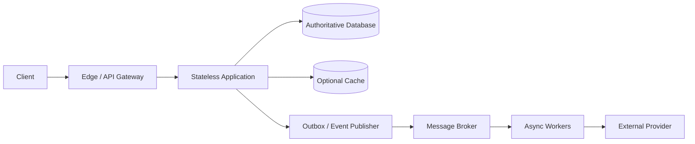
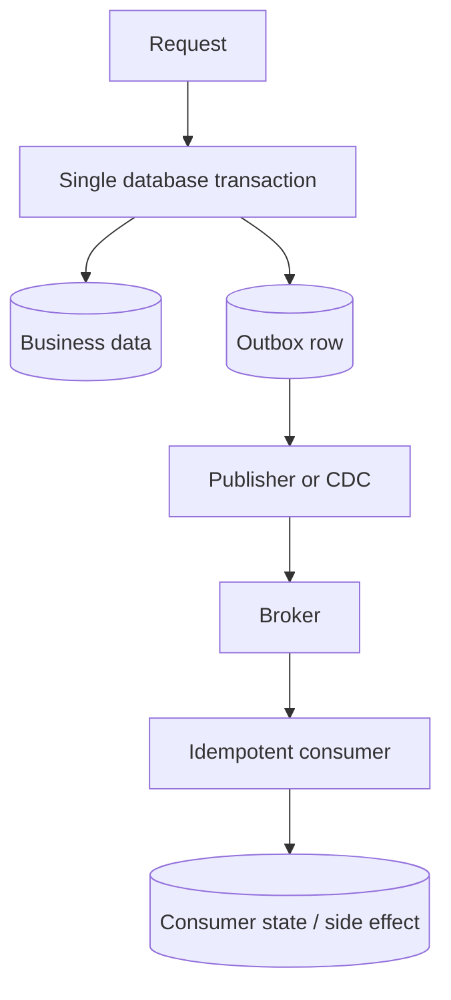

# System Design HLD Interview Handbook

**Audience:** Java backend engineers with 5+ years of experience preparing for senior backend and product-company interviews.  
**Purpose:** A progressive guide to architecture reasoning, capacity estimation, data ownership, consistency, failure handling, operations, and cost.  
**Status:** Foundational release; continue expanding and reviewing the scenario bank as preparation progresses.

> **How to use this guide:** Learn fundamentals in order, then practise scenarios aloud. State assumptions, identify the critical business invariant, estimate scale, draw the simplest viable architecture, and deepen the part the interviewer challenges. Naming technologies is not the goal; explaining why the design satisfies requirements is.

## Table of contents

1. [HLD interview method](#1-hld-interview-method)
2. [Requirements and quality attributes](#2-requirements-and-quality-attributes)
3. [Capacity estimation](#3-capacity-estimation)
4. [Networking and request delivery](#4-networking-and-request-delivery)
5. [APIs and service boundaries](#5-apis-and-service-boundaries)
6. [Scaling and traffic management](#6-scaling-and-traffic-management)
7. [Databases and data modelling](#7-databases-and-data-modelling)
8. [Caching and content delivery](#8-caching-and-content-delivery)
9. [Distributed systems and consistency](#9-distributed-systems-and-consistency)
10. [Messaging and event-driven architecture](#10-messaging-and-event-driven-architecture)
11. [Transactions and business correctness](#11-transactions-and-business-correctness)
12. [Resilience and failure handling](#12-resilience-and-failure-handling)
13. [Security and abuse prevention](#13-security-and-abuse-prevention)
14. [Observability and operations](#14-observability-and-operations)
15. [Multi-region and disaster recovery](#15-multi-region-and-disaster-recovery)
16. [Cost and architectural evolution](#16-cost-and-architectural-evolution)
17. [Advanced HLD deep-dive Q&A](#17-advanced-hld-deep-dive-qa)
18. [Senior-level scenario bank](#18-senior-level-scenario-bank)
19. [End-to-end case-study index](#19-end-to-end-case-study-index)
20. [Cross-references and authoritative reading](#20-cross-references-and-authoritative-reading)

---

## 1. HLD interview method

### Q1. What does a High-Level Design interview evaluate?

It evaluates whether you can turn an ambiguous product goal into a coherent architecture and defend its important decisions. Interviewers look for requirement discovery, assumptions, capacity reasoning, data modelling, component boundaries, consistency guarantees, failure handling, and communication. They do not expect a perfect production architecture in 45 minutes; they expect you to expose important decisions and reason about consequences.

Start with user journeys and business invariants, not a list of fashionable technologies. In a ticket-booking system, preventing two users from buying the same seat is more fundamental than choosing an API framework.

### Q2. How is HLD different from LLD?

HLD explains major components, responsibilities, communication paths, data ownership, scaling, and reliability. LLD explains classes, interfaces, methods, object collaboration, and implementation-level patterns. The boundary is not absolute: an HLD discussion may need a concrete schema, API contract, partition key, or transaction boundary when it determines correctness.

### Q3. How should you structure a 45–60-minute design interview?

A reasonable default is 0–5 minutes for requirements; 5–10 for quality targets and estimates; 10–20 for architecture and main flows; 20–35 for data, consistency, and bottlenecks; 35–50 for failure handling, security, and trade-offs; then summarize. Adapt when the interviewer redirects you. Do not rigidly follow a schedule at the expense of the discussion.

### Q4. What should you clarify before drawing the architecture?

Ask about users, core actions, traffic and bursts, read/write ratio, latency, availability, retention, correctness invariants, geographic distribution, privacy, and cost. Ask questions that could change the design. If information is unavailable, state an assumption and proceed.

### Q5. How do functional and non-functional requirements differ?

Functional requirements describe what the system does, such as create an order or send a notification. Non-functional requirements describe how well it must work, such as latency, availability, durability, privacy, throughput, recovery time, and cost. Functional requirements define the features; non-functional requirements often determine the architecture.

### Q6. How do you handle an ambiguous prompt such as “design a notification system”?

Clarify channels, volume, latency classes, provider constraints, preferences, retries, deduplication, and what delivery means. Define states such as accepted, queued, sent to provider, and confirmed delivered. This avoids promising guarantees that the system cannot actually observe.

### Q7. How do you avoid overengineering?

Start with the simplest architecture that satisfies requirements and leaves credible growth paths. A modular monolith and relational database may be ideal at modest scale. Add a broker, cache, search index, or service boundary only when a requirement or measured bottleneck justifies its operational cost.

### Q8. What makes an architecture diagram useful?

Show major components, ownership boundaries, synchronous calls, asynchronous events, persistent stores, and trust boundaries. Label critical flows and identify the authoritative owner of each data item. A clear six-component diagram with explained trade-offs is better than twenty unexplained boxes.

A generic backend flow might look like this; a real interview diagram should be tailored to the requirements.

The synchronous path should own the user-visible acceptance guarantee. The asynchronous path is useful for work that can complete later, but it needs durable events, idempotent consumers, and observable backlog.

### Q9. How should you respond when the interviewer changes a requirement?

Restate the new constraint, identify assumptions it invalidates, and update only affected parts. If notifications now have a two-second deadline, priority queues and reserved capacity may be needed; the entire system does not automatically require a rewrite.

### Q10. Why do candidates underperform in HLD interviews?

Common problems include designing before clarifying requirements, skipping estimates, confusing average and peak load, choosing databases by popularity, ignoring correctness, assuming retries are harmless, drawing components without data flows, and omitting operations and cost. Treating every problem as a microservices problem is another frequent mistake.

### Q11. How do you know the design is complete enough?

You can explain the main user flow, data ownership, critical invariant, expected load, likely bottleneck, dependency-failure behavior, security boundary, and recovery strategy. State what remains out of scope. Complete enough means adequate for the requirements and time, not every implementation detail.

### Q12. How should you communicate a trade-off?

Use: “Given requirement X, I choose A because it provides Y. The cost is Z. If constraint X changes to W, I would reconsider B.” This is stronger than claiming one technology is universally best.

## 2. Requirements and quality attributes

### Q13. Explain scalability, availability, reliability, durability, and fault tolerance.

- **Scalability:** capacity can grow as workload grows.
- **Availability:** requests can receive a usable response when needed.
- **Reliability:** the system continues to behave correctly over time.
- **Durability:** acknowledged data survives the failures covered by the design.
- **Fault tolerance:** the system continues operating, perhaps in degraded form, despite specified failures.

A system may be highly available while returning stale data. A durable database may be unavailable during failover.

### Q14. Latency versus throughput: what is the difference?

Latency is the time an operation takes; throughput is the number completed per unit time. A system can have high throughput and poor latency when it batches or queues work, and low latency at low load but collapse at peak load. Measure distributions, not only averages.

### Q15. Why do P95 and P99 latency matter?

P95 is the latency below which 95% of observations fall; P99 is the corresponding 99th percentile. Averages hide slow outliers. When a page depends on many calls, completion can be dominated by the slowest required call, so tail latency matters disproportionately.

### Q16. What are SLI, SLO, and SLA?

An SLI is a measured indicator such as successful-request ratio or p99 latency. An SLO is the target for that indicator over a defined window. An SLA is an external commitment, often with consequences if breached. Request-based and time-based availability are different measurements; define the denominator precisely.

### Q17. What is an error budget?

For a time-based 99.9% availability target over a 30-day month, the nominal unavailability budget is about 43 minutes. A request-based SLO instead allows a fraction of eligible requests to fail. Error budgets help balance release velocity and reliability work; they are not permission to ignore incidents.

### Q18. How do you estimate end-to-end availability across dependencies?

If a request requires all independent components to succeed, approximate availability by multiplying their availabilities. Three required components each at 99.9% yield 0.999³, or about 99.70%. This is only an approximation: failures may be correlated and fallbacks can change user-visible success.

### Q19. What is graceful degradation?

It preserves valuable functionality when optional dependencies fail. A shopping page may show product details while recommendations are unavailable. Never replace a correctness-critical balance check with a stale cache merely to keep an endpoint green.

### Q20. How do you prioritize conflicting quality attributes?

Identify the business invariant and rank requirements by impact and risk. For a financial ledger, correctness and durability usually outrank accepting every write during a partition. For a public catalogue, availability and low latency may justify slightly stale data. State the boundary explicitly.

### Q21. What is blast radius?

Blast radius is the amount of the system or number of users affected by a failure. Tenant isolation, bulkheads, bounded queues, regional isolation, and independent deployment units can reduce it. Redundancy alone does not help if all replicas depend on the same overloaded database.

## 3. Capacity estimation

### Q22. Estimate requests per second from daily active users.

Assume 2 million daily active users each make 40 requests per day: 80 million requests/day. Divide by 86,400 seconds to get about 926 requests/second on average. If peak traffic is four times average, plan for roughly 3,700 requests/second before retries, background jobs, and internal fan-out.

These are illustrative assumptions, not measured production facts. The estimate helps determine whether a simple deployment is plausible and which components deserve further investigation.

### Q23. Why is average traffic insufficient?

Traffic is uneven: campaigns, commute times, and viral events create peaks. A system sized exactly to average load queues work during peaks, increasing latency and triggering retries. Estimate peak-to-average ratio, burst duration, and whether excess work can be queued or must be rejected.

### Q24. How do you estimate storage?

Assume 10 million records/day averaging 1.5 KB including metadata. Raw growth is about 15 GB/day, or 5.5 TB/year before indexes, replicas, logs, compaction, and backups. If effective overhead is 2.5×, an initial estimate is about 13.7 TB/year. Validate with actual measurements and distinguish decimal GB/TB from binary GiB/TiB.

### Q25. How do you estimate bandwidth?

Multiply request rate by average payload size and estimate responses separately. At 4,000 requests/second and a 20 KB response, response egress is about 80 MB/s, or 640 Mbps, before protocol overhead and headroom. Large media often belongs in object storage behind a CDN rather than flowing through application servers.

### Q26. How do you estimate queue processing capacity?

If 8,000 events/second arrive and each worker instance reliably processes 500 events/second, at least 16 instances are needed just to match arrivals. Running at 100% leaves no burst or failure headroom. If arrivals exceed processing for a sustained period, the backlog grows regardless of queue size.

### Q27. How do retries affect capacity?

Retries increase attempt rate above incoming request rate. During an outage, synchronized retries can overload the already struggling dependency. Estimate retry amplification and use bounded attempts, exponential backoff with jitter, deadlines, and admission control.

### Q28. How do you estimate cache memory?

Estimate active keys multiplied by average serialized value size, then add key/object overhead, metadata, fragmentation, and replication. Five million values averaging 2 KB need 10 GB for values alone; actual allocation may be much higher. Validate using representative data and memory metrics.

### Q29. What changes when traffic grows 10×?

Find the limiting resource rather than multiplying every server count by ten. Stateless compute may scale horizontally, but a single database writer, hot partition, provider quota, or global lock may not. Recalculate network, storage, connection pools, queue drain time, and cost; the bottleneck often moves after the first fix.

### Q30. What is capacity headroom?

Headroom is spare capacity beyond expected demand. It absorbs bursts, node failures, deployments, and estimation error. The right amount depends on burst duration, scaling delay, failure tolerance, and cost. Autoscaling is not instantaneous, so sudden spikes may require warm capacity or admission control.

## 4. Networking and request delivery

### Q31. What happens when a client makes an HTTPS request?

The client resolves a hostname through DNS, establishes a transport connection, negotiates TLS, sends an HTTP request, and receives a response through proxies or load balancers to the application. Connection reuse can avoid repeated handshakes. DNS, TLS, network hops, queueing, and server work all contribute to latency.

### Q32. Layer 4 versus Layer 7 load balancing?

Layer 4 balances using transport information such as IP addresses and ports. Layer 7 understands application protocols and can route by host, path, headers, or other request properties. Layer 7 enables richer policies but adds processing and protocol complexity.

### Q33. Which load-balancing algorithms are common?

Round robin distributes requests cyclically; least-connections prefers backends with fewer active connections; weighted methods account for unequal capacity; consistent hashing can preserve affinity for a key. No algorithm fixes an overloaded shared database. Choose based on request duration, backend heterogeneity, and locality.

### Q34. Are health checks enough for safe failover?

No. Liveness indicates whether a process should be restarted; readiness indicates whether it should receive traffic. Overly aggressive checks can remove healthy instances during a transient dependency outage and amplify the incident. Drain connections during planned removal.

### Q35. What are the limitations of sticky sessions?

Sticky sessions route a client repeatedly to one server. They can improve locality but create uneven load and complicate failover. If session state exists only in process memory, restart loses it. Prefer stateless services unless affinity is a measured requirement.

### Q36. How should timeout budgets be designed?

Set an end-to-end deadline and allocate smaller budgets to downstream calls. A request with a one-second deadline should not wait two seconds on one dependency. Include connection acquisition, DNS, TLS, queueing, and processing. Retries must not exceed the caller's useful time budget.

### Q37. When use WebSockets, Server-Sent Events, or long polling?

WebSockets support bidirectional long-lived communication, useful for chat and collaboration. Server-Sent Events provide a server-to-client stream over HTTP. Long polling holds a request until data is available and can be simpler but adds repeated request overhead. Choose based on directionality, scale, reconnect behavior, and delivery needs.

### Q38. What does a CDN solve and not solve?

A CDN caches eligible content near users, reducing origin load and geographic latency. It works well for static assets and carefully cacheable responses, but not automatically for personalized data, authorization, or writes. Cache keys must include every request dimension that changes the representation.

## 5. APIs and service boundaries

### Q39. REST versus RPC/gRPC: how do you choose?

REST over HTTP is interoperable and well suited to resource-oriented public APIs. gRPC provides typed contracts, efficient binary serialization, and streaming patterns useful for some internal calls. Neither is automatically faster end-to-end; topology, payloads, tooling, observability, and operations matter.

### Q40. How do you change an API without breaking clients?

Prefer additive compatible changes: optional fields and preserved meanings. Version when semantics must change incompatibly. Measure adoption, publish deprecation windows, and remove old contracts only when usage and policy permit. Test mixed-version deployments.

### Q41. Offset versus cursor pagination?

Offset pagination is easy but may become expensive at large offsets and can skip or repeat records as data changes. Cursor pagination uses a stable ordering key, often timestamp plus unique ID, to continue from the last position. It suits large changing datasets but requires a well-defined sort order and cursor contract.

### Q42. What is an idempotency key?

It identifies a logical operation so repeated submissions return a consistent outcome rather than creating duplicate effects. Persist the key with operation state and a request fingerprint; reject reuse with a different payload. Define scope, expiry, concurrency behavior, and the response while the first attempt is running.

### Q43. API gateway versus service mesh?

An API gateway commonly handles north-south traffic: external authentication, quotas, routing, and API policies. A service mesh focuses on service-to-service traffic, often providing workload identity, transport security, telemetry, and traffic policies. Neither replaces sound service contracts or application authorization.

### Q44. When should a monolith be split into microservices?

Split when independent ownership, deployment, scaling, security, or fault isolation has meaningful value and the team can operate the complexity. Identify cohesive domain boundaries and data ownership first. Poorly split services create chatty calls and distributed transactions—a distributed monolith. A modular monolith may be the better choice.

### Q45. Why is database-per-service not an automatic win?

Independent data ownership reduces coupling, but cross-service queries and transactions become harder. Duplicated read models may be needed and are often eventually consistent. Start from domain ownership and access patterns, not a slogan.

## 6. Scaling and traffic management

### Q46. Vertical versus horizontal scaling?

Vertical scaling increases resources on one machine and is operationally simple until hardware limits or single-node risks dominate. Horizontal scaling adds instances but requires distributing traffic and state. Stateful systems often need sharding, replication, or coordination before they scale horizontally.

### Q47. Why might adding application instances not improve throughput?

The bottleneck may be the database, a global lock, a connection pool, downstream quota, network, or serialized critical section. More instances can increase contention and connection pressure. Use latency breakdowns, saturation metrics, traces, and load tests before scaling.

### Q48. What is backpressure?

Backpressure prevents producers from overwhelming slower consumers through bounded queues, demand signals, concurrency limits, or rejection. Without bounds, a queue converts overload into memory growth and long latency. Decide whether to slow producers, reject work, or defer it based on business priority.

### Q49. What is load shedding?

Load shedding intentionally rejects lower-priority work when capacity is exhausted so critical work remains healthy. A fast overload response can be better than allowing every request to time out. Align the policy with product priorities and monitor rejected work.

### Q50. Why can autoscaling make an incident worse?

If CPU is not the bottleneck, adding instances may increase database connections, cache misses, or downstream traffic. Aggressive thresholds can cause oscillation, and cold starts may worsen latency. Scale on the resource limiting useful throughput, cap concurrency, and reserve capacity for sudden bursts.

### Q51. How do you isolate a noisy tenant?

Use per-tenant quotas, concurrency budgets, fair scheduling, workload pools, and tenant-aware metrics. Strong isolation may require dedicated partitions or infrastructure. A global limit protects the platform but does not ensure fairness.

### Q52. How do you estimate queue drain time?

With 3.6 million messages, 12,000 processed/second, and 4,000 new arrivals/second, net drain rate is 8,000/second, so drain time is about 450 seconds or 7.5 minutes. This assumes stable rates and no retries or variable processing costs. If arrivals match or exceed processing, the backlog will not drain.

## 7. Databases and data modelling

### Q53. How do you choose SQL versus NoSQL?

Start with relationships, invariants, access patterns, transaction requirements, query flexibility, and operational expertise. Relational databases are strong defaults for structured data and multi-row transactions. Key-value or wide-column stores suit predictable high-volume patterns; document databases suit aggregate-oriented records; graph databases help relationship traversal. NoSQL does not automatically mean faster or more scalable.

### Q54. OLTP versus OLAP?

OLTP handles operational reads and writes, usually with short transactions and correctness needs. OLAP supports large scans and aggregations. Heavy analytics on the transactional primary can damage user-facing latency; replicate or stream data to analytical storage when workload isolation justifies it.

### Q55. What makes a good shard key?

It distributes load and storage while supporting common queries without excessive scatter-gather. A user ID localizes user data but can become hot for a popular user. Time-based keys can create write hotspots. Evaluate cardinality, skew, queries, growth, and migration difficulty.

### Q56. What is a hot partition?

A partition is hot when it receives disproportionate traffic or data. Causes include skewed keys, celebrity accounts, sequential keys, or uneven tenant load. Mitigations include key salting, sub-partitioning, caching, isolating hot tenants, or redesigning access patterns. Each can make reads or aggregation more complex.

### Q57. What is consistent hashing?

Consistent hashing maps keys and nodes onto a logical ring so adding or removing a node typically remaps only a portion of keys. Virtual nodes can improve balance. It reduces movement but does not guarantee perfect distribution, eliminate hot keys, or solve replication correctness.

### Q58. What are read replicas good for, and what can go wrong?

Replicas can scale reads and provide recovery options. Asynchronous replication introduces lag: a user may write a value and immediately read an older one. Route read-after-write traffic to the primary or use a supported consistency token. Replicas also consume resources and have failover implications.

### Q59. Why is read/write splitting not simply “send reads to replicas”?

Some reads require fresh data or influence a subsequent write. A lagging replica can violate business expectations. Classify reads by consistency needs, define routing rules, and test failover behavior. Monitor lag and avoid overwhelming replicas with expensive queries.

### Q60. How do you perform a zero-downtime schema migration?

Use expand–migrate–contract. Add a backward-compatible schema element, deploy code that handles old and new representations, backfill in bounded batches, verify, switch reads/writes, and remove the old schema only after clients migrate. Plan for locks, index creation, rollback, and mixed-version behavior.

### Q61. Normalization versus denormalization?

Normalization reduces duplicated facts and update anomalies. Denormalization duplicates or derives data to improve read locality. It creates a synchronization obligation: define the authoritative copy, propagation method, freshness contract, and reconciliation process.

### Q62. How do you recover from database failure?

Distinguish node loss, corruption, accidental deletion, regional loss, and logical errors. Replication helps availability but may replicate corruption. Backups and point-in-time recovery protect against some logical failures. Define RPO/RTO, test restores, verify integrity, and document promotion and client reconnection.

## 8. Caching and content delivery

### Q63. When does caching help?

Caching helps when values are reused, expensive to fetch, and tolerate the freshness model. It may hurt when data is rarely reused, invalidation is expensive, values are large, or a remote lookup adds more latency than it saves. Measure hit ratio alongside end-to-end latency, backend load, memory, and stale-read incidents.

### Q64. Explain cache-aside.

The application checks the cache, loads from the source on a miss, and populates the cache. On writes, it commonly updates the database and invalidates the key. Concurrent readers can repopulate stale data, so use suitable TTLs and versioning or invalidation coordination where needed. Never treat a cache as the authoritative financial record.

### Q65. What is a cache stampede?

Many requests miss the same expired key and simultaneously query the backend. Mitigations include single-flight request coalescing, jittered TTLs, refresh-ahead, stale-while-revalidate, and carefully bounded per-key locks. A lock itself can become a bottleneck.

### Q66. Cache penetration, hot keys, and stampedes—what differs?

Penetration is repeated access to nonexistent keys, potentially addressed by negative caching or a Bloom filter. A hot key is one existing key receiving disproportionate traffic, addressed through replication, local caching, or coalescing. A stampede is concurrent regeneration of a key, often after expiry. Diagnose before choosing a mitigation.

### Q67. How should TTLs be chosen?

Choose TTL based on staleness cost, update frequency, and backend capacity. Randomize TTLs to avoid synchronized expiration. TTL bounds retention, not freshness across in-flight requests or a guarantee that every client sees the same value.

### Q68. What if Redis becomes unavailable?

Determine whether it is optional acceleration or correctness-critical coordination. Cache-aside fallback may overload the database, so use concurrency limits, circuit breaking, load shedding, and carefully permitted stale responses. If Redis stores lock or workflow state, preserve the invariant rather than blindly bypassing it.

### Q69. How do you keep cache and database consistent?

There is no universal atomic operation spanning an ordinary database and an independent cache. Commit then invalidate is common but still has races. TTL bounds stale duration but does not eliminate it. Stricter needs may require versioned values, transactional change capture, or bypassing the cache for critical reads.

## 9. Distributed systems and consistency

### Q70. What is a partial failure?

One component or network path fails while the rest of the system continues. A caller may time out even though the callee completed the operation. A timeout is not proof that an operation did not happen.

### Q71. Explain strong and eventual consistency.

Strong consistency is an umbrella term; system-design discussions often mean linearizability, where operations behave as if they occurred in a single agreed order. Eventual consistency means replicas may temporarily disagree but converge if updates stop and repair succeeds. It does not define a maximum staleness bound or guarantee business correctness by itself.

### Q72. What is read-your-writes consistency?

After a client successfully writes a value, its subsequent reads observe that write or a newer one. Implementations may route to the primary, pin a session to a caught-up replica, or pass a version token. It is weaker than global linearizability and can be sufficient for user settings.

### Q73. Explain CAP carefully.

When a network partition prevents nodes from communicating, a distributed data system cannot guarantee both linearizable consistency and a successful response from every non-failing node. Partition tolerance is not a practical optional feature in a networked system; the meaningful choice during a partition is often whether to reject or delay some operations or serve potentially stale data. CAP does not mean any two properties are freely chosen under all conditions.

### Q74. What does PACELC add?

PACELC says that during a partition a system trades off availability and consistency; otherwise, during normal operation, it still trades off latency and consistency. It is a reasoning aid, not a substitute for understanding a database's actual guarantees.

### Q75. What are quorum reads and writes?

Replicated systems may require acknowledgements from a configured number of replicas. Intersecting read and write quorums can help ensure a reader encounters a recent write under suitable assumptions. Guarantees depend on versioning, conflict resolution, membership, and configuration; arithmetic alone is not a universal guarantee.

### Q76. Why are distributed locks difficult?

A lock holder can pause or lose connectivity beyond its lease while still believing it owns the lock. Another client may acquire the expired lock, so both can work. Fencing tokens—monotonically increasing ownership numbers enforced by the protected resource—can reject stale writes. Prefer database constraints or conditional writes when they express the invariant more simply.

### Q77. Does exactly-once delivery exist?

The phrase is incomplete without a system boundary. A broker may offer exactly-once processing within specific transactional boundaries, but that does not automatically make an external payment, email, or database side effect exactly once. Business workflows commonly combine at-least-once delivery, durable operation records, idempotent consumers, unique constraints, and reconciliation.

### Q78. How do you handle out-of-order events?

Decide whether order is needed and at what scope. If per-account order matters, partition by account and process sequentially within that partition. Include versions or sequence numbers so consumers can detect stale or missing updates. Global ordering is expensive and usually unnecessary.

### Q79. What is reconciliation?

Reconciliation compares independent records or states to discover missed, duplicated, or inconsistent work. For example, compare internal payment operations with provider settlement records. It complements transactional design by recovering from uncertain outcomes and failures that cannot be prevented completely.

## 10. Messaging and event-driven architecture

### Q80. Queue versus event stream?

A task queue commonly distributes work among workers, with each task intended for one worker in a consumer group. An event stream retains an ordered log that multiple independent consumers can read and replay within retention. Products may support both patterns, but retention, replay, ordering, and acknowledgement semantics differ.

### Q81. What is a Kafka partition key?

The key determines which partition receives a record under the producer's partitioning strategy. Same-key records are typically routed to the same partition, enabling per-key ordering there. A bad key can create a hot partition; changing partition counts or strategy can change key placement.

### Q82. What is consumer lag?

Consumer lag measures how far a group trails the available log. Lag alone does not reveal catch-up time; record size, processing cost, partitions, and incoming rate matter. Monitor lag trend, age of oldest event, processing latency, errors, and throughput.

### Q83. How should retries and dead-letter queues work?

Retry transient failures with bounded attempts and backoff. Do not retry permanent validation errors forever. A dead-letter queue stores messages that exceed policy for investigation and safe replay. Preserve payload, error context, attempt count, and correlation IDs; assign ownership so the DLQ is not a silent graveyard.

### Q84. What is the transactional outbox pattern?

Write the business change and an outbox record in the same database transaction. A publisher or CDC pipeline then publishes the record. This avoids the dual-write gap where the database commits but the event is lost—or the event publishes while the database rolls back. Publication may repeat, so consumers should be idempotent.

The important property is that the business change and outbox row commit together. Publishing is a separate, retryable step; it can publish the same event more than once, so downstream processing still needs deduplication.

### Q85. Saga choreography versus orchestration?

In choreography, services react to events and each knows how to continue or compensate. It avoids a central coordinator but complex workflows become hard to understand. In orchestration, a coordinator tracks state and commands participants, improving visibility while adding a component whose availability and state matter. Both need idempotency, timeouts, durable state, and compensation.

### Q86. How do you handle poison messages?

A poison message repeatedly fails due to malformed data, schema incompatibility, or deterministic bugs. Classify errors, cap attempts, route irrecoverable messages for investigation, and preserve ordering requirements. Skipping a failed event may be unsafe if later events depend on it.

## 11. Transactions and business correctness

### Q87. How do you prevent duplicate payment charges?

Create a durable payment-operation record with a unique business/idempotency key before calling the provider. Repeated submissions resolve to the same operation. Pass an idempotency key to the provider if supported and persist provider references. Treat timeouts as unknown outcomes, query status or reconcile, and do not blindly initiate a new charge.

### Q88. How do you prevent double booking a seat?

The invariant is that at most one active reservation owns a seat for a show. Enforce it in the authoritative datastore with a unique constraint, conditional update, or transactionally guarded state transition. A cache or distributed lock alone is insufficient. Holds need expiry and an atomic transition to confirmed.

### Q89. Optimistic versus pessimistic concurrency control?

Optimistic control allows concurrent work and checks for conflict at commit, often using a version. It works when conflicts are uncommon. Pessimistic control locks data during the transaction and may suit high contention, but can reduce throughput and introduce deadlocks. Choose based on conflict frequency, transaction duration, and invariant.

### Q90. What happens when a request times out after a successful write?

The client sees an uncertain outcome. It should retry with the same idempotency key or query operation status, not create a new logical operation. The server must persist enough state to return the original result. Distinguish accepted, in progress, succeeded, failed, and unknown where relevant.

### Q91. Why is a saga not a distributed ACID transaction?

A saga coordinates local transactions and compensating actions; the whole workflow is not atomic at every instant. Intermediate states are visible, compensation can fail, and some effects cannot truly be undone. Model the workflow explicitly and provide retry and manual-recovery paths.

### Q92. How should webhook consumers handle duplicate callbacks?

Verify authenticity, persist the provider event ID under a uniqueness constraint, and make state transitions idempotent. Acknowledge after durable acceptance according to the provider contract. Callbacks may be duplicated or out of order; validate legal state transitions and reconcile when necessary.

## 12. Resilience and failure handling

### Q93. How should retries be designed?

Retry only likely transient failures, only when the operation is safe to repeat, and only within a bounded deadline. Use exponential backoff with jitter. Coordinate retries across clients, gateways, services, and brokers; independent retry policies can multiply attempts. Respect provider retry guidance where available.

### Q94. What does a circuit breaker do?

It stops calls to a dependency that appears unhealthy, allowing recovery and preventing callers from accumulating slow requests. Typical states are closed, open, and half-open. Thresholds must match the workload. It complements timeouts; it does not replace them.

### Q95. What is a bulkhead?

A bulkhead isolates resources so one failing workload cannot consume all capacity. Separate thread pools, concurrency limits, queues, or connection pools can help. Separate application pools do not help if all of them wait on the same exhausted database.

### Q96. Why can retries cause cascading failures?

A slow dependency causes timeouts; callers retry, increasing load; the dependency slows further; queues and connection pools fill; unrelated requests fail. Break the loop with deadlines, retry budgets, jitter, circuit breakers, bounded concurrency, load shedding, and reduced optional work.

### Q97. Liveness versus readiness?

Liveness asks whether a process should continue or be restarted. Readiness asks whether it should receive traffic. Restarting every instance because a shared database is temporarily down can worsen an outage. Probes should not turn dependency failure into a restart storm.

### Q98. How should a service recover after a long downstream outage?

Protect the recovering dependency from a sudden flood. Limit concurrency, drain queues at a controlled rate, prioritize time-sensitive work, and preserve idempotency. Monitor queue age and net drain rate. Expire work only according to explicit business policy.

## 13. Security and abuse prevention

### Q99. Authentication versus authorization?

Authentication establishes who or what is making a request; authorization decides whether that identity may perform an action on a resource. A valid token does not imply access to every tenant's data. Enforce resource ownership on every relevant path.

### Q100. How do you secure service-to-service communication?

Use workload identities or short-lived credentials, authenticated transport such as TLS/mTLS where appropriate, least-privilege authorization, secret rotation, and audit trails. Avoid long-lived shared secrets in source code or images. Network location alone is not identity.

### Q101. How do you prevent API abuse?

Apply identity-aware rate limits, quotas, payload-size limits, concurrency caps, validation, anomaly detection, and threat-specific controls. Use multiple dimensions such as IP, account, API key, tenant, and endpoint. Distributed rate limiting adds coordination cost; choose accuracy based on risk.

### Q102. What security issues arise in multi-tenant systems?

Enforce tenant identity in database queries, cache keys, background jobs, object-storage paths, logs, and exports. A cache key that omits tenant identity can leak data even when database queries are secure. Add isolation tests and audit privileged cross-tenant access.

## 14. Observability and operations

### Q103. What should you monitor?

Track request rate, error rate, latency percentiles, and saturation. Add domain signals such as payment outcomes, inventory conflicts, queue age, consumer lag, cache hit ratio, replication lag, and reconciliation discrepancies. Infrastructure metrics alone cannot prove business correctness.

### Q104. Logs, metrics, and traces: what is each for?

Logs record discrete events and context; metrics aggregate numeric behavior for alerting; traces show a request's path across components and where time was spent. Connect them with trace/correlation IDs. Avoid high-cardinality metric labels such as raw user IDs and never log secrets.

### Q105. How do you investigate high p99 latency when CPU is low?

Break latency into queue wait, connection acquisition, network, downstream service, database, and serialization. Inspect traces, pool saturation, thread states, locks, garbage collection pauses, DNS/TLS, and retries. Low CPU may mean threads are blocked, not that the system has spare useful capacity.

### Q106. Canary versus blue-green deployment?

A canary sends a small share of traffic to a new version and expands based on health signals. Blue-green runs two environments and switches traffic, often enabling quick rollback at extra resource cost. Both require backward-compatible data changes; rollback may not undo irreversible writes.

### Q107. Why do schema compatibility and feature flags matter during deployments?

Application versions coexist during rolling deployments. A new producer may emit a field an old consumer cannot parse. Use expand–migrate–contract, compatible event schemas, staged rollout, and explicit rollback plans. Feature flags do not replace schema compatibility.

### Q108. What belongs in an incident runbook?

Symptoms and impact, dashboards and queries, likely failure domains, safe mitigation, escalation ownership, rollback/failover procedures, and verification steps. Include the risks of each mitigation so responders do not worsen the incident.

## 15. Multi-region and disaster recovery

### Q109. Active-passive versus active-active regions?

Active-passive serves normal traffic from one region and keeps another ready for failover. It is easier to reason about writes but needs tested promotion and acceptable recovery time. Active-active serves traffic in multiple regions and may reduce latency, but conflicts, replication lag, routing, and operations become harder. Active-active compute does not require active-active writes to the same entity.

### Q110. Define RTO and RPO.

Recovery Time Objective is the target maximum time to restore service after disruption. Recovery Point Objective is the maximum tolerable data-loss window measured in time. Backups, replication, failover automation, and restore testing influence them. A replica is not a backup against logical corruption.

### Q111. How do you handle a regional outage without conflicting financial writes?

Define a single authoritative write owner per financial entity or use a datastore with required global consistency. If regions cannot coordinate and correctness is mandatory, reject or queue some writes rather than allow conflicting updates. Fence the old leader and reconcile before restoring normal writes. Double-charging customers is not an acceptable availability trade-off.

### Q112. What is split brain?

Split brain occurs when two nodes or regions both believe they are authoritative, producing conflicting writes. Prevent it with quorum/consensus or explicit ownership, and use fencing epochs enforced by storage. DNS failover does not prove the old region stopped accepting writes.

### Q113. Why are backups and replication different?

Replication maintains another current copy and can reduce recovery time, but may copy accidental deletion or corruption. Backups provide historical recovery points when retained independently. Test restores, not just backup-job success.

## 16. Cost and architectural evolution

### Q114. How do you reduce cost without violating latency or reliability?

Measure cost by workload and tenant. Look for idle capacity, oversized instances, inefficient queries, excessive retention, unnecessary cross-region transfer, poor cache effectiveness, and retry amplification. Change one major factor at a time and compare latency, errors, saturation, and recovery objectives.

### Q115. When is a modular monolith preferable?

When a small team needs cohesive deployment, transactions across related modules, and low operational overhead. Keep modules separated by domain APIs and ownership so future extraction remains possible. Avoid shared mutable internals and cross-module table access that make separation difficult.

### Q116. Explain the Strangler pattern.

Incrementally move capabilities from a legacy system to a new implementation. Route selected flows to the new path while the old system serves the rest. Use clear data ownership, compatibility adapters, observability, and rollback. Avoid independent writes from both systems without reconciliation.

### Q117. How do you evolve from thousands to millions of users?

Do not build hypothetical scale at the expense of delivery. Establish SLOs and load-test baselines, identify likely constraints, and evolve when evidence appears. Stable IDs, tenant isolation, data ownership, and idempotency are often cheaper to design early than retrofit later.

### Q118. How do you reason about cost per request?

Include compute, storage operations, database capacity, egress, broker throughput, cache memory, observability, and idle headroom. Divide by successful business operations rather than raw HTTP attempts so retries and failures remain visible.

## 17. Advanced HLD deep-dive Q&A

This section adds cross-cutting architecture questions that interviewers use to test whether a candidate can connect requirements, component behavior, and operational consequences. It complements—not replaces—the dedicated Distributed Systems, Kafka, Redis, SQL, and Microservices guides.

### Q119. How do you turn requirements into an architecture instead of jumping directly to components?

Start by writing down user-visible operations and the invariant each operation must preserve. For each journey, identify its authoritative data, latency target, failure behavior, and dependencies. Estimate the load, then draw the smallest architecture that satisfies those constraints. For example, “place an order” might require a synchronous durable order record but allow email and analytics to happen asynchronously. The requirement—not a preference for Kafka or microservices—determines the boundary.

### Q120. How do you distinguish a system boundary from a deployment boundary?

A system boundary describes ownership, trust, data, and responsibility; a deployment boundary describes what is released and scaled together. They can align, but they do not have to. A modular monolith can enforce clear domain boundaries in one deployment. Splitting every module into a separate service adds network failures, versioning, observability, and operational burden. Extract a service when independent ownership, scaling, deployment, or isolation has measurable value.

### Q121. How do you decide which work belongs on the synchronous request path?

Keep synchronous work limited to what is necessary to produce a truthful response and preserve immediate business invariants. Move slow, retryable, or nonessential side effects—such as analytics, noncritical notifications, or media processing—to durable asynchronous workflows. However, asynchronous acceptance must be durable: if the API promises “accepted,” persist the job or outbox record before returning. Do not acknowledge work that exists only in process memory.

### Q122. How do you identify the authoritative source of truth in a system with several databases?

For each business fact, name one authoritative owner and distinguish it from caches, search indexes, analytics stores, and replicated read models. A product search index can be stale, but checkout should validate price and availability against their authoritative owners. If two services can independently overwrite the same fact, define conflict resolution or redesign ownership. “Both databases are the source of truth” is usually a warning that consistency responsibilities are unclear.

### Q123. What is a materialized view, and when is it useful?

A materialized view stores a precomputed representation of data for a read pattern. A social feed or customer dashboard may combine facts from several owners, making on-demand fan-out expensive. Build the view from reliable change events or periodic refreshes, track its freshness, and make updates idempotent. The trade-off is write amplification, extra storage, and eventual consistency. Rebuild and reconciliation procedures are part of the design.

### Q124. How do you choose between request-time fan-out and precomputation?

Request-time fan-out keeps data fresh and avoids storing every combination, but latency and availability depend on several services. Precomputation moves work to the write/update path and makes reads predictable, but introduces staleness and update complexity. Use request-time composition for low-volume or highly personalized data when latency permits; precompute hot, repeatable views when read volume is high and freshness can be bounded. A hybrid often works best.

### Q125. What is the difference between a control plane and a data plane?

The control plane configures and coordinates behavior—such as routes, policies, cluster membership, or tenant quotas. The data plane handles the actual requests or records. Separating them can protect request processing from slow administrative operations, but stale configuration and control-plane outages still need explicit behavior. Cache validated configuration, define safe defaults, and decide which policy changes must take effect immediately.

### Q126. How do you choose between pushing and pulling work?

With push, producers send work immediately to consumers; it can reduce latency but may overload consumers unless admission control and backpressure exist. With pull, consumers control their own pace, making load regulation simpler but potentially adding polling delay. Brokers often combine durable push-to-storage with consumer-controlled fetching. Choose based on latency, burstiness, consumer capacity, and how much control consumers need over throughput.

### Q127. Why are bounded queues important?

A queue absorbs short bursts; it cannot fix a permanent throughput deficit. If arrival rate stays above completion rate, backlog grows until retention, memory, disk, or latency limits are reached. Bound in-memory queues and define rejection, persistence, expiry, and priority policies. Monitor queue age and estimated drain time, not only depth. A million old low-priority jobs can be more damaging than a small queue of deadline-sensitive work.

### Q128. How do you estimate whether a queue can recover from a burst?

Calculate net drain rate as processing rate minus ongoing arrival rate. If 9,000 tasks/s can be processed while 6,000/s continue to arrive, a backlog of 1.8 million tasks takes roughly 600 seconds to drain. This assumes stable rates and homogeneous task cost. Include retries, poison messages, provider quotas, and worker failures. If net drain rate is zero or negative, adding retention only postpones the problem.

### Q129. How do you select a partition key when both ordering and throughput matter?

First define the ordering scope. If all events for an account must be ordered, account ID is a natural key, but a very active account may become a hot partition. Splitting one account across partitions improves throughput only by weakening ordering or requiring a later merge/coordination step. Measure skew and decide whether the business truly requires per-entity order, or only version checks and eventual convergence.

### Q130. When is a global lock a design smell?

A global lock serializes otherwise independent operations and can become a throughput ceiling and availability dependency. Ask whether the invariant can instead be enforced with a unique constraint, conditional write, version check, partition ownership, or per-entity lock. Global coordination may be justified for rare administrative operations, but it should not sit on every request without a clear correctness reason.

### Q131. What is the difference between deduplication and idempotency?

Deduplication recognizes that the same event or operation ID has been seen before. Idempotency means repeating an operation has the same intended effect as performing it once. Deduplication storage can expire or be unavailable, and two different event IDs can represent the same business action. Use stable business keys, idempotent state transitions, and database constraints where the invariant demands it.

### Q132. How should you handle a request that depends on several downstream services?

Draw the dependency graph and classify calls as required, optional, or conditionally required. Give each call a deadline within the overall request budget; parallelize independent calls where it helps. Bound concurrency and retries, and degrade only optional data. Fan-out increases the chance that at least one dependency is slow or failing, so precompute or consolidate calls when the user experience cannot tolerate the combined tail latency.

### Q133. How do you reason about availability for a fan-out endpoint?

If all N independent dependencies must succeed and each has availability A, a simplified estimate is A^N. For example, ten required dependencies each at 99.9% yield about 99.0% combined availability. This model assumes independence and ignores retries, caching, and fallback paths; real failures are often correlated. The architectural lesson is to reduce mandatory dependencies and define graceful behavior, not to treat the calculation as a production forecast.

### Q134. How do you choose a cache consistency model?

Start from the consequence of stale data. Stale recommendations may be harmless; stale authorization, inventory, or balances may not be. For tolerant reads, define maximum acceptable staleness, TTL, invalidation, and repair. For critical decisions, read from the authority or use a datastore guarantee that supports the invariant. A short TTL is a bound on cache residence, not proof of instantaneous consistency.

### Q135. What should a cache key include?

Every input that can change the response representation: entity ID, tenant, locale, currency, permission scope, relevant query parameters, and sometimes schema/version. Omitting tenant or authorization context can leak data across users. Including too many dimensions fragments the cache and reduces hit ratio. Document the cache-key contract and test isolation explicitly.

### Q136. How should a design respond to a cold cache after deployment or failover?

Assume a cold cache may expose the full source workload. Estimate miss traffic, use bounded concurrency and request coalescing, and warm only high-value keys when safe. Stagger expirations and rollouts. Avoid eagerly loading the entire dataset if it competes with production traffic. If the source cannot handle cold-cache load, keep spare capacity or temporarily shed optional traffic.

### Q137. What is the difference between a replica, a backup, and a read model?

A replica maintains another copy for availability or read scaling, often with limited lag. A backup is a retained recovery point for restoring earlier state after corruption or deletion. A read model is a representation optimized for particular queries and may be derived from events. These serve different purposes; none automatically substitutes for the others.

### Q138. How do you choose a consistency boundary for a business workflow?

Identify the smallest set of facts that must change atomically to preserve an invariant. Keep those changes in one transaction when possible. Coordinate later cross-service steps through a saga or durable events, making intermediate states explicit. For example, order creation and its outbox event can commit together, while notification delivery occurs later. Do not expand a transaction across every service just to make the diagram look atomic.

### Q139. What is the dual-write problem?

A service updates a database and separately publishes an event. If the database commit succeeds but publishing fails, downstream systems never learn about the change; if publishing succeeds but the transaction rolls back, consumers see a phantom event. The transactional outbox or a supported CDC approach closes this gap between the authoritative commit and publication. Consumers still need idempotency because publication and delivery can repeat.

### Q140. When is event sourcing justified?

Event sourcing stores state-changing events as the primary record and derives current state by replaying them. It can provide audit history and temporal reconstruction, but introduces event-schema evolution, replay cost, projection lag, correction strategies, and operational complexity. It is not synonymous with using Kafka or publishing domain events. Choose it when the event history itself is a core domain requirement, not merely because an event-driven architecture is desired.

### Q141. How should API rate limits be distributed across multiple application instances?

A local limiter is fast and resilient but allows aggregate traffic to multiply with instance count and can be uneven across instances. A shared limiter enforces a more global view but adds network latency and a new dependency. Hierarchical budgets can allocate a global quota to local instances and periodically reconcile it, trading exactness for speed. Choose based on abuse risk, quota semantics, traffic volume, and behavior during limiter failure.

### Q142. How do token bucket and leaky bucket differ conceptually?

A token bucket accumulates tokens up to a capacity; requests consume tokens, allowing controlled bursts while bounding long-term average rate. A leaky-bucket-style shaper releases work at a controlled rate, smoothing bursts; variants may instead reject excess work. Pick a model based on whether bursts should be permitted, whether requests can wait, and how strict the quota must be. State the exact algorithm rather than relying on the name alone.

### Q143. What is admission control, and how does it differ from rate limiting?

Rate limiting constrains traffic over a defined interval or budget. Admission control decides whether the system has enough current capacity to accept additional work, often using concurrency, queue length, deadlines, or resource saturation. A request may be within its rate quota but still be rejected because all workers are busy. Both can protect latency and prevent overload.

### Q144. How should you design for a downstream provider's quota?

Centralize or coordinate quota accounting at the scope the provider enforces. Queue requests, use priority classes, coalesce duplicate work, and schedule calls under the allowed rate. A per-instance limiter is insufficient if the provider applies one account-wide limit. Respect retry hints and expose pending state rather than silently dropping work. Ensure recovery does not create a quota-breaking replay storm.

### Q145. What makes a multi-tenant architecture fair?

Fairness requires explicit budgets for request rate, concurrent work, storage, queue use, and expensive operations. A single global limit protects total capacity but can let one tenant starve everyone else. Weighted fair scheduling, per-tenant queues, and dedicated pools can isolate workloads. Measure per-tenant latency and rejection rates, and account for contractual priority tiers.

### Q146. How should service-to-service authentication influence the architecture?

Use workload identity and least-privilege authorization instead of assuming that internal network access implies trust. Decide how identity is issued, rotated, propagated, and audited. Ensure gateways and service meshes do not become the only place where resource-level authorization is enforced. Background workers, replay tools, and administrative paths need the same data-isolation controls as public APIs.

### Q147. How do you design observability for asynchronous workflows?

Propagate correlation and causation identifiers across API requests, outbox rows, messages, retries, and callbacks. Record durable workflow state and attempt metadata. Measure queue age, processing duration, retry counts, dead-letter volume, and business completion rate. A single distributed trace may not remain open for a workflow lasting hours, so persist identifiers and link separate trace segments.

### Q148. Why can infrastructure health checks miss business failures?

A process can return HTTP 200 while a workflow is stuck, a provider callback is never reconciled, or a read model is stale. Monitor business outcomes and state transitions in addition to CPU, memory, and endpoint health. Define freshness and completion SLOs for asynchronous work. Alerts should identify actionable symptoms and include links to diagnostic context.

### Q149. How do you set an RTO and RPO from business requirements?

Ask how long the business can tolerate service interruption and how much committed data it can afford to lose. RTO is a recovery-time target; RPO is a data-loss-window target. Translate them into architecture and operating procedures: backup frequency, replication mode, failover readiness, restore time, and reconciliation. Validate with exercises; a documented target without measured recovery evidence is only an aspiration.

### Q150. Why can active-active compute still use a single write leader?

Requests can be served near users while each entity's writes route to one authoritative region or partition. This avoids conflicting concurrent updates while keeping read latency low. The trade-off is cross-region write latency and reduced write availability when the owner is unreachable. Active-active deployment and active-active writes are separate decisions.

### Q151. What is a safe failover sequence for a stateful service?

Detect and assess the failure, fence the old writer, verify the candidate's data and replication position, promote one authority, update routing, and ensure clients reconnect safely. Afterward, validate invariants and monitor replication and error rates. Failover must prevent both old and new leaders from accepting writes. DNS or health-check changes alone do not establish exclusive ownership.

### Q152. How do you prevent a failover loop?

Separate health detection from promotion policy. A region may fail a health check because a shared dependency is unavailable; promoting another region with the same dependency may not help and can cause repeated flips. Use hysteresis, explicit state transitions, minimum stable periods, and clear failback criteria. Test partial dependency failures and ensure the recovery region has enough capacity.

### Q153. What is the role of a canary in reducing release risk?

A canary exposes a small, controlled share of traffic to a new version, then expands only if preselected signals remain healthy. Choose both technical and business indicators: latency, errors, saturation, payment outcomes, and workflow completion. Account for traffic representativeness and delayed effects. A canary cannot protect against a schema change that irreversibly corrupts shared data; use compatible migrations and rollback planning too.

### Q154. How should a system support backward-compatible event evolution?

Assume old and new producers/consumers may run simultaneously during rollout and rollback. Prefer additive optional fields, stable meanings, tolerant readers, and explicit schema compatibility checks. Deploy consumers that can handle the new representation before producers emit it. Treat semantic changes and field reuse as breaking even if the schema registry accepts them.

### Q155. How do you reduce cloud cost without creating reliability debt?

Attribute cost to workloads and successful business outcomes, then inspect idle headroom, query inefficiency, egress, retention, over-replication, unnecessary logs, and retry amplification. Do not remove redundancy or lower capacity targets without quantifying the effect on SLOs, RTO/RPO, and failure tolerance. Run controlled changes and compare cost with p95/p99 latency, errors, and recovery behavior.

### Q156. How do you evaluate a proposed new technology?

State the unmet requirement first. Compare the candidate with the simplest existing option across performance under representative load, consistency guarantees, operational expertise, migration, observability, security, cost, and exit strategy. Prototype the riskiest assumption and test failure behavior. A benchmark that ignores realistic data skew, tail latency, or recovery is weak evidence.

### Q157. What belongs in an architecture decision record?

Record the context and constraints, decision, alternatives considered, consequences, assumptions, and signals that would trigger reconsideration. Include rejected alternatives and why they were rejected. This prevents a temporary choice from becoming an unquestioned rule and helps future engineers understand whether changed requirements justify a different design.

### Q158. How do you explain the limits of your own design in an interview?

Name the guarantees you provide, the failure modes you handle, and the ones you do not. For example: “The order write is durable before acceptance; notification delivery is asynchronous and at-least-once, with deduplication. A provider outage can delay delivery, and the queue-age SLO will alert us.” This is more credible than claiming “exactly once,” “zero downtime,” or “infinite scalability” without defining scope and assumptions.

## 18. Senior-level scenario bank

For every scenario, state assumptions, identify the invariant, analyse evidence, recommend a design, explain alternatives, describe failure behavior, and name operational signals. These are connected design discussions, not technology flashcards.

### Scenario 1 — 100,000 requests/second, one hot database shard

**Problem:** Overall traffic is high, but one shard is saturated while others are underused.

**Clarify:** Is the hotspot a popular key, poor shard key, expensive query, write hotspot, or skewed tenant? What is the read/write mix and is the hot key correctness-critical?

**Analysis and design:** Inspect per-shard QPS, CPU, queueing, lock waits, query latency, and key distribution. For hot reads, use request coalescing and cache replicas/local caches if freshness allows. For hot writes, split the logical key into buckets only if business invariants permit it. If the shard key is poor, plan versioned repartitioning. More application instances do not fix one saturated partition.

**Trade-offs and signals:** Key salting complicates reads and aggregation; caching reduces reads, not writes; resharding requires migration correctness. Track per-shard p99, hot-key frequency, cache hit ratio, lock waits, and rebalance duration.

**Follow-ups**
- **Why not add shards?** A single hot key may still map to one shard.
- **How migrate safely?** Version routing, backfill, capture concurrent changes, validate counts/checksums, switch reads, then retire the old layout.

### Scenario 2 — Adding a cache increases latency

**Problem:** Redis reduces database CPU, but p99 rises.

**Clarify:** Does the path add a network hop? What are hit ratio, payload size, serialization cost, pool wait, Redis latency, and miss-path behavior?

**Answer:** Compare traces before and after. A remote cache can be slower than a small indexed database or local read. Large values, connection saturation, and stampedes can outweigh saved database work. Measure per endpoint, remove caching where it does not help, and test cold-cache behavior. If Redis fails, bounded fallback is required because unrestricted database fallback may overload the source.

**Follow-up:** A high hit ratio is not proof of benefit; compare end-to-end latency and backend work saved.

### Scenario 3 — Read replicas return stale order status

**Problem:** An order write succeeds but the next read returns “not found.”

**Answer:** The write committed on the primary, while the read hit a lagging replica. If the journey requires read-your-writes, route the immediate read to primary, use a supported consistency token, or wait for a replication position. Keep unrelated catalogue reads on replicas.

**Trade-off:** Sending every read to primary is simple but sacrifices read scaling. Monitor replica lag; an arbitrary sleep is not a consistency guarantee.

### Scenario 4 — Payment provider times out after charging

**Problem:** The provider may have charged the card, but the client sees a timeout.

**Answer:** Persist a durable operation ID and idempotency key; mark the result unknown/pending rather than failed. Query provider status or await authenticated webhook confirmation, make transitions idempotent, and reconcile settlement records. Do not retry with a new key blindly.

**Signals:** Unknown outcomes, provider timeouts, webhook lag, duplicate-charge indicators, and reconciliation discrepancies.

### Scenario 5 — Kafka consumers fall behind

**Problem:** Input rate exceeds processing rate and lag grows.

**Answer:** Compare arrival and completion rates, oldest-event age, partition skew, processing time, retries, and downstream latency. Add consumers only up to partition and downstream capacity. A hot key may remain serial. Optimize I/O, batch safely, isolate slow event types, and route poison messages according to policy. During recovery, drain at a controlled rate.

**Follow-up:** A 1.8-million-message backlog at a net drain rate of 5,000/second takes about 360 seconds, assuming rates remain stable.

### Scenario 6 — Autoscaling overloads the database

**Problem:** CPU-driven autoscaling adds instances and saturates the database connection pool.

**Answer:** Each instance increases connections and concurrent queries. Cap total/per-instance connections, bound request concurrency, inspect query time and pool wait, and scale on useful throughput and queueing. Autoscaling needs guardrails; more compute is not more database capacity.

### Scenario 7 — Notification provider unavailable for 45 minutes

**Problem:** Millions of notifications accumulate while new events continue.

**Answer:** Separate accepted business events from delivery attempts. Define expiry by notification class; use bounded queues, provider-specific circuit breakers, jittered retries, priority lanes, tenant quotas, and capped replay after recovery. Deduplicate with durable IDs. Promotional messages may expire; security alerts may not. The policy must reflect business impact.

### Scenario 8 — Redis outage overloads the database

**Problem:** Every request becomes a cache miss.

**Answer:** Treat fallback as a separate load scenario. Use circuit breaking, database concurrency limits, load shedding, and stale responses only where permitted. Warm the cache gradually after recovery. “Fall back to the database” is not sufficient if the database cannot handle uncached traffic.

### Scenario 9 — One tenant dominates the platform

**Problem:** A large customer degrades p99 for everyone.

**Answer:** Measure per-tenant rate, concurrency, query cost, storage, and queue use. Add quotas, fair scheduling, isolated pools, or dedicated partitions for large tenants. Enforce tenant identity in cache keys and data access. Ensure quota policy permits contracted bursts and critical recovery.

### Scenario 10 — Zero-downtime migration of a heavily written table

**Problem:** A table needs a new representation while writes continue.

**Answer:** Expand schema, deploy compatible code, backfill in idempotent batches, capture concurrent changes using carefully designed dual-write or CDC, compare representations, switch reads gradually, then contract. Watch lock duration, replication lag, write amplification, and load. Version checks and reconciliation prevent backfill from overwriting newer data.

### Scenario 11 — Distributed lock expires while work continues

**Problem:** Worker A pauses past its lease; B acquires the lock; A resumes and writes stale data.

**Answer:** A lease does not guarantee continued ownership. Use a fencing token or version enforced by the protected resource. Keep work bounded and prefer conditional database updates when possible. A lock service cannot protect a resource that does not validate ownership.

### Scenario 12 — p99 latency is poor but averages look healthy

**Problem:** Average is 80 ms but p99 is 2.5 seconds.

**Answer:** Break traces down by endpoint, tenant, dependency, and request size. Look for queueing, pool waits, slow queries, GC pauses, locks, retries, and fan-out. Bound concurrency and deadlines, isolate noisy workloads, and remove unnecessary serial dependencies. Optimize the percentile that the SLO actually specifies.

### Scenario 13 — Multi-region partition during financial writes

**Problem:** Two regions lose connectivity and both receive updates.

**Answer:** Establish a single write authority per entity or use globally consistent coordination. Fence stale leaders; reject or queue writes when ownership cannot be proven. Reconcile provider and internal ledgers before resuming. Independent active-active writes are unsafe if they can create conflicting financial effects.

### Scenario 14 — New microservice makes requests slower

**Problem:** One in-process call becomes three network calls.

**Answer:** Compare serialization, connection setup, retries, fan-out, and database round trips. Use coarser APIs, connection reuse, parallelize only independent calls, or use read models where justified. Recombine modules if the boundary adds no ownership or operational benefit.

### Scenario 15 — Retry policy creates an outage

**Problem:** Client, gateway, and worker each retry a slow dependency three times.

**Answer:** Nested retries can multiply attempts. Assign a retry owner where practical, propagate deadlines, use bounded attempts and jitter, and never retry non-idempotent writes without deduplication. Add circuit breaking and load shedding during recovery.

### Scenario 16 — API returns success before work is durable

**Problem:** The service replies “created” before database commit or durable queue acknowledgement.

**Answer:** Define what success means. If it promises durable acceptance, persist the operation or obtain the required durable acknowledgement before responding. For asynchronous work, return an explicit accepted/pending state and operation ID. Scheduling an in-memory task is not durable acceptance.

### Scenario 17 — Strongly consistent payments and eventually consistent analytics

**Answer:** Keep the authoritative ledger transactional and enforce invariants there. Publish committed changes through outbox/CDC to analytics storage. Expose analytics freshness and never use a lagging analytical model to authorize financial decisions.

### Scenario 18 — Incompatible event schema deployment

**Problem:** A new producer adds a field and an old consumer crashes.

**Answer:** Establish compatibility policy, deploy tolerant consumers first when needed, make additive fields optional or provide defaults, then roll out producers. Test mixed versions and rollback. A schema registry enforces configured rules, not semantic correctness.

### Scenario 19 — Rate limiter becomes the bottleneck

**Problem:** Every request requires a remote global counter update.

**Answer:** Decide whether exact global limits are required. Central counters are accurate but add latency and contention. Local token buckets with allocated budgets reduce coordination but allow bounded overshoot. Consider hierarchical limits, atomic server-side operations, and explicit fail-open/fail-closed behavior.

### Scenario 20 — 10× spike with a limited budget

**Answer:** Separate baseline from burst capacity. Cache immutable reads, precompute expensive results, queue deferrable work, reserve capacity for critical flows, and apply admission control. Test cache-cold and dependency-failure conditions. Autoscaling helps gradual growth; instant spikes may need pre-warming and traffic shaping.

### Scenario 21 — Millions of queued events after an outage

**Answer:** Ramp replay gradually, limit concurrency, prioritize by deadline, and monitor queue age and error rates. Expire only work whose policy allows it. Reprocessing must be idempotent and observable; do not flood a recovering dependency.

### Scenario 22 — Duplicate notifications after consumer rebalance

**Answer:** Trace a notification ID from source event to outbox, broker, consumer attempt, provider request, and callback. A crash between side effect and offset/ack commit can repeat processing. Use durable deduplication and provider idempotency where available. If the provider lacks idempotency, acknowledge the remaining uncertain duplicate window.

### Scenario 23 — Search shows stale price after product update

**Answer:** Search is a derived read model and may lag. Define freshness expectations; checkout must revalidate price against the authoritative source. Publish changes reliably, make indexing idempotent and version-aware, and monitor indexing lag. Never finalize a financial amount using stale search data.

### Scenario 24 — Regional failover creates a routing loop

**Answer:** Map routing and dependency topology. Distinguish ingress health from required dependency health; use region-aware routing and explicit failover states. A healthy HTTP endpoint is insufficient if its critical downstream path is unavailable. Test failover and failback.

### Scenario 25 — Retention doubles storage requirements

**Answer:** Recalculate raw growth, indexes, replicas, backups, and analytics copies. Decide what must remain queryable versus archived, and verify deletion requirements across caches, logs, replicas, and backups. Storage estimates must separate hot data from low-cost archive.

### Scenario 26 — Global service needs low latency on multiple continents

**Answer:** Classify operations as global writes, region-local, or read-mostly. Use CDN/edge caching for eligible content and regional read models where consistency permits. Keep authoritative writes near their owner or accept coordination latency. Multi-region compute does not automatically make data local.

### Scenario 27 — External provider imposes a strict quota

**Answer:** Centralize quota accounting, schedule calls through a bounded queue, prioritize, coalesce duplicates, and cache only where allowed. Honor retry hints and expose pending state. A per-instance limiter is insufficient for an account-wide quota.

### Scenario 28 — Infrastructure is healthy but data is inconsistent

**Answer:** Add business-level signals: write-to-read freshness, replication lag, event age, duplicate/conflict counts, and reconciliation outcomes. Trace entity versions through database, outbox, broker, and read model. Distinguish allowed staleness from a violated read-your-writes guarantee.

### Scenario 29 — Team wants a new database because it is popular

**Answer:** Identify a concrete workload the current database cannot meet, quantify the gap, and compare operational expertise, migration, backup, security, and on-call costs. Prototype representative queries and failure tests. Keep the current database if it satisfies requirements at lower total cost.

### Scenario 30 — Interviewer asks “What breaks first?”

**Answer structure:** Use estimates and architecture to identify the likely bottleneck; explain how a node failure changes remaining capacity; describe protective controls and what degrades or is rejected. Discuss database headroom, connection limits, partition skew, queue growth, provider quotas, and recovery time. Name the metrics and load test that would validate the hypothesis.

### Scenario 51 — A dashboard endpoint fans out to many services

**Problem:** The endpoint calls account, billing, usage, permissions, and recommendations services. Its p99 latency is poor even though most dependencies look healthy.

**Clarify:** Which fields are required to render the page? Which data has a freshness requirement? What is the end-to-end latency objective, and do all calls execute serially?

**Analysis and recommendation:** Draw the dependency graph and use traces to measure each span, including queue and connection wait. Parallelize independent calls under a bounded concurrency limit, but do not assume parallelism removes the slowest dependency's tail. Return a partial response only if the API contract explicitly permits it. For expensive, frequently requested combinations, consider a materialized read model with a freshness SLO. Keep authorization and other correctness-critical checks authoritative.

**Trade-offs and signals:** A read model improves predictable latency but adds projection lag and operational work. Monitor per-dependency p95/p99, fan-out count, timeout rate, queue wait, and read-model age.

**Follow-up:** If one field is optional, isolate its timeout and render the rest rather than allowing it to consume the entire request deadline.

### Scenario 52 — A tenant exceeds its contracted API quota

**Problem:** One tenant sends a burst that overwhelms shared application and database capacity.

**Clarify:** Is the quota a hard contract or a soft target? Does it apply per second, minute, or concurrent request? Are certain endpoints much more expensive? Is burst allowance required?

**Recommendation:** Enforce limits at the correct identity and scope, combine request-rate limits with concurrency and cost-aware admission control, and reserve capacity for critical operations. Use per-tenant metrics and fair scheduling; a global limiter alone can allow noisy-neighbor behavior. If a shared limiter is used, decide whether temporary limiter unavailability fails open or closed according to abuse and correctness risk.

**Follow-up:** If each of 20 instances allows 100 requests/s locally, the aggregate can reach 2,000 requests/s. Local limits must be budgeted or coordinated if the provider contract is global.

### Scenario 53 — An outbox publisher is stuck but API requests succeed

**Problem:** Business records commit, but downstream consumers stop receiving new events.

**Analysis:** The transactional outbox protects against losing the event at commit time, but it does not guarantee that the publisher continues making progress. Inspect oldest unpublished row, publish failures, database load, CDC connector health, broker availability, and schema errors.

**Recommendation:** Alert on outbox age and publish throughput, retry transient errors with bounded backoff, isolate poison records, and make publication idempotent. Ensure outbox retention and cleanup do not delete unpublished rows. Define replay procedures and monitor end-to-end event freshness, not just API success.

**Follow-up:** The outbox table can itself become a write/storage bottleneck; batch publishing, partition/retention strategy, and careful indexing may be needed at scale.

### Scenario 54 — A provider callback arrives before the synchronous response

**Problem:** A payment provider processes a request quickly and sends a webhook before the application has persisted its local provider response.

**Recommendation:** Create the durable payment operation before making the provider call, using a stable operation ID. The callback handler should resolve the operation by provider reference or idempotency key, tolerate valid state transitions arriving in either order, and persist the callback for retry if correlation is not yet possible. Avoid assuming that network arrival order matches business processing order.

**Failure handling:** Deduplicate provider event IDs, authenticate callbacks, validate transition legality, and reconcile unmatched events. Do not discard a valid callback simply because a local state has not caught up yet.

### Scenario 55 — A database failover causes a burst of connection errors

**Problem:** The database promotes a replica, but application instances keep using stale connections and retry aggressively.

**Recommendation:** Understand driver and pool behavior during failover, use bounded connection and query timeouts, evict broken connections, and apply retry budgets with jitter. Reconnect gradually rather than allowing every instance to establish a synchronized connection storm. Keep request deadlines and idempotency in place because a connection failure can occur after a write reached the old primary.

**Metrics:** Connection acquisition wait, broken-connection rate, reconnection rate, database recovery state, retry attempts, and uncertain write outcomes.

### Scenario 56 — A data backfill competes with live production traffic

**Problem:** A migration backfills hundreds of millions of records while production writes must remain within latency SLOs.

**Recommendation:** Run bounded, resumable batches with checkpoints and idempotent updates. Throttle by observed database latency, lock waits, replication lag, and resource saturation; pause automatically when guardrails are breached. Use a stable high-water mark or CDC to account for concurrent writes, and verify counts/checksums before switching reads.

**Trade-offs:** Faster backfills reduce migration duration but consume more resources and can increase replication lag. Never assume a successful job exit proves the new representation is correct.

### Scenario 57 — A retry storm begins after a brief dependency outage

**Problem:** The dependency has recovered, but request volume remains elevated and latency does not normalize.

**Recommendation:** Inspect attempts per logical request, retry layers, synchronized schedules, queue age, and current dependency saturation. Apply retry budgets, capped exponential backoff with jitter, and concurrency limits. Stop retrying permanent failures and let noncritical work expire according to policy. Recover gradually to avoid immediately replaying all deferred work.

**Follow-up:** Timeouts, retries, backoff, and jitter are complementary—not interchangeable—controls. Timeouts bound resource holding; retries may mask transient failures; backoff and jitter spread attempts over time. Cite the [AWS Builders' Library guidance](https://aws.amazon.com/builders-library/timeouts-retries-and-backoff-with-jitter/) when explaining this trade-off.

### Scenario 58 — A feature flag service becomes unavailable

**Problem:** Services need flag values during a control-plane outage.

**Recommendation:** Decide flag-by-flag whether the safe behavior is the last known value, a conservative default, or refusing the operation. Cache validated configuration locally with version and freshness metadata, and separate flag evaluation from a network call on every request. Security-sensitive flags and emergency kill switches need explicit propagation and expiry behavior.

**Trade-off:** Local evaluation improves availability and latency but may delay rollout or revocation. Measure configuration age and propagation delay; do not treat all flags as having the same risk.

### Scenario 59 — A CDN serves private content to the wrong user

**Problem:** A personalized response was cached under a key that omitted authorization or tenant context.

**Recommendation:** Treat cache-key construction and cache-control policy as security boundaries. Avoid shared caching for sensitive responses unless the cache is explicitly designed for the authorization model. Include all representation-changing dimensions where shared caching is safe, and test cross-tenant isolation. Purge affected objects and investigate logs without exposing sensitive values.

**Follow-up:** A correct origin authorization check does not help if the CDN serves a cached response without contacting the origin.

### Scenario 60 — A design review challenges a new microservice

**Problem:** A team proposes extracting a service mainly to “make it scalable,” but the new service adds multiple network calls and shared database access.

**Analysis:** Ask which bottleneck or ownership issue the extraction solves, whether the component needs independent deployment/scaling, and how data ownership changes. Estimate added network latency, retries, on-call burden, and cross-service transaction complexity.

**Recommendation:** If the boundary is not cohesive or independently valuable, retain a module inside the monolith and improve internal interfaces. If extraction is justified, establish data ownership, contract compatibility, observability, deployment strategy, and rollback before migration.

**Follow-up:** “Microservices are more scalable” is not a sufficient rationale. A poorly bounded service can make both scalability and reliability worse.

## 19. End-to-end case-study index

This section is an **index only**. Practise full designs separately; the Q&A above explains reusable principles.

### Core systems

| System | Level / concepts | References |
|---|---|---|
| URL shortener | Intermediate: IDs, redirects, cache, hot keys | [URL shortener design walkthrough](https://systemdesign.cloud/part3-design-problems/url-shortener) |
| Pastebin | Intermediate: expiry, storage, read-heavy traffic | [System Design Primer](https://github.com/donnemartin/system-design-primer) |
| Distributed unique ID generator | Advanced: uniqueness, time, coordination | [System Design Primer](https://github.com/donnemartin/system-design-primer) |
| Distributed rate limiter | Advanced: token bucket, atomicity, quotas | [System Design Primer](https://github.com/donnemartin/system-design-primer) |
| Notification service | Advanced: queues, priorities, retries | [AWS Builders’ Library](https://aws.amazon.com/builders-library/) |
| Distributed job scheduler | Advanced: durable scheduling, leases | [Google SRE Books](https://sre.google/books/) |

### Social and communication systems

| System | Level / concepts | References |
|---|---|---|
| Chat/messaging platform | Advanced: WebSockets, ordering, delivery | [System Design Primer](https://github.com/donnemartin/system-design-primer) |
| News feed | Advanced: fan-out, ranking, caching | [System Design Primer](https://github.com/donnemartin/system-design-primer) |
| Photo-sharing platform | Advanced: object storage, metadata, CDN | [System Design Primer](https://github.com/donnemartin/system-design-primer) |
| Email service | Advanced: queues, abuse controls, delivery status | [Google SRE Books](https://sre.google/books/) |
| Real-time collaboration | Advanced: concurrent edits, conflicts | [Designing Data-Intensive Applications](https://dataintensive.net/) |

### Commerce and transactions

| System | Level / concepts | References |
|---|---|---|
| E-commerce platform | Advanced: catalogue, cart, orders, inventory | [System Design Primer](https://github.com/donnemartin/system-design-primer) |
| Shopping cart and checkout | Advanced: idempotency, workflow | [AWS Builders’ Library](https://aws.amazon.com/builders-library/) |
| Payment processing | Senior: unknown outcomes, ledger, reconciliation | [Stripe Engineering](https://stripe.com/blog/engineering) |
| Ticket booking | Senior: seat holds, contention, expiry | [System Design Primer](https://github.com/donnemartin/system-design-primer) |
| Hotel booking | Senior: date ranges, inventory, overbooking | [System Design Primer](https://github.com/donnemartin/system-design-primer) |
| Inventory reservation | Senior: atomic updates, holds, compensation | [AWS Builders’ Library](https://aws.amazon.com/builders-library/) |
| Food delivery | Senior: geospatial matching, workflows | [Uber Engineering](https://www.uber.com/blog/engineering/) |

### Media and storage

| System | Level / concepts | References |
|---|---|---|
| File storage and synchronization | Advanced: object storage, metadata, versions | [System Design Primer](https://github.com/donnemartin/system-design-primer) |
| Video streaming | Senior: transcoding, CDN, adaptive bitrate | [Netflix TechBlog](https://netflixtechblog.com/) |
| Image-processing pipeline | Intermediate/Advanced: async jobs, retries | [AWS Builders’ Library](https://aws.amazon.com/builders-library/) |
| Search and autocomplete | Advanced: indexes, prefixes, freshness | [Elastic Blog](https://www.elastic.co/blog) |
| Content delivery platform | Advanced: edge caching, origin protection | [Cloudflare Blog](https://blog.cloudflare.com/) |

### Infrastructure and data platforms

| System | Level / concepts | References |
|---|---|---|
| Distributed cache | Senior: sharding, eviction, consistency | [System Design Primer](https://github.com/donnemartin/system-design-primer) |
| Key-value store | Senior: replication, partitioning, quorum | [Designing Data-Intensive Applications](https://dataintensive.net/) |
| Metrics and logging platform | Senior: ingestion, cardinality, retention | [Google SRE Books](https://sre.google/books/) |
| Event ingestion and analytics | Senior: partitioning, backpressure | [Confluent Developer](https://developer.confluent.io/) |
| Distributed task execution | Senior: scheduling, leases, retries | [Temporal documentation](https://docs.temporal.io/) |
| Feature-flag platform | Advanced: evaluation, rollout, consistency | [LaunchDarkly Blog](https://launchdarkly.com/blog/) |
| API gateway/load balancer | Senior: routing, quotas, resilience | [Envoy documentation](https://www.envoyproxy.io/docs) |

### Location and real-time systems

| System | Level / concepts | References |
|---|---|---|
| Ride-booking platform | Senior: matching, geospatial indexes, surge | [Uber Engineering](https://www.uber.com/blog/engineering/) |
| Location tracking | Advanced: high-write streams, privacy | [Uber Engineering](https://www.uber.com/blog/engineering/) |
| Geospatial search | Advanced: spatial indexes, radius queries | [PostGIS documentation](https://postgis.net/documentation/) |
| Live leaderboard | Advanced: ranking, hot keys, approximate counts | [Redis documentation](https://redis.io/docs/latest/) |

Additional problems worth practising: distributed lock service; webhook delivery platform; configuration service; multi-tenant SaaS control plane; fraud detection pipeline; CDC platform; workflow engine; backup and restore platform.

Reference links are starting points, not claims that every linked page contains a complete solution for the exact prompt. Prefer a specific article when available and verify access before relying on it.

## 20. Cross-references and authoritative reading

The repository's focused guides provide implementation depth; this handbook retains the architectural reasoning.

- [Java Interview Handbook](../Java/Java-Interview-QA.md) — concurrency, JVM, collections, runtime behavior.
- [Design Patterns & LLD](../Design-Patterns-LLD/Design-Patterns-LLD-Interview-QA.md) — object collaboration and component design.
- [Spring Framework + Spring Boot](../Spring/Spring-Interview-QA.md) — application framework and transaction implementation.
- [Microservices & REST APIs](../Microservices-REST-APIs/Microservices-REST-APIs-Interview-QA.md) — service boundaries and API contracts.
- [Distributed Systems](../Distributed-Systems/Distributed-Systems-Interview-QA.md) — consistency, coordination, distributed failure.
- [Hibernate + JPA](../Hibernate-JPA/Hibernate-JPA-Interview-QA.md) — ORM and transaction behavior.
- [SQL & Database Engineering](../SQL-Database/SQL-Database-Interview-QA.md) — query plans, indexes, transaction isolation.
- [Redis & Caching](../Redis-Caching/Redis-Caching-Interview-QA.md) — cache behavior and Redis/database consistency.
- [Apache Kafka](../Kafka/KAFKA_INTERVIEW_GUIDE.md) — broker mechanics, partitioning, delivery semantics.

### Authoritative and practical references

- [System Design Primer](https://github.com/donnemartin/system-design-primer) — concepts and practice problems.
- [Google SRE Books](https://sre.google/books/) — reliability, monitoring, incident response.
- [AWS Builders’ Library](https://aws.amazon.com/builders-library/) — operational lessons and distributed design; see also [timeouts, retries, and backoff with jitter](https://aws.amazon.com/builders-library/timeouts-retries-and-backoff-with-jitter/).
- [Google Cloud Architecture Framework](https://cloud.google.com/architecture/framework) — reliability, security, cost.
- [Microsoft Azure Architecture Center](https://learn.microsoft.com/en-us/azure/architecture/) — architecture patterns and reference designs.
- [Apache Kafka documentation](https://kafka.apache.org/documentation/) — broker/client guarantees.
- [PostgreSQL documentation](https://www.postgresql.org/docs/) — transaction, isolation, replication behavior.
- [Redis documentation](https://redis.io/docs/latest/) — data structures, persistence, replication.
- [Envoy documentation](https://www.envoyproxy.io/docs) — proxy and traffic management.
- [Designing Data-Intensive Applications](https://dataintensive.net/) — foundational data-system architecture.

## Revision checklist

Before finishing a practice design, ask:
- What are the key functional requirements and business invariant?
- Which quality attributes are targets, and how are they measured?
- What are average/peak rates, data growth, and payload sizes?
- Which component owns each authoritative data item?
- What happens when a request times out after success?
- Which reads may be stale, and which need read-your-writes?
- What happens when cache, database, broker, or provider fails?
- How are retries bounded and duplicate effects prevented?
- What breaks first at 10× traffic?
- What are the RTO/RPO and data-loss assumptions?
- How are tenant isolation, abuse prevention, and sensitive data handled?
- What are the main operating costs and simplest viable alternative?
- Which metrics and traces prove the design is working?

---

*This is a living study resource. Technical guarantees vary by database, broker, service, configuration, and failure mode. Verify product-specific claims against official documentation and test behavior that matters to the design.*

### Scenario 31 — Requirement changes from eventual to strong consistency

A feature tolerated stale data, but now every successful read must reflect completed writes. Clarify which entity and journey need the guarantee; do not make analytics strongly consistent unnecessarily. Route critical reads to an authoritative store or use a documented consistency token, and keep derived views asynchronous. Stronger guarantees may increase latency and reduce availability during partitions. Cache invalidation events alone do not guarantee immediate consistency because they can be delayed or lost.

### Scenario 32 — Global username uniqueness during a regional partition

Two regions receive requests to claim the same username while cross-region connectivity is degraded. A local check-then-insert in each region races. Enforce uniqueness at one authoritative constraint boundary or use coordination that can guarantee one winner. If global uniqueness is mandatory, some requests must wait or fail during a partition. Eventual conflict resolution is acceptable only if duplicate identities and remediation are genuinely tolerable.

### Scenario 33 — Connection pool saturated while database CPU is low

API latency rises and connection acquisition waits increase, but database CPU remains modest. Connections may be held during external calls, long transactions, locks, or slow clients. Inspect connection hold time, active/idle/waiting counts, transaction duration, lock waits, and query latency. Keep transactions short, avoid network calls inside transactions, bound concurrency, and size pools against database capacity. Increasing pool size blindly can make overload worse.

### Scenario 34 — Search indexing falls behind during a campaign

Product writes succeed but search results become minutes stale. Measure event arrival rate, indexer processing rate, queue age, and indexing errors. Decide whether stale search is acceptable while checkout revalidates against the source of truth. Increase workers only if partitions and search-cluster capacity allow it; batch safely and prioritize important updates. Alert on freshness SLO, not only cluster health. Coalescing updates by product is safe only if intermediate states are irrelevant.

### Scenario 35 — A scheduled job runs twice after failover

A scheduler leader fails after triggering a job but before recording completion; the replacement triggers it again. Give each logical run a deterministic ID, persist run state, and make workers idempotent. Use leases/fencing for ownership but still protect business effects at the destination. Define misfire behavior, overlap policy, and retry limits. Exactly-once execution across arbitrary external effects is not generally guaranteed.

### Scenario 36 — Queue retention expires before consumers recover

A consumer is offline long enough that the broker may delete unprocessed records. Clarify whether the stream is the system of record or only transport. Size retention using outage duration, peak input rate, record size, replication factor, and safety margin. Alert on oldest unprocessed event and projected time to retention expiry. Irreplaceable business events need a durable source or archive and a tested replay plan.

### Scenario 37 — Cached authorization remains valid after revocation

A permission is revoked, but a cached authorization result still allows access. Treat authorization freshness as a security requirement. Use bounded caching, versioned permission records, reliable invalidation with a safe fallback, or authoritative checks for sensitive operations. Fail closed when authorization cannot be established for high-risk actions. Measure revocation propagation delay and test cache/event failure.

### Scenario 38 — Rolling deployment duplicates scheduled work

Two application versions overlap and both schedule the same periodic task. Do not rely on process-local timers for globally unique scheduling. Use a durable scheduler or lease, deterministic run IDs, uniqueness constraints, and idempotent execution. Make leader ownership visible and test deployment, crash, and failover overlap.

### Scenario 39 — Writes slow after adding indexes

Read queries improve, but write latency and storage use increase. Indexes add work to inserts, updates, deletes, and maintenance; they consume storage and affect cache locality. Examine query plans, selectivity, write amplification, lock waits, and index overlap. Keep indexes that support important workloads and remove redundant ones only after validating query usage, including seasonal traffic.

### Scenario 40 — Fan-out request calls 20 downstream services

The API's p99 is much worse than each dependency's median. Identify required versus optional calls. Parallelize independent calls where safe, but the request may inherit the slowest required dependency's tail. Set per-call deadlines under an overall deadline, limit concurrency, and return partial results only if the contract permits it. Reduce chatty boundaries or create a read model when the topology is fundamentally too expensive.

### Scenario 41 — HTTP 200 responses hide business failures

Infrastructure metrics show success, but orders are not progressing. Define business success separately from transport success. Instrument outcome codes, state-transition counts, and workflow age; validate response semantics rather than treating every 2xx as completion. Alert on stuck states and reconcile requests accepted by one service but not completed downstream.

### Scenario 42 — Consumer offset commits before database transaction

A consumer advances its offset, then crashes before the business update becomes durable, losing the event's effect. Align acknowledgement with durable processing. Commonly, commit the database effect before advancing the offset; a crash between these steps may cause duplicate processing, which idempotency must handle. Understand the exact scope of any broker/database transaction integration before claiming cross-system atomicity.

### Scenario 43 — Consumer crashes after processing but before acknowledgement

The event is delivered again after restart. This is the normal at-least-once duplicate window. Use an inbox/deduplication table keyed by event ID, unique business constraints, and idempotent state transitions. If the dedup record and business update share a database, commit them atomically. External effects need provider idempotency or reconciliation.

### Scenario 44 — Cache invalidation events arrive out of order

An older update overwrites a newer cached value. Store entity versions and reject updates older than the current version, or invalidate rather than applying an untrusted stale payload. Define refill semantics when cache and source updates race. Ordering is scoped to a key/partition and must be verified in the actual broker and producer configuration.

### Scenario 45 — A distributed botnet bypasses IP rate limits

Combine authenticated identity, account, API key, tenant quota, endpoint cost, and behavioral signals where appropriate. Apply cheap edge controls before expensive database work while avoiding false positives for legitimate users behind shared NAT. Use challenge/throttling strategies consistent with product needs and privacy obligations. No single signal is sufficient.

### Scenario 46 — Backups exist but restore is untested

Run scheduled restore exercises into an isolated environment, validate checksums and business invariants, measure recovery time, and verify keys, schemas, secrets, and configuration. Replication cannot replace historical backups. Document authorization, data-integrity checks, and how to avoid overwriting healthy data during recovery.

### Scenario 47 — Multiple layers retry the same request

SDK, gateway, application, and consumer each retry. Draw the complete attempt tree and calculate worst-case amplification. Choose one retry owner per operation where possible, propagate deadlines, use retry budgets, and distinguish safe reads from non-idempotent writes. Track attempts and reasons. Retries should not turn a partial outage into a traffic storm.

### Scenario 48 — New service must extract data from a monolith safely

Choose a narrow domain boundary, define source-of-truth ownership, add a compatibility API or event feed, backfill and validate data, then route a small flow first. Avoid dual authoritative writes. Use canary traffic, business-level metrics, rollback criteria, and an explicit retirement plan for the old path.

### Scenario 49 — Tenant requires data residency

Map all data paths: primary records, replicas, backups, logs, traces, search indexes, caches, analytics, support exports, and disaster-recovery copies. Enforce placement through policy and automation, and document exceptions such as global identity or control-plane metadata. Residency is not solved by placing only the primary database in-region.

### Scenario 50 — Availability conflicts with correctness during a partition

A partition prevents confirmation that inventory or a financial resource is still available. Identify the invariant. Accepting conflicting writes can create irreversible damage, so reject or queue uncertain writes while continuing safe reads and unrelated work. An availability-first policy may be acceptable for domains that tolerate overselling or later reconciliation, but it must be an explicit business decision.

